# OrthoNet hip · query set `test` · page 1/3

[← all pages](README.md)

### Q0001 · correct: option 4 · `Hip_JRIOrtho_FurlongEvolution_NilCol`

<table><tr>
<td align="center" valign="top"><b>Query</b>  Hip_JRIOrtho_FurlongEvolution_NilCol</td>
<td align="center" valign="top"><b>Option 1</b>  Hip_Stryker_AccoladeII</td>
<td align="center" valign="top"><b>Option 2</b>  Hip_DepuySynthes_Corail_NilCol</td>
<td align="center" valign="top"><b>Option 3</b> 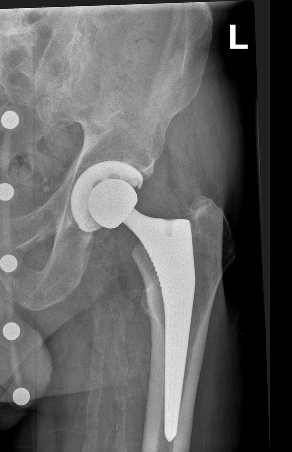 Hip_SmithAndNephew_Polarstem_NilCol</td>
<td align="center" valign="top"><b>✅ Option 4</b> 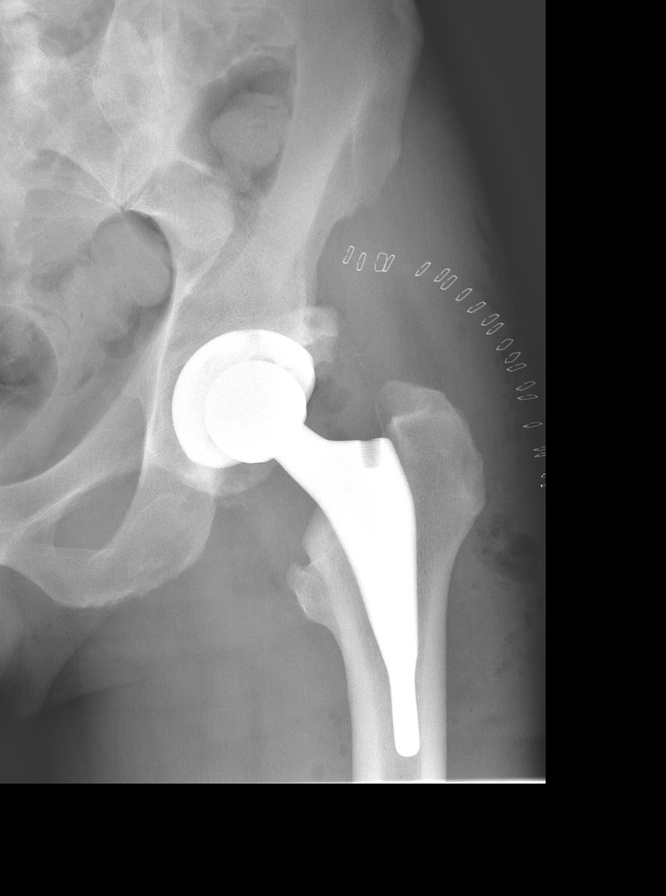 Hip_JRIOrtho_FurlongEvolution_NilCol</td>
<td align="center" valign="top"><b>Option 5</b> 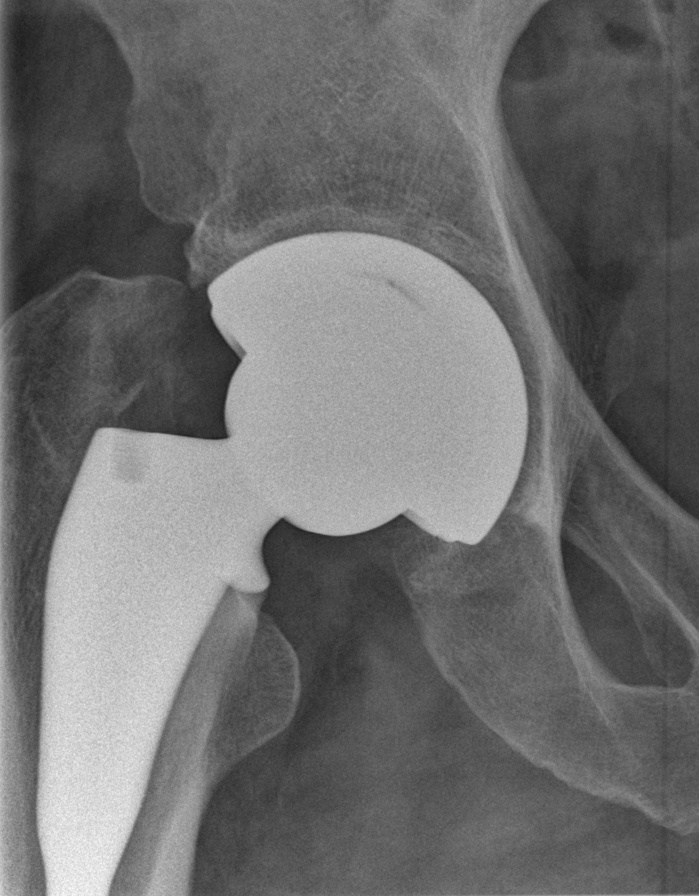 Hip_JRIOrtho_FurlongEvolution_Collar</td>
<td align="center" valign="middle"><b>Option 6</b>  <i>None of the above</i></td>
</tr></table>

### Q0002 · correct: option 4 · `Hip_JRIOrtho_FurlongEvolution_NilCol`

<table><tr>
<td align="center" valign="top"><b>Query</b> 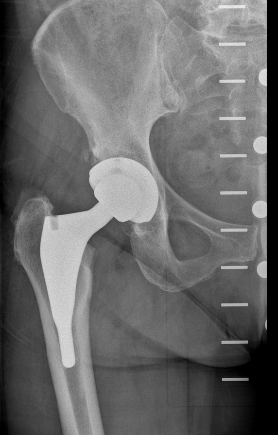 Hip_JRIOrtho_FurlongEvolution_NilCol</td>
<td align="center" valign="top"><b>Option 1</b>  Hip_DepuySynthes_Corail_NilCol</td>
<td align="center" valign="top"><b>Option 2</b>  Hip_Stryker_AccoladeII</td>
<td align="center" valign="top"><b>Option 3</b>  Hip_SmithAndNephew_Polarstem_NilCol</td>
<td align="center" valign="top"><b>✅ Option 4</b>  Hip_JRIOrtho_FurlongEvolution_NilCol</td>
<td align="center" valign="top"><b>Option 5</b>  Hip_JRIOrtho_FurlongEvolution_Collar</td>
<td align="center" valign="middle"><b>Option 6</b>  <i>None of the above</i></td>
</tr></table>

### Q0003 · correct: option 1 · `Hip_JRIOrtho_FurlongEvolution_NilCol`

<table><tr>
<td align="center" valign="top"><b>Query</b> 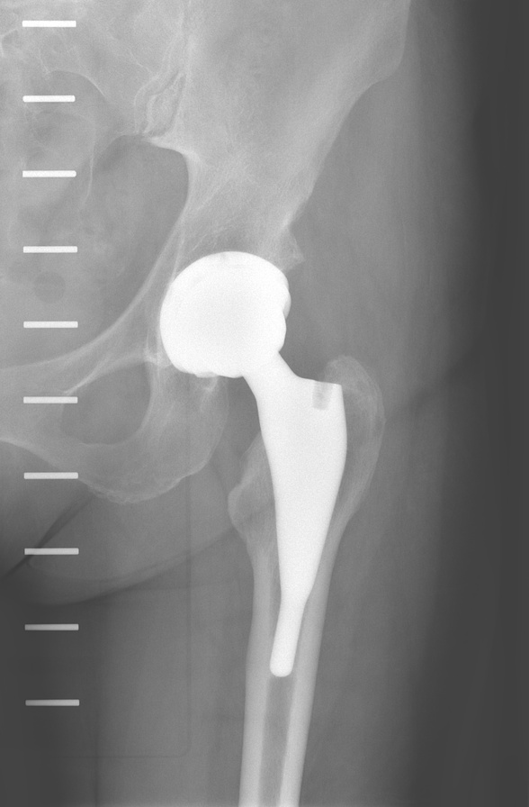 Hip_JRIOrtho_FurlongEvolution_NilCol</td>
<td align="center" valign="top"><b>✅ Option 1</b> 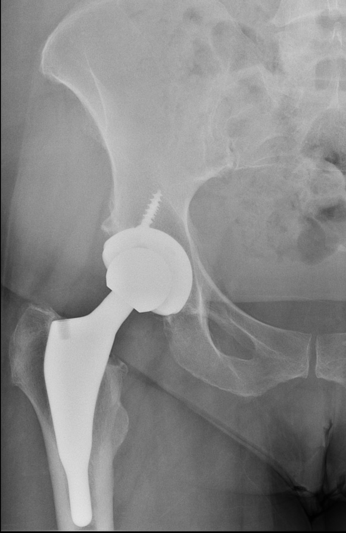 Hip_JRIOrtho_FurlongEvolution_NilCol</td>
<td align="center" valign="top"><b>Option 2</b>  Hip_Stryker_AccoladeII</td>
<td align="center" valign="top"><b>Option 3</b> 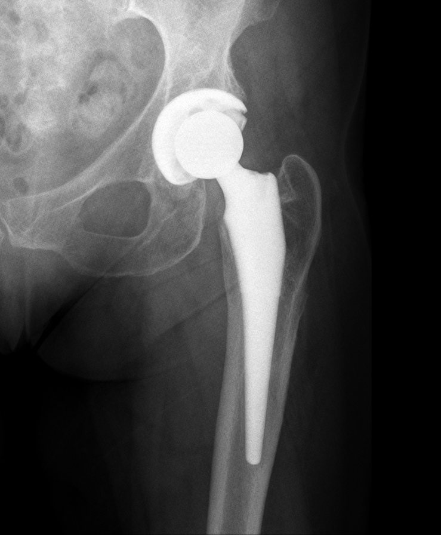 Hip_SmithAndNephew_Anthology</td>
<td align="center" valign="top"><b>Option 4</b>  Hip_DepuySynthes_Corail_NilCol</td>
<td align="center" valign="top"><b>Option 5</b>  Hip_JRIOrtho_FurlongEvolution_Collar</td>
<td align="center" valign="middle"><b>Option 6</b>  <i>None of the above</i></td>
</tr></table>

### Q0004 · correct: option 3 · `Hip_JRIOrtho_FurlongEvolution_NilCol`

<table><tr>
<td align="center" valign="top"><b>Query</b> 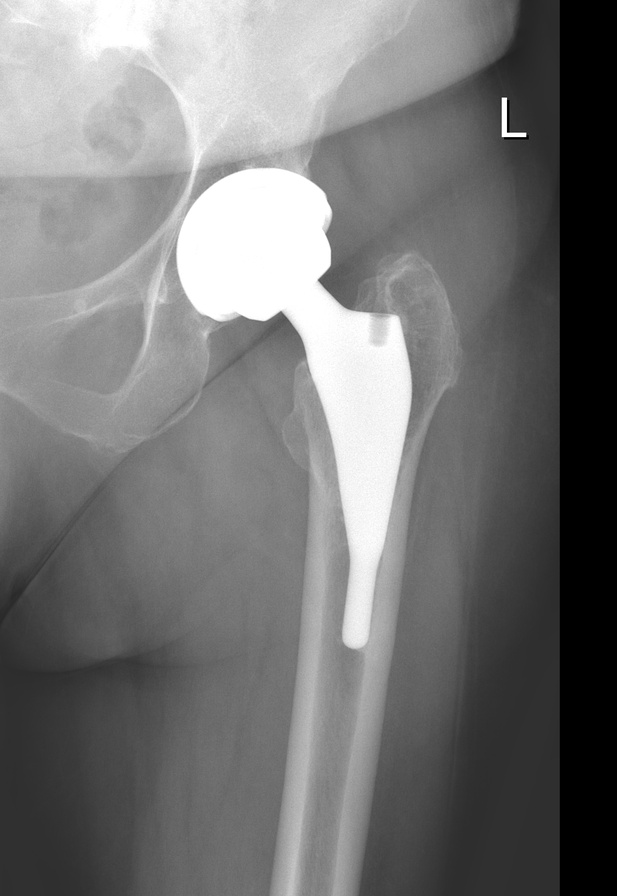 Hip_JRIOrtho_FurlongEvolution_NilCol</td>
<td align="center" valign="top"><b>Option 1</b>  Hip_Stryker_AccoladeII</td>
<td align="center" valign="top"><b>Option 2</b>  Hip_DepuySynthes_Corail_NilCol</td>
<td align="center" valign="top"><b>✅ Option 3</b>  Hip_JRIOrtho_FurlongEvolution_NilCol</td>
<td align="center" valign="top"><b>Option 4</b>  Hip_JRIOrtho_FurlongEvolution_Collar</td>
<td align="center" valign="top"><b>Option 5</b> 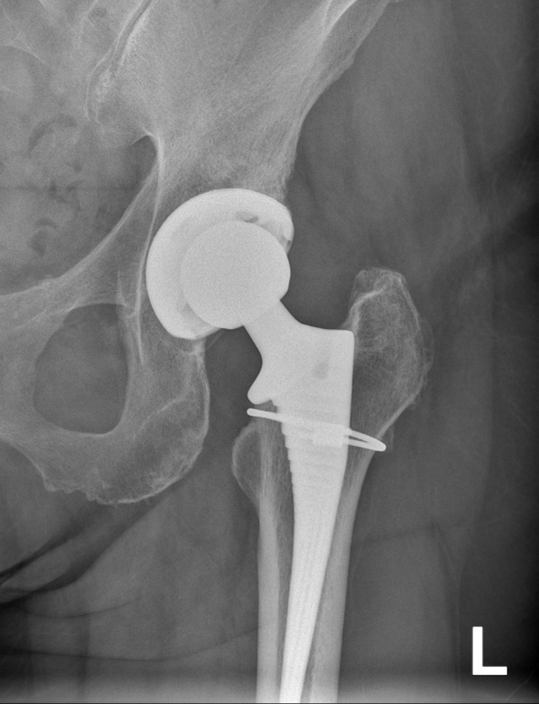 Hip_DepuySynthes_Corail_Collar</td>
<td align="center" valign="middle"><b>Option 6</b>  <i>None of the above</i></td>
</tr></table>

### Q0005 · correct: option 5 · `Hip_JRIOrtho_FurlongEvolution_NilCol`

<table><tr>
<td align="center" valign="top"><b>Query</b> 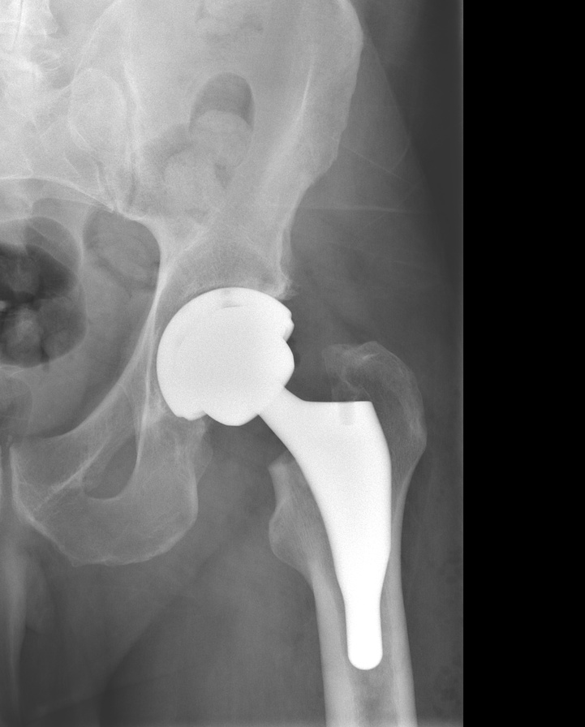 Hip_JRIOrtho_FurlongEvolution_NilCol</td>
<td align="center" valign="top"><b>Option 1</b> 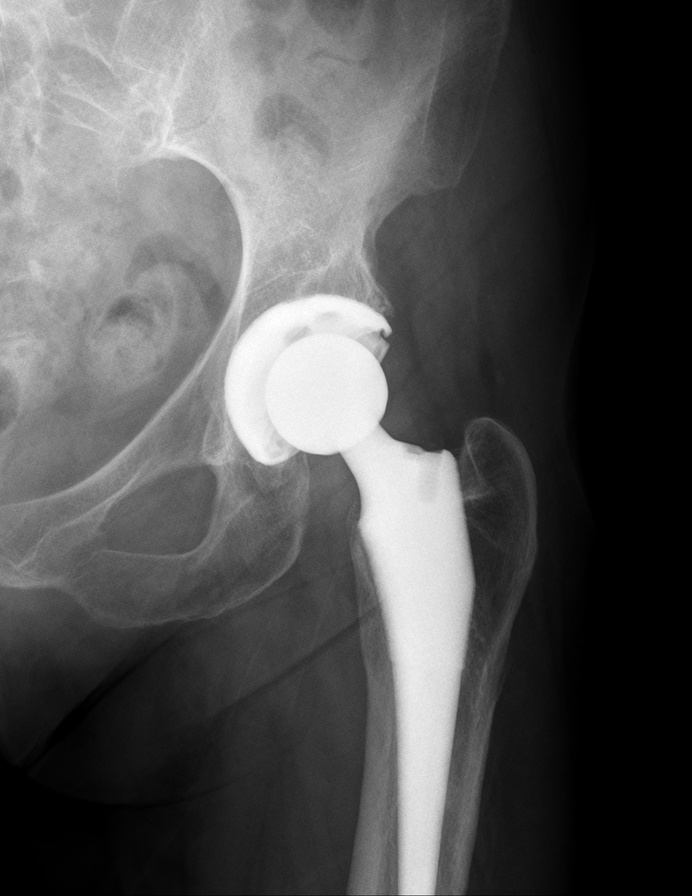 Hip_SmithAndNephew_Anthology</td>
<td align="center" valign="top"><b>Option 2</b>  Hip_Stryker_AccoladeII</td>
<td align="center" valign="top"><b>Option 3</b>  Hip_JRIOrtho_FurlongEvolution_Collar</td>
<td align="center" valign="top"><b>Option 4</b> 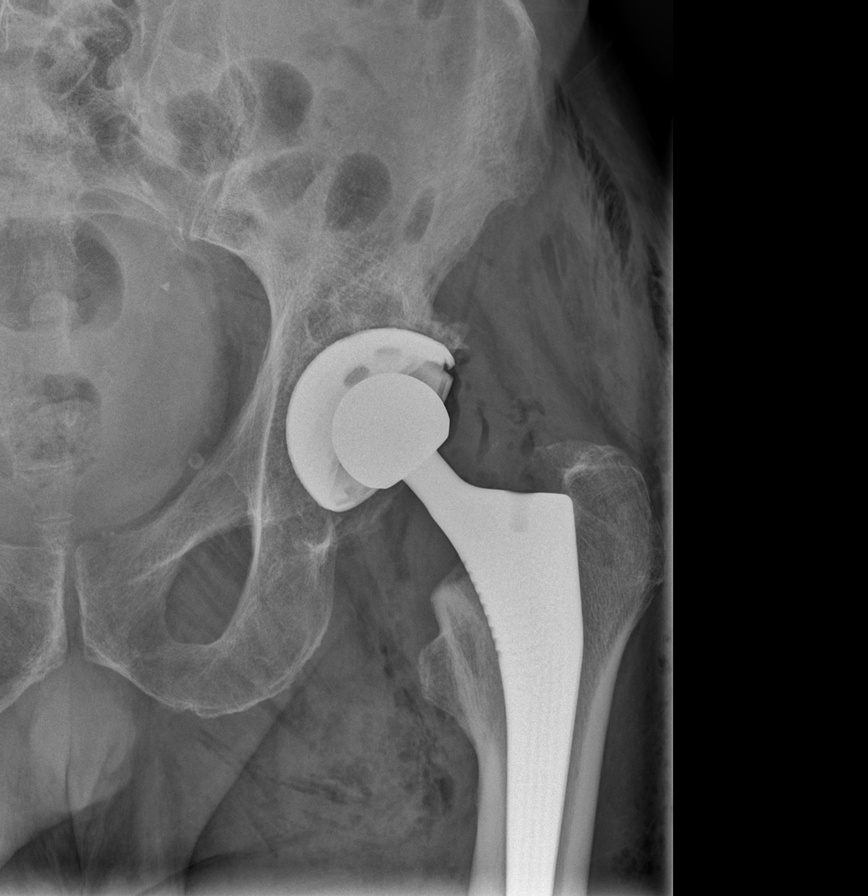 Hip_SmithAndNephew_Polarstem_NilCol</td>
<td align="center" valign="top"><b>✅ Option 5</b>  Hip_JRIOrtho_FurlongEvolution_NilCol</td>
<td align="center" valign="middle"><b>Option 6</b>  <i>None of the above</i></td>
</tr></table>

### Q0006 · correct: option 2 · `Hip_JRIOrtho_FurlongEvolution_NilCol`

<table><tr>
<td align="center" valign="top"><b>Query</b>  Hip_JRIOrtho_FurlongEvolution_NilCol</td>
<td align="center" valign="top"><b>Option 1</b> 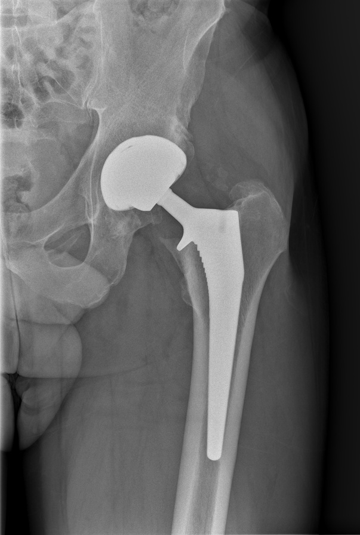 Hip_DepuySynthes_Corail_Collar</td>
<td align="center" valign="top"><b>✅ Option 2</b>  Hip_JRIOrtho_FurlongEvolution_NilCol</td>
<td align="center" valign="top"><b>Option 3</b> 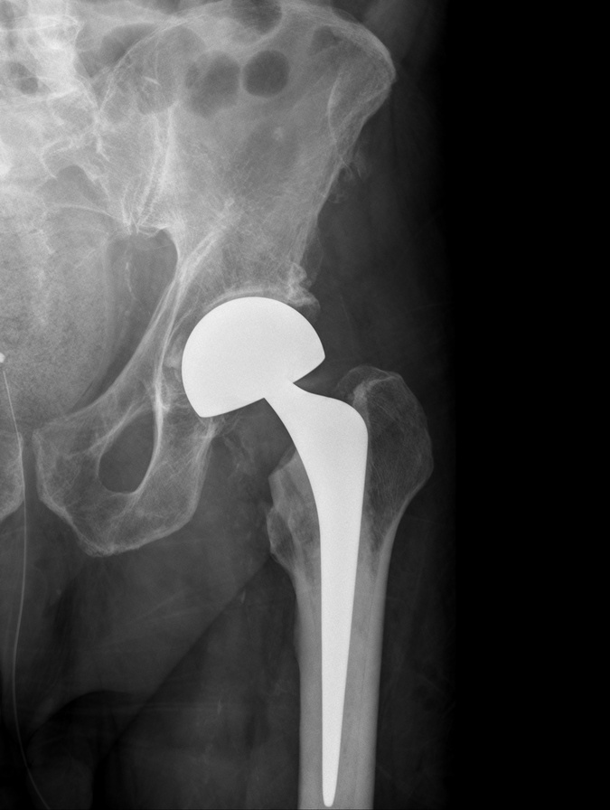 Hip_Stryker_Exeter</td>
<td align="center" valign="top"><b>Option 4</b>  Hip_JRIOrtho_FurlongEvolution_Collar</td>
<td align="center" valign="top"><b>Option 5</b>  Hip_SmithAndNephew_Polarstem_NilCol</td>
<td align="center" valign="middle"><b>Option 6</b>  <i>None of the above</i></td>
</tr></table>

### Q0007 · correct: option 4 · `Hip_JRIOrtho_FurlongEvolution_NilCol`

<table><tr>
<td align="center" valign="top"><b>Query</b> 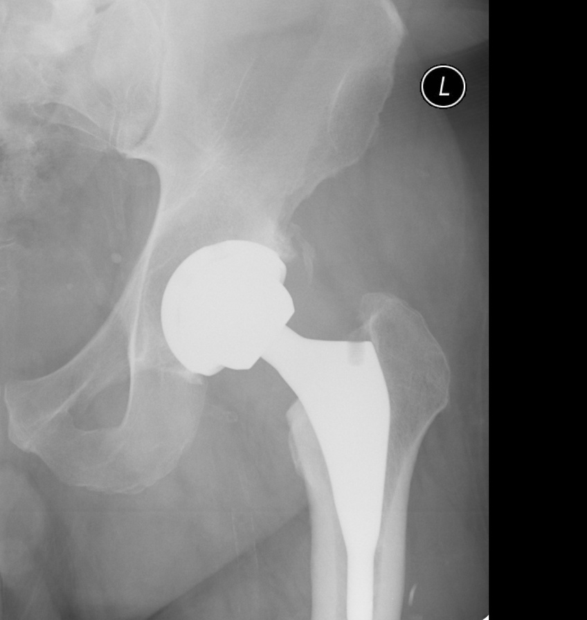 Hip_JRIOrtho_FurlongEvolution_NilCol</td>
<td align="center" valign="top"><b>Option 1</b>  Hip_SmithAndNephew_Polarstem_NilCol</td>
<td align="center" valign="top"><b>Option 2</b>  Hip_Stryker_Exeter</td>
<td align="center" valign="top"><b>Option 3</b>  Hip_Stryker_AccoladeII</td>
<td align="center" valign="top"><b>✅ Option 4</b>  Hip_JRIOrtho_FurlongEvolution_NilCol</td>
<td align="center" valign="top"><b>Option 5</b>  Hip_JRIOrtho_FurlongEvolution_Collar</td>
<td align="center" valign="middle"><b>Option 6</b>  <i>None of the above</i></td>
</tr></table>

### Q0008 · correct: option 3 · `Hip_JRIOrtho_FurlongEvolution_NilCol`

<table><tr>
<td align="center" valign="top"><b>Query</b> 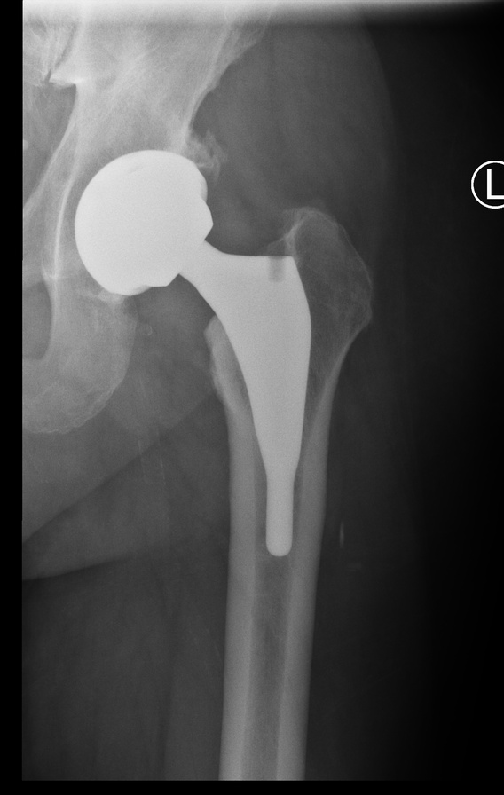 Hip_JRIOrtho_FurlongEvolution_NilCol</td>
<td align="center" valign="top"><b>Option 1</b>  Hip_SmithAndNephew_Polarstem_NilCol</td>
<td align="center" valign="top"><b>Option 2</b>  Hip_SmithAndNephew_Anthology</td>
<td align="center" valign="top"><b>✅ Option 3</b>  Hip_JRIOrtho_FurlongEvolution_NilCol</td>
<td align="center" valign="top"><b>Option 4</b>  Hip_JRIOrtho_FurlongEvolution_Collar</td>
<td align="center" valign="top"><b>Option 5</b>  Hip_Stryker_AccoladeII</td>
<td align="center" valign="middle"><b>Option 6</b>  <i>None of the above</i></td>
</tr></table>

### Q0009 · correct: option 5 · `Hip_JRIOrtho_FurlongEvolution_NilCol`

<table><tr>
<td align="center" valign="top"><b>Query</b> 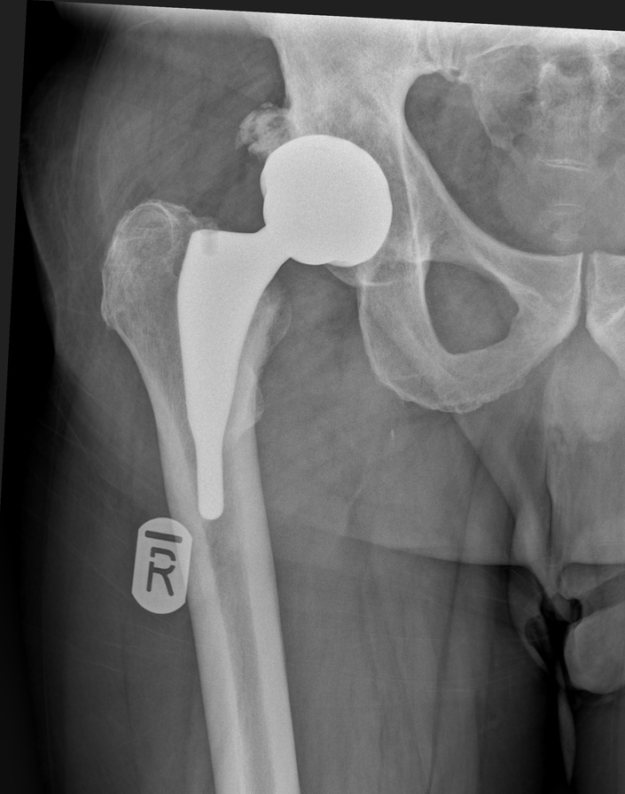 Hip_JRIOrtho_FurlongEvolution_NilCol</td>
<td align="center" valign="top"><b>Option 1</b>  Hip_Stryker_AccoladeII</td>
<td align="center" valign="top"><b>Option 2</b>  Hip_SmithAndNephew_Anthology</td>
<td align="center" valign="top"><b>Option 3</b>  Hip_JRIOrtho_FurlongEvolution_Collar</td>
<td align="center" valign="top"><b>Option 4</b>  Hip_SmithAndNephew_Polarstem_NilCol</td>
<td align="center" valign="top"><b>✅ Option 5</b>  Hip_JRIOrtho_FurlongEvolution_NilCol</td>
<td align="center" valign="middle"><b>Option 6</b>  <i>None of the above</i></td>
</tr></table>

### Q0010 · correct: option 5 · `Hip_JRIOrtho_FurlongEvolution_NilCol`

<table><tr>
<td align="center" valign="top"><b>Query</b> 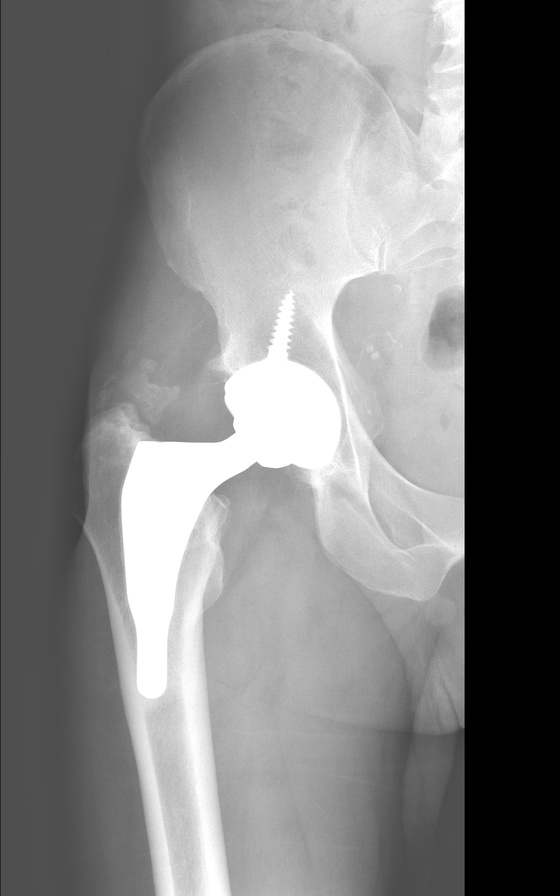 Hip_JRIOrtho_FurlongEvolution_NilCol</td>
<td align="center" valign="top"><b>Option 1</b>  Hip_Stryker_AccoladeII</td>
<td align="center" valign="top"><b>Option 2</b>  Hip_DepuySynthes_Corail_NilCol</td>
<td align="center" valign="top"><b>Option 3</b>  Hip_DepuySynthes_Corail_Collar</td>
<td align="center" valign="top"><b>Option 4</b>  Hip_JRIOrtho_FurlongEvolution_Collar</td>
<td align="center" valign="top"><b>✅ Option 5</b>  Hip_JRIOrtho_FurlongEvolution_NilCol</td>
<td align="center" valign="middle"><b>Option 6</b>  <i>None of the above</i></td>
</tr></table>

### Q0011 · correct: option 2 · `Hip_JRIOrtho_FurlongEvolution_NilCol`

<table><tr>
<td align="center" valign="top"><b>Query</b> 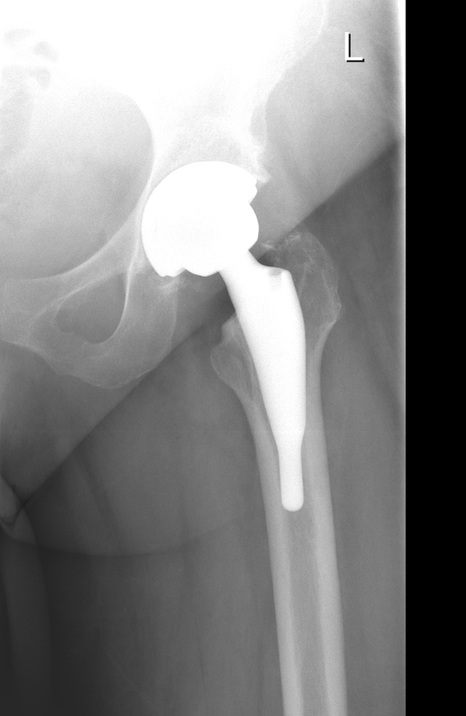 Hip_JRIOrtho_FurlongEvolution_NilCol</td>
<td align="center" valign="top"><b>Option 1</b>  Hip_JRIOrtho_FurlongEvolution_Collar</td>
<td align="center" valign="top"><b>✅ Option 2</b>  Hip_JRIOrtho_FurlongEvolution_NilCol</td>
<td align="center" valign="top"><b>Option 3</b>  Hip_Stryker_Exeter</td>
<td align="center" valign="top"><b>Option 4</b>  Hip_SmithAndNephew_Anthology</td>
<td align="center" valign="top"><b>Option 5</b>  Hip_DepuySynthes_Corail_Collar</td>
<td align="center" valign="middle"><b>Option 6</b>  <i>None of the above</i></td>
</tr></table>

### Q0012 · correct: option 1 · `Hip_JRIOrtho_FurlongEvolution_NilCol`

<table><tr>
<td align="center" valign="top"><b>Query</b> 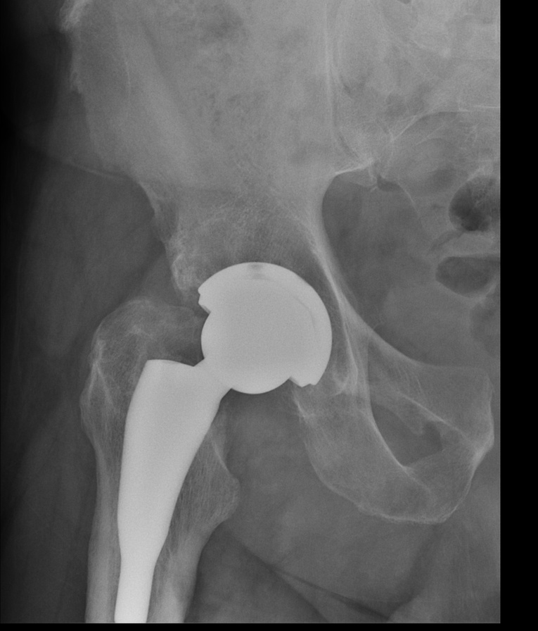 Hip_JRIOrtho_FurlongEvolution_NilCol</td>
<td align="center" valign="top"><b>✅ Option 1</b>  Hip_JRIOrtho_FurlongEvolution_NilCol</td>
<td align="center" valign="top"><b>Option 2</b>  Hip_SmithAndNephew_Anthology</td>
<td align="center" valign="top"><b>Option 3</b>  Hip_DepuySynthes_Corail_Collar</td>
<td align="center" valign="top"><b>Option 4</b>  Hip_Stryker_Exeter</td>
<td align="center" valign="top"><b>Option 5</b>  Hip_JRIOrtho_FurlongEvolution_Collar</td>
<td align="center" valign="middle"><b>Option 6</b>  <i>None of the above</i></td>
</tr></table>

### Q0013 · correct: option 2 · `Hip_JRIOrtho_FurlongEvolution_NilCol`

<table><tr>
<td align="center" valign="top"><b>Query</b> 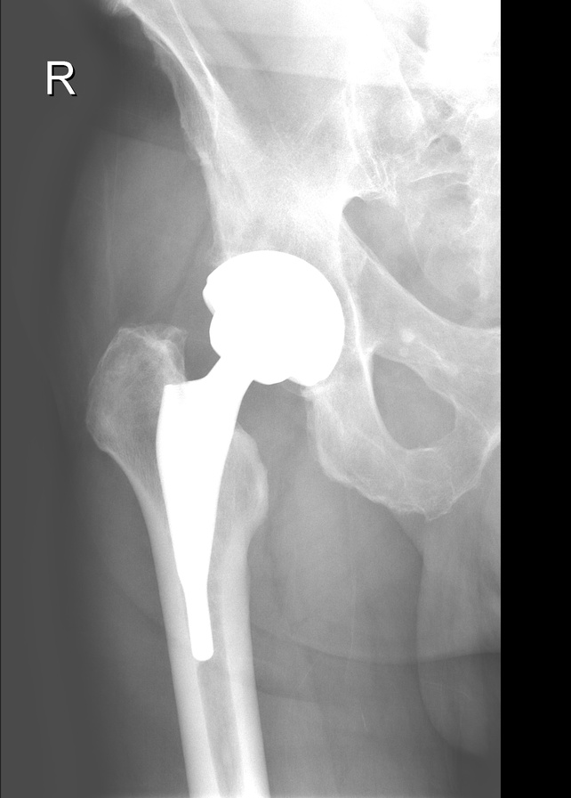 Hip_JRIOrtho_FurlongEvolution_NilCol</td>
<td align="center" valign="top"><b>Option 1</b>  Hip_Stryker_Exeter</td>
<td align="center" valign="top"><b>✅ Option 2</b>  Hip_JRIOrtho_FurlongEvolution_NilCol</td>
<td align="center" valign="top"><b>Option 3</b>  Hip_Stryker_AccoladeII</td>
<td align="center" valign="top"><b>Option 4</b>  Hip_SmithAndNephew_Polarstem_NilCol</td>
<td align="center" valign="top"><b>Option 5</b>  Hip_JRIOrtho_FurlongEvolution_Collar</td>
<td align="center" valign="middle"><b>Option 6</b>  <i>None of the above</i></td>
</tr></table>

### Q0014 · correct: option 5 · `Hip_JRIOrtho_FurlongEvolution_NilCol`

<table><tr>
<td align="center" valign="top"><b>Query</b> 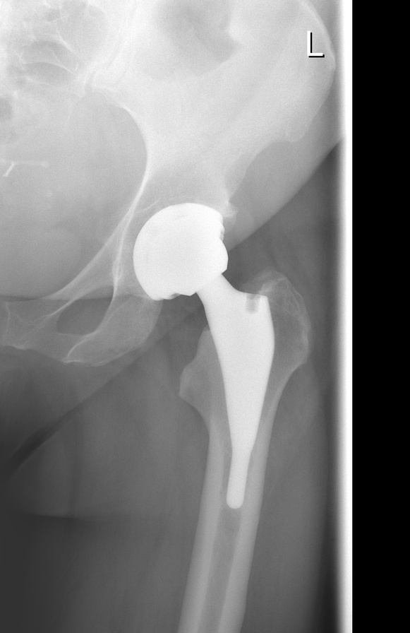 Hip_JRIOrtho_FurlongEvolution_NilCol</td>
<td align="center" valign="top"><b>Option 1</b>  Hip_DepuySynthes_Corail_NilCol</td>
<td align="center" valign="top"><b>Option 2</b>  Hip_SmithAndNephew_Anthology</td>
<td align="center" valign="top"><b>Option 3</b>  Hip_Stryker_AccoladeII</td>
<td align="center" valign="top"><b>Option 4</b>  Hip_JRIOrtho_FurlongEvolution_Collar</td>
<td align="center" valign="top"><b>✅ Option 5</b>  Hip_JRIOrtho_FurlongEvolution_NilCol</td>
<td align="center" valign="middle"><b>Option 6</b>  <i>None of the above</i></td>
</tr></table>

### Q0015 · correct: option 4 · `Hip_DepuySynthes_Corail_NilCol`

<table><tr>
<td align="center" valign="top"><b>Query</b> 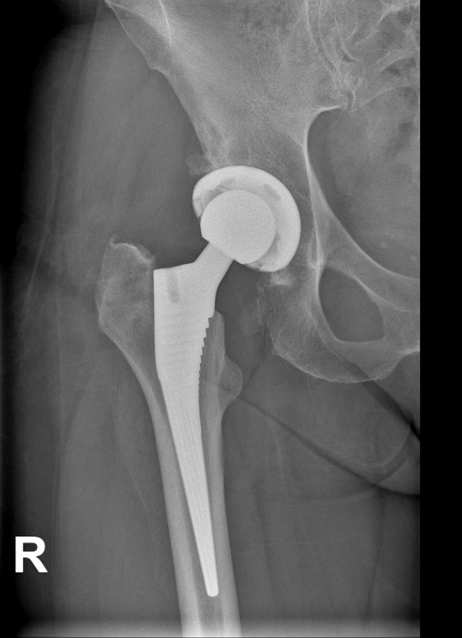 Hip_DepuySynthes_Corail_NilCol</td>
<td align="center" valign="top"><b>Option 1</b>  Hip_SmithAndNephew_Polarstem_NilCol</td>
<td align="center" valign="top"><b>Option 2</b> 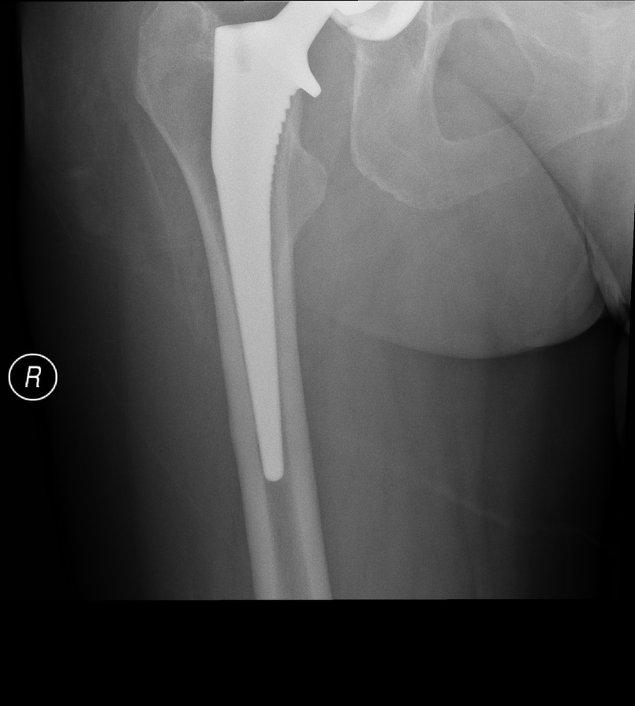 Hip_DepuySynthes_Corail_Collar</td>
<td align="center" valign="top"><b>Option 3</b>  Hip_SmithAndNephew_Anthology</td>
<td align="center" valign="top"><b>✅ Option 4</b> 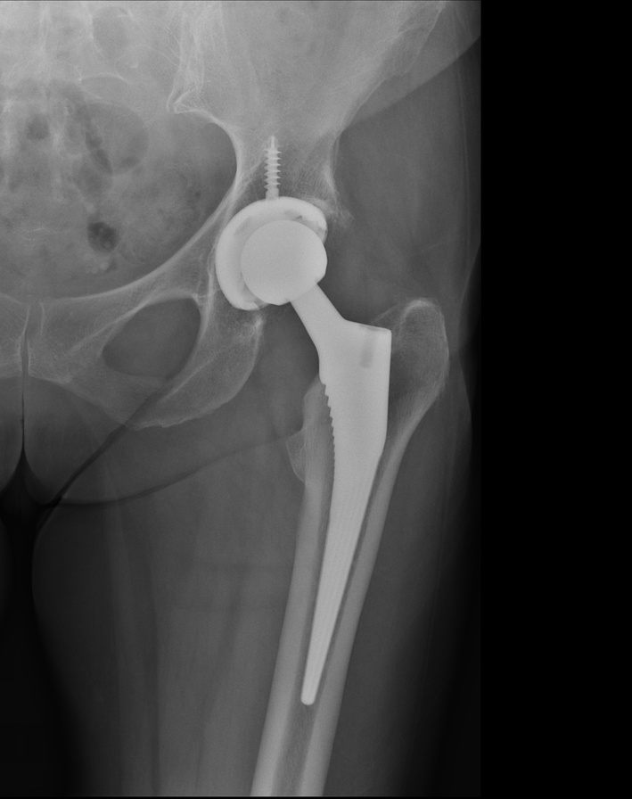 Hip_DepuySynthes_Corail_NilCol</td>
<td align="center" valign="top"><b>Option 5</b>  Hip_Stryker_Exeter</td>
<td align="center" valign="middle"><b>Option 6</b>  <i>None of the above</i></td>
</tr></table>

### Q0016 · correct: option 3 · `Hip_DepuySynthes_Corail_NilCol`

<table><tr>
<td align="center" valign="top"><b>Query</b> 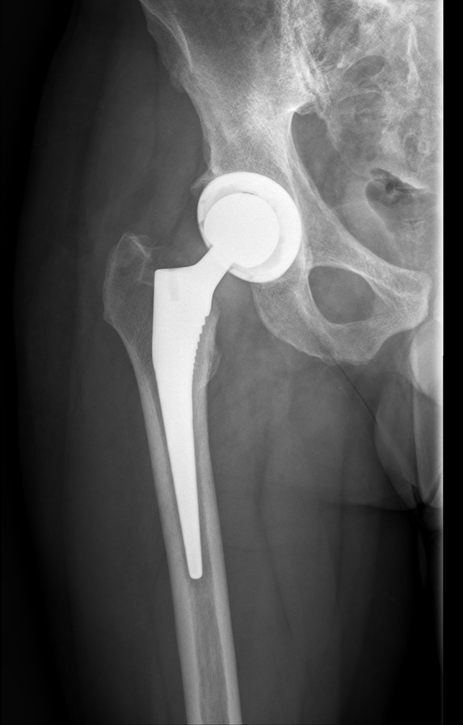 Hip_DepuySynthes_Corail_NilCol</td>
<td align="center" valign="top"><b>Option 1</b> 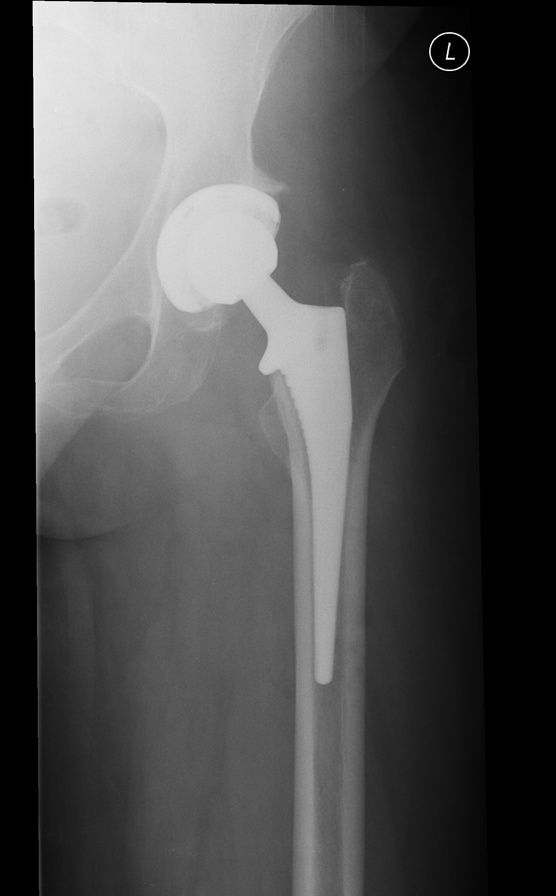 Hip_DepuySynthes_Corail_Collar</td>
<td align="center" valign="top"><b>Option 2</b>  Hip_JRIOrtho_FurlongEvolution_NilCol</td>
<td align="center" valign="top"><b>✅ Option 3</b> 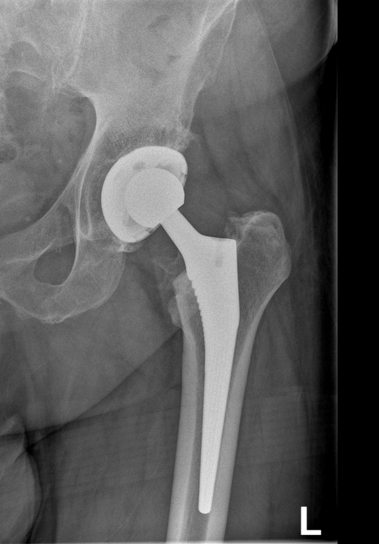 Hip_DepuySynthes_Corail_NilCol</td>
<td align="center" valign="top"><b>Option 4</b>  Hip_SmithAndNephew_Anthology</td>
<td align="center" valign="top"><b>Option 5</b>  Hip_SmithAndNephew_Polarstem_NilCol</td>
<td align="center" valign="middle"><b>Option 6</b>  <i>None of the above</i></td>
</tr></table>

### Q0017 · correct: option 2 · `Hip_DepuySynthes_Corail_NilCol`

<table><tr>
<td align="center" valign="top"><b>Query</b> 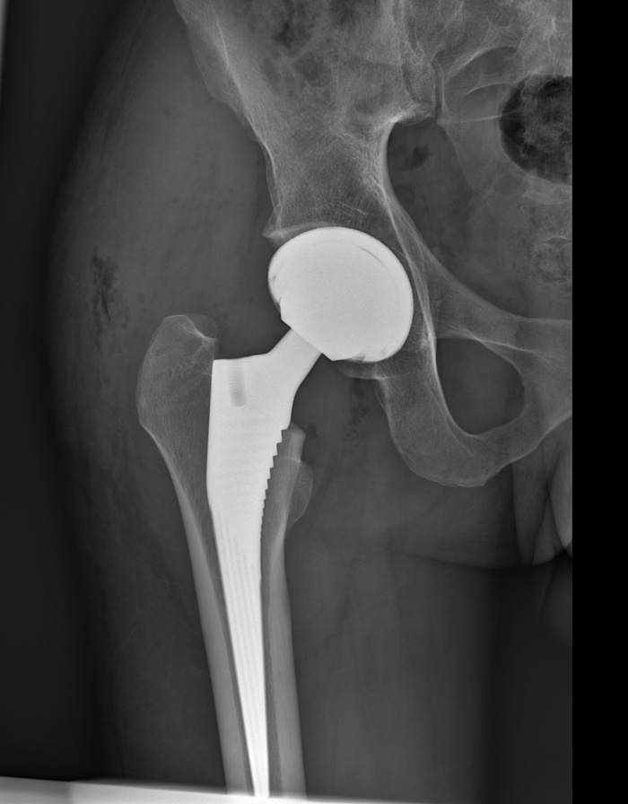 Hip_DepuySynthes_Corail_NilCol</td>
<td align="center" valign="top"><b>Option 1</b>  Hip_JRIOrtho_FurlongEvolution_Collar</td>
<td align="center" valign="top"><b>✅ Option 2</b>  Hip_DepuySynthes_Corail_NilCol</td>
<td align="center" valign="top"><b>Option 3</b>  Hip_SmithAndNephew_Anthology</td>
<td align="center" valign="top"><b>Option 4</b>  Hip_Stryker_Exeter</td>
<td align="center" valign="top"><b>Option 5</b>  Hip_DepuySynthes_Corail_Collar</td>
<td align="center" valign="middle"><b>Option 6</b>  <i>None of the above</i></td>
</tr></table>

### Q0018 · correct: option 3 · `Hip_DepuySynthes_Corail_NilCol`

<table><tr>
<td align="center" valign="top"><b>Query</b> 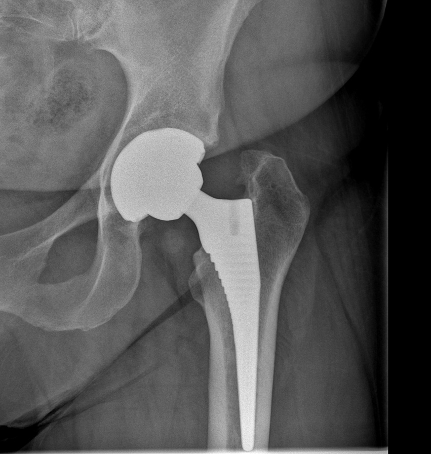 Hip_DepuySynthes_Corail_NilCol</td>
<td align="center" valign="top"><b>Option 1</b>  Hip_Stryker_Exeter</td>
<td align="center" valign="top"><b>Option 2</b>  Hip_DepuySynthes_Corail_Collar</td>
<td align="center" valign="top"><b>✅ Option 3</b> 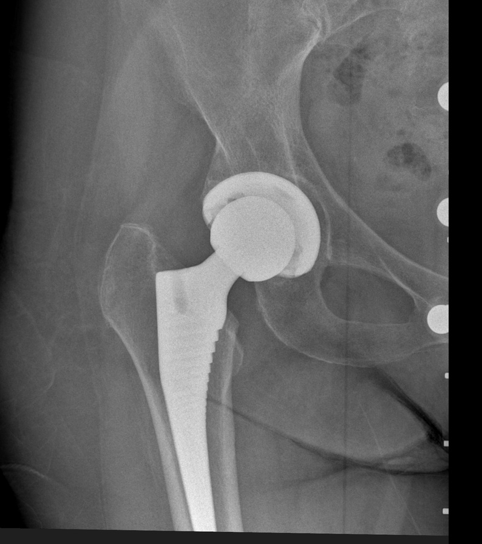 Hip_DepuySynthes_Corail_NilCol</td>
<td align="center" valign="top"><b>Option 4</b>  Hip_JRIOrtho_FurlongEvolution_NilCol</td>
<td align="center" valign="top"><b>Option 5</b>  Hip_JRIOrtho_FurlongEvolution_Collar</td>
<td align="center" valign="middle"><b>Option 6</b>  <i>None of the above</i></td>
</tr></table>

### Q0019 · correct: option 5 · `Hip_DepuySynthes_Corail_NilCol`

<table><tr>
<td align="center" valign="top"><b>Query</b> 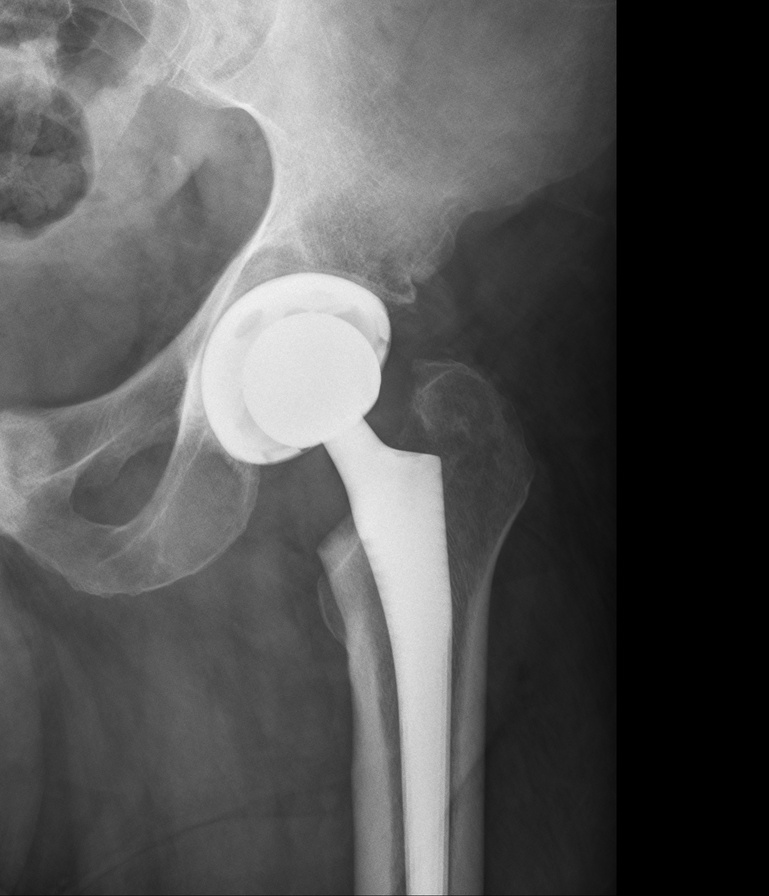 Hip_DepuySynthes_Corail_NilCol</td>
<td align="center" valign="top"><b>Option 1</b>  Hip_Stryker_Exeter</td>
<td align="center" valign="top"><b>Option 2</b> 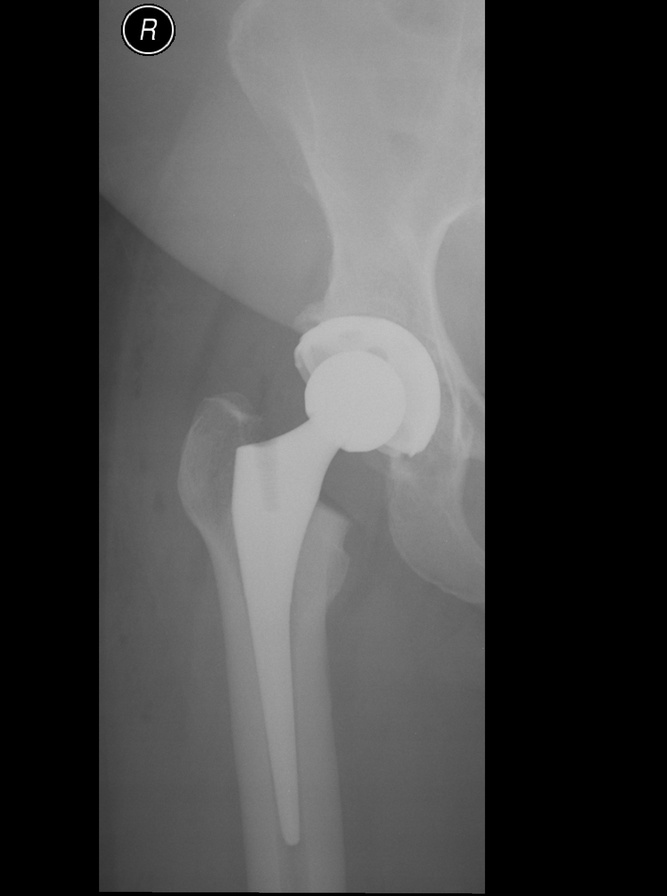 Hip_Stryker_AccoladeII</td>
<td align="center" valign="top"><b>Option 3</b>  Hip_JRIOrtho_FurlongEvolution_NilCol</td>
<td align="center" valign="top"><b>Option 4</b>  Hip_SmithAndNephew_Anthology</td>
<td align="center" valign="top"><b>✅ Option 5</b>  Hip_DepuySynthes_Corail_NilCol</td>
<td align="center" valign="middle"><b>Option 6</b>  <i>None of the above</i></td>
</tr></table>

### Q0020 · correct: option 4 · `Hip_DepuySynthes_Corail_NilCol`

<table><tr>
<td align="center" valign="top"><b>Query</b> 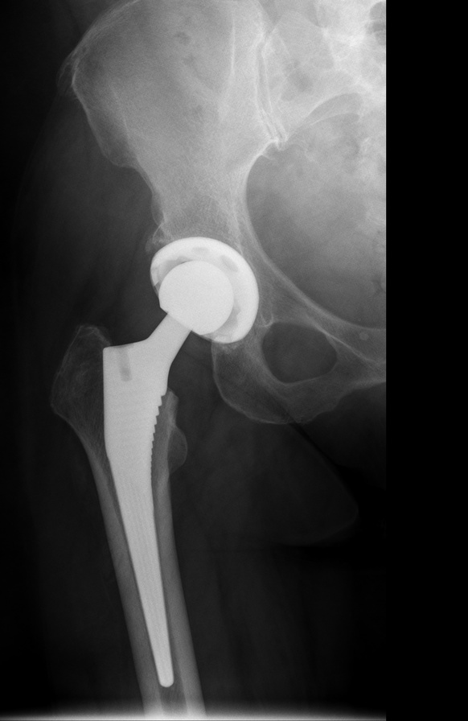 Hip_DepuySynthes_Corail_NilCol</td>
<td align="center" valign="top"><b>Option 1</b> 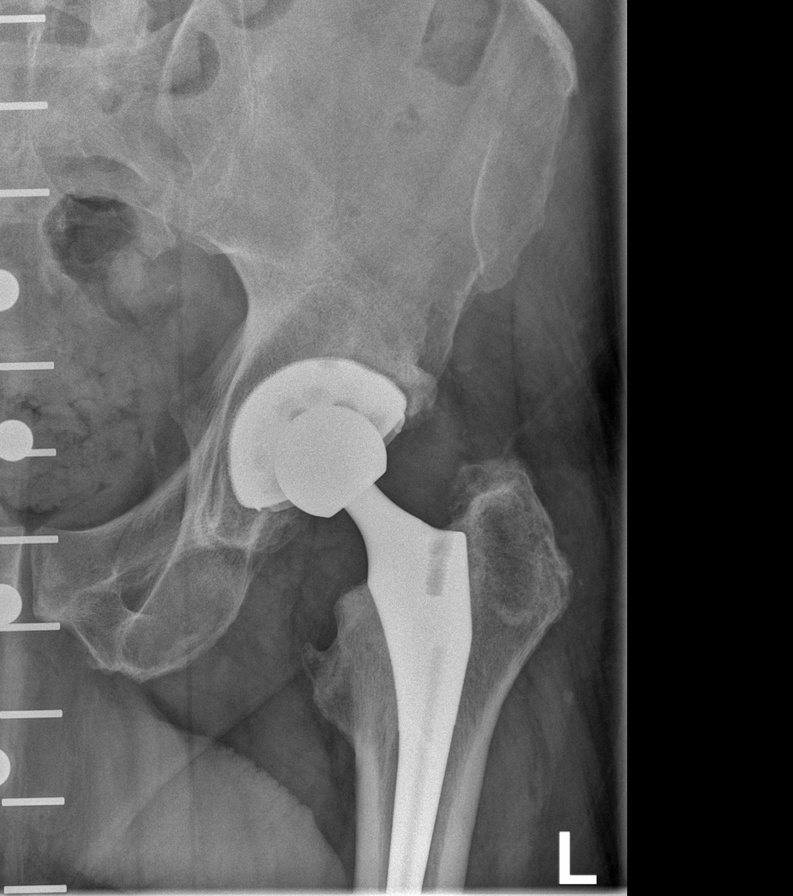 Hip_Stryker_AccoladeII</td>
<td align="center" valign="top"><b>Option 2</b>  Hip_SmithAndNephew_Anthology</td>
<td align="center" valign="top"><b>Option 3</b>  Hip_Stryker_Exeter</td>
<td align="center" valign="top"><b>✅ Option 4</b>  Hip_DepuySynthes_Corail_NilCol</td>
<td align="center" valign="top"><b>Option 5</b>  Hip_DepuySynthes_Corail_Collar</td>
<td align="center" valign="middle"><b>Option 6</b>  <i>None of the above</i></td>
</tr></table>

### Q0021 · correct: option 5 · `Hip_DepuySynthes_Corail_NilCol`

<table><tr>
<td align="center" valign="top"><b>Query</b> 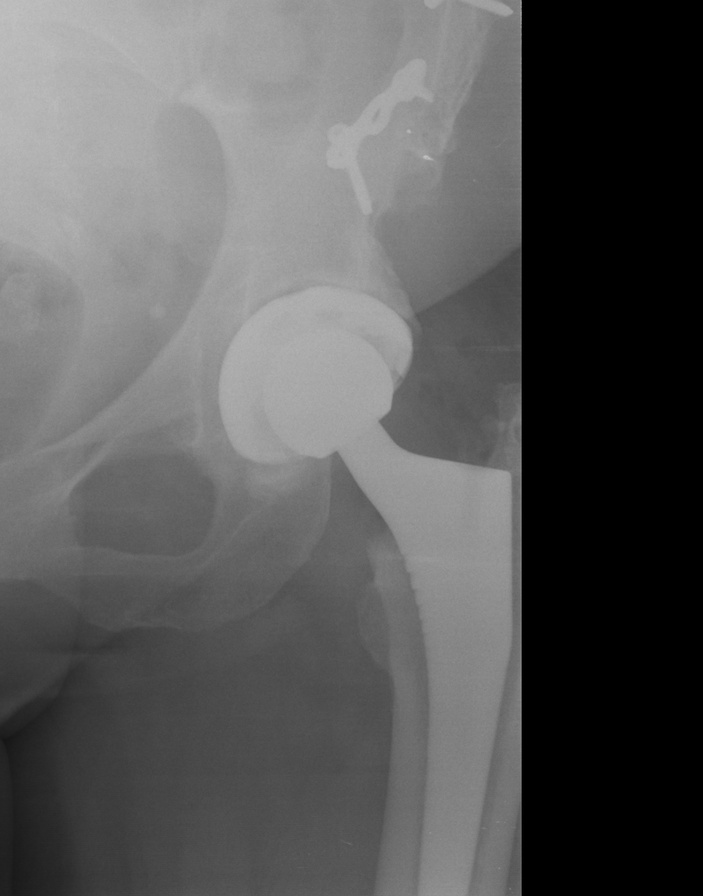 Hip_DepuySynthes_Corail_NilCol</td>
<td align="center" valign="top"><b>Option 1</b>  Hip_Stryker_AccoladeII</td>
<td align="center" valign="top"><b>Option 2</b>  Hip_JRIOrtho_FurlongEvolution_NilCol</td>
<td align="center" valign="top"><b>Option 3</b>  Hip_JRIOrtho_FurlongEvolution_Collar</td>
<td align="center" valign="top"><b>Option 4</b>  Hip_SmithAndNephew_Anthology</td>
<td align="center" valign="top"><b>✅ Option 5</b>  Hip_DepuySynthes_Corail_NilCol</td>
<td align="center" valign="middle"><b>Option 6</b>  <i>None of the above</i></td>
</tr></table>

### Q0022 · correct: option 2 · `Hip_DepuySynthes_Corail_NilCol`

<table><tr>
<td align="center" valign="top"><b>Query</b> 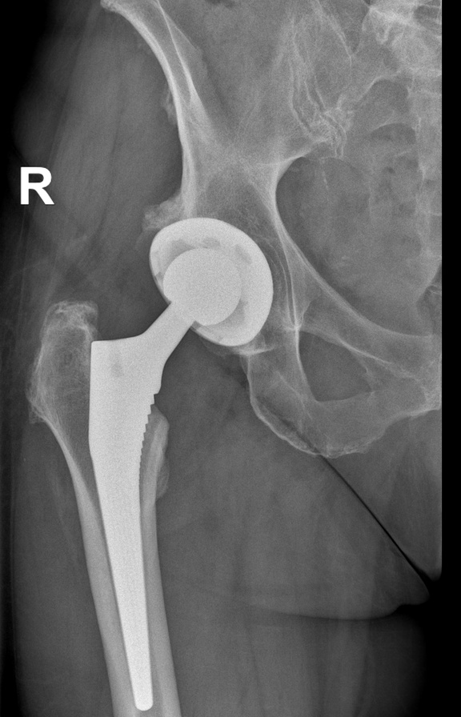 Hip_DepuySynthes_Corail_NilCol</td>
<td align="center" valign="top"><b>Option 1</b>  Hip_JRIOrtho_FurlongEvolution_Collar</td>
<td align="center" valign="top"><b>✅ Option 2</b>  Hip_DepuySynthes_Corail_NilCol</td>
<td align="center" valign="top"><b>Option 3</b>  Hip_SmithAndNephew_Polarstem_NilCol</td>
<td align="center" valign="top"><b>Option 4</b>  Hip_DepuySynthes_Corail_Collar</td>
<td align="center" valign="top"><b>Option 5</b>  Hip_SmithAndNephew_Anthology</td>
<td align="center" valign="middle"><b>Option 6</b>  <i>None of the above</i></td>
</tr></table>

### Q0023 · correct: option 5 · `Hip_DepuySynthes_Corail_NilCol`

<table><tr>
<td align="center" valign="top"><b>Query</b> 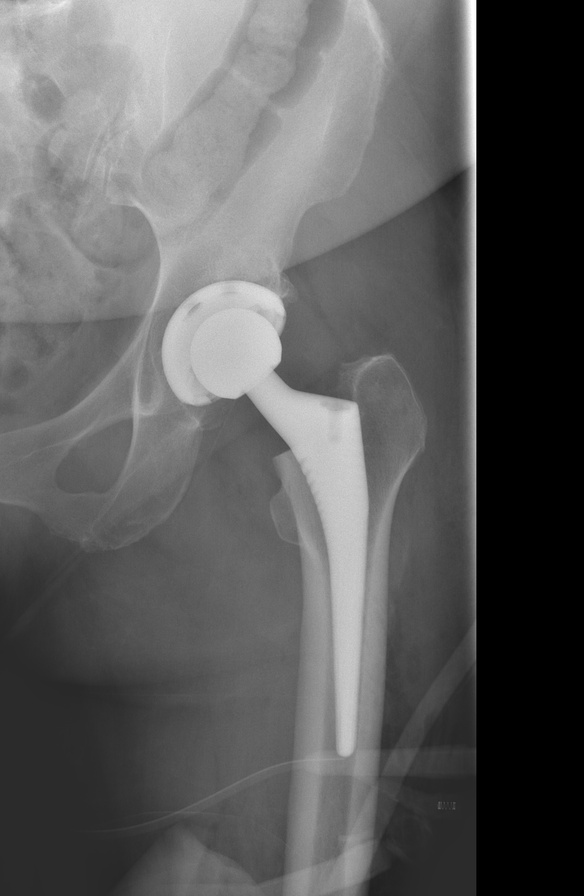 Hip_DepuySynthes_Corail_NilCol</td>
<td align="center" valign="top"><b>Option 1</b>  Hip_SmithAndNephew_Anthology</td>
<td align="center" valign="top"><b>Option 2</b>  Hip_SmithAndNephew_Polarstem_NilCol</td>
<td align="center" valign="top"><b>Option 3</b>  Hip_DepuySynthes_Corail_Collar</td>
<td align="center" valign="top"><b>Option 4</b>  Hip_JRIOrtho_FurlongEvolution_NilCol</td>
<td align="center" valign="top"><b>✅ Option 5</b> 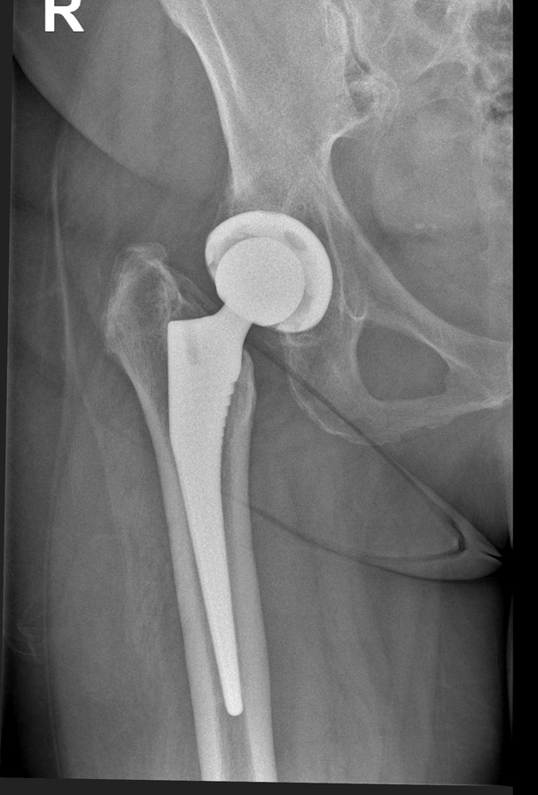 Hip_DepuySynthes_Corail_NilCol</td>
<td align="center" valign="middle"><b>Option 6</b>  <i>None of the above</i></td>
</tr></table>

### Q0024 · correct: option 4 · `Hip_DepuySynthes_Corail_NilCol`

<table><tr>
<td align="center" valign="top"><b>Query</b> 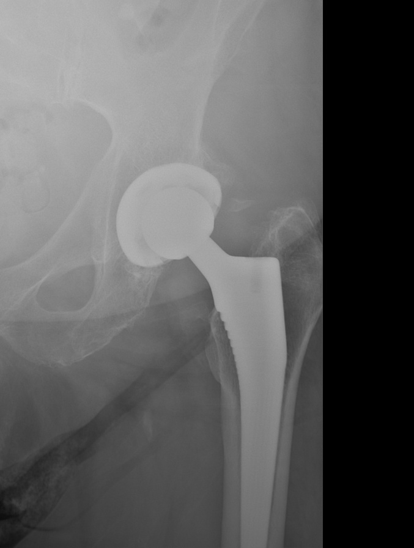 Hip_DepuySynthes_Corail_NilCol</td>
<td align="center" valign="top"><b>Option 1</b>  Hip_JRIOrtho_FurlongEvolution_NilCol</td>
<td align="center" valign="top"><b>Option 2</b>  Hip_SmithAndNephew_Polarstem_NilCol</td>
<td align="center" valign="top"><b>Option 3</b>  Hip_Stryker_Exeter</td>
<td align="center" valign="top"><b>✅ Option 4</b>  Hip_DepuySynthes_Corail_NilCol</td>
<td align="center" valign="top"><b>Option 5</b>  Hip_SmithAndNephew_Anthology</td>
<td align="center" valign="middle"><b>Option 6</b>  <i>None of the above</i></td>
</tr></table>

### Q0025 · correct: option 2 · `Hip_DepuySynthes_Corail_NilCol`

<table><tr>
<td align="center" valign="top"><b>Query</b> 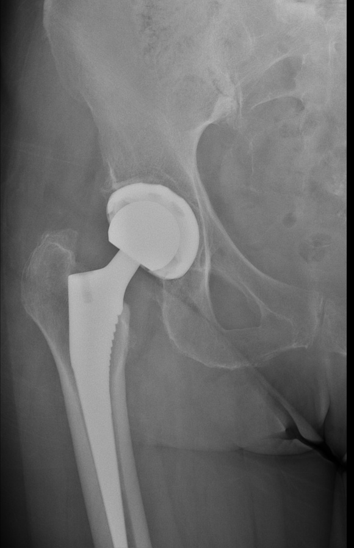 Hip_DepuySynthes_Corail_NilCol</td>
<td align="center" valign="top"><b>Option 1</b>  Hip_DepuySynthes_Corail_Collar</td>
<td align="center" valign="top"><b>✅ Option 2</b>  Hip_DepuySynthes_Corail_NilCol</td>
<td align="center" valign="top"><b>Option 3</b>  Hip_Stryker_Exeter</td>
<td align="center" valign="top"><b>Option 4</b>  Hip_JRIOrtho_FurlongEvolution_Collar</td>
<td align="center" valign="top"><b>Option 5</b>  Hip_JRIOrtho_FurlongEvolution_NilCol</td>
<td align="center" valign="middle"><b>Option 6</b>  <i>None of the above</i></td>
</tr></table>

### Q0026 · correct: option 4 · `Hip_DepuySynthes_Corail_NilCol`

<table><tr>
<td align="center" valign="top"><b>Query</b> 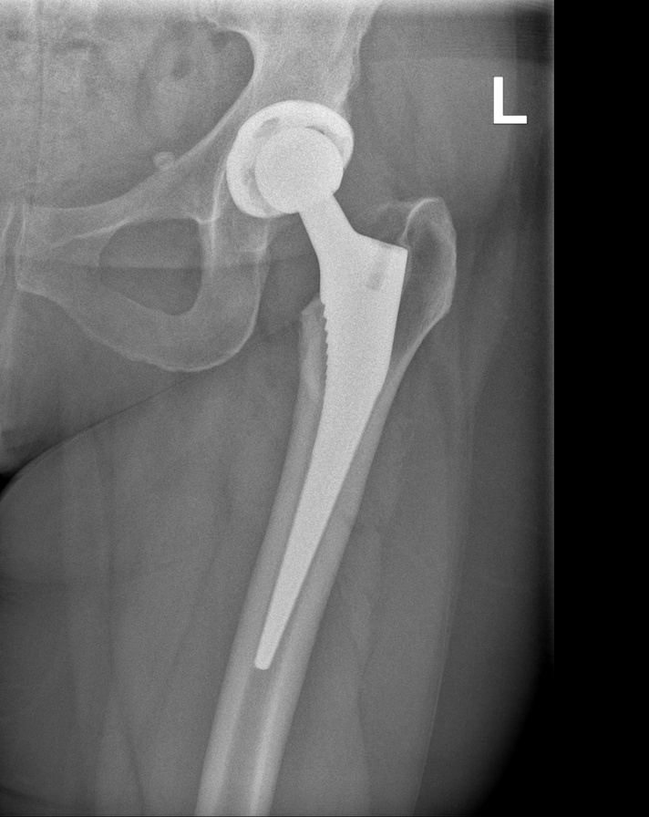 Hip_DepuySynthes_Corail_NilCol</td>
<td align="center" valign="top"><b>Option 1</b>  Hip_SmithAndNephew_Anthology</td>
<td align="center" valign="top"><b>Option 2</b>  Hip_JRIOrtho_FurlongEvolution_NilCol</td>
<td align="center" valign="top"><b>Option 3</b>  Hip_SmithAndNephew_Polarstem_NilCol</td>
<td align="center" valign="top"><b>✅ Option 4</b>  Hip_DepuySynthes_Corail_NilCol</td>
<td align="center" valign="top"><b>Option 5</b>  Hip_DepuySynthes_Corail_Collar</td>
<td align="center" valign="middle"><b>Option 6</b>  <i>None of the above</i></td>
</tr></table>

### Q0027 · correct: option 3 · `Hip_DepuySynthes_Corail_NilCol`

<table><tr>
<td align="center" valign="top"><b>Query</b> 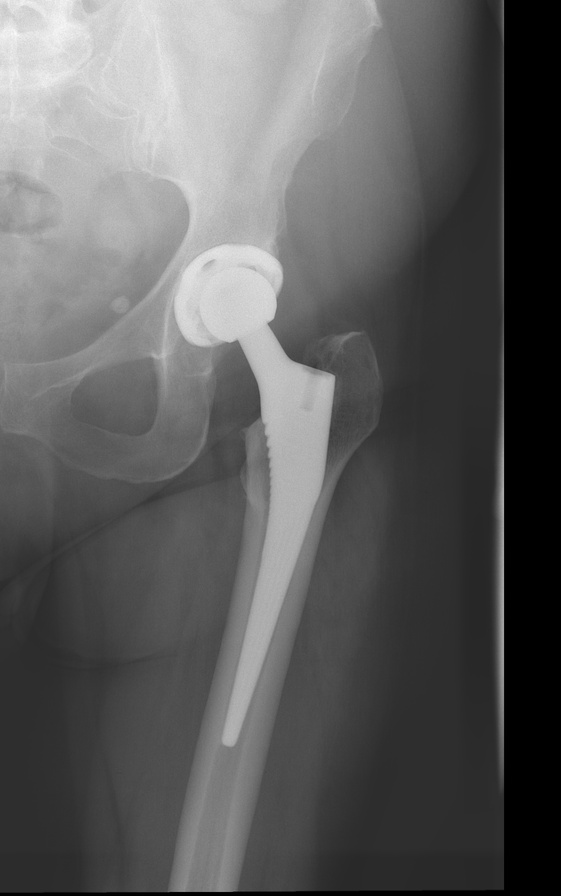 Hip_DepuySynthes_Corail_NilCol</td>
<td align="center" valign="top"><b>Option 1</b>  Hip_DepuySynthes_Corail_Collar</td>
<td align="center" valign="top"><b>Option 2</b>  Hip_SmithAndNephew_Anthology</td>
<td align="center" valign="top"><b>✅ Option 3</b>  Hip_DepuySynthes_Corail_NilCol</td>
<td align="center" valign="top"><b>Option 4</b>  Hip_SmithAndNephew_Polarstem_NilCol</td>
<td align="center" valign="top"><b>Option 5</b>  Hip_Stryker_Exeter</td>
<td align="center" valign="middle"><b>Option 6</b>  <i>None of the above</i></td>
</tr></table>

### Q0028 · correct: option 3 · `Hip_DepuySynthes_Corail_NilCol`

<table><tr>
<td align="center" valign="top"><b>Query</b> 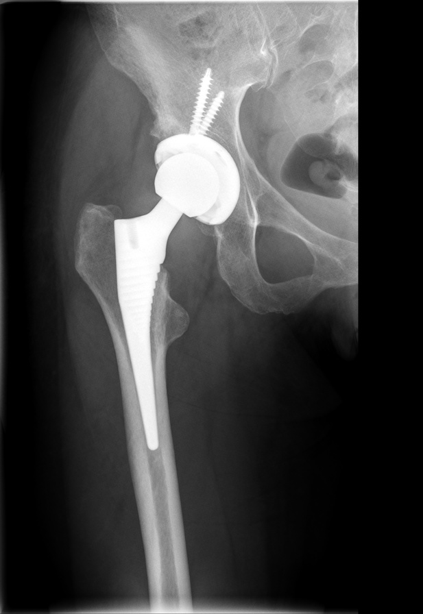 Hip_DepuySynthes_Corail_NilCol</td>
<td align="center" valign="top"><b>Option 1</b>  Hip_SmithAndNephew_Anthology</td>
<td align="center" valign="top"><b>Option 2</b>  Hip_DepuySynthes_Corail_Collar</td>
<td align="center" valign="top"><b>✅ Option 3</b>  Hip_DepuySynthes_Corail_NilCol</td>
<td align="center" valign="top"><b>Option 4</b>  Hip_SmithAndNephew_Polarstem_NilCol</td>
<td align="center" valign="top"><b>Option 5</b>  Hip_Stryker_Exeter</td>
<td align="center" valign="middle"><b>Option 6</b>  <i>None of the above</i></td>
</tr></table>

### Q0029 · correct: option 4 · `Hip_DepuySynthes_Corail_NilCol`

<table><tr>
<td align="center" valign="top"><b>Query</b> 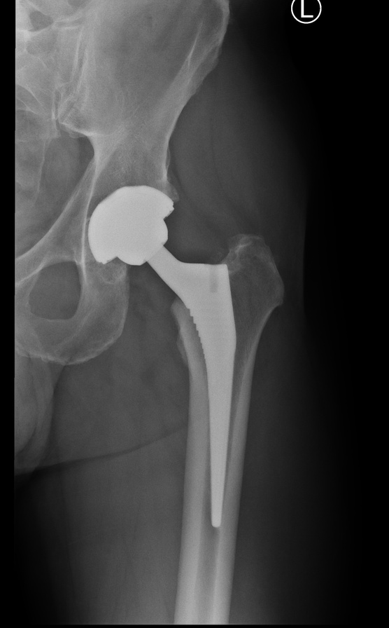 Hip_DepuySynthes_Corail_NilCol</td>
<td align="center" valign="top"><b>Option 1</b>  Hip_SmithAndNephew_Polarstem_NilCol</td>
<td align="center" valign="top"><b>Option 2</b>  Hip_JRIOrtho_FurlongEvolution_NilCol</td>
<td align="center" valign="top"><b>Option 3</b>  Hip_DepuySynthes_Corail_Collar</td>
<td align="center" valign="top"><b>✅ Option 4</b>  Hip_DepuySynthes_Corail_NilCol</td>
<td align="center" valign="top"><b>Option 5</b>  Hip_Stryker_Exeter</td>
<td align="center" valign="middle"><b>Option 6</b>  <i>None of the above</i></td>
</tr></table>

### Q0030 · correct: option 3 · `Hip_Stryker_Exeter`

<table><tr>
<td align="center" valign="top"><b>Query</b> 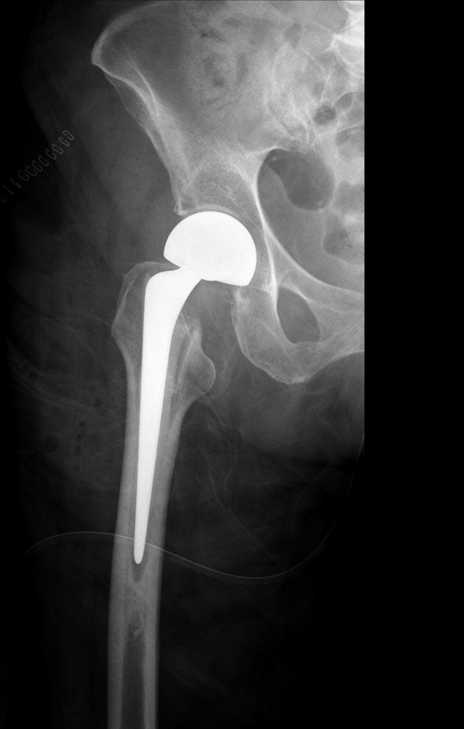 Hip_Stryker_Exeter</td>
<td align="center" valign="top"><b>Option 1</b>  Hip_DepuySynthes_Corail_NilCol</td>
<td align="center" valign="top"><b>Option 2</b>  Hip_SmithAndNephew_Polarstem_NilCol</td>
<td align="center" valign="top"><b>✅ Option 3</b> 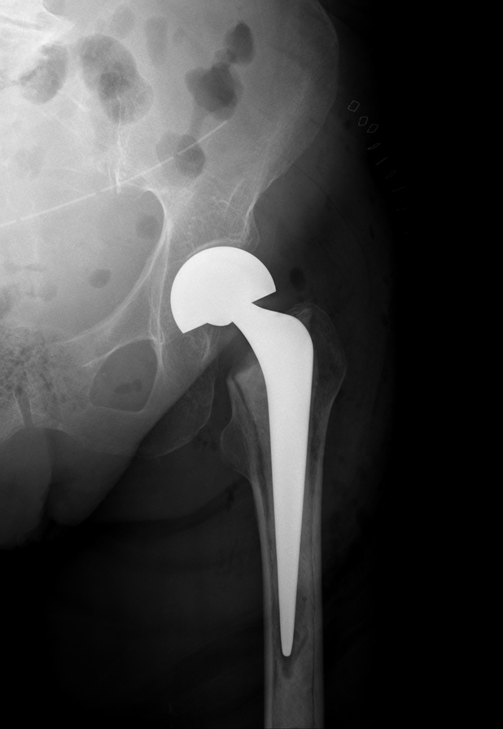 Hip_Stryker_Exeter</td>
<td align="center" valign="top"><b>Option 4</b> 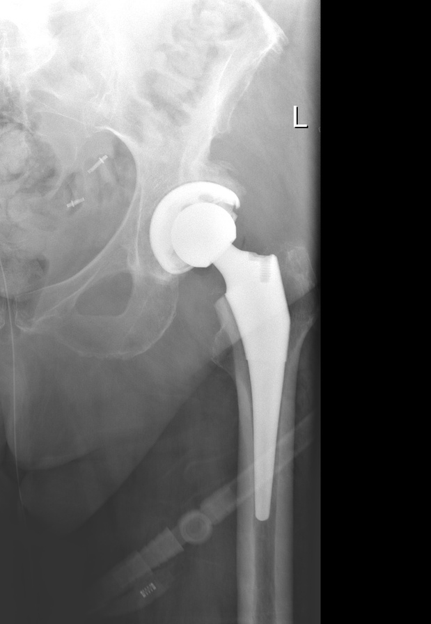 Hip_SmithAndNephew_Anthology</td>
<td align="center" valign="top"><b>Option 5</b>  Hip_DepuySynthes_Corail_Collar</td>
<td align="center" valign="middle"><b>Option 6</b>  <i>None of the above</i></td>
</tr></table>

### Q0031 · correct: option 4 · `Hip_Stryker_Exeter`

<table><tr>
<td align="center" valign="top"><b>Query</b> 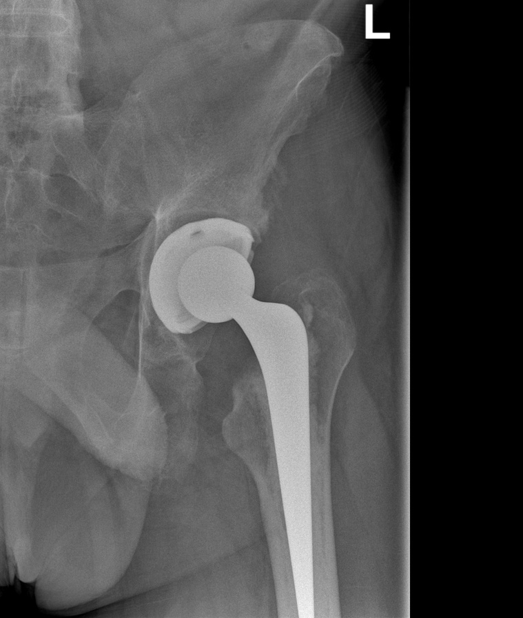 Hip_Stryker_Exeter</td>
<td align="center" valign="top"><b>Option 1</b>  Hip_Stryker_AccoladeII</td>
<td align="center" valign="top"><b>Option 2</b>  Hip_SmithAndNephew_Polarstem_NilCol</td>
<td align="center" valign="top"><b>Option 3</b>  Hip_DepuySynthes_Corail_NilCol</td>
<td align="center" valign="top"><b>✅ Option 4</b>  Hip_Stryker_Exeter</td>
<td align="center" valign="top"><b>Option 5</b>  Hip_SmithAndNephew_Anthology</td>
<td align="center" valign="middle"><b>Option 6</b>  <i>None of the above</i></td>
</tr></table>

### Q0032 · correct: option 3 · `Hip_Stryker_Exeter`

<table><tr>
<td align="center" valign="top"><b>Query</b> 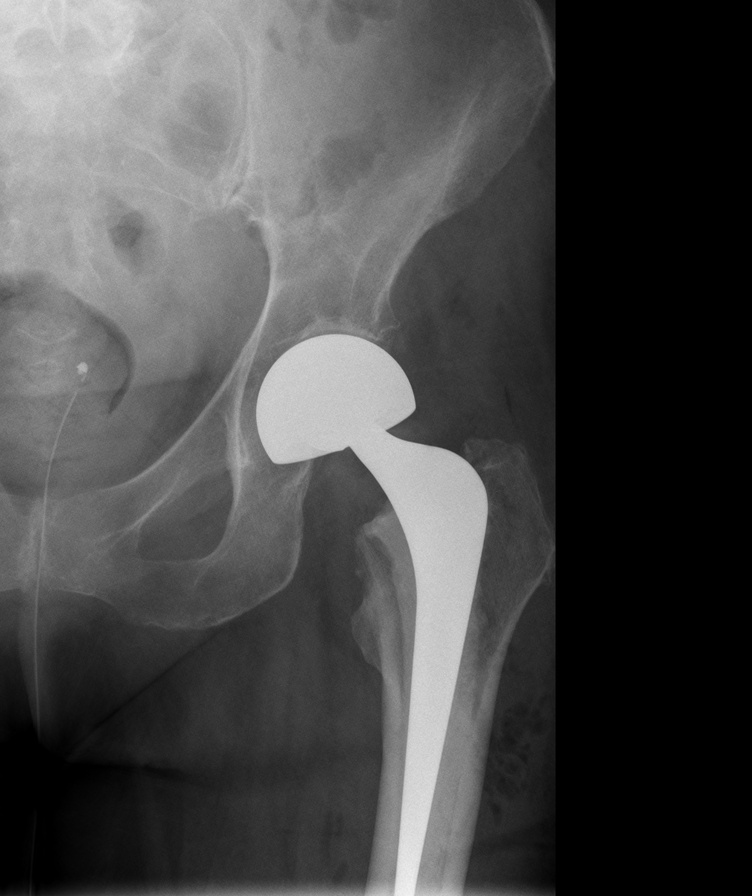 Hip_Stryker_Exeter</td>
<td align="center" valign="top"><b>Option 1</b>  Hip_Stryker_AccoladeII</td>
<td align="center" valign="top"><b>Option 2</b>  Hip_SmithAndNephew_Anthology</td>
<td align="center" valign="top"><b>✅ Option 3</b>  Hip_Stryker_Exeter</td>
<td align="center" valign="top"><b>Option 4</b>  Hip_SmithAndNephew_Polarstem_NilCol</td>
<td align="center" valign="top"><b>Option 5</b>  Hip_DepuySynthes_Corail_Collar</td>
<td align="center" valign="middle"><b>Option 6</b>  <i>None of the above</i></td>
</tr></table>

### Q0033 · correct: option 2 · `Hip_Stryker_Exeter`

<table><tr>
<td align="center" valign="top"><b>Query</b>  Hip_Stryker_Exeter</td>
<td align="center" valign="top"><b>Option 1</b>  Hip_SmithAndNephew_Polarstem_NilCol</td>
<td align="center" valign="top"><b>✅ Option 2</b>  Hip_Stryker_Exeter</td>
<td align="center" valign="top"><b>Option 3</b>  Hip_JRIOrtho_FurlongEvolution_Collar</td>
<td align="center" valign="top"><b>Option 4</b>  Hip_DepuySynthes_Corail_NilCol</td>
<td align="center" valign="top"><b>Option 5</b>  Hip_DepuySynthes_Corail_Collar</td>
<td align="center" valign="middle"><b>Option 6</b>  <i>None of the above</i></td>
</tr></table>

### Q0034 · correct: option 1 · `Hip_Stryker_Exeter`

<table><tr>
<td align="center" valign="top"><b>Query</b>  Hip_Stryker_Exeter</td>
<td align="center" valign="top"><b>✅ Option 1</b>  Hip_Stryker_Exeter</td>
<td align="center" valign="top"><b>Option 2</b>  Hip_JRIOrtho_FurlongEvolution_NilCol</td>
<td align="center" valign="top"><b>Option 3</b>  Hip_SmithAndNephew_Anthology</td>
<td align="center" valign="top"><b>Option 4</b>  Hip_JRIOrtho_FurlongEvolution_Collar</td>
<td align="center" valign="top"><b>Option 5</b>  Hip_SmithAndNephew_Polarstem_NilCol</td>
<td align="center" valign="middle"><b>Option 6</b>  <i>None of the above</i></td>
</tr></table>

### Q0035 · correct: option 5 · `Hip_Stryker_Exeter`

<table><tr>
<td align="center" valign="top"><b>Query</b>  Hip_Stryker_Exeter</td>
<td align="center" valign="top"><b>Option 1</b>  Hip_DepuySynthes_Corail_NilCol</td>
<td align="center" valign="top"><b>Option 2</b>  Hip_SmithAndNephew_Anthology</td>
<td align="center" valign="top"><b>Option 3</b>  Hip_JRIOrtho_FurlongEvolution_Collar</td>
<td align="center" valign="top"><b>Option 4</b>  Hip_DepuySynthes_Corail_Collar</td>
<td align="center" valign="top"><b>✅ Option 5</b>  Hip_Stryker_Exeter</td>
<td align="center" valign="middle"><b>Option 6</b>  <i>None of the above</i></td>
</tr></table>

### Q0036 · correct: option 3 · `Hip_Stryker_Exeter`

<table><tr>
<td align="center" valign="top"><b>Query</b>  Hip_Stryker_Exeter</td>
<td align="center" valign="top"><b>Option 1</b>  Hip_SmithAndNephew_Anthology</td>
<td align="center" valign="top"><b>Option 2</b>  Hip_Stryker_AccoladeII</td>
<td align="center" valign="top"><b>✅ Option 3</b>  Hip_Stryker_Exeter</td>
<td align="center" valign="top"><b>Option 4</b>  Hip_SmithAndNephew_Polarstem_NilCol</td>
<td align="center" valign="top"><b>Option 5</b>  Hip_DepuySynthes_Corail_NilCol</td>
<td align="center" valign="middle"><b>Option 6</b>  <i>None of the above</i></td>
</tr></table>

### Q0037 · correct: option 2 · `Hip_Stryker_Exeter`

<table><tr>
<td align="center" valign="top"><b>Query</b>  Hip_Stryker_Exeter</td>
<td align="center" valign="top"><b>Option 1</b>  Hip_DepuySynthes_Corail_Collar</td>
<td align="center" valign="top"><b>✅ Option 2</b>  Hip_Stryker_Exeter</td>
<td align="center" valign="top"><b>Option 3</b>  Hip_SmithAndNephew_Anthology</td>
<td align="center" valign="top"><b>Option 4</b>  Hip_DepuySynthes_Corail_NilCol</td>
<td align="center" valign="top"><b>Option 5</b>  Hip_SmithAndNephew_Polarstem_NilCol</td>
<td align="center" valign="middle"><b>Option 6</b>  <i>None of the above</i></td>
</tr></table>

### Q0038 · correct: option 1 · `Hip_Stryker_Exeter`

<table><tr>
<td align="center" valign="top"><b>Query</b>  Hip_Stryker_Exeter</td>
<td align="center" valign="top"><b>✅ Option 1</b>  Hip_Stryker_Exeter</td>
<td align="center" valign="top"><b>Option 2</b>  Hip_SmithAndNephew_Polarstem_NilCol</td>
<td align="center" valign="top"><b>Option 3</b>  Hip_Stryker_AccoladeII</td>
<td align="center" valign="top"><b>Option 4</b>  Hip_DepuySynthes_Corail_Collar</td>
<td align="center" valign="top"><b>Option 5</b>  Hip_DepuySynthes_Corail_NilCol</td>
<td align="center" valign="middle"><b>Option 6</b>  <i>None of the above</i></td>
</tr></table>

### Q0039 · correct: option 4 · `Hip_Stryker_Exeter`

<table><tr>
<td align="center" valign="top"><b>Query</b>  Hip_Stryker_Exeter</td>
<td align="center" valign="top"><b>Option 1</b>  Hip_DepuySynthes_Corail_NilCol</td>
<td align="center" valign="top"><b>Option 2</b>  Hip_JRIOrtho_FurlongEvolution_NilCol</td>
<td align="center" valign="top"><b>Option 3</b>  Hip_SmithAndNephew_Polarstem_NilCol</td>
<td align="center" valign="top"><b>✅ Option 4</b>  Hip_Stryker_Exeter</td>
<td align="center" valign="top"><b>Option 5</b>  Hip_SmithAndNephew_Anthology</td>
<td align="center" valign="middle"><b>Option 6</b>  <i>None of the above</i></td>
</tr></table>

### Q0040 · correct: option 5 · `Hip_Stryker_Exeter`

<table><tr>
<td align="center" valign="top"><b>Query</b>  Hip_Stryker_Exeter</td>
<td align="center" valign="top"><b>Option 1</b>  Hip_DepuySynthes_Corail_Collar</td>
<td align="center" valign="top"><b>Option 2</b>  Hip_DepuySynthes_Corail_NilCol</td>
<td align="center" valign="top"><b>Option 3</b>  Hip_SmithAndNephew_Anthology</td>
<td align="center" valign="top"><b>Option 4</b>  Hip_SmithAndNephew_Polarstem_NilCol</td>
<td align="center" valign="top"><b>✅ Option 5</b>  Hip_Stryker_Exeter</td>
<td align="center" valign="middle"><b>Option 6</b>  <i>None of the above</i></td>
</tr></table>

### Q0041 · correct: option 2 · `Hip_Stryker_Exeter`

<table><tr>
<td align="center" valign="top"><b>Query</b>  Hip_Stryker_Exeter</td>
<td align="center" valign="top"><b>Option 1</b>  Hip_JRIOrtho_FurlongEvolution_NilCol</td>
<td align="center" valign="top"><b>✅ Option 2</b>  Hip_Stryker_Exeter</td>
<td align="center" valign="top"><b>Option 3</b>  Hip_DepuySynthes_Corail_Collar</td>
<td align="center" valign="top"><b>Option 4</b>  Hip_DepuySynthes_Corail_NilCol</td>
<td align="center" valign="top"><b>Option 5</b>  Hip_SmithAndNephew_Polarstem_NilCol</td>
<td align="center" valign="middle"><b>Option 6</b>  <i>None of the above</i></td>
</tr></table>

### Q0042 · correct: option 3 · `Hip_Stryker_Exeter`

<table><tr>
<td align="center" valign="top"><b>Query</b>  Hip_Stryker_Exeter</td>
<td align="center" valign="top"><b>Option 1</b>  Hip_Stryker_AccoladeII</td>
<td align="center" valign="top"><b>Option 2</b>  Hip_DepuySynthes_Corail_NilCol</td>
<td align="center" valign="top"><b>✅ Option 3</b>  Hip_Stryker_Exeter</td>
<td align="center" valign="top"><b>Option 4</b>  Hip_JRIOrtho_FurlongEvolution_NilCol</td>
<td align="center" valign="top"><b>Option 5</b>  Hip_SmithAndNephew_Polarstem_NilCol</td>
<td align="center" valign="middle"><b>Option 6</b>  <i>None of the above</i></td>
</tr></table>

### Q0043 · correct: option 1 · `Hip_Stryker_Exeter`

<table><tr>
<td align="center" valign="top"><b>Query</b>  Hip_Stryker_Exeter</td>
<td align="center" valign="top"><b>✅ Option 1</b>  Hip_Stryker_Exeter</td>
<td align="center" valign="top"><b>Option 2</b>  Hip_SmithAndNephew_Anthology</td>
<td align="center" valign="top"><b>Option 3</b>  Hip_SmithAndNephew_Polarstem_NilCol</td>
<td align="center" valign="top"><b>Option 4</b>  Hip_DepuySynthes_Corail_Collar</td>
<td align="center" valign="top"><b>Option 5</b>  Hip_DepuySynthes_Corail_NilCol</td>
<td align="center" valign="middle"><b>Option 6</b>  <i>None of the above</i></td>
</tr></table>

### Q0044 · correct: option 3 · `Hip_Stryker_Exeter`

<table><tr>
<td align="center" valign="top"><b>Query</b>  Hip_Stryker_Exeter</td>
<td align="center" valign="top"><b>Option 1</b>  Hip_Stryker_AccoladeII</td>
<td align="center" valign="top"><b>Option 2</b>  Hip_DepuySynthes_Corail_NilCol</td>
<td align="center" valign="top"><b>✅ Option 3</b>  Hip_Stryker_Exeter</td>
<td align="center" valign="top"><b>Option 4</b>  Hip_SmithAndNephew_Polarstem_NilCol</td>
<td align="center" valign="top"><b>Option 5</b>  Hip_SmithAndNephew_Anthology</td>
<td align="center" valign="middle"><b>Option 6</b>  <i>None of the above</i></td>
</tr></table>

### Q0045 · correct: option 2 · `Hip_SmithAndNephew_Polarstem_NilCol`

<table><tr>
<td align="center" valign="top"><b>Query</b>  Hip_SmithAndNephew_Polarstem_NilCol</td>
<td align="center" valign="top"><b>Option 1</b>  Hip_Stryker_AccoladeII</td>
<td align="center" valign="top"><b>✅ Option 2</b>  Hip_SmithAndNephew_Polarstem_NilCol</td>
<td align="center" valign="top"><b>Option 3</b>  Hip_SmithAndNephew_Anthology</td>
<td align="center" valign="top"><b>Option 4</b>  Hip_Stryker_Exeter</td>
<td align="center" valign="top"><b>Option 5</b>  Hip_DepuySynthes_Corail_NilCol</td>
<td align="center" valign="middle"><b>Option 6</b>  <i>None of the above</i></td>
</tr></table>

### Q0046 · correct: option 2 · `Hip_SmithAndNephew_Polarstem_NilCol`

<table><tr>
<td align="center" valign="top"><b>Query</b>  Hip_SmithAndNephew_Polarstem_NilCol</td>
<td align="center" valign="top"><b>Option 1</b>  Hip_JRIOrtho_FurlongEvolution_NilCol</td>
<td align="center" valign="top"><b>✅ Option 2</b>  Hip_SmithAndNephew_Polarstem_NilCol</td>
<td align="center" valign="top"><b>Option 3</b>  Hip_JRIOrtho_FurlongEvolution_Collar</td>
<td align="center" valign="top"><b>Option 4</b>  Hip_DepuySynthes_Corail_Collar</td>
<td align="center" valign="top"><b>Option 5</b>  Hip_DepuySynthes_Corail_NilCol</td>
<td align="center" valign="middle"><b>Option 6</b>  <i>None of the above</i></td>
</tr></table>

### Q0047 · correct: option 2 · `Hip_SmithAndNephew_Polarstem_NilCol`

<table><tr>
<td align="center" valign="top"><b>Query</b>  Hip_SmithAndNephew_Polarstem_NilCol</td>
<td align="center" valign="top"><b>Option 1</b>  Hip_SmithAndNephew_Anthology</td>
<td align="center" valign="top"><b>✅ Option 2</b>  Hip_SmithAndNephew_Polarstem_NilCol</td>
<td align="center" valign="top"><b>Option 3</b>  Hip_Stryker_Exeter</td>
<td align="center" valign="top"><b>Option 4</b>  Hip_Stryker_AccoladeII</td>
<td align="center" valign="top"><b>Option 5</b>  Hip_JRIOrtho_FurlongEvolution_NilCol</td>
<td align="center" valign="middle"><b>Option 6</b>  <i>None of the above</i></td>
</tr></table>

### Q0048 · correct: option 2 · `Hip_SmithAndNephew_Polarstem_NilCol`

<table><tr>
<td align="center" valign="top"><b>Query</b>  Hip_SmithAndNephew_Polarstem_NilCol</td>
<td align="center" valign="top"><b>Option 1</b>  Hip_JRIOrtho_FurlongEvolution_NilCol</td>
<td align="center" valign="top"><b>✅ Option 2</b>  Hip_SmithAndNephew_Polarstem_NilCol</td>
<td align="center" valign="top"><b>Option 3</b>  Hip_DepuySynthes_Corail_NilCol</td>
<td align="center" valign="top"><b>Option 4</b>  Hip_SmithAndNephew_Anthology</td>
<td align="center" valign="top"><b>Option 5</b>  Hip_Stryker_AccoladeII</td>
<td align="center" valign="middle"><b>Option 6</b>  <i>None of the above</i></td>
</tr></table>

### Q0049 · correct: option 1 · `Hip_SmithAndNephew_Polarstem_NilCol`

<table><tr>
<td align="center" valign="top"><b>Query</b>  Hip_SmithAndNephew_Polarstem_NilCol</td>
<td align="center" valign="top"><b>✅ Option 1</b>  Hip_SmithAndNephew_Polarstem_NilCol</td>
<td align="center" valign="top"><b>Option 2</b>  Hip_DepuySynthes_Corail_NilCol</td>
<td align="center" valign="top"><b>Option 3</b>  Hip_Stryker_Exeter</td>
<td align="center" valign="top"><b>Option 4</b>  Hip_DepuySynthes_Corail_Collar</td>
<td align="center" valign="top"><b>Option 5</b>  Hip_Stryker_AccoladeII</td>
<td align="center" valign="middle"><b>Option 6</b>  <i>None of the above</i></td>
</tr></table>

### Q0050 · correct: option 3 · `Hip_SmithAndNephew_Polarstem_NilCol`

<table><tr>
<td align="center" valign="top"><b>Query</b>  Hip_SmithAndNephew_Polarstem_NilCol</td>
<td align="center" valign="top"><b>Option 1</b>  Hip_DepuySynthes_Corail_NilCol</td>
<td align="center" valign="top"><b>Option 2</b>  Hip_Stryker_AccoladeII</td>
<td align="center" valign="top"><b>✅ Option 3</b>  Hip_SmithAndNephew_Polarstem_NilCol</td>
<td align="center" valign="top"><b>Option 4</b>  Hip_SmithAndNephew_Anthology</td>
<td align="center" valign="top"><b>Option 5</b>  Hip_JRIOrtho_FurlongEvolution_NilCol</td>
<td align="center" valign="middle"><b>Option 6</b>  <i>None of the above</i></td>
</tr></table>

