# OrthoNet hip · query set `test` · page 2/3

[← all pages](README.md)

### Q0051 · correct: option 1 · `Hip_SmithAndNephew_Polarstem_NilCol`

<table><tr>
<td align="center" valign="top"><b>Query</b> 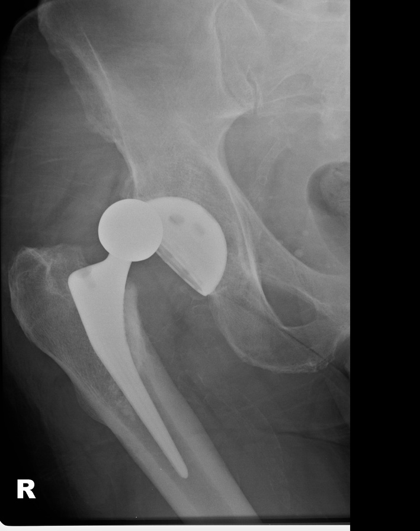 Hip_SmithAndNephew_Polarstem_NilCol</td>
<td align="center" valign="top"><b>✅ Option 1</b> 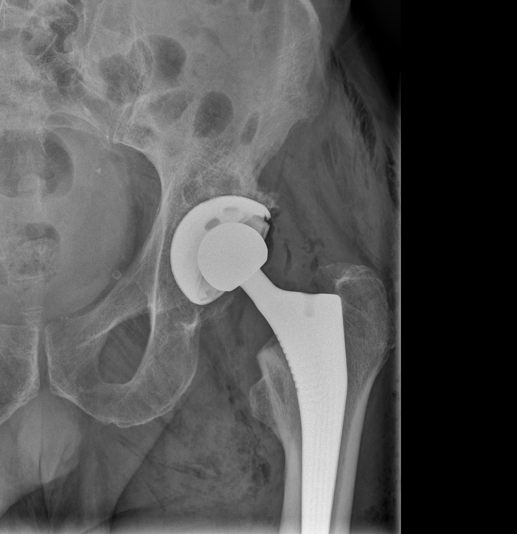 Hip_SmithAndNephew_Polarstem_NilCol</td>
<td align="center" valign="top"><b>Option 2</b>  Hip_JRIOrtho_FurlongEvolution_NilCol</td>
<td align="center" valign="top"><b>Option 3</b> 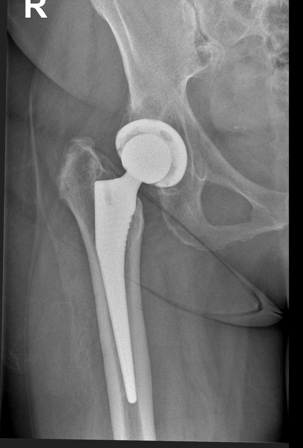 Hip_DepuySynthes_Corail_NilCol</td>
<td align="center" valign="top"><b>Option 4</b>  Hip_Stryker_AccoladeII</td>
<td align="center" valign="top"><b>Option 5</b>  Hip_Stryker_Exeter</td>
<td align="center" valign="middle"><b>Option 6</b>  <i>None of the above</i></td>
</tr></table>

### Q0052 · correct: option 1 · `Hip_SmithAndNephew_Polarstem_NilCol`

<table><tr>
<td align="center" valign="top"><b>Query</b> 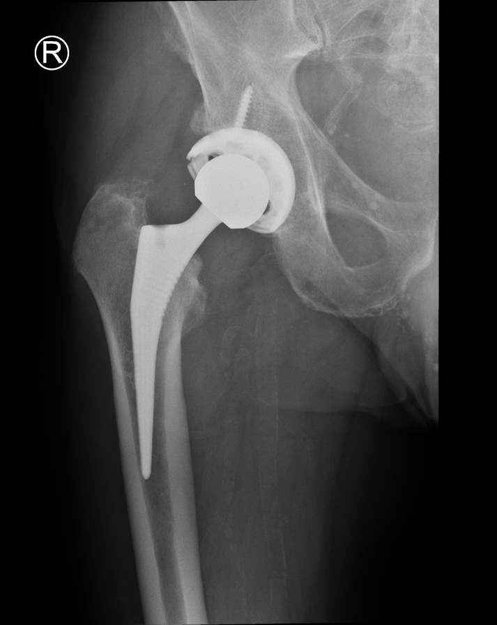 Hip_SmithAndNephew_Polarstem_NilCol</td>
<td align="center" valign="top"><b>✅ Option 1</b>  Hip_SmithAndNephew_Polarstem_NilCol</td>
<td align="center" valign="top"><b>Option 2</b>  Hip_SmithAndNephew_Anthology</td>
<td align="center" valign="top"><b>Option 3</b> 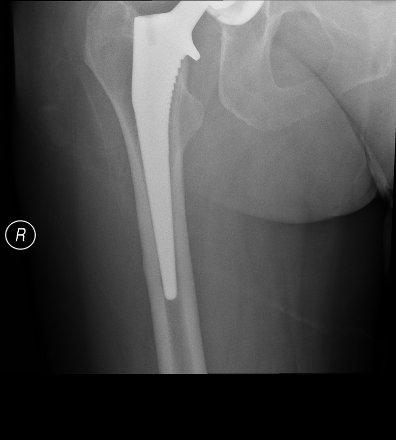 Hip_DepuySynthes_Corail_Collar</td>
<td align="center" valign="top"><b>Option 4</b>  Hip_JRIOrtho_FurlongEvolution_NilCol</td>
<td align="center" valign="top"><b>Option 5</b>  Hip_DepuySynthes_Corail_NilCol</td>
<td align="center" valign="middle"><b>Option 6</b>  <i>None of the above</i></td>
</tr></table>

### Q0053 · correct: option 4 · `Hip_SmithAndNephew_Polarstem_NilCol`

<table><tr>
<td align="center" valign="top"><b>Query</b> 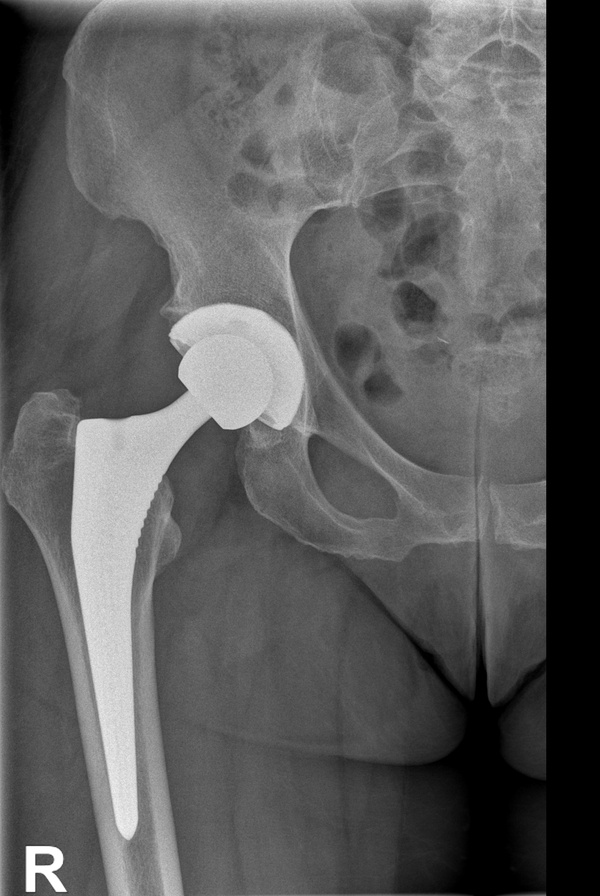 Hip_SmithAndNephew_Polarstem_NilCol</td>
<td align="center" valign="top"><b>Option 1</b>  Hip_DepuySynthes_Corail_NilCol</td>
<td align="center" valign="top"><b>Option 2</b> 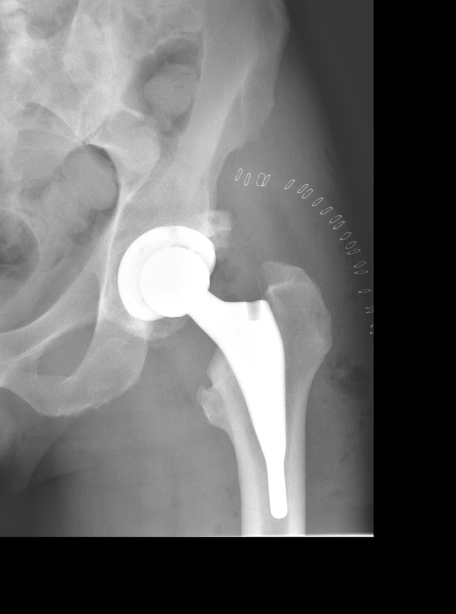 Hip_JRIOrtho_FurlongEvolution_NilCol</td>
<td align="center" valign="top"><b>Option 3</b> 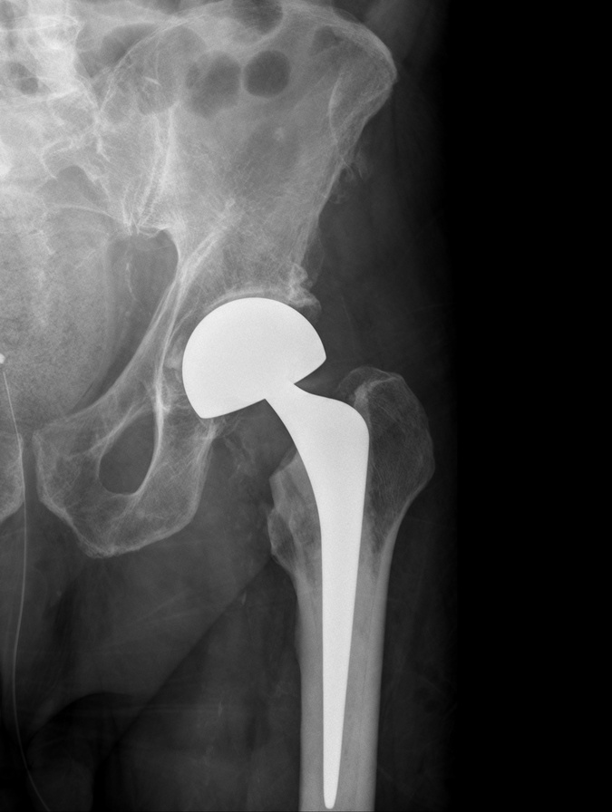 Hip_Stryker_Exeter</td>
<td align="center" valign="top"><b>✅ Option 4</b>  Hip_SmithAndNephew_Polarstem_NilCol</td>
<td align="center" valign="top"><b>Option 5</b>  Hip_Stryker_AccoladeII</td>
<td align="center" valign="middle"><b>Option 6</b>  <i>None of the above</i></td>
</tr></table>

### Q0054 · correct: option 1 · `Hip_SmithAndNephew_Polarstem_NilCol`

<table><tr>
<td align="center" valign="top"><b>Query</b> 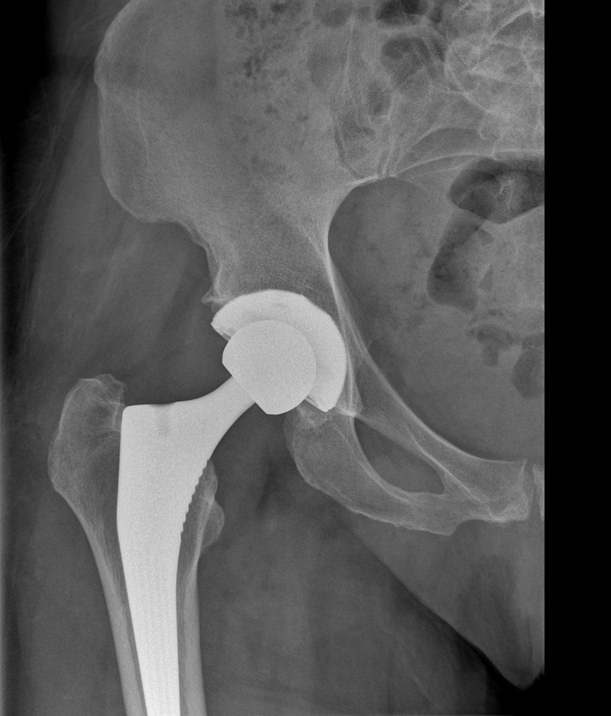 Hip_SmithAndNephew_Polarstem_NilCol</td>
<td align="center" valign="top"><b>✅ Option 1</b> 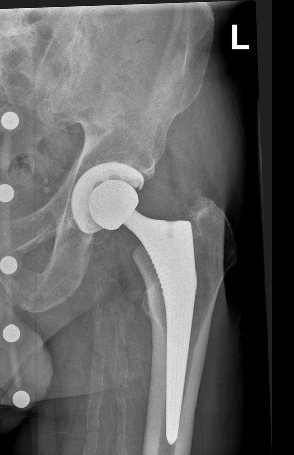 Hip_SmithAndNephew_Polarstem_NilCol</td>
<td align="center" valign="top"><b>Option 2</b>  Hip_JRIOrtho_FurlongEvolution_NilCol</td>
<td align="center" valign="top"><b>Option 3</b>  Hip_DepuySynthes_Corail_NilCol</td>
<td align="center" valign="top"><b>Option 4</b>  Hip_Stryker_Exeter</td>
<td align="center" valign="top"><b>Option 5</b>  Hip_Stryker_AccoladeII</td>
<td align="center" valign="middle"><b>Option 6</b>  <i>None of the above</i></td>
</tr></table>

### Q0055 · correct: option 3 · `Hip_SmithAndNephew_Polarstem_NilCol`

<table><tr>
<td align="center" valign="top"><b>Query</b> 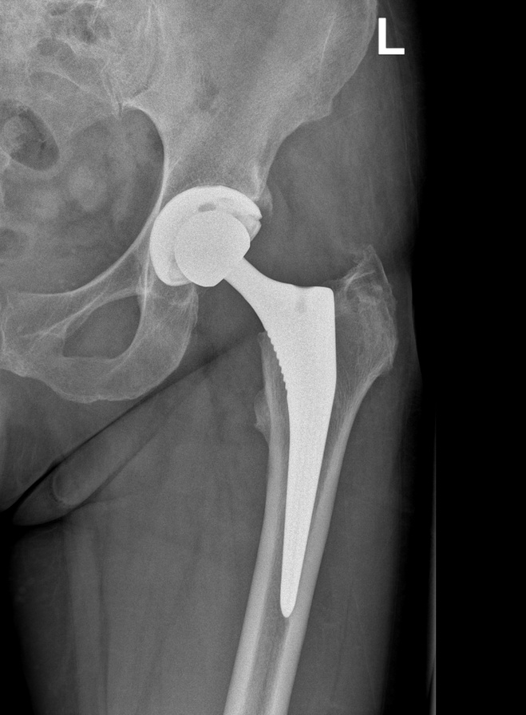 Hip_SmithAndNephew_Polarstem_NilCol</td>
<td align="center" valign="top"><b>Option 1</b>  Hip_Stryker_Exeter</td>
<td align="center" valign="top"><b>Option 2</b> 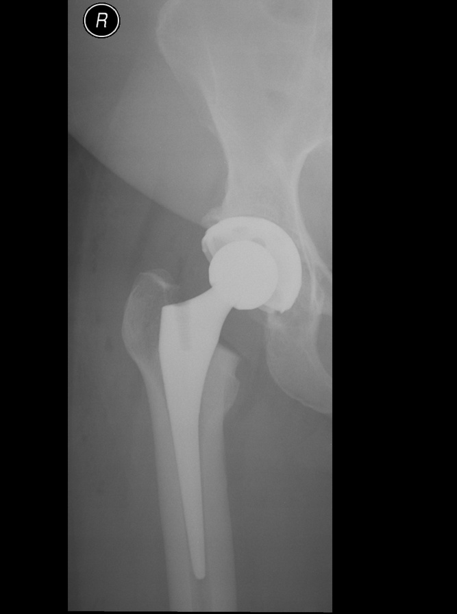 Hip_Stryker_AccoladeII</td>
<td align="center" valign="top"><b>✅ Option 3</b>  Hip_SmithAndNephew_Polarstem_NilCol</td>
<td align="center" valign="top"><b>Option 4</b>  Hip_DepuySynthes_Corail_NilCol</td>
<td align="center" valign="top"><b>Option 5</b>  Hip_DepuySynthes_Corail_Collar</td>
<td align="center" valign="middle"><b>Option 6</b>  <i>None of the above</i></td>
</tr></table>

### Q0056 · correct: option 3 · `Hip_SmithAndNephew_Polarstem_NilCol`

<table><tr>
<td align="center" valign="top"><b>Query</b> 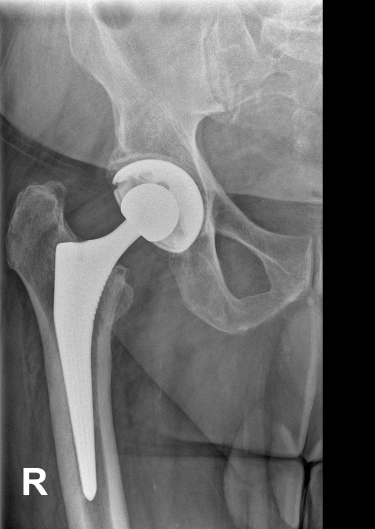 Hip_SmithAndNephew_Polarstem_NilCol</td>
<td align="center" valign="top"><b>Option 1</b>  Hip_DepuySynthes_Corail_NilCol</td>
<td align="center" valign="top"><b>Option 2</b>  Hip_Stryker_Exeter</td>
<td align="center" valign="top"><b>✅ Option 3</b>  Hip_SmithAndNephew_Polarstem_NilCol</td>
<td align="center" valign="top"><b>Option 4</b> 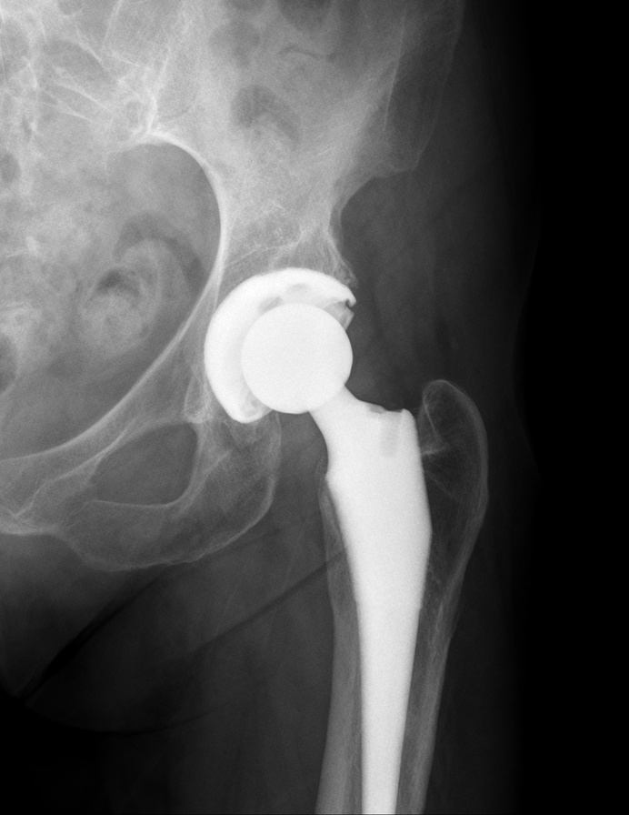 Hip_SmithAndNephew_Anthology</td>
<td align="center" valign="top"><b>Option 5</b>  Hip_Stryker_AccoladeII</td>
<td align="center" valign="middle"><b>Option 6</b>  <i>None of the above</i></td>
</tr></table>

### Q0057 · correct: option 2 · `Hip_SmithAndNephew_Polarstem_NilCol`

<table><tr>
<td align="center" valign="top"><b>Query</b> 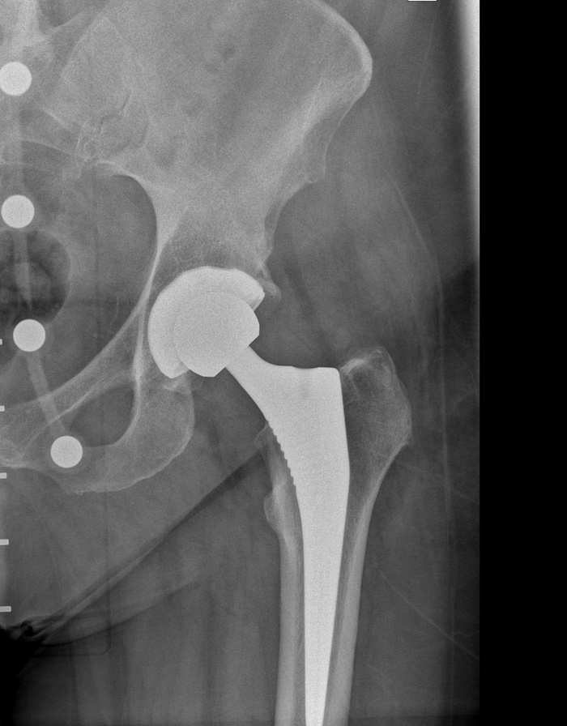 Hip_SmithAndNephew_Polarstem_NilCol</td>
<td align="center" valign="top"><b>Option 1</b>  Hip_Stryker_Exeter</td>
<td align="center" valign="top"><b>✅ Option 2</b>  Hip_SmithAndNephew_Polarstem_NilCol</td>
<td align="center" valign="top"><b>Option 3</b>  Hip_JRIOrtho_FurlongEvolution_NilCol</td>
<td align="center" valign="top"><b>Option 4</b>  Hip_DepuySynthes_Corail_NilCol</td>
<td align="center" valign="top"><b>Option 5</b> 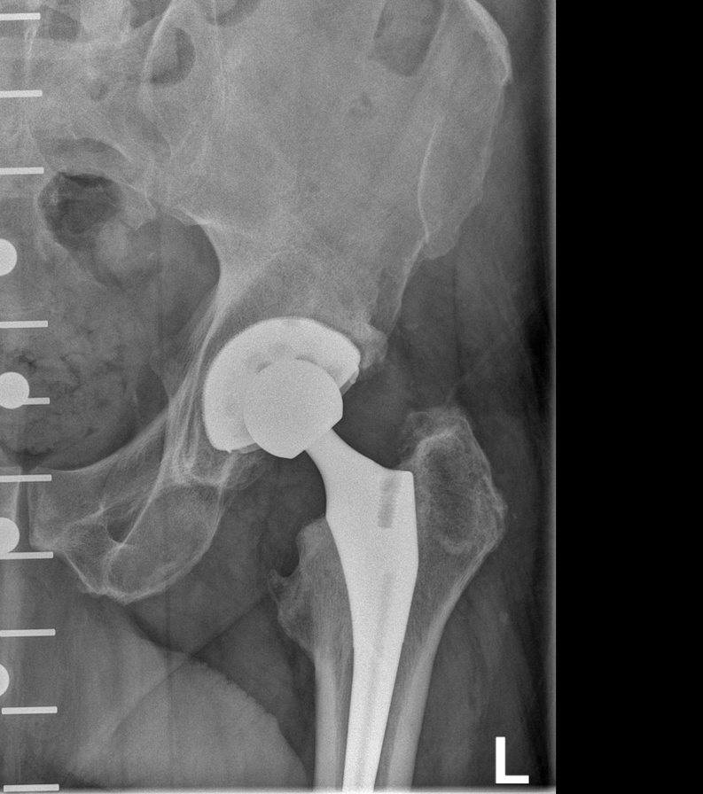 Hip_Stryker_AccoladeII</td>
<td align="center" valign="middle"><b>Option 6</b>  <i>None of the above</i></td>
</tr></table>

### Q0058 · correct: option 2 · `Hip_SmithAndNephew_Polarstem_NilCol`

<table><tr>
<td align="center" valign="top"><b>Query</b> 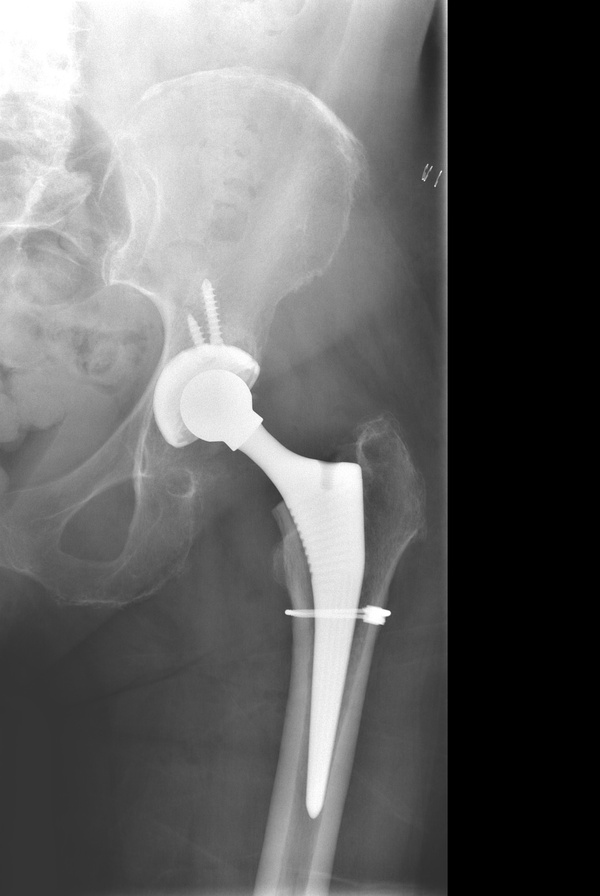 Hip_SmithAndNephew_Polarstem_NilCol</td>
<td align="center" valign="top"><b>Option 1</b>  Hip_Stryker_AccoladeII</td>
<td align="center" valign="top"><b>✅ Option 2</b>  Hip_SmithAndNephew_Polarstem_NilCol</td>
<td align="center" valign="top"><b>Option 3</b>  Hip_DepuySynthes_Corail_NilCol</td>
<td align="center" valign="top"><b>Option 4</b>  Hip_SmithAndNephew_Anthology</td>
<td align="center" valign="top"><b>Option 5</b>  Hip_DepuySynthes_Corail_Collar</td>
<td align="center" valign="middle"><b>Option 6</b>  <i>None of the above</i></td>
</tr></table>

### Q0059 · correct: option 5 · `Hip_SmithAndNephew_Polarstem_NilCol`

<table><tr>
<td align="center" valign="top"><b>Query</b> 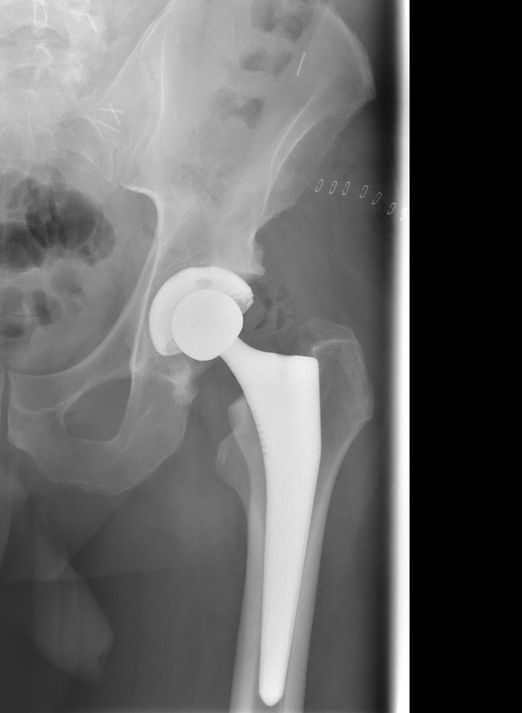 Hip_SmithAndNephew_Polarstem_NilCol</td>
<td align="center" valign="top"><b>Option 1</b>  Hip_DepuySynthes_Corail_NilCol</td>
<td align="center" valign="top"><b>Option 2</b>  Hip_SmithAndNephew_Anthology</td>
<td align="center" valign="top"><b>Option 3</b>  Hip_JRIOrtho_FurlongEvolution_NilCol</td>
<td align="center" valign="top"><b>Option 4</b>  Hip_Stryker_AccoladeII</td>
<td align="center" valign="top"><b>✅ Option 5</b>  Hip_SmithAndNephew_Polarstem_NilCol</td>
<td align="center" valign="middle"><b>Option 6</b>  <i>None of the above</i></td>
</tr></table>

### Q0060 · correct: option 1 · `Hip_DepuySynthes_Corail_Collar`

<table><tr>
<td align="center" valign="top"><b>Query</b> 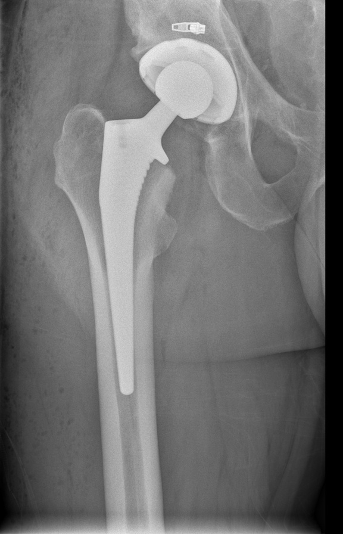 Hip_DepuySynthes_Corail_Collar</td>
<td align="center" valign="top"><b>✅ Option 1</b>  Hip_DepuySynthes_Corail_Collar</td>
<td align="center" valign="top"><b>Option 2</b>  Hip_SmithAndNephew_Anthology</td>
<td align="center" valign="top"><b>Option 3</b>  Hip_SmithAndNephew_Polarstem_NilCol</td>
<td align="center" valign="top"><b>Option 4</b> 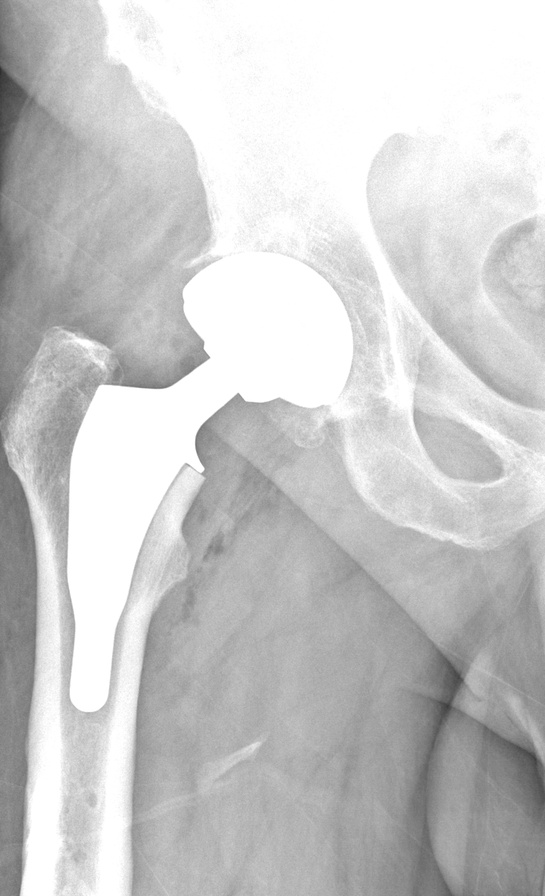 Hip_JRIOrtho_FurlongEvolution_Collar</td>
<td align="center" valign="top"><b>Option 5</b> 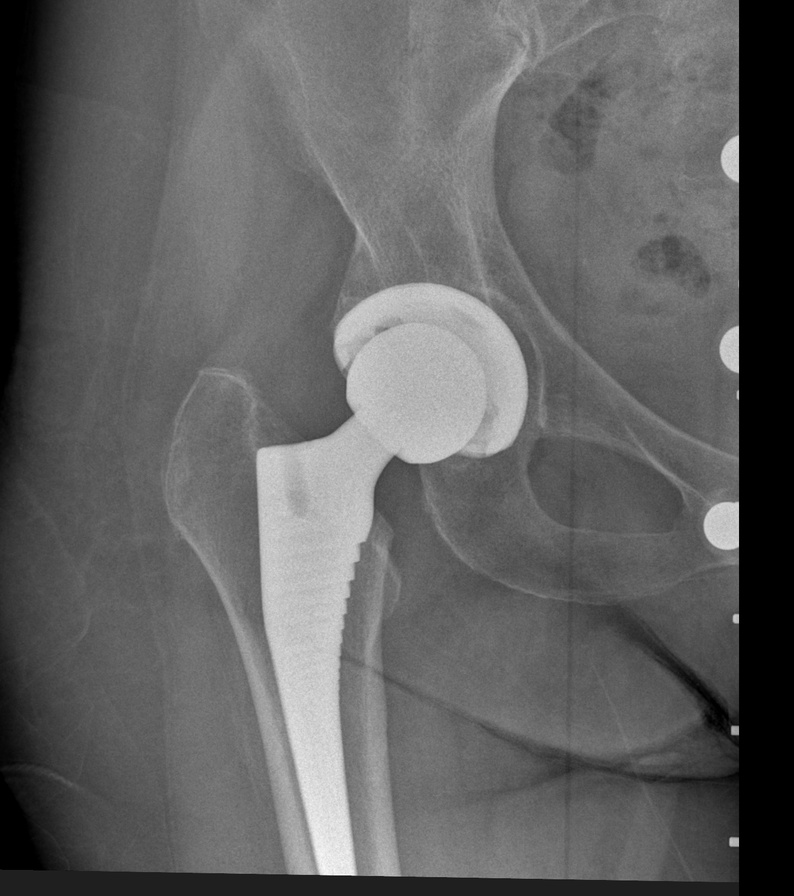 Hip_DepuySynthes_Corail_NilCol</td>
<td align="center" valign="middle"><b>Option 6</b>  <i>None of the above</i></td>
</tr></table>

### Q0061 · correct: option 3 · `Hip_DepuySynthes_Corail_Collar`

<table><tr>
<td align="center" valign="top"><b>Query</b> 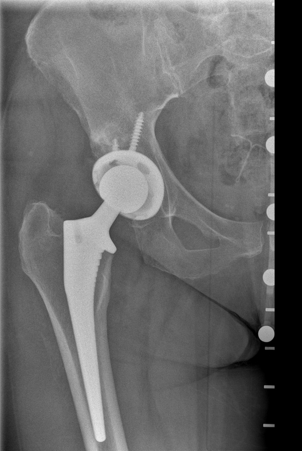 Hip_DepuySynthes_Corail_Collar</td>
<td align="center" valign="top"><b>Option 1</b>  Hip_JRIOrtho_FurlongEvolution_NilCol</td>
<td align="center" valign="top"><b>Option 2</b>  Hip_SmithAndNephew_Anthology</td>
<td align="center" valign="top"><b>✅ Option 3</b>  Hip_DepuySynthes_Corail_Collar</td>
<td align="center" valign="top"><b>Option 4</b>  Hip_SmithAndNephew_Polarstem_NilCol</td>
<td align="center" valign="top"><b>Option 5</b>  Hip_DepuySynthes_Corail_NilCol</td>
<td align="center" valign="middle"><b>Option 6</b>  <i>None of the above</i></td>
</tr></table>

### Q0062 · correct: option 2 · `Hip_DepuySynthes_Corail_Collar`

<table><tr>
<td align="center" valign="top"><b>Query</b> 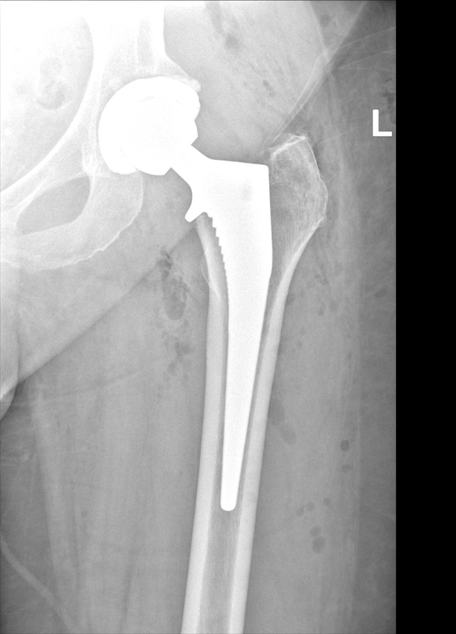 Hip_DepuySynthes_Corail_Collar</td>
<td align="center" valign="top"><b>Option 1</b>  Hip_DepuySynthes_Corail_NilCol</td>
<td align="center" valign="top"><b>✅ Option 2</b>  Hip_DepuySynthes_Corail_Collar</td>
<td align="center" valign="top"><b>Option 3</b>  Hip_SmithAndNephew_Polarstem_NilCol</td>
<td align="center" valign="top"><b>Option 4</b>  Hip_SmithAndNephew_Anthology</td>
<td align="center" valign="top"><b>Option 5</b>  Hip_JRIOrtho_FurlongEvolution_Collar</td>
<td align="center" valign="middle"><b>Option 6</b>  <i>None of the above</i></td>
</tr></table>

### Q0063 · correct: option 1 · `Hip_DepuySynthes_Corail_Collar`

<table><tr>
<td align="center" valign="top"><b>Query</b> 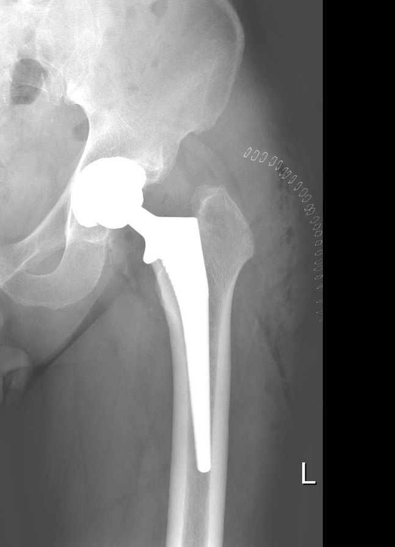 Hip_DepuySynthes_Corail_Collar</td>
<td align="center" valign="top"><b>✅ Option 1</b> 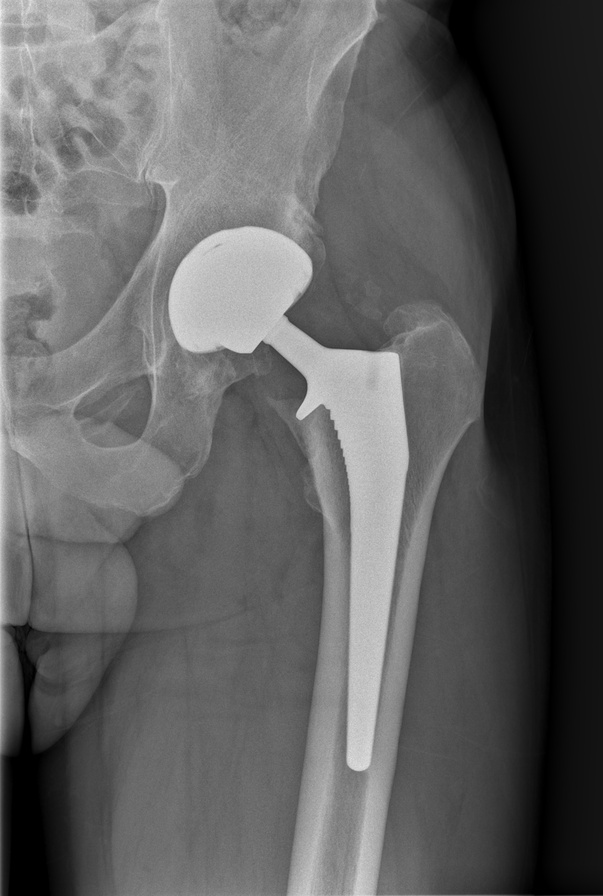 Hip_DepuySynthes_Corail_Collar</td>
<td align="center" valign="top"><b>Option 2</b>  Hip_JRIOrtho_FurlongEvolution_NilCol</td>
<td align="center" valign="top"><b>Option 3</b>  Hip_SmithAndNephew_Polarstem_NilCol</td>
<td align="center" valign="top"><b>Option 4</b>  Hip_DepuySynthes_Corail_NilCol</td>
<td align="center" valign="top"><b>Option 5</b>  Hip_JRIOrtho_FurlongEvolution_Collar</td>
<td align="center" valign="middle"><b>Option 6</b>  <i>None of the above</i></td>
</tr></table>

### Q0064 · correct: option 4 · `Hip_DepuySynthes_Corail_Collar`

<table><tr>
<td align="center" valign="top"><b>Query</b> 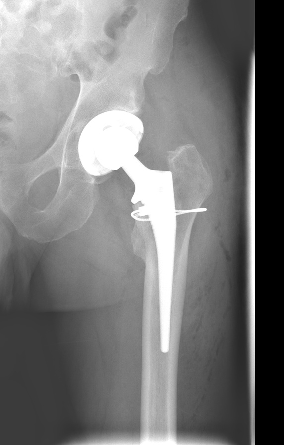 Hip_DepuySynthes_Corail_Collar</td>
<td align="center" valign="top"><b>Option 1</b> 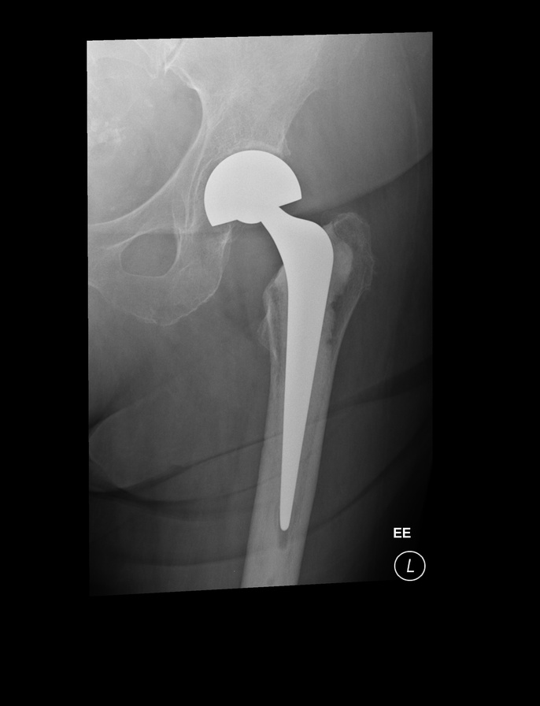 Hip_Stryker_Exeter</td>
<td align="center" valign="top"><b>Option 2</b>  Hip_SmithAndNephew_Anthology</td>
<td align="center" valign="top"><b>Option 3</b>  Hip_JRIOrtho_FurlongEvolution_Collar</td>
<td align="center" valign="top"><b>✅ Option 4</b>  Hip_DepuySynthes_Corail_Collar</td>
<td align="center" valign="top"><b>Option 5</b> 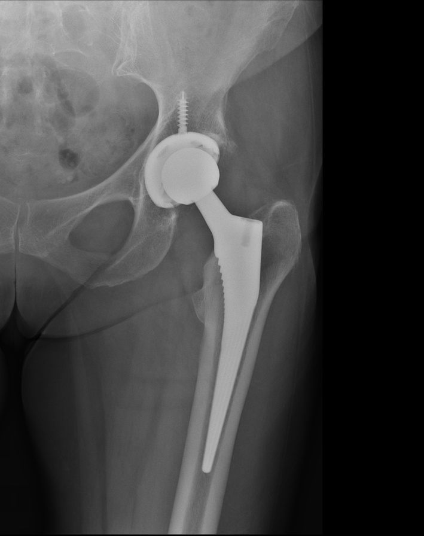 Hip_DepuySynthes_Corail_NilCol</td>
<td align="center" valign="middle"><b>Option 6</b>  <i>None of the above</i></td>
</tr></table>

### Q0065 · correct: option 3 · `Hip_DepuySynthes_Corail_Collar`

<table><tr>
<td align="center" valign="top"><b>Query</b> 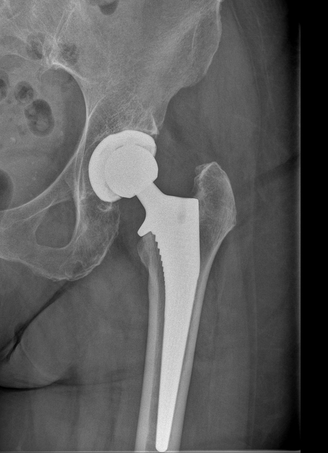 Hip_DepuySynthes_Corail_Collar</td>
<td align="center" valign="top"><b>Option 1</b> 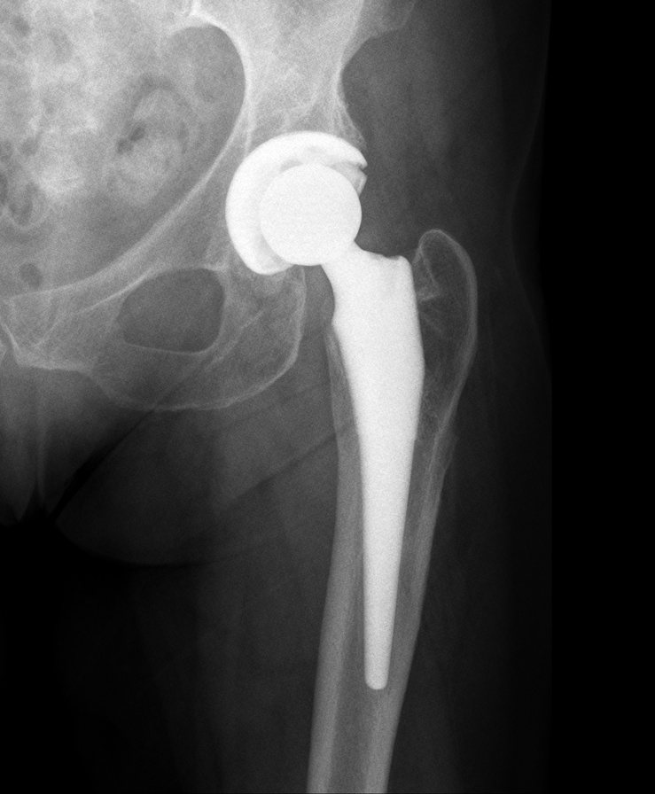 Hip_SmithAndNephew_Anthology</td>
<td align="center" valign="top"><b>Option 2</b>  Hip_Stryker_Exeter</td>
<td align="center" valign="top"><b>✅ Option 3</b>  Hip_DepuySynthes_Corail_Collar</td>
<td align="center" valign="top"><b>Option 4</b>  Hip_DepuySynthes_Corail_NilCol</td>
<td align="center" valign="top"><b>Option 5</b>  Hip_JRIOrtho_FurlongEvolution_Collar</td>
<td align="center" valign="middle"><b>Option 6</b>  <i>None of the above</i></td>
</tr></table>

### Q0066 · correct: option 3 · `Hip_DepuySynthes_Corail_Collar`

<table><tr>
<td align="center" valign="top"><b>Query</b> 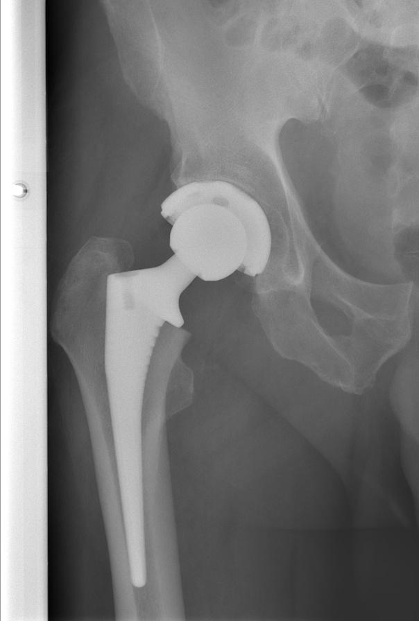 Hip_DepuySynthes_Corail_Collar</td>
<td align="center" valign="top"><b>Option 1</b>  Hip_JRIOrtho_FurlongEvolution_Collar</td>
<td align="center" valign="top"><b>Option 2</b>  Hip_Stryker_AccoladeII</td>
<td align="center" valign="top"><b>✅ Option 3</b>  Hip_DepuySynthes_Corail_Collar</td>
<td align="center" valign="top"><b>Option 4</b> 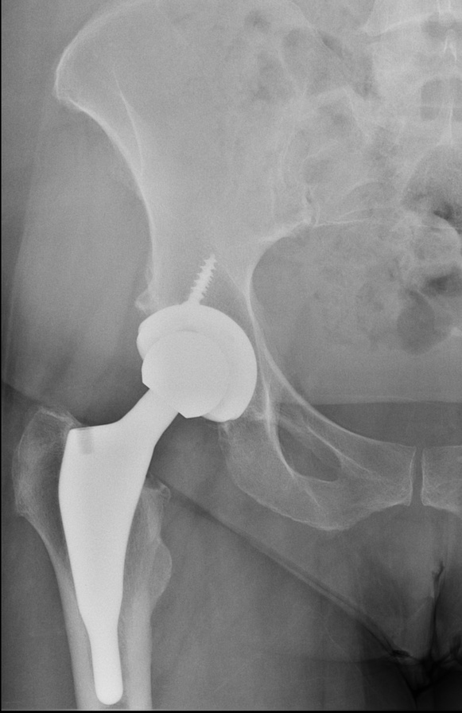 Hip_JRIOrtho_FurlongEvolution_NilCol</td>
<td align="center" valign="top"><b>Option 5</b>  Hip_DepuySynthes_Corail_NilCol</td>
<td align="center" valign="middle"><b>Option 6</b>  <i>None of the above</i></td>
</tr></table>

### Q0067 · correct: option 3 · `Hip_DepuySynthes_Corail_Collar`

<table><tr>
<td align="center" valign="top"><b>Query</b> 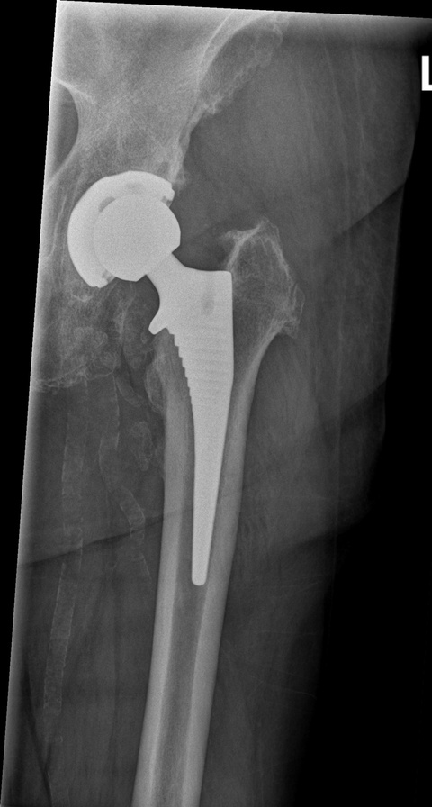 Hip_DepuySynthes_Corail_Collar</td>
<td align="center" valign="top"><b>Option 1</b>  Hip_DepuySynthes_Corail_NilCol</td>
<td align="center" valign="top"><b>Option 2</b>  Hip_Stryker_Exeter</td>
<td align="center" valign="top"><b>✅ Option 3</b>  Hip_DepuySynthes_Corail_Collar</td>
<td align="center" valign="top"><b>Option 4</b>  Hip_SmithAndNephew_Anthology</td>
<td align="center" valign="top"><b>Option 5</b>  Hip_JRIOrtho_FurlongEvolution_Collar</td>
<td align="center" valign="middle"><b>Option 6</b>  <i>None of the above</i></td>
</tr></table>

### Q0068 · correct: option 5 · `Hip_DepuySynthes_Corail_Collar`

<table><tr>
<td align="center" valign="top"><b>Query</b> 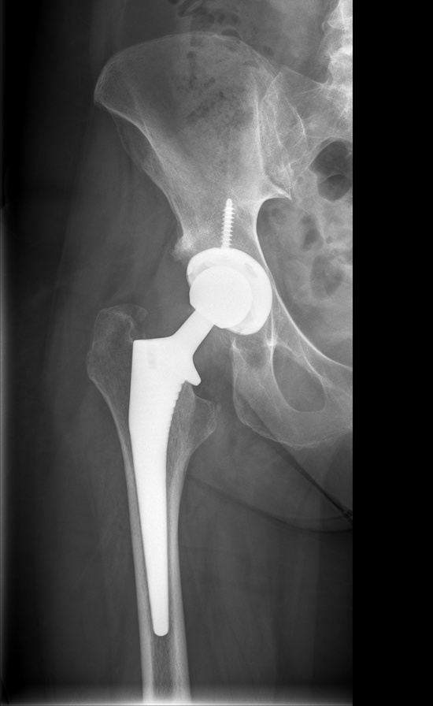 Hip_DepuySynthes_Corail_Collar</td>
<td align="center" valign="top"><b>Option 1</b>  Hip_Stryker_Exeter</td>
<td align="center" valign="top"><b>Option 2</b>  Hip_JRIOrtho_FurlongEvolution_NilCol</td>
<td align="center" valign="top"><b>Option 3</b>  Hip_SmithAndNephew_Anthology</td>
<td align="center" valign="top"><b>Option 4</b>  Hip_DepuySynthes_Corail_NilCol</td>
<td align="center" valign="top"><b>✅ Option 5</b> 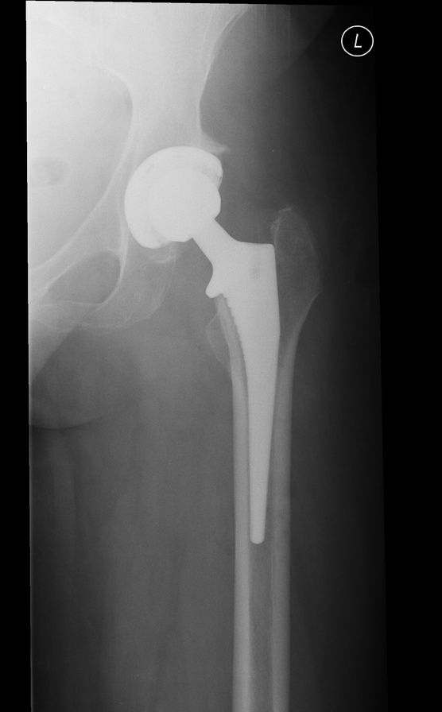 Hip_DepuySynthes_Corail_Collar</td>
<td align="center" valign="middle"><b>Option 6</b>  <i>None of the above</i></td>
</tr></table>

### Q0069 · correct: option 3 · `Hip_DepuySynthes_Corail_Collar`

<table><tr>
<td align="center" valign="top"><b>Query</b> 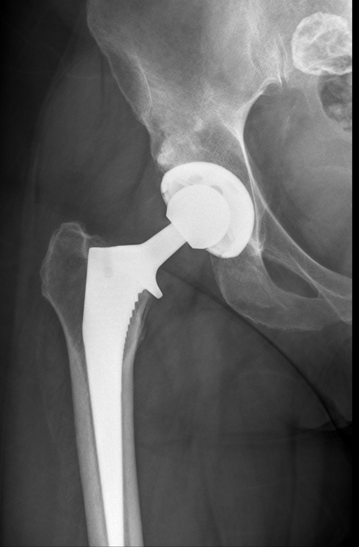 Hip_DepuySynthes_Corail_Collar</td>
<td align="center" valign="top"><b>Option 1</b>  Hip_SmithAndNephew_Anthology</td>
<td align="center" valign="top"><b>Option 2</b>  Hip_JRIOrtho_FurlongEvolution_NilCol</td>
<td align="center" valign="top"><b>✅ Option 3</b>  Hip_DepuySynthes_Corail_Collar</td>
<td align="center" valign="top"><b>Option 4</b>  Hip_JRIOrtho_FurlongEvolution_Collar</td>
<td align="center" valign="top"><b>Option 5</b>  Hip_DepuySynthes_Corail_NilCol</td>
<td align="center" valign="middle"><b>Option 6</b>  <i>None of the above</i></td>
</tr></table>

### Q0070 · correct: option 3 · `Hip_DepuySynthes_Corail_Collar`

<table><tr>
<td align="center" valign="top"><b>Query</b> 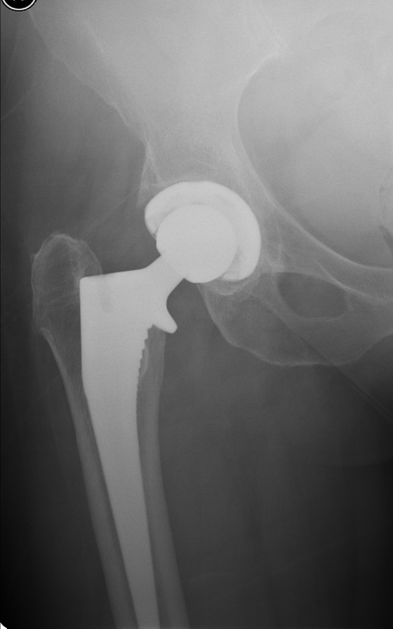 Hip_DepuySynthes_Corail_Collar</td>
<td align="center" valign="top"><b>Option 1</b>  Hip_DepuySynthes_Corail_NilCol</td>
<td align="center" valign="top"><b>Option 2</b>  Hip_SmithAndNephew_Anthology</td>
<td align="center" valign="top"><b>✅ Option 3</b>  Hip_DepuySynthes_Corail_Collar</td>
<td align="center" valign="top"><b>Option 4</b>  Hip_JRIOrtho_FurlongEvolution_Collar</td>
<td align="center" valign="top"><b>Option 5</b>  Hip_JRIOrtho_FurlongEvolution_NilCol</td>
<td align="center" valign="middle"><b>Option 6</b>  <i>None of the above</i></td>
</tr></table>

### Q0071 · correct: option 5 · `Hip_DepuySynthes_Corail_Collar`

<table><tr>
<td align="center" valign="top"><b>Query</b> 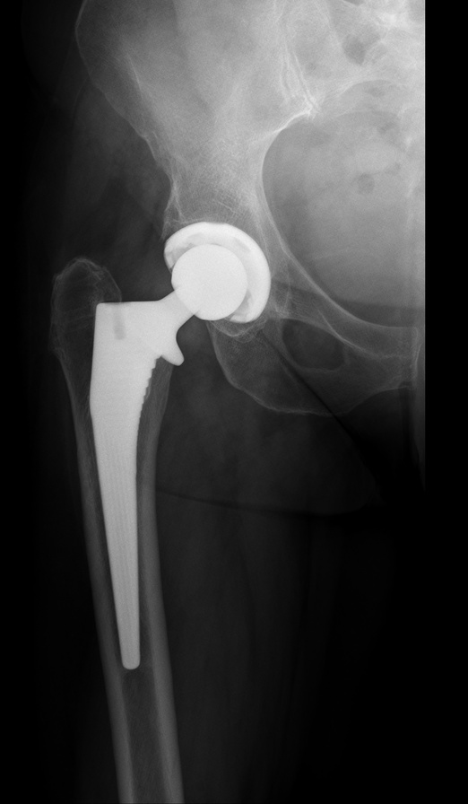 Hip_DepuySynthes_Corail_Collar</td>
<td align="center" valign="top"><b>Option 1</b>  Hip_Stryker_Exeter</td>
<td align="center" valign="top"><b>Option 2</b>  Hip_JRIOrtho_FurlongEvolution_Collar</td>
<td align="center" valign="top"><b>Option 3</b>  Hip_SmithAndNephew_Anthology</td>
<td align="center" valign="top"><b>Option 4</b>  Hip_DepuySynthes_Corail_NilCol</td>
<td align="center" valign="top"><b>✅ Option 5</b>  Hip_DepuySynthes_Corail_Collar</td>
<td align="center" valign="middle"><b>Option 6</b>  <i>None of the above</i></td>
</tr></table>

### Q0072 · correct: option 1 · `Hip_DepuySynthes_Corail_Collar`

<table><tr>
<td align="center" valign="top"><b>Query</b> 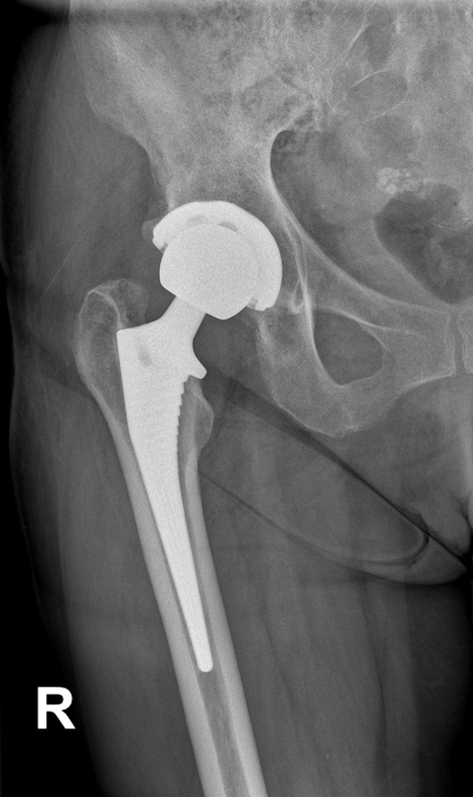 Hip_DepuySynthes_Corail_Collar</td>
<td align="center" valign="top"><b>✅ Option 1</b>  Hip_DepuySynthes_Corail_Collar</td>
<td align="center" valign="top"><b>Option 2</b>  Hip_Stryker_Exeter</td>
<td align="center" valign="top"><b>Option 3</b>  Hip_DepuySynthes_Corail_NilCol</td>
<td align="center" valign="top"><b>Option 4</b>  Hip_JRIOrtho_FurlongEvolution_Collar</td>
<td align="center" valign="top"><b>Option 5</b>  Hip_JRIOrtho_FurlongEvolution_NilCol</td>
<td align="center" valign="middle"><b>Option 6</b>  <i>None of the above</i></td>
</tr></table>

### Q0073 · correct: option 5 · `Hip_DepuySynthes_Corail_Collar`

<table><tr>
<td align="center" valign="top"><b>Query</b> 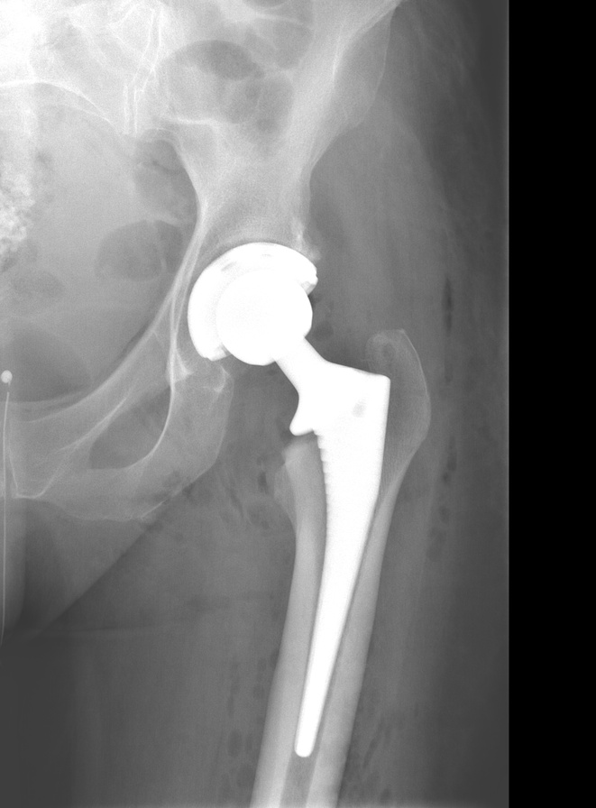 Hip_DepuySynthes_Corail_Collar</td>
<td align="center" valign="top"><b>Option 1</b>  Hip_DepuySynthes_Corail_NilCol</td>
<td align="center" valign="top"><b>Option 2</b>  Hip_Stryker_Exeter</td>
<td align="center" valign="top"><b>Option 3</b>  Hip_JRIOrtho_FurlongEvolution_NilCol</td>
<td align="center" valign="top"><b>Option 4</b>  Hip_JRIOrtho_FurlongEvolution_Collar</td>
<td align="center" valign="top"><b>✅ Option 5</b>  Hip_DepuySynthes_Corail_Collar</td>
<td align="center" valign="middle"><b>Option 6</b>  <i>None of the above</i></td>
</tr></table>

### Q0074 · correct: option 4 · `Hip_DepuySynthes_Corail_Collar`

<table><tr>
<td align="center" valign="top"><b>Query</b> 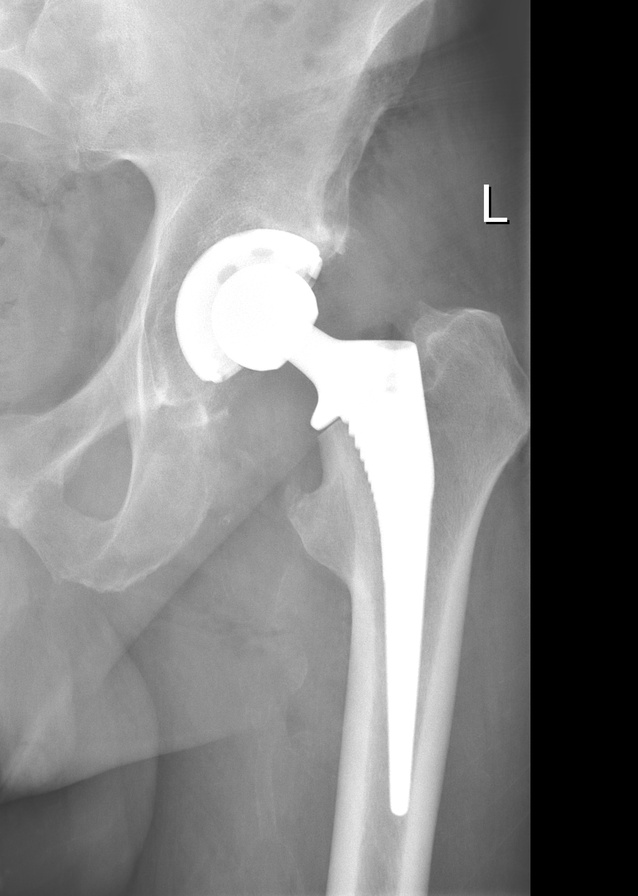 Hip_DepuySynthes_Corail_Collar</td>
<td align="center" valign="top"><b>Option 1</b>  Hip_JRIOrtho_FurlongEvolution_Collar</td>
<td align="center" valign="top"><b>Option 2</b>  Hip_SmithAndNephew_Anthology</td>
<td align="center" valign="top"><b>Option 3</b> 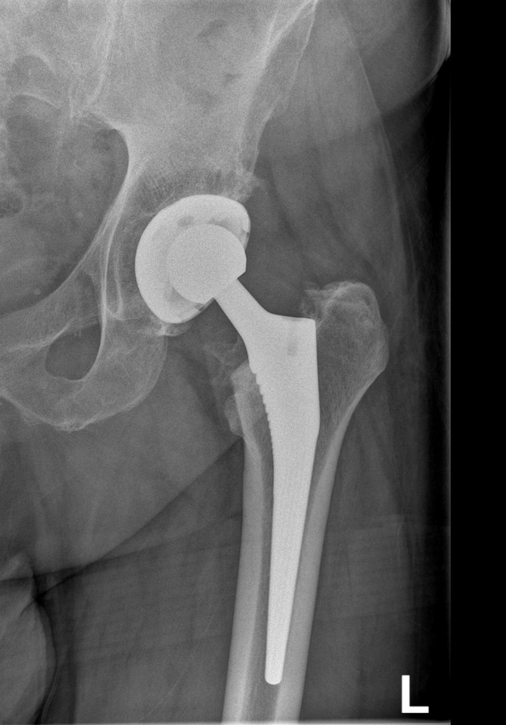 Hip_DepuySynthes_Corail_NilCol</td>
<td align="center" valign="top"><b>✅ Option 4</b>  Hip_DepuySynthes_Corail_Collar</td>
<td align="center" valign="top"><b>Option 5</b>  Hip_Stryker_AccoladeII</td>
<td align="center" valign="middle"><b>Option 6</b>  <i>None of the above</i></td>
</tr></table>

### Q0075 · correct: option 1 · `Hip_JRIOrtho_FurlongEvolution_Collar`

<table><tr>
<td align="center" valign="top"><b>Query</b>  Hip_JRIOrtho_FurlongEvolution_Collar</td>
<td align="center" valign="top"><b>✅ Option 1</b> 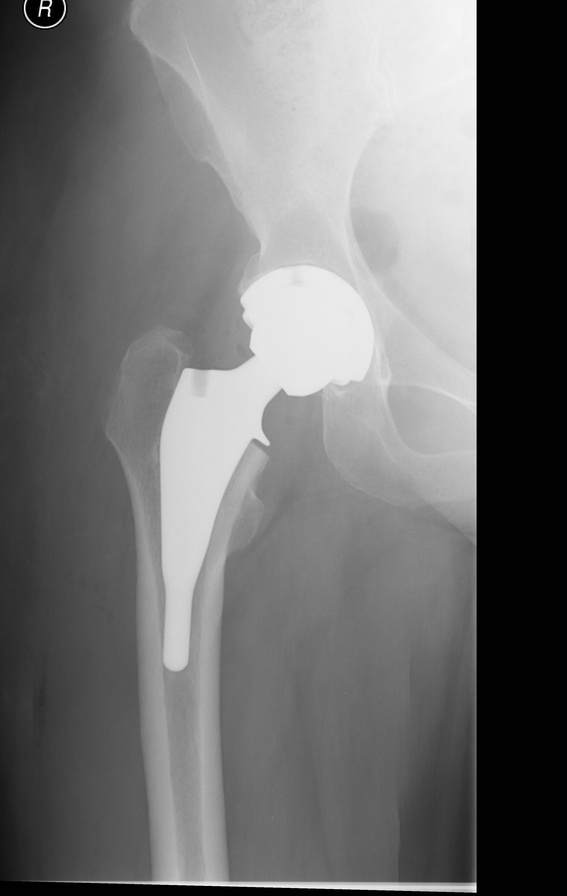 Hip_JRIOrtho_FurlongEvolution_Collar</td>
<td align="center" valign="top"><b>Option 2</b>  Hip_Stryker_Exeter</td>
<td align="center" valign="top"><b>Option 3</b>  Hip_SmithAndNephew_Anthology</td>
<td align="center" valign="top"><b>Option 4</b>  Hip_JRIOrtho_FurlongEvolution_NilCol</td>
<td align="center" valign="top"><b>Option 5</b> 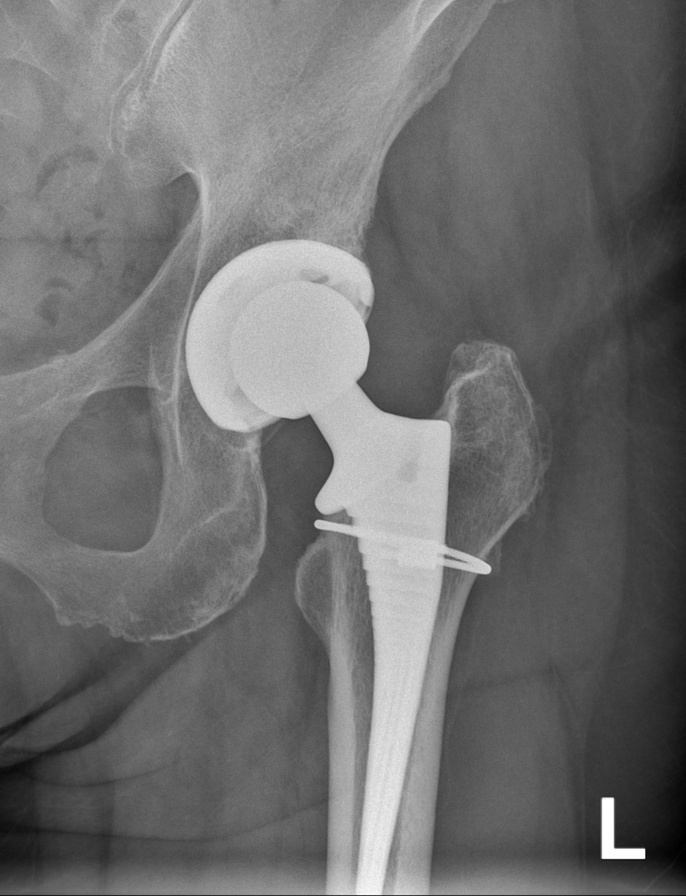 Hip_DepuySynthes_Corail_Collar</td>
<td align="center" valign="middle"><b>Option 6</b>  <i>None of the above</i></td>
</tr></table>

### Q0076 · correct: option 3 · `Hip_JRIOrtho_FurlongEvolution_Collar`

<table><tr>
<td align="center" valign="top"><b>Query</b> 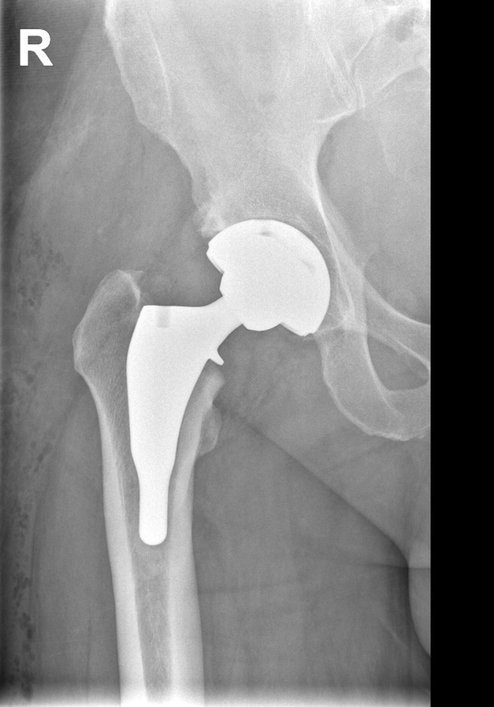 Hip_JRIOrtho_FurlongEvolution_Collar</td>
<td align="center" valign="top"><b>Option 1</b>  Hip_Stryker_Exeter</td>
<td align="center" valign="top"><b>Option 2</b>  Hip_JRIOrtho_FurlongEvolution_NilCol</td>
<td align="center" valign="top"><b>✅ Option 3</b> 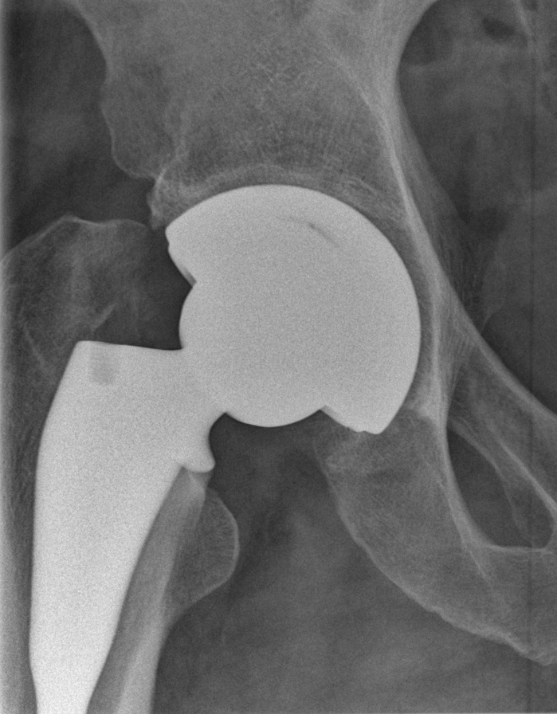 Hip_JRIOrtho_FurlongEvolution_Collar</td>
<td align="center" valign="top"><b>Option 4</b>  Hip_DepuySynthes_Corail_Collar</td>
<td align="center" valign="top"><b>Option 5</b>  Hip_Stryker_AccoladeII</td>
<td align="center" valign="middle"><b>Option 6</b>  <i>None of the above</i></td>
</tr></table>

### Q0077 · correct: option 4 · `Hip_JRIOrtho_FurlongEvolution_Collar`

<table><tr>
<td align="center" valign="top"><b>Query</b> 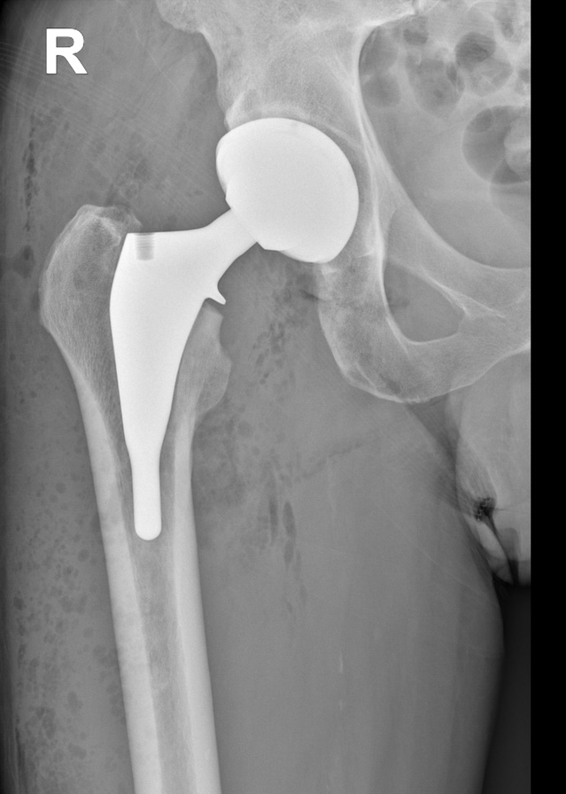 Hip_JRIOrtho_FurlongEvolution_Collar</td>
<td align="center" valign="top"><b>Option 1</b>  Hip_Stryker_AccoladeII</td>
<td align="center" valign="top"><b>Option 2</b>  Hip_JRIOrtho_FurlongEvolution_NilCol</td>
<td align="center" valign="top"><b>Option 3</b>  Hip_SmithAndNephew_Polarstem_NilCol</td>
<td align="center" valign="top"><b>✅ Option 4</b>  Hip_JRIOrtho_FurlongEvolution_Collar</td>
<td align="center" valign="top"><b>Option 5</b>  Hip_DepuySynthes_Corail_Collar</td>
<td align="center" valign="middle"><b>Option 6</b>  <i>None of the above</i></td>
</tr></table>

### Q0078 · correct: option 2 · `Hip_JRIOrtho_FurlongEvolution_Collar`

<table><tr>
<td align="center" valign="top"><b>Query</b> 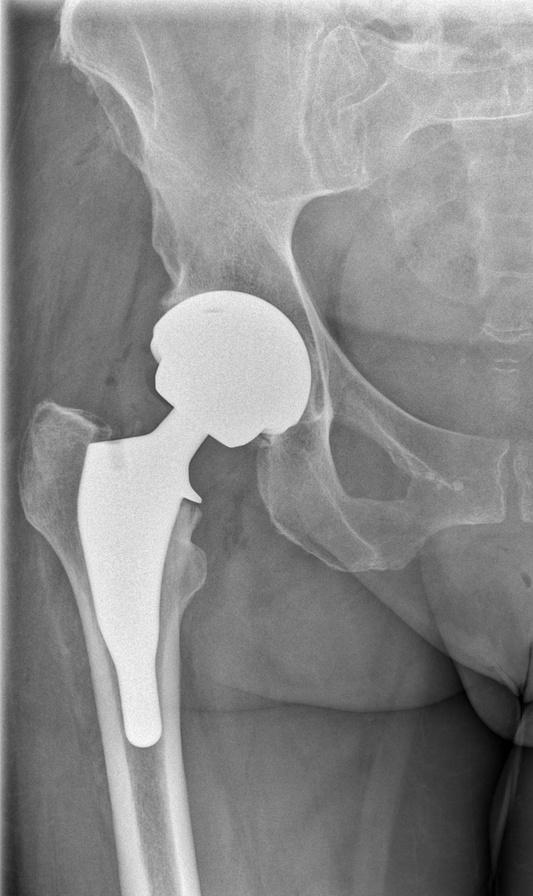 Hip_JRIOrtho_FurlongEvolution_Collar</td>
<td align="center" valign="top"><b>Option 1</b>  Hip_SmithAndNephew_Anthology</td>
<td align="center" valign="top"><b>✅ Option 2</b>  Hip_JRIOrtho_FurlongEvolution_Collar</td>
<td align="center" valign="top"><b>Option 3</b>  Hip_DepuySynthes_Corail_Collar</td>
<td align="center" valign="top"><b>Option 4</b>  Hip_Stryker_AccoladeII</td>
<td align="center" valign="top"><b>Option 5</b>  Hip_JRIOrtho_FurlongEvolution_NilCol</td>
<td align="center" valign="middle"><b>Option 6</b>  <i>None of the above</i></td>
</tr></table>

### Q0079 · correct: option 4 · `Hip_JRIOrtho_FurlongEvolution_Collar`

<table><tr>
<td align="center" valign="top"><b>Query</b> 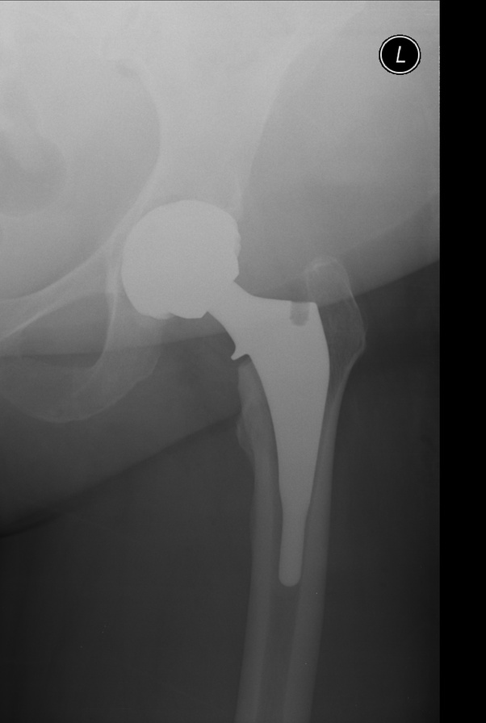 Hip_JRIOrtho_FurlongEvolution_Collar</td>
<td align="center" valign="top"><b>Option 1</b>  Hip_JRIOrtho_FurlongEvolution_NilCol</td>
<td align="center" valign="top"><b>Option 2</b>  Hip_Stryker_AccoladeII</td>
<td align="center" valign="top"><b>Option 3</b>  Hip_DepuySynthes_Corail_Collar</td>
<td align="center" valign="top"><b>✅ Option 4</b>  Hip_JRIOrtho_FurlongEvolution_Collar</td>
<td align="center" valign="top"><b>Option 5</b>  Hip_DepuySynthes_Corail_NilCol</td>
<td align="center" valign="middle"><b>Option 6</b>  <i>None of the above</i></td>
</tr></table>

### Q0080 · correct: option 2 · `Hip_JRIOrtho_FurlongEvolution_Collar`

<table><tr>
<td align="center" valign="top"><b>Query</b>  Hip_JRIOrtho_FurlongEvolution_Collar</td>
<td align="center" valign="top"><b>Option 1</b>  Hip_SmithAndNephew_Anthology</td>
<td align="center" valign="top"><b>✅ Option 2</b>  Hip_JRIOrtho_FurlongEvolution_Collar</td>
<td align="center" valign="top"><b>Option 3</b>  Hip_Stryker_Exeter</td>
<td align="center" valign="top"><b>Option 4</b>  Hip_DepuySynthes_Corail_Collar</td>
<td align="center" valign="top"><b>Option 5</b>  Hip_JRIOrtho_FurlongEvolution_NilCol</td>
<td align="center" valign="middle"><b>Option 6</b>  <i>None of the above</i></td>
</tr></table>

### Q0081 · correct: option 1 · `Hip_JRIOrtho_FurlongEvolution_Collar`

<table><tr>
<td align="center" valign="top"><b>Query</b> 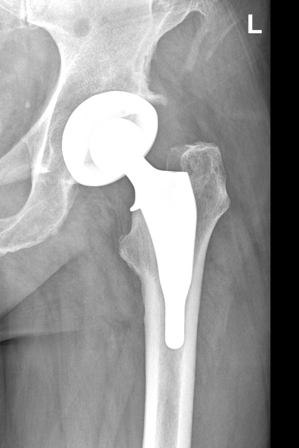 Hip_JRIOrtho_FurlongEvolution_Collar</td>
<td align="center" valign="top"><b>✅ Option 1</b>  Hip_JRIOrtho_FurlongEvolution_Collar</td>
<td align="center" valign="top"><b>Option 2</b>  Hip_Stryker_AccoladeII</td>
<td align="center" valign="top"><b>Option 3</b>  Hip_DepuySynthes_Corail_Collar</td>
<td align="center" valign="top"><b>Option 4</b>  Hip_JRIOrtho_FurlongEvolution_NilCol</td>
<td align="center" valign="top"><b>Option 5</b>  Hip_SmithAndNephew_Anthology</td>
<td align="center" valign="middle"><b>Option 6</b>  <i>None of the above</i></td>
</tr></table>

### Q0082 · correct: option 2 · `Hip_JRIOrtho_FurlongEvolution_Collar`

<table><tr>
<td align="center" valign="top"><b>Query</b>  Hip_JRIOrtho_FurlongEvolution_Collar</td>
<td align="center" valign="top"><b>Option 1</b>  Hip_SmithAndNephew_Anthology</td>
<td align="center" valign="top"><b>✅ Option 2</b>  Hip_JRIOrtho_FurlongEvolution_Collar</td>
<td align="center" valign="top"><b>Option 3</b>  Hip_Stryker_AccoladeII</td>
<td align="center" valign="top"><b>Option 4</b>  Hip_JRIOrtho_FurlongEvolution_NilCol</td>
<td align="center" valign="top"><b>Option 5</b>  Hip_DepuySynthes_Corail_Collar</td>
<td align="center" valign="middle"><b>Option 6</b>  <i>None of the above</i></td>
</tr></table>

### Q0083 · correct: option 3 · `Hip_JRIOrtho_FurlongEvolution_Collar`

<table><tr>
<td align="center" valign="top"><b>Query</b>  Hip_JRIOrtho_FurlongEvolution_Collar</td>
<td align="center" valign="top"><b>Option 1</b>  Hip_Stryker_AccoladeII</td>
<td align="center" valign="top"><b>Option 2</b>  Hip_JRIOrtho_FurlongEvolution_NilCol</td>
<td align="center" valign="top"><b>✅ Option 3</b>  Hip_JRIOrtho_FurlongEvolution_Collar</td>
<td align="center" valign="top"><b>Option 4</b>  Hip_DepuySynthes_Corail_Collar</td>
<td align="center" valign="top"><b>Option 5</b>  Hip_SmithAndNephew_Anthology</td>
<td align="center" valign="middle"><b>Option 6</b>  <i>None of the above</i></td>
</tr></table>

### Q0084 · correct: option 4 · `Hip_JRIOrtho_FurlongEvolution_Collar`

<table><tr>
<td align="center" valign="top"><b>Query</b>  Hip_JRIOrtho_FurlongEvolution_Collar</td>
<td align="center" valign="top"><b>Option 1</b>  Hip_JRIOrtho_FurlongEvolution_NilCol</td>
<td align="center" valign="top"><b>Option 2</b>  Hip_SmithAndNephew_Polarstem_NilCol</td>
<td align="center" valign="top"><b>Option 3</b>  Hip_Stryker_AccoladeII</td>
<td align="center" valign="top"><b>✅ Option 4</b>  Hip_JRIOrtho_FurlongEvolution_Collar</td>
<td align="center" valign="top"><b>Option 5</b>  Hip_DepuySynthes_Corail_Collar</td>
<td align="center" valign="middle"><b>Option 6</b>  <i>None of the above</i></td>
</tr></table>

### Q0085 · correct: option 2 · `Hip_JRIOrtho_FurlongEvolution_Collar`

<table><tr>
<td align="center" valign="top"><b>Query</b>  Hip_JRIOrtho_FurlongEvolution_Collar</td>
<td align="center" valign="top"><b>Option 1</b>  Hip_SmithAndNephew_Anthology</td>
<td align="center" valign="top"><b>✅ Option 2</b>  Hip_JRIOrtho_FurlongEvolution_Collar</td>
<td align="center" valign="top"><b>Option 3</b>  Hip_Stryker_Exeter</td>
<td align="center" valign="top"><b>Option 4</b>  Hip_DepuySynthes_Corail_Collar</td>
<td align="center" valign="top"><b>Option 5</b>  Hip_JRIOrtho_FurlongEvolution_NilCol</td>
<td align="center" valign="middle"><b>Option 6</b>  <i>None of the above</i></td>
</tr></table>

### Q0086 · correct: option 2 · `Hip_JRIOrtho_FurlongEvolution_Collar`

<table><tr>
<td align="center" valign="top"><b>Query</b>  Hip_JRIOrtho_FurlongEvolution_Collar</td>
<td align="center" valign="top"><b>Option 1</b>  Hip_Stryker_AccoladeII</td>
<td align="center" valign="top"><b>✅ Option 2</b>  Hip_JRIOrtho_FurlongEvolution_Collar</td>
<td align="center" valign="top"><b>Option 3</b>  Hip_SmithAndNephew_Anthology</td>
<td align="center" valign="top"><b>Option 4</b>  Hip_JRIOrtho_FurlongEvolution_NilCol</td>
<td align="center" valign="top"><b>Option 5</b>  Hip_DepuySynthes_Corail_Collar</td>
<td align="center" valign="middle"><b>Option 6</b>  <i>None of the above</i></td>
</tr></table>

### Q0087 · correct: option 3 · `Hip_JRIOrtho_FurlongEvolution_Collar`

<table><tr>
<td align="center" valign="top"><b>Query</b>  Hip_JRIOrtho_FurlongEvolution_Collar</td>
<td align="center" valign="top"><b>Option 1</b>  Hip_SmithAndNephew_Anthology</td>
<td align="center" valign="top"><b>Option 2</b>  Hip_DepuySynthes_Corail_NilCol</td>
<td align="center" valign="top"><b>✅ Option 3</b>  Hip_JRIOrtho_FurlongEvolution_Collar</td>
<td align="center" valign="top"><b>Option 4</b>  Hip_DepuySynthes_Corail_Collar</td>
<td align="center" valign="top"><b>Option 5</b>  Hip_JRIOrtho_FurlongEvolution_NilCol</td>
<td align="center" valign="middle"><b>Option 6</b>  <i>None of the above</i></td>
</tr></table>

### Q0088 · correct: option 2 · `Hip_JRIOrtho_FurlongEvolution_Collar`

<table><tr>
<td align="center" valign="top"><b>Query</b>  Hip_JRIOrtho_FurlongEvolution_Collar</td>
<td align="center" valign="top"><b>Option 1</b>  Hip_JRIOrtho_FurlongEvolution_NilCol</td>
<td align="center" valign="top"><b>✅ Option 2</b>  Hip_JRIOrtho_FurlongEvolution_Collar</td>
<td align="center" valign="top"><b>Option 3</b>  Hip_SmithAndNephew_Anthology</td>
<td align="center" valign="top"><b>Option 4</b>  Hip_Stryker_AccoladeII</td>
<td align="center" valign="top"><b>Option 5</b>  Hip_DepuySynthes_Corail_Collar</td>
<td align="center" valign="middle"><b>Option 6</b>  <i>None of the above</i></td>
</tr></table>

### Q0089 · correct: option 3 · `Hip_JRIOrtho_FurlongEvolution_Collar`

<table><tr>
<td align="center" valign="top"><b>Query</b>  Hip_JRIOrtho_FurlongEvolution_Collar</td>
<td align="center" valign="top"><b>Option 1</b>  Hip_DepuySynthes_Corail_Collar</td>
<td align="center" valign="top"><b>Option 2</b>  Hip_SmithAndNephew_Anthology</td>
<td align="center" valign="top"><b>✅ Option 3</b>  Hip_JRIOrtho_FurlongEvolution_Collar</td>
<td align="center" valign="top"><b>Option 4</b>  Hip_Stryker_AccoladeII</td>
<td align="center" valign="top"><b>Option 5</b>  Hip_JRIOrtho_FurlongEvolution_NilCol</td>
<td align="center" valign="middle"><b>Option 6</b>  <i>None of the above</i></td>
</tr></table>

### Q0090 · correct: option 5 · `Hip_Stryker_AccoladeII`

<table><tr>
<td align="center" valign="top"><b>Query</b>  Hip_Stryker_AccoladeII</td>
<td align="center" valign="top"><b>Option 1</b>  Hip_JRIOrtho_FurlongEvolution_Collar</td>
<td align="center" valign="top"><b>Option 2</b>  Hip_JRIOrtho_FurlongEvolution_NilCol</td>
<td align="center" valign="top"><b>Option 3</b>  Hip_DepuySynthes_Corail_Collar</td>
<td align="center" valign="top"><b>Option 4</b>  Hip_SmithAndNephew_Polarstem_NilCol</td>
<td align="center" valign="top"><b>✅ Option 5</b>  Hip_Stryker_AccoladeII</td>
<td align="center" valign="middle"><b>Option 6</b>  <i>None of the above</i></td>
</tr></table>

### Q0091 · correct: option 4 · `Hip_Stryker_AccoladeII`

<table><tr>
<td align="center" valign="top"><b>Query</b>  Hip_Stryker_AccoladeII</td>
<td align="center" valign="top"><b>Option 1</b>  Hip_SmithAndNephew_Anthology</td>
<td align="center" valign="top"><b>Option 2</b>  Hip_JRIOrtho_FurlongEvolution_NilCol</td>
<td align="center" valign="top"><b>Option 3</b>  Hip_SmithAndNephew_Polarstem_NilCol</td>
<td align="center" valign="top"><b>✅ Option 4</b>  Hip_Stryker_AccoladeII</td>
<td align="center" valign="top"><b>Option 5</b>  Hip_Stryker_Exeter</td>
<td align="center" valign="middle"><b>Option 6</b>  <i>None of the above</i></td>
</tr></table>

### Q0092 · correct: option 5 · `Hip_Stryker_AccoladeII`

<table><tr>
<td align="center" valign="top"><b>Query</b>  Hip_Stryker_AccoladeII</td>
<td align="center" valign="top"><b>Option 1</b>  Hip_DepuySynthes_Corail_NilCol</td>
<td align="center" valign="top"><b>Option 2</b>  Hip_SmithAndNephew_Polarstem_NilCol</td>
<td align="center" valign="top"><b>Option 3</b>  Hip_JRIOrtho_FurlongEvolution_NilCol</td>
<td align="center" valign="top"><b>Option 4</b>  Hip_SmithAndNephew_Anthology</td>
<td align="center" valign="top"><b>✅ Option 5</b>  Hip_Stryker_AccoladeII</td>
<td align="center" valign="middle"><b>Option 6</b>  <i>None of the above</i></td>
</tr></table>

### Q0093 · correct: option 5 · `Hip_Stryker_AccoladeII`

<table><tr>
<td align="center" valign="top"><b>Query</b>  Hip_Stryker_AccoladeII</td>
<td align="center" valign="top"><b>Option 1</b>  Hip_DepuySynthes_Corail_NilCol</td>
<td align="center" valign="top"><b>Option 2</b>  Hip_SmithAndNephew_Anthology</td>
<td align="center" valign="top"><b>Option 3</b>  Hip_Stryker_Exeter</td>
<td align="center" valign="top"><b>Option 4</b>  Hip_SmithAndNephew_Polarstem_NilCol</td>
<td align="center" valign="top"><b>✅ Option 5</b>  Hip_Stryker_AccoladeII</td>
<td align="center" valign="middle"><b>Option 6</b>  <i>None of the above</i></td>
</tr></table>

### Q0094 · correct: option 4 · `Hip_Stryker_AccoladeII`

<table><tr>
<td align="center" valign="top"><b>Query</b>  Hip_Stryker_AccoladeII</td>
<td align="center" valign="top"><b>Option 1</b>  Hip_JRIOrtho_FurlongEvolution_NilCol</td>
<td align="center" valign="top"><b>Option 2</b>  Hip_DepuySynthes_Corail_NilCol</td>
<td align="center" valign="top"><b>Option 3</b>  Hip_SmithAndNephew_Polarstem_NilCol</td>
<td align="center" valign="top"><b>✅ Option 4</b>  Hip_Stryker_AccoladeII</td>
<td align="center" valign="top"><b>Option 5</b>  Hip_SmithAndNephew_Anthology</td>
<td align="center" valign="middle"><b>Option 6</b>  <i>None of the above</i></td>
</tr></table>

### Q0095 · correct: option 5 · `Hip_Stryker_AccoladeII`

<table><tr>
<td align="center" valign="top"><b>Query</b>  Hip_Stryker_AccoladeII</td>
<td align="center" valign="top"><b>Option 1</b>  Hip_JRIOrtho_FurlongEvolution_NilCol</td>
<td align="center" valign="top"><b>Option 2</b>  Hip_SmithAndNephew_Anthology</td>
<td align="center" valign="top"><b>Option 3</b>  Hip_SmithAndNephew_Polarstem_NilCol</td>
<td align="center" valign="top"><b>Option 4</b>  Hip_Stryker_Exeter</td>
<td align="center" valign="top"><b>✅ Option 5</b>  Hip_Stryker_AccoladeII</td>
<td align="center" valign="middle"><b>Option 6</b>  <i>None of the above</i></td>
</tr></table>

### Q0096 · correct: option 3 · `Hip_Stryker_AccoladeII`

<table><tr>
<td align="center" valign="top"><b>Query</b>  Hip_Stryker_AccoladeII</td>
<td align="center" valign="top"><b>Option 1</b>  Hip_SmithAndNephew_Polarstem_NilCol</td>
<td align="center" valign="top"><b>Option 2</b>  Hip_DepuySynthes_Corail_NilCol</td>
<td align="center" valign="top"><b>✅ Option 3</b>  Hip_Stryker_AccoladeII</td>
<td align="center" valign="top"><b>Option 4</b>  Hip_SmithAndNephew_Anthology</td>
<td align="center" valign="top"><b>Option 5</b>  Hip_DepuySynthes_Corail_Collar</td>
<td align="center" valign="middle"><b>Option 6</b>  <i>None of the above</i></td>
</tr></table>

### Q0097 · correct: option 5 · `Hip_Stryker_AccoladeII`

<table><tr>
<td align="center" valign="top"><b>Query</b>  Hip_Stryker_AccoladeII</td>
<td align="center" valign="top"><b>Option 1</b>  Hip_DepuySynthes_Corail_NilCol</td>
<td align="center" valign="top"><b>Option 2</b>  Hip_SmithAndNephew_Anthology</td>
<td align="center" valign="top"><b>Option 3</b>  Hip_JRIOrtho_FurlongEvolution_NilCol</td>
<td align="center" valign="top"><b>Option 4</b>  Hip_SmithAndNephew_Polarstem_NilCol</td>
<td align="center" valign="top"><b>✅ Option 5</b>  Hip_Stryker_AccoladeII</td>
<td align="center" valign="middle"><b>Option 6</b>  <i>None of the above</i></td>
</tr></table>

### Q0098 · correct: option 5 · `Hip_Stryker_AccoladeII`

<table><tr>
<td align="center" valign="top"><b>Query</b>  Hip_Stryker_AccoladeII</td>
<td align="center" valign="top"><b>Option 1</b>  Hip_SmithAndNephew_Polarstem_NilCol</td>
<td align="center" valign="top"><b>Option 2</b>  Hip_SmithAndNephew_Anthology</td>
<td align="center" valign="top"><b>Option 3</b>  Hip_DepuySynthes_Corail_Collar</td>
<td align="center" valign="top"><b>Option 4</b>  Hip_JRIOrtho_FurlongEvolution_NilCol</td>
<td align="center" valign="top"><b>✅ Option 5</b>  Hip_Stryker_AccoladeII</td>
<td align="center" valign="middle"><b>Option 6</b>  <i>None of the above</i></td>
</tr></table>

### Q0099 · correct: option 6 (None of the above)

<table><tr>
<td align="center" valign="top"><b>Query</b>  Hip_Stryker_AccoladeII</td>
<td align="center" valign="top"><b>Option 1</b>  Hip_JRIOrtho_FurlongEvolution_NilCol</td>
<td align="center" valign="top"><b>Option 2</b>  Hip_JRIOrtho_FurlongEvolution_Collar</td>
<td align="center" valign="top"><b>Option 3</b>  Hip_Stryker_Exeter</td>
<td align="center" valign="top"><b>Option 4</b>  Hip_SmithAndNephew_Polarstem_NilCol</td>
<td align="center" valign="top"><b>Option 5</b>  Hip_DepuySynthes_Corail_Collar</td>
<td align="center" valign="middle"><b>✅ Option 6</b>  <i>None of the above</i></td>
</tr></table>

### Q0100 · correct: option 2 · `Hip_Stryker_AccoladeII`

<table><tr>
<td align="center" valign="top"><b>Query</b>  Hip_Stryker_AccoladeII</td>
<td align="center" valign="top"><b>Option 1</b>  Hip_DepuySynthes_Corail_NilCol</td>
<td align="center" valign="top"><b>✅ Option 2</b>  Hip_Stryker_AccoladeII</td>
<td align="center" valign="top"><b>Option 3</b>  Hip_Stryker_Exeter</td>
<td align="center" valign="top"><b>Option 4</b>  Hip_SmithAndNephew_Anthology</td>
<td align="center" valign="top"><b>Option 5</b>  Hip_SmithAndNephew_Polarstem_NilCol</td>
<td align="center" valign="middle"><b>Option 6</b>  <i>None of the above</i></td>
</tr></table>

