# OrthoNet hip · query set `test` · page 3/3

[← all pages](README.md)

### Q0101 · correct: option 2 · `Hip_Stryker_AccoladeII`

<table><tr>
<td align="center" valign="top"><b>Query</b> 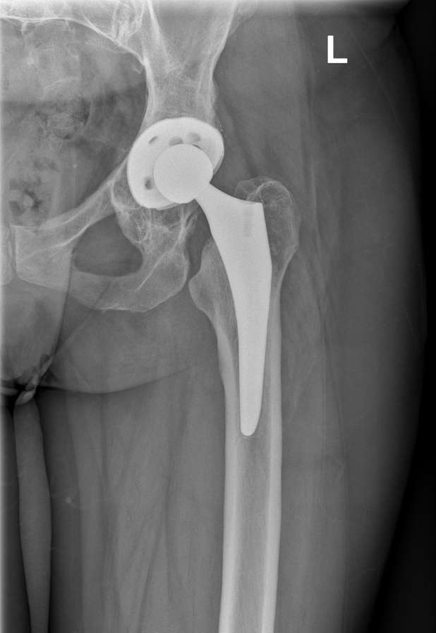 Hip_Stryker_AccoladeII</td>
<td align="center" valign="top"><b>Option 1</b>  Hip_Stryker_Exeter</td>
<td align="center" valign="top"><b>✅ Option 2</b> 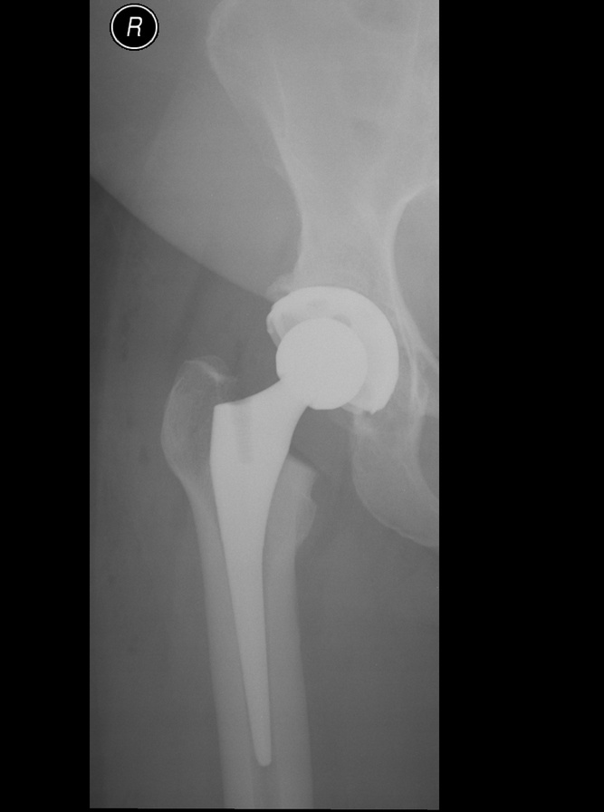 Hip_Stryker_AccoladeII</td>
<td align="center" valign="top"><b>Option 3</b>  Hip_SmithAndNephew_Anthology</td>
<td align="center" valign="top"><b>Option 4</b> 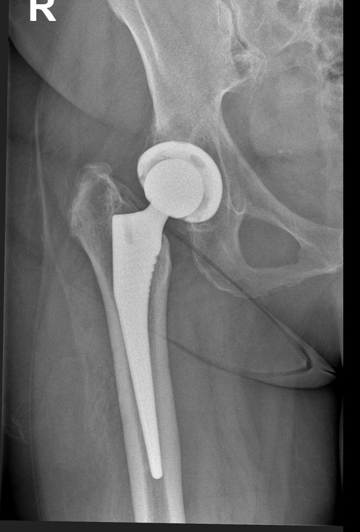 Hip_DepuySynthes_Corail_NilCol</td>
<td align="center" valign="top"><b>Option 5</b> 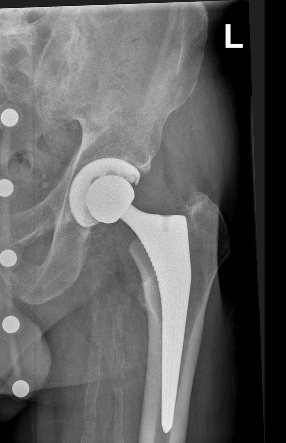 Hip_SmithAndNephew_Polarstem_NilCol</td>
<td align="center" valign="middle"><b>Option 6</b>  <i>None of the above</i></td>
</tr></table>

### Q0102 · correct: option 4 · `Hip_Stryker_AccoladeII`

<table><tr>
<td align="center" valign="top"><b>Query</b> 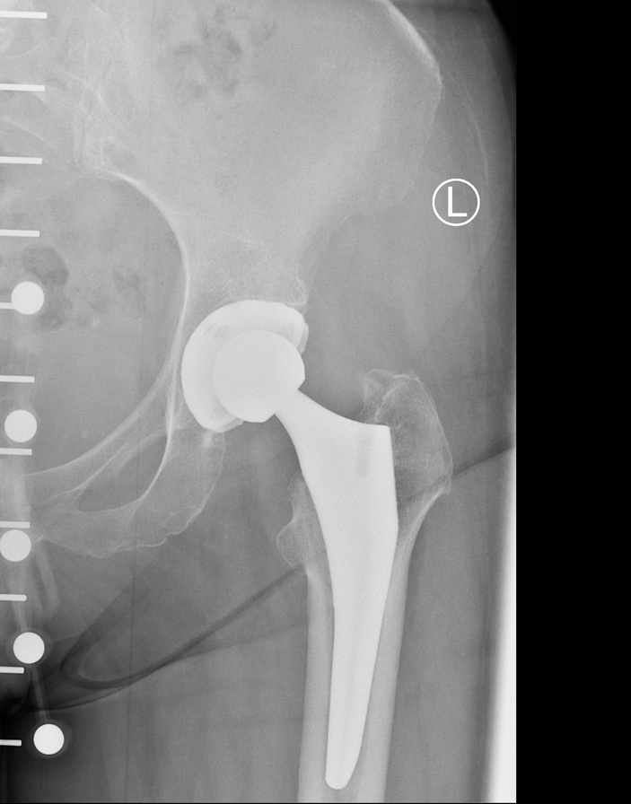 Hip_Stryker_AccoladeII</td>
<td align="center" valign="top"><b>Option 1</b>  Hip_JRIOrtho_FurlongEvolution_NilCol</td>
<td align="center" valign="top"><b>Option 2</b> 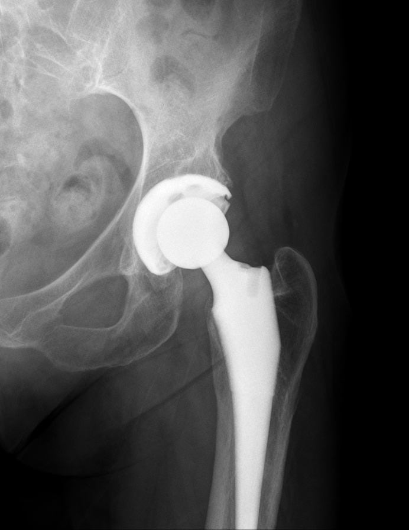 Hip_SmithAndNephew_Anthology</td>
<td align="center" valign="top"><b>Option 3</b>  Hip_SmithAndNephew_Polarstem_NilCol</td>
<td align="center" valign="top"><b>✅ Option 4</b>  Hip_Stryker_AccoladeII</td>
<td align="center" valign="top"><b>Option 5</b>  Hip_DepuySynthes_Corail_NilCol</td>
<td align="center" valign="middle"><b>Option 6</b>  <i>None of the above</i></td>
</tr></table>

### Q0103 · correct: option 6 (None of the above)

<table><tr>
<td align="center" valign="top"><b>Query</b> 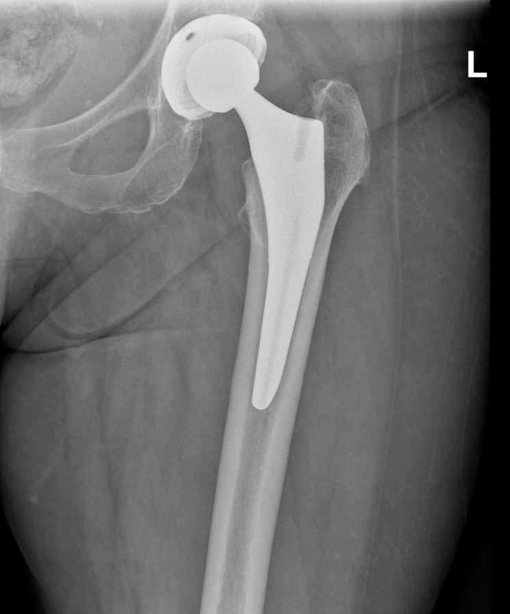 Hip_Stryker_AccoladeII</td>
<td align="center" valign="top"><b>Option 1</b>  Hip_SmithAndNephew_Polarstem_NilCol</td>
<td align="center" valign="top"><b>Option 2</b> 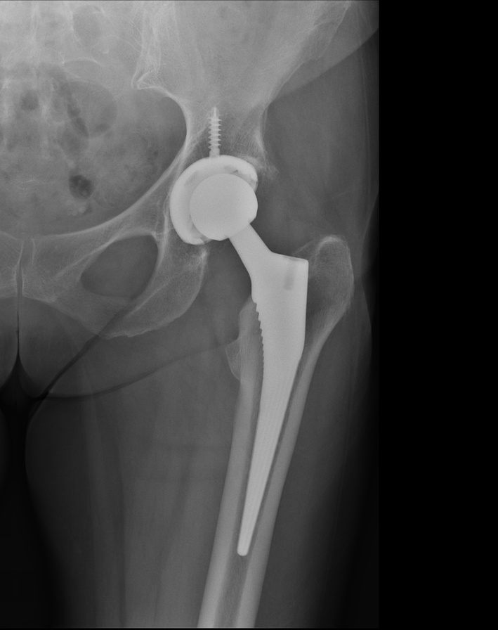 Hip_DepuySynthes_Corail_NilCol</td>
<td align="center" valign="top"><b>Option 3</b>  Hip_SmithAndNephew_Anthology</td>
<td align="center" valign="top"><b>Option 4</b>  Hip_Stryker_Exeter</td>
<td align="center" valign="top"><b>Option 5</b> 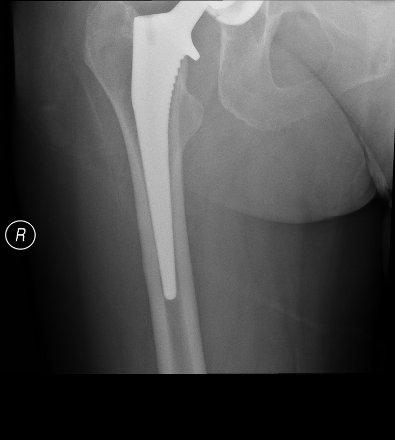 Hip_DepuySynthes_Corail_Collar</td>
<td align="center" valign="middle"><b>✅ Option 6</b>  <i>None of the above</i></td>
</tr></table>

### Q0104 · correct: option 1 · `Hip_Stryker_AccoladeII`

<table><tr>
<td align="center" valign="top"><b>Query</b> 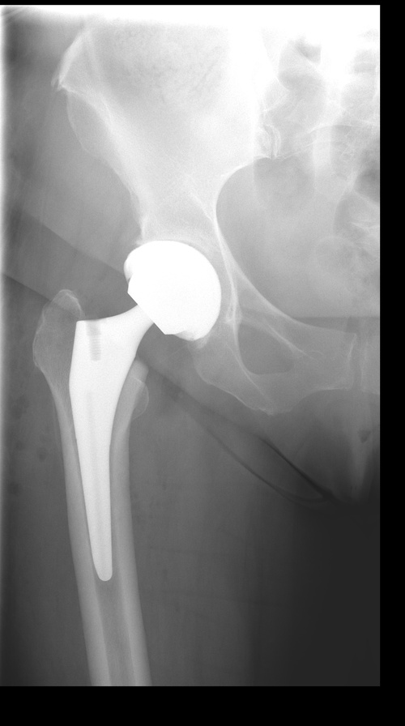 Hip_Stryker_AccoladeII</td>
<td align="center" valign="top"><b>✅ Option 1</b>  Hip_Stryker_AccoladeII</td>
<td align="center" valign="top"><b>Option 2</b>  Hip_DepuySynthes_Corail_NilCol</td>
<td align="center" valign="top"><b>Option 3</b> 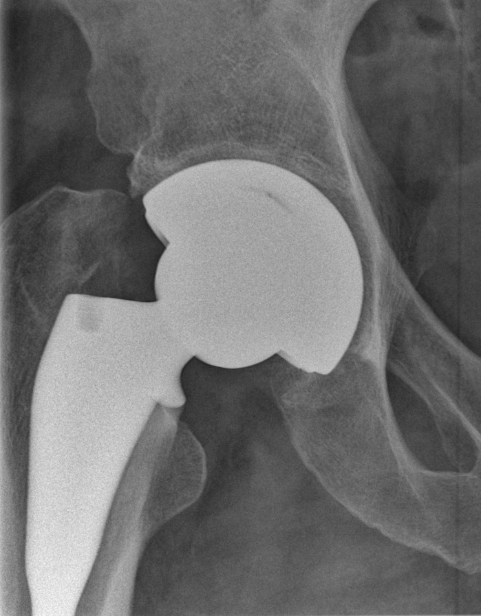 Hip_JRIOrtho_FurlongEvolution_Collar</td>
<td align="center" valign="top"><b>Option 4</b>  Hip_JRIOrtho_FurlongEvolution_NilCol</td>
<td align="center" valign="top"><b>Option 5</b> 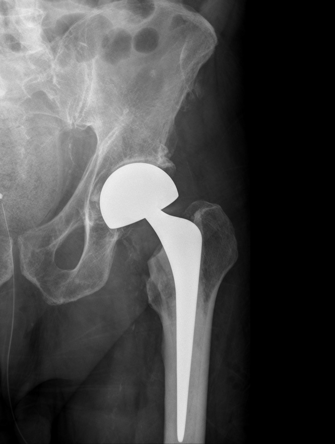 Hip_Stryker_Exeter</td>
<td align="center" valign="middle"><b>Option 6</b>  <i>None of the above</i></td>
</tr></table>

### Q0105 · correct: option 1 · `Hip_SmithAndNephew_Anthology`

<table><tr>
<td align="center" valign="top"><b>Query</b> 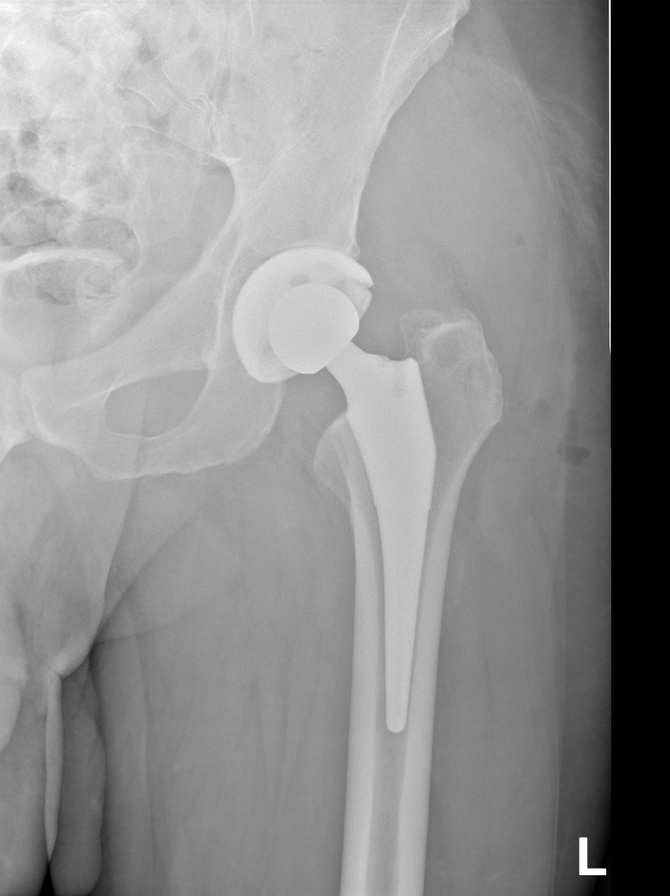 Hip_SmithAndNephew_Anthology</td>
<td align="center" valign="top"><b>✅ Option 1</b>  Hip_SmithAndNephew_Anthology</td>
<td align="center" valign="top"><b>Option 2</b> 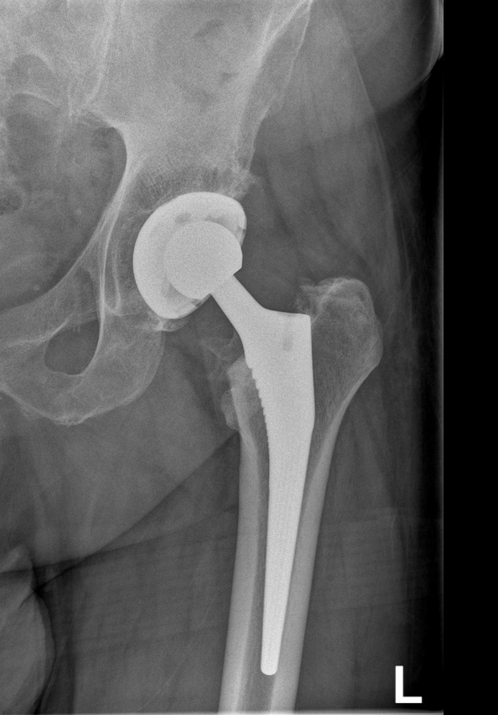 Hip_DepuySynthes_Corail_NilCol</td>
<td align="center" valign="top"><b>Option 3</b>  Hip_Stryker_AccoladeII</td>
<td align="center" valign="top"><b>Option 4</b> 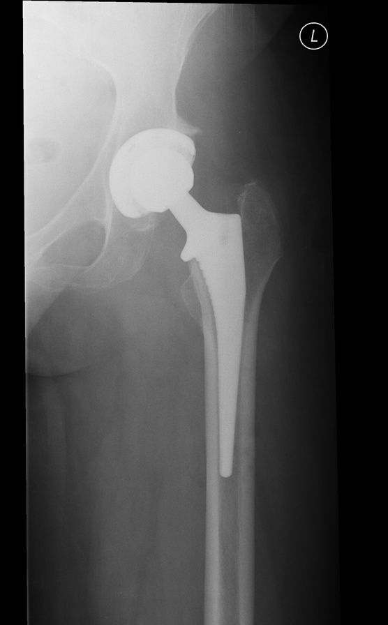 Hip_DepuySynthes_Corail_Collar</td>
<td align="center" valign="top"><b>Option 5</b>  Hip_SmithAndNephew_Polarstem_NilCol</td>
<td align="center" valign="middle"><b>Option 6</b>  <i>None of the above</i></td>
</tr></table>

### Q0106 · correct: option 4 · `Hip_SmithAndNephew_Anthology`

<table><tr>
<td align="center" valign="top"><b>Query</b> 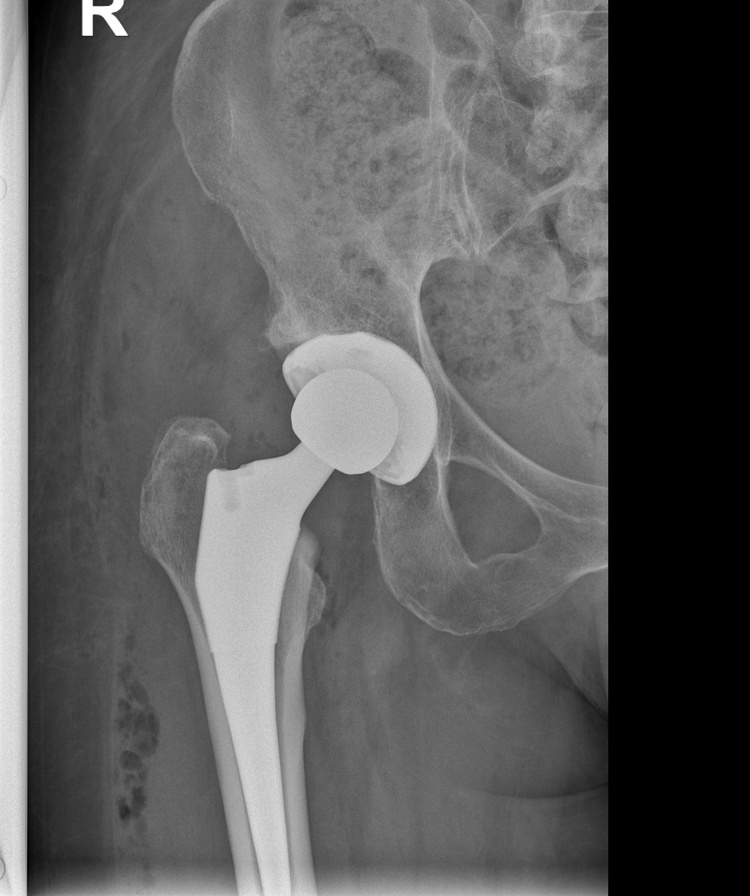 Hip_SmithAndNephew_Anthology</td>
<td align="center" valign="top"><b>Option 1</b>  Hip_Stryker_Exeter</td>
<td align="center" valign="top"><b>Option 2</b>  Hip_JRIOrtho_FurlongEvolution_NilCol</td>
<td align="center" valign="top"><b>Option 3</b>  Hip_SmithAndNephew_Polarstem_NilCol</td>
<td align="center" valign="top"><b>✅ Option 4</b>  Hip_SmithAndNephew_Anthology</td>
<td align="center" valign="top"><b>Option 5</b>  Hip_Stryker_AccoladeII</td>
<td align="center" valign="middle"><b>Option 6</b>  <i>None of the above</i></td>
</tr></table>

### Q0107 · correct: option 3 · `Hip_SmithAndNephew_Anthology`

<table><tr>
<td align="center" valign="top"><b>Query</b> 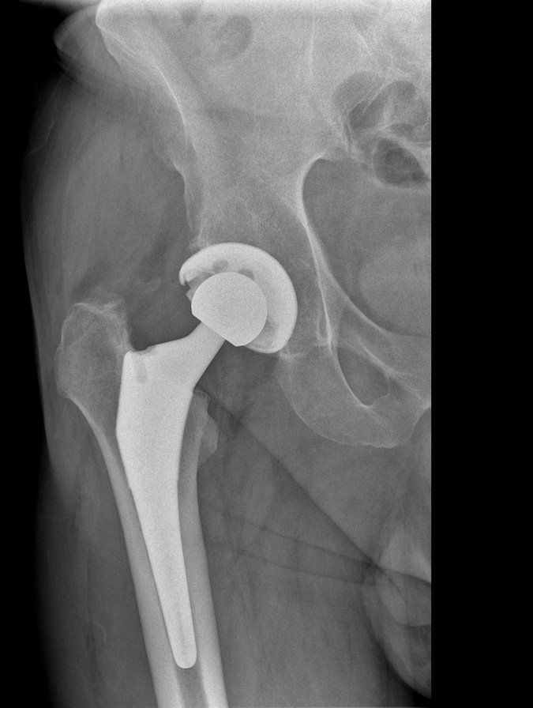 Hip_SmithAndNephew_Anthology</td>
<td align="center" valign="top"><b>Option 1</b>  Hip_SmithAndNephew_Polarstem_NilCol</td>
<td align="center" valign="top"><b>Option 2</b>  Hip_DepuySynthes_Corail_NilCol</td>
<td align="center" valign="top"><b>✅ Option 3</b>  Hip_SmithAndNephew_Anthology</td>
<td align="center" valign="top"><b>Option 4</b>  Hip_Stryker_Exeter</td>
<td align="center" valign="top"><b>Option 5</b>  Hip_Stryker_AccoladeII</td>
<td align="center" valign="middle"><b>Option 6</b>  <i>None of the above</i></td>
</tr></table>

### Q0108 · correct: option 4 · `Hip_SmithAndNephew_Anthology`

<table><tr>
<td align="center" valign="top"><b>Query</b> 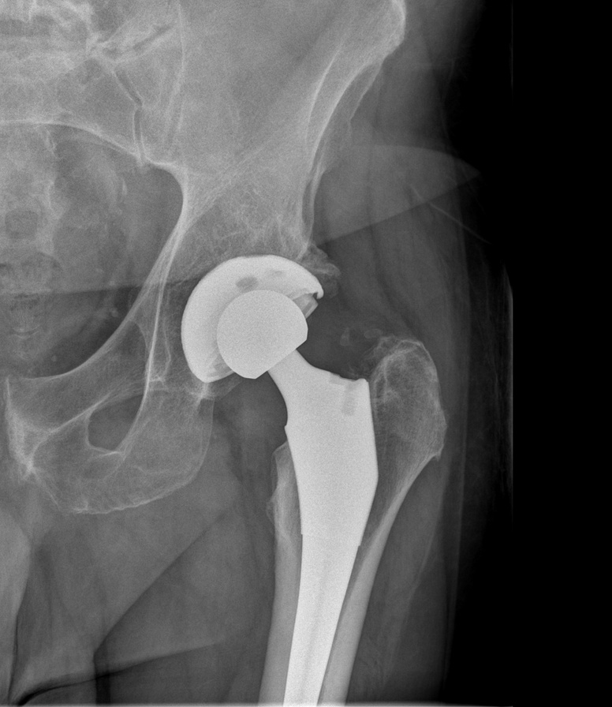 Hip_SmithAndNephew_Anthology</td>
<td align="center" valign="top"><b>Option 1</b>  Hip_SmithAndNephew_Polarstem_NilCol</td>
<td align="center" valign="top"><b>Option 2</b>  Hip_Stryker_AccoladeII</td>
<td align="center" valign="top"><b>Option 3</b>  Hip_DepuySynthes_Corail_NilCol</td>
<td align="center" valign="top"><b>✅ Option 4</b> 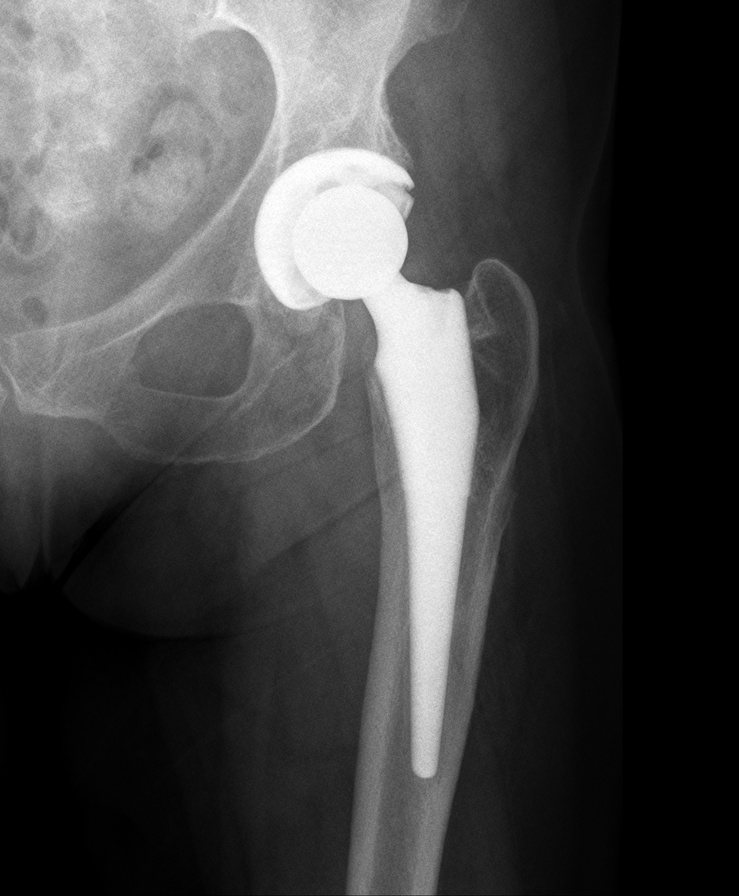 Hip_SmithAndNephew_Anthology</td>
<td align="center" valign="top"><b>Option 5</b> 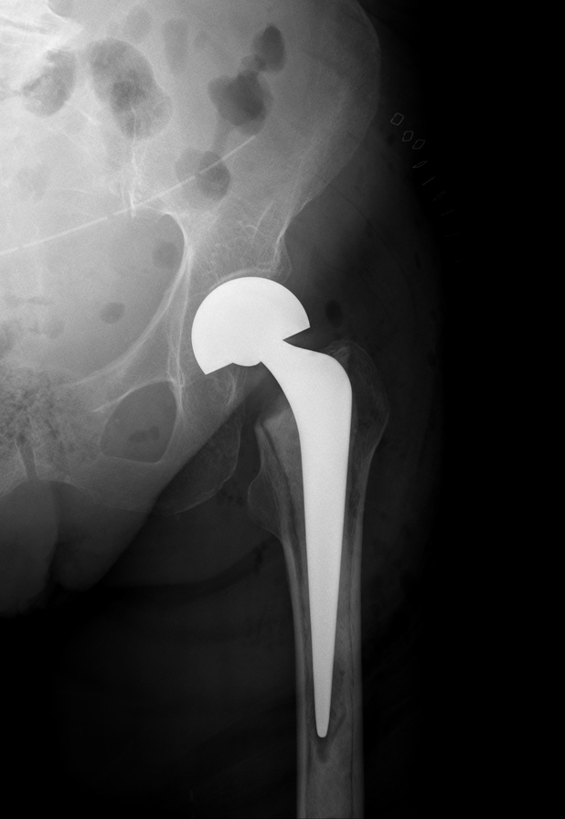 Hip_Stryker_Exeter</td>
<td align="center" valign="middle"><b>Option 6</b>  <i>None of the above</i></td>
</tr></table>

### Q0109 · correct: option 3 · `Hip_SmithAndNephew_Anthology`

<table><tr>
<td align="center" valign="top"><b>Query</b> 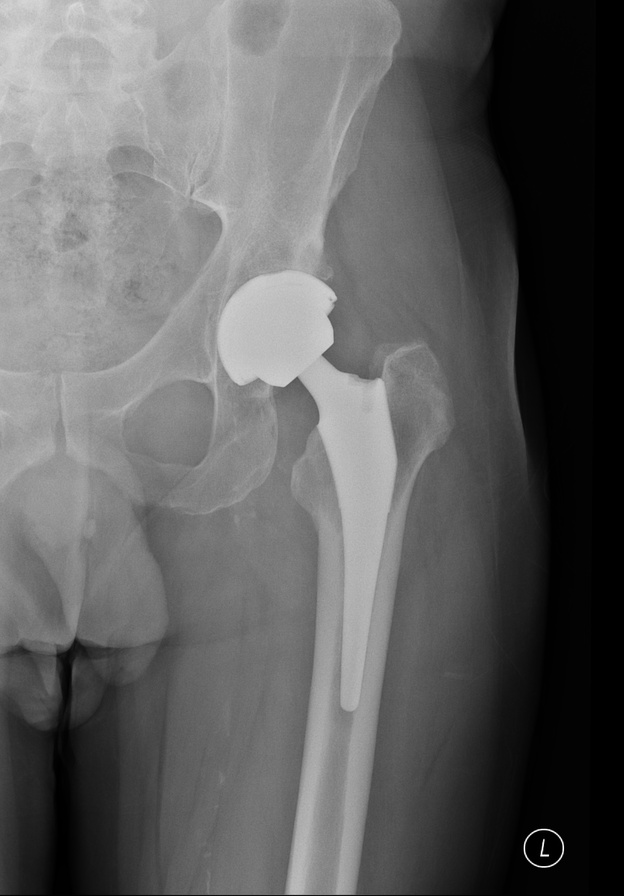 Hip_SmithAndNephew_Anthology</td>
<td align="center" valign="top"><b>Option 1</b>  Hip_JRIOrtho_FurlongEvolution_NilCol</td>
<td align="center" valign="top"><b>Option 2</b>  Hip_DepuySynthes_Corail_NilCol</td>
<td align="center" valign="top"><b>✅ Option 3</b>  Hip_SmithAndNephew_Anthology</td>
<td align="center" valign="top"><b>Option 4</b>  Hip_SmithAndNephew_Polarstem_NilCol</td>
<td align="center" valign="top"><b>Option 5</b> 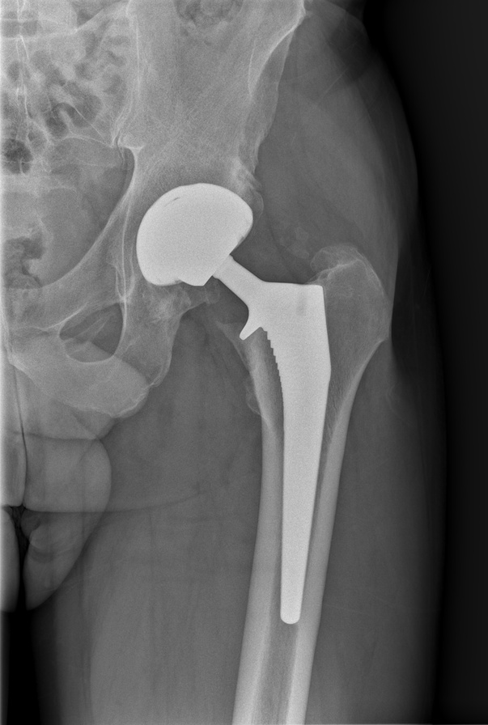 Hip_DepuySynthes_Corail_Collar</td>
<td align="center" valign="middle"><b>Option 6</b>  <i>None of the above</i></td>
</tr></table>

### Q0110 · correct: option 1 · `Hip_SmithAndNephew_Anthology`

<table><tr>
<td align="center" valign="top"><b>Query</b> 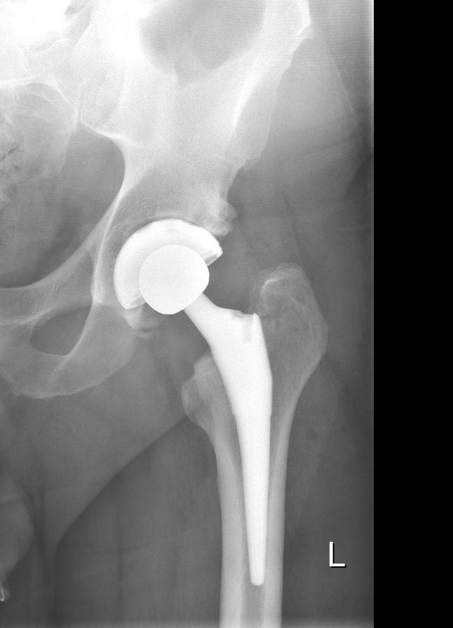 Hip_SmithAndNephew_Anthology</td>
<td align="center" valign="top"><b>✅ Option 1</b>  Hip_SmithAndNephew_Anthology</td>
<td align="center" valign="top"><b>Option 2</b>  Hip_DepuySynthes_Corail_NilCol</td>
<td align="center" valign="top"><b>Option 3</b>  Hip_SmithAndNephew_Polarstem_NilCol</td>
<td align="center" valign="top"><b>Option 4</b>  Hip_Stryker_Exeter</td>
<td align="center" valign="top"><b>Option 5</b>  Hip_Stryker_AccoladeII</td>
<td align="center" valign="middle"><b>Option 6</b>  <i>None of the above</i></td>
</tr></table>

### Q0111 · correct: option 2 · `Hip_SmithAndNephew_Anthology`

<table><tr>
<td align="center" valign="top"><b>Query</b> 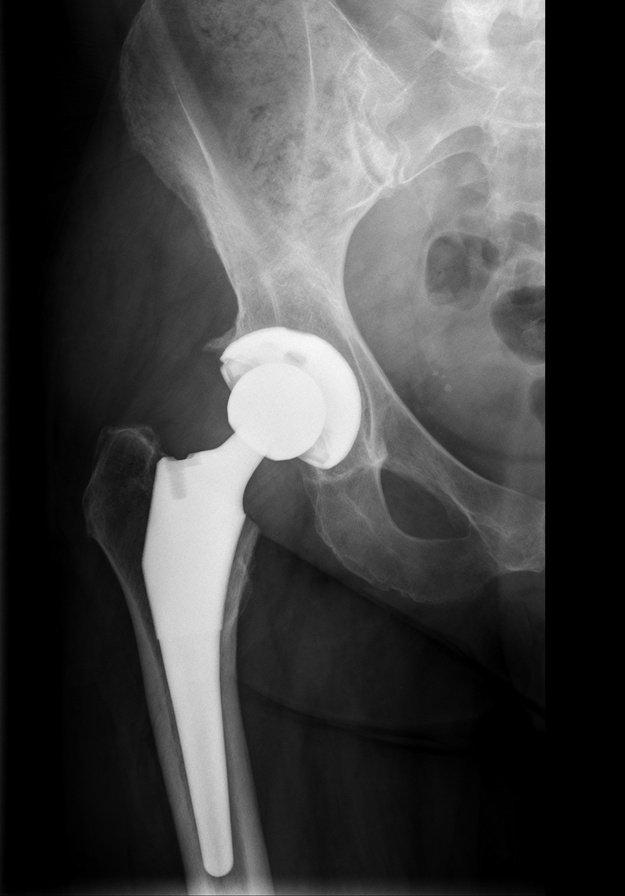 Hip_SmithAndNephew_Anthology</td>
<td align="center" valign="top"><b>Option 1</b>  Hip_DepuySynthes_Corail_NilCol</td>
<td align="center" valign="top"><b>✅ Option 2</b>  Hip_SmithAndNephew_Anthology</td>
<td align="center" valign="top"><b>Option 3</b>  Hip_Stryker_AccoladeII</td>
<td align="center" valign="top"><b>Option 4</b>  Hip_JRIOrtho_FurlongEvolution_NilCol</td>
<td align="center" valign="top"><b>Option 5</b>  Hip_SmithAndNephew_Polarstem_NilCol</td>
<td align="center" valign="middle"><b>Option 6</b>  <i>None of the above</i></td>
</tr></table>

### Q0112 · correct: option 1 · `Hip_SmithAndNephew_Anthology`

<table><tr>
<td align="center" valign="top"><b>Query</b> 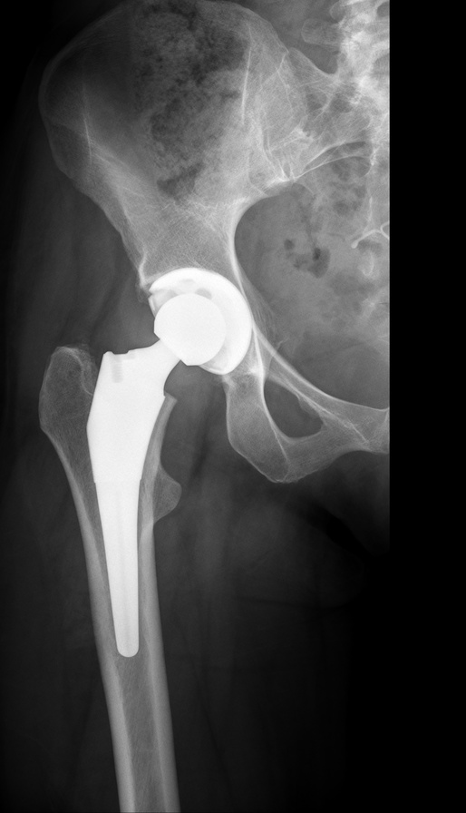 Hip_SmithAndNephew_Anthology</td>
<td align="center" valign="top"><b>✅ Option 1</b>  Hip_SmithAndNephew_Anthology</td>
<td align="center" valign="top"><b>Option 2</b>  Hip_Stryker_AccoladeII</td>
<td align="center" valign="top"><b>Option 3</b>  Hip_JRIOrtho_FurlongEvolution_NilCol</td>
<td align="center" valign="top"><b>Option 4</b>  Hip_JRIOrtho_FurlongEvolution_Collar</td>
<td align="center" valign="top"><b>Option 5</b>  Hip_SmithAndNephew_Polarstem_NilCol</td>
<td align="center" valign="middle"><b>Option 6</b>  <i>None of the above</i></td>
</tr></table>

### Q0113 · correct: option 4 · `Hip_SmithAndNephew_Anthology`

<table><tr>
<td align="center" valign="top"><b>Query</b> 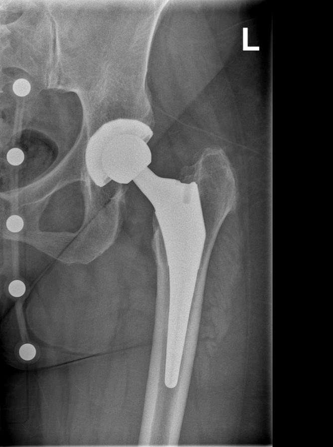 Hip_SmithAndNephew_Anthology</td>
<td align="center" valign="top"><b>Option 1</b>  Hip_SmithAndNephew_Polarstem_NilCol</td>
<td align="center" valign="top"><b>Option 2</b>  Hip_Stryker_Exeter</td>
<td align="center" valign="top"><b>Option 3</b>  Hip_Stryker_AccoladeII</td>
<td align="center" valign="top"><b>✅ Option 4</b> 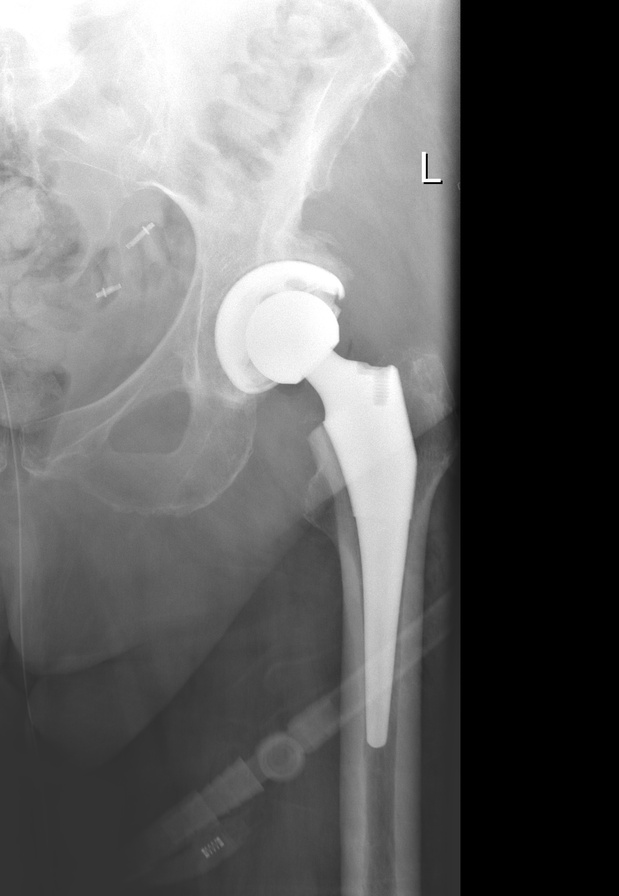 Hip_SmithAndNephew_Anthology</td>
<td align="center" valign="top"><b>Option 5</b>  Hip_DepuySynthes_Corail_NilCol</td>
<td align="center" valign="middle"><b>Option 6</b>  <i>None of the above</i></td>
</tr></table>

### Q0114 · correct: option 5 · `Hip_SmithAndNephew_Anthology`

<table><tr>
<td align="center" valign="top"><b>Query</b> 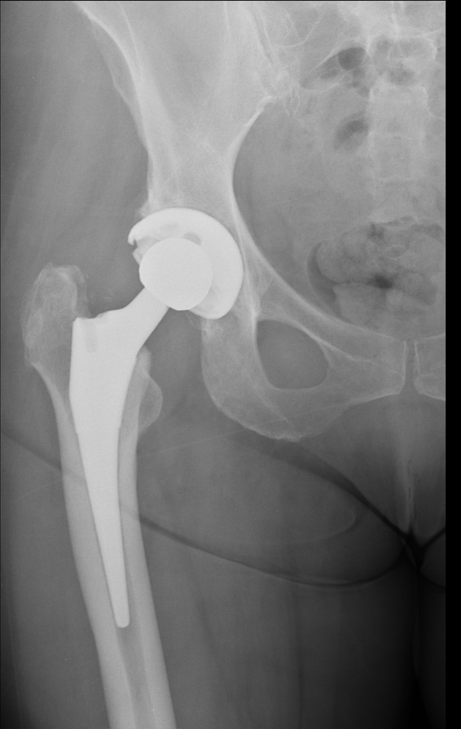 Hip_SmithAndNephew_Anthology</td>
<td align="center" valign="top"><b>Option 1</b>  Hip_DepuySynthes_Corail_NilCol</td>
<td align="center" valign="top"><b>Option 2</b>  Hip_SmithAndNephew_Polarstem_NilCol</td>
<td align="center" valign="top"><b>Option 3</b>  Hip_JRIOrtho_FurlongEvolution_NilCol</td>
<td align="center" valign="top"><b>Option 4</b>  Hip_Stryker_AccoladeII</td>
<td align="center" valign="top"><b>✅ Option 5</b>  Hip_SmithAndNephew_Anthology</td>
<td align="center" valign="middle"><b>Option 6</b>  <i>None of the above</i></td>
</tr></table>

### Q0115 · correct: option 5 · `Hip_SmithAndNephew_Anthology`

<table><tr>
<td align="center" valign="top"><b>Query</b> 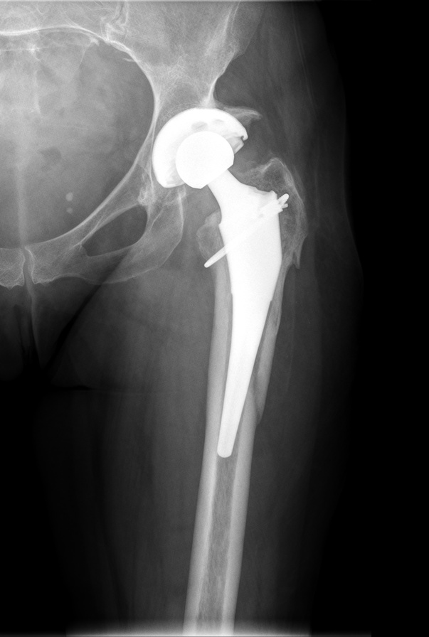 Hip_SmithAndNephew_Anthology</td>
<td align="center" valign="top"><b>Option 1</b>  Hip_DepuySynthes_Corail_NilCol</td>
<td align="center" valign="top"><b>Option 2</b> 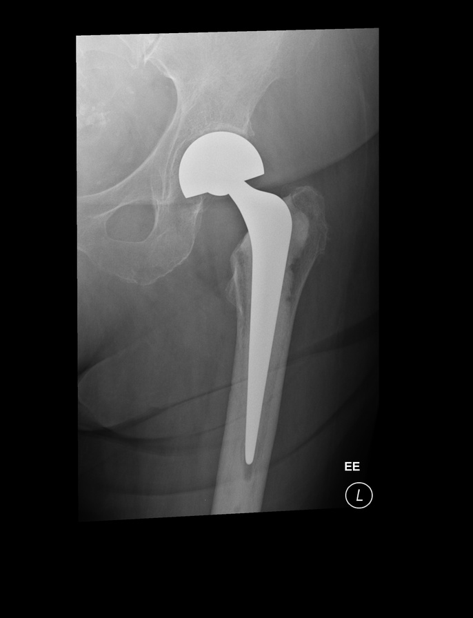 Hip_Stryker_Exeter</td>
<td align="center" valign="top"><b>Option 3</b>  Hip_DepuySynthes_Corail_Collar</td>
<td align="center" valign="top"><b>Option 4</b> 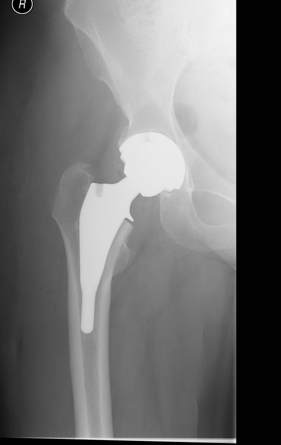 Hip_JRIOrtho_FurlongEvolution_Collar</td>
<td align="center" valign="top"><b>✅ Option 5</b>  Hip_SmithAndNephew_Anthology</td>
<td align="center" valign="middle"><b>Option 6</b>  <i>None of the above</i></td>
</tr></table>

### Q0116 · correct: option 3 · `Hip_SmithAndNephew_Anthology`

<table><tr>
<td align="center" valign="top"><b>Query</b> 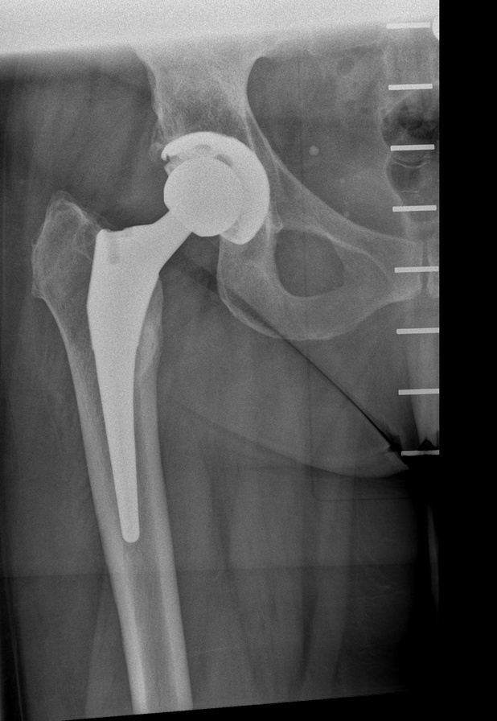 Hip_SmithAndNephew_Anthology</td>
<td align="center" valign="top"><b>Option 1</b>  Hip_Stryker_AccoladeII</td>
<td align="center" valign="top"><b>Option 2</b>  Hip_SmithAndNephew_Polarstem_NilCol</td>
<td align="center" valign="top"><b>✅ Option 3</b>  Hip_SmithAndNephew_Anthology</td>
<td align="center" valign="top"><b>Option 4</b>  Hip_JRIOrtho_FurlongEvolution_NilCol</td>
<td align="center" valign="top"><b>Option 5</b>  Hip_DepuySynthes_Corail_NilCol</td>
<td align="center" valign="middle"><b>Option 6</b>  <i>None of the above</i></td>
</tr></table>

### Q0117 · correct: option 2 · `Hip_SmithAndNephew_Anthology`

<table><tr>
<td align="center" valign="top"><b>Query</b> 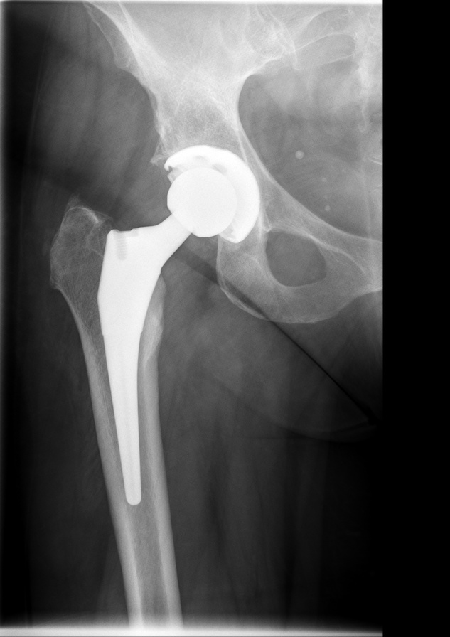 Hip_SmithAndNephew_Anthology</td>
<td align="center" valign="top"><b>Option 1</b>  Hip_DepuySynthes_Corail_Collar</td>
<td align="center" valign="top"><b>✅ Option 2</b>  Hip_SmithAndNephew_Anthology</td>
<td align="center" valign="top"><b>Option 3</b>  Hip_SmithAndNephew_Polarstem_NilCol</td>
<td align="center" valign="top"><b>Option 4</b>  Hip_Stryker_AccoladeII</td>
<td align="center" valign="top"><b>Option 5</b>  Hip_DepuySynthes_Corail_NilCol</td>
<td align="center" valign="middle"><b>Option 6</b>  <i>None of the above</i></td>
</tr></table>

### Q0118 · correct: option 5 · `Hip_SmithAndNephew_Anthology`

<table><tr>
<td align="center" valign="top"><b>Query</b> 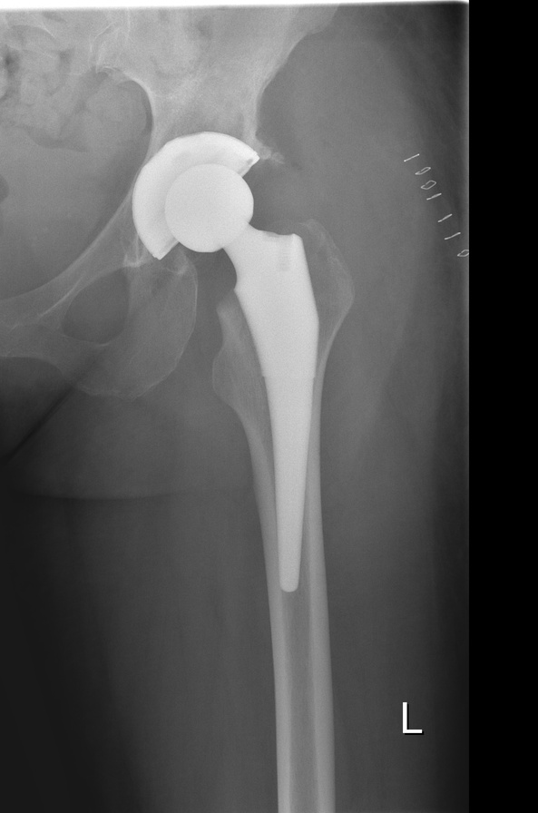 Hip_SmithAndNephew_Anthology</td>
<td align="center" valign="top"><b>Option 1</b> 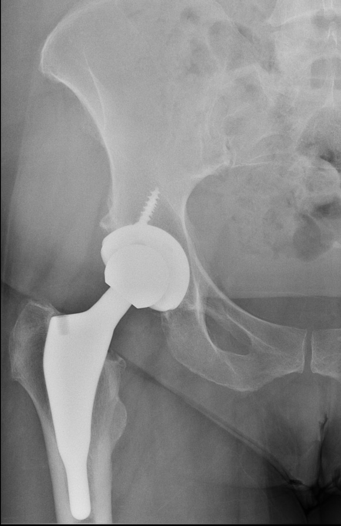 Hip_JRIOrtho_FurlongEvolution_NilCol</td>
<td align="center" valign="top"><b>Option 2</b>  Hip_JRIOrtho_FurlongEvolution_Collar</td>
<td align="center" valign="top"><b>Option 3</b>  Hip_Stryker_AccoladeII</td>
<td align="center" valign="top"><b>Option 4</b>  Hip_DepuySynthes_Corail_Collar</td>
<td align="center" valign="top"><b>✅ Option 5</b>  Hip_SmithAndNephew_Anthology</td>
<td align="center" valign="middle"><b>Option 6</b>  <i>None of the above</i></td>
</tr></table>

### Q0119 · correct: option 1 · `Hip_SmithAndNephew_Anthology`

<table><tr>
<td align="center" valign="top"><b>Query</b> 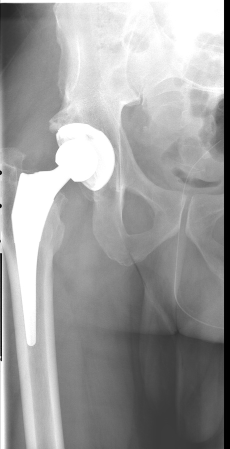 Hip_SmithAndNephew_Anthology</td>
<td align="center" valign="top"><b>✅ Option 1</b>  Hip_SmithAndNephew_Anthology</td>
<td align="center" valign="top"><b>Option 2</b>  Hip_JRIOrtho_FurlongEvolution_NilCol</td>
<td align="center" valign="top"><b>Option 3</b>  Hip_Stryker_AccoladeII</td>
<td align="center" valign="top"><b>Option 4</b>  Hip_JRIOrtho_FurlongEvolution_Collar</td>
<td align="center" valign="top"><b>Option 5</b>  Hip_SmithAndNephew_Polarstem_NilCol</td>
<td align="center" valign="middle"><b>Option 6</b>  <i>None of the above</i></td>
</tr></table>

