# OrthoNet hip · query set `train1` · page 1/3

[← all pages](README.md)

### Q0120 · correct: option 3 · `Hip_SmithAndNephew_Polarstem_NilCol`

<table><tr>
<td align="center" valign="top"><b>Query</b> 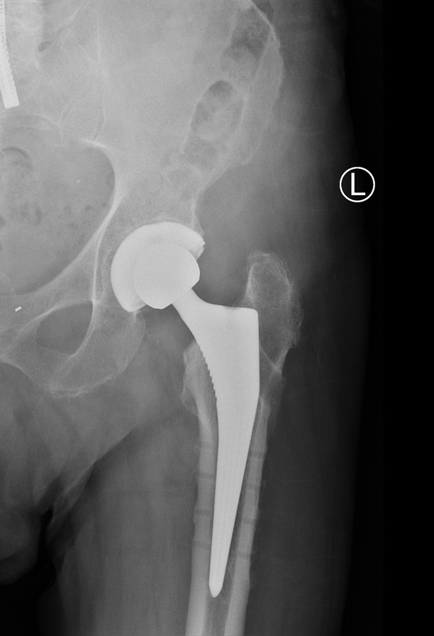 Hip_SmithAndNephew_Polarstem_NilCol</td>
<td align="center" valign="top"><b>Option 1</b> 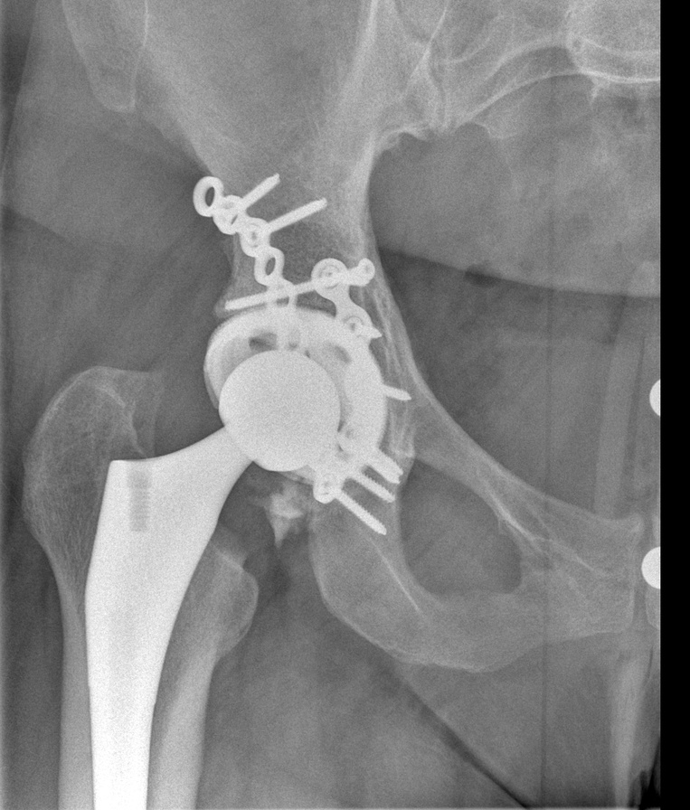 Hip_Stryker_AccoladeII</td>
<td align="center" valign="top"><b>Option 2</b> 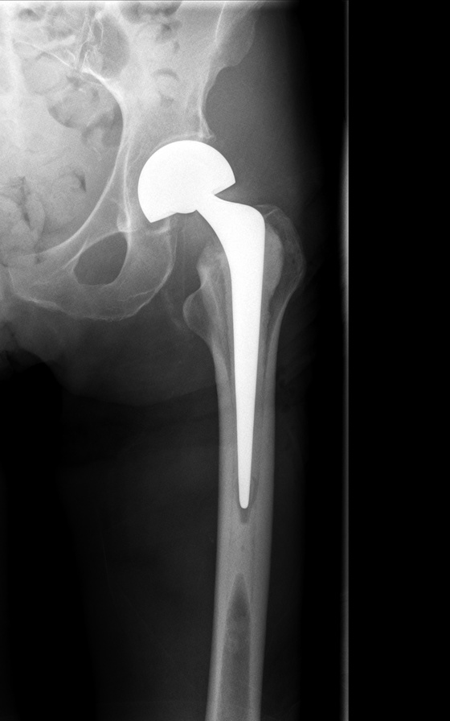 Hip_Stryker_Exeter</td>
<td align="center" valign="top"><b>✅ Option 3</b> 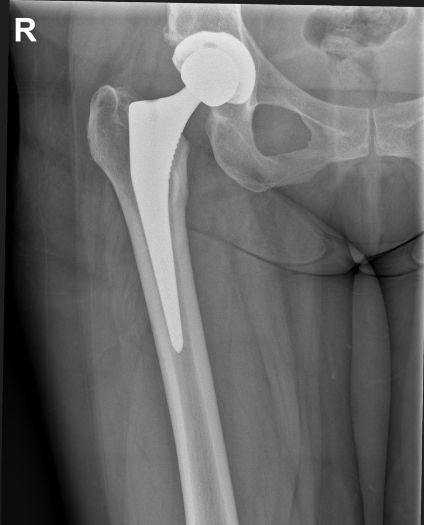 Hip_SmithAndNephew_Polarstem_NilCol</td>
<td align="center" valign="top"><b>Option 4</b> 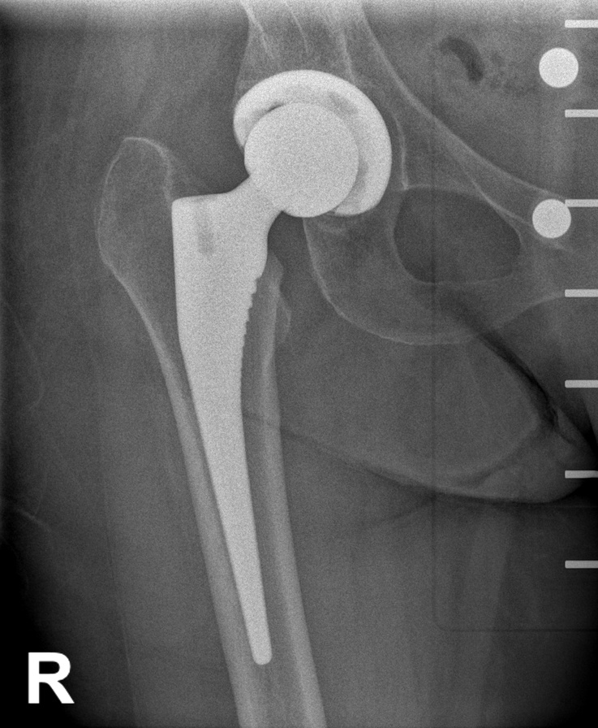 Hip_DepuySynthes_Corail_NilCol</td>
<td align="center" valign="top"><b>Option 5</b> 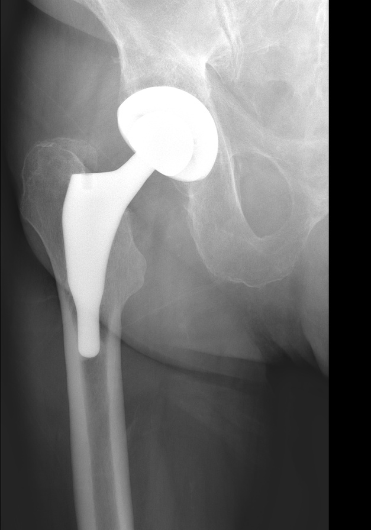 Hip_JRIOrtho_FurlongEvolution_NilCol</td>
<td align="center" valign="middle"><b>Option 6</b>  <i>None of the above</i></td>
</tr></table>

### Q0121 · correct: option 2 · `Hip_SmithAndNephew_Polarstem_NilCol`

<table><tr>
<td align="center" valign="top"><b>Query</b> 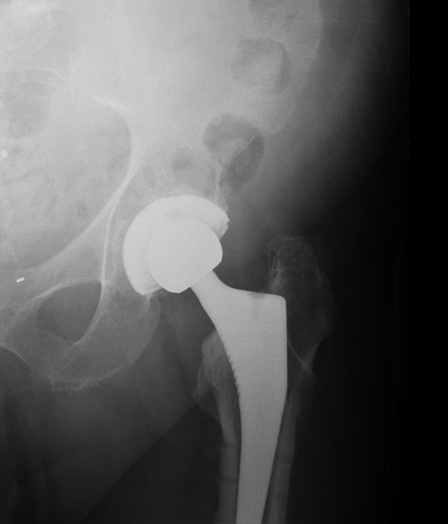 Hip_SmithAndNephew_Polarstem_NilCol</td>
<td align="center" valign="top"><b>Option 1</b>  Hip_DepuySynthes_Corail_NilCol</td>
<td align="center" valign="top"><b>✅ Option 2</b>  Hip_SmithAndNephew_Polarstem_NilCol</td>
<td align="center" valign="top"><b>Option 3</b> 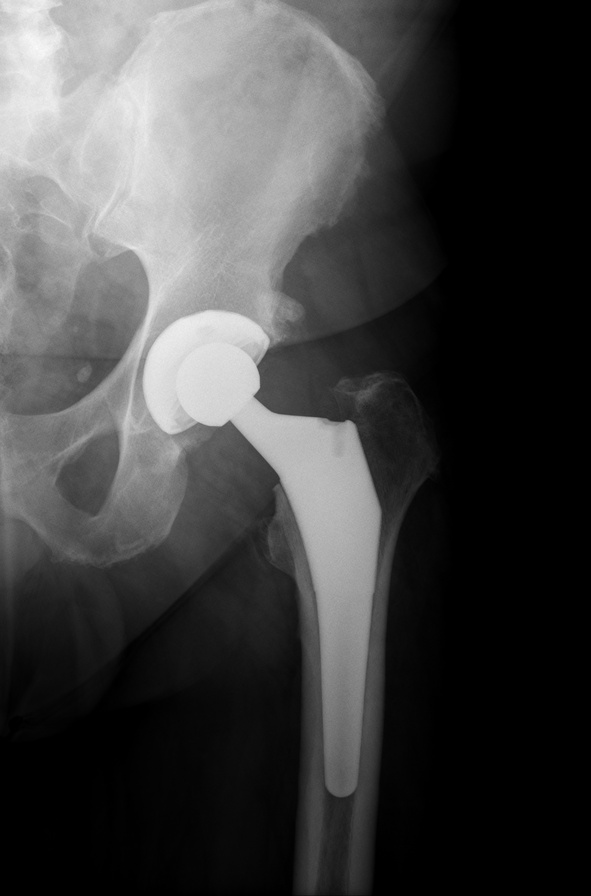 Hip_SmithAndNephew_Anthology</td>
<td align="center" valign="top"><b>Option 4</b> 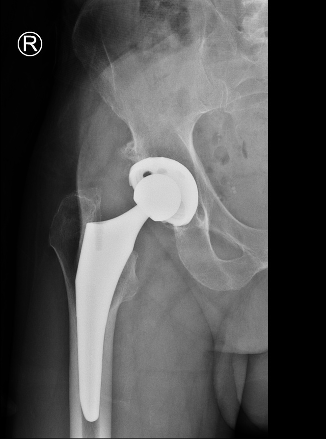 Hip_Stryker_AccoladeII</td>
<td align="center" valign="top"><b>Option 5</b>  Hip_Stryker_Exeter</td>
<td align="center" valign="middle"><b>Option 6</b>  <i>None of the above</i></td>
</tr></table>

### Q0122 · correct: option 5 · `Hip_SmithAndNephew_Polarstem_NilCol`

<table><tr>
<td align="center" valign="top"><b>Query</b> 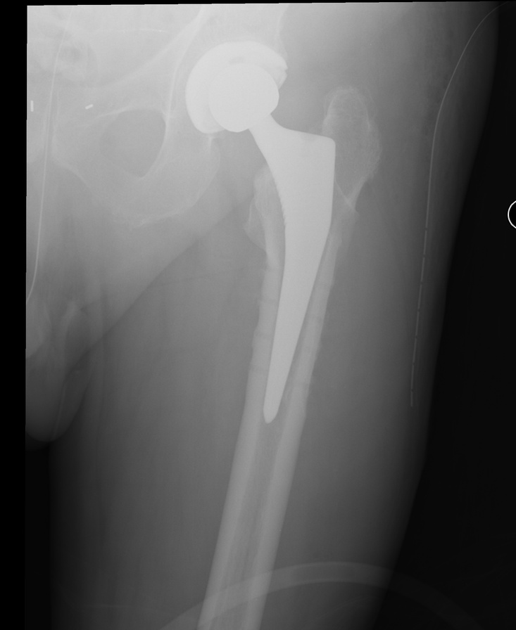 Hip_SmithAndNephew_Polarstem_NilCol</td>
<td align="center" valign="top"><b>Option 1</b> 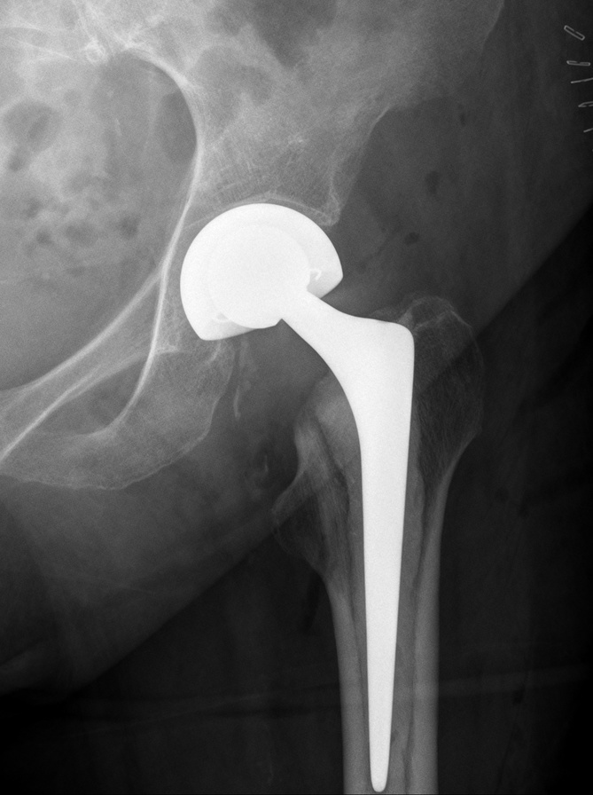 Hip_Stryker_Exeter</td>
<td align="center" valign="top"><b>Option 2</b>  Hip_Stryker_AccoladeII</td>
<td align="center" valign="top"><b>Option 3</b>  Hip_DepuySynthes_Corail_NilCol</td>
<td align="center" valign="top"><b>Option 4</b> 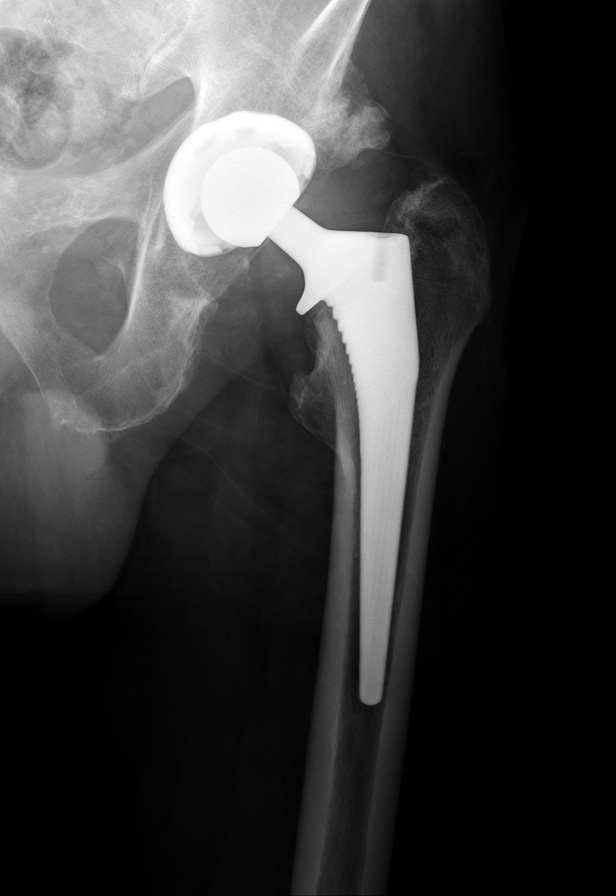 Hip_DepuySynthes_Corail_Collar</td>
<td align="center" valign="top"><b>✅ Option 5</b>  Hip_SmithAndNephew_Polarstem_NilCol</td>
<td align="center" valign="middle"><b>Option 6</b>  <i>None of the above</i></td>
</tr></table>

### Q0123 · correct: option 3 · `Hip_SmithAndNephew_Polarstem_NilCol`

<table><tr>
<td align="center" valign="top"><b>Query</b> 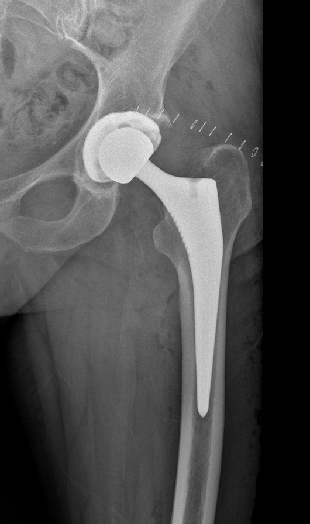 Hip_SmithAndNephew_Polarstem_NilCol</td>
<td align="center" valign="top"><b>Option 1</b>  Hip_SmithAndNephew_Anthology</td>
<td align="center" valign="top"><b>Option 2</b>  Hip_DepuySynthes_Corail_NilCol</td>
<td align="center" valign="top"><b>✅ Option 3</b>  Hip_SmithAndNephew_Polarstem_NilCol</td>
<td align="center" valign="top"><b>Option 4</b>  Hip_Stryker_Exeter</td>
<td align="center" valign="top"><b>Option 5</b>  Hip_Stryker_AccoladeII</td>
<td align="center" valign="middle"><b>Option 6</b>  <i>None of the above</i></td>
</tr></table>

### Q0124 · correct: option 1 · `Hip_Stryker_Exeter`

<table><tr>
<td align="center" valign="top"><b>Query</b> 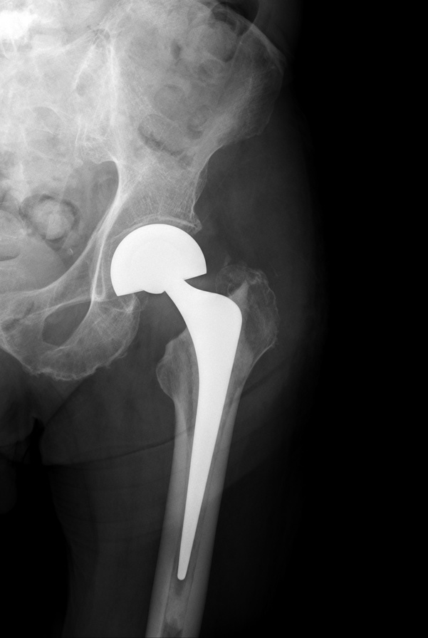 Hip_Stryker_Exeter</td>
<td align="center" valign="top"><b>✅ Option 1</b>  Hip_Stryker_Exeter</td>
<td align="center" valign="top"><b>Option 2</b>  Hip_SmithAndNephew_Polarstem_NilCol</td>
<td align="center" valign="top"><b>Option 3</b>  Hip_DepuySynthes_Corail_Collar</td>
<td align="center" valign="top"><b>Option 4</b> 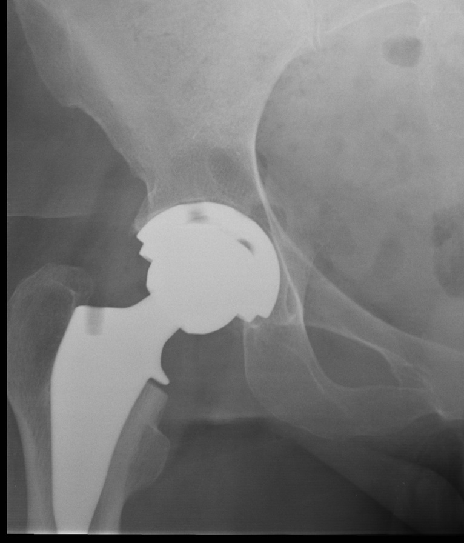 Hip_JRIOrtho_FurlongEvolution_Collar</td>
<td align="center" valign="top"><b>Option 5</b>  Hip_SmithAndNephew_Anthology</td>
<td align="center" valign="middle"><b>Option 6</b>  <i>None of the above</i></td>
</tr></table>

### Q0125 · correct: option 4 · `Hip_Stryker_Exeter`

<table><tr>
<td align="center" valign="top"><b>Query</b> 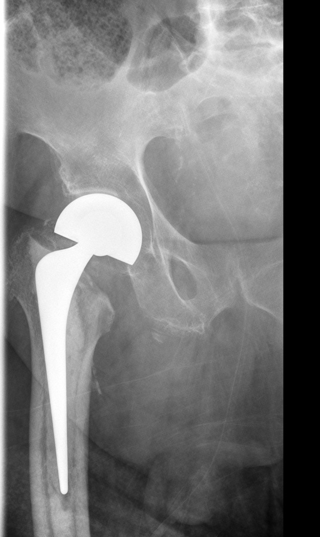 Hip_Stryker_Exeter</td>
<td align="center" valign="top"><b>Option 1</b> 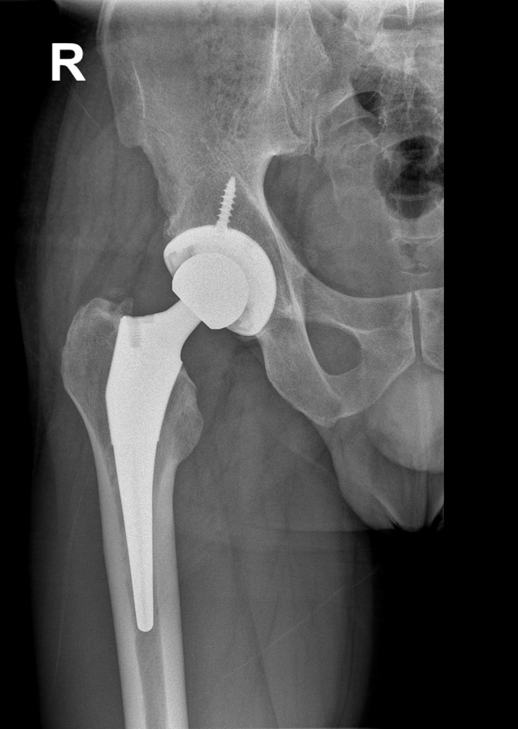 Hip_SmithAndNephew_Anthology</td>
<td align="center" valign="top"><b>Option 2</b> 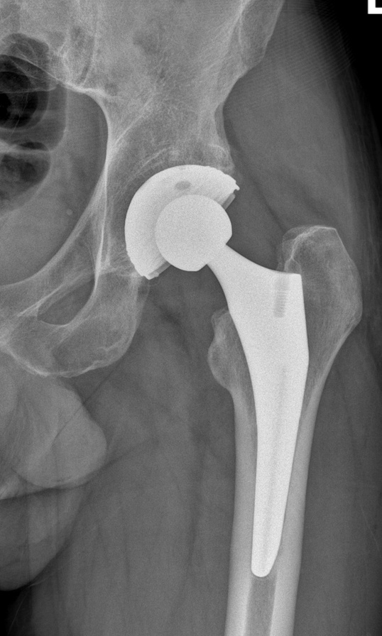 Hip_Stryker_AccoladeII</td>
<td align="center" valign="top"><b>Option 3</b> 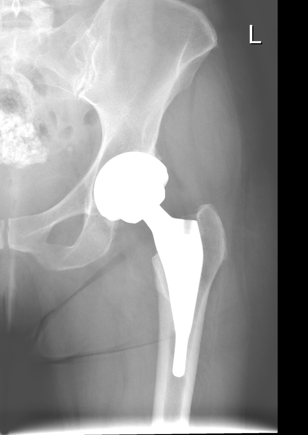 Hip_JRIOrtho_FurlongEvolution_NilCol</td>
<td align="center" valign="top"><b>✅ Option 4</b> 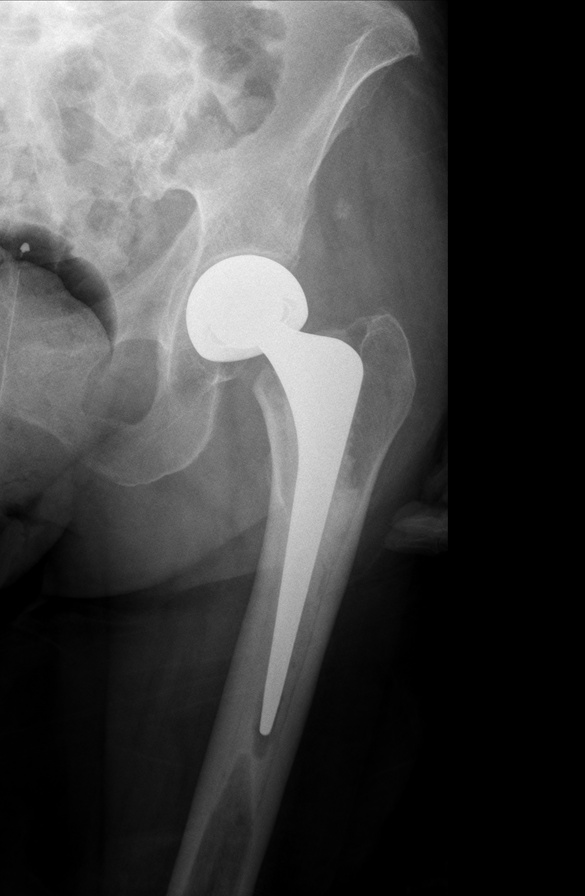 Hip_Stryker_Exeter</td>
<td align="center" valign="top"><b>Option 5</b>  Hip_JRIOrtho_FurlongEvolution_Collar</td>
<td align="center" valign="middle"><b>Option 6</b>  <i>None of the above</i></td>
</tr></table>

### Q0126 · correct: option 3 · `Hip_SmithAndNephew_Polarstem_NilCol`

<table><tr>
<td align="center" valign="top"><b>Query</b> 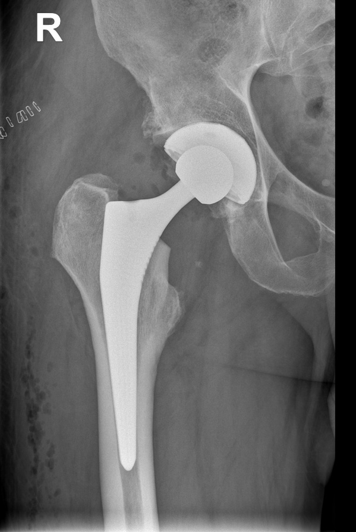 Hip_SmithAndNephew_Polarstem_NilCol</td>
<td align="center" valign="top"><b>Option 1</b>  Hip_SmithAndNephew_Anthology</td>
<td align="center" valign="top"><b>Option 2</b>  Hip_Stryker_AccoladeII</td>
<td align="center" valign="top"><b>✅ Option 3</b>  Hip_SmithAndNephew_Polarstem_NilCol</td>
<td align="center" valign="top"><b>Option 4</b>  Hip_Stryker_Exeter</td>
<td align="center" valign="top"><b>Option 5</b>  Hip_DepuySynthes_Corail_NilCol</td>
<td align="center" valign="middle"><b>Option 6</b>  <i>None of the above</i></td>
</tr></table>

### Q0127 · correct: option 1 · `Hip_SmithAndNephew_Polarstem_NilCol`

<table><tr>
<td align="center" valign="top"><b>Query</b> 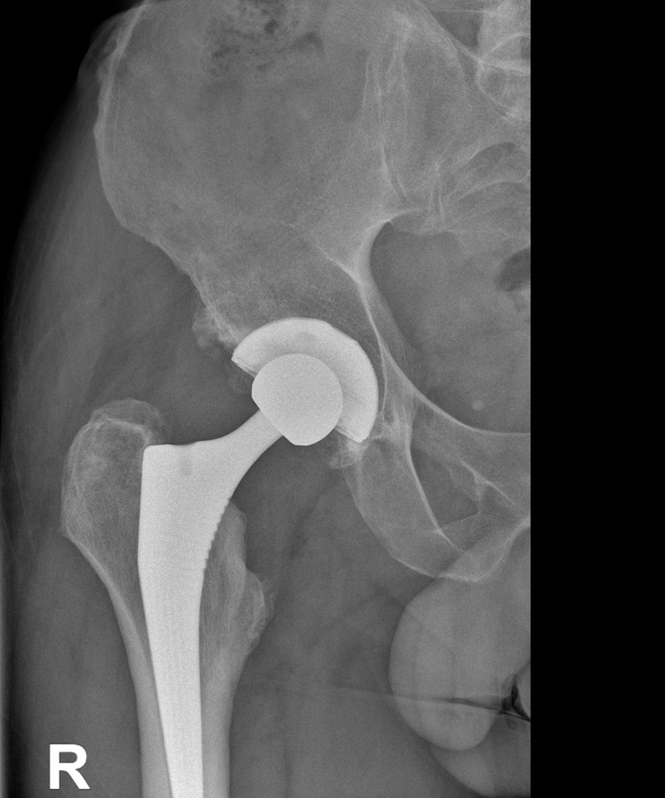 Hip_SmithAndNephew_Polarstem_NilCol</td>
<td align="center" valign="top"><b>✅ Option 1</b>  Hip_SmithAndNephew_Polarstem_NilCol</td>
<td align="center" valign="top"><b>Option 2</b>  Hip_JRIOrtho_FurlongEvolution_NilCol</td>
<td align="center" valign="top"><b>Option 3</b>  Hip_Stryker_AccoladeII</td>
<td align="center" valign="top"><b>Option 4</b>  Hip_SmithAndNephew_Anthology</td>
<td align="center" valign="top"><b>Option 5</b>  Hip_DepuySynthes_Corail_NilCol</td>
<td align="center" valign="middle"><b>Option 6</b>  <i>None of the above</i></td>
</tr></table>

### Q0128 · correct: option 3 · `Hip_SmithAndNephew_Polarstem_NilCol`

<table><tr>
<td align="center" valign="top"><b>Query</b> 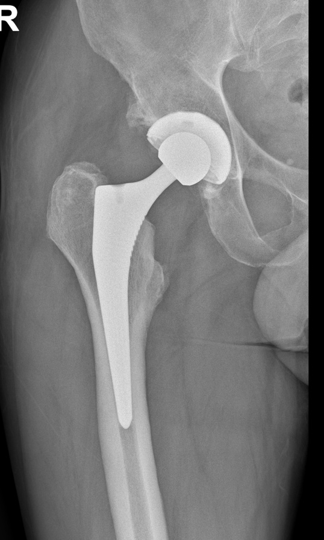 Hip_SmithAndNephew_Polarstem_NilCol</td>
<td align="center" valign="top"><b>Option 1</b>  Hip_SmithAndNephew_Anthology</td>
<td align="center" valign="top"><b>Option 2</b>  Hip_Stryker_AccoladeII</td>
<td align="center" valign="top"><b>✅ Option 3</b>  Hip_SmithAndNephew_Polarstem_NilCol</td>
<td align="center" valign="top"><b>Option 4</b>  Hip_Stryker_Exeter</td>
<td align="center" valign="top"><b>Option 5</b>  Hip_DepuySynthes_Corail_NilCol</td>
<td align="center" valign="middle"><b>Option 6</b>  <i>None of the above</i></td>
</tr></table>

### Q0129 · correct: option 3 · `Hip_Stryker_Exeter`

<table><tr>
<td align="center" valign="top"><b>Query</b> 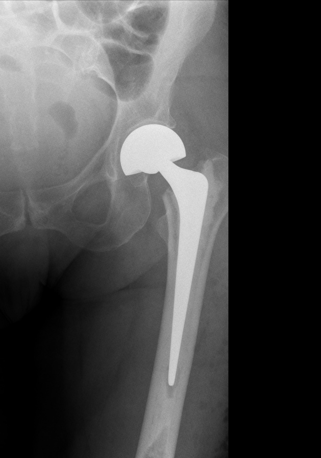 Hip_Stryker_Exeter</td>
<td align="center" valign="top"><b>Option 1</b> 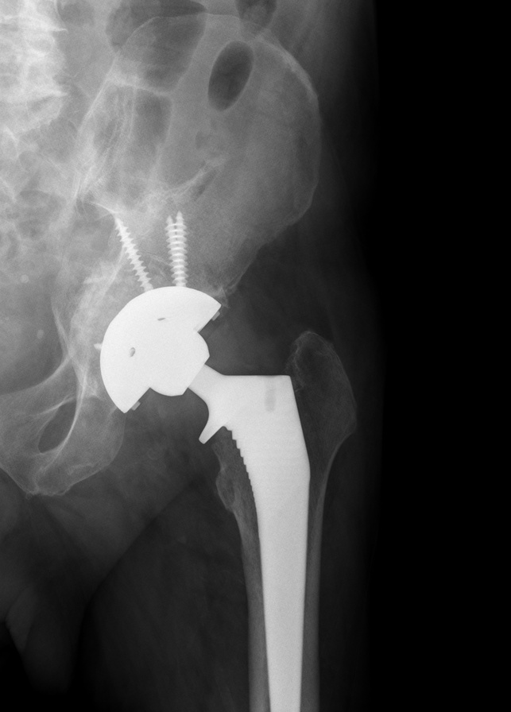 Hip_DepuySynthes_Corail_Collar</td>
<td align="center" valign="top"><b>Option 2</b>  Hip_JRIOrtho_FurlongEvolution_Collar</td>
<td align="center" valign="top"><b>✅ Option 3</b>  Hip_Stryker_Exeter</td>
<td align="center" valign="top"><b>Option 4</b>  Hip_DepuySynthes_Corail_NilCol</td>
<td align="center" valign="top"><b>Option 5</b>  Hip_SmithAndNephew_Polarstem_NilCol</td>
<td align="center" valign="middle"><b>Option 6</b>  <i>None of the above</i></td>
</tr></table>

### Q0130 · correct: option 1 · `Hip_Stryker_Exeter`

<table><tr>
<td align="center" valign="top"><b>Query</b> 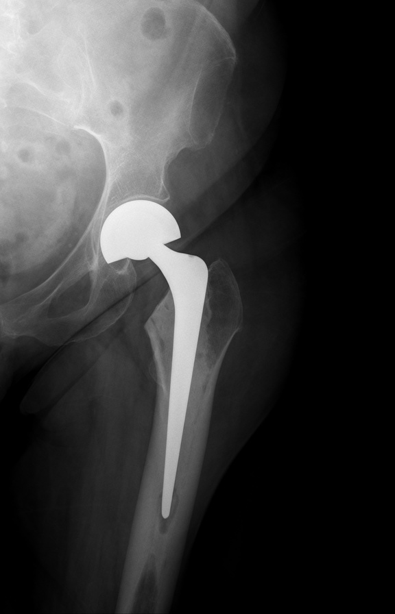 Hip_Stryker_Exeter</td>
<td align="center" valign="top"><b>✅ Option 1</b>  Hip_Stryker_Exeter</td>
<td align="center" valign="top"><b>Option 2</b>  Hip_SmithAndNephew_Polarstem_NilCol</td>
<td align="center" valign="top"><b>Option 3</b>  Hip_JRIOrtho_FurlongEvolution_NilCol</td>
<td align="center" valign="top"><b>Option 4</b>  Hip_JRIOrtho_FurlongEvolution_Collar</td>
<td align="center" valign="top"><b>Option 5</b>  Hip_DepuySynthes_Corail_Collar</td>
<td align="center" valign="middle"><b>Option 6</b>  <i>None of the above</i></td>
</tr></table>

### Q0131 · correct: option 4 · `Hip_Stryker_Exeter`

<table><tr>
<td align="center" valign="top"><b>Query</b> 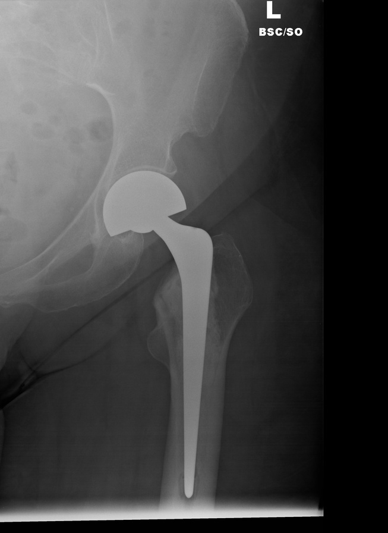 Hip_Stryker_Exeter</td>
<td align="center" valign="top"><b>Option 1</b>  Hip_SmithAndNephew_Anthology</td>
<td align="center" valign="top"><b>Option 2</b>  Hip_JRIOrtho_FurlongEvolution_Collar</td>
<td align="center" valign="top"><b>Option 3</b>  Hip_JRIOrtho_FurlongEvolution_NilCol</td>
<td align="center" valign="top"><b>✅ Option 4</b>  Hip_Stryker_Exeter</td>
<td align="center" valign="top"><b>Option 5</b>  Hip_SmithAndNephew_Polarstem_NilCol</td>
<td align="center" valign="middle"><b>Option 6</b>  <i>None of the above</i></td>
</tr></table>

### Q0132 · correct: option 2 · `Hip_Stryker_Exeter`

<table><tr>
<td align="center" valign="top"><b>Query</b> 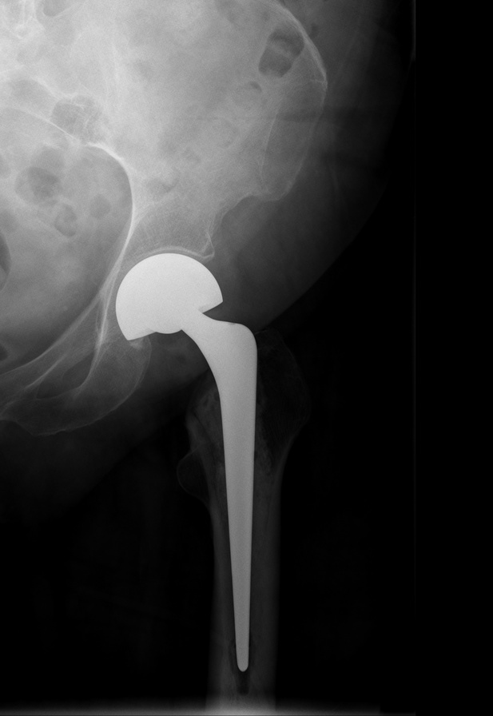 Hip_Stryker_Exeter</td>
<td align="center" valign="top"><b>Option 1</b>  Hip_DepuySynthes_Corail_Collar</td>
<td align="center" valign="top"><b>✅ Option 2</b>  Hip_Stryker_Exeter</td>
<td align="center" valign="top"><b>Option 3</b>  Hip_JRIOrtho_FurlongEvolution_Collar</td>
<td align="center" valign="top"><b>Option 4</b>  Hip_SmithAndNephew_Polarstem_NilCol</td>
<td align="center" valign="top"><b>Option 5</b>  Hip_JRIOrtho_FurlongEvolution_NilCol</td>
<td align="center" valign="middle"><b>Option 6</b>  <i>None of the above</i></td>
</tr></table>

### Q0133 · correct: option 5 · `Hip_DepuySynthes_Corail_NilCol`

<table><tr>
<td align="center" valign="top"><b>Query</b> 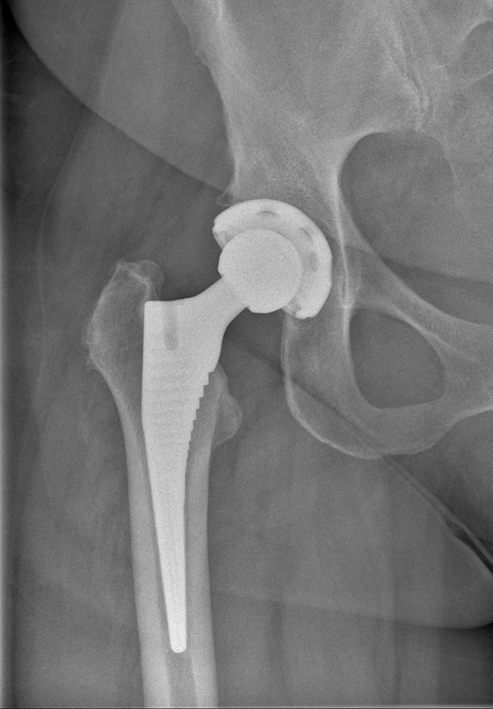 Hip_DepuySynthes_Corail_NilCol</td>
<td align="center" valign="top"><b>Option 1</b>  Hip_DepuySynthes_Corail_Collar</td>
<td align="center" valign="top"><b>Option 2</b> 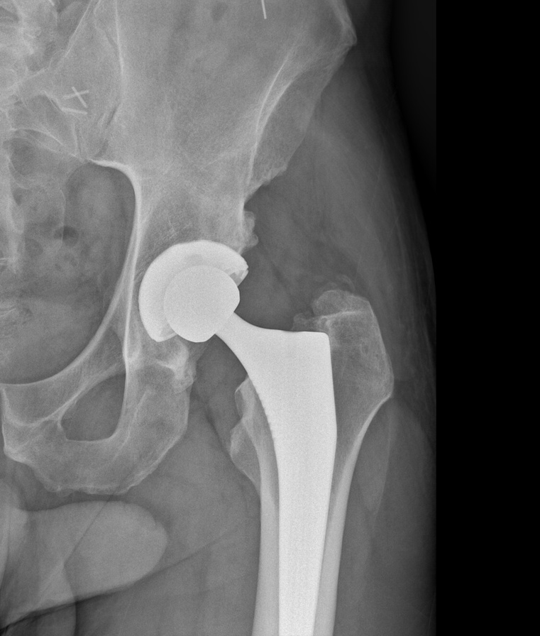 Hip_SmithAndNephew_Polarstem_NilCol</td>
<td align="center" valign="top"><b>Option 3</b> 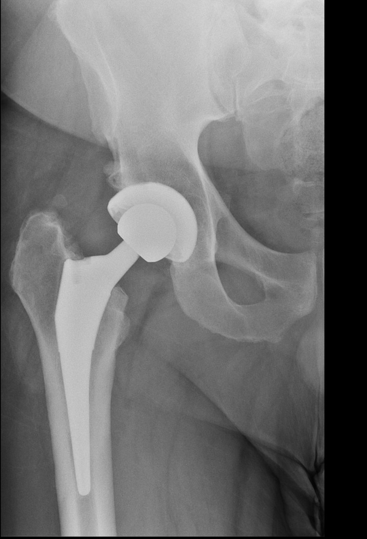 Hip_SmithAndNephew_Anthology</td>
<td align="center" valign="top"><b>Option 4</b>  Hip_Stryker_AccoladeII</td>
<td align="center" valign="top"><b>✅ Option 5</b> 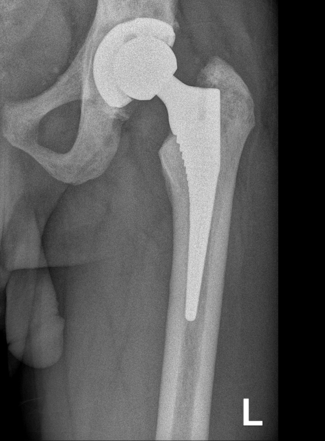 Hip_DepuySynthes_Corail_NilCol</td>
<td align="center" valign="middle"><b>Option 6</b>  <i>None of the above</i></td>
</tr></table>

### Q0134 · correct: option 1 · `Hip_DepuySynthes_Corail_NilCol`

<table><tr>
<td align="center" valign="top"><b>Query</b> 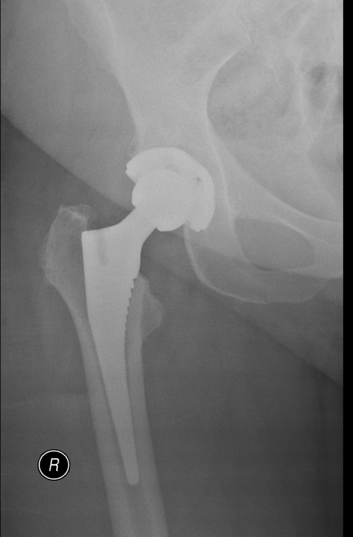 Hip_DepuySynthes_Corail_NilCol</td>
<td align="center" valign="top"><b>✅ Option 1</b> 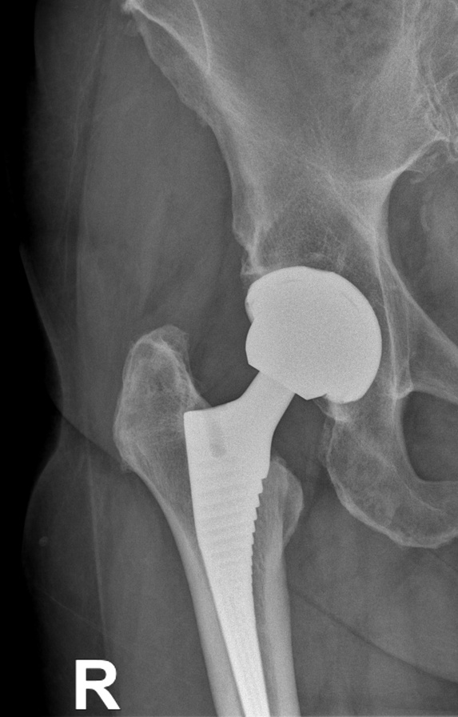 Hip_DepuySynthes_Corail_NilCol</td>
<td align="center" valign="top"><b>Option 2</b> 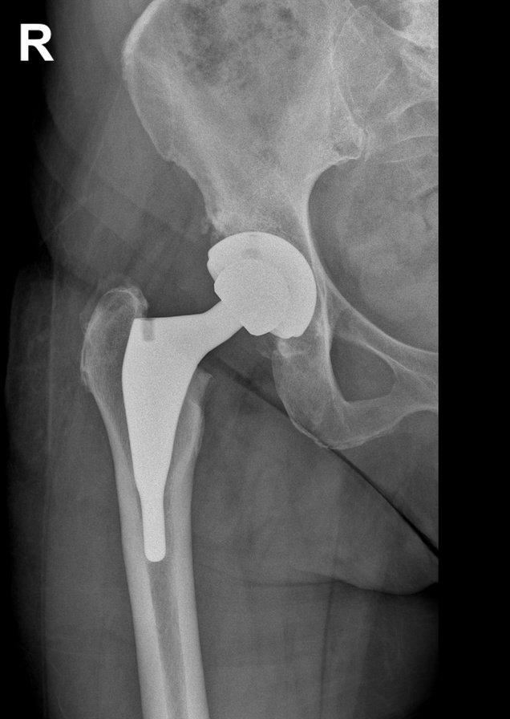 Hip_JRIOrtho_FurlongEvolution_NilCol</td>
<td align="center" valign="top"><b>Option 3</b> 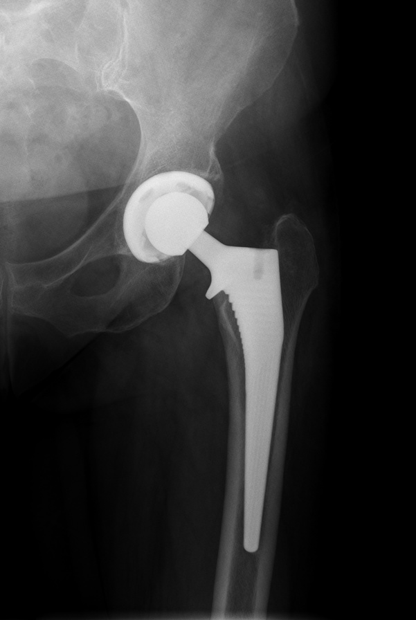 Hip_DepuySynthes_Corail_Collar</td>
<td align="center" valign="top"><b>Option 4</b> 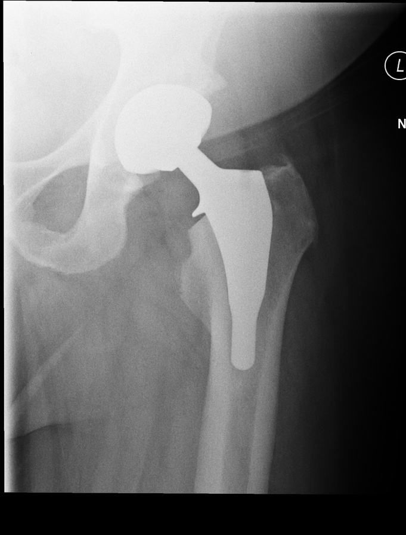 Hip_JRIOrtho_FurlongEvolution_Collar</td>
<td align="center" valign="top"><b>Option 5</b>  Hip_SmithAndNephew_Anthology</td>
<td align="center" valign="middle"><b>Option 6</b>  <i>None of the above</i></td>
</tr></table>

### Q0135 · correct: option 3 · `Hip_JRIOrtho_FurlongEvolution_Collar`

<table><tr>
<td align="center" valign="top"><b>Query</b> 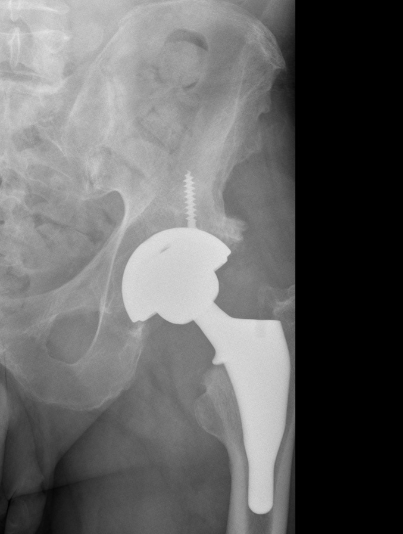 Hip_JRIOrtho_FurlongEvolution_Collar</td>
<td align="center" valign="top"><b>Option 1</b> 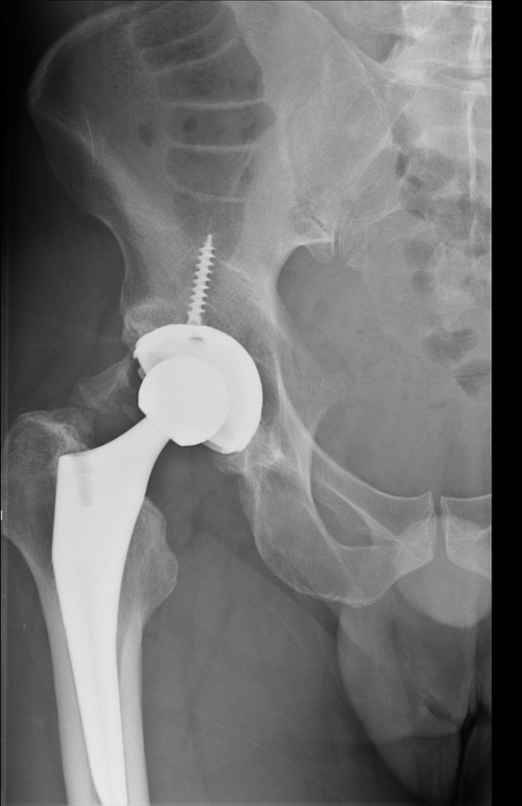 Hip_Stryker_AccoladeII</td>
<td align="center" valign="top"><b>Option 2</b>  Hip_JRIOrtho_FurlongEvolution_NilCol</td>
<td align="center" valign="top"><b>✅ Option 3</b> 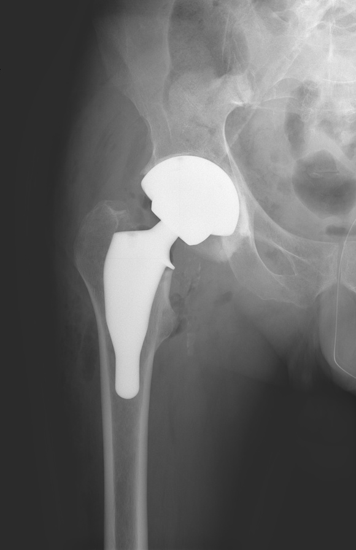 Hip_JRIOrtho_FurlongEvolution_Collar</td>
<td align="center" valign="top"><b>Option 4</b> 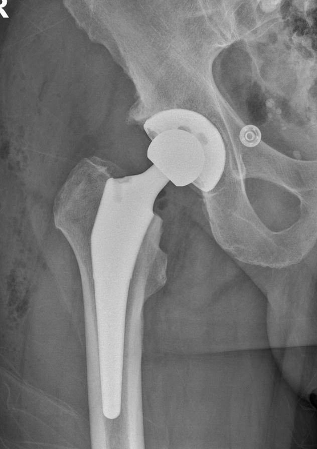 Hip_SmithAndNephew_Anthology</td>
<td align="center" valign="top"><b>Option 5</b>  Hip_DepuySynthes_Corail_Collar</td>
<td align="center" valign="middle"><b>Option 6</b>  <i>None of the above</i></td>
</tr></table>

### Q0136 · correct: option 1 · `Hip_JRIOrtho_FurlongEvolution_Collar`

<table><tr>
<td align="center" valign="top"><b>Query</b> 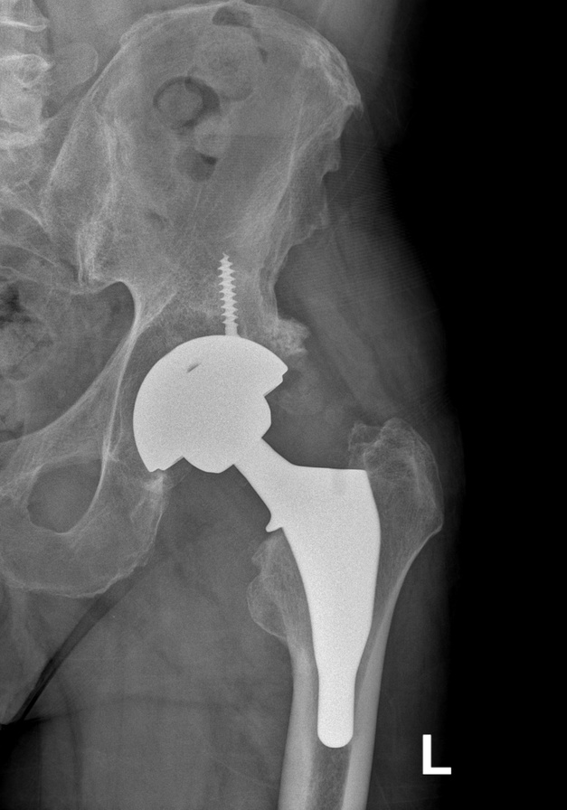 Hip_JRIOrtho_FurlongEvolution_Collar</td>
<td align="center" valign="top"><b>✅ Option 1</b>  Hip_JRIOrtho_FurlongEvolution_Collar</td>
<td align="center" valign="top"><b>Option 2</b> 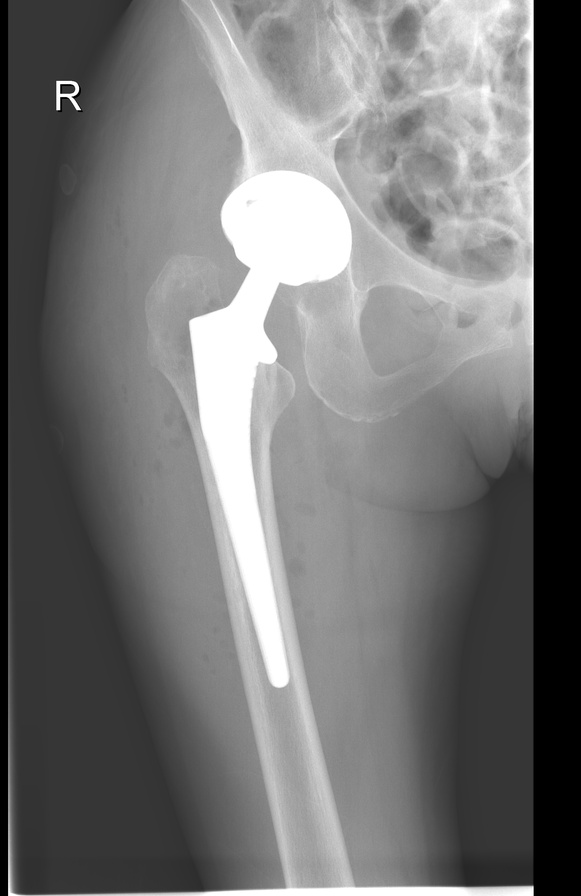 Hip_DepuySynthes_Corail_Collar</td>
<td align="center" valign="top"><b>Option 3</b> 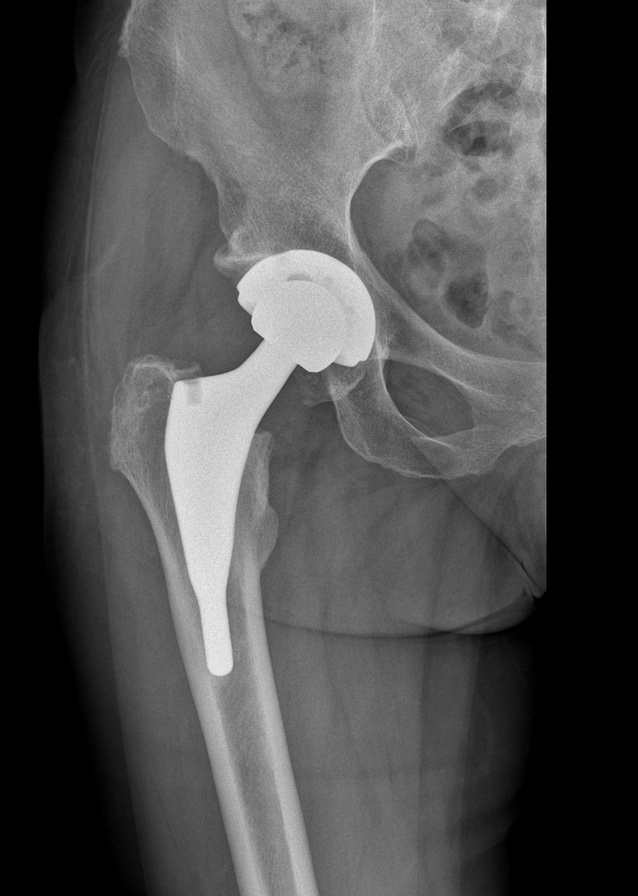 Hip_JRIOrtho_FurlongEvolution_NilCol</td>
<td align="center" valign="top"><b>Option 4</b>  Hip_SmithAndNephew_Anthology</td>
<td align="center" valign="top"><b>Option 5</b>  Hip_Stryker_AccoladeII</td>
<td align="center" valign="middle"><b>Option 6</b>  <i>None of the above</i></td>
</tr></table>

### Q0137 · correct: option 4 · `Hip_DepuySynthes_Corail_Collar`

<table><tr>
<td align="center" valign="top"><b>Query</b> 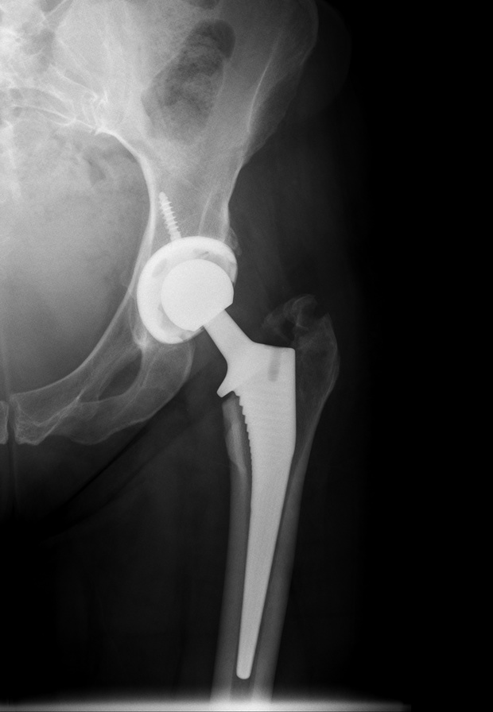 Hip_DepuySynthes_Corail_Collar</td>
<td align="center" valign="top"><b>Option 1</b> 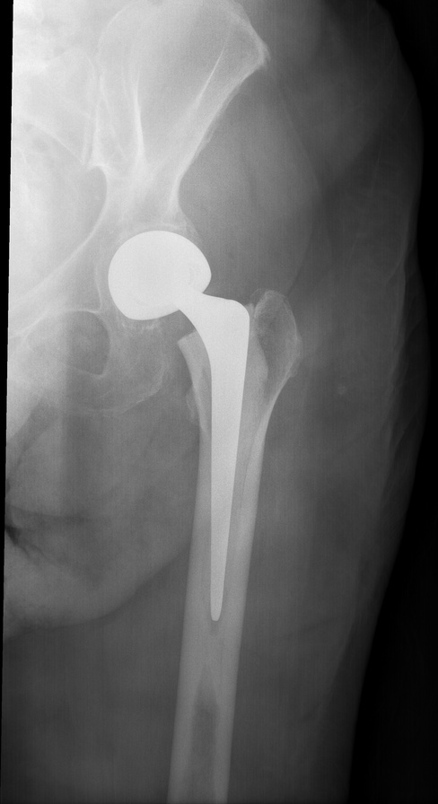 Hip_Stryker_Exeter</td>
<td align="center" valign="top"><b>Option 2</b>  Hip_DepuySynthes_Corail_NilCol</td>
<td align="center" valign="top"><b>Option 3</b>  Hip_Stryker_AccoladeII</td>
<td align="center" valign="top"><b>✅ Option 4</b>  Hip_DepuySynthes_Corail_Collar</td>
<td align="center" valign="top"><b>Option 5</b>  Hip_SmithAndNephew_Anthology</td>
<td align="center" valign="middle"><b>Option 6</b>  <i>None of the above</i></td>
</tr></table>

### Q0138 · correct: option 4 · `Hip_DepuySynthes_Corail_Collar`

<table><tr>
<td align="center" valign="top"><b>Query</b> 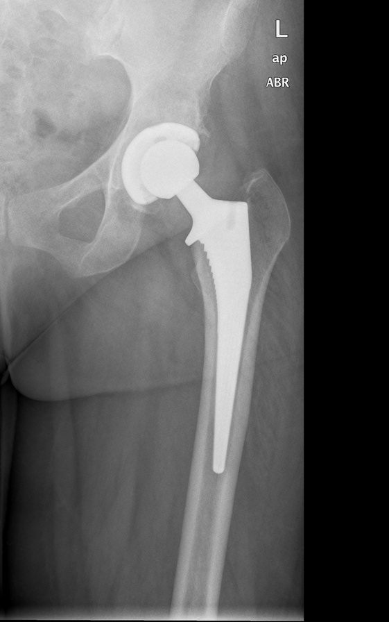 Hip_DepuySynthes_Corail_Collar</td>
<td align="center" valign="top"><b>Option 1</b>  Hip_Stryker_Exeter</td>
<td align="center" valign="top"><b>Option 2</b>  Hip_JRIOrtho_FurlongEvolution_Collar</td>
<td align="center" valign="top"><b>Option 3</b>  Hip_DepuySynthes_Corail_NilCol</td>
<td align="center" valign="top"><b>✅ Option 4</b>  Hip_DepuySynthes_Corail_Collar</td>
<td align="center" valign="top"><b>Option 5</b>  Hip_Stryker_AccoladeII</td>
<td align="center" valign="middle"><b>Option 6</b>  <i>None of the above</i></td>
</tr></table>

### Q0139 · correct: option 2 · `Hip_DepuySynthes_Corail_Collar`

<table><tr>
<td align="center" valign="top"><b>Query</b> 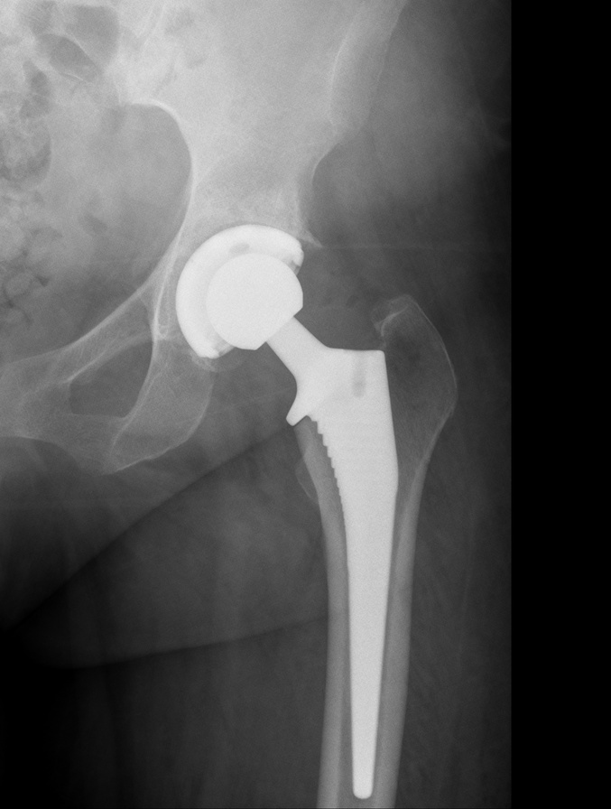 Hip_DepuySynthes_Corail_Collar</td>
<td align="center" valign="top"><b>Option 1</b>  Hip_DepuySynthes_Corail_NilCol</td>
<td align="center" valign="top"><b>✅ Option 2</b>  Hip_DepuySynthes_Corail_Collar</td>
<td align="center" valign="top"><b>Option 3</b>  Hip_JRIOrtho_FurlongEvolution_Collar</td>
<td align="center" valign="top"><b>Option 4</b>  Hip_SmithAndNephew_Anthology</td>
<td align="center" valign="top"><b>Option 5</b>  Hip_Stryker_Exeter</td>
<td align="center" valign="middle"><b>Option 6</b>  <i>None of the above</i></td>
</tr></table>

### Q0140 · correct: option 3 · `Hip_Stryker_Exeter`

<table><tr>
<td align="center" valign="top"><b>Query</b> 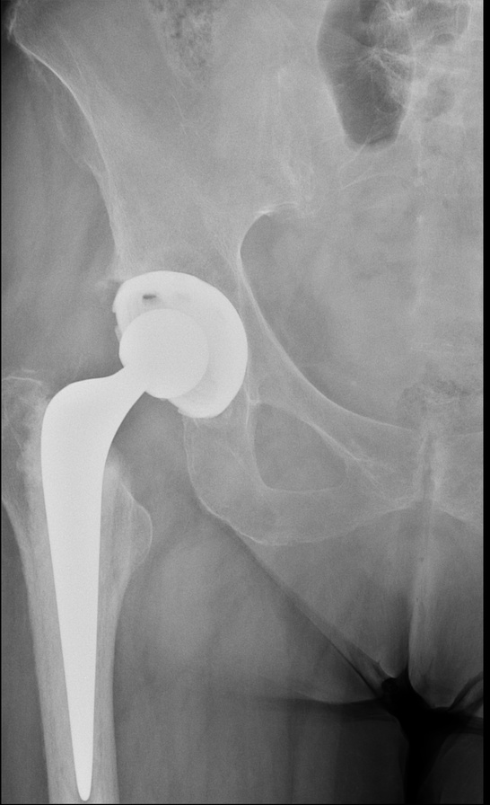 Hip_Stryker_Exeter</td>
<td align="center" valign="top"><b>Option 1</b>  Hip_SmithAndNephew_Polarstem_NilCol</td>
<td align="center" valign="top"><b>Option 2</b>  Hip_SmithAndNephew_Anthology</td>
<td align="center" valign="top"><b>✅ Option 3</b>  Hip_Stryker_Exeter</td>
<td align="center" valign="top"><b>Option 4</b>  Hip_Stryker_AccoladeII</td>
<td align="center" valign="top"><b>Option 5</b>  Hip_JRIOrtho_FurlongEvolution_Collar</td>
<td align="center" valign="middle"><b>Option 6</b>  <i>None of the above</i></td>
</tr></table>

### Q0141 · correct: option 2 · `Hip_Stryker_Exeter`

<table><tr>
<td align="center" valign="top"><b>Query</b> 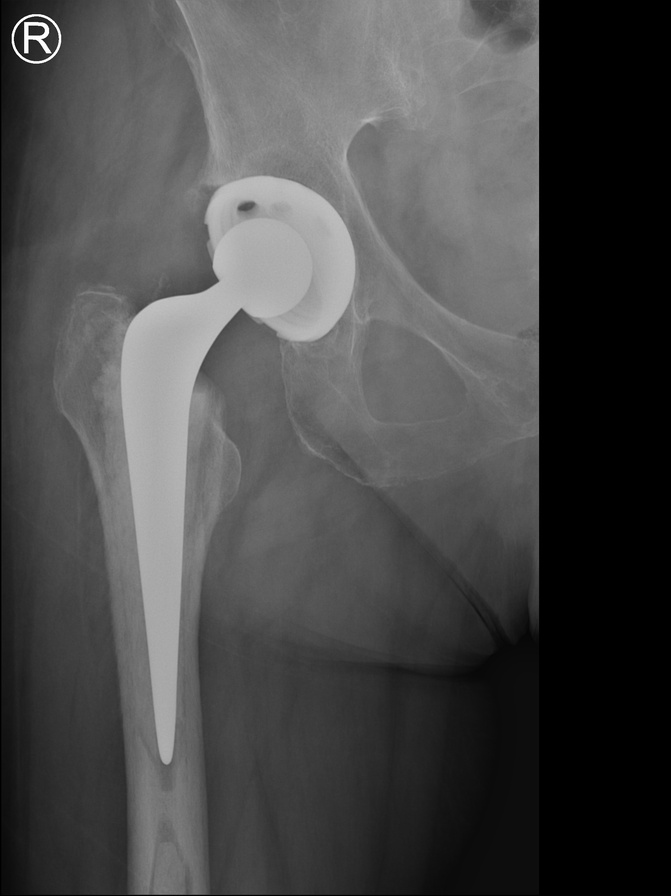 Hip_Stryker_Exeter</td>
<td align="center" valign="top"><b>Option 1</b>  Hip_Stryker_AccoladeII</td>
<td align="center" valign="top"><b>✅ Option 2</b>  Hip_Stryker_Exeter</td>
<td align="center" valign="top"><b>Option 3</b>  Hip_SmithAndNephew_Anthology</td>
<td align="center" valign="top"><b>Option 4</b>  Hip_JRIOrtho_FurlongEvolution_NilCol</td>
<td align="center" valign="top"><b>Option 5</b>  Hip_SmithAndNephew_Polarstem_NilCol</td>
<td align="center" valign="middle"><b>Option 6</b>  <i>None of the above</i></td>
</tr></table>

### Q0142 · correct: option 4 · `Hip_Stryker_Exeter`

<table><tr>
<td align="center" valign="top"><b>Query</b>  Hip_Stryker_Exeter</td>
<td align="center" valign="top"><b>Option 1</b>  Hip_Stryker_AccoladeII</td>
<td align="center" valign="top"><b>Option 2</b>  Hip_SmithAndNephew_Anthology</td>
<td align="center" valign="top"><b>Option 3</b>  Hip_SmithAndNephew_Polarstem_NilCol</td>
<td align="center" valign="top"><b>✅ Option 4</b>  Hip_Stryker_Exeter</td>
<td align="center" valign="top"><b>Option 5</b>  Hip_JRIOrtho_FurlongEvolution_NilCol</td>
<td align="center" valign="middle"><b>Option 6</b>  <i>None of the above</i></td>
</tr></table>

### Q0143 · correct: option 1 · `Hip_Stryker_Exeter`

<table><tr>
<td align="center" valign="top"><b>Query</b>  Hip_Stryker_Exeter</td>
<td align="center" valign="top"><b>✅ Option 1</b>  Hip_Stryker_Exeter</td>
<td align="center" valign="top"><b>Option 2</b>  Hip_Stryker_AccoladeII</td>
<td align="center" valign="top"><b>Option 3</b>  Hip_JRIOrtho_FurlongEvolution_Collar</td>
<td align="center" valign="top"><b>Option 4</b>  Hip_SmithAndNephew_Anthology</td>
<td align="center" valign="top"><b>Option 5</b>  Hip_DepuySynthes_Corail_NilCol</td>
<td align="center" valign="middle"><b>Option 6</b>  <i>None of the above</i></td>
</tr></table>

### Q0144 · correct: option 2 · `Hip_Stryker_Exeter`

<table><tr>
<td align="center" valign="top"><b>Query</b>  Hip_Stryker_Exeter</td>
<td align="center" valign="top"><b>Option 1</b>  Hip_SmithAndNephew_Anthology</td>
<td align="center" valign="top"><b>✅ Option 2</b>  Hip_Stryker_Exeter</td>
<td align="center" valign="top"><b>Option 3</b>  Hip_Stryker_AccoladeII</td>
<td align="center" valign="top"><b>Option 4</b>  Hip_DepuySynthes_Corail_Collar</td>
<td align="center" valign="top"><b>Option 5</b>  Hip_SmithAndNephew_Polarstem_NilCol</td>
<td align="center" valign="middle"><b>Option 6</b>  <i>None of the above</i></td>
</tr></table>

### Q0145 · correct: option 3 · `Hip_Stryker_Exeter`

<table><tr>
<td align="center" valign="top"><b>Query</b>  Hip_Stryker_Exeter</td>
<td align="center" valign="top"><b>Option 1</b>  Hip_SmithAndNephew_Anthology</td>
<td align="center" valign="top"><b>Option 2</b>  Hip_DepuySynthes_Corail_NilCol</td>
<td align="center" valign="top"><b>✅ Option 3</b>  Hip_Stryker_Exeter</td>
<td align="center" valign="top"><b>Option 4</b>  Hip_SmithAndNephew_Polarstem_NilCol</td>
<td align="center" valign="top"><b>Option 5</b>  Hip_Stryker_AccoladeII</td>
<td align="center" valign="middle"><b>Option 6</b>  <i>None of the above</i></td>
</tr></table>

### Q0146 · correct: option 2 · `Hip_DepuySynthes_Corail_NilCol`

<table><tr>
<td align="center" valign="top"><b>Query</b>  Hip_DepuySynthes_Corail_NilCol</td>
<td align="center" valign="top"><b>Option 1</b>  Hip_SmithAndNephew_Polarstem_NilCol</td>
<td align="center" valign="top"><b>✅ Option 2</b>  Hip_DepuySynthes_Corail_NilCol</td>
<td align="center" valign="top"><b>Option 3</b>  Hip_DepuySynthes_Corail_Collar</td>
<td align="center" valign="top"><b>Option 4</b>  Hip_Stryker_Exeter</td>
<td align="center" valign="top"><b>Option 5</b>  Hip_SmithAndNephew_Anthology</td>
<td align="center" valign="middle"><b>Option 6</b>  <i>None of the above</i></td>
</tr></table>

### Q0147 · correct: option 4 · `Hip_DepuySynthes_Corail_Collar`

<table><tr>
<td align="center" valign="top"><b>Query</b>  Hip_DepuySynthes_Corail_Collar</td>
<td align="center" valign="top"><b>Option 1</b>  Hip_SmithAndNephew_Anthology</td>
<td align="center" valign="top"><b>Option 2</b>  Hip_DepuySynthes_Corail_NilCol</td>
<td align="center" valign="top"><b>Option 3</b>  Hip_JRIOrtho_FurlongEvolution_NilCol</td>
<td align="center" valign="top"><b>✅ Option 4</b>  Hip_DepuySynthes_Corail_Collar</td>
<td align="center" valign="top"><b>Option 5</b>  Hip_Stryker_AccoladeII</td>
<td align="center" valign="middle"><b>Option 6</b>  <i>None of the above</i></td>
</tr></table>

### Q0148 · correct: option 4 · `Hip_DepuySynthes_Corail_Collar`

<table><tr>
<td align="center" valign="top"><b>Query</b>  Hip_DepuySynthes_Corail_Collar</td>
<td align="center" valign="top"><b>Option 1</b>  Hip_DepuySynthes_Corail_NilCol</td>
<td align="center" valign="top"><b>Option 2</b>  Hip_JRIOrtho_FurlongEvolution_Collar</td>
<td align="center" valign="top"><b>Option 3</b>  Hip_Stryker_AccoladeII</td>
<td align="center" valign="top"><b>✅ Option 4</b>  Hip_DepuySynthes_Corail_Collar</td>
<td align="center" valign="top"><b>Option 5</b>  Hip_Stryker_Exeter</td>
<td align="center" valign="middle"><b>Option 6</b>  <i>None of the above</i></td>
</tr></table>

### Q0149 · correct: option 3 · `Hip_SmithAndNephew_Polarstem_NilCol`

<table><tr>
<td align="center" valign="top"><b>Query</b>  Hip_SmithAndNephew_Polarstem_NilCol</td>
<td align="center" valign="top"><b>Option 1</b>  Hip_SmithAndNephew_Anthology</td>
<td align="center" valign="top"><b>Option 2</b>  Hip_DepuySynthes_Corail_Collar</td>
<td align="center" valign="top"><b>✅ Option 3</b>  Hip_SmithAndNephew_Polarstem_NilCol</td>
<td align="center" valign="top"><b>Option 4</b>  Hip_Stryker_Exeter</td>
<td align="center" valign="top"><b>Option 5</b>  Hip_DepuySynthes_Corail_NilCol</td>
<td align="center" valign="middle"><b>Option 6</b>  <i>None of the above</i></td>
</tr></table>

### Q0150 · correct: option 4 · `Hip_DepuySynthes_Corail_Collar`

<table><tr>
<td align="center" valign="top"><b>Query</b>  Hip_DepuySynthes_Corail_Collar</td>
<td align="center" valign="top"><b>Option 1</b>  Hip_JRIOrtho_FurlongEvolution_Collar</td>
<td align="center" valign="top"><b>Option 2</b>  Hip_SmithAndNephew_Anthology</td>
<td align="center" valign="top"><b>Option 3</b>  Hip_SmithAndNephew_Polarstem_NilCol</td>
<td align="center" valign="top"><b>✅ Option 4</b>  Hip_DepuySynthes_Corail_Collar</td>
<td align="center" valign="top"><b>Option 5</b>  Hip_DepuySynthes_Corail_NilCol</td>
<td align="center" valign="middle"><b>Option 6</b>  <i>None of the above</i></td>
</tr></table>

### Q0151 · correct: option 4 · `Hip_DepuySynthes_Corail_Collar`

<table><tr>
<td align="center" valign="top"><b>Query</b>  Hip_DepuySynthes_Corail_Collar</td>
<td align="center" valign="top"><b>Option 1</b>  Hip_SmithAndNephew_Polarstem_NilCol</td>
<td align="center" valign="top"><b>Option 2</b>  Hip_JRIOrtho_FurlongEvolution_Collar</td>
<td align="center" valign="top"><b>Option 3</b>  Hip_DepuySynthes_Corail_NilCol</td>
<td align="center" valign="top"><b>✅ Option 4</b>  Hip_DepuySynthes_Corail_Collar</td>
<td align="center" valign="top"><b>Option 5</b>  Hip_Stryker_AccoladeII</td>
<td align="center" valign="middle"><b>Option 6</b>  <i>None of the above</i></td>
</tr></table>

### Q0152 · correct: option 3 · `Hip_Stryker_AccoladeII`

<table><tr>
<td align="center" valign="top"><b>Query</b>  Hip_Stryker_AccoladeII</td>
<td align="center" valign="top"><b>Option 1</b>  Hip_JRIOrtho_FurlongEvolution_Collar</td>
<td align="center" valign="top"><b>Option 2</b>  Hip_DepuySynthes_Corail_NilCol</td>
<td align="center" valign="top"><b>✅ Option 3</b>  Hip_Stryker_AccoladeII</td>
<td align="center" valign="top"><b>Option 4</b>  Hip_SmithAndNephew_Anthology</td>
<td align="center" valign="top"><b>Option 5</b>  Hip_JRIOrtho_FurlongEvolution_NilCol</td>
<td align="center" valign="middle"><b>Option 6</b>  <i>None of the above</i></td>
</tr></table>

### Q0153 · correct: option 2 · `Hip_SmithAndNephew_Polarstem_NilCol`

<table><tr>
<td align="center" valign="top"><b>Query</b>  Hip_SmithAndNephew_Polarstem_NilCol</td>
<td align="center" valign="top"><b>Option 1</b>  Hip_JRIOrtho_FurlongEvolution_NilCol</td>
<td align="center" valign="top"><b>✅ Option 2</b>  Hip_SmithAndNephew_Polarstem_NilCol</td>
<td align="center" valign="top"><b>Option 3</b>  Hip_DepuySynthes_Corail_NilCol</td>
<td align="center" valign="top"><b>Option 4</b>  Hip_Stryker_Exeter</td>
<td align="center" valign="top"><b>Option 5</b>  Hip_Stryker_AccoladeII</td>
<td align="center" valign="middle"><b>Option 6</b>  <i>None of the above</i></td>
</tr></table>

### Q0154 · correct: option 1 · `Hip_SmithAndNephew_Polarstem_NilCol`

<table><tr>
<td align="center" valign="top"><b>Query</b>  Hip_SmithAndNephew_Polarstem_NilCol</td>
<td align="center" valign="top"><b>✅ Option 1</b>  Hip_SmithAndNephew_Polarstem_NilCol</td>
<td align="center" valign="top"><b>Option 2</b>  Hip_DepuySynthes_Corail_NilCol</td>
<td align="center" valign="top"><b>Option 3</b>  Hip_JRIOrtho_FurlongEvolution_NilCol</td>
<td align="center" valign="top"><b>Option 4</b>  Hip_Stryker_Exeter</td>
<td align="center" valign="top"><b>Option 5</b>  Hip_Stryker_AccoladeII</td>
<td align="center" valign="middle"><b>Option 6</b>  <i>None of the above</i></td>
</tr></table>

### Q0155 · correct: option 5 · `Hip_SmithAndNephew_Polarstem_NilCol`

<table><tr>
<td align="center" valign="top"><b>Query</b>  Hip_SmithAndNephew_Polarstem_NilCol</td>
<td align="center" valign="top"><b>Option 1</b>  Hip_DepuySynthes_Corail_NilCol</td>
<td align="center" valign="top"><b>Option 2</b>  Hip_JRIOrtho_FurlongEvolution_NilCol</td>
<td align="center" valign="top"><b>Option 3</b>  Hip_Stryker_Exeter</td>
<td align="center" valign="top"><b>Option 4</b>  Hip_Stryker_AccoladeII</td>
<td align="center" valign="top"><b>✅ Option 5</b>  Hip_SmithAndNephew_Polarstem_NilCol</td>
<td align="center" valign="middle"><b>Option 6</b>  <i>None of the above</i></td>
</tr></table>

### Q0156 · correct: option 5 · `Hip_SmithAndNephew_Polarstem_NilCol`

<table><tr>
<td align="center" valign="top"><b>Query</b>  Hip_SmithAndNephew_Polarstem_NilCol</td>
<td align="center" valign="top"><b>Option 1</b>  Hip_DepuySynthes_Corail_NilCol</td>
<td align="center" valign="top"><b>Option 2</b>  Hip_JRIOrtho_FurlongEvolution_NilCol</td>
<td align="center" valign="top"><b>Option 3</b>  Hip_Stryker_Exeter</td>
<td align="center" valign="top"><b>Option 4</b>  Hip_Stryker_AccoladeII</td>
<td align="center" valign="top"><b>✅ Option 5</b>  Hip_SmithAndNephew_Polarstem_NilCol</td>
<td align="center" valign="middle"><b>Option 6</b>  <i>None of the above</i></td>
</tr></table>

### Q0157 · correct: option 3 · `Hip_DepuySynthes_Corail_Collar`

<table><tr>
<td align="center" valign="top"><b>Query</b>  Hip_DepuySynthes_Corail_Collar</td>
<td align="center" valign="top"><b>Option 1</b>  Hip_JRIOrtho_FurlongEvolution_Collar</td>
<td align="center" valign="top"><b>Option 2</b>  Hip_DepuySynthes_Corail_NilCol</td>
<td align="center" valign="top"><b>✅ Option 3</b>  Hip_DepuySynthes_Corail_Collar</td>
<td align="center" valign="top"><b>Option 4</b>  Hip_SmithAndNephew_Anthology</td>
<td align="center" valign="top"><b>Option 5</b>  Hip_Stryker_AccoladeII</td>
<td align="center" valign="middle"><b>Option 6</b>  <i>None of the above</i></td>
</tr></table>

### Q0158 · correct: option 3 · `Hip_DepuySynthes_Corail_Collar`

<table><tr>
<td align="center" valign="top"><b>Query</b>  Hip_DepuySynthes_Corail_Collar</td>
<td align="center" valign="top"><b>Option 1</b>  Hip_Stryker_AccoladeII</td>
<td align="center" valign="top"><b>Option 2</b>  Hip_JRIOrtho_FurlongEvolution_Collar</td>
<td align="center" valign="top"><b>✅ Option 3</b>  Hip_DepuySynthes_Corail_Collar</td>
<td align="center" valign="top"><b>Option 4</b>  Hip_SmithAndNephew_Anthology</td>
<td align="center" valign="top"><b>Option 5</b>  Hip_DepuySynthes_Corail_NilCol</td>
<td align="center" valign="middle"><b>Option 6</b>  <i>None of the above</i></td>
</tr></table>

### Q0159 · correct: option 4 · `Hip_DepuySynthes_Corail_Collar`

<table><tr>
<td align="center" valign="top"><b>Query</b>  Hip_DepuySynthes_Corail_Collar</td>
<td align="center" valign="top"><b>Option 1</b>  Hip_Stryker_Exeter</td>
<td align="center" valign="top"><b>Option 2</b>  Hip_SmithAndNephew_Anthology</td>
<td align="center" valign="top"><b>Option 3</b>  Hip_Stryker_AccoladeII</td>
<td align="center" valign="top"><b>✅ Option 4</b>  Hip_DepuySynthes_Corail_Collar</td>
<td align="center" valign="top"><b>Option 5</b>  Hip_DepuySynthes_Corail_NilCol</td>
<td align="center" valign="middle"><b>Option 6</b>  <i>None of the above</i></td>
</tr></table>

### Q0160 · correct: option 2 · `Hip_DepuySynthes_Corail_Collar`

<table><tr>
<td align="center" valign="top"><b>Query</b>  Hip_DepuySynthes_Corail_Collar</td>
<td align="center" valign="top"><b>Option 1</b>  Hip_SmithAndNephew_Polarstem_NilCol</td>
<td align="center" valign="top"><b>✅ Option 2</b>  Hip_DepuySynthes_Corail_Collar</td>
<td align="center" valign="top"><b>Option 3</b>  Hip_DepuySynthes_Corail_NilCol</td>
<td align="center" valign="top"><b>Option 4</b>  Hip_JRIOrtho_FurlongEvolution_Collar</td>
<td align="center" valign="top"><b>Option 5</b>  Hip_Stryker_AccoladeII</td>
<td align="center" valign="middle"><b>Option 6</b>  <i>None of the above</i></td>
</tr></table>

### Q0161 · correct: option 3 · `Hip_DepuySynthes_Corail_Collar`

<table><tr>
<td align="center" valign="top"><b>Query</b>  Hip_DepuySynthes_Corail_Collar</td>
<td align="center" valign="top"><b>Option 1</b>  Hip_DepuySynthes_Corail_NilCol</td>
<td align="center" valign="top"><b>Option 2</b>  Hip_Stryker_AccoladeII</td>
<td align="center" valign="top"><b>✅ Option 3</b>  Hip_DepuySynthes_Corail_Collar</td>
<td align="center" valign="top"><b>Option 4</b>  Hip_JRIOrtho_FurlongEvolution_Collar</td>
<td align="center" valign="top"><b>Option 5</b>  Hip_SmithAndNephew_Polarstem_NilCol</td>
<td align="center" valign="middle"><b>Option 6</b>  <i>None of the above</i></td>
</tr></table>

### Q0162 · correct: option 5 · `Hip_Stryker_AccoladeII`

<table><tr>
<td align="center" valign="top"><b>Query</b>  Hip_Stryker_AccoladeII</td>
<td align="center" valign="top"><b>Option 1</b>  Hip_JRIOrtho_FurlongEvolution_Collar</td>
<td align="center" valign="top"><b>Option 2</b>  Hip_Stryker_Exeter</td>
<td align="center" valign="top"><b>Option 3</b>  Hip_JRIOrtho_FurlongEvolution_NilCol</td>
<td align="center" valign="top"><b>Option 4</b>  Hip_SmithAndNephew_Polarstem_NilCol</td>
<td align="center" valign="top"><b>✅ Option 5</b>  Hip_Stryker_AccoladeII</td>
<td align="center" valign="middle"><b>Option 6</b>  <i>None of the above</i></td>
</tr></table>

### Q0163 · correct: option 2 · `Hip_Stryker_AccoladeII`

<table><tr>
<td align="center" valign="top"><b>Query</b>  Hip_Stryker_AccoladeII</td>
<td align="center" valign="top"><b>Option 1</b>  Hip_Stryker_Exeter</td>
<td align="center" valign="top"><b>✅ Option 2</b>  Hip_Stryker_AccoladeII</td>
<td align="center" valign="top"><b>Option 3</b>  Hip_SmithAndNephew_Polarstem_NilCol</td>
<td align="center" valign="top"><b>Option 4</b>  Hip_SmithAndNephew_Anthology</td>
<td align="center" valign="top"><b>Option 5</b>  Hip_JRIOrtho_FurlongEvolution_NilCol</td>
<td align="center" valign="middle"><b>Option 6</b>  <i>None of the above</i></td>
</tr></table>

### Q0164 · correct: option 3 · `Hip_Stryker_AccoladeII`

<table><tr>
<td align="center" valign="top"><b>Query</b>  Hip_Stryker_AccoladeII</td>
<td align="center" valign="top"><b>Option 1</b>  Hip_SmithAndNephew_Anthology</td>
<td align="center" valign="top"><b>Option 2</b>  Hip_JRIOrtho_FurlongEvolution_NilCol</td>
<td align="center" valign="top"><b>✅ Option 3</b>  Hip_Stryker_AccoladeII</td>
<td align="center" valign="top"><b>Option 4</b>  Hip_JRIOrtho_FurlongEvolution_Collar</td>
<td align="center" valign="top"><b>Option 5</b>  Hip_SmithAndNephew_Polarstem_NilCol</td>
<td align="center" valign="middle"><b>Option 6</b>  <i>None of the above</i></td>
</tr></table>

### Q0165 · correct: option 2 · `Hip_Stryker_AccoladeII`

<table><tr>
<td align="center" valign="top"><b>Query</b>  Hip_Stryker_AccoladeII</td>
<td align="center" valign="top"><b>Option 1</b>  Hip_JRIOrtho_FurlongEvolution_NilCol</td>
<td align="center" valign="top"><b>✅ Option 2</b>  Hip_Stryker_AccoladeII</td>
<td align="center" valign="top"><b>Option 3</b>  Hip_SmithAndNephew_Polarstem_NilCol</td>
<td align="center" valign="top"><b>Option 4</b>  Hip_SmithAndNephew_Anthology</td>
<td align="center" valign="top"><b>Option 5</b>  Hip_Stryker_Exeter</td>
<td align="center" valign="middle"><b>Option 6</b>  <i>None of the above</i></td>
</tr></table>

### Q0166 · correct: option 5 · `Hip_Stryker_AccoladeII`

<table><tr>
<td align="center" valign="top"><b>Query</b>  Hip_Stryker_AccoladeII</td>
<td align="center" valign="top"><b>Option 1</b>  Hip_DepuySynthes_Corail_NilCol</td>
<td align="center" valign="top"><b>Option 2</b>  Hip_JRIOrtho_FurlongEvolution_NilCol</td>
<td align="center" valign="top"><b>Option 3</b>  Hip_SmithAndNephew_Polarstem_NilCol</td>
<td align="center" valign="top"><b>Option 4</b>  Hip_SmithAndNephew_Anthology</td>
<td align="center" valign="top"><b>✅ Option 5</b>  Hip_Stryker_AccoladeII</td>
<td align="center" valign="middle"><b>Option 6</b>  <i>None of the above</i></td>
</tr></table>

### Q0167 · correct: option 2 · `Hip_SmithAndNephew_Anthology`

<table><tr>
<td align="center" valign="top"><b>Query</b>  Hip_SmithAndNephew_Anthology</td>
<td align="center" valign="top"><b>Option 1</b>  Hip_JRIOrtho_FurlongEvolution_Collar</td>
<td align="center" valign="top"><b>✅ Option 2</b>  Hip_SmithAndNephew_Anthology</td>
<td align="center" valign="top"><b>Option 3</b>  Hip_SmithAndNephew_Polarstem_NilCol</td>
<td align="center" valign="top"><b>Option 4</b>  Hip_Stryker_AccoladeII</td>
<td align="center" valign="top"><b>Option 5</b>  Hip_JRIOrtho_FurlongEvolution_NilCol</td>
<td align="center" valign="middle"><b>Option 6</b>  <i>None of the above</i></td>
</tr></table>

### Q0168 · correct: option 5 · `Hip_SmithAndNephew_Anthology`

<table><tr>
<td align="center" valign="top"><b>Query</b>  Hip_SmithAndNephew_Anthology</td>
<td align="center" valign="top"><b>Option 1</b>  Hip_SmithAndNephew_Polarstem_NilCol</td>
<td align="center" valign="top"><b>Option 2</b>  Hip_DepuySynthes_Corail_NilCol</td>
<td align="center" valign="top"><b>Option 3</b>  Hip_DepuySynthes_Corail_Collar</td>
<td align="center" valign="top"><b>Option 4</b>  Hip_Stryker_AccoladeII</td>
<td align="center" valign="top"><b>✅ Option 5</b>  Hip_SmithAndNephew_Anthology</td>
<td align="center" valign="middle"><b>Option 6</b>  <i>None of the above</i></td>
</tr></table>

### Q0169 · correct: option 4 · `Hip_DepuySynthes_Corail_Collar`

<table><tr>
<td align="center" valign="top"><b>Query</b>  Hip_DepuySynthes_Corail_Collar</td>
<td align="center" valign="top"><b>Option 1</b>  Hip_DepuySynthes_Corail_NilCol</td>
<td align="center" valign="top"><b>Option 2</b>  Hip_SmithAndNephew_Anthology</td>
<td align="center" valign="top"><b>Option 3</b>  Hip_Stryker_AccoladeII</td>
<td align="center" valign="top"><b>✅ Option 4</b>  Hip_DepuySynthes_Corail_Collar</td>
<td align="center" valign="top"><b>Option 5</b>  Hip_JRIOrtho_FurlongEvolution_NilCol</td>
<td align="center" valign="middle"><b>Option 6</b>  <i>None of the above</i></td>
</tr></table>

