# OrthoNet hip · query set `train1` · page 2/3

[← all pages](README.md)

### Q0170 · correct: option 2 · `Hip_DepuySynthes_Corail_Collar`

<table><tr>
<td align="center" valign="top"><b>Query</b> 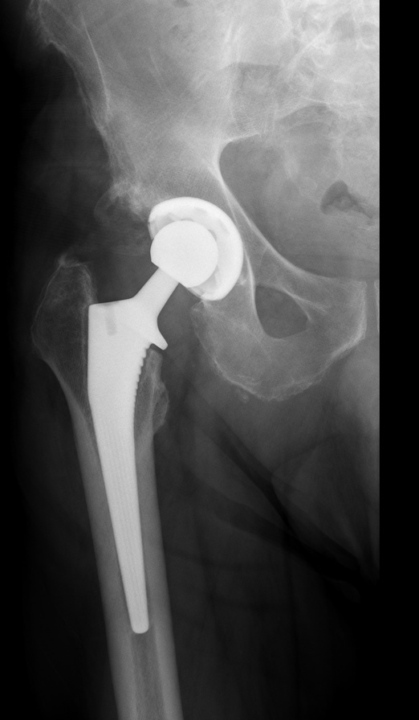 Hip_DepuySynthes_Corail_Collar</td>
<td align="center" valign="top"><b>Option 1</b>  Hip_JRIOrtho_FurlongEvolution_Collar</td>
<td align="center" valign="top"><b>✅ Option 2</b> 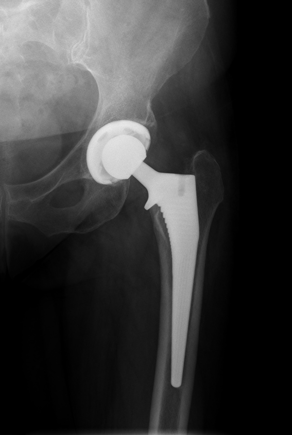 Hip_DepuySynthes_Corail_Collar</td>
<td align="center" valign="top"><b>Option 3</b>  Hip_Stryker_AccoladeII</td>
<td align="center" valign="top"><b>Option 4</b>  Hip_SmithAndNephew_Anthology</td>
<td align="center" valign="top"><b>Option 5</b> 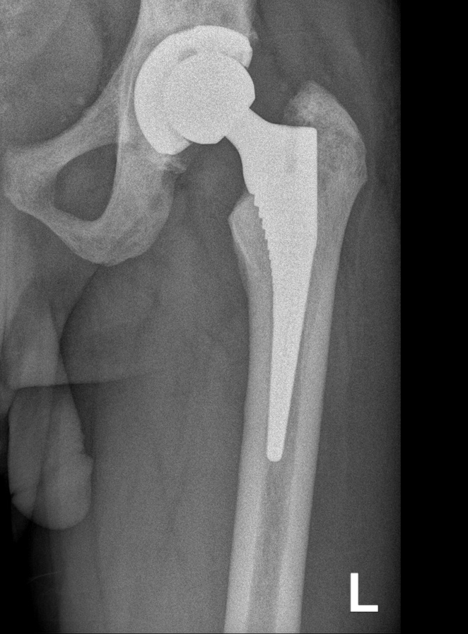 Hip_DepuySynthes_Corail_NilCol</td>
<td align="center" valign="middle"><b>Option 6</b>  <i>None of the above</i></td>
</tr></table>

### Q0171 · correct: option 5 · `Hip_DepuySynthes_Corail_NilCol`

<table><tr>
<td align="center" valign="top"><b>Query</b> 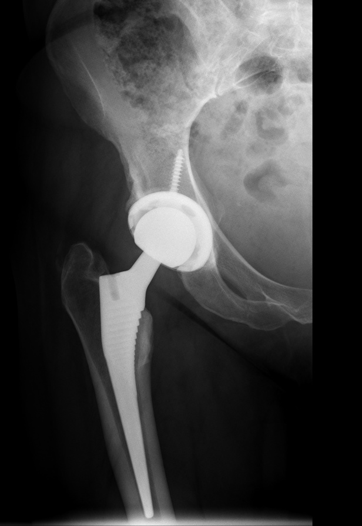 Hip_DepuySynthes_Corail_NilCol</td>
<td align="center" valign="top"><b>Option 1</b>  Hip_DepuySynthes_Corail_Collar</td>
<td align="center" valign="top"><b>Option 2</b>  Hip_SmithAndNephew_Anthology</td>
<td align="center" valign="top"><b>Option 3</b>  Hip_JRIOrtho_FurlongEvolution_NilCol</td>
<td align="center" valign="top"><b>Option 4</b> 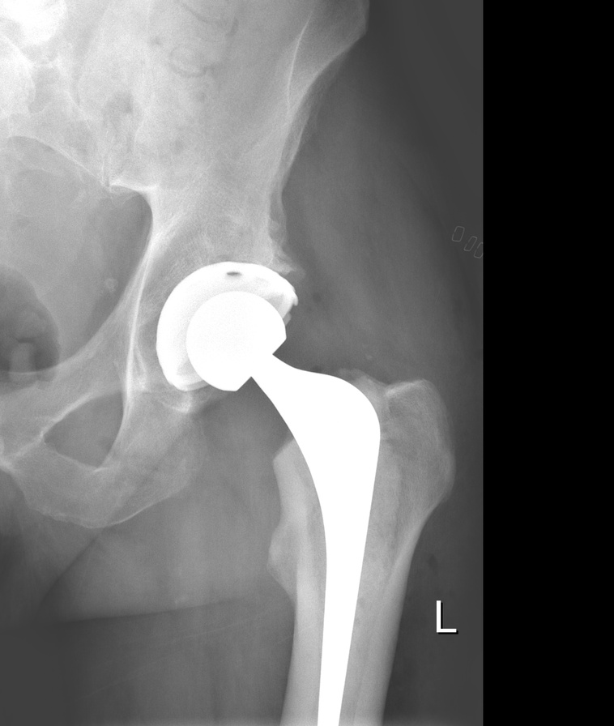 Hip_Stryker_Exeter</td>
<td align="center" valign="top"><b>✅ Option 5</b>  Hip_DepuySynthes_Corail_NilCol</td>
<td align="center" valign="middle"><b>Option 6</b>  <i>None of the above</i></td>
</tr></table>

### Q0172 · correct: option 4 · `Hip_DepuySynthes_Corail_NilCol`

<table><tr>
<td align="center" valign="top"><b>Query</b> 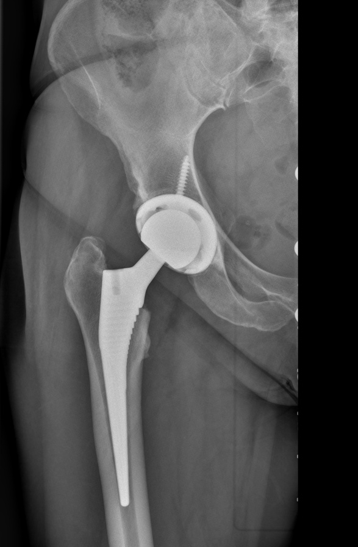 Hip_DepuySynthes_Corail_NilCol</td>
<td align="center" valign="top"><b>Option 1</b> 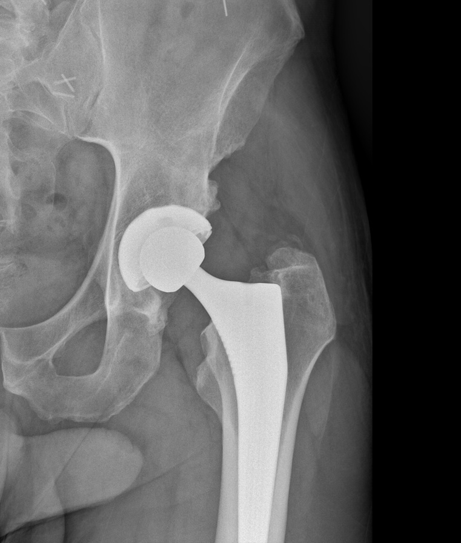 Hip_SmithAndNephew_Polarstem_NilCol</td>
<td align="center" valign="top"><b>Option 2</b>  Hip_SmithAndNephew_Anthology</td>
<td align="center" valign="top"><b>Option 3</b>  Hip_Stryker_AccoladeII</td>
<td align="center" valign="top"><b>✅ Option 4</b>  Hip_DepuySynthes_Corail_NilCol</td>
<td align="center" valign="top"><b>Option 5</b>  Hip_DepuySynthes_Corail_Collar</td>
<td align="center" valign="middle"><b>Option 6</b>  <i>None of the above</i></td>
</tr></table>

### Q0173 · correct: option 2 · `Hip_DepuySynthes_Corail_Collar`

<table><tr>
<td align="center" valign="top"><b>Query</b> 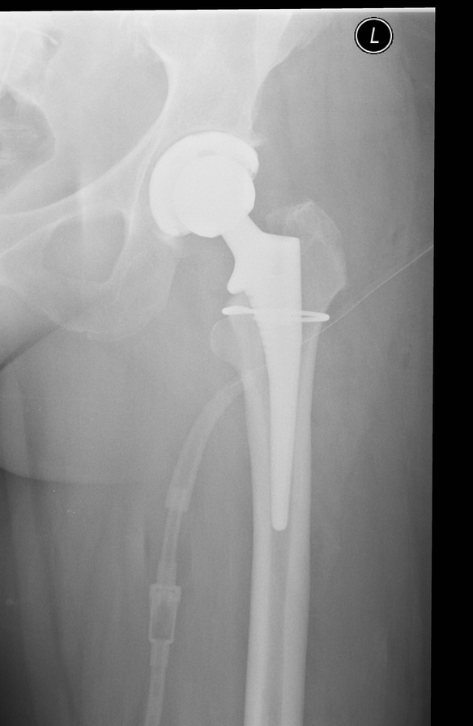 Hip_DepuySynthes_Corail_Collar</td>
<td align="center" valign="top"><b>Option 1</b>  Hip_DepuySynthes_Corail_NilCol</td>
<td align="center" valign="top"><b>✅ Option 2</b> 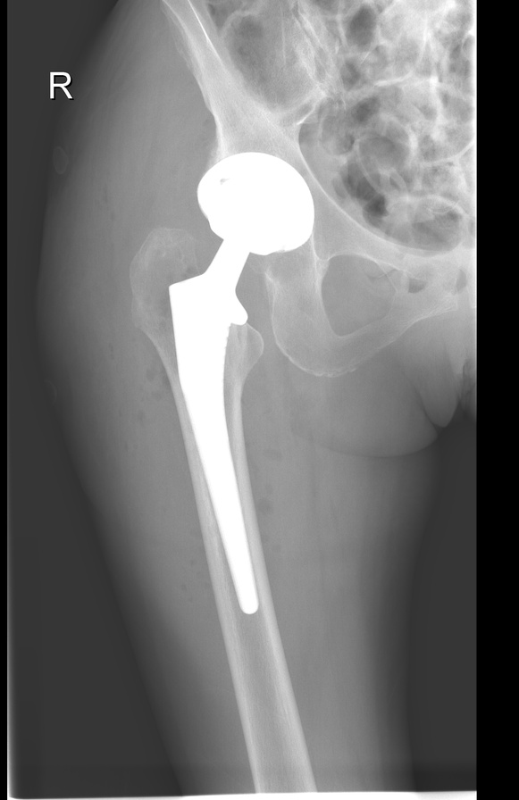 Hip_DepuySynthes_Corail_Collar</td>
<td align="center" valign="top"><b>Option 3</b> 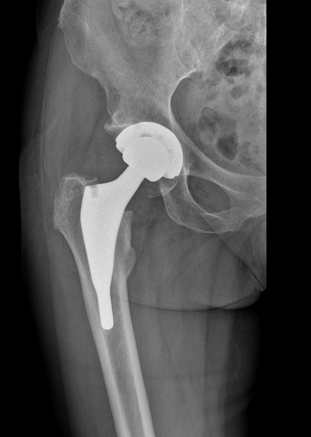 Hip_JRIOrtho_FurlongEvolution_NilCol</td>
<td align="center" valign="top"><b>Option 4</b>  Hip_Stryker_AccoladeII</td>
<td align="center" valign="top"><b>Option 5</b>  Hip_JRIOrtho_FurlongEvolution_Collar</td>
<td align="center" valign="middle"><b>Option 6</b>  <i>None of the above</i></td>
</tr></table>

### Q0174 · correct: option 3 · `Hip_SmithAndNephew_Polarstem_NilCol`

<table><tr>
<td align="center" valign="top"><b>Query</b> 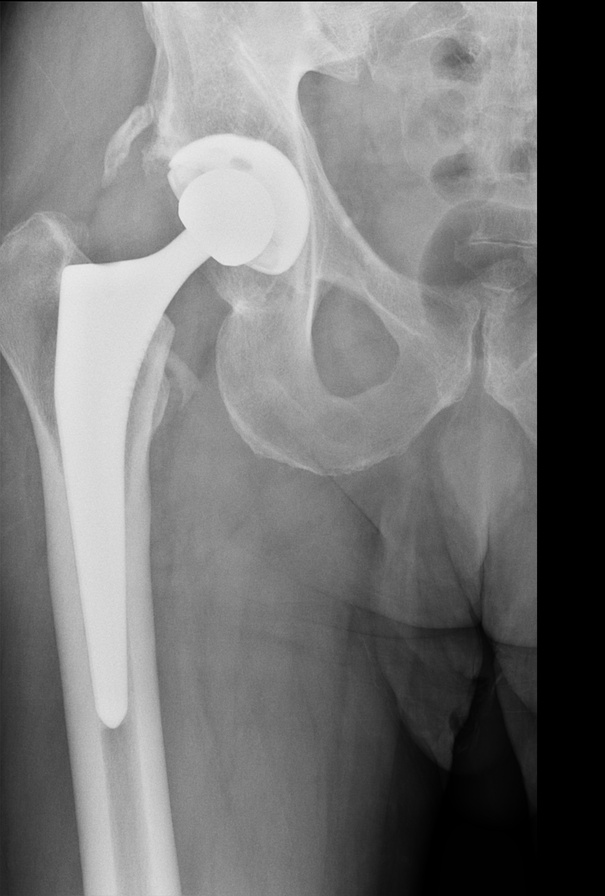 Hip_SmithAndNephew_Polarstem_NilCol</td>
<td align="center" valign="top"><b>Option 1</b>  Hip_JRIOrtho_FurlongEvolution_NilCol</td>
<td align="center" valign="top"><b>Option 2</b> 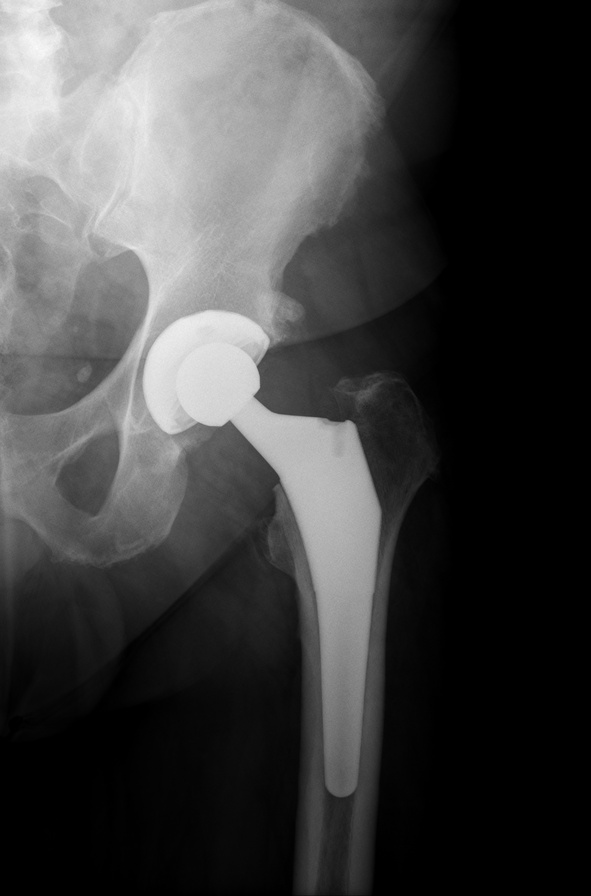 Hip_SmithAndNephew_Anthology</td>
<td align="center" valign="top"><b>✅ Option 3</b>  Hip_SmithAndNephew_Polarstem_NilCol</td>
<td align="center" valign="top"><b>Option 4</b> 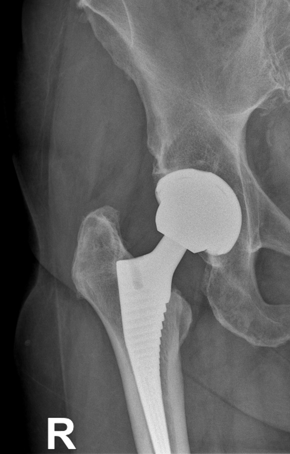 Hip_DepuySynthes_Corail_NilCol</td>
<td align="center" valign="top"><b>Option 5</b> 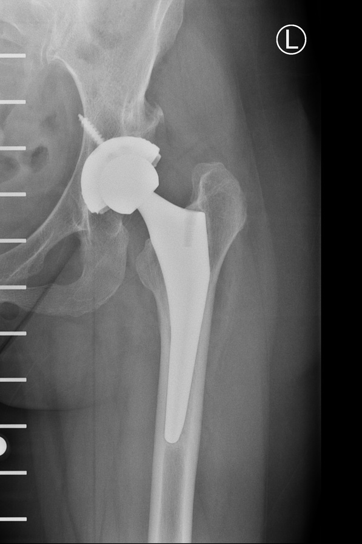 Hip_Stryker_AccoladeII</td>
<td align="center" valign="middle"><b>Option 6</b>  <i>None of the above</i></td>
</tr></table>

### Q0175 · correct: option 1 · `Hip_DepuySynthes_Corail_NilCol`

<table><tr>
<td align="center" valign="top"><b>Query</b> 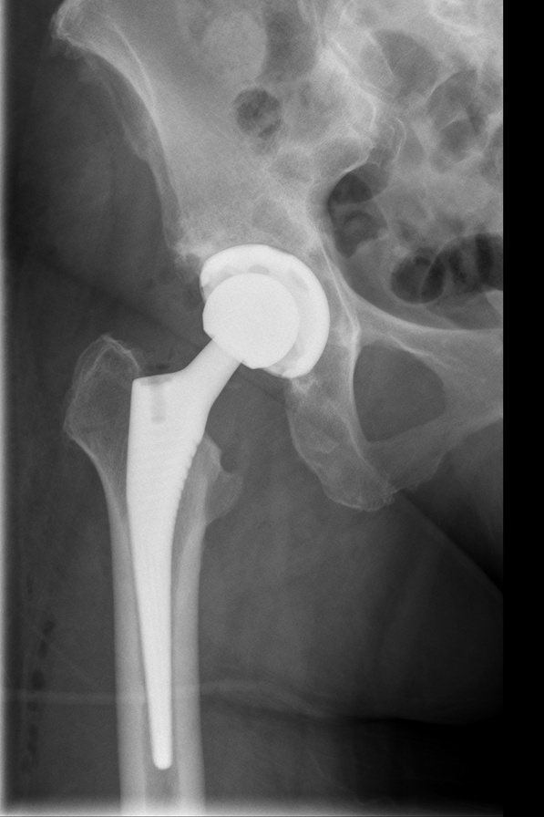 Hip_DepuySynthes_Corail_NilCol</td>
<td align="center" valign="top"><b>✅ Option 1</b>  Hip_DepuySynthes_Corail_NilCol</td>
<td align="center" valign="top"><b>Option 2</b>  Hip_Stryker_AccoladeII</td>
<td align="center" valign="top"><b>Option 3</b>  Hip_DepuySynthes_Corail_Collar</td>
<td align="center" valign="top"><b>Option 4</b>  Hip_Stryker_Exeter</td>
<td align="center" valign="top"><b>Option 5</b>  Hip_SmithAndNephew_Anthology</td>
<td align="center" valign="middle"><b>Option 6</b>  <i>None of the above</i></td>
</tr></table>

### Q0176 · correct: option 1 · `Hip_DepuySynthes_Corail_NilCol`

<table><tr>
<td align="center" valign="top"><b>Query</b> 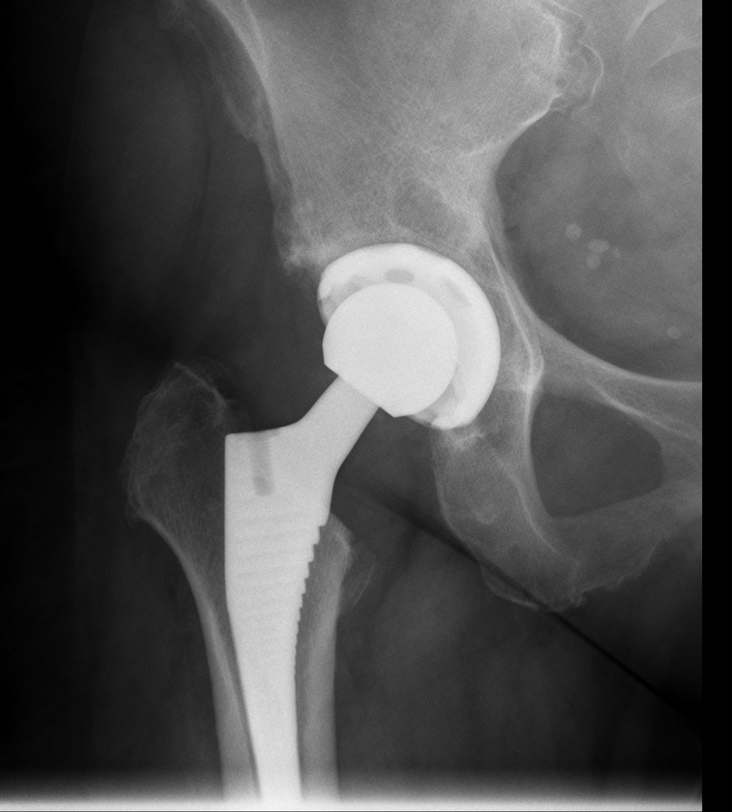 Hip_DepuySynthes_Corail_NilCol</td>
<td align="center" valign="top"><b>✅ Option 1</b>  Hip_DepuySynthes_Corail_NilCol</td>
<td align="center" valign="top"><b>Option 2</b>  Hip_DepuySynthes_Corail_Collar</td>
<td align="center" valign="top"><b>Option 3</b>  Hip_Stryker_Exeter</td>
<td align="center" valign="top"><b>Option 4</b>  Hip_SmithAndNephew_Anthology</td>
<td align="center" valign="top"><b>Option 5</b>  Hip_SmithAndNephew_Polarstem_NilCol</td>
<td align="center" valign="middle"><b>Option 6</b>  <i>None of the above</i></td>
</tr></table>

### Q0177 · correct: option 5 · `Hip_DepuySynthes_Corail_NilCol`

<table><tr>
<td align="center" valign="top"><b>Query</b> 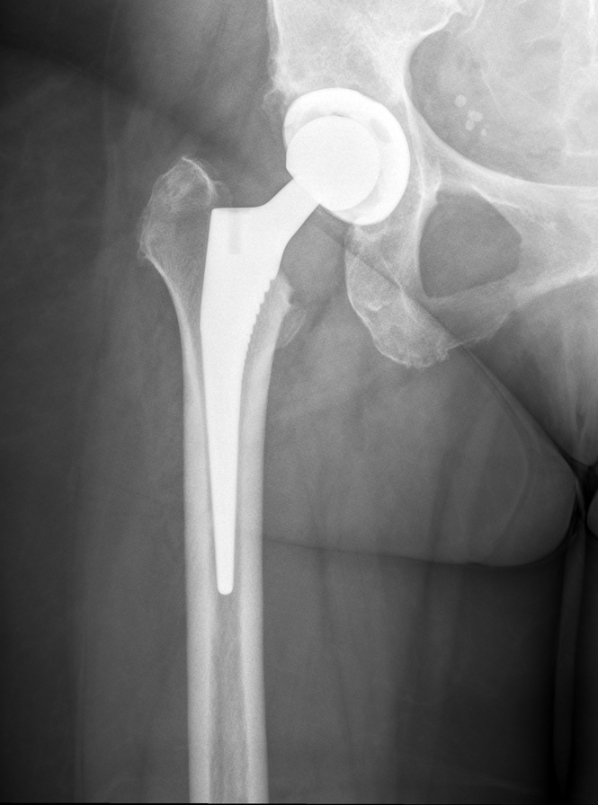 Hip_DepuySynthes_Corail_NilCol</td>
<td align="center" valign="top"><b>Option 1</b> 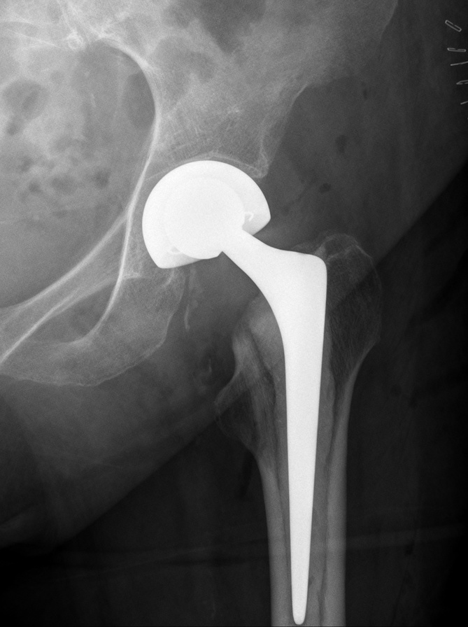 Hip_Stryker_Exeter</td>
<td align="center" valign="top"><b>Option 2</b> 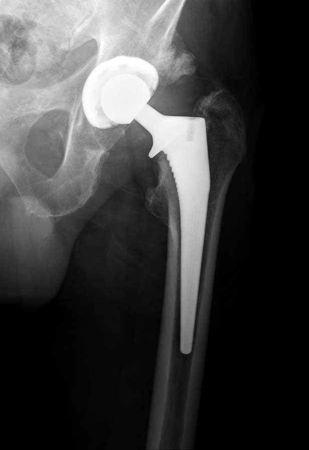 Hip_DepuySynthes_Corail_Collar</td>
<td align="center" valign="top"><b>Option 3</b>  Hip_SmithAndNephew_Polarstem_NilCol</td>
<td align="center" valign="top"><b>Option 4</b>  Hip_SmithAndNephew_Anthology</td>
<td align="center" valign="top"><b>✅ Option 5</b>  Hip_DepuySynthes_Corail_NilCol</td>
<td align="center" valign="middle"><b>Option 6</b>  <i>None of the above</i></td>
</tr></table>

### Q0178 · correct: option 3 · `Hip_Stryker_Exeter`

<table><tr>
<td align="center" valign="top"><b>Query</b> 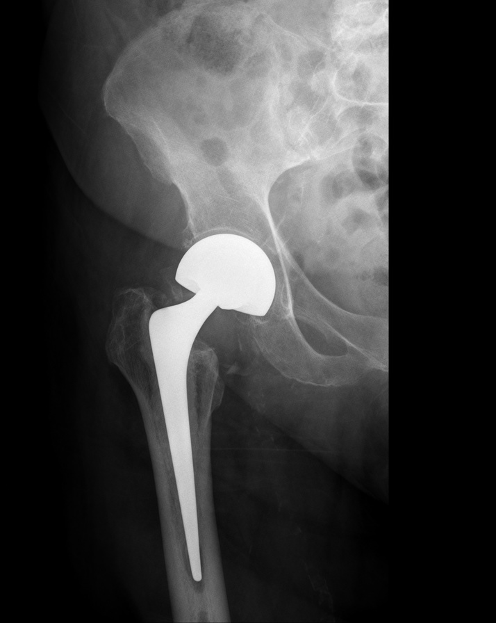 Hip_Stryker_Exeter</td>
<td align="center" valign="top"><b>Option 1</b> 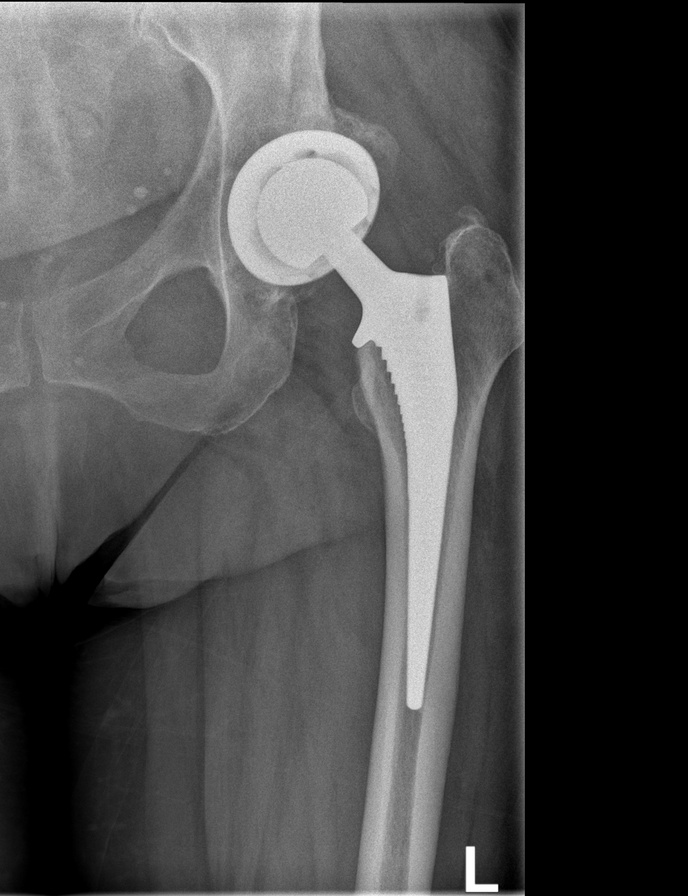 Hip_DepuySynthes_Corail_Collar</td>
<td align="center" valign="top"><b>Option 2</b>  Hip_JRIOrtho_FurlongEvolution_NilCol</td>
<td align="center" valign="top"><b>✅ Option 3</b>  Hip_Stryker_Exeter</td>
<td align="center" valign="top"><b>Option 4</b>  Hip_SmithAndNephew_Anthology</td>
<td align="center" valign="top"><b>Option 5</b>  Hip_SmithAndNephew_Polarstem_NilCol</td>
<td align="center" valign="middle"><b>Option 6</b>  <i>None of the above</i></td>
</tr></table>

### Q0179 · correct: option 1 · `Hip_Stryker_Exeter`

<table><tr>
<td align="center" valign="top"><b>Query</b>  Hip_Stryker_Exeter</td>
<td align="center" valign="top"><b>✅ Option 1</b>  Hip_Stryker_Exeter</td>
<td align="center" valign="top"><b>Option 2</b>  Hip_JRIOrtho_FurlongEvolution_NilCol</td>
<td align="center" valign="top"><b>Option 3</b> 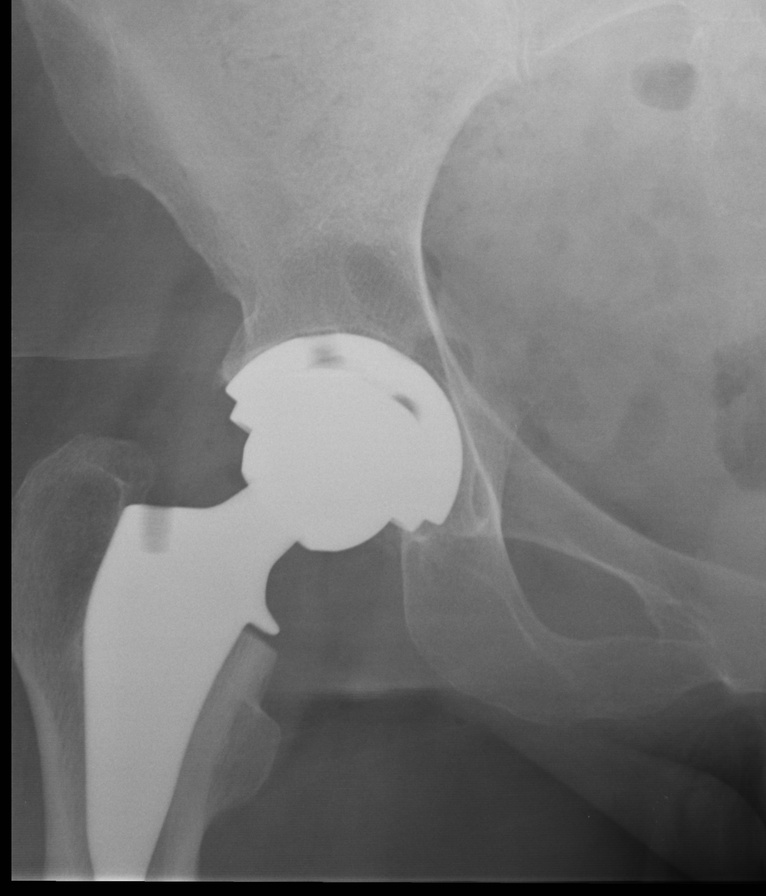 Hip_JRIOrtho_FurlongEvolution_Collar</td>
<td align="center" valign="top"><b>Option 4</b>  Hip_SmithAndNephew_Polarstem_NilCol</td>
<td align="center" valign="top"><b>Option 5</b>  Hip_DepuySynthes_Corail_Collar</td>
<td align="center" valign="middle"><b>Option 6</b>  <i>None of the above</i></td>
</tr></table>

### Q0180 · correct: option 1 · `Hip_Stryker_Exeter`

<table><tr>
<td align="center" valign="top"><b>Query</b> 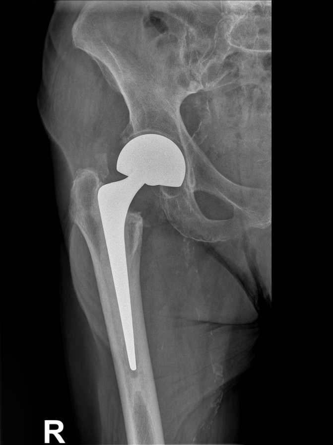 Hip_Stryker_Exeter</td>
<td align="center" valign="top"><b>✅ Option 1</b>  Hip_Stryker_Exeter</td>
<td align="center" valign="top"><b>Option 2</b>  Hip_JRIOrtho_FurlongEvolution_NilCol</td>
<td align="center" valign="top"><b>Option 3</b>  Hip_DepuySynthes_Corail_Collar</td>
<td align="center" valign="top"><b>Option 4</b>  Hip_SmithAndNephew_Anthology</td>
<td align="center" valign="top"><b>Option 5</b>  Hip_SmithAndNephew_Polarstem_NilCol</td>
<td align="center" valign="middle"><b>Option 6</b>  <i>None of the above</i></td>
</tr></table>

### Q0181 · correct: option 1 · `Hip_DepuySynthes_Corail_Collar`

<table><tr>
<td align="center" valign="top"><b>Query</b> 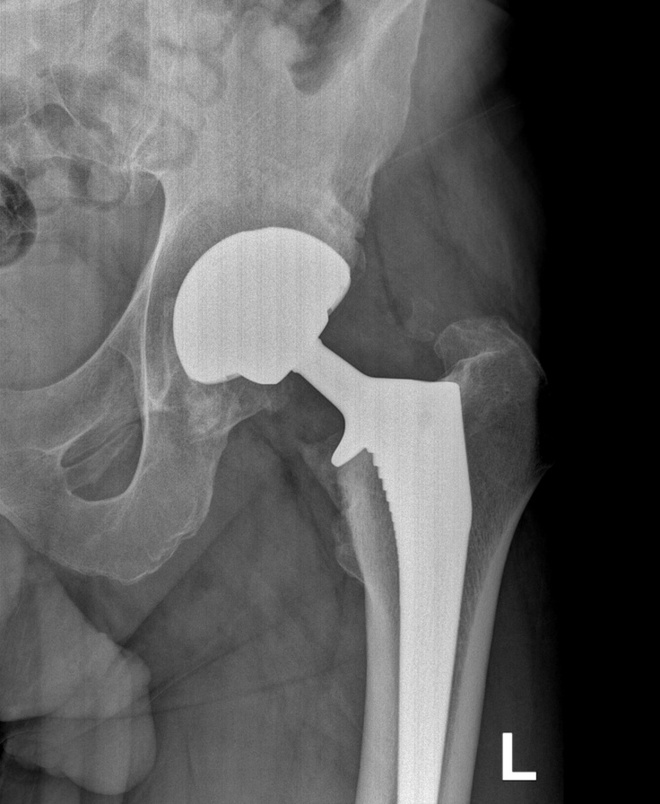 Hip_DepuySynthes_Corail_Collar</td>
<td align="center" valign="top"><b>✅ Option 1</b>  Hip_DepuySynthes_Corail_Collar</td>
<td align="center" valign="top"><b>Option 2</b> 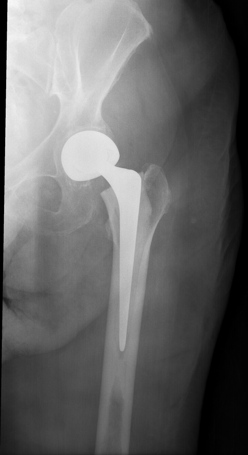 Hip_Stryker_Exeter</td>
<td align="center" valign="top"><b>Option 3</b>  Hip_JRIOrtho_FurlongEvolution_Collar</td>
<td align="center" valign="top"><b>Option 4</b> 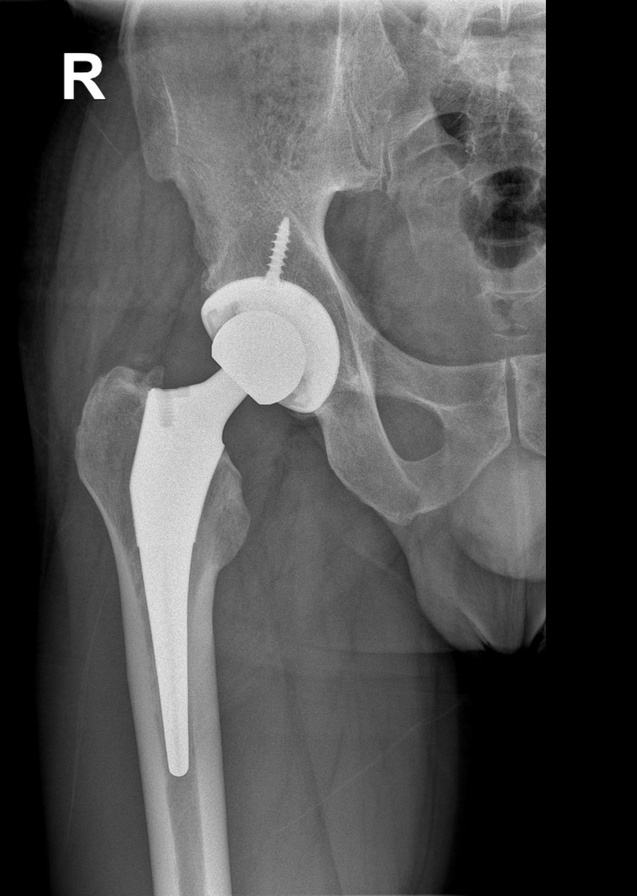 Hip_SmithAndNephew_Anthology</td>
<td align="center" valign="top"><b>Option 5</b>  Hip_DepuySynthes_Corail_NilCol</td>
<td align="center" valign="middle"><b>Option 6</b>  <i>None of the above</i></td>
</tr></table>

### Q0182 · correct: option 4 · `Hip_DepuySynthes_Corail_Collar`

<table><tr>
<td align="center" valign="top"><b>Query</b> 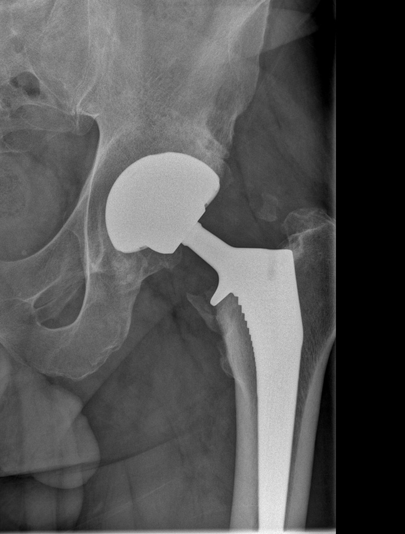 Hip_DepuySynthes_Corail_Collar</td>
<td align="center" valign="top"><b>Option 1</b>  Hip_SmithAndNephew_Anthology</td>
<td align="center" valign="top"><b>Option 2</b>  Hip_JRIOrtho_FurlongEvolution_NilCol</td>
<td align="center" valign="top"><b>Option 3</b>  Hip_JRIOrtho_FurlongEvolution_Collar</td>
<td align="center" valign="top"><b>✅ Option 4</b>  Hip_DepuySynthes_Corail_Collar</td>
<td align="center" valign="top"><b>Option 5</b>  Hip_DepuySynthes_Corail_NilCol</td>
<td align="center" valign="middle"><b>Option 6</b>  <i>None of the above</i></td>
</tr></table>

### Q0183 · correct: option 5 · `Hip_DepuySynthes_Corail_Collar`

<table><tr>
<td align="center" valign="top"><b>Query</b> 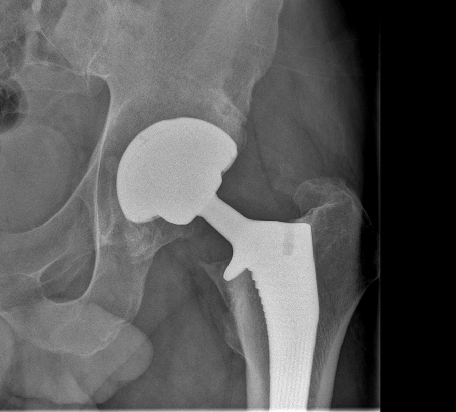 Hip_DepuySynthes_Corail_Collar</td>
<td align="center" valign="top"><b>Option 1</b>  Hip_DepuySynthes_Corail_NilCol</td>
<td align="center" valign="top"><b>Option 2</b>  Hip_Stryker_Exeter</td>
<td align="center" valign="top"><b>Option 3</b>  Hip_JRIOrtho_FurlongEvolution_Collar</td>
<td align="center" valign="top"><b>Option 4</b>  Hip_JRIOrtho_FurlongEvolution_NilCol</td>
<td align="center" valign="top"><b>✅ Option 5</b>  Hip_DepuySynthes_Corail_Collar</td>
<td align="center" valign="middle"><b>Option 6</b>  <i>None of the above</i></td>
</tr></table>

### Q0184 · correct: option 4 · `Hip_DepuySynthes_Corail_Collar`

<table><tr>
<td align="center" valign="top"><b>Query</b> 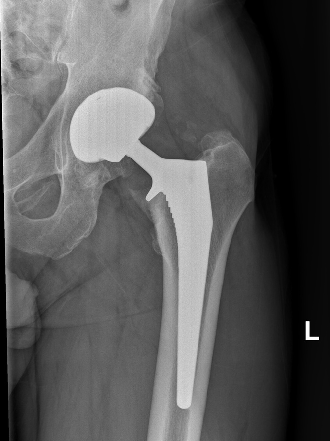 Hip_DepuySynthes_Corail_Collar</td>
<td align="center" valign="top"><b>Option 1</b>  Hip_Stryker_Exeter</td>
<td align="center" valign="top"><b>Option 2</b>  Hip_DepuySynthes_Corail_NilCol</td>
<td align="center" valign="top"><b>Option 3</b>  Hip_JRIOrtho_FurlongEvolution_Collar</td>
<td align="center" valign="top"><b>✅ Option 4</b>  Hip_DepuySynthes_Corail_Collar</td>
<td align="center" valign="top"><b>Option 5</b>  Hip_SmithAndNephew_Polarstem_NilCol</td>
<td align="center" valign="middle"><b>Option 6</b>  <i>None of the above</i></td>
</tr></table>

### Q0185 · correct: option 1 · `Hip_DepuySynthes_Corail_Collar`

<table><tr>
<td align="center" valign="top"><b>Query</b> 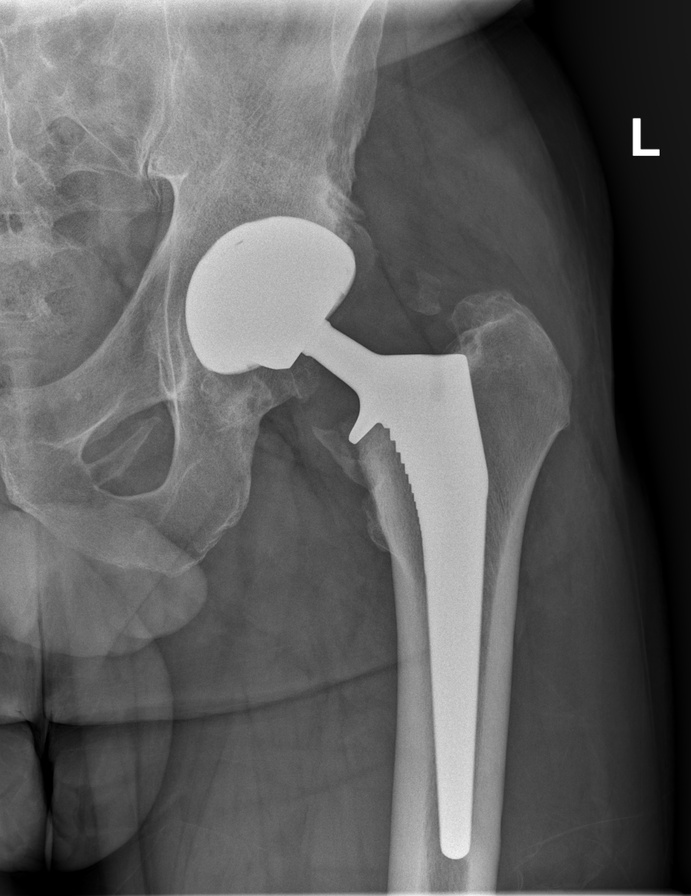 Hip_DepuySynthes_Corail_Collar</td>
<td align="center" valign="top"><b>✅ Option 1</b>  Hip_DepuySynthes_Corail_Collar</td>
<td align="center" valign="top"><b>Option 2</b> 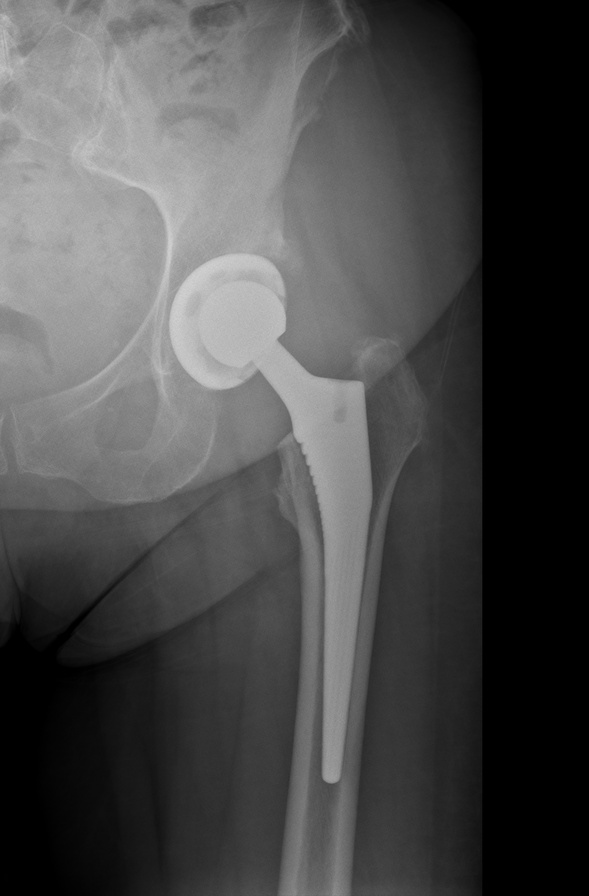 Hip_DepuySynthes_Corail_NilCol</td>
<td align="center" valign="top"><b>Option 3</b>  Hip_Stryker_Exeter</td>
<td align="center" valign="top"><b>Option 4</b> 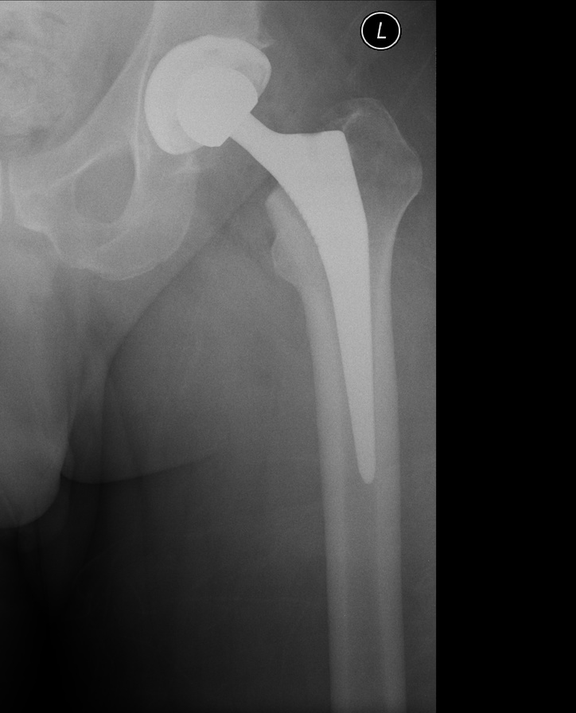 Hip_SmithAndNephew_Polarstem_NilCol</td>
<td align="center" valign="top"><b>Option 5</b>  Hip_JRIOrtho_FurlongEvolution_Collar</td>
<td align="center" valign="middle"><b>Option 6</b>  <i>None of the above</i></td>
</tr></table>

### Q0186 · correct: option 5 · `Hip_DepuySynthes_Corail_Collar`

<table><tr>
<td align="center" valign="top"><b>Query</b> 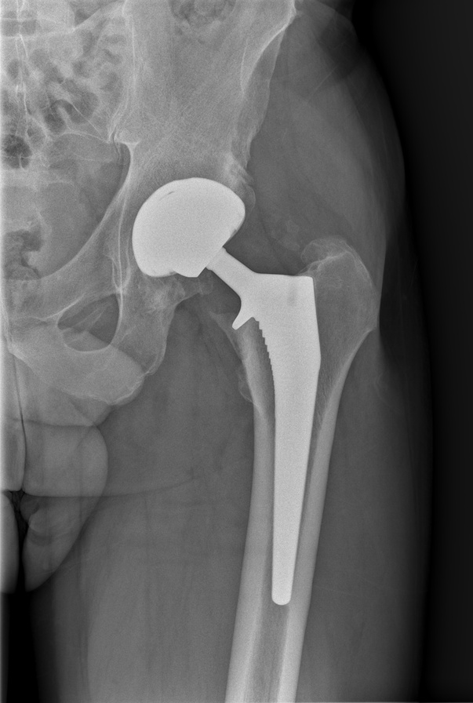 Hip_DepuySynthes_Corail_Collar</td>
<td align="center" valign="top"><b>Option 1</b>  Hip_Stryker_Exeter</td>
<td align="center" valign="top"><b>Option 2</b>  Hip_JRIOrtho_FurlongEvolution_Collar</td>
<td align="center" valign="top"><b>Option 3</b>  Hip_SmithAndNephew_Polarstem_NilCol</td>
<td align="center" valign="top"><b>Option 4</b>  Hip_DepuySynthes_Corail_NilCol</td>
<td align="center" valign="top"><b>✅ Option 5</b>  Hip_DepuySynthes_Corail_Collar</td>
<td align="center" valign="middle"><b>Option 6</b>  <i>None of the above</i></td>
</tr></table>

### Q0187 · correct: option 4 · `Hip_Stryker_Exeter`

<table><tr>
<td align="center" valign="top"><b>Query</b> 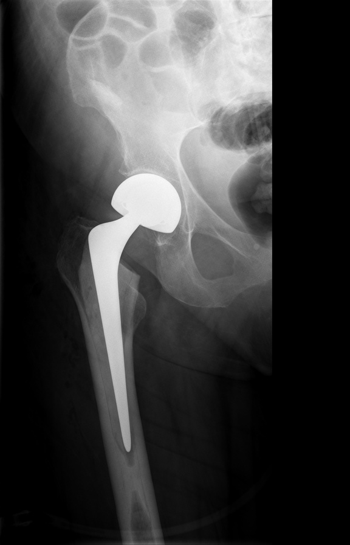 Hip_Stryker_Exeter</td>
<td align="center" valign="top"><b>Option 1</b>  Hip_JRIOrtho_FurlongEvolution_NilCol</td>
<td align="center" valign="top"><b>Option 2</b>  Hip_JRIOrtho_FurlongEvolution_Collar</td>
<td align="center" valign="top"><b>Option 3</b>  Hip_SmithAndNephew_Anthology</td>
<td align="center" valign="top"><b>✅ Option 4</b>  Hip_Stryker_Exeter</td>
<td align="center" valign="top"><b>Option 5</b>  Hip_DepuySynthes_Corail_Collar</td>
<td align="center" valign="middle"><b>Option 6</b>  <i>None of the above</i></td>
</tr></table>

### Q0188 · correct: option 5 · `Hip_Stryker_Exeter`

<table><tr>
<td align="center" valign="top"><b>Query</b> 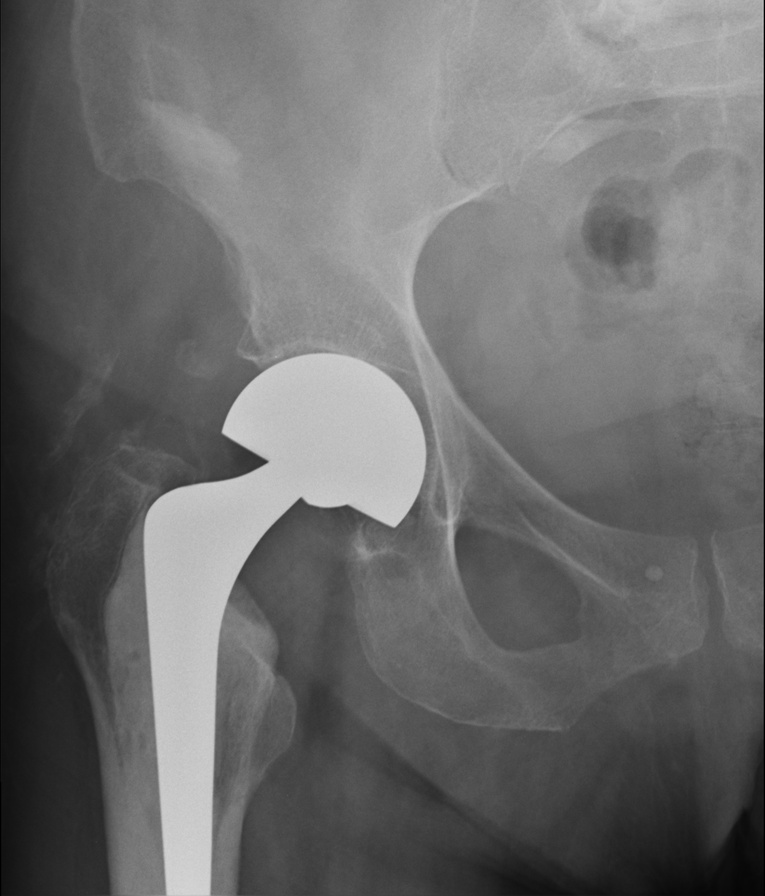 Hip_Stryker_Exeter</td>
<td align="center" valign="top"><b>Option 1</b>  Hip_SmithAndNephew_Polarstem_NilCol</td>
<td align="center" valign="top"><b>Option 2</b>  Hip_JRIOrtho_FurlongEvolution_Collar</td>
<td align="center" valign="top"><b>Option 3</b>  Hip_JRIOrtho_FurlongEvolution_NilCol</td>
<td align="center" valign="top"><b>Option 4</b>  Hip_Stryker_AccoladeII</td>
<td align="center" valign="top"><b>✅ Option 5</b> 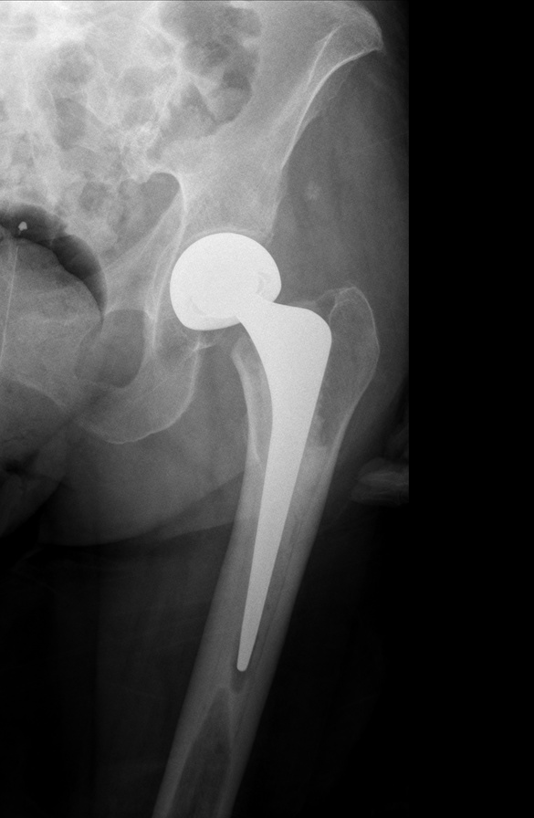 Hip_Stryker_Exeter</td>
<td align="center" valign="middle"><b>Option 6</b>  <i>None of the above</i></td>
</tr></table>

### Q0189 · correct: option 2 · `Hip_Stryker_Exeter`

<table><tr>
<td align="center" valign="top"><b>Query</b> 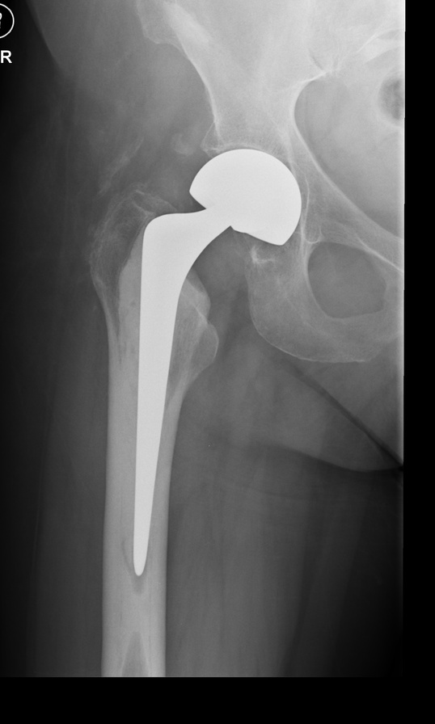 Hip_Stryker_Exeter</td>
<td align="center" valign="top"><b>Option 1</b>  Hip_JRIOrtho_FurlongEvolution_Collar</td>
<td align="center" valign="top"><b>✅ Option 2</b>  Hip_Stryker_Exeter</td>
<td align="center" valign="top"><b>Option 3</b>  Hip_DepuySynthes_Corail_Collar</td>
<td align="center" valign="top"><b>Option 4</b>  Hip_DepuySynthes_Corail_NilCol</td>
<td align="center" valign="top"><b>Option 5</b>  Hip_SmithAndNephew_Polarstem_NilCol</td>
<td align="center" valign="middle"><b>Option 6</b>  <i>None of the above</i></td>
</tr></table>

### Q0190 · correct: option 4 · `Hip_Stryker_Exeter`

<table><tr>
<td align="center" valign="top"><b>Query</b> 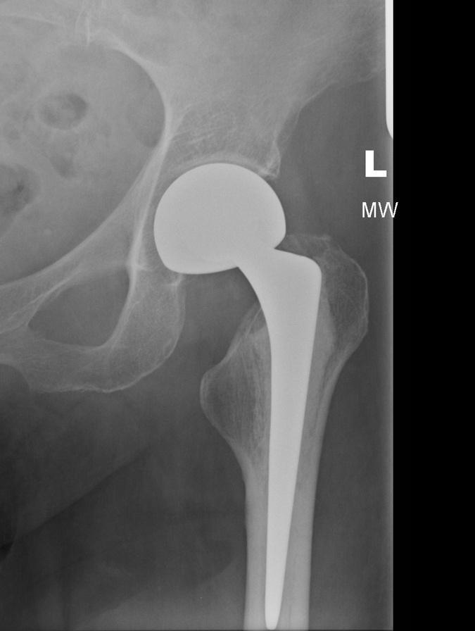 Hip_Stryker_Exeter</td>
<td align="center" valign="top"><b>Option 1</b>  Hip_JRIOrtho_FurlongEvolution_NilCol</td>
<td align="center" valign="top"><b>Option 2</b>  Hip_SmithAndNephew_Polarstem_NilCol</td>
<td align="center" valign="top"><b>Option 3</b>  Hip_DepuySynthes_Corail_NilCol</td>
<td align="center" valign="top"><b>✅ Option 4</b>  Hip_Stryker_Exeter</td>
<td align="center" valign="top"><b>Option 5</b>  Hip_JRIOrtho_FurlongEvolution_Collar</td>
<td align="center" valign="middle"><b>Option 6</b>  <i>None of the above</i></td>
</tr></table>

### Q0191 · correct: option 1 · `Hip_Stryker_Exeter`

<table><tr>
<td align="center" valign="top"><b>Query</b> 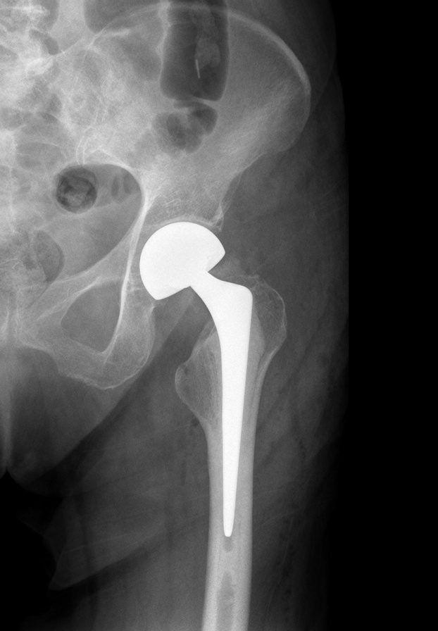 Hip_Stryker_Exeter</td>
<td align="center" valign="top"><b>✅ Option 1</b>  Hip_Stryker_Exeter</td>
<td align="center" valign="top"><b>Option 2</b>  Hip_JRIOrtho_FurlongEvolution_NilCol</td>
<td align="center" valign="top"><b>Option 3</b>  Hip_SmithAndNephew_Polarstem_NilCol</td>
<td align="center" valign="top"><b>Option 4</b>  Hip_JRIOrtho_FurlongEvolution_Collar</td>
<td align="center" valign="top"><b>Option 5</b>  Hip_SmithAndNephew_Anthology</td>
<td align="center" valign="middle"><b>Option 6</b>  <i>None of the above</i></td>
</tr></table>

### Q0192 · correct: option 2 · `Hip_Stryker_Exeter`

<table><tr>
<td align="center" valign="top"><b>Query</b> 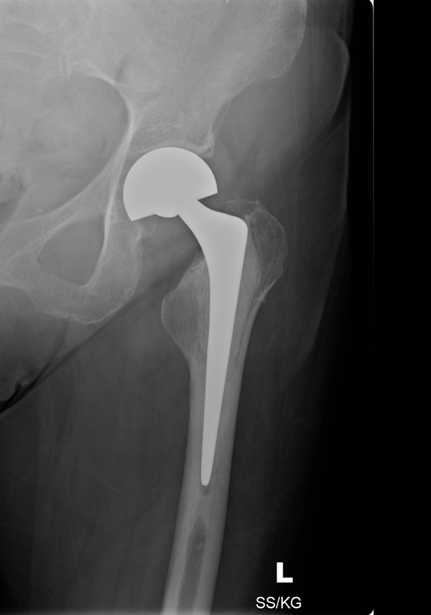 Hip_Stryker_Exeter</td>
<td align="center" valign="top"><b>Option 1</b>  Hip_JRIOrtho_FurlongEvolution_NilCol</td>
<td align="center" valign="top"><b>✅ Option 2</b>  Hip_Stryker_Exeter</td>
<td align="center" valign="top"><b>Option 3</b>  Hip_SmithAndNephew_Polarstem_NilCol</td>
<td align="center" valign="top"><b>Option 4</b>  Hip_DepuySynthes_Corail_Collar</td>
<td align="center" valign="top"><b>Option 5</b>  Hip_SmithAndNephew_Anthology</td>
<td align="center" valign="middle"><b>Option 6</b>  <i>None of the above</i></td>
</tr></table>

### Q0193 · correct: option 4 · `Hip_Stryker_Exeter`

<table><tr>
<td align="center" valign="top"><b>Query</b> 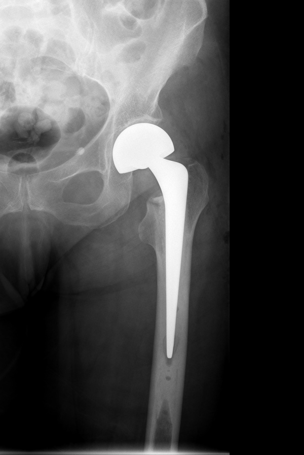 Hip_Stryker_Exeter</td>
<td align="center" valign="top"><b>Option 1</b>  Hip_Stryker_AccoladeII</td>
<td align="center" valign="top"><b>Option 2</b>  Hip_JRIOrtho_FurlongEvolution_NilCol</td>
<td align="center" valign="top"><b>Option 3</b>  Hip_DepuySynthes_Corail_Collar</td>
<td align="center" valign="top"><b>✅ Option 4</b>  Hip_Stryker_Exeter</td>
<td align="center" valign="top"><b>Option 5</b>  Hip_JRIOrtho_FurlongEvolution_Collar</td>
<td align="center" valign="middle"><b>Option 6</b>  <i>None of the above</i></td>
</tr></table>

### Q0194 · correct: option 2 · `Hip_Stryker_Exeter`

<table><tr>
<td align="center" valign="top"><b>Query</b> 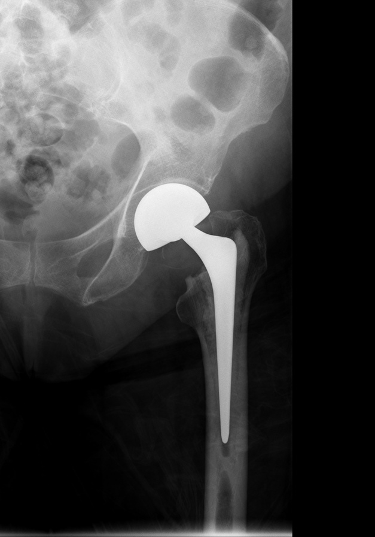 Hip_Stryker_Exeter</td>
<td align="center" valign="top"><b>Option 1</b>  Hip_JRIOrtho_FurlongEvolution_NilCol</td>
<td align="center" valign="top"><b>✅ Option 2</b>  Hip_Stryker_Exeter</td>
<td align="center" valign="top"><b>Option 3</b>  Hip_JRIOrtho_FurlongEvolution_Collar</td>
<td align="center" valign="top"><b>Option 4</b>  Hip_DepuySynthes_Corail_Collar</td>
<td align="center" valign="top"><b>Option 5</b>  Hip_SmithAndNephew_Polarstem_NilCol</td>
<td align="center" valign="middle"><b>Option 6</b>  <i>None of the above</i></td>
</tr></table>

### Q0195 · correct: option 2 · `Hip_Stryker_Exeter`

<table><tr>
<td align="center" valign="top"><b>Query</b> 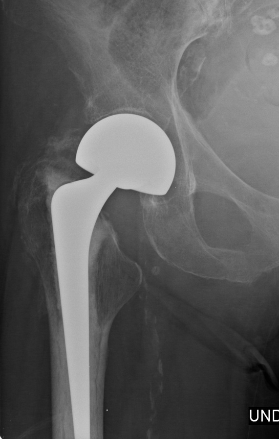 Hip_Stryker_Exeter</td>
<td align="center" valign="top"><b>Option 1</b>  Hip_JRIOrtho_FurlongEvolution_Collar</td>
<td align="center" valign="top"><b>✅ Option 2</b>  Hip_Stryker_Exeter</td>
<td align="center" valign="top"><b>Option 3</b>  Hip_JRIOrtho_FurlongEvolution_NilCol</td>
<td align="center" valign="top"><b>Option 4</b>  Hip_DepuySynthes_Corail_NilCol</td>
<td align="center" valign="top"><b>Option 5</b>  Hip_DepuySynthes_Corail_Collar</td>
<td align="center" valign="middle"><b>Option 6</b>  <i>None of the above</i></td>
</tr></table>

### Q0196 · correct: option 5 · `Hip_Stryker_Exeter`

<table><tr>
<td align="center" valign="top"><b>Query</b> 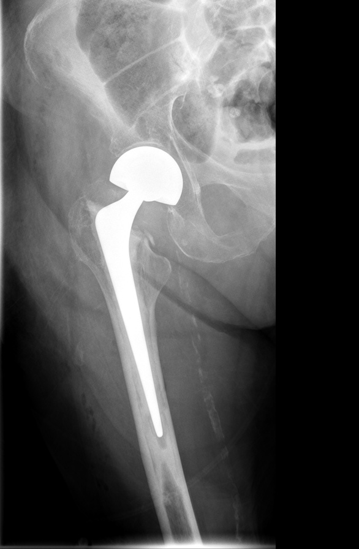 Hip_Stryker_Exeter</td>
<td align="center" valign="top"><b>Option 1</b>  Hip_DepuySynthes_Corail_Collar</td>
<td align="center" valign="top"><b>Option 2</b>  Hip_JRIOrtho_FurlongEvolution_NilCol</td>
<td align="center" valign="top"><b>Option 3</b>  Hip_DepuySynthes_Corail_NilCol</td>
<td align="center" valign="top"><b>Option 4</b>  Hip_SmithAndNephew_Anthology</td>
<td align="center" valign="top"><b>✅ Option 5</b>  Hip_Stryker_Exeter</td>
<td align="center" valign="middle"><b>Option 6</b>  <i>None of the above</i></td>
</tr></table>

### Q0197 · correct: option 2 · `Hip_Stryker_Exeter`

<table><tr>
<td align="center" valign="top"><b>Query</b> 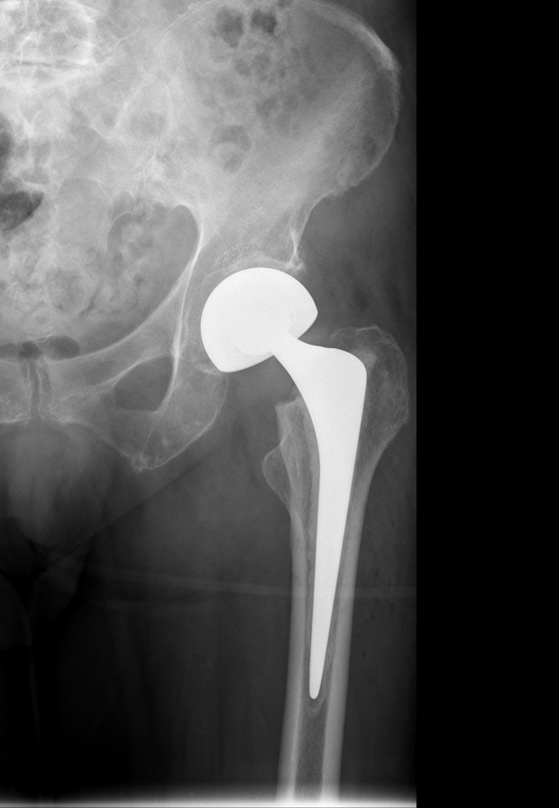 Hip_Stryker_Exeter</td>
<td align="center" valign="top"><b>Option 1</b>  Hip_JRIOrtho_FurlongEvolution_Collar</td>
<td align="center" valign="top"><b>✅ Option 2</b>  Hip_Stryker_Exeter</td>
<td align="center" valign="top"><b>Option 3</b>  Hip_DepuySynthes_Corail_Collar</td>
<td align="center" valign="top"><b>Option 4</b>  Hip_JRIOrtho_FurlongEvolution_NilCol</td>
<td align="center" valign="top"><b>Option 5</b>  Hip_SmithAndNephew_Polarstem_NilCol</td>
<td align="center" valign="middle"><b>Option 6</b>  <i>None of the above</i></td>
</tr></table>

### Q0198 · correct: option 1 · `Hip_Stryker_Exeter`

<table><tr>
<td align="center" valign="top"><b>Query</b> 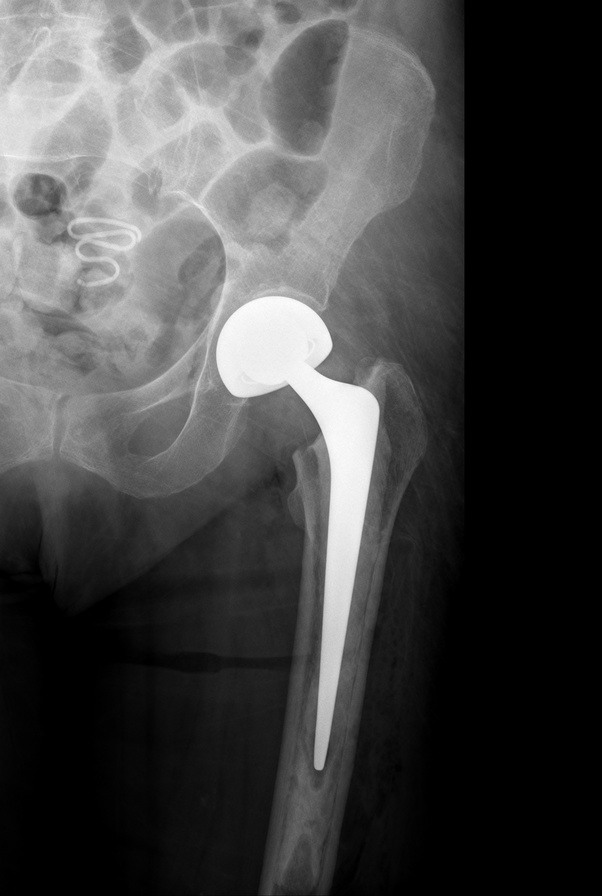 Hip_Stryker_Exeter</td>
<td align="center" valign="top"><b>✅ Option 1</b>  Hip_Stryker_Exeter</td>
<td align="center" valign="top"><b>Option 2</b>  Hip_Stryker_AccoladeII</td>
<td align="center" valign="top"><b>Option 3</b>  Hip_SmithAndNephew_Anthology</td>
<td align="center" valign="top"><b>Option 4</b>  Hip_DepuySynthes_Corail_Collar</td>
<td align="center" valign="top"><b>Option 5</b>  Hip_JRIOrtho_FurlongEvolution_NilCol</td>
<td align="center" valign="middle"><b>Option 6</b>  <i>None of the above</i></td>
</tr></table>

### Q0199 · correct: option 2 · `Hip_Stryker_Exeter`

<table><tr>
<td align="center" valign="top"><b>Query</b> 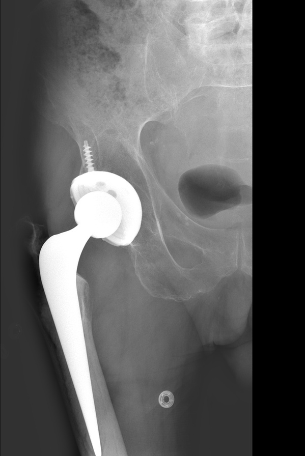 Hip_Stryker_Exeter</td>
<td align="center" valign="top"><b>Option 1</b>  Hip_SmithAndNephew_Anthology</td>
<td align="center" valign="top"><b>✅ Option 2</b> 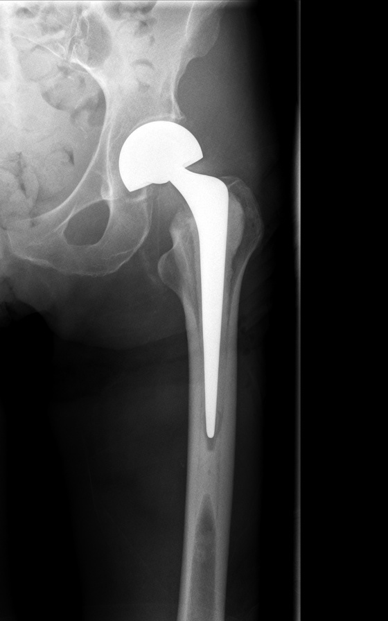 Hip_Stryker_Exeter</td>
<td align="center" valign="top"><b>Option 3</b>  Hip_Stryker_AccoladeII</td>
<td align="center" valign="top"><b>Option 4</b> 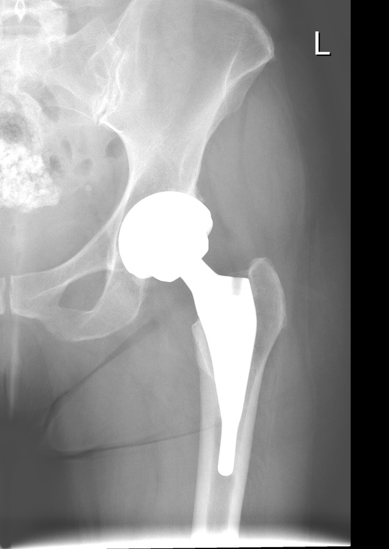 Hip_JRIOrtho_FurlongEvolution_NilCol</td>
<td align="center" valign="top"><b>Option 5</b>  Hip_DepuySynthes_Corail_Collar</td>
<td align="center" valign="middle"><b>Option 6</b>  <i>None of the above</i></td>
</tr></table>

### Q0200 · correct: option 5 · `Hip_Stryker_Exeter`

<table><tr>
<td align="center" valign="top"><b>Query</b> 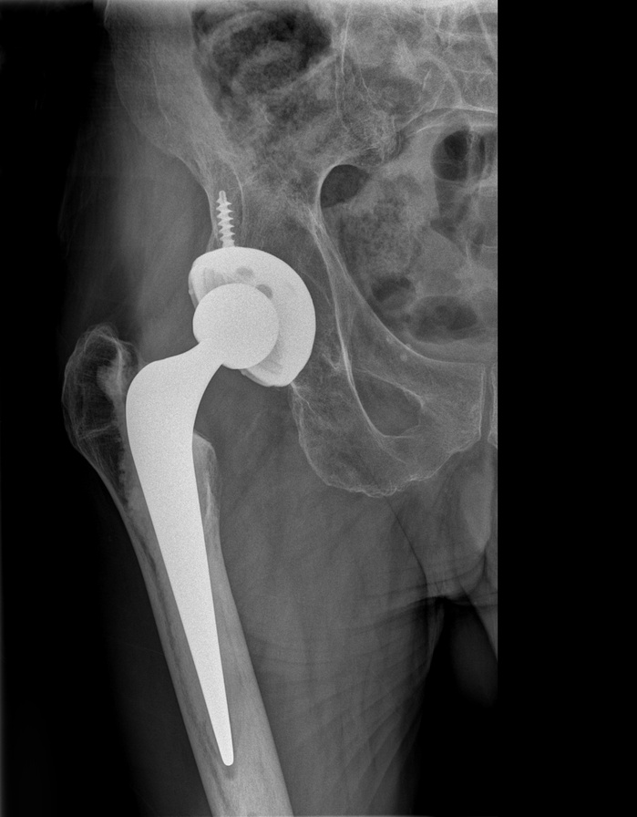 Hip_Stryker_Exeter</td>
<td align="center" valign="top"><b>Option 1</b>  Hip_Stryker_AccoladeII</td>
<td align="center" valign="top"><b>Option 2</b>  Hip_DepuySynthes_Corail_NilCol</td>
<td align="center" valign="top"><b>Option 3</b>  Hip_DepuySynthes_Corail_Collar</td>
<td align="center" valign="top"><b>Option 4</b>  Hip_SmithAndNephew_Anthology</td>
<td align="center" valign="top"><b>✅ Option 5</b>  Hip_Stryker_Exeter</td>
<td align="center" valign="middle"><b>Option 6</b>  <i>None of the above</i></td>
</tr></table>

### Q0201 · correct: option 4 · `Hip_Stryker_Exeter`

<table><tr>
<td align="center" valign="top"><b>Query</b>  Hip_Stryker_Exeter</td>
<td align="center" valign="top"><b>Option 1</b>  Hip_SmithAndNephew_Polarstem_NilCol</td>
<td align="center" valign="top"><b>Option 2</b>  Hip_Stryker_AccoladeII</td>
<td align="center" valign="top"><b>Option 3</b>  Hip_DepuySynthes_Corail_Collar</td>
<td align="center" valign="top"><b>✅ Option 4</b>  Hip_Stryker_Exeter</td>
<td align="center" valign="top"><b>Option 5</b>  Hip_DepuySynthes_Corail_NilCol</td>
<td align="center" valign="middle"><b>Option 6</b>  <i>None of the above</i></td>
</tr></table>

### Q0202 · correct: option 2 · `Hip_Stryker_Exeter`

<table><tr>
<td align="center" valign="top"><b>Query</b>  Hip_Stryker_Exeter</td>
<td align="center" valign="top"><b>Option 1</b>  Hip_SmithAndNephew_Polarstem_NilCol</td>
<td align="center" valign="top"><b>✅ Option 2</b>  Hip_Stryker_Exeter</td>
<td align="center" valign="top"><b>Option 3</b>  Hip_Stryker_AccoladeII</td>
<td align="center" valign="top"><b>Option 4</b>  Hip_SmithAndNephew_Anthology</td>
<td align="center" valign="top"><b>Option 5</b>  Hip_DepuySynthes_Corail_Collar</td>
<td align="center" valign="middle"><b>Option 6</b>  <i>None of the above</i></td>
</tr></table>

### Q0203 · correct: option 5 · `Hip_Stryker_Exeter`

<table><tr>
<td align="center" valign="top"><b>Query</b>  Hip_Stryker_Exeter</td>
<td align="center" valign="top"><b>Option 1</b>  Hip_SmithAndNephew_Anthology</td>
<td align="center" valign="top"><b>Option 2</b>  Hip_DepuySynthes_Corail_Collar</td>
<td align="center" valign="top"><b>Option 3</b>  Hip_Stryker_AccoladeII</td>
<td align="center" valign="top"><b>Option 4</b>  Hip_DepuySynthes_Corail_NilCol</td>
<td align="center" valign="top"><b>✅ Option 5</b>  Hip_Stryker_Exeter</td>
<td align="center" valign="middle"><b>Option 6</b>  <i>None of the above</i></td>
</tr></table>

### Q0204 · correct: option 4 · `Hip_Stryker_Exeter`

<table><tr>
<td align="center" valign="top"><b>Query</b>  Hip_Stryker_Exeter</td>
<td align="center" valign="top"><b>Option 1</b>  Hip_DepuySynthes_Corail_Collar</td>
<td align="center" valign="top"><b>Option 2</b>  Hip_Stryker_AccoladeII</td>
<td align="center" valign="top"><b>Option 3</b>  Hip_SmithAndNephew_Anthology</td>
<td align="center" valign="top"><b>✅ Option 4</b>  Hip_Stryker_Exeter</td>
<td align="center" valign="top"><b>Option 5</b>  Hip_JRIOrtho_FurlongEvolution_NilCol</td>
<td align="center" valign="middle"><b>Option 6</b>  <i>None of the above</i></td>
</tr></table>

### Q0205 · correct: option 3 · `Hip_JRIOrtho_FurlongEvolution_Collar`

<table><tr>
<td align="center" valign="top"><b>Query</b>  Hip_JRIOrtho_FurlongEvolution_Collar</td>
<td align="center" valign="top"><b>Option 1</b>  Hip_JRIOrtho_FurlongEvolution_NilCol</td>
<td align="center" valign="top"><b>Option 2</b>  Hip_DepuySynthes_Corail_Collar</td>
<td align="center" valign="top"><b>✅ Option 3</b>  Hip_JRIOrtho_FurlongEvolution_Collar</td>
<td align="center" valign="top"><b>Option 4</b>  Hip_Stryker_AccoladeII</td>
<td align="center" valign="top"><b>Option 5</b>  Hip_SmithAndNephew_Anthology</td>
<td align="center" valign="middle"><b>Option 6</b>  <i>None of the above</i></td>
</tr></table>

### Q0206 · correct: option 5 · `Hip_JRIOrtho_FurlongEvolution_Collar`

<table><tr>
<td align="center" valign="top"><b>Query</b>  Hip_JRIOrtho_FurlongEvolution_Collar</td>
<td align="center" valign="top"><b>Option 1</b>  Hip_SmithAndNephew_Polarstem_NilCol</td>
<td align="center" valign="top"><b>Option 2</b>  Hip_SmithAndNephew_Anthology</td>
<td align="center" valign="top"><b>Option 3</b>  Hip_Stryker_AccoladeII</td>
<td align="center" valign="top"><b>Option 4</b>  Hip_JRIOrtho_FurlongEvolution_NilCol</td>
<td align="center" valign="top"><b>✅ Option 5</b>  Hip_JRIOrtho_FurlongEvolution_Collar</td>
<td align="center" valign="middle"><b>Option 6</b>  <i>None of the above</i></td>
</tr></table>

### Q0207 · correct: option 3 · `Hip_JRIOrtho_FurlongEvolution_Collar`

<table><tr>
<td align="center" valign="top"><b>Query</b>  Hip_JRIOrtho_FurlongEvolution_Collar</td>
<td align="center" valign="top"><b>Option 1</b>  Hip_SmithAndNephew_Anthology</td>
<td align="center" valign="top"><b>Option 2</b>  Hip_DepuySynthes_Corail_NilCol</td>
<td align="center" valign="top"><b>✅ Option 3</b>  Hip_JRIOrtho_FurlongEvolution_Collar</td>
<td align="center" valign="top"><b>Option 4</b>  Hip_Stryker_AccoladeII</td>
<td align="center" valign="top"><b>Option 5</b>  Hip_JRIOrtho_FurlongEvolution_NilCol</td>
<td align="center" valign="middle"><b>Option 6</b>  <i>None of the above</i></td>
</tr></table>

### Q0208 · correct: option 1 · `Hip_DepuySynthes_Corail_Collar`

<table><tr>
<td align="center" valign="top"><b>Query</b>  Hip_DepuySynthes_Corail_Collar</td>
<td align="center" valign="top"><b>✅ Option 1</b>  Hip_DepuySynthes_Corail_Collar</td>
<td align="center" valign="top"><b>Option 2</b>  Hip_JRIOrtho_FurlongEvolution_Collar</td>
<td align="center" valign="top"><b>Option 3</b>  Hip_SmithAndNephew_Anthology</td>
<td align="center" valign="top"><b>Option 4</b>  Hip_DepuySynthes_Corail_NilCol</td>
<td align="center" valign="top"><b>Option 5</b>  Hip_SmithAndNephew_Polarstem_NilCol</td>
<td align="center" valign="middle"><b>Option 6</b>  <i>None of the above</i></td>
</tr></table>

### Q0209 · correct: option 1 · `Hip_DepuySynthes_Corail_Collar`

<table><tr>
<td align="center" valign="top"><b>Query</b>  Hip_DepuySynthes_Corail_Collar</td>
<td align="center" valign="top"><b>✅ Option 1</b>  Hip_DepuySynthes_Corail_Collar</td>
<td align="center" valign="top"><b>Option 2</b>  Hip_JRIOrtho_FurlongEvolution_Collar</td>
<td align="center" valign="top"><b>Option 3</b>  Hip_DepuySynthes_Corail_NilCol</td>
<td align="center" valign="top"><b>Option 4</b>  Hip_Stryker_Exeter</td>
<td align="center" valign="top"><b>Option 5</b>  Hip_SmithAndNephew_Polarstem_NilCol</td>
<td align="center" valign="middle"><b>Option 6</b>  <i>None of the above</i></td>
</tr></table>

### Q0210 · correct: option 2 · `Hip_Stryker_AccoladeII`

<table><tr>
<td align="center" valign="top"><b>Query</b>  Hip_Stryker_AccoladeII</td>
<td align="center" valign="top"><b>Option 1</b>  Hip_Stryker_Exeter</td>
<td align="center" valign="top"><b>✅ Option 2</b>  Hip_Stryker_AccoladeII</td>
<td align="center" valign="top"><b>Option 3</b>  Hip_DepuySynthes_Corail_NilCol</td>
<td align="center" valign="top"><b>Option 4</b>  Hip_SmithAndNephew_Polarstem_NilCol</td>
<td align="center" valign="top"><b>Option 5</b>  Hip_SmithAndNephew_Anthology</td>
<td align="center" valign="middle"><b>Option 6</b>  <i>None of the above</i></td>
</tr></table>

### Q0211 · correct: option 3 · `Hip_JRIOrtho_FurlongEvolution_NilCol`

<table><tr>
<td align="center" valign="top"><b>Query</b>  Hip_JRIOrtho_FurlongEvolution_NilCol</td>
<td align="center" valign="top"><b>Option 1</b>  Hip_SmithAndNephew_Polarstem_NilCol</td>
<td align="center" valign="top"><b>Option 2</b>  Hip_SmithAndNephew_Anthology</td>
<td align="center" valign="top"><b>✅ Option 3</b>  Hip_JRIOrtho_FurlongEvolution_NilCol</td>
<td align="center" valign="top"><b>Option 4</b>  Hip_JRIOrtho_FurlongEvolution_Collar</td>
<td align="center" valign="top"><b>Option 5</b>  Hip_DepuySynthes_Corail_NilCol</td>
<td align="center" valign="middle"><b>Option 6</b>  <i>None of the above</i></td>
</tr></table>

### Q0212 · correct: option 1 · `Hip_JRIOrtho_FurlongEvolution_NilCol`

<table><tr>
<td align="center" valign="top"><b>Query</b>  Hip_JRIOrtho_FurlongEvolution_NilCol</td>
<td align="center" valign="top"><b>✅ Option 1</b>  Hip_JRIOrtho_FurlongEvolution_NilCol</td>
<td align="center" valign="top"><b>Option 2</b>  Hip_Stryker_AccoladeII</td>
<td align="center" valign="top"><b>Option 3</b>  Hip_SmithAndNephew_Polarstem_NilCol</td>
<td align="center" valign="top"><b>Option 4</b>  Hip_JRIOrtho_FurlongEvolution_Collar</td>
<td align="center" valign="top"><b>Option 5</b>  Hip_DepuySynthes_Corail_NilCol</td>
<td align="center" valign="middle"><b>Option 6</b>  <i>None of the above</i></td>
</tr></table>

### Q0213 · correct: option 2 · `Hip_Stryker_Exeter`

<table><tr>
<td align="center" valign="top"><b>Query</b>  Hip_Stryker_Exeter</td>
<td align="center" valign="top"><b>Option 1</b>  Hip_SmithAndNephew_Polarstem_NilCol</td>
<td align="center" valign="top"><b>✅ Option 2</b>  Hip_Stryker_Exeter</td>
<td align="center" valign="top"><b>Option 3</b>  Hip_SmithAndNephew_Anthology</td>
<td align="center" valign="top"><b>Option 4</b>  Hip_JRIOrtho_FurlongEvolution_NilCol</td>
<td align="center" valign="top"><b>Option 5</b>  Hip_DepuySynthes_Corail_Collar</td>
<td align="center" valign="middle"><b>Option 6</b>  <i>None of the above</i></td>
</tr></table>

### Q0214 · correct: option 3 · `Hip_Stryker_Exeter`

<table><tr>
<td align="center" valign="top"><b>Query</b>  Hip_Stryker_Exeter</td>
<td align="center" valign="top"><b>Option 1</b>  Hip_JRIOrtho_FurlongEvolution_NilCol</td>
<td align="center" valign="top"><b>Option 2</b>  Hip_DepuySynthes_Corail_Collar</td>
<td align="center" valign="top"><b>✅ Option 3</b>  Hip_Stryker_Exeter</td>
<td align="center" valign="top"><b>Option 4</b>  Hip_DepuySynthes_Corail_NilCol</td>
<td align="center" valign="top"><b>Option 5</b>  Hip_SmithAndNephew_Anthology</td>
<td align="center" valign="middle"><b>Option 6</b>  <i>None of the above</i></td>
</tr></table>

### Q0215 · correct: option 2 · `Hip_Stryker_Exeter`

<table><tr>
<td align="center" valign="top"><b>Query</b>  Hip_Stryker_Exeter</td>
<td align="center" valign="top"><b>Option 1</b>  Hip_JRIOrtho_FurlongEvolution_Collar</td>
<td align="center" valign="top"><b>✅ Option 2</b>  Hip_Stryker_Exeter</td>
<td align="center" valign="top"><b>Option 3</b>  Hip_JRIOrtho_FurlongEvolution_NilCol</td>
<td align="center" valign="top"><b>Option 4</b>  Hip_DepuySynthes_Corail_Collar</td>
<td align="center" valign="top"><b>Option 5</b>  Hip_SmithAndNephew_Anthology</td>
<td align="center" valign="middle"><b>Option 6</b>  <i>None of the above</i></td>
</tr></table>

### Q0216 · correct: option 4 · `Hip_Stryker_Exeter`

<table><tr>
<td align="center" valign="top"><b>Query</b>  Hip_Stryker_Exeter</td>
<td align="center" valign="top"><b>Option 1</b>  Hip_Stryker_AccoladeII</td>
<td align="center" valign="top"><b>Option 2</b>  Hip_SmithAndNephew_Anthology</td>
<td align="center" valign="top"><b>Option 3</b>  Hip_JRIOrtho_FurlongEvolution_Collar</td>
<td align="center" valign="top"><b>✅ Option 4</b>  Hip_Stryker_Exeter</td>
<td align="center" valign="top"><b>Option 5</b>  Hip_DepuySynthes_Corail_Collar</td>
<td align="center" valign="middle"><b>Option 6</b>  <i>None of the above</i></td>
</tr></table>

### Q0217 · correct: option 3 · `Hip_Stryker_Exeter`

<table><tr>
<td align="center" valign="top"><b>Query</b>  Hip_Stryker_Exeter</td>
<td align="center" valign="top"><b>Option 1</b>  Hip_DepuySynthes_Corail_NilCol</td>
<td align="center" valign="top"><b>Option 2</b>  Hip_DepuySynthes_Corail_Collar</td>
<td align="center" valign="top"><b>✅ Option 3</b>  Hip_Stryker_Exeter</td>
<td align="center" valign="top"><b>Option 4</b>  Hip_Stryker_AccoladeII</td>
<td align="center" valign="top"><b>Option 5</b>  Hip_SmithAndNephew_Polarstem_NilCol</td>
<td align="center" valign="middle"><b>Option 6</b>  <i>None of the above</i></td>
</tr></table>

### Q0218 · correct: option 2 · `Hip_DepuySynthes_Corail_NilCol`

<table><tr>
<td align="center" valign="top"><b>Query</b>  Hip_DepuySynthes_Corail_NilCol</td>
<td align="center" valign="top"><b>Option 1</b>  Hip_DepuySynthes_Corail_Collar</td>
<td align="center" valign="top"><b>✅ Option 2</b>  Hip_DepuySynthes_Corail_NilCol</td>
<td align="center" valign="top"><b>Option 3</b>  Hip_JRIOrtho_FurlongEvolution_NilCol</td>
<td align="center" valign="top"><b>Option 4</b>  Hip_Stryker_Exeter</td>
<td align="center" valign="top"><b>Option 5</b>  Hip_SmithAndNephew_Anthology</td>
<td align="center" valign="middle"><b>Option 6</b>  <i>None of the above</i></td>
</tr></table>

### Q0219 · correct: option 4 · `Hip_DepuySynthes_Corail_NilCol`

<table><tr>
<td align="center" valign="top"><b>Query</b>  Hip_DepuySynthes_Corail_NilCol</td>
<td align="center" valign="top"><b>Option 1</b>  Hip_SmithAndNephew_Polarstem_NilCol</td>
<td align="center" valign="top"><b>Option 2</b>  Hip_DepuySynthes_Corail_Collar</td>
<td align="center" valign="top"><b>Option 3</b>  Hip_Stryker_Exeter</td>
<td align="center" valign="top"><b>✅ Option 4</b>  Hip_DepuySynthes_Corail_NilCol</td>
<td align="center" valign="top"><b>Option 5</b>  Hip_JRIOrtho_FurlongEvolution_NilCol</td>
<td align="center" valign="middle"><b>Option 6</b>  <i>None of the above</i></td>
</tr></table>

