# OrthoNet knee · query set `test` · page 1/2

[← all pages](README.md)

### Q0911 · correct: option 2 · `Knee_SmithAndNephew_Legion2`

<table><tr>
<td align="center" valign="top"><b>Query</b> 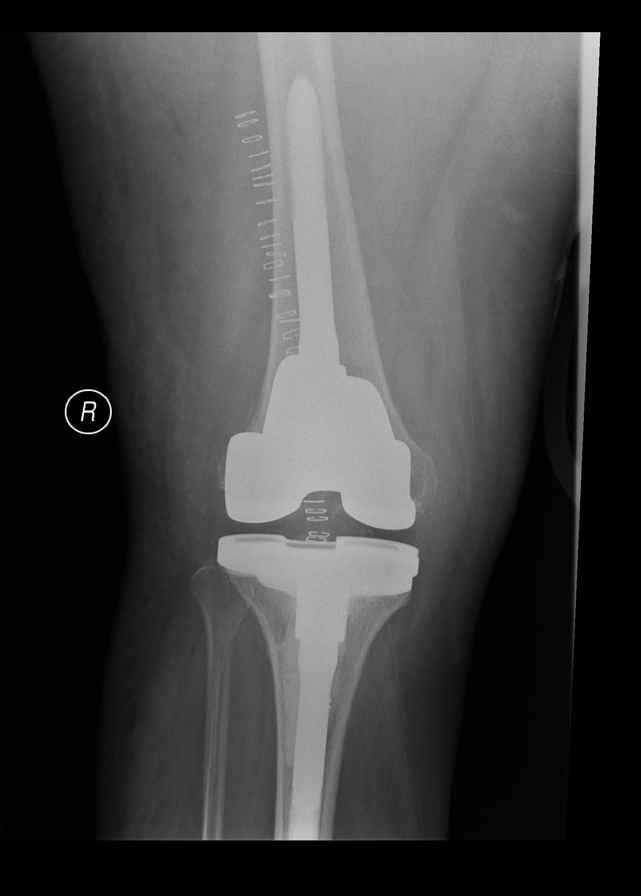 Knee_SmithAndNephew_Legion2</td>
<td align="center" valign="top"><b>Option 1</b> 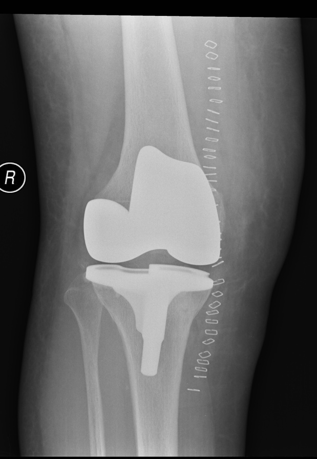 Knee_SmithAndNephew_GenesisII</td>
<td align="center" valign="top"><b>✅ Option 2</b> 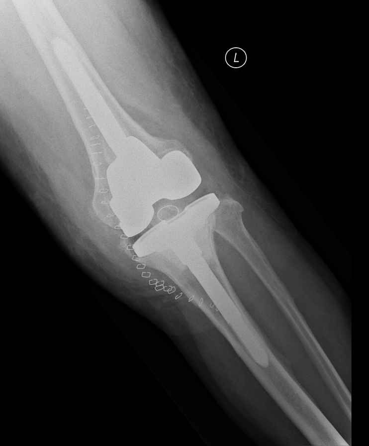 Knee_SmithAndNephew_Legion2</td>
<td align="center" valign="top"><b>Option 3</b> 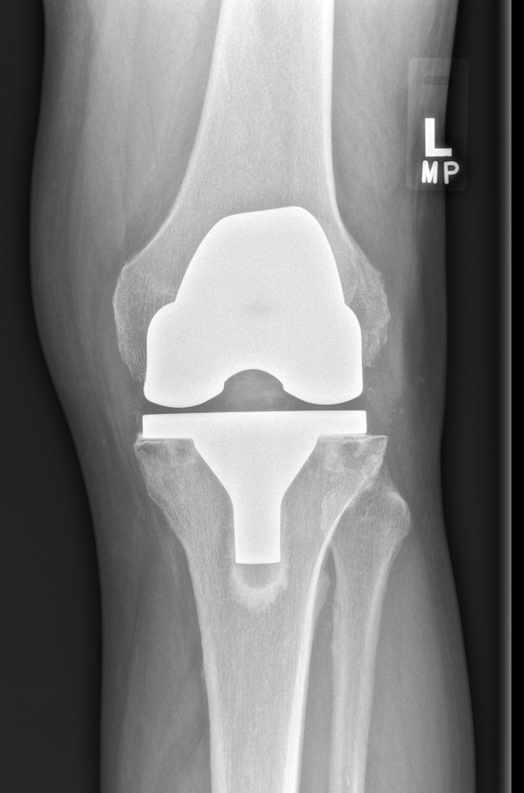 Knee_Depuy_Synthes_Sigma</td>
<td align="center" valign="top"><b>Option 4</b> 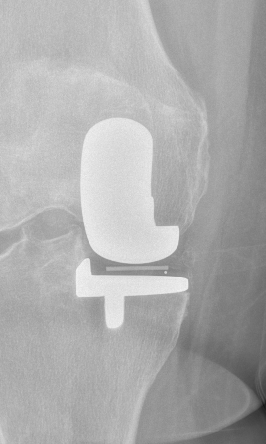 Knee_ZimmerBiomet_Oxford</td>
<td align="center" valign="middle"><b>Option 6</b>  <i>None of the above</i></td>
</tr></table>

### Q0912 · correct: option 2 · `Knee_SmithAndNephew_Legion2`

<table><tr>
<td align="center" valign="top"><b>Query</b> 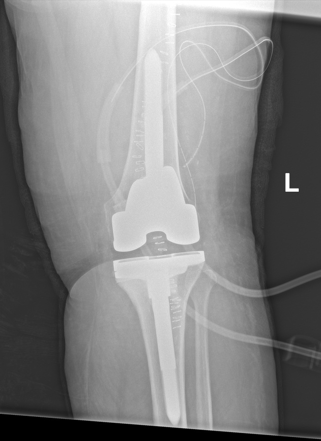 Knee_SmithAndNephew_Legion2</td>
<td align="center" valign="top"><b>Option 1</b>  Knee_ZimmerBiomet_Oxford</td>
<td align="center" valign="top"><b>✅ Option 2</b> 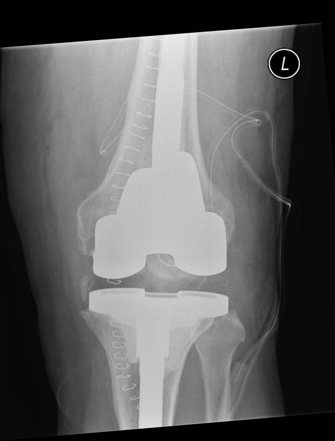 Knee_SmithAndNephew_Legion2</td>
<td align="center" valign="top"><b>Option 3</b>  Knee_Depuy_Synthes_Sigma</td>
<td align="center" valign="top"><b>Option 4</b>  Knee_SmithAndNephew_GenesisII</td>
<td align="center" valign="middle"><b>Option 6</b>  <i>None of the above</i></td>
</tr></table>

### Q0913 · correct: option 1 · `Knee_SmithAndNephew_Legion2`

<table><tr>
<td align="center" valign="top"><b>Query</b> 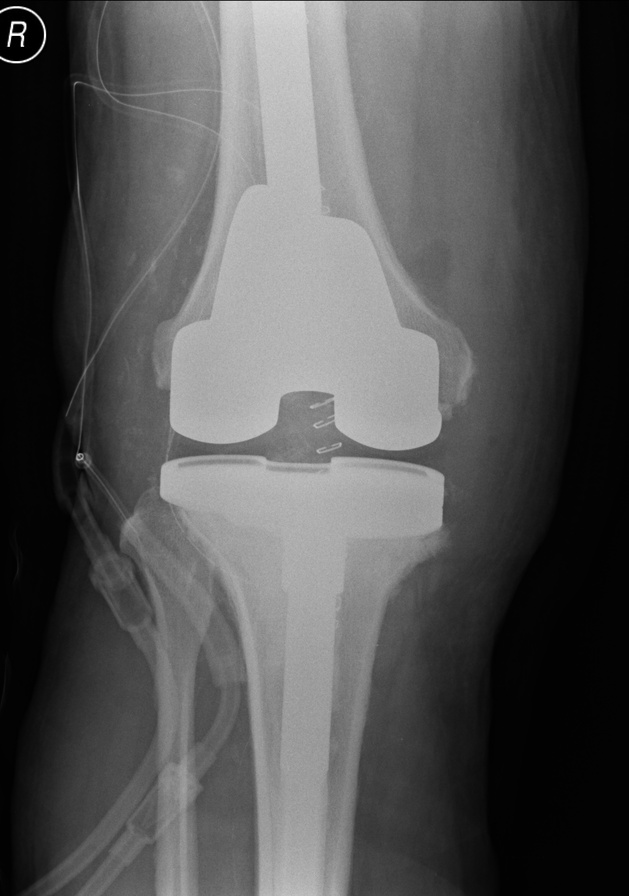 Knee_SmithAndNephew_Legion2</td>
<td align="center" valign="top"><b>✅ Option 1</b>  Knee_SmithAndNephew_Legion2</td>
<td align="center" valign="top"><b>Option 2</b>  Knee_SmithAndNephew_GenesisII</td>
<td align="center" valign="top"><b>Option 3</b>  Knee_Depuy_Synthes_Sigma</td>
<td align="center" valign="top"><b>Option 4</b>  Knee_ZimmerBiomet_Oxford</td>
<td align="center" valign="middle"><b>Option 6</b>  <i>None of the above</i></td>
</tr></table>

### Q0914 · correct: option 1 · `Knee_SmithAndNephew_Legion2`

<table><tr>
<td align="center" valign="top"><b>Query</b> 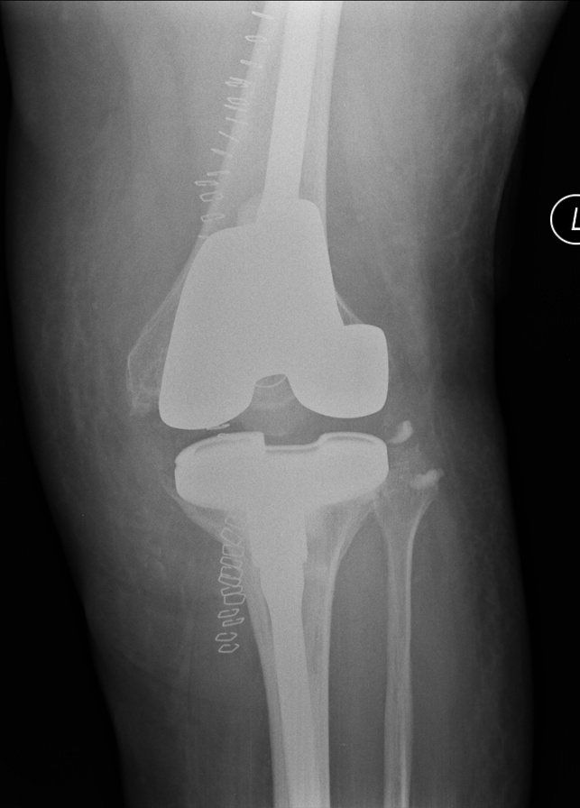 Knee_SmithAndNephew_Legion2</td>
<td align="center" valign="top"><b>✅ Option 1</b>  Knee_SmithAndNephew_Legion2</td>
<td align="center" valign="top"><b>Option 2</b>  Knee_ZimmerBiomet_Oxford</td>
<td align="center" valign="top"><b>Option 3</b>  Knee_Depuy_Synthes_Sigma</td>
<td align="center" valign="top"><b>Option 4</b>  Knee_SmithAndNephew_GenesisII</td>
<td align="center" valign="middle"><b>Option 6</b>  <i>None of the above</i></td>
</tr></table>

### Q0915 · correct: option 4 · `Knee_SmithAndNephew_Legion2`

<table><tr>
<td align="center" valign="top"><b>Query</b> 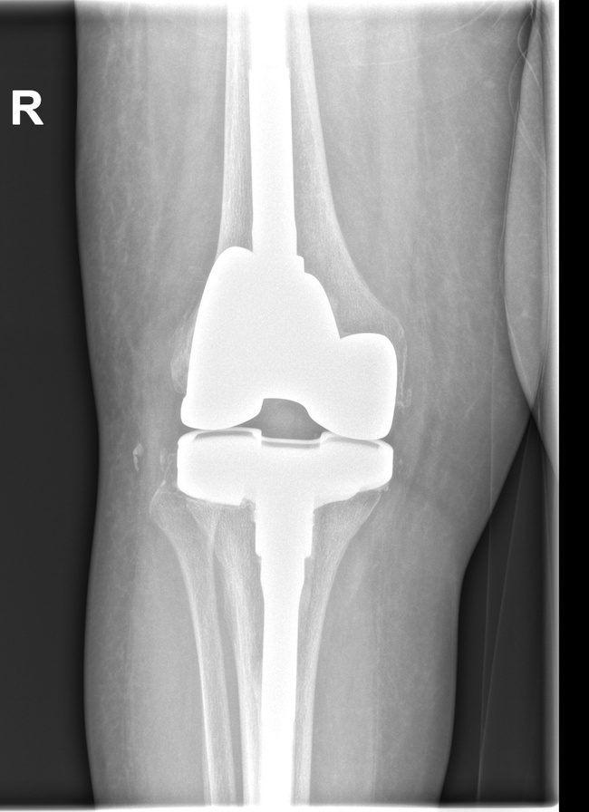 Knee_SmithAndNephew_Legion2</td>
<td align="center" valign="top"><b>Option 1</b>  Knee_Depuy_Synthes_Sigma</td>
<td align="center" valign="top"><b>Option 2</b>  Knee_SmithAndNephew_GenesisII</td>
<td align="center" valign="top"><b>Option 3</b>  Knee_ZimmerBiomet_Oxford</td>
<td align="center" valign="top"><b>✅ Option 4</b>  Knee_SmithAndNephew_Legion2</td>
<td align="center" valign="middle"><b>Option 6</b>  <i>None of the above</i></td>
</tr></table>

### Q0916 · correct: option 2 · `Knee_SmithAndNephew_Legion2`

<table><tr>
<td align="center" valign="top"><b>Query</b> 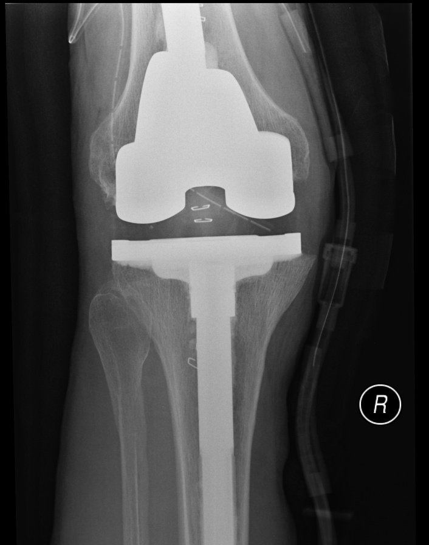 Knee_SmithAndNephew_Legion2</td>
<td align="center" valign="top"><b>Option 1</b>  Knee_ZimmerBiomet_Oxford</td>
<td align="center" valign="top"><b>✅ Option 2</b>  Knee_SmithAndNephew_Legion2</td>
<td align="center" valign="top"><b>Option 3</b>  Knee_Depuy_Synthes_Sigma</td>
<td align="center" valign="top"><b>Option 4</b>  Knee_SmithAndNephew_GenesisII</td>
<td align="center" valign="middle"><b>Option 6</b>  <i>None of the above</i></td>
</tr></table>

### Q0917 · correct: option 3 · `Knee_SmithAndNephew_Legion2`

<table><tr>
<td align="center" valign="top"><b>Query</b> 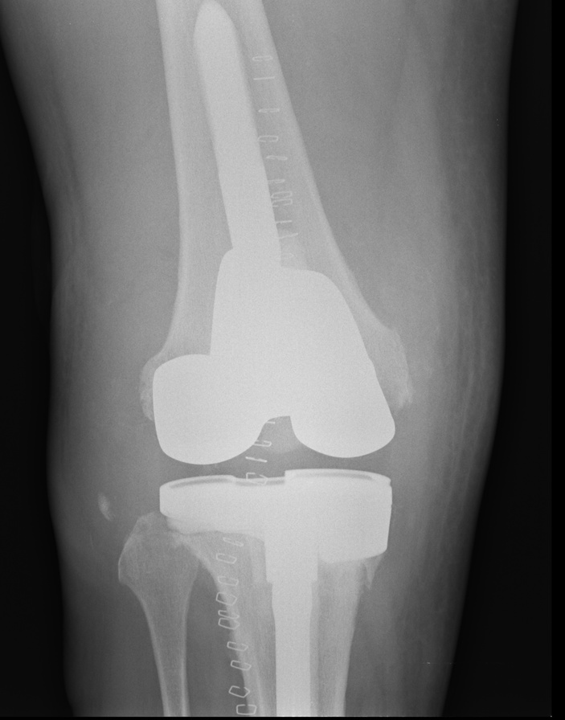 Knee_SmithAndNephew_Legion2</td>
<td align="center" valign="top"><b>Option 1</b>  Knee_ZimmerBiomet_Oxford</td>
<td align="center" valign="top"><b>Option 2</b>  Knee_Depuy_Synthes_Sigma</td>
<td align="center" valign="top"><b>✅ Option 3</b>  Knee_SmithAndNephew_Legion2</td>
<td align="center" valign="top"><b>Option 4</b>  Knee_SmithAndNephew_GenesisII</td>
<td align="center" valign="middle"><b>Option 6</b>  <i>None of the above</i></td>
</tr></table>

### Q0918 · correct: option 2 · `Knee_SmithAndNephew_Legion2`

<table><tr>
<td align="center" valign="top"><b>Query</b> 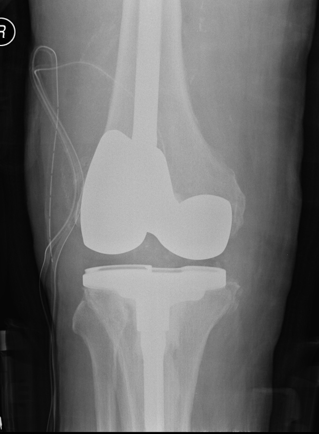 Knee_SmithAndNephew_Legion2</td>
<td align="center" valign="top"><b>Option 1</b>  Knee_ZimmerBiomet_Oxford</td>
<td align="center" valign="top"><b>✅ Option 2</b>  Knee_SmithAndNephew_Legion2</td>
<td align="center" valign="top"><b>Option 3</b>  Knee_Depuy_Synthes_Sigma</td>
<td align="center" valign="top"><b>Option 4</b>  Knee_SmithAndNephew_GenesisII</td>
<td align="center" valign="middle"><b>Option 6</b>  <i>None of the above</i></td>
</tr></table>

### Q0919 · correct: option 2 · `Knee_SmithAndNephew_Legion2`

<table><tr>
<td align="center" valign="top"><b>Query</b> 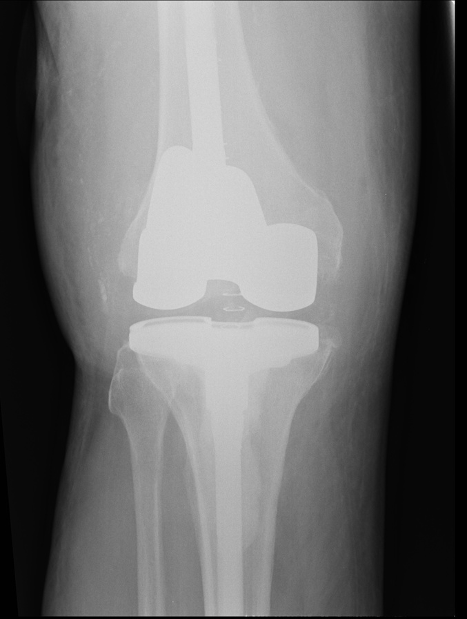 Knee_SmithAndNephew_Legion2</td>
<td align="center" valign="top"><b>Option 1</b>  Knee_Depuy_Synthes_Sigma</td>
<td align="center" valign="top"><b>✅ Option 2</b>  Knee_SmithAndNephew_Legion2</td>
<td align="center" valign="top"><b>Option 3</b>  Knee_SmithAndNephew_GenesisII</td>
<td align="center" valign="top"><b>Option 4</b>  Knee_ZimmerBiomet_Oxford</td>
<td align="center" valign="middle"><b>Option 6</b>  <i>None of the above</i></td>
</tr></table>

### Q0920 · correct: option 3 · `Knee_SmithAndNephew_Legion2`

<table><tr>
<td align="center" valign="top"><b>Query</b> 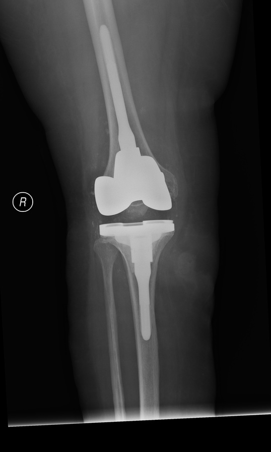 Knee_SmithAndNephew_Legion2</td>
<td align="center" valign="top"><b>Option 1</b>  Knee_SmithAndNephew_GenesisII</td>
<td align="center" valign="top"><b>Option 2</b>  Knee_Depuy_Synthes_Sigma</td>
<td align="center" valign="top"><b>✅ Option 3</b>  Knee_SmithAndNephew_Legion2</td>
<td align="center" valign="top"><b>Option 4</b>  Knee_ZimmerBiomet_Oxford</td>
<td align="center" valign="middle"><b>Option 6</b>  <i>None of the above</i></td>
</tr></table>

### Q0921 · correct: option 1 · `Knee_SmithAndNephew_Legion2`

<table><tr>
<td align="center" valign="top"><b>Query</b> 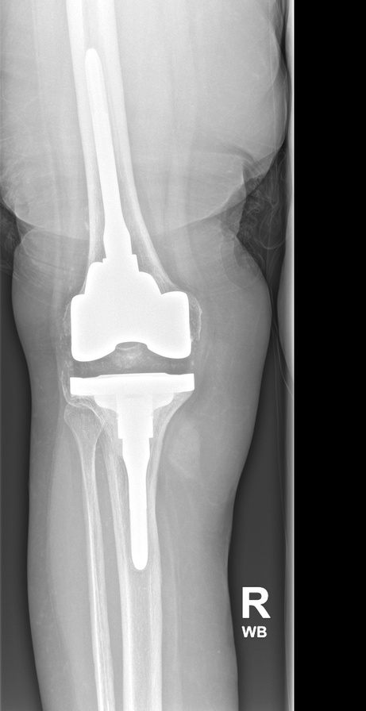 Knee_SmithAndNephew_Legion2</td>
<td align="center" valign="top"><b>✅ Option 1</b>  Knee_SmithAndNephew_Legion2</td>
<td align="center" valign="top"><b>Option 2</b>  Knee_Depuy_Synthes_Sigma</td>
<td align="center" valign="top"><b>Option 3</b>  Knee_SmithAndNephew_GenesisII</td>
<td align="center" valign="top"><b>Option 4</b>  Knee_ZimmerBiomet_Oxford</td>
<td align="center" valign="middle"><b>Option 6</b>  <i>None of the above</i></td>
</tr></table>

### Q0922 · correct: option 2 · `Knee_SmithAndNephew_Legion2`

<table><tr>
<td align="center" valign="top"><b>Query</b> 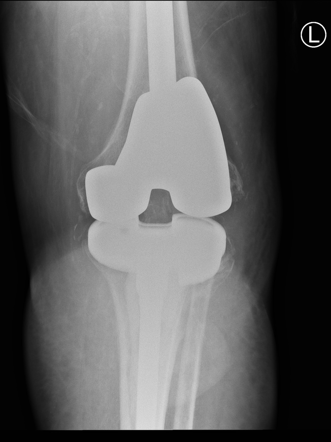 Knee_SmithAndNephew_Legion2</td>
<td align="center" valign="top"><b>Option 1</b>  Knee_Depuy_Synthes_Sigma</td>
<td align="center" valign="top"><b>✅ Option 2</b>  Knee_SmithAndNephew_Legion2</td>
<td align="center" valign="top"><b>Option 3</b>  Knee_ZimmerBiomet_Oxford</td>
<td align="center" valign="top"><b>Option 4</b>  Knee_SmithAndNephew_GenesisII</td>
<td align="center" valign="middle"><b>Option 6</b>  <i>None of the above</i></td>
</tr></table>

### Q0923 · correct: option 2 · `Knee_SmithAndNephew_Legion2`

<table><tr>
<td align="center" valign="top"><b>Query</b> 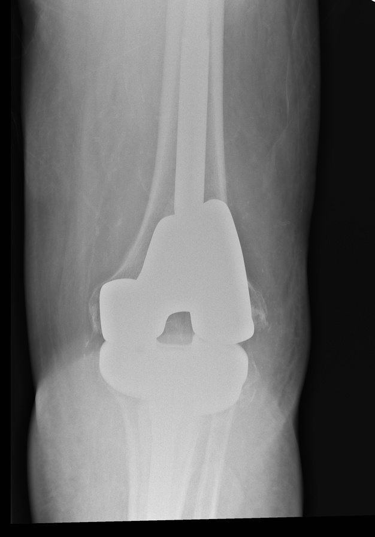 Knee_SmithAndNephew_Legion2</td>
<td align="center" valign="top"><b>Option 1</b>  Knee_SmithAndNephew_GenesisII</td>
<td align="center" valign="top"><b>✅ Option 2</b> 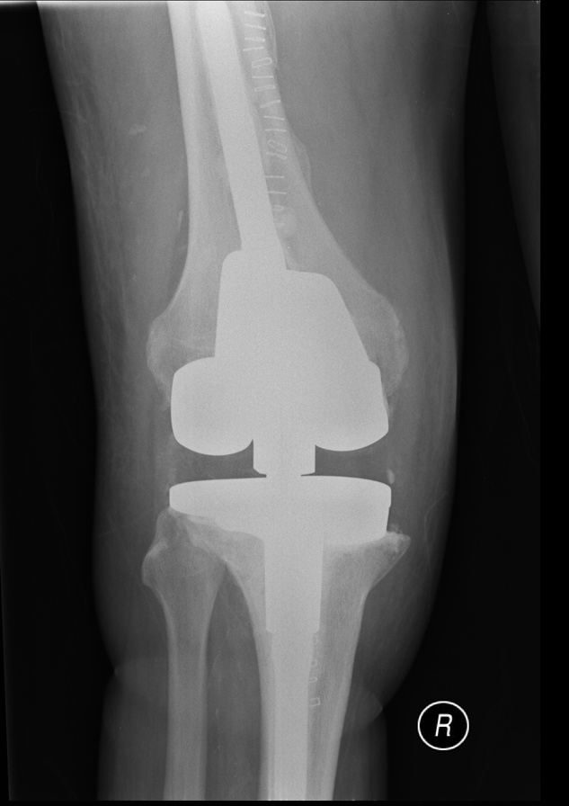 Knee_SmithAndNephew_Legion2</td>
<td align="center" valign="top"><b>Option 3</b>  Knee_ZimmerBiomet_Oxford</td>
<td align="center" valign="top"><b>Option 4</b>  Knee_Depuy_Synthes_Sigma</td>
<td align="center" valign="middle"><b>Option 6</b>  <i>None of the above</i></td>
</tr></table>

### Q0924 · correct: option 3 · `Knee_SmithAndNephew_Legion2`

<table><tr>
<td align="center" valign="top"><b>Query</b> 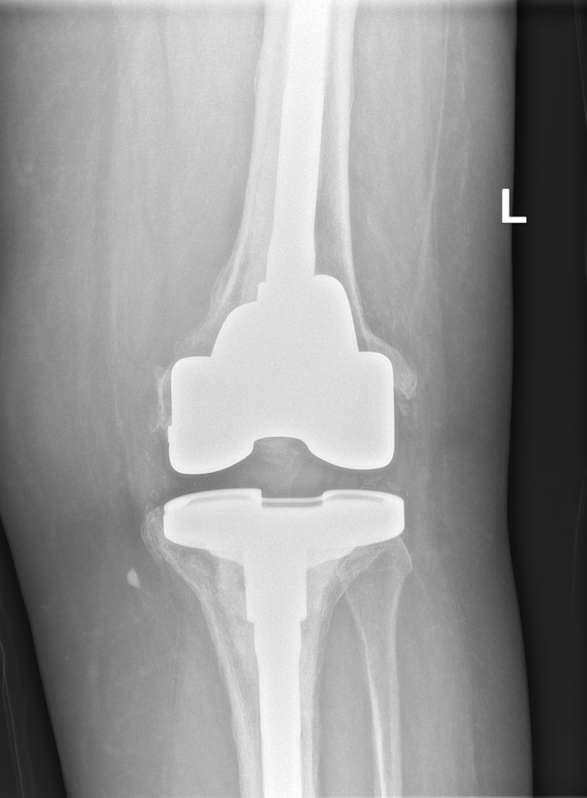 Knee_SmithAndNephew_Legion2</td>
<td align="center" valign="top"><b>Option 1</b>  Knee_SmithAndNephew_GenesisII</td>
<td align="center" valign="top"><b>Option 2</b>  Knee_ZimmerBiomet_Oxford</td>
<td align="center" valign="top"><b>✅ Option 3</b>  Knee_SmithAndNephew_Legion2</td>
<td align="center" valign="top"><b>Option 4</b>  Knee_Depuy_Synthes_Sigma</td>
<td align="center" valign="middle"><b>Option 6</b>  <i>None of the above</i></td>
</tr></table>

### Q0925 · correct: option 2 · `Knee_SmithAndNephew_Legion2`

<table><tr>
<td align="center" valign="top"><b>Query</b> 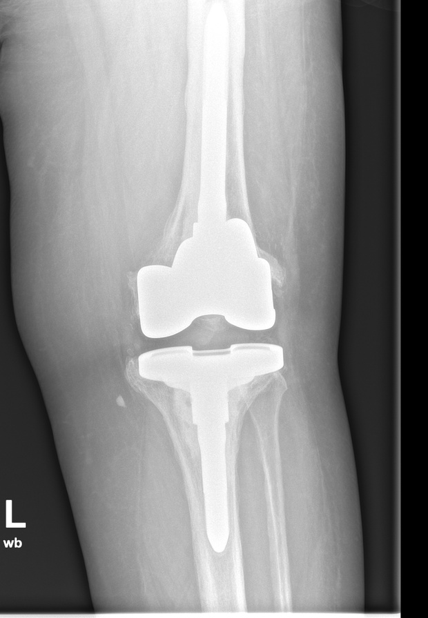 Knee_SmithAndNephew_Legion2</td>
<td align="center" valign="top"><b>Option 1</b>  Knee_Depuy_Synthes_Sigma</td>
<td align="center" valign="top"><b>✅ Option 2</b>  Knee_SmithAndNephew_Legion2</td>
<td align="center" valign="top"><b>Option 3</b>  Knee_SmithAndNephew_GenesisII</td>
<td align="center" valign="top"><b>Option 4</b>  Knee_ZimmerBiomet_Oxford</td>
<td align="center" valign="middle"><b>Option 6</b>  <i>None of the above</i></td>
</tr></table>

### Q0926 · correct: option 2 · `Knee_ZimmerBiomet_Oxford`

<table><tr>
<td align="center" valign="top"><b>Query</b> 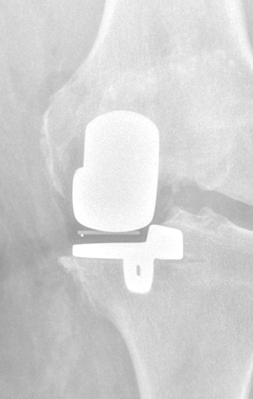 Knee_ZimmerBiomet_Oxford</td>
<td align="center" valign="top"><b>Option 1</b> 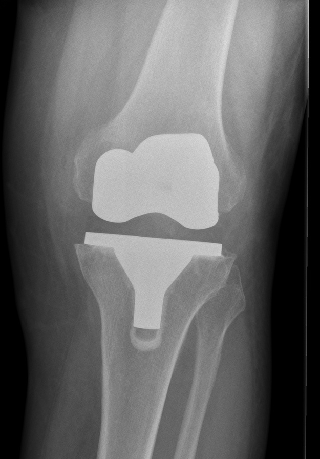 Knee_Depuy_Synthes_Sigma</td>
<td align="center" valign="top"><b>✅ Option 2</b> 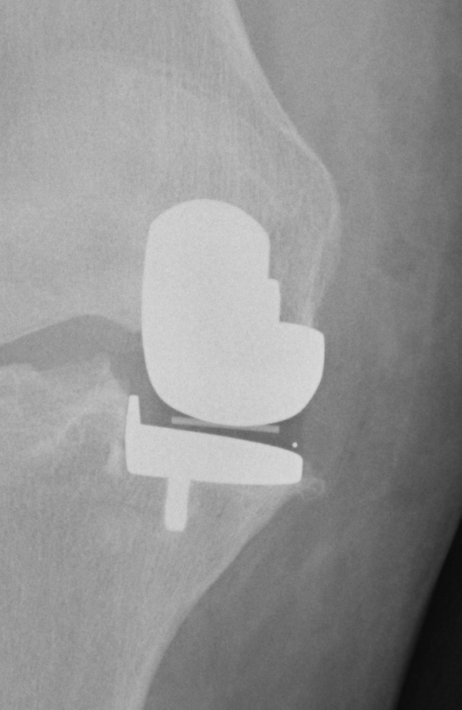 Knee_ZimmerBiomet_Oxford</td>
<td align="center" valign="top"><b>Option 3</b> 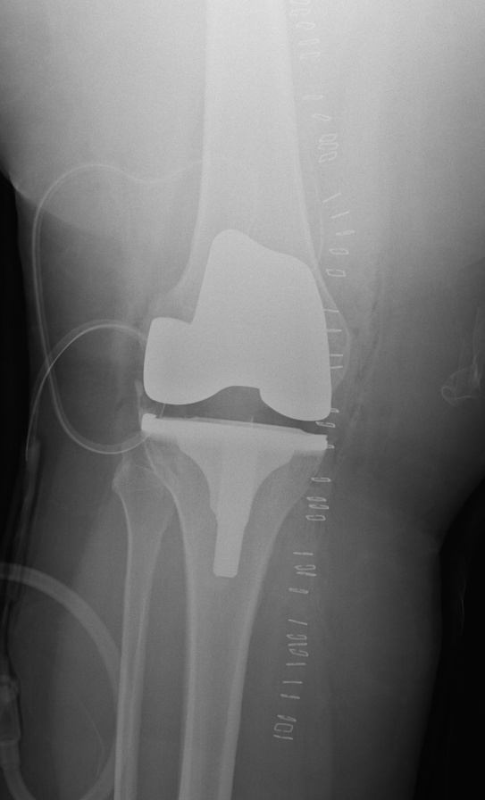 Knee_SmithAndNephew_GenesisII</td>
<td align="center" valign="top"><b>Option 4</b>  Knee_SmithAndNephew_Legion2</td>
<td align="center" valign="middle"><b>Option 6</b>  <i>None of the above</i></td>
</tr></table>

### Q0927 · correct: option 2 · `Knee_ZimmerBiomet_Oxford`

<table><tr>
<td align="center" valign="top"><b>Query</b> 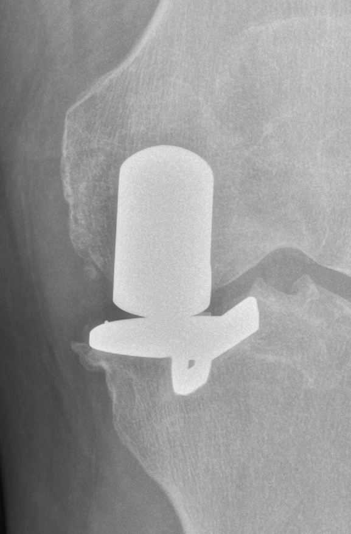 Knee_ZimmerBiomet_Oxford</td>
<td align="center" valign="top"><b>Option 1</b>  Knee_SmithAndNephew_GenesisII</td>
<td align="center" valign="top"><b>✅ Option 2</b>  Knee_ZimmerBiomet_Oxford</td>
<td align="center" valign="top"><b>Option 3</b>  Knee_Depuy_Synthes_Sigma</td>
<td align="center" valign="top"><b>Option 4</b>  Knee_SmithAndNephew_Legion2</td>
<td align="center" valign="middle"><b>Option 6</b>  <i>None of the above</i></td>
</tr></table>

### Q0928 · correct: option 4 · `Knee_ZimmerBiomet_Oxford`

<table><tr>
<td align="center" valign="top"><b>Query</b> 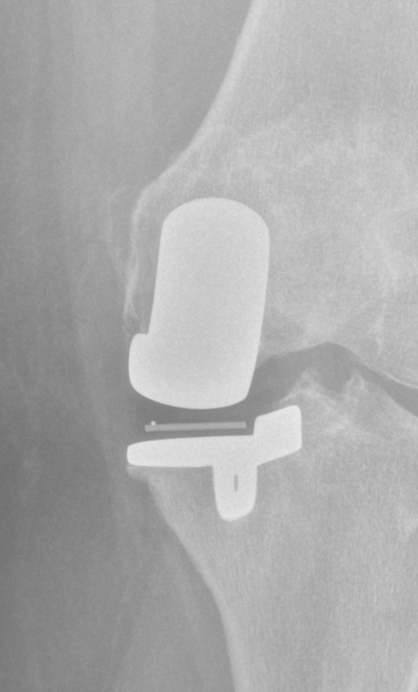 Knee_ZimmerBiomet_Oxford</td>
<td align="center" valign="top"><b>Option 1</b>  Knee_SmithAndNephew_Legion2</td>
<td align="center" valign="top"><b>Option 2</b>  Knee_Depuy_Synthes_Sigma</td>
<td align="center" valign="top"><b>Option 3</b>  Knee_SmithAndNephew_GenesisII</td>
<td align="center" valign="top"><b>✅ Option 4</b>  Knee_ZimmerBiomet_Oxford</td>
<td align="center" valign="middle"><b>Option 6</b>  <i>None of the above</i></td>
</tr></table>

### Q0929 · correct: option 1 · `Knee_ZimmerBiomet_Oxford`

<table><tr>
<td align="center" valign="top"><b>Query</b> 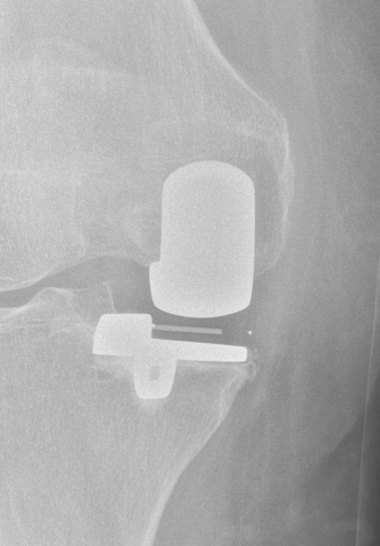 Knee_ZimmerBiomet_Oxford</td>
<td align="center" valign="top"><b>✅ Option 1</b> 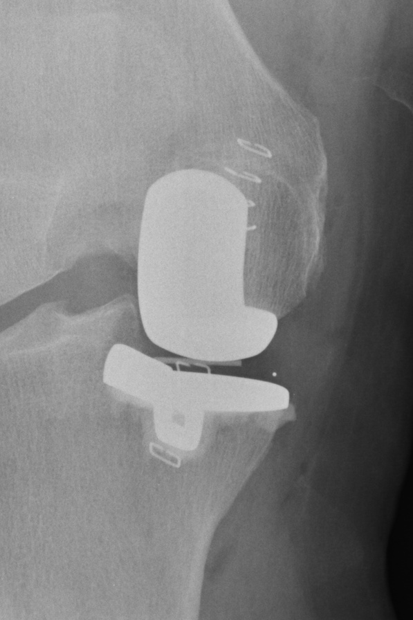 Knee_ZimmerBiomet_Oxford</td>
<td align="center" valign="top"><b>Option 2</b>  Knee_Depuy_Synthes_Sigma</td>
<td align="center" valign="top"><b>Option 3</b>  Knee_SmithAndNephew_Legion2</td>
<td align="center" valign="top"><b>Option 4</b>  Knee_SmithAndNephew_GenesisII</td>
<td align="center" valign="middle"><b>Option 6</b>  <i>None of the above</i></td>
</tr></table>

### Q0930 · correct: option 2 · `Knee_ZimmerBiomet_Oxford`

<table><tr>
<td align="center" valign="top"><b>Query</b> 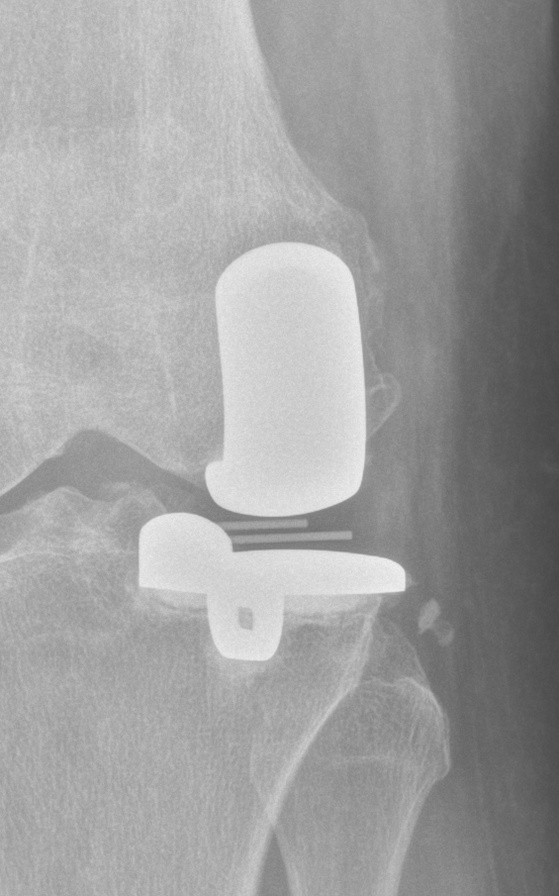 Knee_ZimmerBiomet_Oxford</td>
<td align="center" valign="top"><b>Option 1</b>  Knee_SmithAndNephew_Legion2</td>
<td align="center" valign="top"><b>✅ Option 2</b> 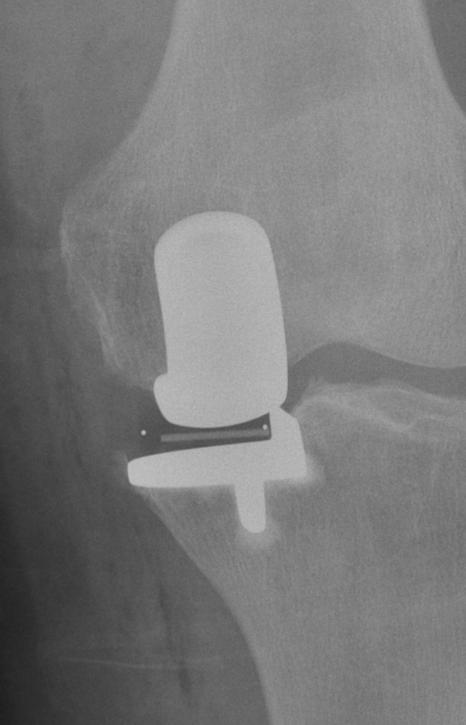 Knee_ZimmerBiomet_Oxford</td>
<td align="center" valign="top"><b>Option 3</b>  Knee_SmithAndNephew_GenesisII</td>
<td align="center" valign="top"><b>Option 4</b>  Knee_Depuy_Synthes_Sigma</td>
<td align="center" valign="middle"><b>Option 6</b>  <i>None of the above</i></td>
</tr></table>

### Q0931 · correct: option 1 · `Knee_ZimmerBiomet_Oxford`

<table><tr>
<td align="center" valign="top"><b>Query</b> 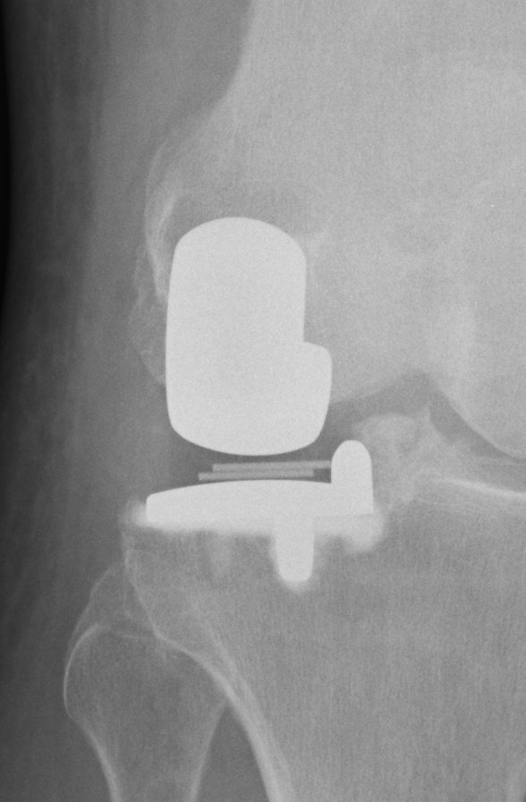 Knee_ZimmerBiomet_Oxford</td>
<td align="center" valign="top"><b>✅ Option 1</b>  Knee_ZimmerBiomet_Oxford</td>
<td align="center" valign="top"><b>Option 2</b>  Knee_Depuy_Synthes_Sigma</td>
<td align="center" valign="top"><b>Option 3</b>  Knee_SmithAndNephew_GenesisII</td>
<td align="center" valign="top"><b>Option 4</b>  Knee_SmithAndNephew_Legion2</td>
<td align="center" valign="middle"><b>Option 6</b>  <i>None of the above</i></td>
</tr></table>

### Q0932 · correct: option 2 · `Knee_ZimmerBiomet_Oxford`

<table><tr>
<td align="center" valign="top"><b>Query</b> 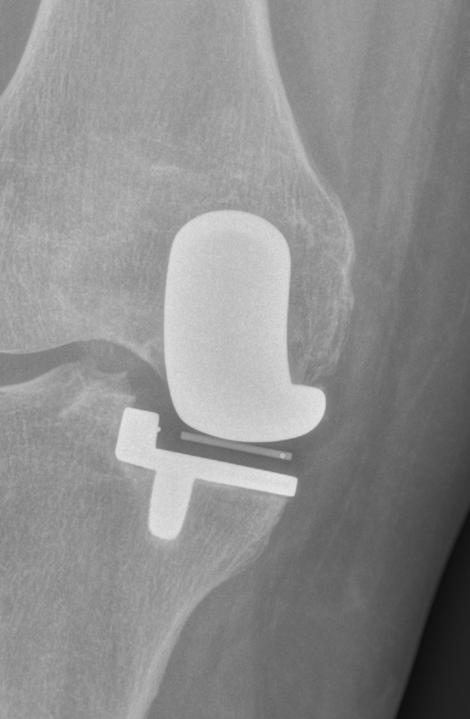 Knee_ZimmerBiomet_Oxford</td>
<td align="center" valign="top"><b>Option 1</b>  Knee_Depuy_Synthes_Sigma</td>
<td align="center" valign="top"><b>✅ Option 2</b>  Knee_ZimmerBiomet_Oxford</td>
<td align="center" valign="top"><b>Option 3</b>  Knee_SmithAndNephew_GenesisII</td>
<td align="center" valign="top"><b>Option 4</b>  Knee_SmithAndNephew_Legion2</td>
<td align="center" valign="middle"><b>Option 6</b>  <i>None of the above</i></td>
</tr></table>

### Q0933 · correct: option 1 · `Knee_ZimmerBiomet_Oxford`

<table><tr>
<td align="center" valign="top"><b>Query</b> 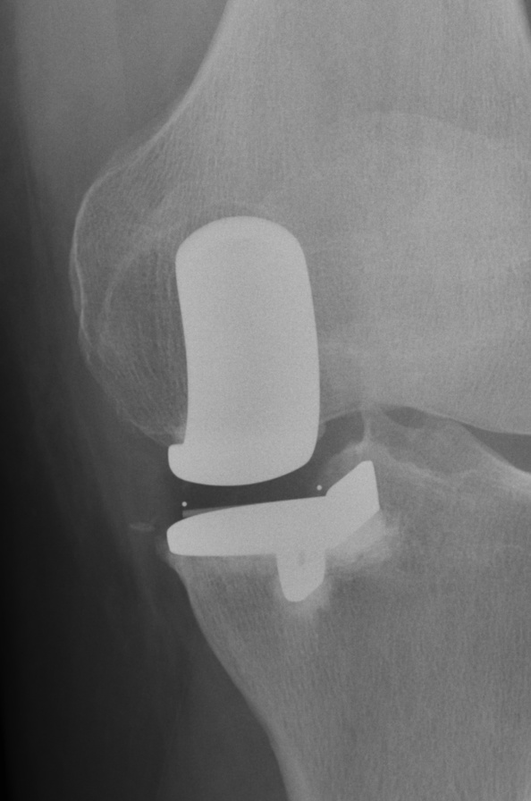 Knee_ZimmerBiomet_Oxford</td>
<td align="center" valign="top"><b>✅ Option 1</b>  Knee_ZimmerBiomet_Oxford</td>
<td align="center" valign="top"><b>Option 2</b>  Knee_SmithAndNephew_Legion2</td>
<td align="center" valign="top"><b>Option 3</b>  Knee_Depuy_Synthes_Sigma</td>
<td align="center" valign="top"><b>Option 4</b>  Knee_SmithAndNephew_GenesisII</td>
<td align="center" valign="middle"><b>Option 6</b>  <i>None of the above</i></td>
</tr></table>

### Q0934 · correct: option 3 · `Knee_ZimmerBiomet_Oxford`

<table><tr>
<td align="center" valign="top"><b>Query</b> 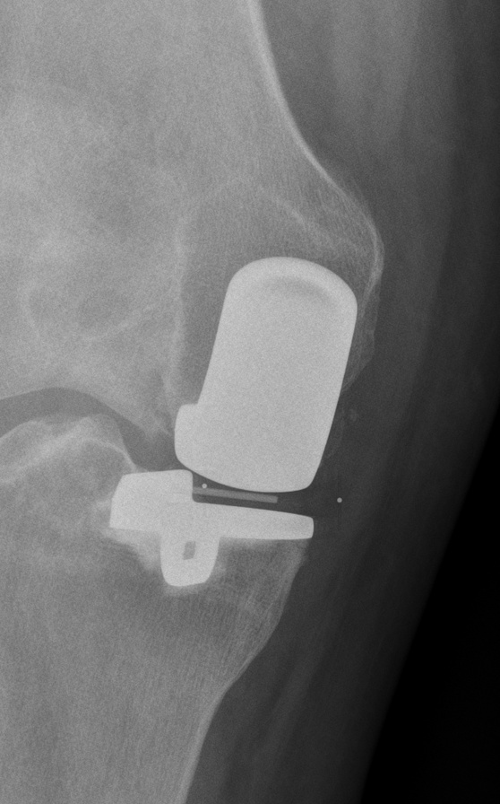 Knee_ZimmerBiomet_Oxford</td>
<td align="center" valign="top"><b>Option 1</b>  Knee_Depuy_Synthes_Sigma</td>
<td align="center" valign="top"><b>Option 2</b>  Knee_SmithAndNephew_Legion2</td>
<td align="center" valign="top"><b>✅ Option 3</b>  Knee_ZimmerBiomet_Oxford</td>
<td align="center" valign="top"><b>Option 4</b>  Knee_SmithAndNephew_GenesisII</td>
<td align="center" valign="middle"><b>Option 6</b>  <i>None of the above</i></td>
</tr></table>

### Q0935 · correct: option 2 · `Knee_ZimmerBiomet_Oxford`

<table><tr>
<td align="center" valign="top"><b>Query</b> 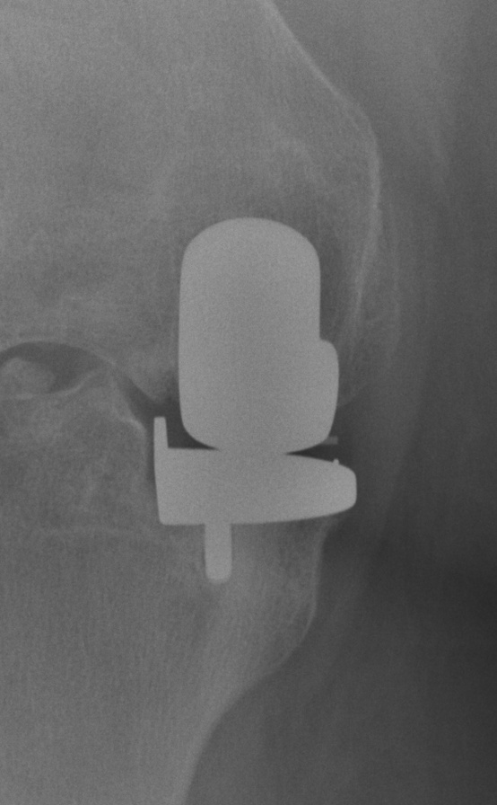 Knee_ZimmerBiomet_Oxford</td>
<td align="center" valign="top"><b>Option 1</b>  Knee_SmithAndNephew_Legion2</td>
<td align="center" valign="top"><b>✅ Option 2</b>  Knee_ZimmerBiomet_Oxford</td>
<td align="center" valign="top"><b>Option 3</b>  Knee_Depuy_Synthes_Sigma</td>
<td align="center" valign="top"><b>Option 4</b>  Knee_SmithAndNephew_GenesisII</td>
<td align="center" valign="middle"><b>Option 6</b>  <i>None of the above</i></td>
</tr></table>

### Q0936 · correct: option 3 · `Knee_ZimmerBiomet_Oxford`

<table><tr>
<td align="center" valign="top"><b>Query</b> 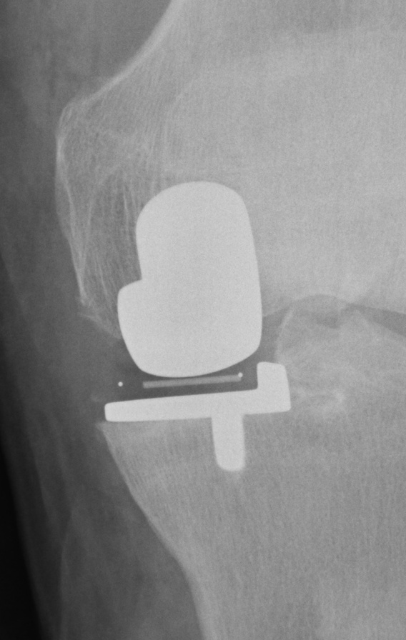 Knee_ZimmerBiomet_Oxford</td>
<td align="center" valign="top"><b>Option 1</b>  Knee_Depuy_Synthes_Sigma</td>
<td align="center" valign="top"><b>Option 2</b>  Knee_SmithAndNephew_Legion2</td>
<td align="center" valign="top"><b>✅ Option 3</b>  Knee_ZimmerBiomet_Oxford</td>
<td align="center" valign="top"><b>Option 4</b>  Knee_SmithAndNephew_GenesisII</td>
<td align="center" valign="middle"><b>Option 6</b>  <i>None of the above</i></td>
</tr></table>

### Q0937 · correct: option 3 · `Knee_ZimmerBiomet_Oxford`

<table><tr>
<td align="center" valign="top"><b>Query</b> 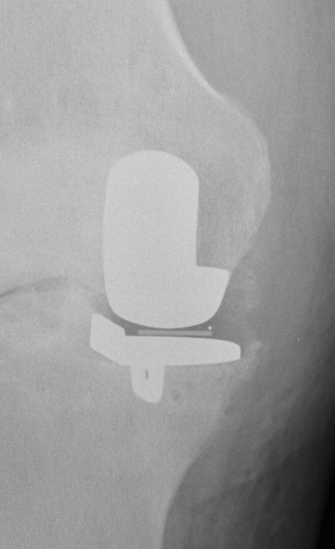 Knee_ZimmerBiomet_Oxford</td>
<td align="center" valign="top"><b>Option 1</b>  Knee_SmithAndNephew_Legion2</td>
<td align="center" valign="top"><b>Option 2</b>  Knee_Depuy_Synthes_Sigma</td>
<td align="center" valign="top"><b>✅ Option 3</b>  Knee_ZimmerBiomet_Oxford</td>
<td align="center" valign="top"><b>Option 4</b>  Knee_SmithAndNephew_GenesisII</td>
<td align="center" valign="middle"><b>Option 6</b>  <i>None of the above</i></td>
</tr></table>

### Q0938 · correct: option 2 · `Knee_ZimmerBiomet_Oxford`

<table><tr>
<td align="center" valign="top"><b>Query</b> 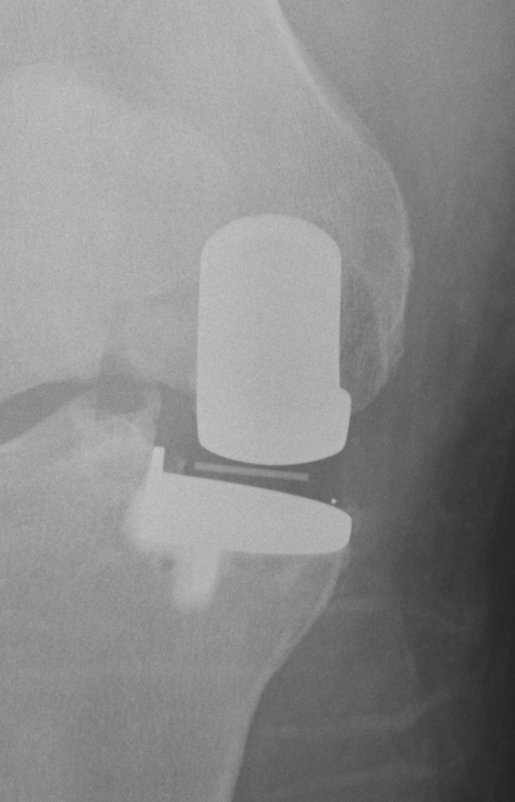 Knee_ZimmerBiomet_Oxford</td>
<td align="center" valign="top"><b>Option 1</b>  Knee_SmithAndNephew_GenesisII</td>
<td align="center" valign="top"><b>✅ Option 2</b>  Knee_ZimmerBiomet_Oxford</td>
<td align="center" valign="top"><b>Option 3</b>  Knee_Depuy_Synthes_Sigma</td>
<td align="center" valign="top"><b>Option 4</b>  Knee_SmithAndNephew_Legion2</td>
<td align="center" valign="middle"><b>Option 6</b>  <i>None of the above</i></td>
</tr></table>

### Q0939 · correct: option 2 · `Knee_ZimmerBiomet_Oxford`

<table><tr>
<td align="center" valign="top"><b>Query</b> 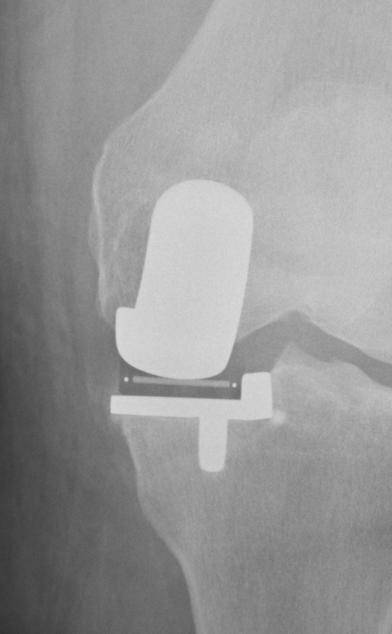 Knee_ZimmerBiomet_Oxford</td>
<td align="center" valign="top"><b>Option 1</b>  Knee_SmithAndNephew_GenesisII</td>
<td align="center" valign="top"><b>✅ Option 2</b>  Knee_ZimmerBiomet_Oxford</td>
<td align="center" valign="top"><b>Option 3</b>  Knee_Depuy_Synthes_Sigma</td>
<td align="center" valign="top"><b>Option 4</b>  Knee_SmithAndNephew_Legion2</td>
<td align="center" valign="middle"><b>Option 6</b>  <i>None of the above</i></td>
</tr></table>

### Q0940 · correct: option 2 · `Knee_ZimmerBiomet_Oxford`

<table><tr>
<td align="center" valign="top"><b>Query</b> 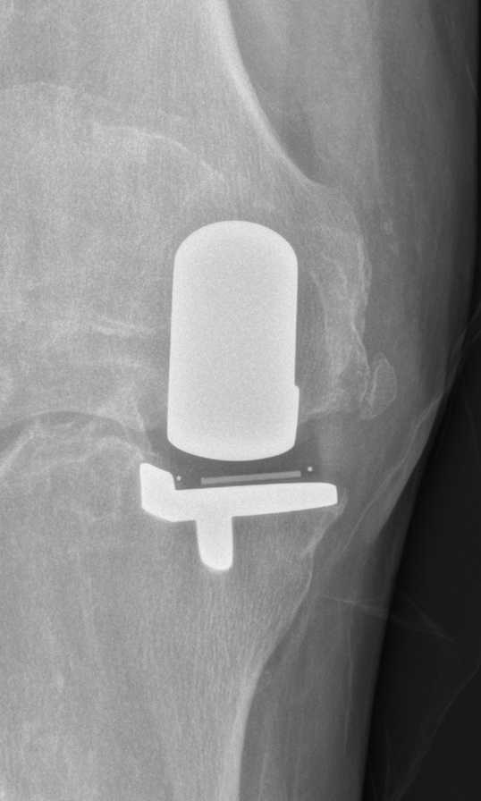 Knee_ZimmerBiomet_Oxford</td>
<td align="center" valign="top"><b>Option 1</b>  Knee_Depuy_Synthes_Sigma</td>
<td align="center" valign="top"><b>✅ Option 2</b>  Knee_ZimmerBiomet_Oxford</td>
<td align="center" valign="top"><b>Option 3</b>  Knee_SmithAndNephew_Legion2</td>
<td align="center" valign="top"><b>Option 4</b>  Knee_SmithAndNephew_GenesisII</td>
<td align="center" valign="middle"><b>Option 6</b>  <i>None of the above</i></td>
</tr></table>

### Q0941 · correct: option 1 · `Knee_Depuy_Synthes_Sigma`

<table><tr>
<td align="center" valign="top"><b>Query</b> 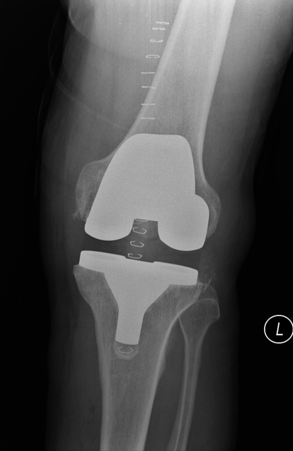 Knee_Depuy_Synthes_Sigma</td>
<td align="center" valign="top"><b>✅ Option 1</b>  Knee_Depuy_Synthes_Sigma</td>
<td align="center" valign="top"><b>Option 2</b>  Knee_SmithAndNephew_Legion2</td>
<td align="center" valign="top"><b>Option 3</b> 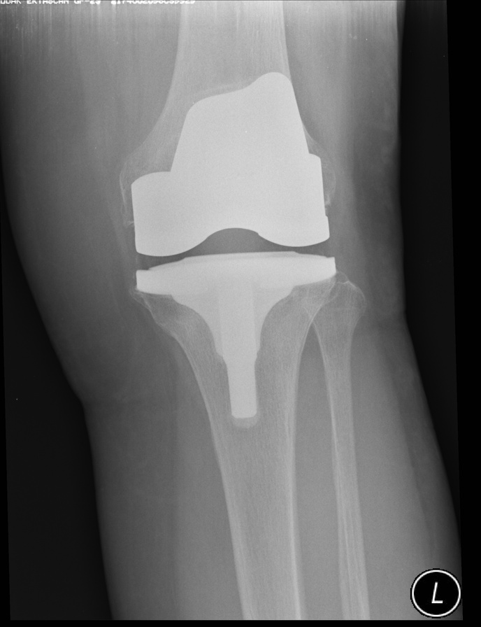 Knee_SmithAndNephew_GenesisII</td>
<td align="center" valign="top"><b>Option 4</b>  Knee_ZimmerBiomet_Oxford</td>
<td align="center" valign="middle"><b>Option 6</b>  <i>None of the above</i></td>
</tr></table>

### Q0942 · correct: option 1 · `Knee_Depuy_Synthes_Sigma`

<table><tr>
<td align="center" valign="top"><b>Query</b> 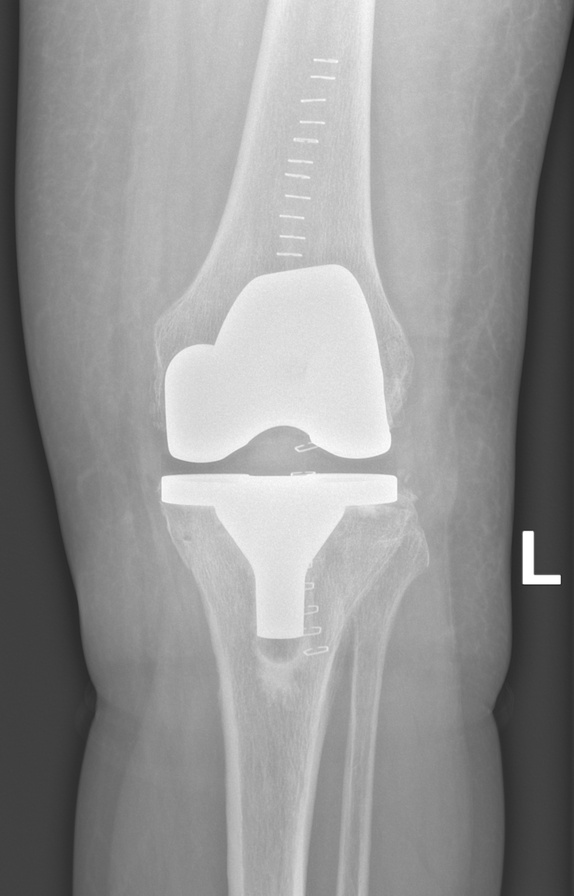 Knee_Depuy_Synthes_Sigma</td>
<td align="center" valign="top"><b>✅ Option 1</b> 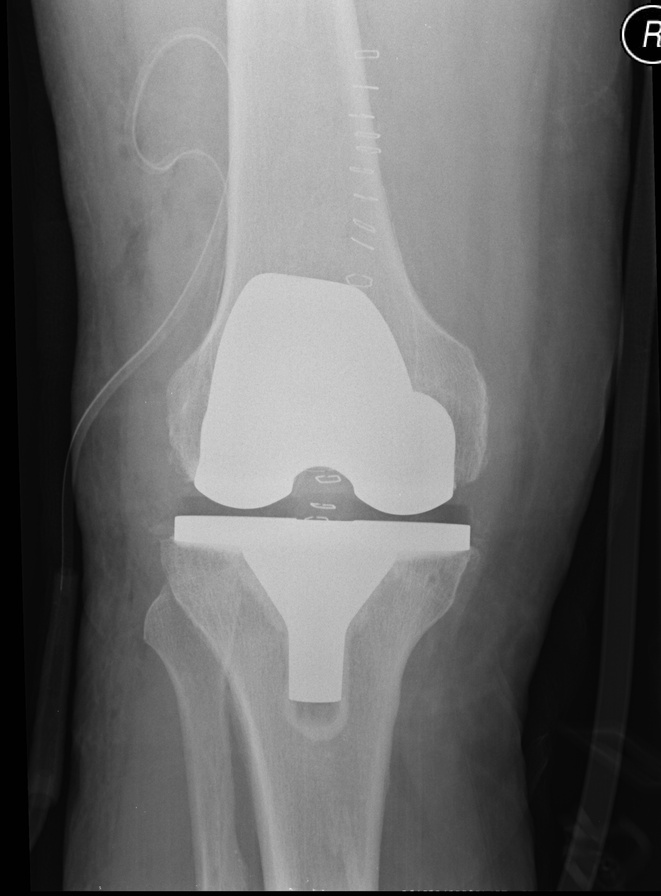 Knee_Depuy_Synthes_Sigma</td>
<td align="center" valign="top"><b>Option 2</b>  Knee_SmithAndNephew_Legion2</td>
<td align="center" valign="top"><b>Option 3</b>  Knee_ZimmerBiomet_Oxford</td>
<td align="center" valign="top"><b>Option 4</b>  Knee_SmithAndNephew_GenesisII</td>
<td align="center" valign="middle"><b>Option 6</b>  <i>None of the above</i></td>
</tr></table>

### Q0943 · correct: option 4 · `Knee_Depuy_Synthes_Sigma`

<table><tr>
<td align="center" valign="top"><b>Query</b> 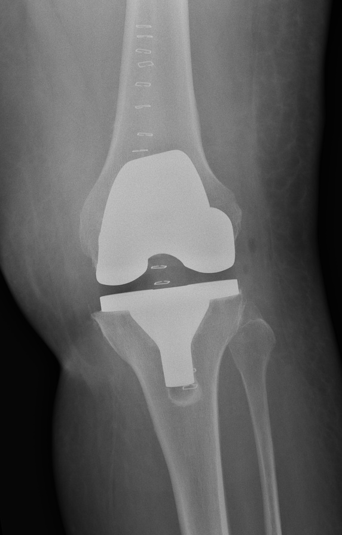 Knee_Depuy_Synthes_Sigma</td>
<td align="center" valign="top"><b>Option 1</b>  Knee_SmithAndNephew_Legion2</td>
<td align="center" valign="top"><b>Option 2</b>  Knee_SmithAndNephew_GenesisII</td>
<td align="center" valign="top"><b>Option 3</b>  Knee_ZimmerBiomet_Oxford</td>
<td align="center" valign="top"><b>✅ Option 4</b>  Knee_Depuy_Synthes_Sigma</td>
<td align="center" valign="middle"><b>Option 6</b>  <i>None of the above</i></td>
</tr></table>

### Q0944 · correct: option 3 · `Knee_Depuy_Synthes_Sigma`

<table><tr>
<td align="center" valign="top"><b>Query</b> 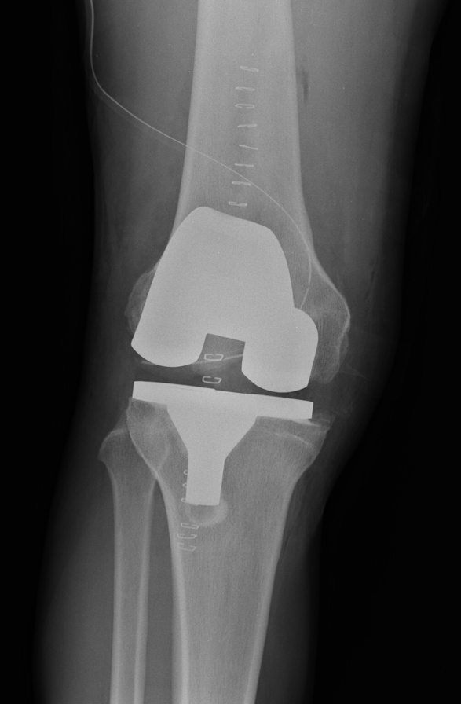 Knee_Depuy_Synthes_Sigma</td>
<td align="center" valign="top"><b>Option 1</b>  Knee_ZimmerBiomet_Oxford</td>
<td align="center" valign="top"><b>Option 2</b>  Knee_SmithAndNephew_GenesisII</td>
<td align="center" valign="top"><b>✅ Option 3</b>  Knee_Depuy_Synthes_Sigma</td>
<td align="center" valign="top"><b>Option 4</b>  Knee_SmithAndNephew_Legion2</td>
<td align="center" valign="middle"><b>Option 6</b>  <i>None of the above</i></td>
</tr></table>

### Q0945 · correct: option 4 · `Knee_Depuy_Synthes_Sigma`

<table><tr>
<td align="center" valign="top"><b>Query</b> 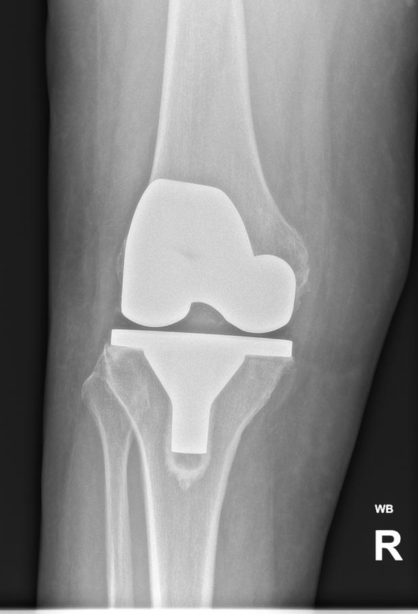 Knee_Depuy_Synthes_Sigma</td>
<td align="center" valign="top"><b>Option 1</b>  Knee_SmithAndNephew_GenesisII</td>
<td align="center" valign="top"><b>Option 2</b>  Knee_SmithAndNephew_Legion2</td>
<td align="center" valign="top"><b>Option 3</b>  Knee_ZimmerBiomet_Oxford</td>
<td align="center" valign="top"><b>✅ Option 4</b>  Knee_Depuy_Synthes_Sigma</td>
<td align="center" valign="middle"><b>Option 6</b>  <i>None of the above</i></td>
</tr></table>

### Q0946 · correct: option 3 · `Knee_Depuy_Synthes_Sigma`

<table><tr>
<td align="center" valign="top"><b>Query</b> 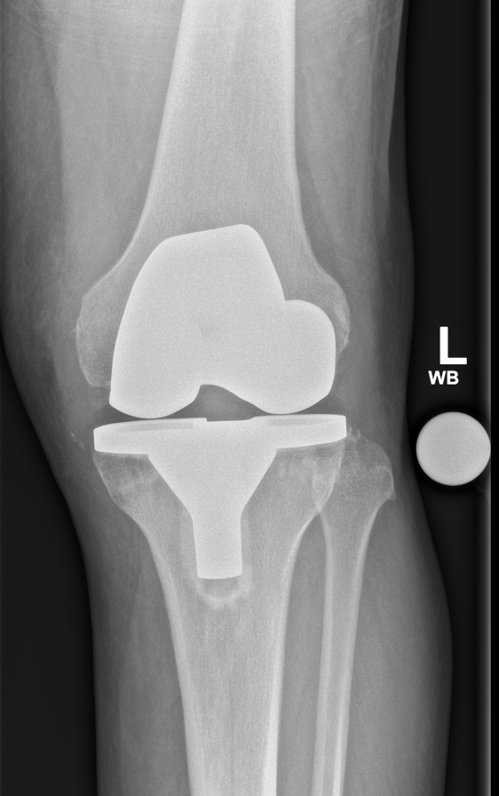 Knee_Depuy_Synthes_Sigma</td>
<td align="center" valign="top"><b>Option 1</b>  Knee_ZimmerBiomet_Oxford</td>
<td align="center" valign="top"><b>Option 2</b>  Knee_SmithAndNephew_GenesisII</td>
<td align="center" valign="top"><b>✅ Option 3</b>  Knee_Depuy_Synthes_Sigma</td>
<td align="center" valign="top"><b>Option 4</b>  Knee_SmithAndNephew_Legion2</td>
<td align="center" valign="middle"><b>Option 6</b>  <i>None of the above</i></td>
</tr></table>

### Q0947 · correct: option 1 · `Knee_Depuy_Synthes_Sigma`

<table><tr>
<td align="center" valign="top"><b>Query</b> 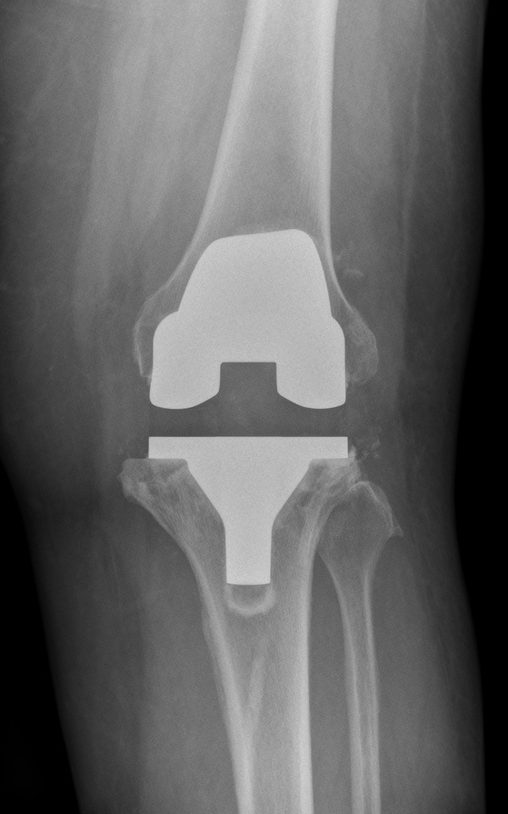 Knee_Depuy_Synthes_Sigma</td>
<td align="center" valign="top"><b>✅ Option 1</b>  Knee_Depuy_Synthes_Sigma</td>
<td align="center" valign="top"><b>Option 2</b>  Knee_SmithAndNephew_GenesisII</td>
<td align="center" valign="top"><b>Option 3</b>  Knee_ZimmerBiomet_Oxford</td>
<td align="center" valign="top"><b>Option 4</b>  Knee_SmithAndNephew_Legion2</td>
<td align="center" valign="middle"><b>Option 6</b>  <i>None of the above</i></td>
</tr></table>

### Q0948 · correct: option 1 · `Knee_Depuy_Synthes_Sigma`

<table><tr>
<td align="center" valign="top"><b>Query</b>  Knee_Depuy_Synthes_Sigma</td>
<td align="center" valign="top"><b>✅ Option 1</b>  Knee_Depuy_Synthes_Sigma</td>
<td align="center" valign="top"><b>Option 2</b>  Knee_SmithAndNephew_GenesisII</td>
<td align="center" valign="top"><b>Option 3</b>  Knee_ZimmerBiomet_Oxford</td>
<td align="center" valign="top"><b>Option 4</b>  Knee_SmithAndNephew_Legion2</td>
<td align="center" valign="middle"><b>Option 6</b>  <i>None of the above</i></td>
</tr></table>

### Q0949 · correct: option 3 · `Knee_Depuy_Synthes_Sigma`

<table><tr>
<td align="center" valign="top"><b>Query</b>  Knee_Depuy_Synthes_Sigma</td>
<td align="center" valign="top"><b>Option 1</b>  Knee_ZimmerBiomet_Oxford</td>
<td align="center" valign="top"><b>Option 2</b>  Knee_SmithAndNephew_GenesisII</td>
<td align="center" valign="top"><b>✅ Option 3</b>  Knee_Depuy_Synthes_Sigma</td>
<td align="center" valign="top"><b>Option 4</b>  Knee_SmithAndNephew_Legion2</td>
<td align="center" valign="middle"><b>Option 6</b>  <i>None of the above</i></td>
</tr></table>

### Q0950 · correct: option 2 · `Knee_Depuy_Synthes_Sigma`

<table><tr>
<td align="center" valign="top"><b>Query</b>  Knee_Depuy_Synthes_Sigma</td>
<td align="center" valign="top"><b>Option 1</b>  Knee_SmithAndNephew_GenesisII</td>
<td align="center" valign="top"><b>✅ Option 2</b>  Knee_Depuy_Synthes_Sigma</td>
<td align="center" valign="top"><b>Option 3</b>  Knee_ZimmerBiomet_Oxford</td>
<td align="center" valign="top"><b>Option 4</b>  Knee_SmithAndNephew_Legion2</td>
<td align="center" valign="middle"><b>Option 6</b>  <i>None of the above</i></td>
</tr></table>

### Q0951 · correct: option 3 · `Knee_Depuy_Synthes_Sigma`

<table><tr>
<td align="center" valign="top"><b>Query</b>  Knee_Depuy_Synthes_Sigma</td>
<td align="center" valign="top"><b>Option 1</b>  Knee_ZimmerBiomet_Oxford</td>
<td align="center" valign="top"><b>Option 2</b>  Knee_SmithAndNephew_GenesisII</td>
<td align="center" valign="top"><b>✅ Option 3</b>  Knee_Depuy_Synthes_Sigma</td>
<td align="center" valign="top"><b>Option 4</b>  Knee_SmithAndNephew_Legion2</td>
<td align="center" valign="middle"><b>Option 6</b>  <i>None of the above</i></td>
</tr></table>

### Q0952 · correct: option 4 · `Knee_Depuy_Synthes_Sigma`

<table><tr>
<td align="center" valign="top"><b>Query</b>  Knee_Depuy_Synthes_Sigma</td>
<td align="center" valign="top"><b>Option 1</b>  Knee_ZimmerBiomet_Oxford</td>
<td align="center" valign="top"><b>Option 2</b>  Knee_SmithAndNephew_Legion2</td>
<td align="center" valign="top"><b>Option 3</b>  Knee_SmithAndNephew_GenesisII</td>
<td align="center" valign="top"><b>✅ Option 4</b>  Knee_Depuy_Synthes_Sigma</td>
<td align="center" valign="middle"><b>Option 6</b>  <i>None of the above</i></td>
</tr></table>

### Q0953 · correct: option 1 · `Knee_Depuy_Synthes_Sigma`

<table><tr>
<td align="center" valign="top"><b>Query</b>  Knee_Depuy_Synthes_Sigma</td>
<td align="center" valign="top"><b>✅ Option 1</b>  Knee_Depuy_Synthes_Sigma</td>
<td align="center" valign="top"><b>Option 2</b>  Knee_SmithAndNephew_GenesisII</td>
<td align="center" valign="top"><b>Option 3</b>  Knee_SmithAndNephew_Legion2</td>
<td align="center" valign="top"><b>Option 4</b>  Knee_ZimmerBiomet_Oxford</td>
<td align="center" valign="middle"><b>Option 6</b>  <i>None of the above</i></td>
</tr></table>

### Q0954 · correct: option 1 · `Knee_Depuy_Synthes_Sigma`

<table><tr>
<td align="center" valign="top"><b>Query</b>  Knee_Depuy_Synthes_Sigma</td>
<td align="center" valign="top"><b>✅ Option 1</b>  Knee_Depuy_Synthes_Sigma</td>
<td align="center" valign="top"><b>Option 2</b>  Knee_SmithAndNephew_GenesisII</td>
<td align="center" valign="top"><b>Option 3</b>  Knee_ZimmerBiomet_Oxford</td>
<td align="center" valign="top"><b>Option 4</b>  Knee_SmithAndNephew_Legion2</td>
<td align="center" valign="middle"><b>Option 6</b>  <i>None of the above</i></td>
</tr></table>

### Q0955 · correct: option 4 · `Knee_Depuy_Synthes_Sigma`

<table><tr>
<td align="center" valign="top"><b>Query</b>  Knee_Depuy_Synthes_Sigma</td>
<td align="center" valign="top"><b>Option 1</b>  Knee_SmithAndNephew_Legion2</td>
<td align="center" valign="top"><b>Option 2</b>  Knee_ZimmerBiomet_Oxford</td>
<td align="center" valign="top"><b>Option 3</b>  Knee_SmithAndNephew_GenesisII</td>
<td align="center" valign="top"><b>✅ Option 4</b>  Knee_Depuy_Synthes_Sigma</td>
<td align="center" valign="middle"><b>Option 6</b>  <i>None of the above</i></td>
</tr></table>

### Q0956 · correct: option 4 · `Knee_SmithAndNephew_GenesisII`

<table><tr>
<td align="center" valign="top"><b>Query</b>  Knee_SmithAndNephew_GenesisII</td>
<td align="center" valign="top"><b>Option 1</b>  Knee_ZimmerBiomet_Oxford</td>
<td align="center" valign="top"><b>Option 2</b>  Knee_SmithAndNephew_Legion2</td>
<td align="center" valign="top"><b>Option 3</b>  Knee_Depuy_Synthes_Sigma</td>
<td align="center" valign="top"><b>✅ Option 4</b>  Knee_SmithAndNephew_GenesisII</td>
<td align="center" valign="middle"><b>Option 6</b>  <i>None of the above</i></td>
</tr></table>

### Q0957 · correct: option 2 · `Knee_SmithAndNephew_GenesisII`

<table><tr>
<td align="center" valign="top"><b>Query</b>  Knee_SmithAndNephew_GenesisII</td>
<td align="center" valign="top"><b>Option 1</b>  Knee_SmithAndNephew_Legion2</td>
<td align="center" valign="top"><b>✅ Option 2</b>  Knee_SmithAndNephew_GenesisII</td>
<td align="center" valign="top"><b>Option 3</b>  Knee_ZimmerBiomet_Oxford</td>
<td align="center" valign="top"><b>Option 4</b>  Knee_Depuy_Synthes_Sigma</td>
<td align="center" valign="middle"><b>Option 6</b>  <i>None of the above</i></td>
</tr></table>

### Q0958 · correct: option 2 · `Knee_SmithAndNephew_GenesisII`

<table><tr>
<td align="center" valign="top"><b>Query</b>  Knee_SmithAndNephew_GenesisII</td>
<td align="center" valign="top"><b>Option 1</b>  Knee_ZimmerBiomet_Oxford</td>
<td align="center" valign="top"><b>✅ Option 2</b>  Knee_SmithAndNephew_GenesisII</td>
<td align="center" valign="top"><b>Option 3</b>  Knee_SmithAndNephew_Legion2</td>
<td align="center" valign="top"><b>Option 4</b>  Knee_Depuy_Synthes_Sigma</td>
<td align="center" valign="middle"><b>Option 6</b>  <i>None of the above</i></td>
</tr></table>

### Q0959 · correct: option 3 · `Knee_SmithAndNephew_GenesisII`

<table><tr>
<td align="center" valign="top"><b>Query</b>  Knee_SmithAndNephew_GenesisII</td>
<td align="center" valign="top"><b>Option 1</b>  Knee_ZimmerBiomet_Oxford</td>
<td align="center" valign="top"><b>Option 2</b>  Knee_SmithAndNephew_Legion2</td>
<td align="center" valign="top"><b>✅ Option 3</b>  Knee_SmithAndNephew_GenesisII</td>
<td align="center" valign="top"><b>Option 4</b>  Knee_Depuy_Synthes_Sigma</td>
<td align="center" valign="middle"><b>Option 6</b>  <i>None of the above</i></td>
</tr></table>

### Q0960 · correct: option 3 · `Knee_SmithAndNephew_GenesisII`

<table><tr>
<td align="center" valign="top"><b>Query</b>  Knee_SmithAndNephew_GenesisII</td>
<td align="center" valign="top"><b>Option 1</b>  Knee_Depuy_Synthes_Sigma</td>
<td align="center" valign="top"><b>Option 2</b>  Knee_SmithAndNephew_Legion2</td>
<td align="center" valign="top"><b>✅ Option 3</b>  Knee_SmithAndNephew_GenesisII</td>
<td align="center" valign="top"><b>Option 4</b>  Knee_ZimmerBiomet_Oxford</td>
<td align="center" valign="middle"><b>Option 6</b>  <i>None of the above</i></td>
</tr></table>

