# OrthoNet knee · query set `test` · page 2/2

[← all pages](README.md)

### Q0961 · correct: option 1 · `Knee_SmithAndNephew_GenesisII`

<table><tr>
<td align="center" valign="top"><b>Query</b> 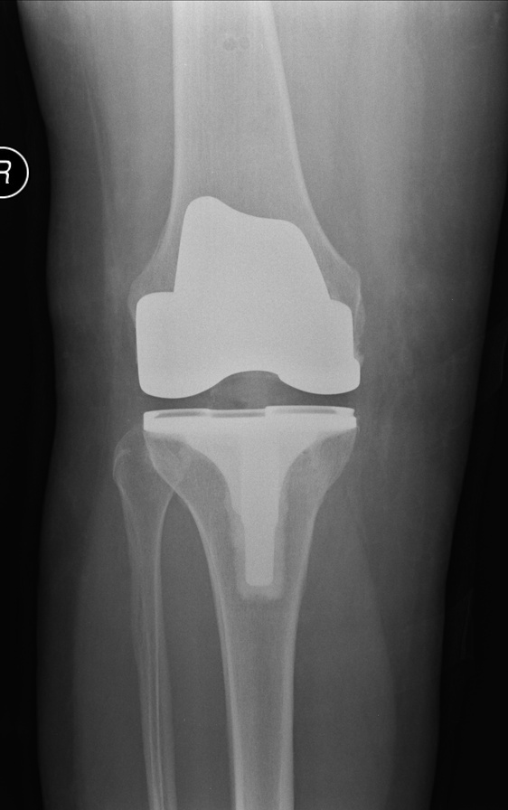 Knee_SmithAndNephew_GenesisII</td>
<td align="center" valign="top"><b>✅ Option 1</b> 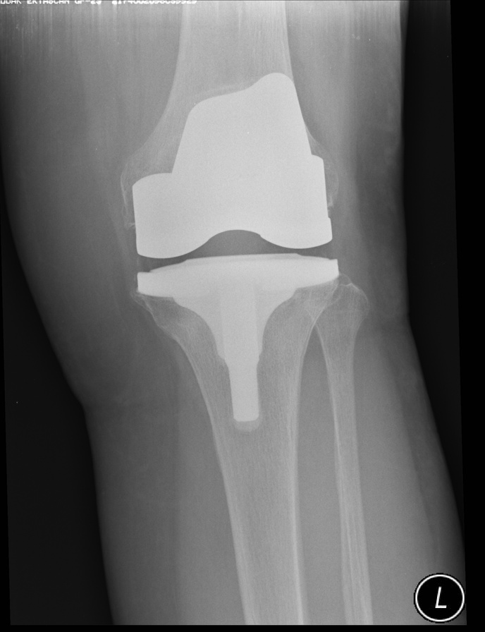 Knee_SmithAndNephew_GenesisII</td>
<td align="center" valign="top"><b>Option 2</b> 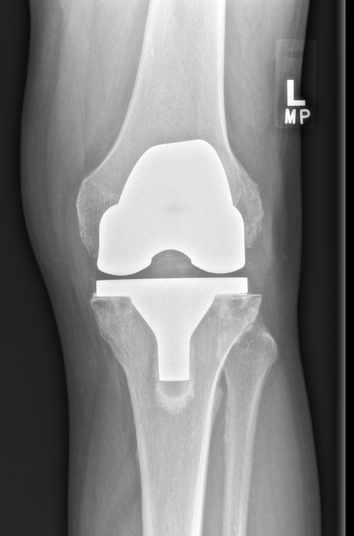 Knee_Depuy_Synthes_Sigma</td>
<td align="center" valign="top"><b>Option 3</b> 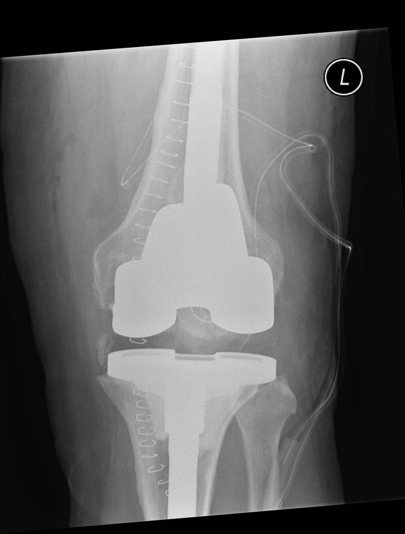 Knee_SmithAndNephew_Legion2</td>
<td align="center" valign="top"><b>Option 4</b> 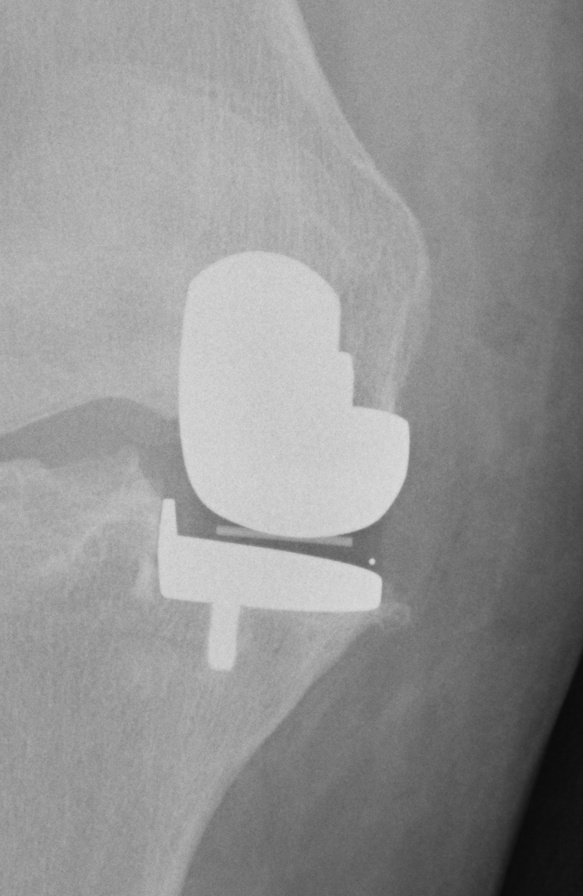 Knee_ZimmerBiomet_Oxford</td>
<td align="center" valign="middle"><b>Option 6</b>  <i>None of the above</i></td>
</tr></table>

### Q0962 · correct: option 3 · `Knee_SmithAndNephew_GenesisII`

<table><tr>
<td align="center" valign="top"><b>Query</b> 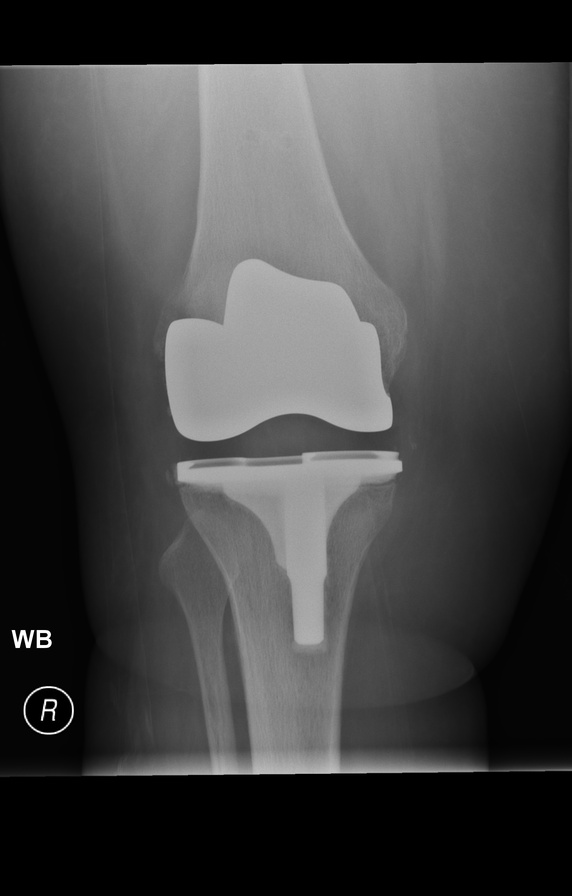 Knee_SmithAndNephew_GenesisII</td>
<td align="center" valign="top"><b>Option 1</b>  Knee_ZimmerBiomet_Oxford</td>
<td align="center" valign="top"><b>Option 2</b>  Knee_Depuy_Synthes_Sigma</td>
<td align="center" valign="top"><b>✅ Option 3</b>  Knee_SmithAndNephew_GenesisII</td>
<td align="center" valign="top"><b>Option 4</b>  Knee_SmithAndNephew_Legion2</td>
<td align="center" valign="middle"><b>Option 6</b>  <i>None of the above</i></td>
</tr></table>

### Q0963 · correct: option 1 · `Knee_SmithAndNephew_GenesisII`

<table><tr>
<td align="center" valign="top"><b>Query</b> 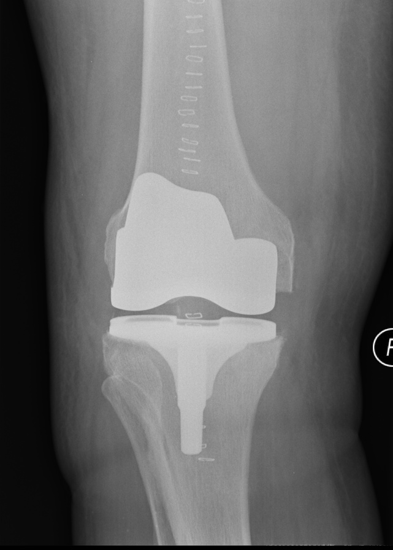 Knee_SmithAndNephew_GenesisII</td>
<td align="center" valign="top"><b>✅ Option 1</b>  Knee_SmithAndNephew_GenesisII</td>
<td align="center" valign="top"><b>Option 2</b>  Knee_ZimmerBiomet_Oxford</td>
<td align="center" valign="top"><b>Option 3</b>  Knee_Depuy_Synthes_Sigma</td>
<td align="center" valign="top"><b>Option 4</b>  Knee_SmithAndNephew_Legion2</td>
<td align="center" valign="middle"><b>Option 6</b>  <i>None of the above</i></td>
</tr></table>

### Q0964 · correct: option 2 · `Knee_SmithAndNephew_GenesisII`

<table><tr>
<td align="center" valign="top"><b>Query</b> 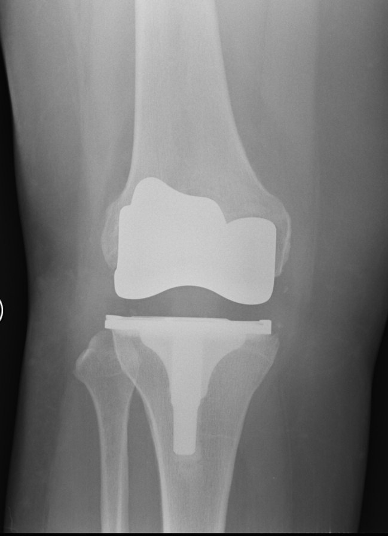 Knee_SmithAndNephew_GenesisII</td>
<td align="center" valign="top"><b>Option 1</b>  Knee_Depuy_Synthes_Sigma</td>
<td align="center" valign="top"><b>✅ Option 2</b>  Knee_SmithAndNephew_GenesisII</td>
<td align="center" valign="top"><b>Option 3</b> 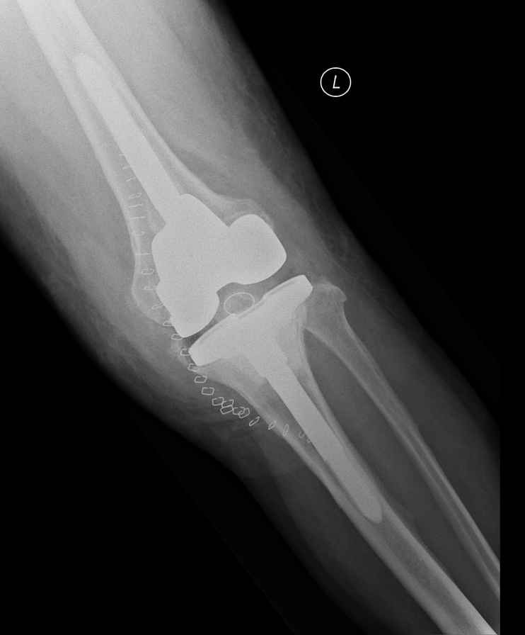 Knee_SmithAndNephew_Legion2</td>
<td align="center" valign="top"><b>Option 4</b>  Knee_ZimmerBiomet_Oxford</td>
<td align="center" valign="middle"><b>Option 6</b>  <i>None of the above</i></td>
</tr></table>

### Q0965 · correct: option 3 · `Knee_SmithAndNephew_GenesisII`

<table><tr>
<td align="center" valign="top"><b>Query</b> 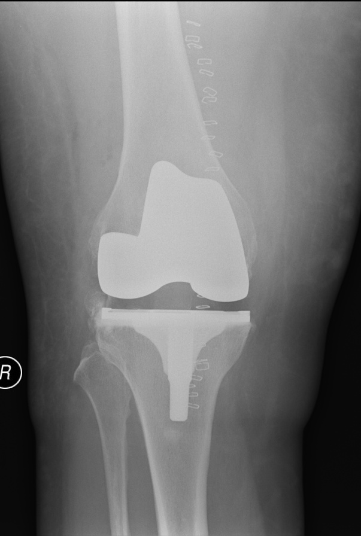 Knee_SmithAndNephew_GenesisII</td>
<td align="center" valign="top"><b>Option 1</b> 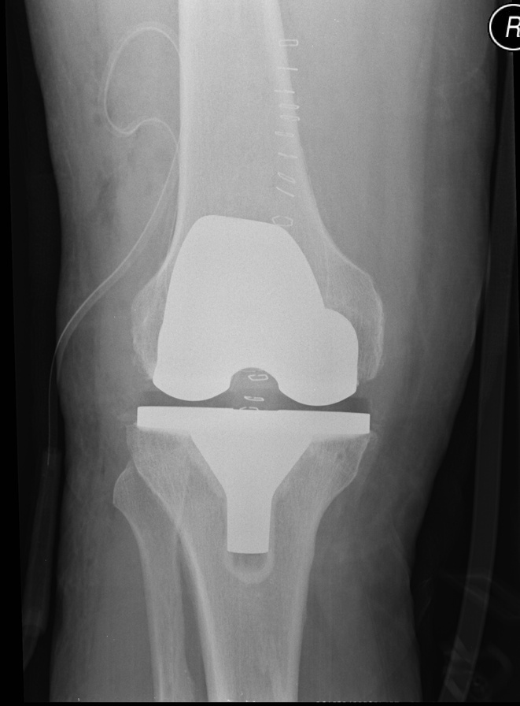 Knee_Depuy_Synthes_Sigma</td>
<td align="center" valign="top"><b>Option 2</b>  Knee_ZimmerBiomet_Oxford</td>
<td align="center" valign="top"><b>✅ Option 3</b>  Knee_SmithAndNephew_GenesisII</td>
<td align="center" valign="top"><b>Option 4</b>  Knee_SmithAndNephew_Legion2</td>
<td align="center" valign="middle"><b>Option 6</b>  <i>None of the above</i></td>
</tr></table>

### Q0966 · correct: option 4 · `Knee_SmithAndNephew_GenesisII`

<table><tr>
<td align="center" valign="top"><b>Query</b> 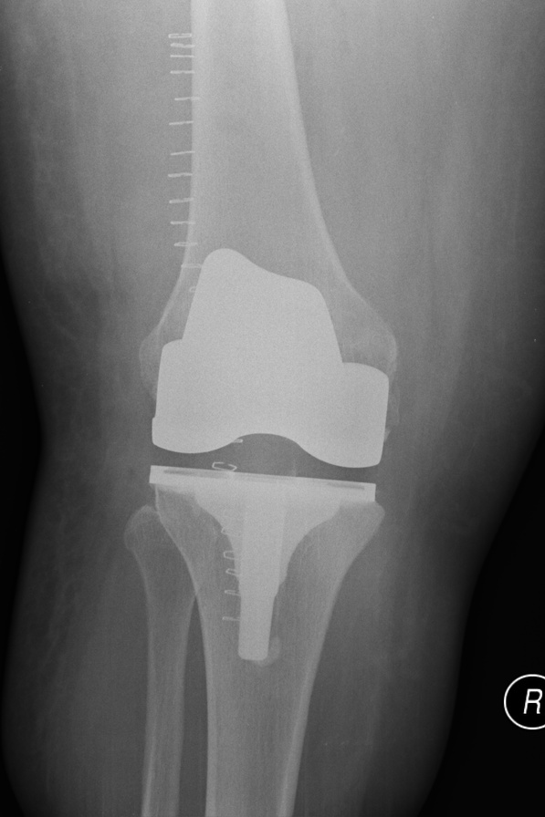 Knee_SmithAndNephew_GenesisII</td>
<td align="center" valign="top"><b>Option 1</b>  Knee_ZimmerBiomet_Oxford</td>
<td align="center" valign="top"><b>Option 2</b>  Knee_SmithAndNephew_Legion2</td>
<td align="center" valign="top"><b>Option 3</b>  Knee_Depuy_Synthes_Sigma</td>
<td align="center" valign="top"><b>✅ Option 4</b> 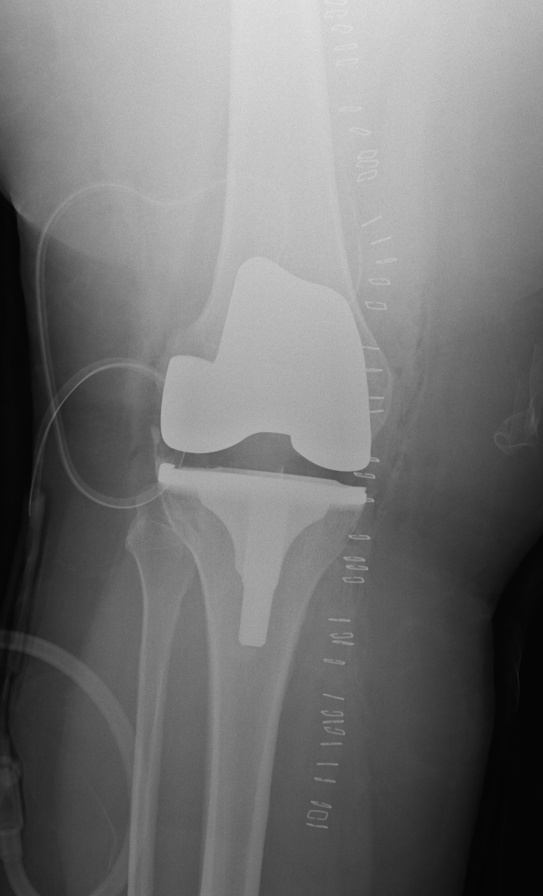 Knee_SmithAndNephew_GenesisII</td>
<td align="center" valign="middle"><b>Option 6</b>  <i>None of the above</i></td>
</tr></table>

### Q0967 · correct: option 2 · `Knee_SmithAndNephew_GenesisII`

<table><tr>
<td align="center" valign="top"><b>Query</b> 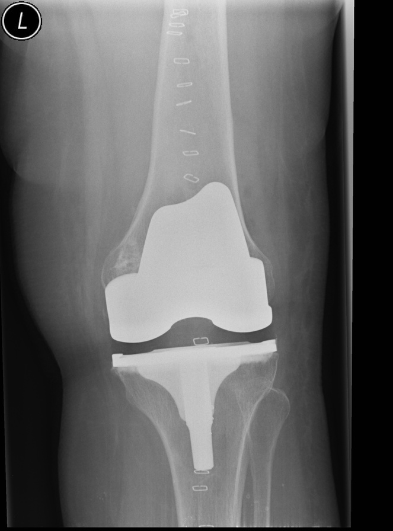 Knee_SmithAndNephew_GenesisII</td>
<td align="center" valign="top"><b>Option 1</b>  Knee_Depuy_Synthes_Sigma</td>
<td align="center" valign="top"><b>✅ Option 2</b>  Knee_SmithAndNephew_GenesisII</td>
<td align="center" valign="top"><b>Option 3</b>  Knee_ZimmerBiomet_Oxford</td>
<td align="center" valign="top"><b>Option 4</b>  Knee_SmithAndNephew_Legion2</td>
<td align="center" valign="middle"><b>Option 6</b>  <i>None of the above</i></td>
</tr></table>

### Q0968 · correct: option 4 · `Knee_SmithAndNephew_GenesisII`

<table><tr>
<td align="center" valign="top"><b>Query</b> 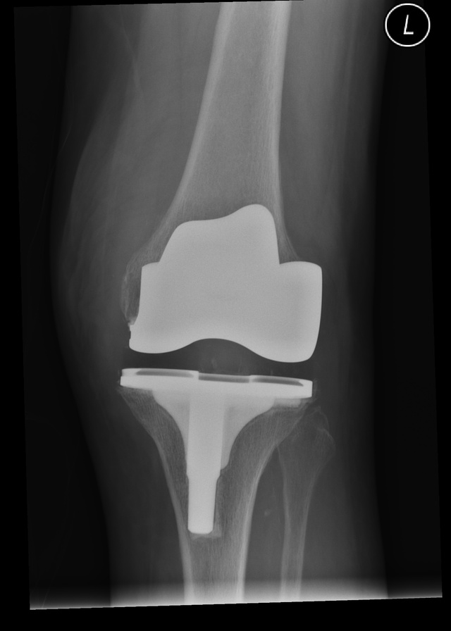 Knee_SmithAndNephew_GenesisII</td>
<td align="center" valign="top"><b>Option 1</b>  Knee_Depuy_Synthes_Sigma</td>
<td align="center" valign="top"><b>Option 2</b>  Knee_SmithAndNephew_Legion2</td>
<td align="center" valign="top"><b>Option 3</b>  Knee_ZimmerBiomet_Oxford</td>
<td align="center" valign="top"><b>✅ Option 4</b> 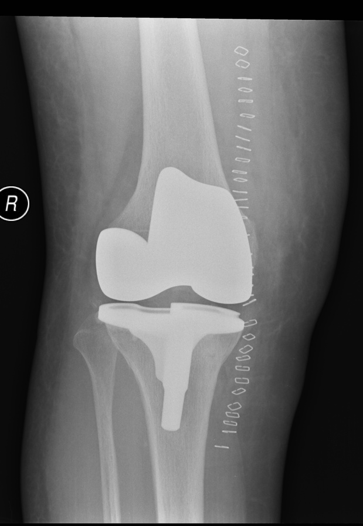 Knee_SmithAndNephew_GenesisII</td>
<td align="center" valign="middle"><b>Option 6</b>  <i>None of the above</i></td>
</tr></table>

### Q0969 · correct: option 1 · `Knee_SmithAndNephew_GenesisII`

<table><tr>
<td align="center" valign="top"><b>Query</b> 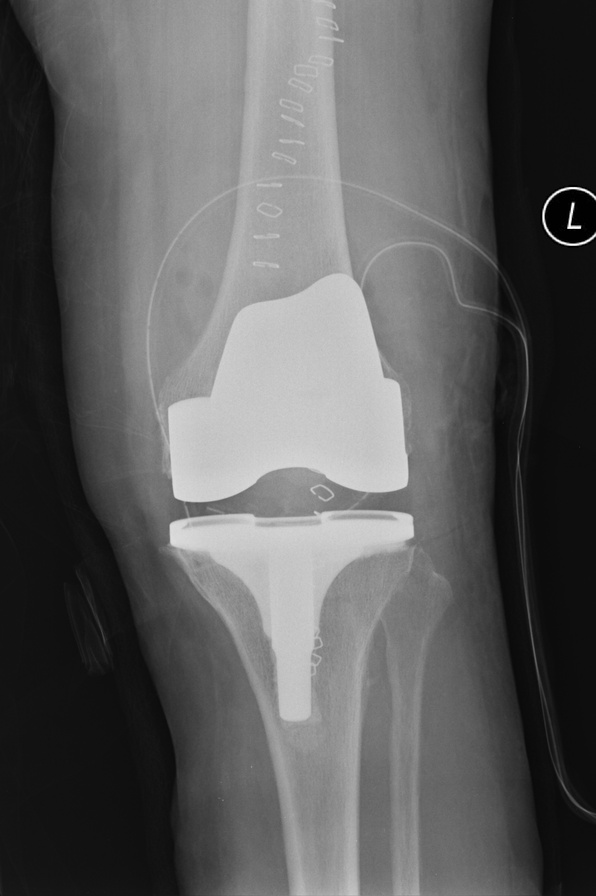 Knee_SmithAndNephew_GenesisII</td>
<td align="center" valign="top"><b>✅ Option 1</b> 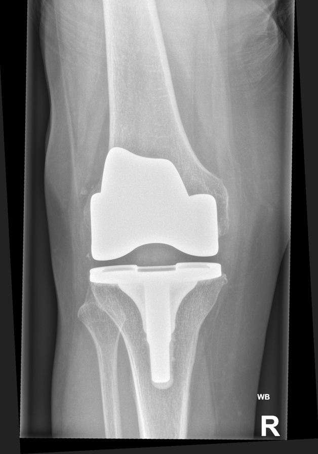 Knee_SmithAndNephew_GenesisII</td>
<td align="center" valign="top"><b>Option 2</b>  Knee_SmithAndNephew_Legion2</td>
<td align="center" valign="top"><b>Option 3</b>  Knee_Depuy_Synthes_Sigma</td>
<td align="center" valign="top"><b>Option 4</b>  Knee_ZimmerBiomet_Oxford</td>
<td align="center" valign="middle"><b>Option 6</b>  <i>None of the above</i></td>
</tr></table>

### Q0970 · correct: option 2 · `Knee_SmithAndNephew_GenesisII`

<table><tr>
<td align="center" valign="top"><b>Query</b> 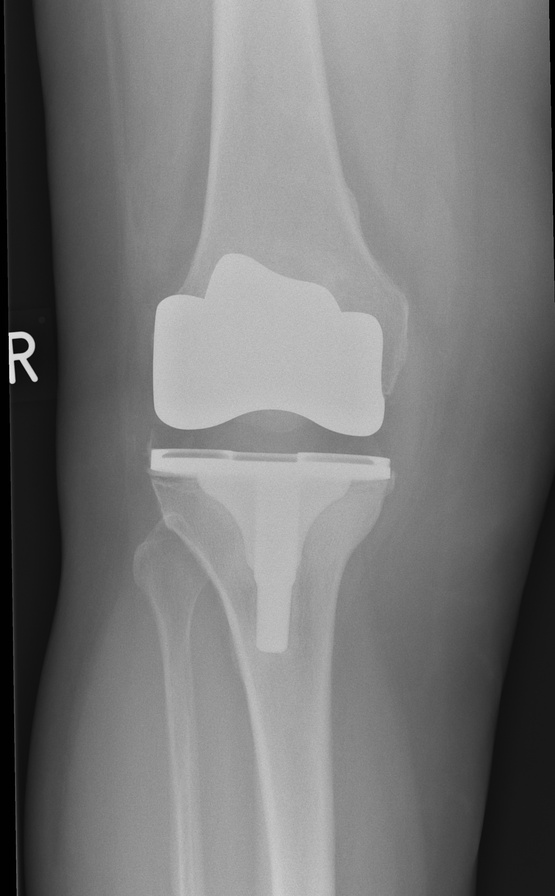 Knee_SmithAndNephew_GenesisII</td>
<td align="center" valign="top"><b>Option 1</b>  Knee_Depuy_Synthes_Sigma</td>
<td align="center" valign="top"><b>✅ Option 2</b>  Knee_SmithAndNephew_GenesisII</td>
<td align="center" valign="top"><b>Option 3</b>  Knee_SmithAndNephew_Legion2</td>
<td align="center" valign="top"><b>Option 4</b>  Knee_ZimmerBiomet_Oxford</td>
<td align="center" valign="middle"><b>Option 6</b>  <i>None of the above</i></td>
</tr></table>

