# OrthoNet knee · query set `train1` · page 1/2

[← all pages](README.md)

### Q0971 · correct: option 2 · `Knee_SmithAndNephew_GenesisII`

<table><tr>
<td align="center" valign="top"><b>Query</b> 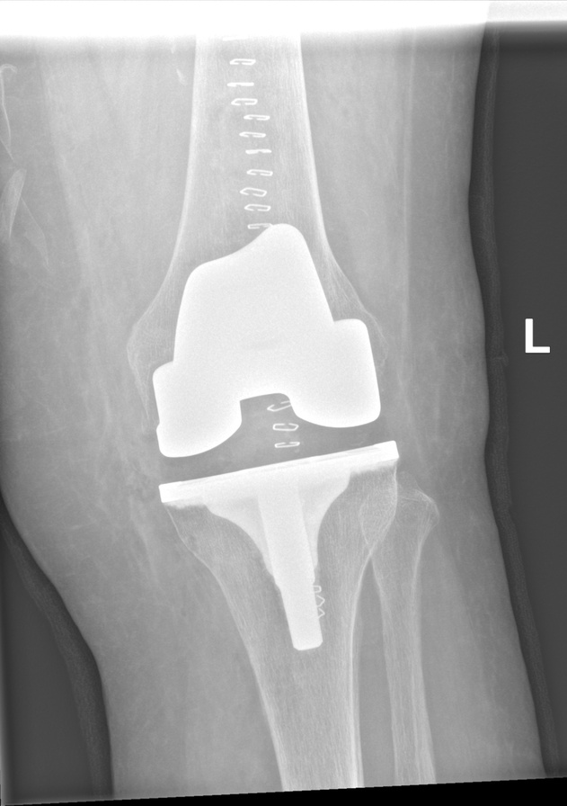 Knee_SmithAndNephew_GenesisII</td>
<td align="center" valign="top"><b>Option 1</b> 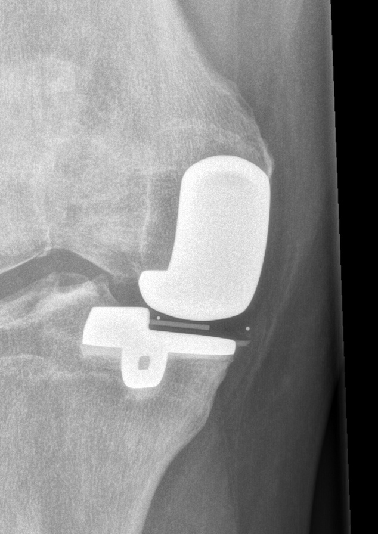 Knee_ZimmerBiomet_Oxford</td>
<td align="center" valign="top"><b>✅ Option 2</b> 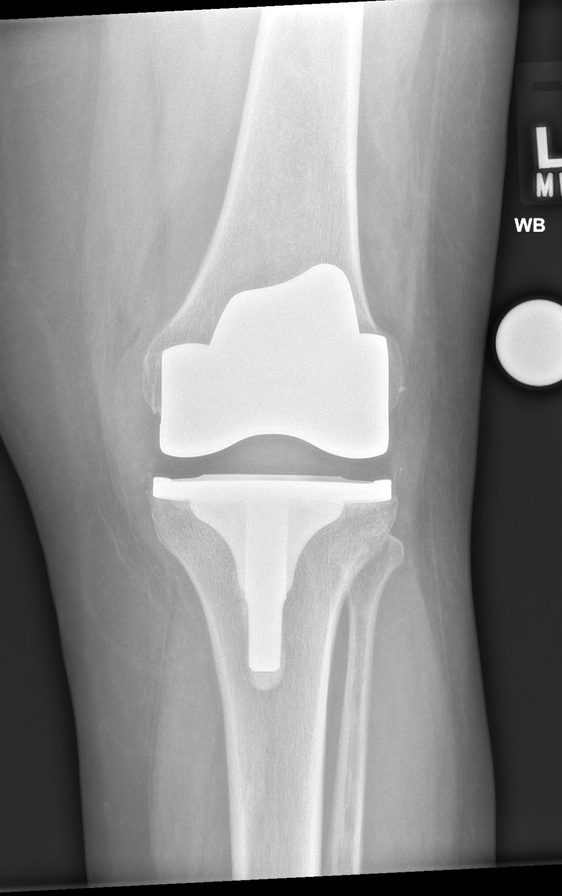 Knee_SmithAndNephew_GenesisII</td>
<td align="center" valign="top"><b>Option 3</b> 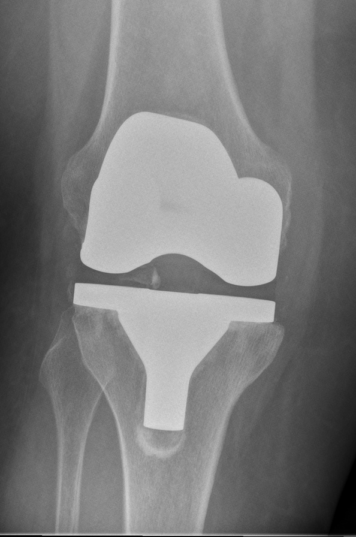 Knee_Depuy_Synthes_Sigma</td>
<td align="center" valign="top"><b>Option 4</b>  Knee_SmithAndNephew_Legion2</td>
<td align="center" valign="middle"><b>Option 6</b>  <i>None of the above</i></td>
</tr></table>

### Q0972 · correct: option 4 · `Knee_SmithAndNephew_GenesisII`

<table><tr>
<td align="center" valign="top"><b>Query</b> 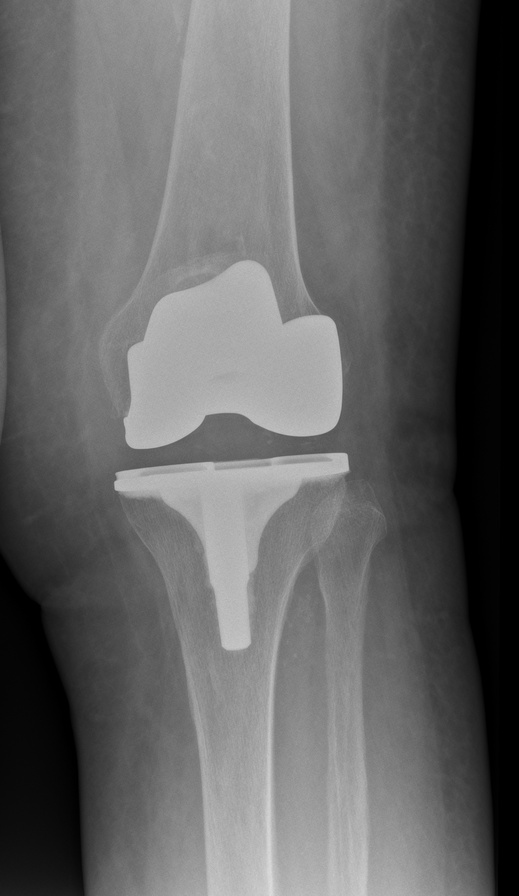 Knee_SmithAndNephew_GenesisII</td>
<td align="center" valign="top"><b>Option 1</b>  Knee_SmithAndNephew_Legion2</td>
<td align="center" valign="top"><b>Option 2</b>  Knee_ZimmerBiomet_Oxford</td>
<td align="center" valign="top"><b>Option 3</b>  Knee_Depuy_Synthes_Sigma</td>
<td align="center" valign="top"><b>✅ Option 4</b>  Knee_SmithAndNephew_GenesisII</td>
<td align="center" valign="middle"><b>Option 6</b>  <i>None of the above</i></td>
</tr></table>

### Q0973 · correct: option 2 · `Knee_SmithAndNephew_GenesisII`

<table><tr>
<td align="center" valign="top"><b>Query</b> 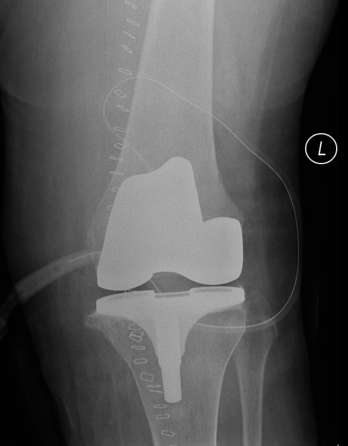 Knee_SmithAndNephew_GenesisII</td>
<td align="center" valign="top"><b>Option 1</b>  Knee_Depuy_Synthes_Sigma</td>
<td align="center" valign="top"><b>✅ Option 2</b>  Knee_SmithAndNephew_GenesisII</td>
<td align="center" valign="top"><b>Option 3</b>  Knee_ZimmerBiomet_Oxford</td>
<td align="center" valign="top"><b>Option 4</b>  Knee_SmithAndNephew_Legion2</td>
<td align="center" valign="middle"><b>Option 6</b>  <i>None of the above</i></td>
</tr></table>

### Q0974 · correct: option 4 · `Knee_SmithAndNephew_GenesisII`

<table><tr>
<td align="center" valign="top"><b>Query</b> 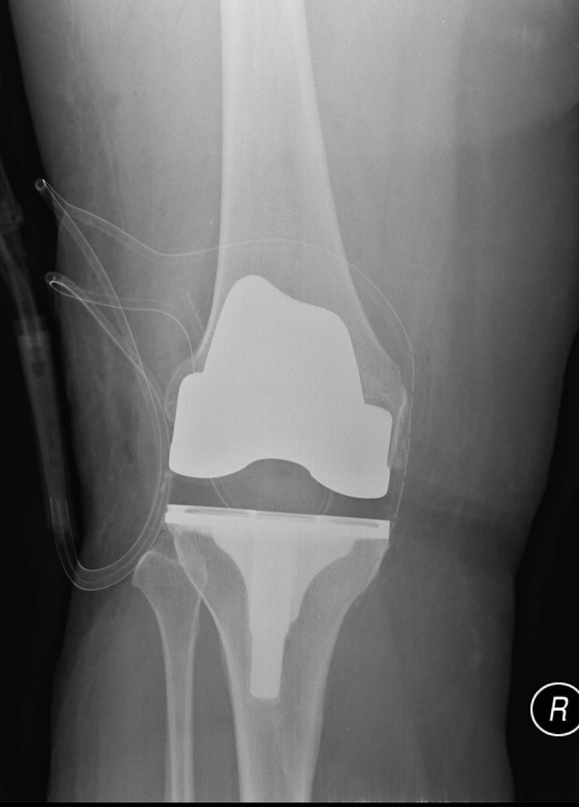 Knee_SmithAndNephew_GenesisII</td>
<td align="center" valign="top"><b>Option 1</b> 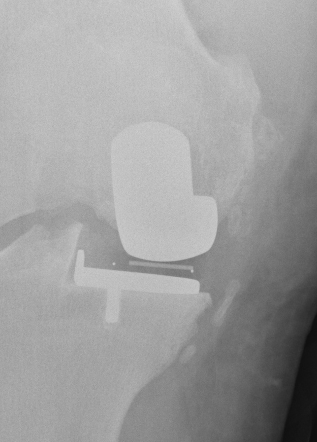 Knee_ZimmerBiomet_Oxford</td>
<td align="center" valign="top"><b>Option 2</b>  Knee_Depuy_Synthes_Sigma</td>
<td align="center" valign="top"><b>Option 3</b>  Knee_SmithAndNephew_Legion2</td>
<td align="center" valign="top"><b>✅ Option 4</b> 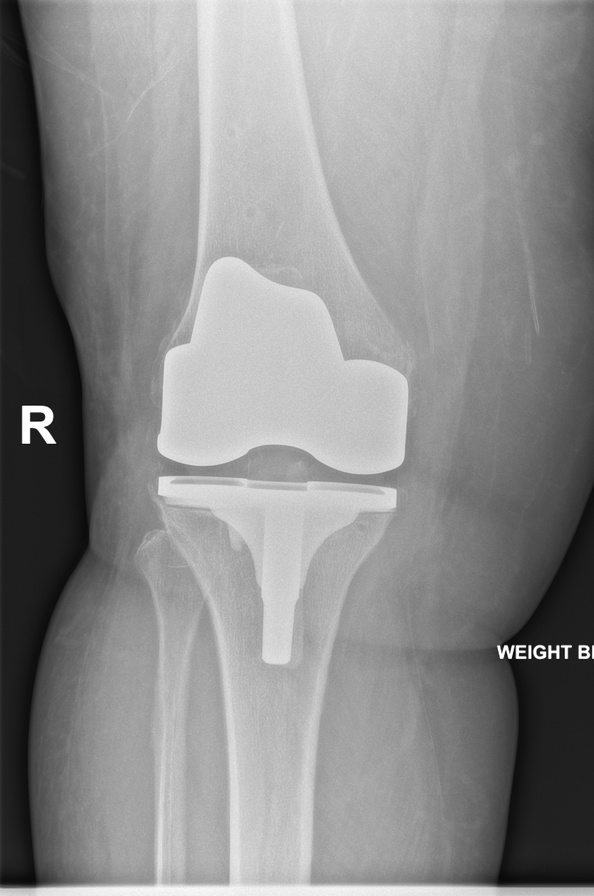 Knee_SmithAndNephew_GenesisII</td>
<td align="center" valign="middle"><b>Option 6</b>  <i>None of the above</i></td>
</tr></table>

### Q0975 · correct: option 4 · `Knee_SmithAndNephew_GenesisII`

<table><tr>
<td align="center" valign="top"><b>Query</b> 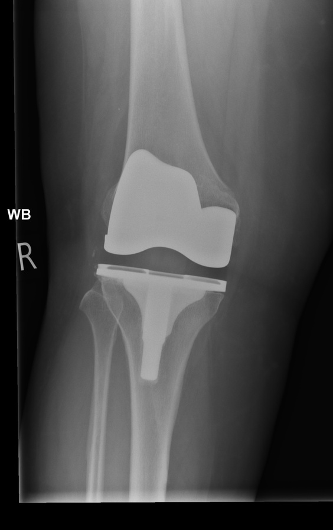 Knee_SmithAndNephew_GenesisII</td>
<td align="center" valign="top"><b>Option 1</b>  Knee_ZimmerBiomet_Oxford</td>
<td align="center" valign="top"><b>Option 2</b>  Knee_Depuy_Synthes_Sigma</td>
<td align="center" valign="top"><b>Option 3</b>  Knee_SmithAndNephew_Legion2</td>
<td align="center" valign="top"><b>✅ Option 4</b>  Knee_SmithAndNephew_GenesisII</td>
<td align="center" valign="middle"><b>Option 6</b>  <i>None of the above</i></td>
</tr></table>

### Q0976 · correct: option 2 · `Knee_SmithAndNephew_GenesisII`

<table><tr>
<td align="center" valign="top"><b>Query</b> 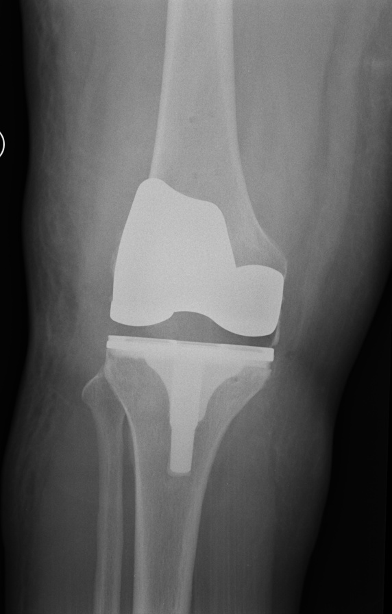 Knee_SmithAndNephew_GenesisII</td>
<td align="center" valign="top"><b>Option 1</b>  Knee_SmithAndNephew_Legion2</td>
<td align="center" valign="top"><b>✅ Option 2</b>  Knee_SmithAndNephew_GenesisII</td>
<td align="center" valign="top"><b>Option 3</b>  Knee_ZimmerBiomet_Oxford</td>
<td align="center" valign="top"><b>Option 4</b>  Knee_Depuy_Synthes_Sigma</td>
<td align="center" valign="middle"><b>Option 6</b>  <i>None of the above</i></td>
</tr></table>

### Q0977 · correct: option 3 · `Knee_Depuy_Synthes_Sigma`

<table><tr>
<td align="center" valign="top"><b>Query</b> 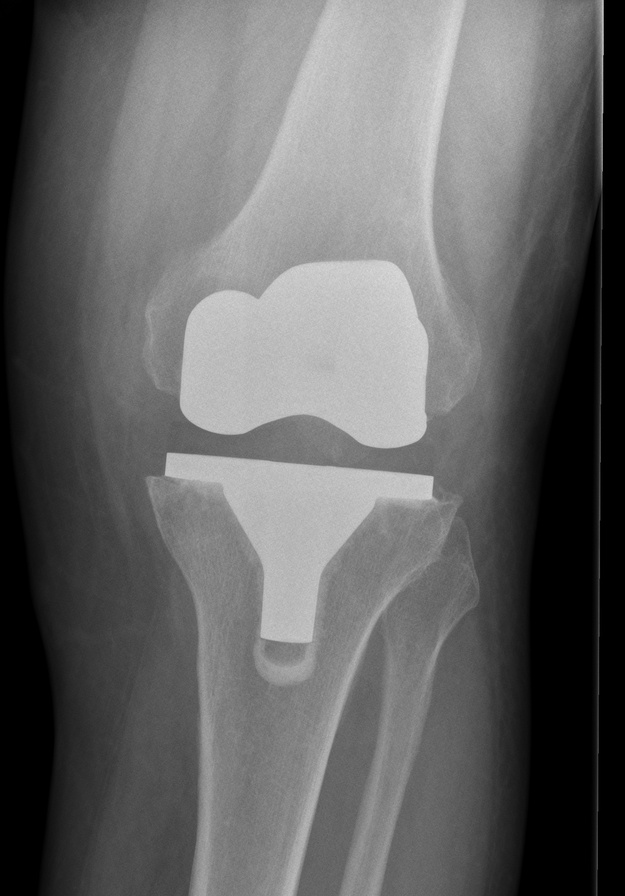 Knee_Depuy_Synthes_Sigma</td>
<td align="center" valign="top"><b>Option 1</b>  Knee_ZimmerBiomet_Oxford</td>
<td align="center" valign="top"><b>Option 2</b>  Knee_SmithAndNephew_GenesisII</td>
<td align="center" valign="top"><b>✅ Option 3</b>  Knee_Depuy_Synthes_Sigma</td>
<td align="center" valign="top"><b>Option 4</b>  Knee_SmithAndNephew_Legion2</td>
<td align="center" valign="middle"><b>Option 6</b>  <i>None of the above</i></td>
</tr></table>

### Q0978 · correct: option 1 · `Knee_Depuy_Synthes_Sigma`

<table><tr>
<td align="center" valign="top"><b>Query</b> 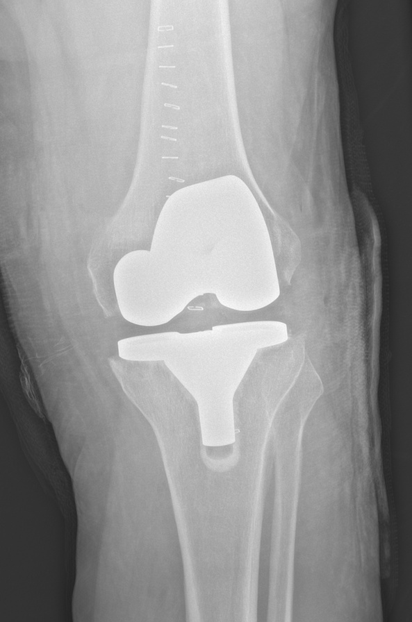 Knee_Depuy_Synthes_Sigma</td>
<td align="center" valign="top"><b>✅ Option 1</b>  Knee_Depuy_Synthes_Sigma</td>
<td align="center" valign="top"><b>Option 2</b>  Knee_ZimmerBiomet_Oxford</td>
<td align="center" valign="top"><b>Option 3</b>  Knee_SmithAndNephew_GenesisII</td>
<td align="center" valign="top"><b>Option 4</b>  Knee_SmithAndNephew_Legion2</td>
<td align="center" valign="middle"><b>Option 6</b>  <i>None of the above</i></td>
</tr></table>

### Q0979 · correct: option 1 · `Knee_SmithAndNephew_GenesisII`

<table><tr>
<td align="center" valign="top"><b>Query</b> 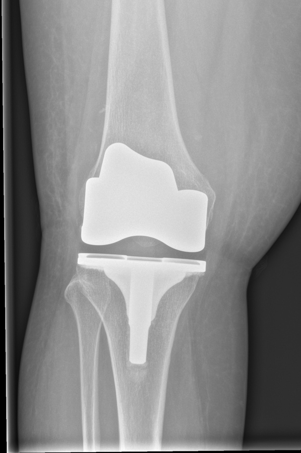 Knee_SmithAndNephew_GenesisII</td>
<td align="center" valign="top"><b>✅ Option 1</b>  Knee_SmithAndNephew_GenesisII</td>
<td align="center" valign="top"><b>Option 2</b>  Knee_Depuy_Synthes_Sigma</td>
<td align="center" valign="top"><b>Option 3</b>  Knee_ZimmerBiomet_Oxford</td>
<td align="center" valign="top"><b>Option 4</b>  Knee_SmithAndNephew_Legion2</td>
<td align="center" valign="middle"><b>Option 6</b>  <i>None of the above</i></td>
</tr></table>

### Q0980 · correct: option 2 · `Knee_SmithAndNephew_GenesisII`

<table><tr>
<td align="center" valign="top"><b>Query</b> 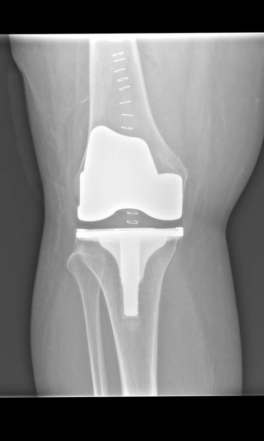 Knee_SmithAndNephew_GenesisII</td>
<td align="center" valign="top"><b>Option 1</b>  Knee_SmithAndNephew_Legion2</td>
<td align="center" valign="top"><b>✅ Option 2</b>  Knee_SmithAndNephew_GenesisII</td>
<td align="center" valign="top"><b>Option 3</b>  Knee_ZimmerBiomet_Oxford</td>
<td align="center" valign="top"><b>Option 4</b>  Knee_Depuy_Synthes_Sigma</td>
<td align="center" valign="middle"><b>Option 6</b>  <i>None of the above</i></td>
</tr></table>

### Q0981 · correct: option 4 · `Knee_Depuy_Synthes_Sigma`

<table><tr>
<td align="center" valign="top"><b>Query</b> 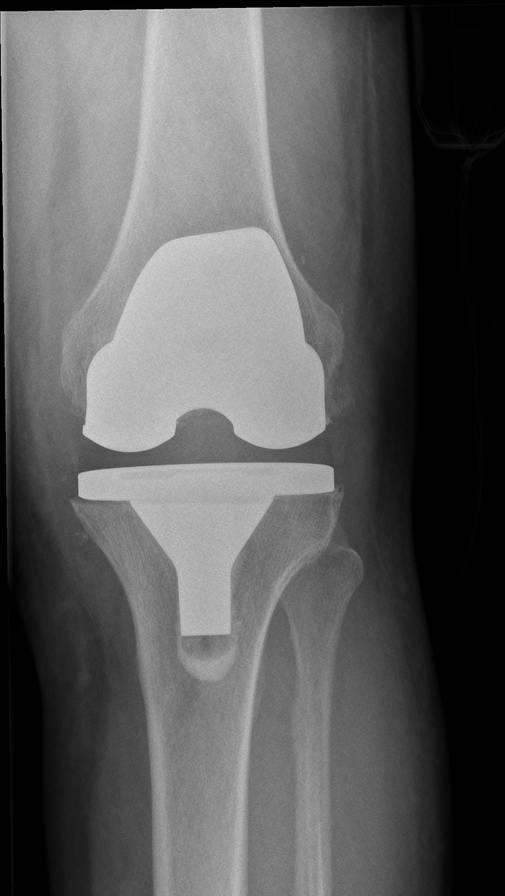 Knee_Depuy_Synthes_Sigma</td>
<td align="center" valign="top"><b>Option 1</b>  Knee_SmithAndNephew_Legion2</td>
<td align="center" valign="top"><b>Option 2</b>  Knee_ZimmerBiomet_Oxford</td>
<td align="center" valign="top"><b>Option 3</b>  Knee_SmithAndNephew_GenesisII</td>
<td align="center" valign="top"><b>✅ Option 4</b>  Knee_Depuy_Synthes_Sigma</td>
<td align="center" valign="middle"><b>Option 6</b>  <i>None of the above</i></td>
</tr></table>

### Q0982 · correct: option 3 · `Knee_Depuy_Synthes_Sigma`

<table><tr>
<td align="center" valign="top"><b>Query</b> 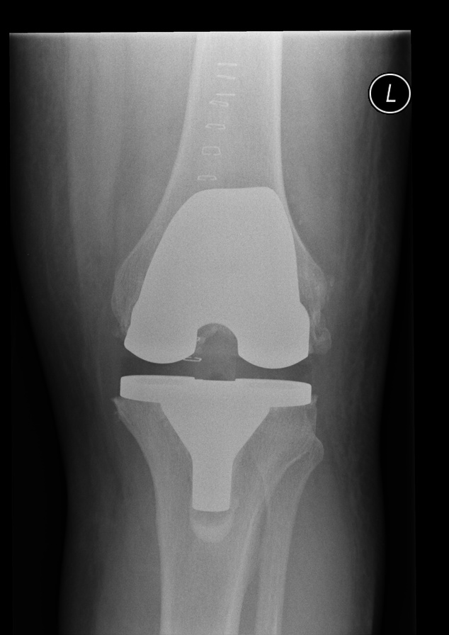 Knee_Depuy_Synthes_Sigma</td>
<td align="center" valign="top"><b>Option 1</b>  Knee_ZimmerBiomet_Oxford</td>
<td align="center" valign="top"><b>Option 2</b>  Knee_SmithAndNephew_GenesisII</td>
<td align="center" valign="top"><b>✅ Option 3</b> 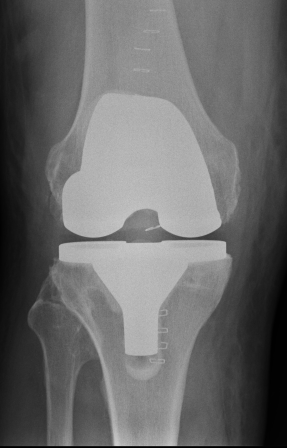 Knee_Depuy_Synthes_Sigma</td>
<td align="center" valign="top"><b>Option 4</b>  Knee_SmithAndNephew_Legion2</td>
<td align="center" valign="middle"><b>Option 6</b>  <i>None of the above</i></td>
</tr></table>

### Q0983 · correct: option 2 · `Knee_Depuy_Synthes_Sigma`

<table><tr>
<td align="center" valign="top"><b>Query</b> 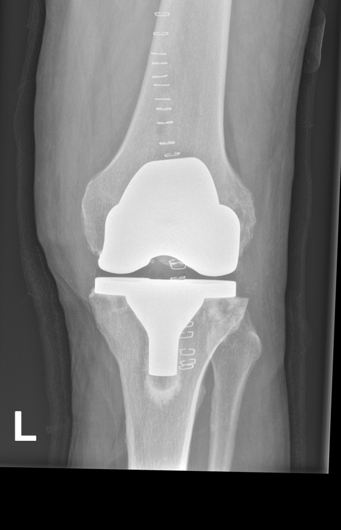 Knee_Depuy_Synthes_Sigma</td>
<td align="center" valign="top"><b>Option 1</b>  Knee_SmithAndNephew_Legion2</td>
<td align="center" valign="top"><b>✅ Option 2</b>  Knee_Depuy_Synthes_Sigma</td>
<td align="center" valign="top"><b>Option 3</b>  Knee_ZimmerBiomet_Oxford</td>
<td align="center" valign="top"><b>Option 4</b>  Knee_SmithAndNephew_GenesisII</td>
<td align="center" valign="middle"><b>Option 6</b>  <i>None of the above</i></td>
</tr></table>

### Q0984 · correct: option 4 · `Knee_Depuy_Synthes_Sigma`

<table><tr>
<td align="center" valign="top"><b>Query</b> 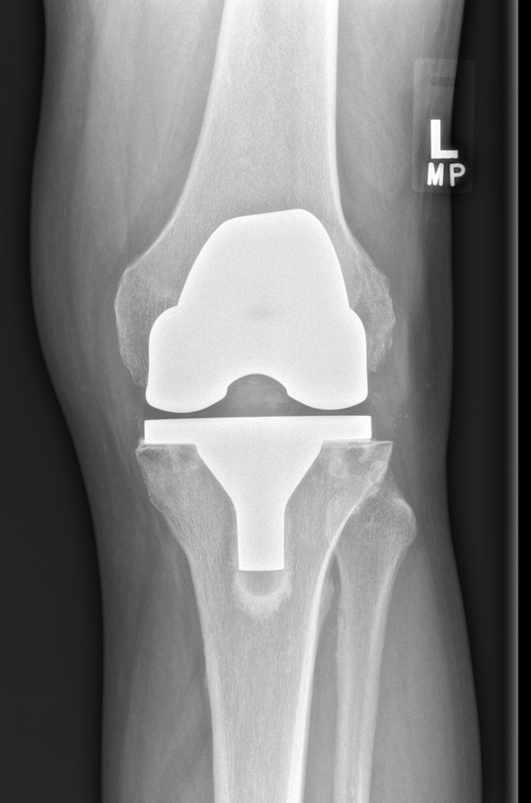 Knee_Depuy_Synthes_Sigma</td>
<td align="center" valign="top"><b>Option 1</b>  Knee_SmithAndNephew_GenesisII</td>
<td align="center" valign="top"><b>Option 2</b>  Knee_ZimmerBiomet_Oxford</td>
<td align="center" valign="top"><b>Option 3</b>  Knee_SmithAndNephew_Legion2</td>
<td align="center" valign="top"><b>✅ Option 4</b>  Knee_Depuy_Synthes_Sigma</td>
<td align="center" valign="middle"><b>Option 6</b>  <i>None of the above</i></td>
</tr></table>

### Q0985 · correct: option 1 · `Knee_Depuy_Synthes_Sigma`

<table><tr>
<td align="center" valign="top"><b>Query</b> 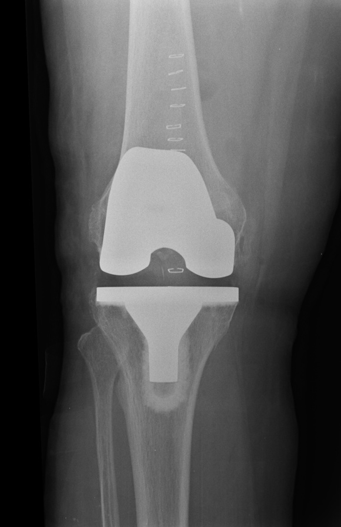 Knee_Depuy_Synthes_Sigma</td>
<td align="center" valign="top"><b>✅ Option 1</b>  Knee_Depuy_Synthes_Sigma</td>
<td align="center" valign="top"><b>Option 2</b>  Knee_ZimmerBiomet_Oxford</td>
<td align="center" valign="top"><b>Option 3</b>  Knee_SmithAndNephew_GenesisII</td>
<td align="center" valign="top"><b>Option 4</b>  Knee_SmithAndNephew_Legion2</td>
<td align="center" valign="middle"><b>Option 6</b>  <i>None of the above</i></td>
</tr></table>

### Q0986 · correct: option 2 · `Knee_Depuy_Synthes_Sigma`

<table><tr>
<td align="center" valign="top"><b>Query</b> 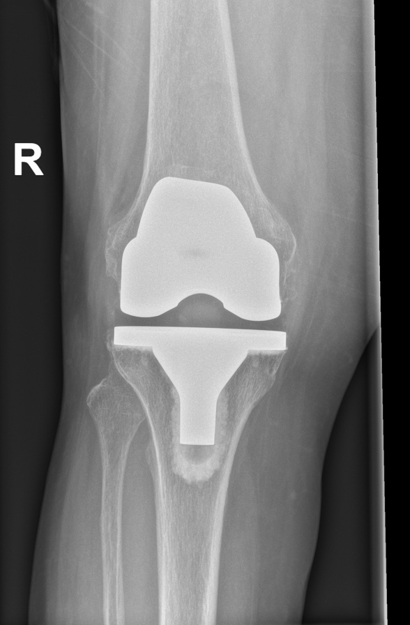 Knee_Depuy_Synthes_Sigma</td>
<td align="center" valign="top"><b>Option 1</b>  Knee_SmithAndNephew_Legion2</td>
<td align="center" valign="top"><b>✅ Option 2</b>  Knee_Depuy_Synthes_Sigma</td>
<td align="center" valign="top"><b>Option 3</b>  Knee_SmithAndNephew_GenesisII</td>
<td align="center" valign="top"><b>Option 4</b>  Knee_ZimmerBiomet_Oxford</td>
<td align="center" valign="middle"><b>Option 6</b>  <i>None of the above</i></td>
</tr></table>

### Q0987 · correct: option 4 · `Knee_Depuy_Synthes_Sigma`

<table><tr>
<td align="center" valign="top"><b>Query</b> 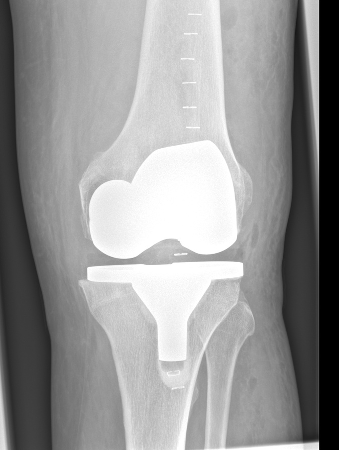 Knee_Depuy_Synthes_Sigma</td>
<td align="center" valign="top"><b>Option 1</b>  Knee_ZimmerBiomet_Oxford</td>
<td align="center" valign="top"><b>Option 2</b>  Knee_SmithAndNephew_Legion2</td>
<td align="center" valign="top"><b>Option 3</b>  Knee_SmithAndNephew_GenesisII</td>
<td align="center" valign="top"><b>✅ Option 4</b>  Knee_Depuy_Synthes_Sigma</td>
<td align="center" valign="middle"><b>Option 6</b>  <i>None of the above</i></td>
</tr></table>

### Q0988 · correct: option 4 · `Knee_SmithAndNephew_GenesisII`

<table><tr>
<td align="center" valign="top"><b>Query</b> 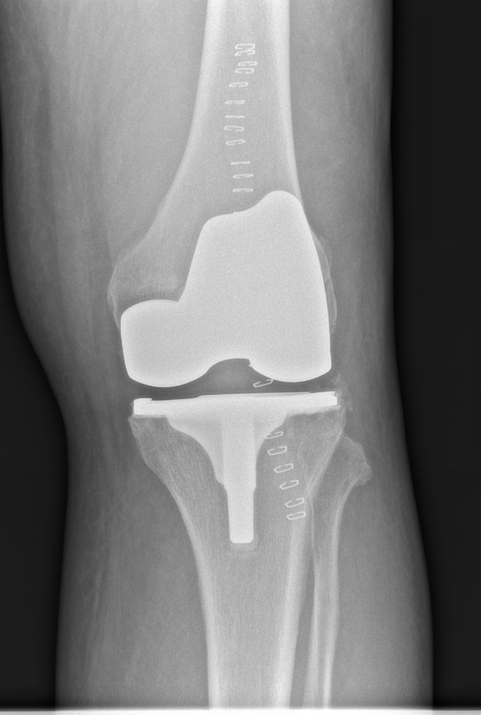 Knee_SmithAndNephew_GenesisII</td>
<td align="center" valign="top"><b>Option 1</b>  Knee_SmithAndNephew_Legion2</td>
<td align="center" valign="top"><b>Option 2</b>  Knee_ZimmerBiomet_Oxford</td>
<td align="center" valign="top"><b>Option 3</b>  Knee_Depuy_Synthes_Sigma</td>
<td align="center" valign="top"><b>✅ Option 4</b>  Knee_SmithAndNephew_GenesisII</td>
<td align="center" valign="middle"><b>Option 6</b>  <i>None of the above</i></td>
</tr></table>

### Q0989 · correct: option 4 · `Knee_SmithAndNephew_GenesisII`

<table><tr>
<td align="center" valign="top"><b>Query</b> 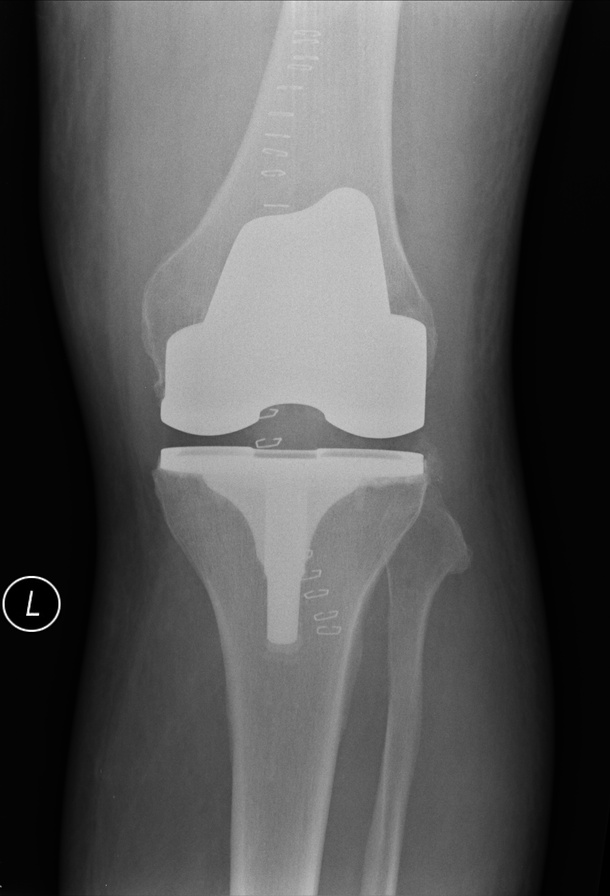 Knee_SmithAndNephew_GenesisII</td>
<td align="center" valign="top"><b>Option 1</b>  Knee_Depuy_Synthes_Sigma</td>
<td align="center" valign="top"><b>Option 2</b>  Knee_ZimmerBiomet_Oxford</td>
<td align="center" valign="top"><b>Option 3</b>  Knee_SmithAndNephew_Legion2</td>
<td align="center" valign="top"><b>✅ Option 4</b> 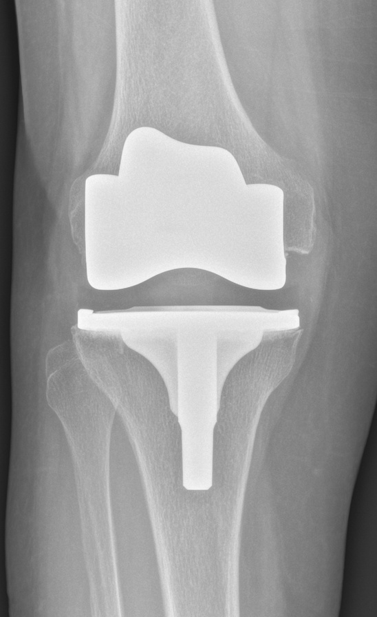 Knee_SmithAndNephew_GenesisII</td>
<td align="center" valign="middle"><b>Option 6</b>  <i>None of the above</i></td>
</tr></table>

### Q0990 · correct: option 4 · `Knee_SmithAndNephew_GenesisII`

<table><tr>
<td align="center" valign="top"><b>Query</b> 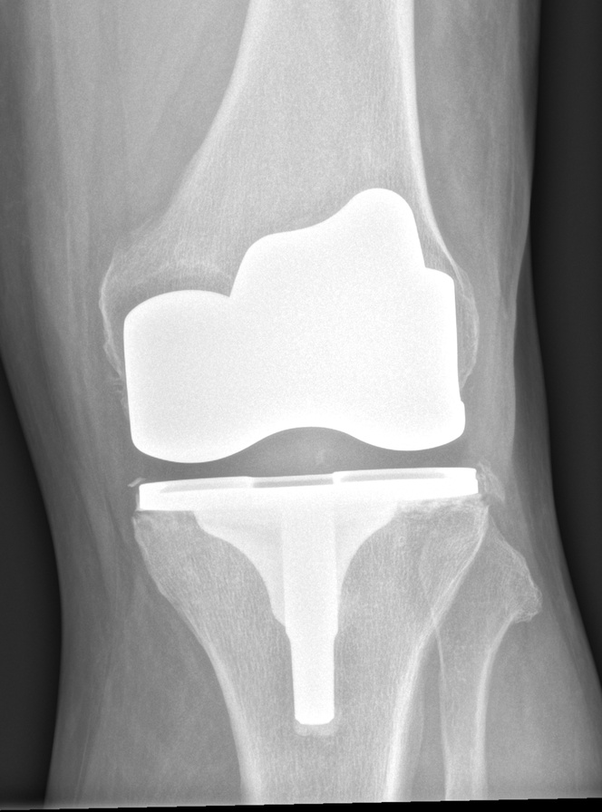 Knee_SmithAndNephew_GenesisII</td>
<td align="center" valign="top"><b>Option 1</b>  Knee_Depuy_Synthes_Sigma</td>
<td align="center" valign="top"><b>Option 2</b>  Knee_ZimmerBiomet_Oxford</td>
<td align="center" valign="top"><b>Option 3</b>  Knee_SmithAndNephew_Legion2</td>
<td align="center" valign="top"><b>✅ Option 4</b>  Knee_SmithAndNephew_GenesisII</td>
<td align="center" valign="middle"><b>Option 6</b>  <i>None of the above</i></td>
</tr></table>

### Q0991 · correct: option 2 · `Knee_SmithAndNephew_GenesisII`

<table><tr>
<td align="center" valign="top"><b>Query</b> 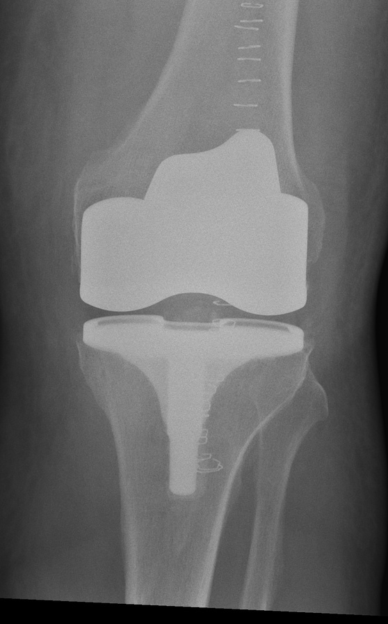 Knee_SmithAndNephew_GenesisII</td>
<td align="center" valign="top"><b>Option 1</b>  Knee_Depuy_Synthes_Sigma</td>
<td align="center" valign="top"><b>✅ Option 2</b>  Knee_SmithAndNephew_GenesisII</td>
<td align="center" valign="top"><b>Option 3</b>  Knee_ZimmerBiomet_Oxford</td>
<td align="center" valign="top"><b>Option 4</b>  Knee_SmithAndNephew_Legion2</td>
<td align="center" valign="middle"><b>Option 6</b>  <i>None of the above</i></td>
</tr></table>

### Q0992 · correct: option 4 · `Knee_SmithAndNephew_GenesisII`

<table><tr>
<td align="center" valign="top"><b>Query</b> 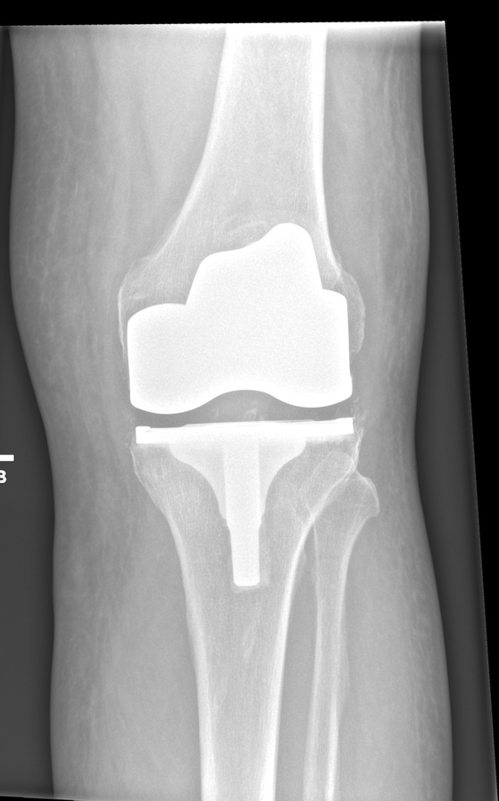 Knee_SmithAndNephew_GenesisII</td>
<td align="center" valign="top"><b>Option 1</b>  Knee_Depuy_Synthes_Sigma</td>
<td align="center" valign="top"><b>Option 2</b>  Knee_SmithAndNephew_Legion2</td>
<td align="center" valign="top"><b>Option 3</b>  Knee_ZimmerBiomet_Oxford</td>
<td align="center" valign="top"><b>✅ Option 4</b>  Knee_SmithAndNephew_GenesisII</td>
<td align="center" valign="middle"><b>Option 6</b>  <i>None of the above</i></td>
</tr></table>

### Q0993 · correct: option 1 · `Knee_Depuy_Synthes_Sigma`

<table><tr>
<td align="center" valign="top"><b>Query</b> 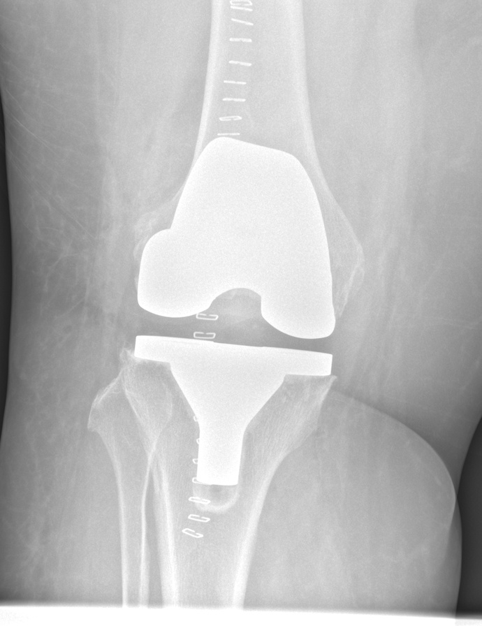 Knee_Depuy_Synthes_Sigma</td>
<td align="center" valign="top"><b>✅ Option 1</b> 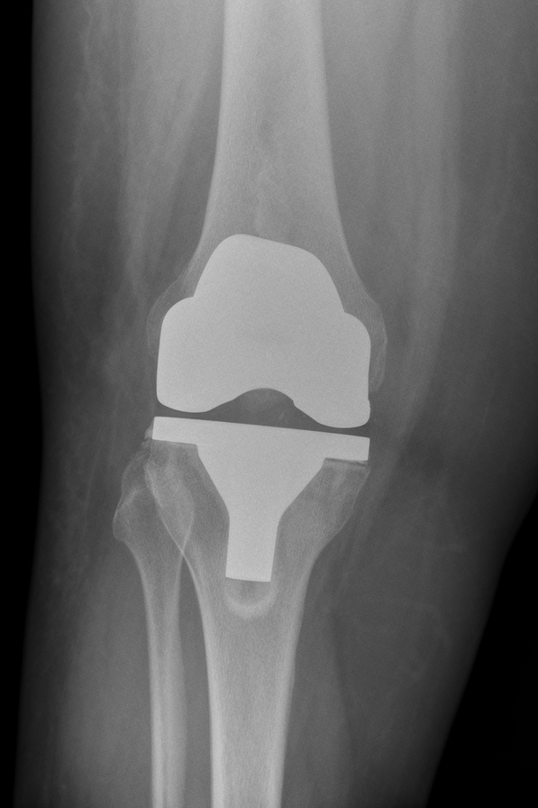 Knee_Depuy_Synthes_Sigma</td>
<td align="center" valign="top"><b>Option 2</b>  Knee_SmithAndNephew_GenesisII</td>
<td align="center" valign="top"><b>Option 3</b>  Knee_ZimmerBiomet_Oxford</td>
<td align="center" valign="top"><b>Option 4</b> 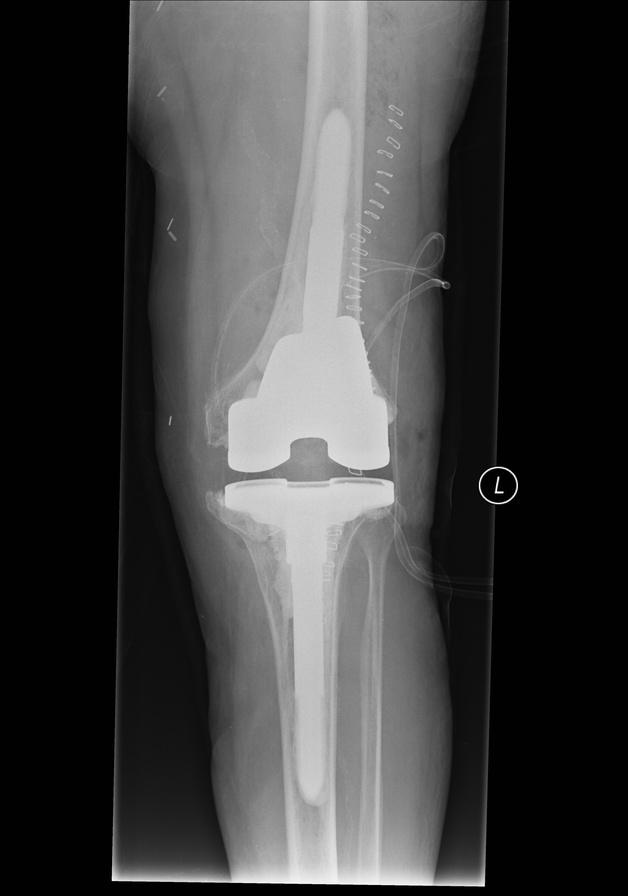 Knee_SmithAndNephew_Legion2</td>
<td align="center" valign="middle"><b>Option 6</b>  <i>None of the above</i></td>
</tr></table>

### Q0994 · correct: option 3 · `Knee_Depuy_Synthes_Sigma`

<table><tr>
<td align="center" valign="top"><b>Query</b> 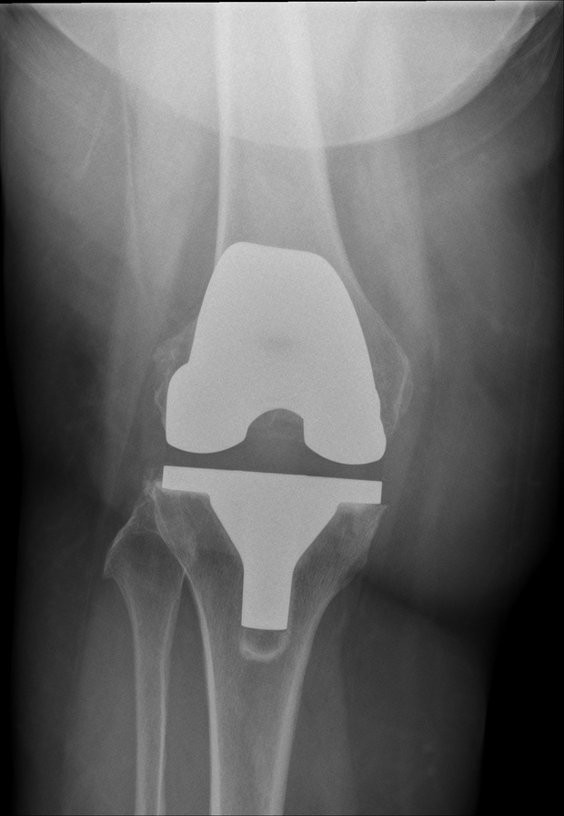 Knee_Depuy_Synthes_Sigma</td>
<td align="center" valign="top"><b>Option 1</b>  Knee_ZimmerBiomet_Oxford</td>
<td align="center" valign="top"><b>Option 2</b>  Knee_SmithAndNephew_Legion2</td>
<td align="center" valign="top"><b>✅ Option 3</b>  Knee_Depuy_Synthes_Sigma</td>
<td align="center" valign="top"><b>Option 4</b>  Knee_SmithAndNephew_GenesisII</td>
<td align="center" valign="middle"><b>Option 6</b>  <i>None of the above</i></td>
</tr></table>

### Q0995 · correct: option 3 · `Knee_Depuy_Synthes_Sigma`

<table><tr>
<td align="center" valign="top"><b>Query</b> 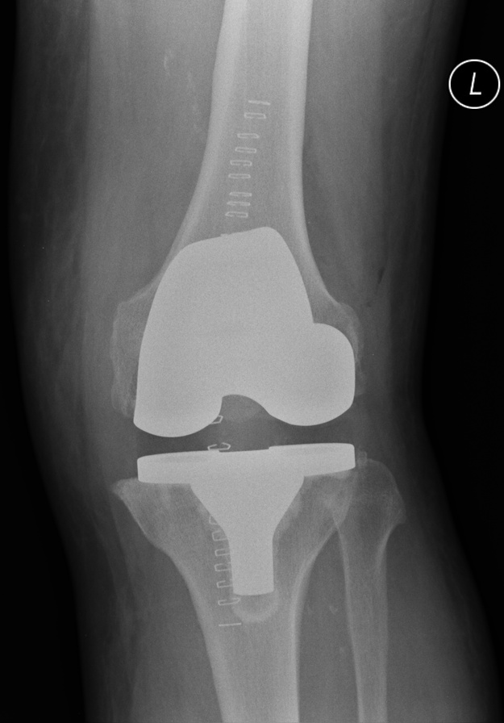 Knee_Depuy_Synthes_Sigma</td>
<td align="center" valign="top"><b>Option 1</b>  Knee_SmithAndNephew_GenesisII</td>
<td align="center" valign="top"><b>Option 2</b>  Knee_SmithAndNephew_Legion2</td>
<td align="center" valign="top"><b>✅ Option 3</b>  Knee_Depuy_Synthes_Sigma</td>
<td align="center" valign="top"><b>Option 4</b>  Knee_ZimmerBiomet_Oxford</td>
<td align="center" valign="middle"><b>Option 6</b>  <i>None of the above</i></td>
</tr></table>

### Q0996 · correct: option 2 · `Knee_Depuy_Synthes_Sigma`

<table><tr>
<td align="center" valign="top"><b>Query</b> 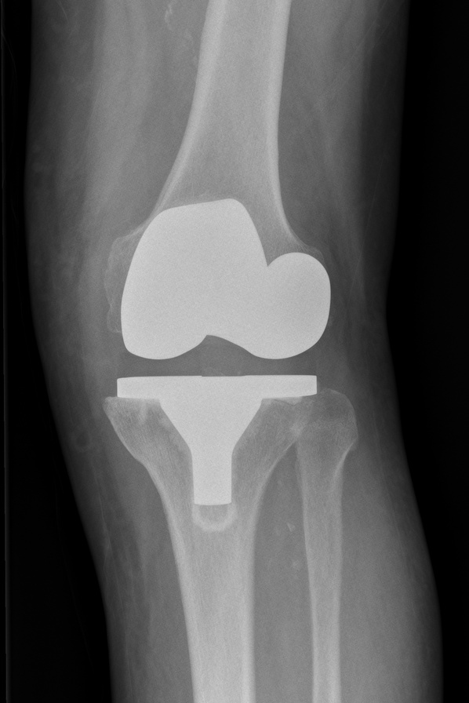 Knee_Depuy_Synthes_Sigma</td>
<td align="center" valign="top"><b>Option 1</b>  Knee_SmithAndNephew_GenesisII</td>
<td align="center" valign="top"><b>✅ Option 2</b>  Knee_Depuy_Synthes_Sigma</td>
<td align="center" valign="top"><b>Option 3</b>  Knee_SmithAndNephew_Legion2</td>
<td align="center" valign="top"><b>Option 4</b>  Knee_ZimmerBiomet_Oxford</td>
<td align="center" valign="middle"><b>Option 6</b>  <i>None of the above</i></td>
</tr></table>

### Q0997 · correct: option 3 · `Knee_SmithAndNephew_GenesisII`

<table><tr>
<td align="center" valign="top"><b>Query</b> 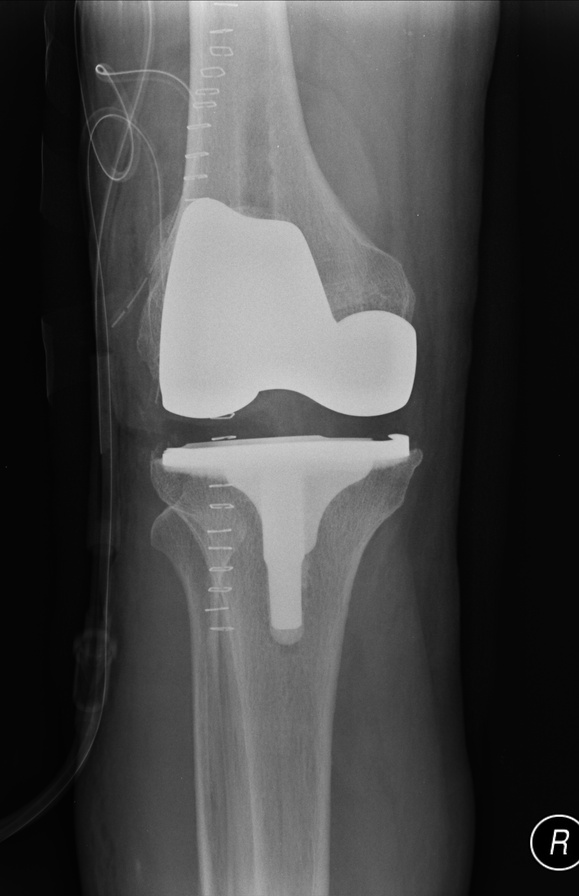 Knee_SmithAndNephew_GenesisII</td>
<td align="center" valign="top"><b>Option 1</b>  Knee_Depuy_Synthes_Sigma</td>
<td align="center" valign="top"><b>Option 2</b>  Knee_ZimmerBiomet_Oxford</td>
<td align="center" valign="top"><b>✅ Option 3</b>  Knee_SmithAndNephew_GenesisII</td>
<td align="center" valign="top"><b>Option 4</b>  Knee_SmithAndNephew_Legion2</td>
<td align="center" valign="middle"><b>Option 6</b>  <i>None of the above</i></td>
</tr></table>

### Q0998 · correct: option 1 · `Knee_SmithAndNephew_GenesisII`

<table><tr>
<td align="center" valign="top"><b>Query</b> 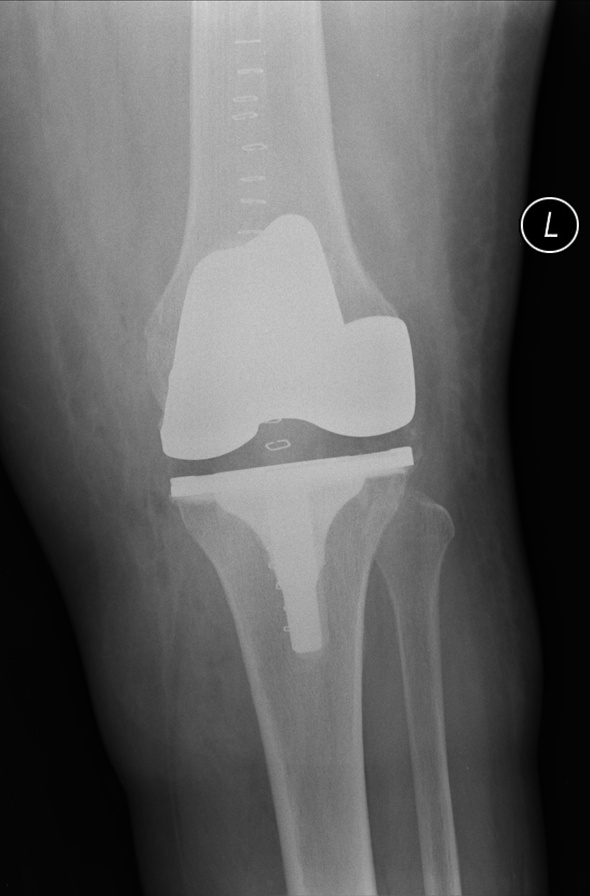 Knee_SmithAndNephew_GenesisII</td>
<td align="center" valign="top"><b>✅ Option 1</b>  Knee_SmithAndNephew_GenesisII</td>
<td align="center" valign="top"><b>Option 2</b>  Knee_SmithAndNephew_Legion2</td>
<td align="center" valign="top"><b>Option 3</b>  Knee_ZimmerBiomet_Oxford</td>
<td align="center" valign="top"><b>Option 4</b>  Knee_Depuy_Synthes_Sigma</td>
<td align="center" valign="middle"><b>Option 6</b>  <i>None of the above</i></td>
</tr></table>

### Q0999 · correct: option 3 · `Knee_Depuy_Synthes_Sigma`

<table><tr>
<td align="center" valign="top"><b>Query</b> 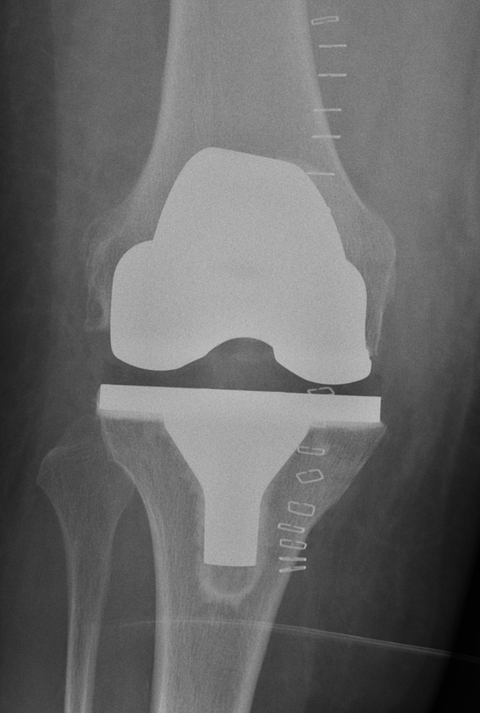 Knee_Depuy_Synthes_Sigma</td>
<td align="center" valign="top"><b>Option 1</b>  Knee_SmithAndNephew_Legion2</td>
<td align="center" valign="top"><b>Option 2</b>  Knee_SmithAndNephew_GenesisII</td>
<td align="center" valign="top"><b>✅ Option 3</b>  Knee_Depuy_Synthes_Sigma</td>
<td align="center" valign="top"><b>Option 4</b>  Knee_ZimmerBiomet_Oxford</td>
<td align="center" valign="middle"><b>Option 6</b>  <i>None of the above</i></td>
</tr></table>

### Q1000 · correct: option 4 · `Knee_Depuy_Synthes_Sigma`

<table><tr>
<td align="center" valign="top"><b>Query</b> 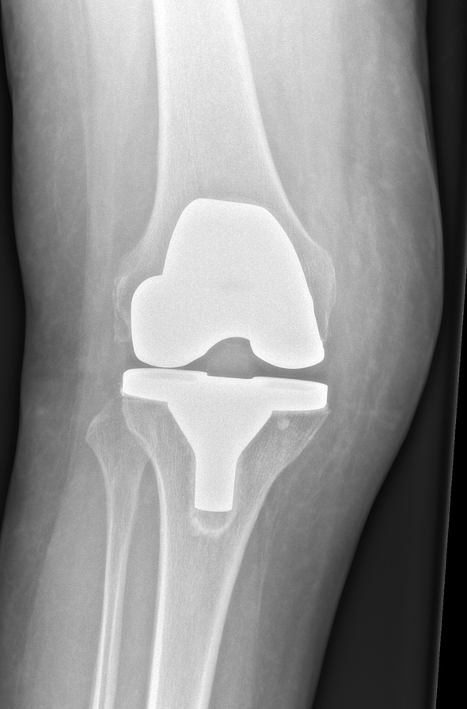 Knee_Depuy_Synthes_Sigma</td>
<td align="center" valign="top"><b>Option 1</b>  Knee_ZimmerBiomet_Oxford</td>
<td align="center" valign="top"><b>Option 2</b>  Knee_SmithAndNephew_GenesisII</td>
<td align="center" valign="top"><b>Option 3</b>  Knee_SmithAndNephew_Legion2</td>
<td align="center" valign="top"><b>✅ Option 4</b>  Knee_Depuy_Synthes_Sigma</td>
<td align="center" valign="middle"><b>Option 6</b>  <i>None of the above</i></td>
</tr></table>

### Q1001 · correct: option 4 · `Knee_SmithAndNephew_GenesisII`

<table><tr>
<td align="center" valign="top"><b>Query</b> 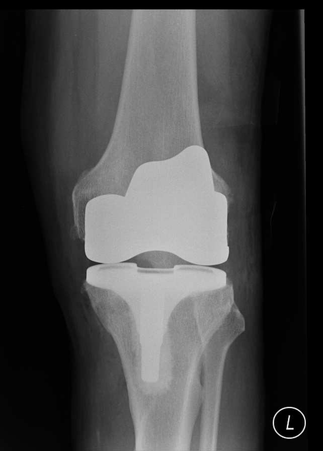 Knee_SmithAndNephew_GenesisII</td>
<td align="center" valign="top"><b>Option 1</b>  Knee_SmithAndNephew_Legion2</td>
<td align="center" valign="top"><b>Option 2</b>  Knee_Depuy_Synthes_Sigma</td>
<td align="center" valign="top"><b>Option 3</b>  Knee_ZimmerBiomet_Oxford</td>
<td align="center" valign="top"><b>✅ Option 4</b>  Knee_SmithAndNephew_GenesisII</td>
<td align="center" valign="middle"><b>Option 6</b>  <i>None of the above</i></td>
</tr></table>

### Q1002 · correct: option 3 · `Knee_Depuy_Synthes_Sigma`

<table><tr>
<td align="center" valign="top"><b>Query</b> 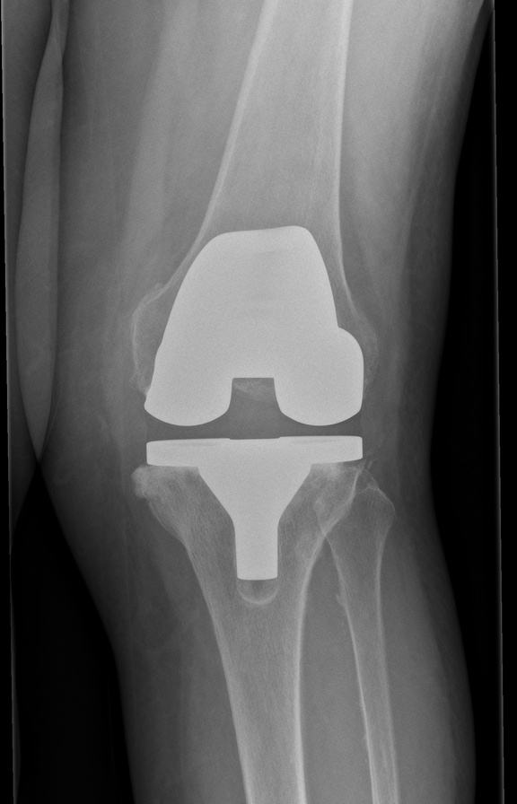 Knee_Depuy_Synthes_Sigma</td>
<td align="center" valign="top"><b>Option 1</b>  Knee_ZimmerBiomet_Oxford</td>
<td align="center" valign="top"><b>Option 2</b>  Knee_SmithAndNephew_GenesisII</td>
<td align="center" valign="top"><b>✅ Option 3</b>  Knee_Depuy_Synthes_Sigma</td>
<td align="center" valign="top"><b>Option 4</b>  Knee_SmithAndNephew_Legion2</td>
<td align="center" valign="middle"><b>Option 6</b>  <i>None of the above</i></td>
</tr></table>

### Q1003 · correct: option 4 · `Knee_Depuy_Synthes_Sigma`

<table><tr>
<td align="center" valign="top"><b>Query</b> 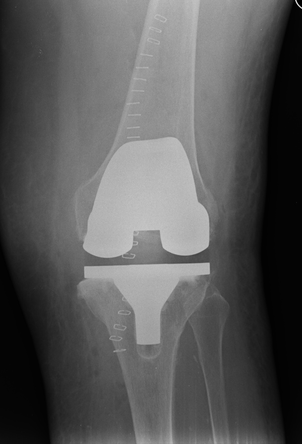 Knee_Depuy_Synthes_Sigma</td>
<td align="center" valign="top"><b>Option 1</b>  Knee_SmithAndNephew_GenesisII</td>
<td align="center" valign="top"><b>Option 2</b>  Knee_ZimmerBiomet_Oxford</td>
<td align="center" valign="top"><b>Option 3</b>  Knee_SmithAndNephew_Legion2</td>
<td align="center" valign="top"><b>✅ Option 4</b>  Knee_Depuy_Synthes_Sigma</td>
<td align="center" valign="middle"><b>Option 6</b>  <i>None of the above</i></td>
</tr></table>

### Q1004 · correct: option 3 · `Knee_Depuy_Synthes_Sigma`

<table><tr>
<td align="center" valign="top"><b>Query</b> 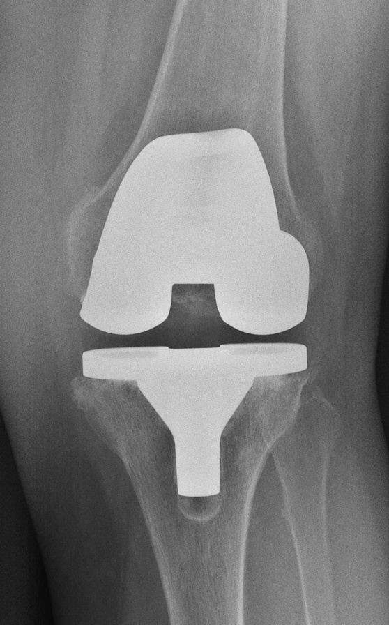 Knee_Depuy_Synthes_Sigma</td>
<td align="center" valign="top"><b>Option 1</b>  Knee_SmithAndNephew_GenesisII</td>
<td align="center" valign="top"><b>Option 2</b>  Knee_SmithAndNephew_Legion2</td>
<td align="center" valign="top"><b>✅ Option 3</b>  Knee_Depuy_Synthes_Sigma</td>
<td align="center" valign="top"><b>Option 4</b>  Knee_ZimmerBiomet_Oxford</td>
<td align="center" valign="middle"><b>Option 6</b>  <i>None of the above</i></td>
</tr></table>

### Q1005 · correct: option 3 · `Knee_Depuy_Synthes_Sigma`

<table><tr>
<td align="center" valign="top"><b>Query</b> 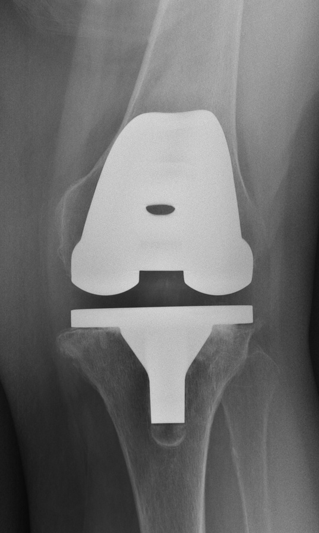 Knee_Depuy_Synthes_Sigma</td>
<td align="center" valign="top"><b>Option 1</b>  Knee_ZimmerBiomet_Oxford</td>
<td align="center" valign="top"><b>Option 2</b>  Knee_SmithAndNephew_GenesisII</td>
<td align="center" valign="top"><b>✅ Option 3</b>  Knee_Depuy_Synthes_Sigma</td>
<td align="center" valign="top"><b>Option 4</b>  Knee_SmithAndNephew_Legion2</td>
<td align="center" valign="middle"><b>Option 6</b>  <i>None of the above</i></td>
</tr></table>

### Q1006 · correct: option 4 · `Knee_Depuy_Synthes_Sigma`

<table><tr>
<td align="center" valign="top"><b>Query</b> 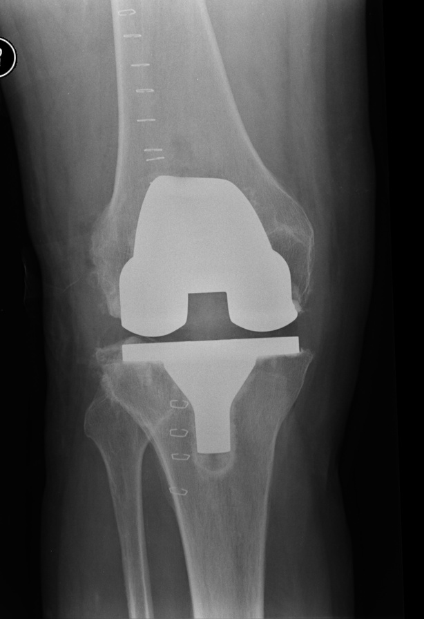 Knee_Depuy_Synthes_Sigma</td>
<td align="center" valign="top"><b>Option 1</b>  Knee_SmithAndNephew_GenesisII</td>
<td align="center" valign="top"><b>Option 2</b>  Knee_SmithAndNephew_Legion2</td>
<td align="center" valign="top"><b>Option 3</b>  Knee_ZimmerBiomet_Oxford</td>
<td align="center" valign="top"><b>✅ Option 4</b>  Knee_Depuy_Synthes_Sigma</td>
<td align="center" valign="middle"><b>Option 6</b>  <i>None of the above</i></td>
</tr></table>

### Q1007 · correct: option 2 · `Knee_Depuy_Synthes_Sigma`

<table><tr>
<td align="center" valign="top"><b>Query</b> 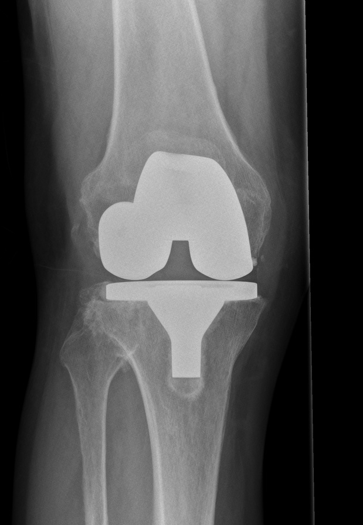 Knee_Depuy_Synthes_Sigma</td>
<td align="center" valign="top"><b>Option 1</b>  Knee_SmithAndNephew_GenesisII</td>
<td align="center" valign="top"><b>✅ Option 2</b>  Knee_Depuy_Synthes_Sigma</td>
<td align="center" valign="top"><b>Option 3</b>  Knee_ZimmerBiomet_Oxford</td>
<td align="center" valign="top"><b>Option 4</b>  Knee_SmithAndNephew_Legion2</td>
<td align="center" valign="middle"><b>Option 6</b>  <i>None of the above</i></td>
</tr></table>

### Q1008 · correct: option 3 · `Knee_Depuy_Synthes_Sigma`

<table><tr>
<td align="center" valign="top"><b>Query</b> 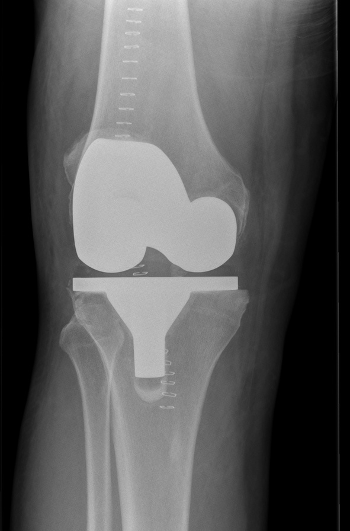 Knee_Depuy_Synthes_Sigma</td>
<td align="center" valign="top"><b>Option 1</b>  Knee_SmithAndNephew_Legion2</td>
<td align="center" valign="top"><b>Option 2</b>  Knee_ZimmerBiomet_Oxford</td>
<td align="center" valign="top"><b>✅ Option 3</b>  Knee_Depuy_Synthes_Sigma</td>
<td align="center" valign="top"><b>Option 4</b>  Knee_SmithAndNephew_GenesisII</td>
<td align="center" valign="middle"><b>Option 6</b>  <i>None of the above</i></td>
</tr></table>

### Q1009 · correct: option 2 · `Knee_Depuy_Synthes_Sigma`

<table><tr>
<td align="center" valign="top"><b>Query</b> 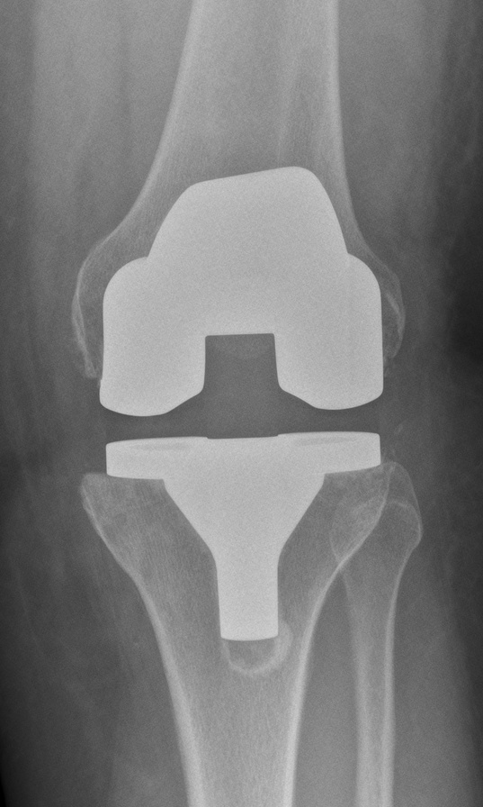 Knee_Depuy_Synthes_Sigma</td>
<td align="center" valign="top"><b>Option 1</b>  Knee_ZimmerBiomet_Oxford</td>
<td align="center" valign="top"><b>✅ Option 2</b>  Knee_Depuy_Synthes_Sigma</td>
<td align="center" valign="top"><b>Option 3</b>  Knee_SmithAndNephew_GenesisII</td>
<td align="center" valign="top"><b>Option 4</b>  Knee_SmithAndNephew_Legion2</td>
<td align="center" valign="middle"><b>Option 6</b>  <i>None of the above</i></td>
</tr></table>

### Q1010 · correct: option 2 · `Knee_Depuy_Synthes_Sigma`

<table><tr>
<td align="center" valign="top"><b>Query</b> 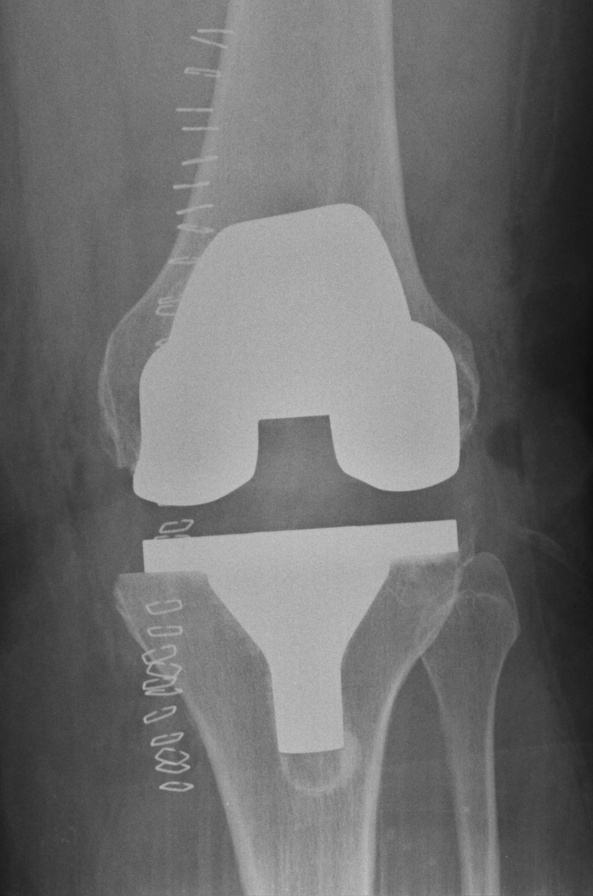 Knee_Depuy_Synthes_Sigma</td>
<td align="center" valign="top"><b>Option 1</b>  Knee_SmithAndNephew_Legion2</td>
<td align="center" valign="top"><b>✅ Option 2</b> 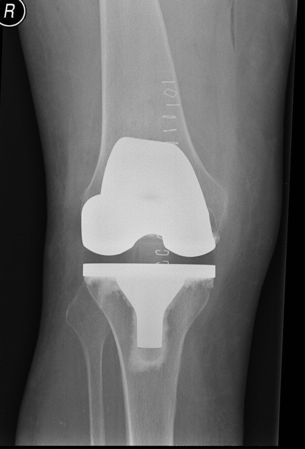 Knee_Depuy_Synthes_Sigma</td>
<td align="center" valign="top"><b>Option 3</b>  Knee_SmithAndNephew_GenesisII</td>
<td align="center" valign="top"><b>Option 4</b>  Knee_ZimmerBiomet_Oxford</td>
<td align="center" valign="middle"><b>Option 6</b>  <i>None of the above</i></td>
</tr></table>

### Q1011 · correct: option 3 · `Knee_Depuy_Synthes_Sigma`

<table><tr>
<td align="center" valign="top"><b>Query</b>  Knee_Depuy_Synthes_Sigma</td>
<td align="center" valign="top"><b>Option 1</b>  Knee_SmithAndNephew_Legion2</td>
<td align="center" valign="top"><b>Option 2</b>  Knee_SmithAndNephew_GenesisII</td>
<td align="center" valign="top"><b>✅ Option 3</b>  Knee_Depuy_Synthes_Sigma</td>
<td align="center" valign="top"><b>Option 4</b>  Knee_ZimmerBiomet_Oxford</td>
<td align="center" valign="middle"><b>Option 6</b>  <i>None of the above</i></td>
</tr></table>

### Q1012 · correct: option 3 · `Knee_Depuy_Synthes_Sigma`

<table><tr>
<td align="center" valign="top"><b>Query</b>  Knee_Depuy_Synthes_Sigma</td>
<td align="center" valign="top"><b>Option 1</b>  Knee_SmithAndNephew_GenesisII</td>
<td align="center" valign="top"><b>Option 2</b>  Knee_SmithAndNephew_Legion2</td>
<td align="center" valign="top"><b>✅ Option 3</b>  Knee_Depuy_Synthes_Sigma</td>
<td align="center" valign="top"><b>Option 4</b>  Knee_ZimmerBiomet_Oxford</td>
<td align="center" valign="middle"><b>Option 6</b>  <i>None of the above</i></td>
</tr></table>

### Q1013 · correct: option 1 · `Knee_Depuy_Synthes_Sigma`

<table><tr>
<td align="center" valign="top"><b>Query</b>  Knee_Depuy_Synthes_Sigma</td>
<td align="center" valign="top"><b>✅ Option 1</b>  Knee_Depuy_Synthes_Sigma</td>
<td align="center" valign="top"><b>Option 2</b>  Knee_SmithAndNephew_GenesisII</td>
<td align="center" valign="top"><b>Option 3</b>  Knee_ZimmerBiomet_Oxford</td>
<td align="center" valign="top"><b>Option 4</b>  Knee_SmithAndNephew_Legion2</td>
<td align="center" valign="middle"><b>Option 6</b>  <i>None of the above</i></td>
</tr></table>

### Q1014 · correct: option 1 · `Knee_Depuy_Synthes_Sigma`

<table><tr>
<td align="center" valign="top"><b>Query</b>  Knee_Depuy_Synthes_Sigma</td>
<td align="center" valign="top"><b>✅ Option 1</b>  Knee_Depuy_Synthes_Sigma</td>
<td align="center" valign="top"><b>Option 2</b>  Knee_SmithAndNephew_GenesisII</td>
<td align="center" valign="top"><b>Option 3</b>  Knee_SmithAndNephew_Legion2</td>
<td align="center" valign="top"><b>Option 4</b>  Knee_ZimmerBiomet_Oxford</td>
<td align="center" valign="middle"><b>Option 6</b>  <i>None of the above</i></td>
</tr></table>

### Q1015 · correct: option 2 · `Knee_Depuy_Synthes_Sigma`

<table><tr>
<td align="center" valign="top"><b>Query</b>  Knee_Depuy_Synthes_Sigma</td>
<td align="center" valign="top"><b>Option 1</b>  Knee_SmithAndNephew_Legion2</td>
<td align="center" valign="top"><b>✅ Option 2</b>  Knee_Depuy_Synthes_Sigma</td>
<td align="center" valign="top"><b>Option 3</b>  Knee_ZimmerBiomet_Oxford</td>
<td align="center" valign="top"><b>Option 4</b>  Knee_SmithAndNephew_GenesisII</td>
<td align="center" valign="middle"><b>Option 6</b>  <i>None of the above</i></td>
</tr></table>

### Q1016 · correct: option 4 · `Knee_Depuy_Synthes_Sigma`

<table><tr>
<td align="center" valign="top"><b>Query</b>  Knee_Depuy_Synthes_Sigma</td>
<td align="center" valign="top"><b>Option 1</b>  Knee_SmithAndNephew_Legion2</td>
<td align="center" valign="top"><b>Option 2</b>  Knee_SmithAndNephew_GenesisII</td>
<td align="center" valign="top"><b>Option 3</b>  Knee_ZimmerBiomet_Oxford</td>
<td align="center" valign="top"><b>✅ Option 4</b>  Knee_Depuy_Synthes_Sigma</td>
<td align="center" valign="middle"><b>Option 6</b>  <i>None of the above</i></td>
</tr></table>

### Q1017 · correct: option 2 · `Knee_Depuy_Synthes_Sigma`

<table><tr>
<td align="center" valign="top"><b>Query</b>  Knee_Depuy_Synthes_Sigma</td>
<td align="center" valign="top"><b>Option 1</b>  Knee_ZimmerBiomet_Oxford</td>
<td align="center" valign="top"><b>✅ Option 2</b>  Knee_Depuy_Synthes_Sigma</td>
<td align="center" valign="top"><b>Option 3</b>  Knee_SmithAndNephew_Legion2</td>
<td align="center" valign="top"><b>Option 4</b>  Knee_SmithAndNephew_GenesisII</td>
<td align="center" valign="middle"><b>Option 6</b>  <i>None of the above</i></td>
</tr></table>

### Q1018 · correct: option 2 · `Knee_Depuy_Synthes_Sigma`

<table><tr>
<td align="center" valign="top"><b>Query</b>  Knee_Depuy_Synthes_Sigma</td>
<td align="center" valign="top"><b>Option 1</b>  Knee_SmithAndNephew_GenesisII</td>
<td align="center" valign="top"><b>✅ Option 2</b>  Knee_Depuy_Synthes_Sigma</td>
<td align="center" valign="top"><b>Option 3</b>  Knee_ZimmerBiomet_Oxford</td>
<td align="center" valign="top"><b>Option 4</b>  Knee_SmithAndNephew_Legion2</td>
<td align="center" valign="middle"><b>Option 6</b>  <i>None of the above</i></td>
</tr></table>

### Q1019 · correct: option 2 · `Knee_SmithAndNephew_Legion2`

<table><tr>
<td align="center" valign="top"><b>Query</b>  Knee_SmithAndNephew_Legion2</td>
<td align="center" valign="top"><b>Option 1</b>  Knee_ZimmerBiomet_Oxford</td>
<td align="center" valign="top"><b>✅ Option 2</b>  Knee_SmithAndNephew_Legion2</td>
<td align="center" valign="top"><b>Option 3</b>  Knee_Depuy_Synthes_Sigma</td>
<td align="center" valign="top"><b>Option 4</b>  Knee_SmithAndNephew_GenesisII</td>
<td align="center" valign="middle"><b>Option 6</b>  <i>None of the above</i></td>
</tr></table>

### Q1020 · correct: option 4 · `Knee_SmithAndNephew_Legion2`

<table><tr>
<td align="center" valign="top"><b>Query</b>  Knee_SmithAndNephew_Legion2</td>
<td align="center" valign="top"><b>Option 1</b>  Knee_ZimmerBiomet_Oxford</td>
<td align="center" valign="top"><b>Option 2</b>  Knee_Depuy_Synthes_Sigma</td>
<td align="center" valign="top"><b>Option 3</b>  Knee_SmithAndNephew_GenesisII</td>
<td align="center" valign="top"><b>✅ Option 4</b>  Knee_SmithAndNephew_Legion2</td>
<td align="center" valign="middle"><b>Option 6</b>  <i>None of the above</i></td>
</tr></table>

