# OrthoNet knee · query set `train1` · page 2/2

[← all pages](README.md)

### Q1021 · correct: option 3 · `Knee_SmithAndNephew_Legion2`

<table><tr>
<td align="center" valign="top"><b>Query</b> 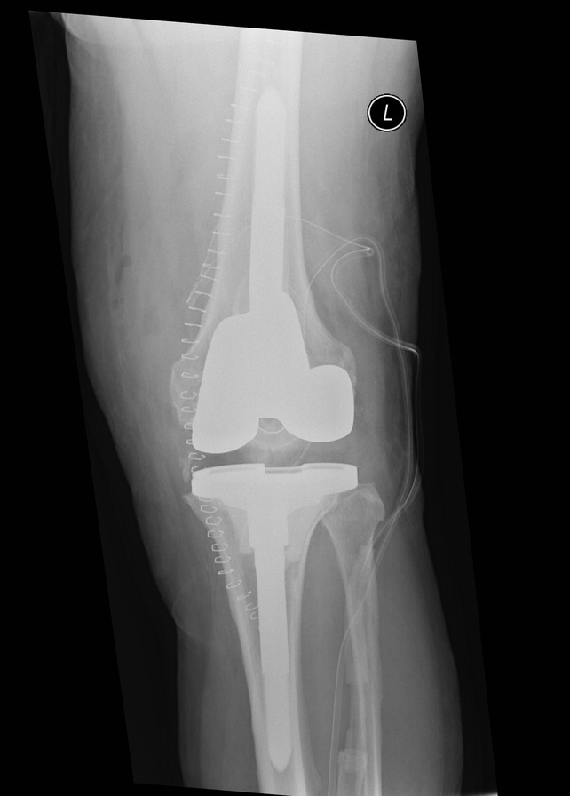 Knee_SmithAndNephew_Legion2</td>
<td align="center" valign="top"><b>Option 1</b> 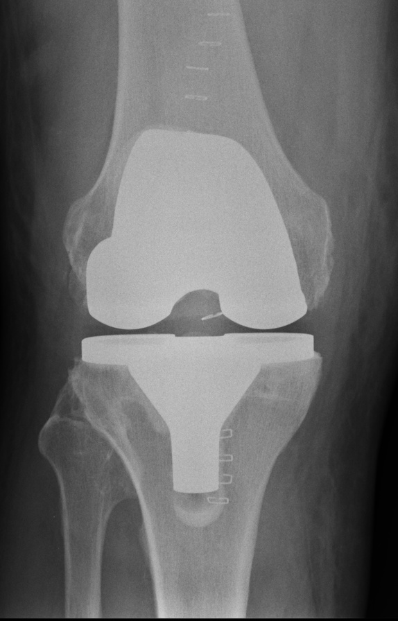 Knee_Depuy_Synthes_Sigma</td>
<td align="center" valign="top"><b>Option 2</b> 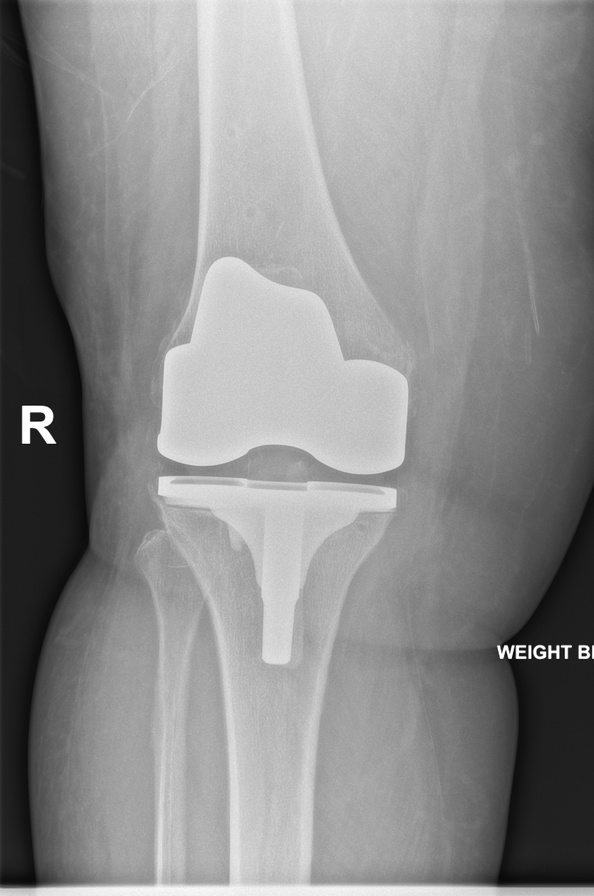 Knee_SmithAndNephew_GenesisII</td>
<td align="center" valign="top"><b>✅ Option 3</b> 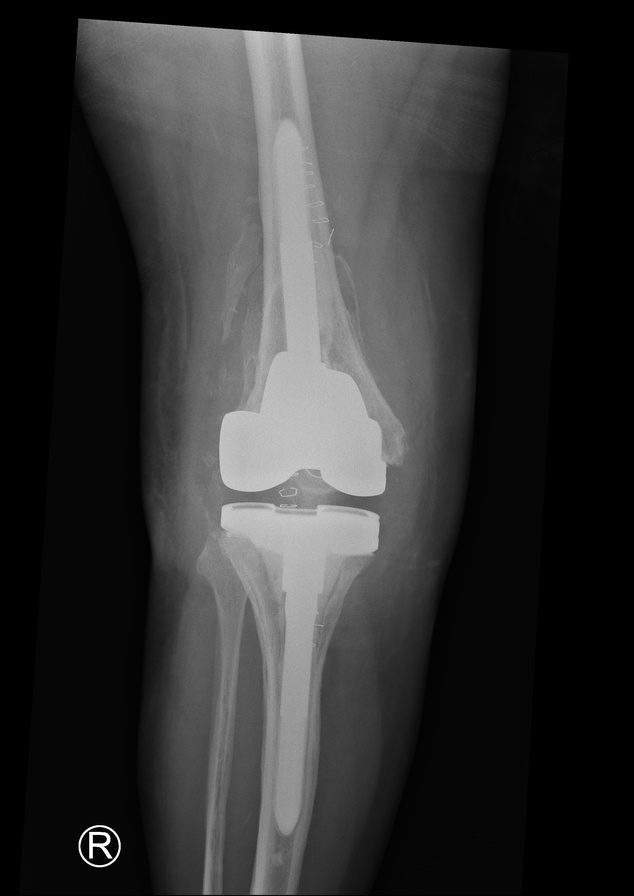 Knee_SmithAndNephew_Legion2</td>
<td align="center" valign="top"><b>Option 4</b> 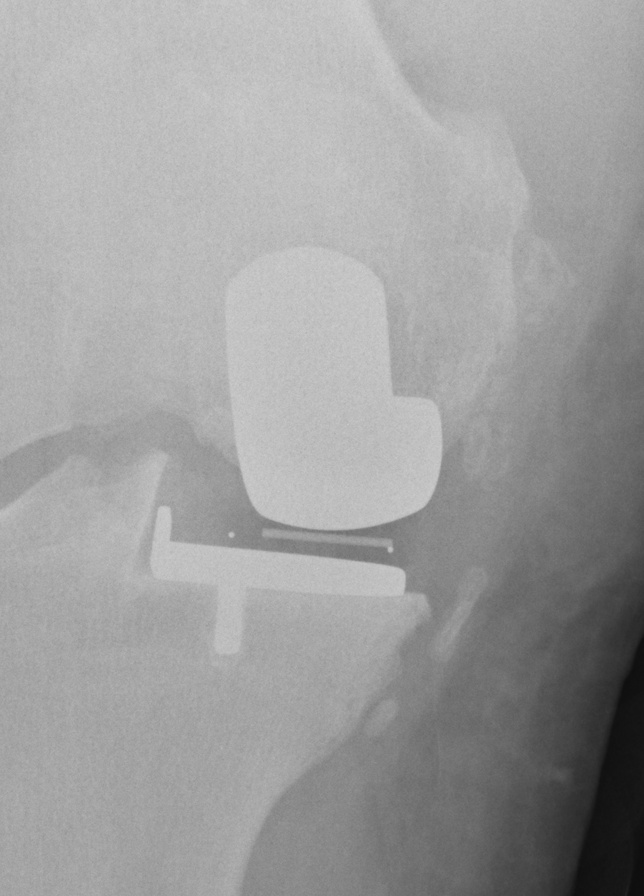 Knee_ZimmerBiomet_Oxford</td>
<td align="center" valign="middle"><b>Option 6</b>  <i>None of the above</i></td>
</tr></table>

### Q1022 · correct: option 4 · `Knee_SmithAndNephew_Legion2`

<table><tr>
<td align="center" valign="top"><b>Query</b> 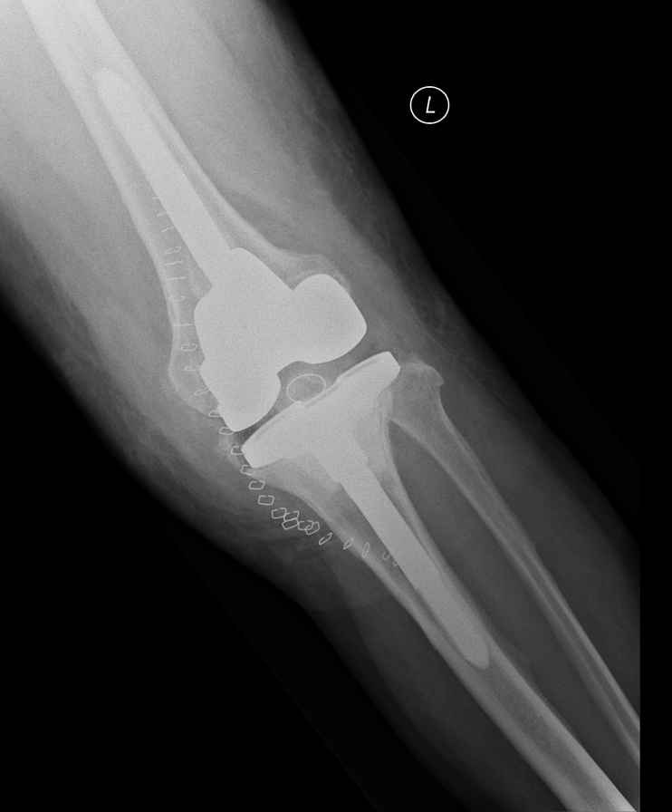 Knee_SmithAndNephew_Legion2</td>
<td align="center" valign="top"><b>Option 1</b>  Knee_SmithAndNephew_GenesisII</td>
<td align="center" valign="top"><b>Option 2</b>  Knee_ZimmerBiomet_Oxford</td>
<td align="center" valign="top"><b>Option 3</b>  Knee_Depuy_Synthes_Sigma</td>
<td align="center" valign="top"><b>✅ Option 4</b>  Knee_SmithAndNephew_Legion2</td>
<td align="center" valign="middle"><b>Option 6</b>  <i>None of the above</i></td>
</tr></table>

### Q1023 · correct: option 4 · `Knee_Depuy_Synthes_Sigma`

<table><tr>
<td align="center" valign="top"><b>Query</b> 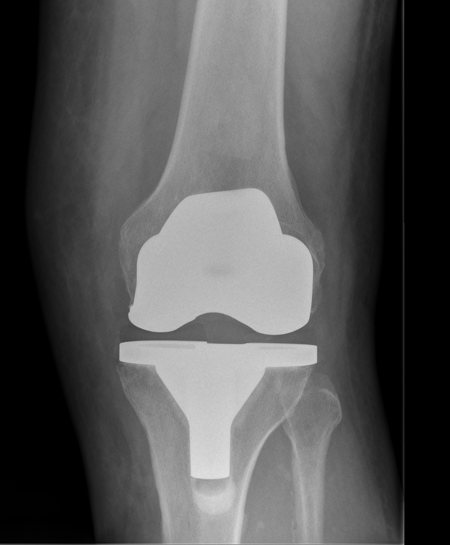 Knee_Depuy_Synthes_Sigma</td>
<td align="center" valign="top"><b>Option 1</b> 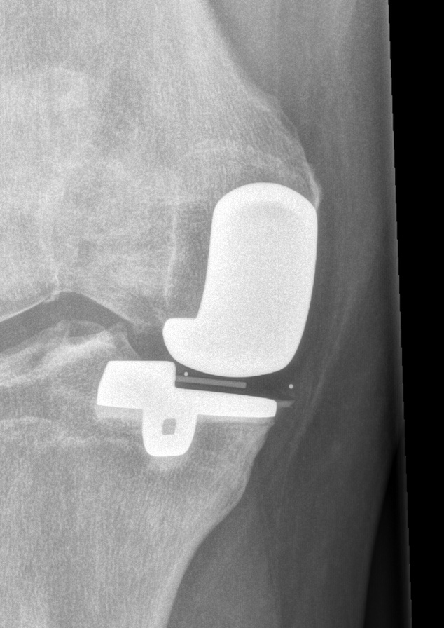 Knee_ZimmerBiomet_Oxford</td>
<td align="center" valign="top"><b>Option 2</b> 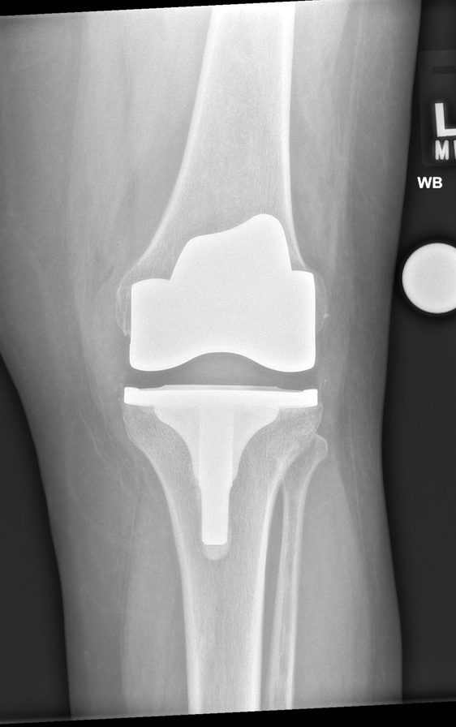 Knee_SmithAndNephew_GenesisII</td>
<td align="center" valign="top"><b>Option 3</b>  Knee_SmithAndNephew_Legion2</td>
<td align="center" valign="top"><b>✅ Option 4</b> 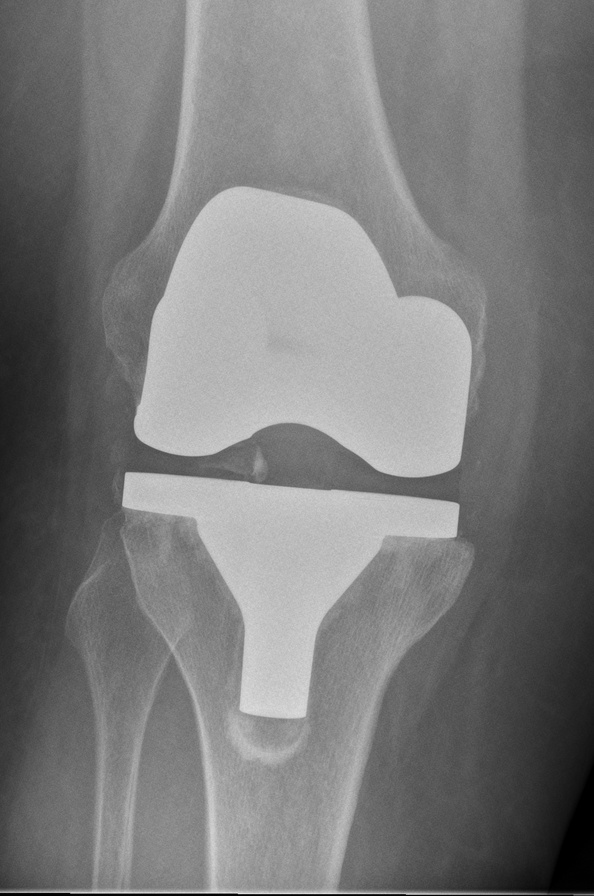 Knee_Depuy_Synthes_Sigma</td>
<td align="center" valign="middle"><b>Option 6</b>  <i>None of the above</i></td>
</tr></table>

### Q1024 · correct: option 2 · `Knee_Depuy_Synthes_Sigma`

<table><tr>
<td align="center" valign="top"><b>Query</b> 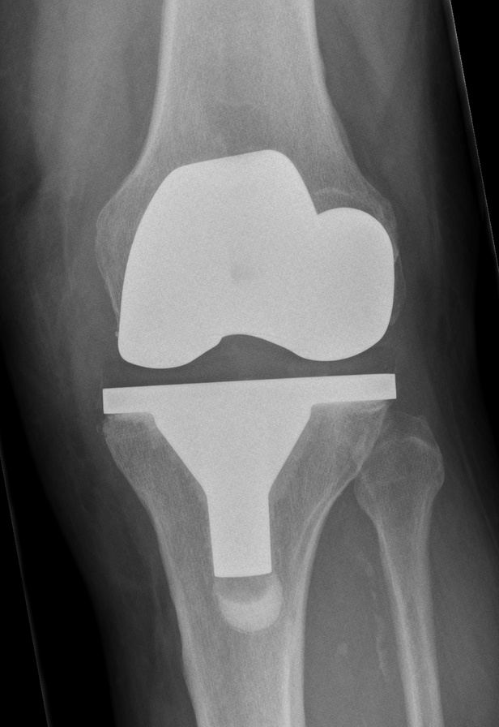 Knee_Depuy_Synthes_Sigma</td>
<td align="center" valign="top"><b>Option 1</b>  Knee_ZimmerBiomet_Oxford</td>
<td align="center" valign="top"><b>✅ Option 2</b>  Knee_Depuy_Synthes_Sigma</td>
<td align="center" valign="top"><b>Option 3</b>  Knee_SmithAndNephew_GenesisII</td>
<td align="center" valign="top"><b>Option 4</b>  Knee_SmithAndNephew_Legion2</td>
<td align="center" valign="middle"><b>Option 6</b>  <i>None of the above</i></td>
</tr></table>

### Q1025 · correct: option 3 · `Knee_Depuy_Synthes_Sigma`

<table><tr>
<td align="center" valign="top"><b>Query</b> 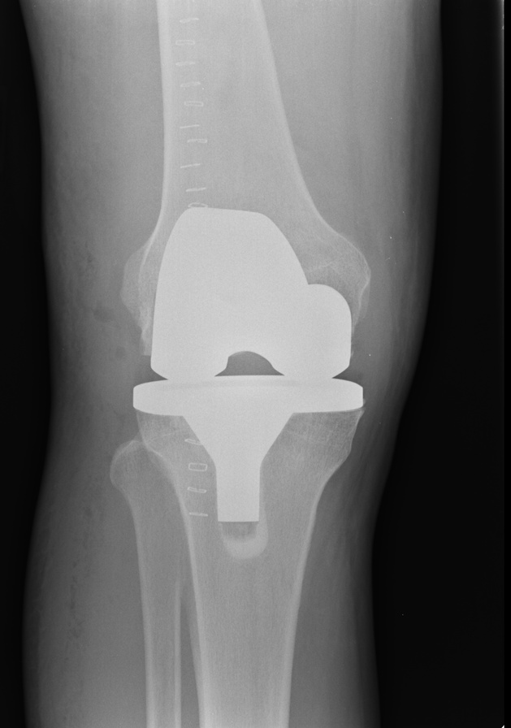 Knee_Depuy_Synthes_Sigma</td>
<td align="center" valign="top"><b>Option 1</b>  Knee_SmithAndNephew_Legion2</td>
<td align="center" valign="top"><b>Option 2</b>  Knee_SmithAndNephew_GenesisII</td>
<td align="center" valign="top"><b>✅ Option 3</b>  Knee_Depuy_Synthes_Sigma</td>
<td align="center" valign="top"><b>Option 4</b>  Knee_ZimmerBiomet_Oxford</td>
<td align="center" valign="middle"><b>Option 6</b>  <i>None of the above</i></td>
</tr></table>

### Q1026 · correct: option 4 · `Knee_SmithAndNephew_GenesisII`

<table><tr>
<td align="center" valign="top"><b>Query</b> 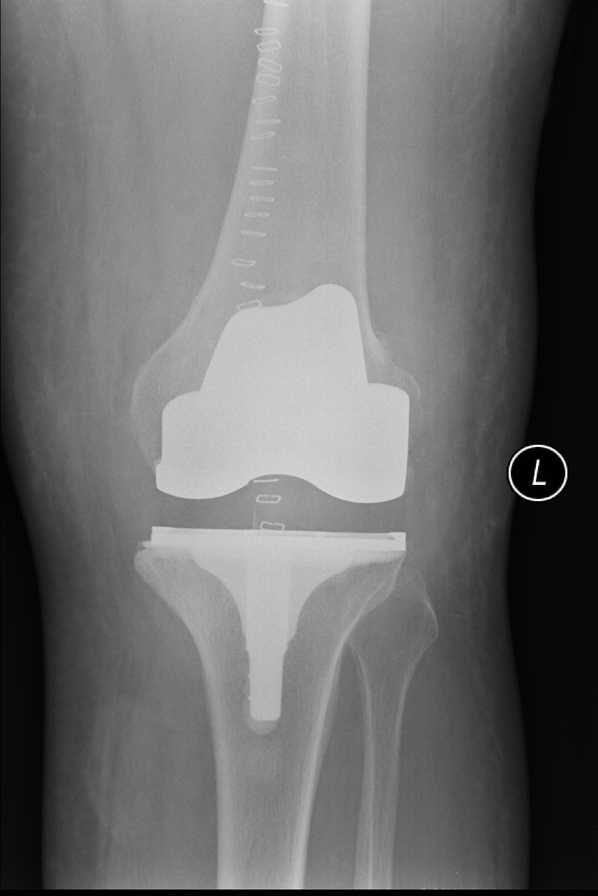 Knee_SmithAndNephew_GenesisII</td>
<td align="center" valign="top"><b>Option 1</b>  Knee_Depuy_Synthes_Sigma</td>
<td align="center" valign="top"><b>Option 2</b>  Knee_ZimmerBiomet_Oxford</td>
<td align="center" valign="top"><b>Option 3</b>  Knee_SmithAndNephew_Legion2</td>
<td align="center" valign="top"><b>✅ Option 4</b> 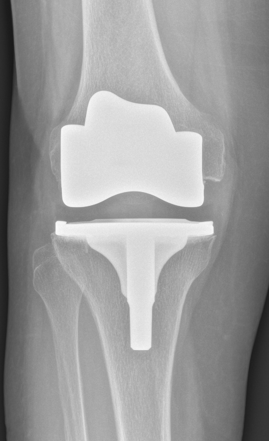 Knee_SmithAndNephew_GenesisII</td>
<td align="center" valign="middle"><b>Option 6</b>  <i>None of the above</i></td>
</tr></table>

### Q1027 · correct: option 1 · `Knee_SmithAndNephew_GenesisII`

<table><tr>
<td align="center" valign="top"><b>Query</b> 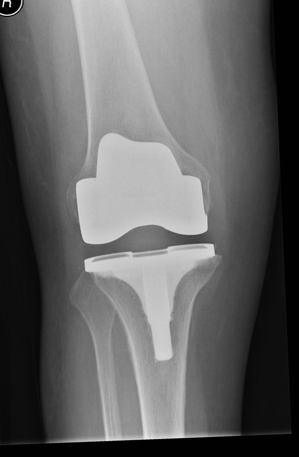 Knee_SmithAndNephew_GenesisII</td>
<td align="center" valign="top"><b>✅ Option 1</b>  Knee_SmithAndNephew_GenesisII</td>
<td align="center" valign="top"><b>Option 2</b>  Knee_Depuy_Synthes_Sigma</td>
<td align="center" valign="top"><b>Option 3</b>  Knee_SmithAndNephew_Legion2</td>
<td align="center" valign="top"><b>Option 4</b>  Knee_ZimmerBiomet_Oxford</td>
<td align="center" valign="middle"><b>Option 6</b>  <i>None of the above</i></td>
</tr></table>

### Q1028 · correct: option 2 · `Knee_Depuy_Synthes_Sigma`

<table><tr>
<td align="center" valign="top"><b>Query</b> 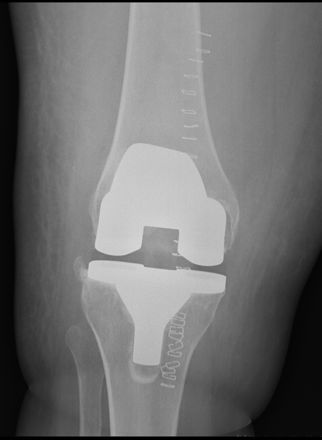 Knee_Depuy_Synthes_Sigma</td>
<td align="center" valign="top"><b>Option 1</b> 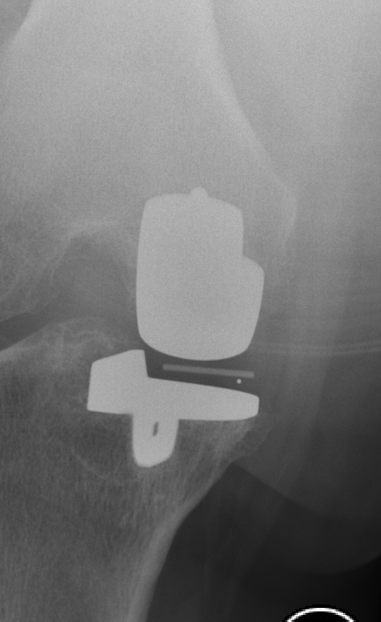 Knee_ZimmerBiomet_Oxford</td>
<td align="center" valign="top"><b>✅ Option 2</b>  Knee_Depuy_Synthes_Sigma</td>
<td align="center" valign="top"><b>Option 3</b>  Knee_SmithAndNephew_GenesisII</td>
<td align="center" valign="top"><b>Option 4</b> 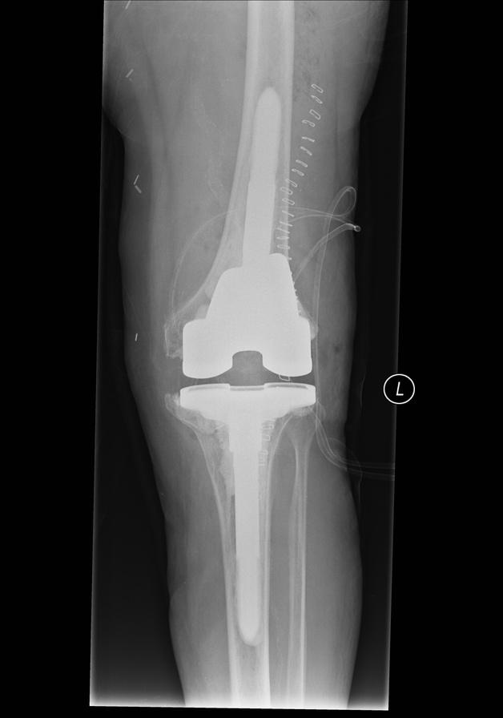 Knee_SmithAndNephew_Legion2</td>
<td align="center" valign="middle"><b>Option 6</b>  <i>None of the above</i></td>
</tr></table>

### Q1029 · correct: option 2 · `Knee_Depuy_Synthes_Sigma`

<table><tr>
<td align="center" valign="top"><b>Query</b> 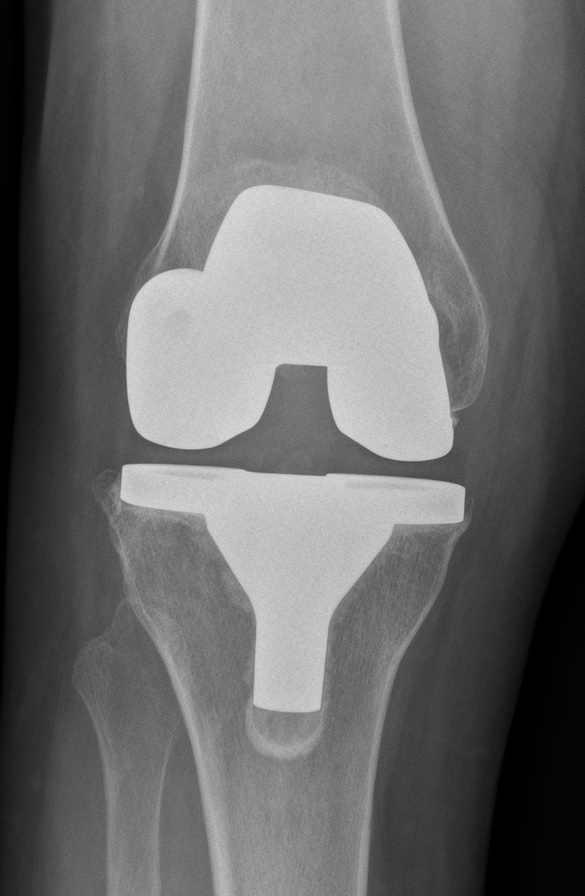 Knee_Depuy_Synthes_Sigma</td>
<td align="center" valign="top"><b>Option 1</b>  Knee_SmithAndNephew_Legion2</td>
<td align="center" valign="top"><b>✅ Option 2</b>  Knee_Depuy_Synthes_Sigma</td>
<td align="center" valign="top"><b>Option 3</b>  Knee_ZimmerBiomet_Oxford</td>
<td align="center" valign="top"><b>Option 4</b>  Knee_SmithAndNephew_GenesisII</td>
<td align="center" valign="middle"><b>Option 6</b>  <i>None of the above</i></td>
</tr></table>

### Q1030 · correct: option 1 · `Knee_SmithAndNephew_GenesisII`

<table><tr>
<td align="center" valign="top"><b>Query</b> 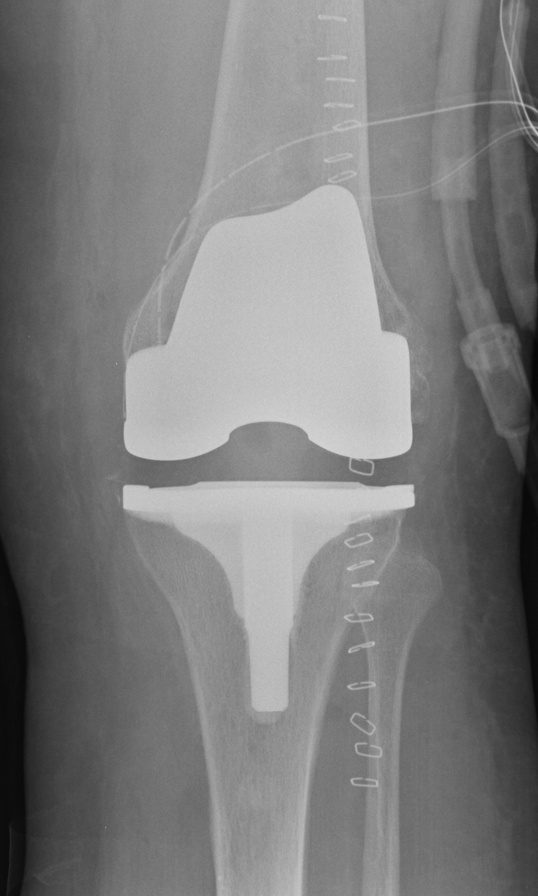 Knee_SmithAndNephew_GenesisII</td>
<td align="center" valign="top"><b>✅ Option 1</b>  Knee_SmithAndNephew_GenesisII</td>
<td align="center" valign="top"><b>Option 2</b>  Knee_Depuy_Synthes_Sigma</td>
<td align="center" valign="top"><b>Option 3</b>  Knee_ZimmerBiomet_Oxford</td>
<td align="center" valign="top"><b>Option 4</b>  Knee_SmithAndNephew_Legion2</td>
<td align="center" valign="middle"><b>Option 6</b>  <i>None of the above</i></td>
</tr></table>

### Q1031 · correct: option 2 · `Knee_SmithAndNephew_GenesisII`

<table><tr>
<td align="center" valign="top"><b>Query</b> 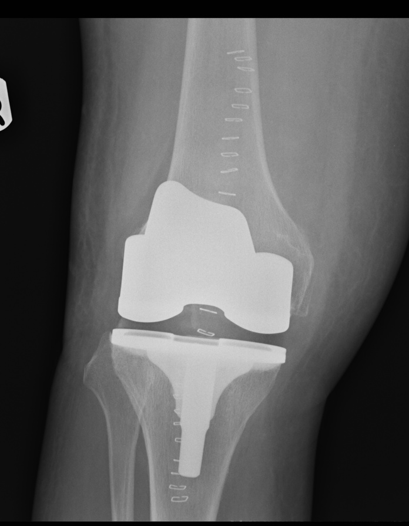 Knee_SmithAndNephew_GenesisII</td>
<td align="center" valign="top"><b>Option 1</b>  Knee_Depuy_Synthes_Sigma</td>
<td align="center" valign="top"><b>✅ Option 2</b>  Knee_SmithAndNephew_GenesisII</td>
<td align="center" valign="top"><b>Option 3</b>  Knee_SmithAndNephew_Legion2</td>
<td align="center" valign="top"><b>Option 4</b>  Knee_ZimmerBiomet_Oxford</td>
<td align="center" valign="middle"><b>Option 6</b>  <i>None of the above</i></td>
</tr></table>

### Q1032 · correct: option 1 · `Knee_SmithAndNephew_GenesisII`

<table><tr>
<td align="center" valign="top"><b>Query</b> 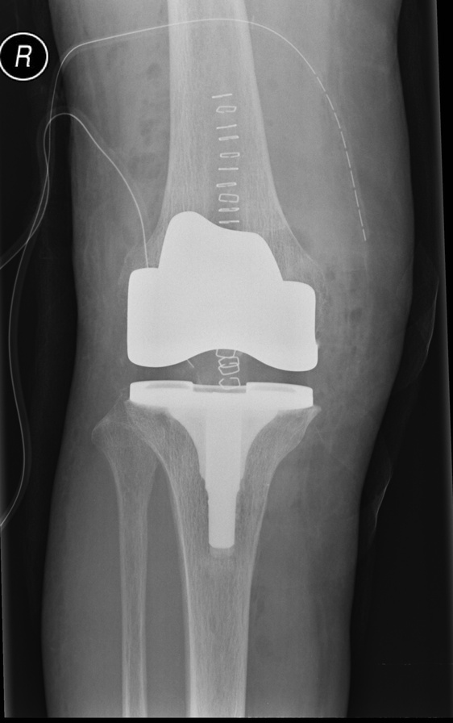 Knee_SmithAndNephew_GenesisII</td>
<td align="center" valign="top"><b>✅ Option 1</b>  Knee_SmithAndNephew_GenesisII</td>
<td align="center" valign="top"><b>Option 2</b>  Knee_Depuy_Synthes_Sigma</td>
<td align="center" valign="top"><b>Option 3</b>  Knee_SmithAndNephew_Legion2</td>
<td align="center" valign="top"><b>Option 4</b>  Knee_ZimmerBiomet_Oxford</td>
<td align="center" valign="middle"><b>Option 6</b>  <i>None of the above</i></td>
</tr></table>

### Q1033 · correct: option 4 · `Knee_SmithAndNephew_GenesisII`

<table><tr>
<td align="center" valign="top"><b>Query</b> 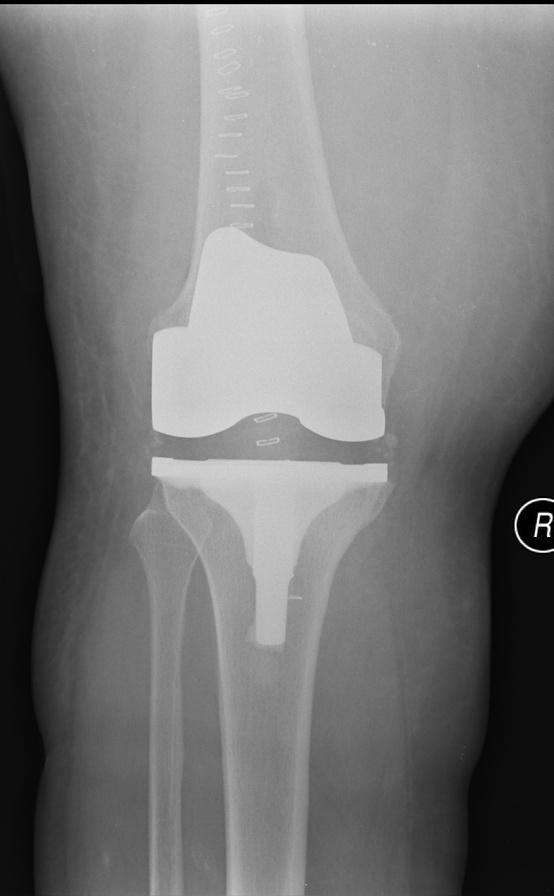 Knee_SmithAndNephew_GenesisII</td>
<td align="center" valign="top"><b>Option 1</b>  Knee_ZimmerBiomet_Oxford</td>
<td align="center" valign="top"><b>Option 2</b>  Knee_SmithAndNephew_Legion2</td>
<td align="center" valign="top"><b>Option 3</b>  Knee_Depuy_Synthes_Sigma</td>
<td align="center" valign="top"><b>✅ Option 4</b>  Knee_SmithAndNephew_GenesisII</td>
<td align="center" valign="middle"><b>Option 6</b>  <i>None of the above</i></td>
</tr></table>

### Q1034 · correct: option 3 · `Knee_SmithAndNephew_GenesisII`

<table><tr>
<td align="center" valign="top"><b>Query</b> 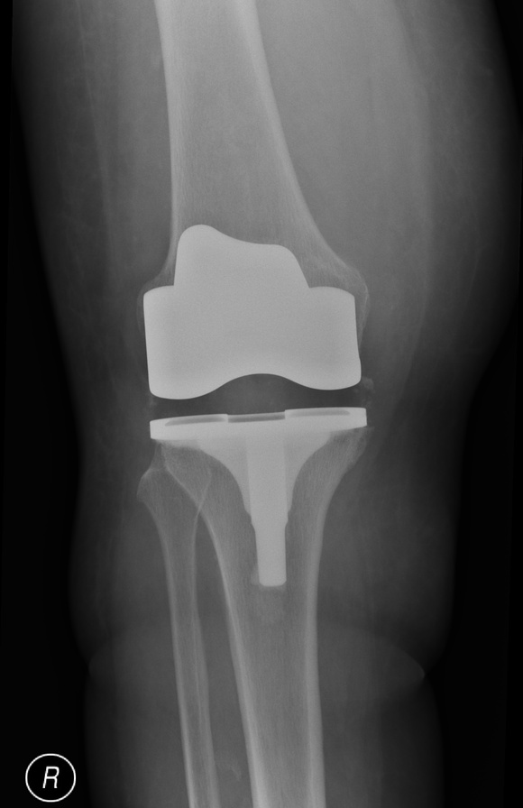 Knee_SmithAndNephew_GenesisII</td>
<td align="center" valign="top"><b>Option 1</b>  Knee_ZimmerBiomet_Oxford</td>
<td align="center" valign="top"><b>Option 2</b>  Knee_Depuy_Synthes_Sigma</td>
<td align="center" valign="top"><b>✅ Option 3</b>  Knee_SmithAndNephew_GenesisII</td>
<td align="center" valign="top"><b>Option 4</b>  Knee_SmithAndNephew_Legion2</td>
<td align="center" valign="middle"><b>Option 6</b>  <i>None of the above</i></td>
</tr></table>

### Q1035 · correct: option 1 · `Knee_SmithAndNephew_GenesisII`

<table><tr>
<td align="center" valign="top"><b>Query</b> 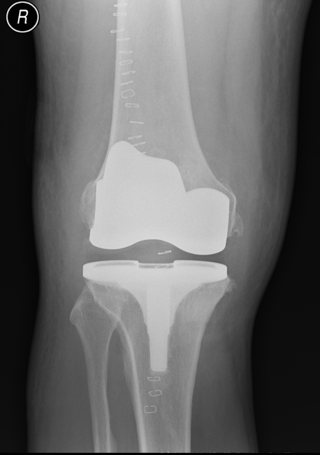 Knee_SmithAndNephew_GenesisII</td>
<td align="center" valign="top"><b>✅ Option 1</b>  Knee_SmithAndNephew_GenesisII</td>
<td align="center" valign="top"><b>Option 2</b>  Knee_SmithAndNephew_Legion2</td>
<td align="center" valign="top"><b>Option 3</b>  Knee_ZimmerBiomet_Oxford</td>
<td align="center" valign="top"><b>Option 4</b>  Knee_Depuy_Synthes_Sigma</td>
<td align="center" valign="middle"><b>Option 6</b>  <i>None of the above</i></td>
</tr></table>

### Q1036 · correct: option 1 · `Knee_Depuy_Synthes_Sigma`

<table><tr>
<td align="center" valign="top"><b>Query</b> 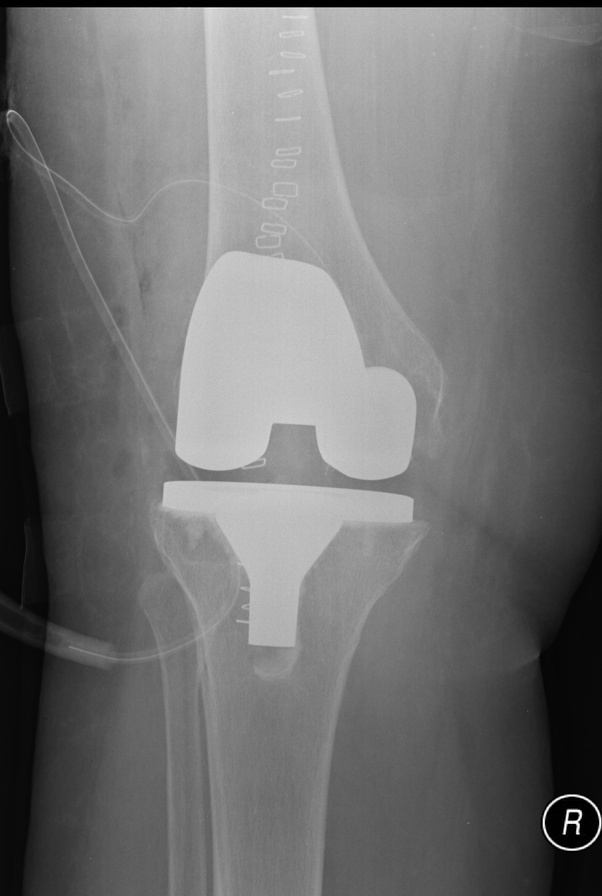 Knee_Depuy_Synthes_Sigma</td>
<td align="center" valign="top"><b>✅ Option 1</b>  Knee_Depuy_Synthes_Sigma</td>
<td align="center" valign="top"><b>Option 2</b>  Knee_ZimmerBiomet_Oxford</td>
<td align="center" valign="top"><b>Option 3</b>  Knee_SmithAndNephew_Legion2</td>
<td align="center" valign="top"><b>Option 4</b>  Knee_SmithAndNephew_GenesisII</td>
<td align="center" valign="middle"><b>Option 6</b>  <i>None of the above</i></td>
</tr></table>

### Q1037 · correct: option 2 · `Knee_Depuy_Synthes_Sigma`

<table><tr>
<td align="center" valign="top"><b>Query</b> 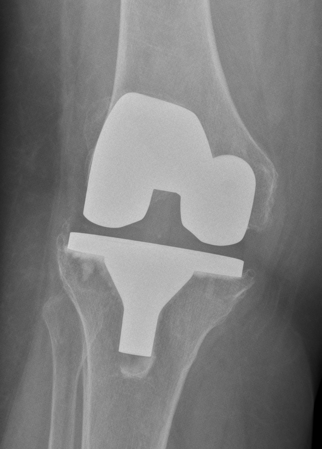 Knee_Depuy_Synthes_Sigma</td>
<td align="center" valign="top"><b>Option 1</b>  Knee_ZimmerBiomet_Oxford</td>
<td align="center" valign="top"><b>✅ Option 2</b> 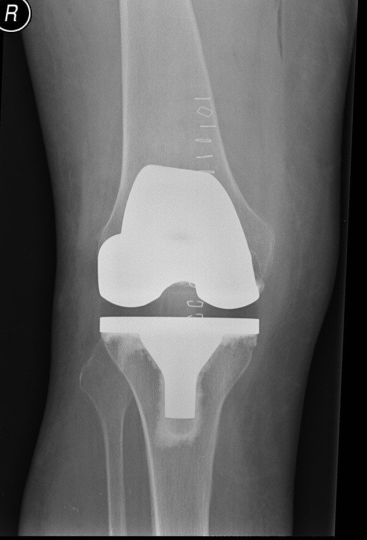 Knee_Depuy_Synthes_Sigma</td>
<td align="center" valign="top"><b>Option 3</b>  Knee_SmithAndNephew_GenesisII</td>
<td align="center" valign="top"><b>Option 4</b>  Knee_SmithAndNephew_Legion2</td>
<td align="center" valign="middle"><b>Option 6</b>  <i>None of the above</i></td>
</tr></table>

### Q1038 · correct: option 3 · `Knee_Depuy_Synthes_Sigma`

<table><tr>
<td align="center" valign="top"><b>Query</b> 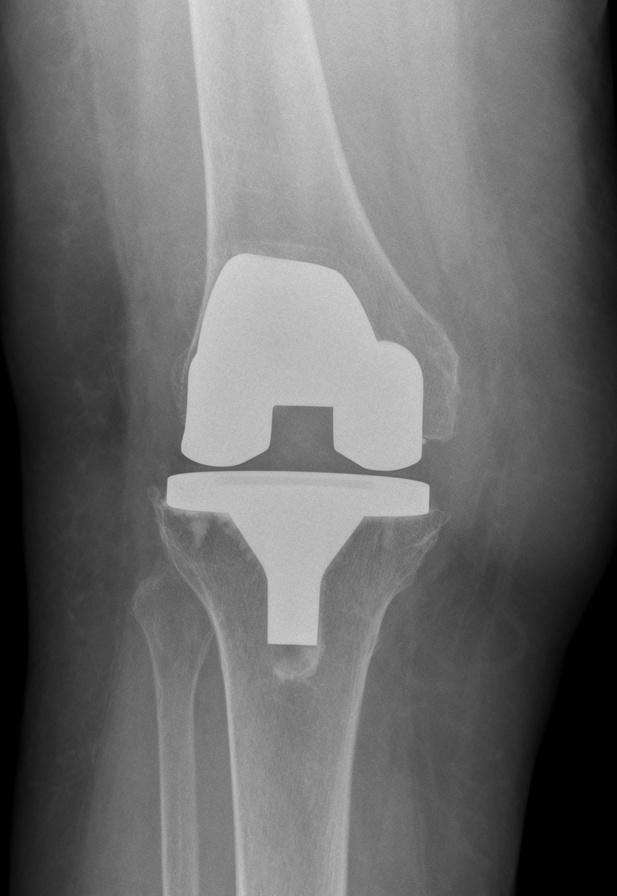 Knee_Depuy_Synthes_Sigma</td>
<td align="center" valign="top"><b>Option 1</b>  Knee_SmithAndNephew_Legion2</td>
<td align="center" valign="top"><b>Option 2</b>  Knee_SmithAndNephew_GenesisII</td>
<td align="center" valign="top"><b>✅ Option 3</b>  Knee_Depuy_Synthes_Sigma</td>
<td align="center" valign="top"><b>Option 4</b>  Knee_ZimmerBiomet_Oxford</td>
<td align="center" valign="middle"><b>Option 6</b>  <i>None of the above</i></td>
</tr></table>

### Q1039 · correct: option 4 · `Knee_SmithAndNephew_GenesisII`

<table><tr>
<td align="center" valign="top"><b>Query</b> 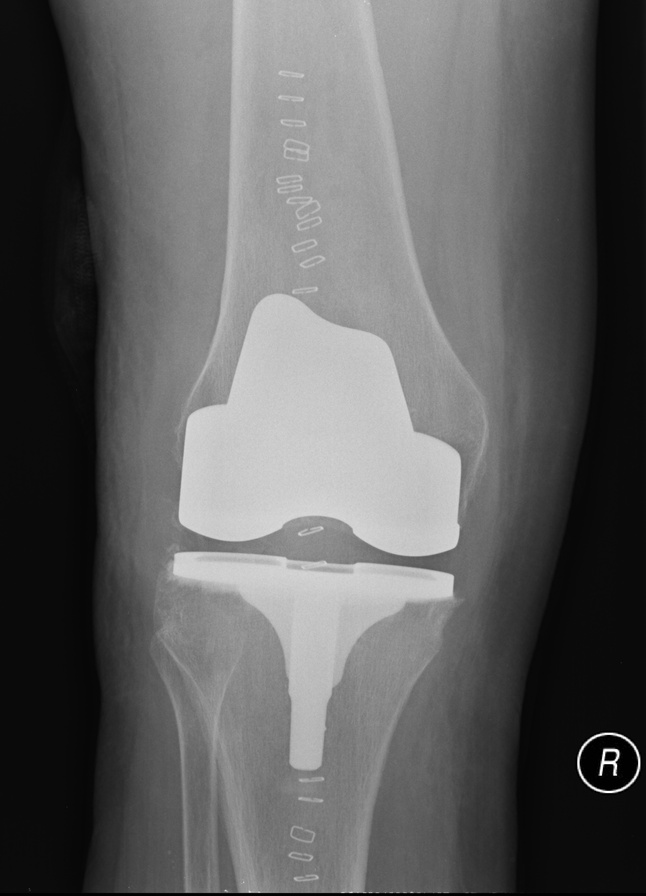 Knee_SmithAndNephew_GenesisII</td>
<td align="center" valign="top"><b>Option 1</b>  Knee_SmithAndNephew_Legion2</td>
<td align="center" valign="top"><b>Option 2</b>  Knee_Depuy_Synthes_Sigma</td>
<td align="center" valign="top"><b>Option 3</b>  Knee_ZimmerBiomet_Oxford</td>
<td align="center" valign="top"><b>✅ Option 4</b>  Knee_SmithAndNephew_GenesisII</td>
<td align="center" valign="middle"><b>Option 6</b>  <i>None of the above</i></td>
</tr></table>

### Q1040 · correct: option 2 · `Knee_SmithAndNephew_GenesisII`

<table><tr>
<td align="center" valign="top"><b>Query</b> 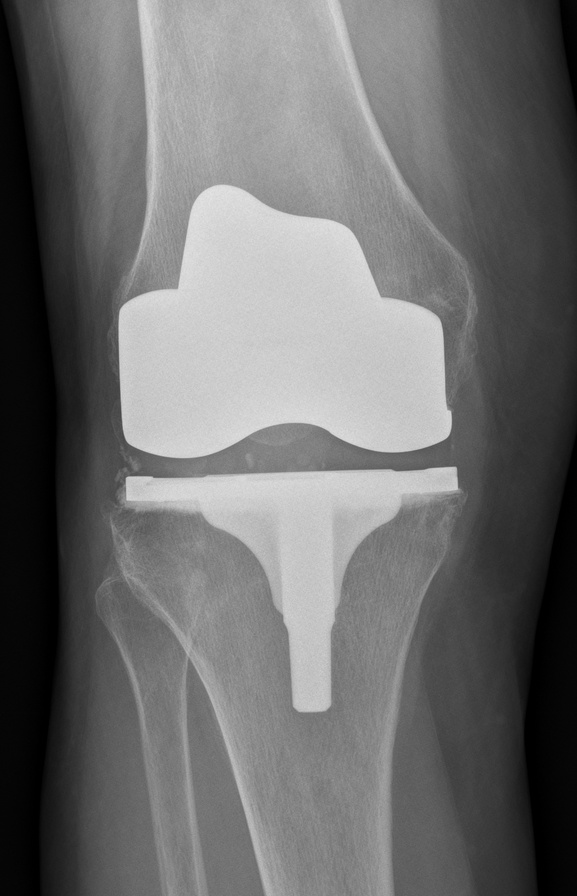 Knee_SmithAndNephew_GenesisII</td>
<td align="center" valign="top"><b>Option 1</b>  Knee_ZimmerBiomet_Oxford</td>
<td align="center" valign="top"><b>✅ Option 2</b>  Knee_SmithAndNephew_GenesisII</td>
<td align="center" valign="top"><b>Option 3</b>  Knee_SmithAndNephew_Legion2</td>
<td align="center" valign="top"><b>Option 4</b>  Knee_Depuy_Synthes_Sigma</td>
<td align="center" valign="middle"><b>Option 6</b>  <i>None of the above</i></td>
</tr></table>

### Q1041 · correct: option 2 · `Knee_SmithAndNephew_GenesisII`

<table><tr>
<td align="center" valign="top"><b>Query</b> 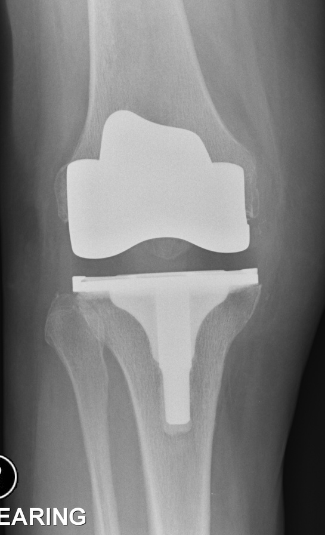 Knee_SmithAndNephew_GenesisII</td>
<td align="center" valign="top"><b>Option 1</b>  Knee_ZimmerBiomet_Oxford</td>
<td align="center" valign="top"><b>✅ Option 2</b>  Knee_SmithAndNephew_GenesisII</td>
<td align="center" valign="top"><b>Option 3</b>  Knee_Depuy_Synthes_Sigma</td>
<td align="center" valign="top"><b>Option 4</b>  Knee_SmithAndNephew_Legion2</td>
<td align="center" valign="middle"><b>Option 6</b>  <i>None of the above</i></td>
</tr></table>

### Q1042 · correct: option 3 · `Knee_SmithAndNephew_GenesisII`

<table><tr>
<td align="center" valign="top"><b>Query</b> 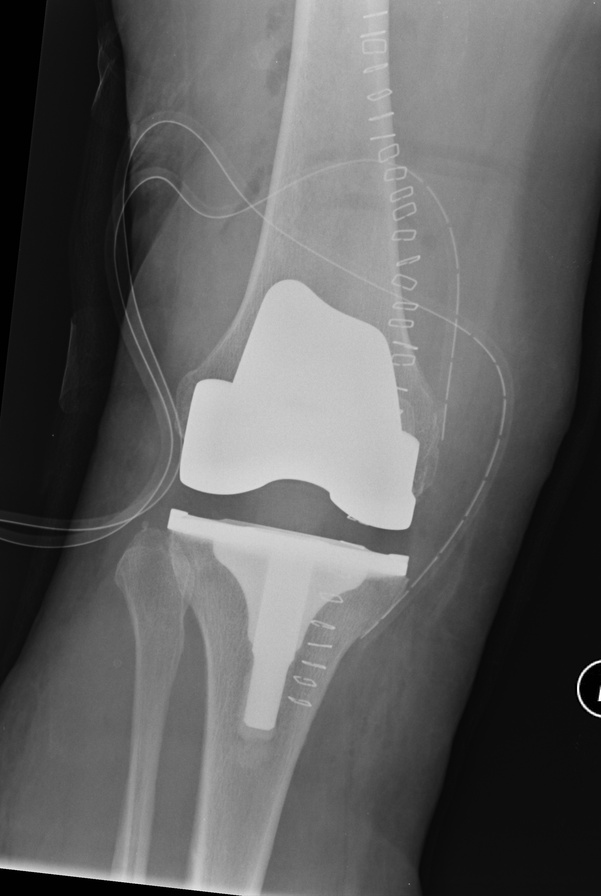 Knee_SmithAndNephew_GenesisII</td>
<td align="center" valign="top"><b>Option 1</b>  Knee_SmithAndNephew_Legion2</td>
<td align="center" valign="top"><b>Option 2</b>  Knee_Depuy_Synthes_Sigma</td>
<td align="center" valign="top"><b>✅ Option 3</b>  Knee_SmithAndNephew_GenesisII</td>
<td align="center" valign="top"><b>Option 4</b>  Knee_ZimmerBiomet_Oxford</td>
<td align="center" valign="middle"><b>Option 6</b>  <i>None of the above</i></td>
</tr></table>

### Q1043 · correct: option 4 · `Knee_SmithAndNephew_GenesisII`

<table><tr>
<td align="center" valign="top"><b>Query</b> 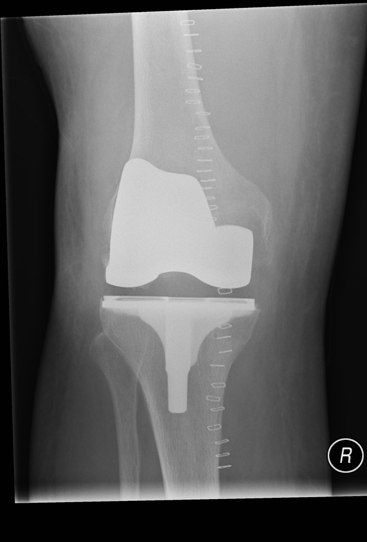 Knee_SmithAndNephew_GenesisII</td>
<td align="center" valign="top"><b>Option 1</b>  Knee_ZimmerBiomet_Oxford</td>
<td align="center" valign="top"><b>Option 2</b>  Knee_SmithAndNephew_Legion2</td>
<td align="center" valign="top"><b>Option 3</b>  Knee_Depuy_Synthes_Sigma</td>
<td align="center" valign="top"><b>✅ Option 4</b>  Knee_SmithAndNephew_GenesisII</td>
<td align="center" valign="middle"><b>Option 6</b>  <i>None of the above</i></td>
</tr></table>

### Q1044 · correct: option 4 · `Knee_ZimmerBiomet_Oxford`

<table><tr>
<td align="center" valign="top"><b>Query</b> 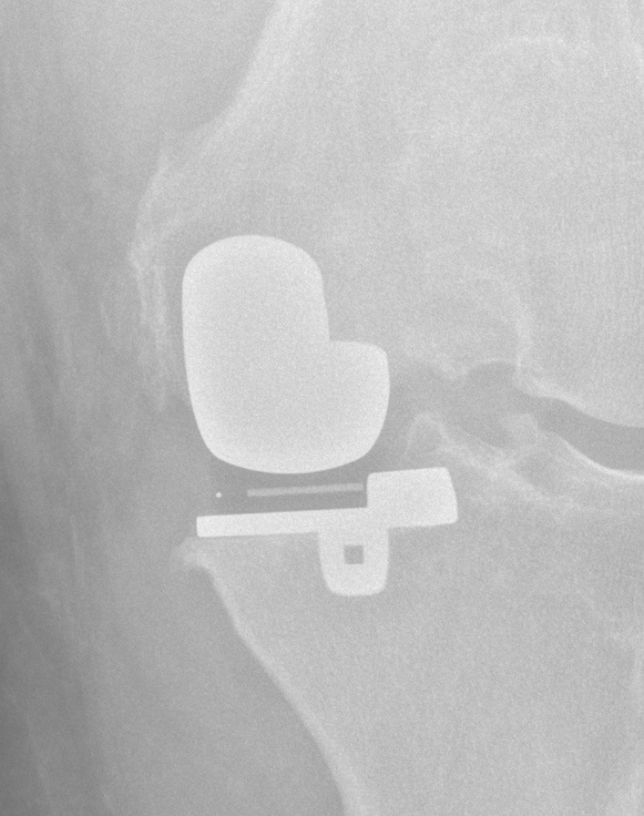 Knee_ZimmerBiomet_Oxford</td>
<td align="center" valign="top"><b>Option 1</b> 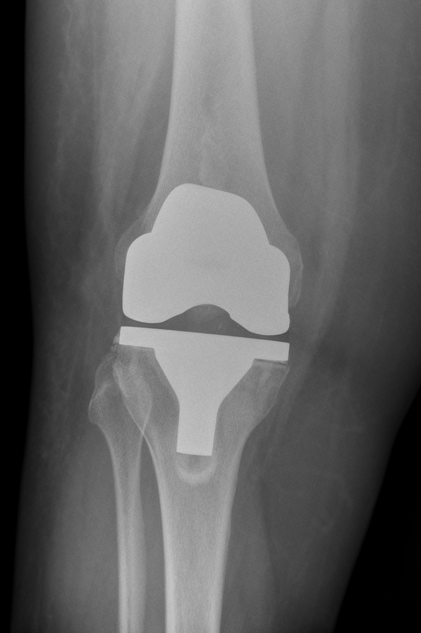 Knee_Depuy_Synthes_Sigma</td>
<td align="center" valign="top"><b>Option 2</b>  Knee_SmithAndNephew_Legion2</td>
<td align="center" valign="top"><b>Option 3</b> 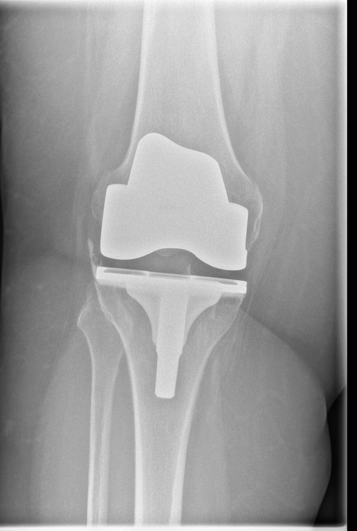 Knee_SmithAndNephew_GenesisII</td>
<td align="center" valign="top"><b>✅ Option 4</b>  Knee_ZimmerBiomet_Oxford</td>
<td align="center" valign="middle"><b>Option 6</b>  <i>None of the above</i></td>
</tr></table>

### Q1045 · correct: option 4 · `Knee_ZimmerBiomet_Oxford`

<table><tr>
<td align="center" valign="top"><b>Query</b> 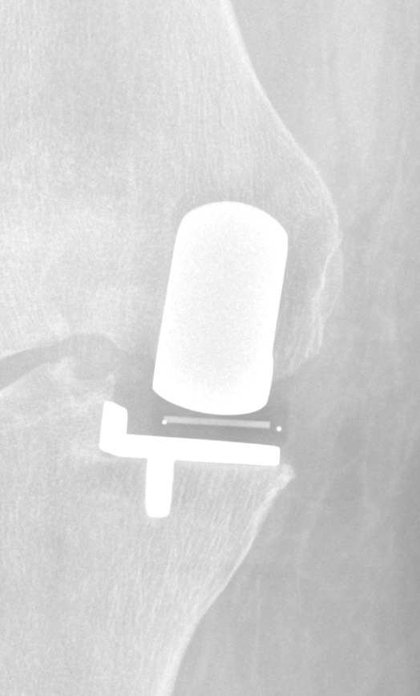 Knee_ZimmerBiomet_Oxford</td>
<td align="center" valign="top"><b>Option 1</b>  Knee_SmithAndNephew_Legion2</td>
<td align="center" valign="top"><b>Option 2</b>  Knee_SmithAndNephew_GenesisII</td>
<td align="center" valign="top"><b>Option 3</b>  Knee_Depuy_Synthes_Sigma</td>
<td align="center" valign="top"><b>✅ Option 4</b>  Knee_ZimmerBiomet_Oxford</td>
<td align="center" valign="middle"><b>Option 6</b>  <i>None of the above</i></td>
</tr></table>

### Q1046 · correct: option 2 · `Knee_ZimmerBiomet_Oxford`

<table><tr>
<td align="center" valign="top"><b>Query</b> 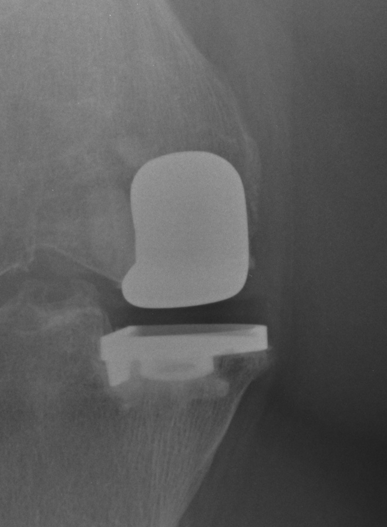 Knee_ZimmerBiomet_Oxford</td>
<td align="center" valign="top"><b>Option 1</b>  Knee_Depuy_Synthes_Sigma</td>
<td align="center" valign="top"><b>✅ Option 2</b>  Knee_ZimmerBiomet_Oxford</td>
<td align="center" valign="top"><b>Option 3</b>  Knee_SmithAndNephew_Legion2</td>
<td align="center" valign="top"><b>Option 4</b>  Knee_SmithAndNephew_GenesisII</td>
<td align="center" valign="middle"><b>Option 6</b>  <i>None of the above</i></td>
</tr></table>

### Q1047 · correct: option 4 · `Knee_ZimmerBiomet_Oxford`

<table><tr>
<td align="center" valign="top"><b>Query</b> 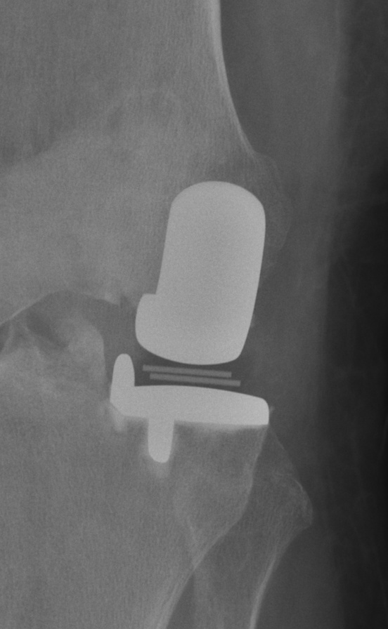 Knee_ZimmerBiomet_Oxford</td>
<td align="center" valign="top"><b>Option 1</b>  Knee_SmithAndNephew_Legion2</td>
<td align="center" valign="top"><b>Option 2</b>  Knee_SmithAndNephew_GenesisII</td>
<td align="center" valign="top"><b>Option 3</b>  Knee_Depuy_Synthes_Sigma</td>
<td align="center" valign="top"><b>✅ Option 4</b> 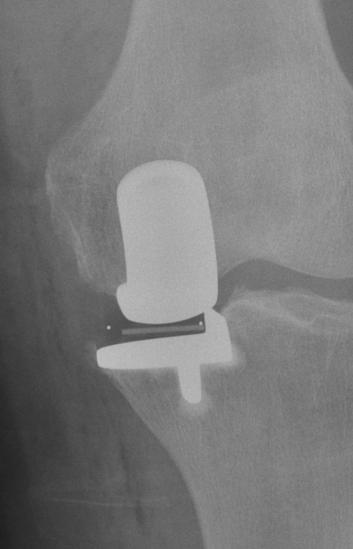 Knee_ZimmerBiomet_Oxford</td>
<td align="center" valign="middle"><b>Option 6</b>  <i>None of the above</i></td>
</tr></table>

### Q1048 · correct: option 3 · `Knee_ZimmerBiomet_Oxford`

<table><tr>
<td align="center" valign="top"><b>Query</b> 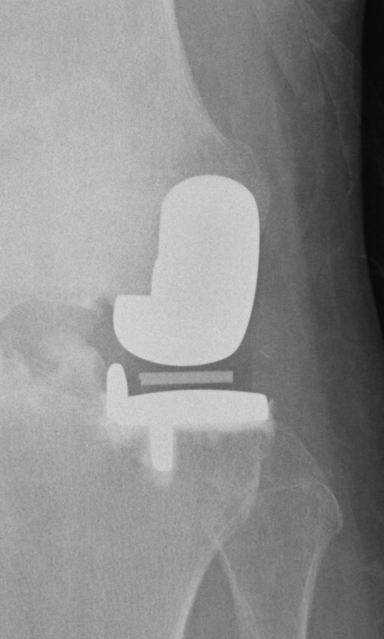 Knee_ZimmerBiomet_Oxford</td>
<td align="center" valign="top"><b>Option 1</b>  Knee_SmithAndNephew_Legion2</td>
<td align="center" valign="top"><b>Option 2</b>  Knee_SmithAndNephew_GenesisII</td>
<td align="center" valign="top"><b>✅ Option 3</b>  Knee_ZimmerBiomet_Oxford</td>
<td align="center" valign="top"><b>Option 4</b>  Knee_Depuy_Synthes_Sigma</td>
<td align="center" valign="middle"><b>Option 6</b>  <i>None of the above</i></td>
</tr></table>

### Q1049 · correct: option 1 · `Knee_ZimmerBiomet_Oxford`

<table><tr>
<td align="center" valign="top"><b>Query</b> 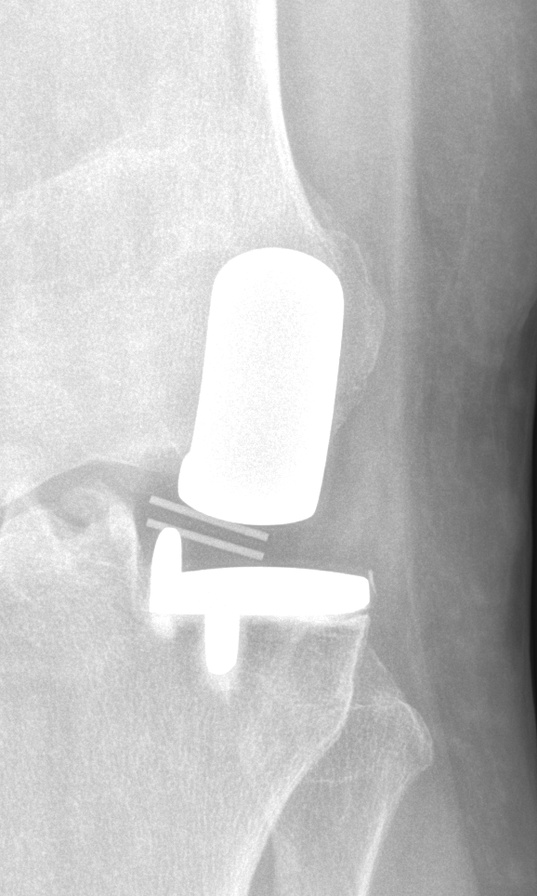 Knee_ZimmerBiomet_Oxford</td>
<td align="center" valign="top"><b>✅ Option 1</b>  Knee_ZimmerBiomet_Oxford</td>
<td align="center" valign="top"><b>Option 2</b>  Knee_Depuy_Synthes_Sigma</td>
<td align="center" valign="top"><b>Option 3</b>  Knee_SmithAndNephew_GenesisII</td>
<td align="center" valign="top"><b>Option 4</b>  Knee_SmithAndNephew_Legion2</td>
<td align="center" valign="middle"><b>Option 6</b>  <i>None of the above</i></td>
</tr></table>

### Q1050 · correct: option 3 · `Knee_ZimmerBiomet_Oxford`

<table><tr>
<td align="center" valign="top"><b>Query</b> 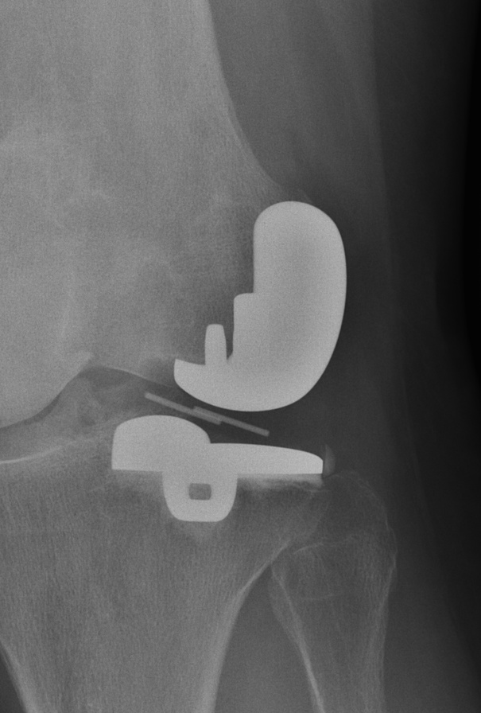 Knee_ZimmerBiomet_Oxford</td>
<td align="center" valign="top"><b>Option 1</b>  Knee_Depuy_Synthes_Sigma</td>
<td align="center" valign="top"><b>Option 2</b>  Knee_SmithAndNephew_Legion2</td>
<td align="center" valign="top"><b>✅ Option 3</b>  Knee_ZimmerBiomet_Oxford</td>
<td align="center" valign="top"><b>Option 4</b>  Knee_SmithAndNephew_GenesisII</td>
<td align="center" valign="middle"><b>Option 6</b>  <i>None of the above</i></td>
</tr></table>

### Q1051 · correct: option 1 · `Knee_ZimmerBiomet_Oxford`

<table><tr>
<td align="center" valign="top"><b>Query</b> 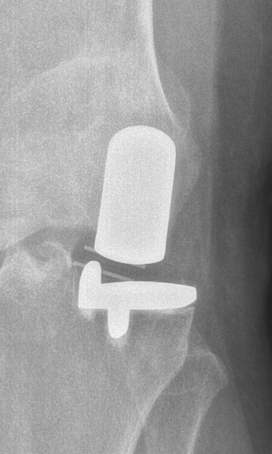 Knee_ZimmerBiomet_Oxford</td>
<td align="center" valign="top"><b>✅ Option 1</b>  Knee_ZimmerBiomet_Oxford</td>
<td align="center" valign="top"><b>Option 2</b>  Knee_SmithAndNephew_Legion2</td>
<td align="center" valign="top"><b>Option 3</b>  Knee_Depuy_Synthes_Sigma</td>
<td align="center" valign="top"><b>Option 4</b>  Knee_SmithAndNephew_GenesisII</td>
<td align="center" valign="middle"><b>Option 6</b>  <i>None of the above</i></td>
</tr></table>

### Q1052 · correct: option 4 · `Knee_ZimmerBiomet_Oxford`

<table><tr>
<td align="center" valign="top"><b>Query</b> 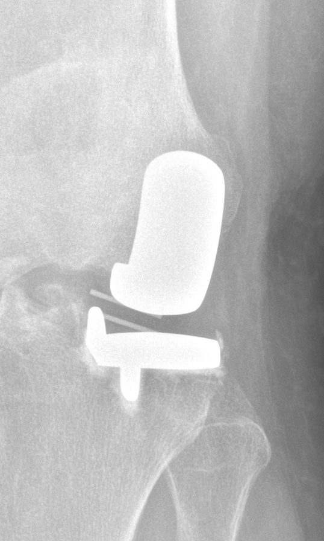 Knee_ZimmerBiomet_Oxford</td>
<td align="center" valign="top"><b>Option 1</b>  Knee_SmithAndNephew_GenesisII</td>
<td align="center" valign="top"><b>Option 2</b>  Knee_Depuy_Synthes_Sigma</td>
<td align="center" valign="top"><b>Option 3</b>  Knee_SmithAndNephew_Legion2</td>
<td align="center" valign="top"><b>✅ Option 4</b>  Knee_ZimmerBiomet_Oxford</td>
<td align="center" valign="middle"><b>Option 6</b>  <i>None of the above</i></td>
</tr></table>

### Q1053 · correct: option 1 · `Knee_ZimmerBiomet_Oxford`

<table><tr>
<td align="center" valign="top"><b>Query</b> 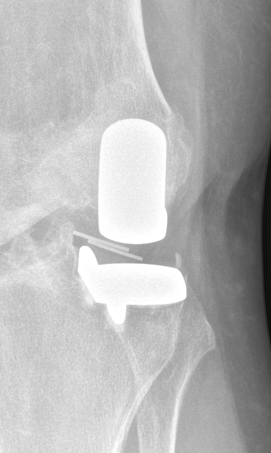 Knee_ZimmerBiomet_Oxford</td>
<td align="center" valign="top"><b>✅ Option 1</b>  Knee_ZimmerBiomet_Oxford</td>
<td align="center" valign="top"><b>Option 2</b>  Knee_Depuy_Synthes_Sigma</td>
<td align="center" valign="top"><b>Option 3</b>  Knee_SmithAndNephew_GenesisII</td>
<td align="center" valign="top"><b>Option 4</b>  Knee_SmithAndNephew_Legion2</td>
<td align="center" valign="middle"><b>Option 6</b>  <i>None of the above</i></td>
</tr></table>

