# OrthoNet knee · query set `train2` · page 1/2

[← all pages](README.md)

### Q1054 · correct: option 3 · `Knee_SmithAndNephew_GenesisII`

<table><tr>
<td align="center" valign="top"><b>Query</b> 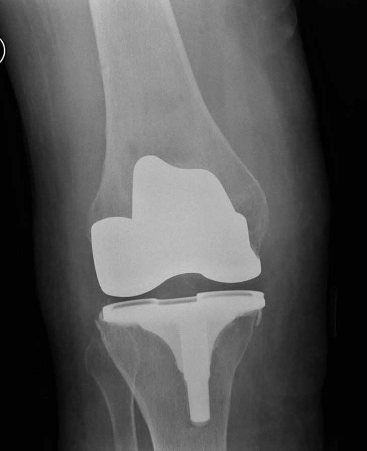 Knee_SmithAndNephew_GenesisII</td>
<td align="center" valign="top"><b>Option 1</b> 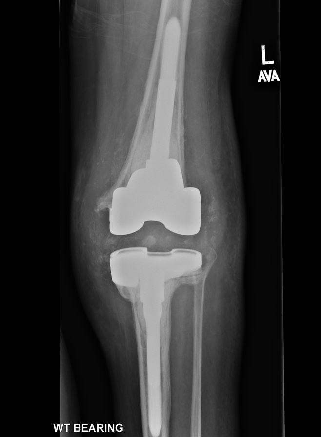 Knee_SmithAndNephew_Legion2</td>
<td align="center" valign="top"><b>Option 2</b> 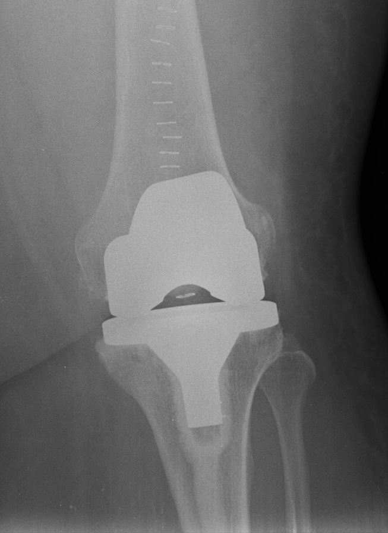 Knee_Depuy_Synthes_Sigma</td>
<td align="center" valign="top"><b>✅ Option 3</b> 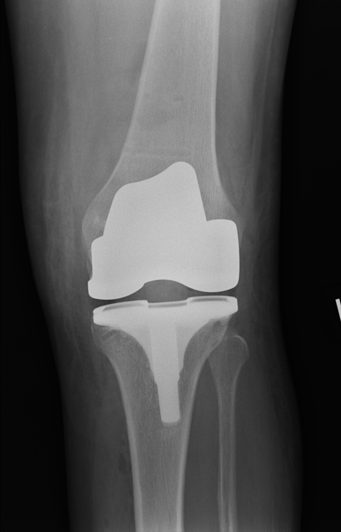 Knee_SmithAndNephew_GenesisII</td>
<td align="center" valign="top"><b>Option 4</b> 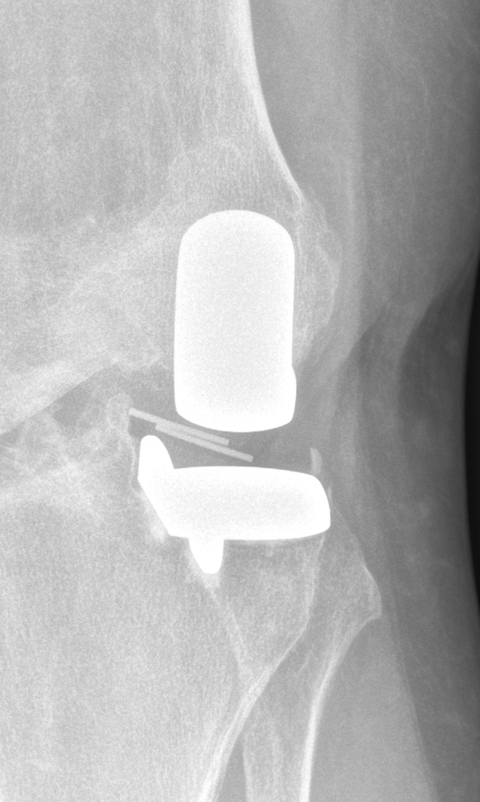 Knee_ZimmerBiomet_Oxford</td>
<td align="center" valign="middle"><b>Option 6</b>  <i>None of the above</i></td>
</tr></table>

### Q1055 · correct: option 2 · `Knee_Depuy_Synthes_Sigma`

<table><tr>
<td align="center" valign="top"><b>Query</b> 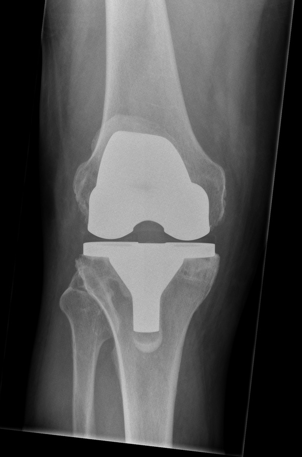 Knee_Depuy_Synthes_Sigma</td>
<td align="center" valign="top"><b>Option 1</b> 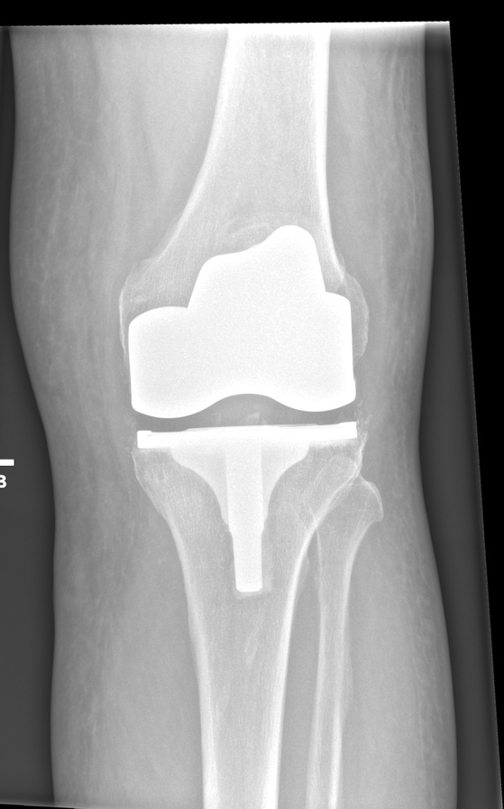 Knee_SmithAndNephew_GenesisII</td>
<td align="center" valign="top"><b>✅ Option 2</b> 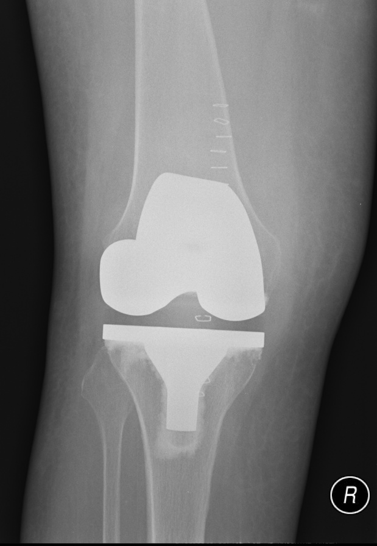 Knee_Depuy_Synthes_Sigma</td>
<td align="center" valign="top"><b>Option 3</b> 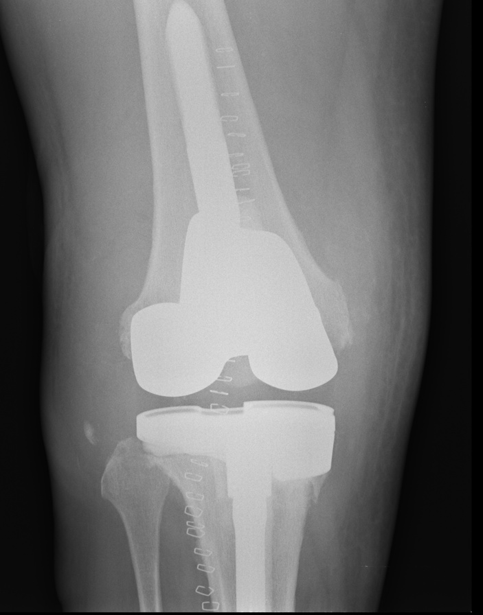 Knee_SmithAndNephew_Legion2</td>
<td align="center" valign="top"><b>Option 4</b> 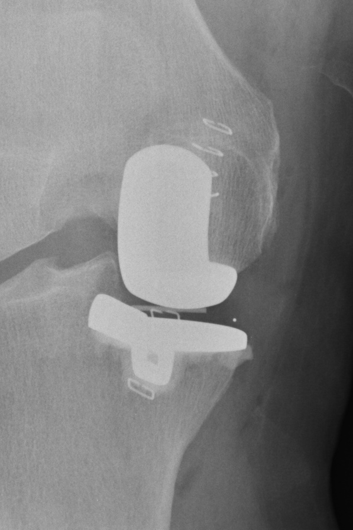 Knee_ZimmerBiomet_Oxford</td>
<td align="center" valign="middle"><b>Option 6</b>  <i>None of the above</i></td>
</tr></table>

### Q1056 · correct: option 4 · `Knee_Depuy_Synthes_Sigma`

<table><tr>
<td align="center" valign="top"><b>Query</b> 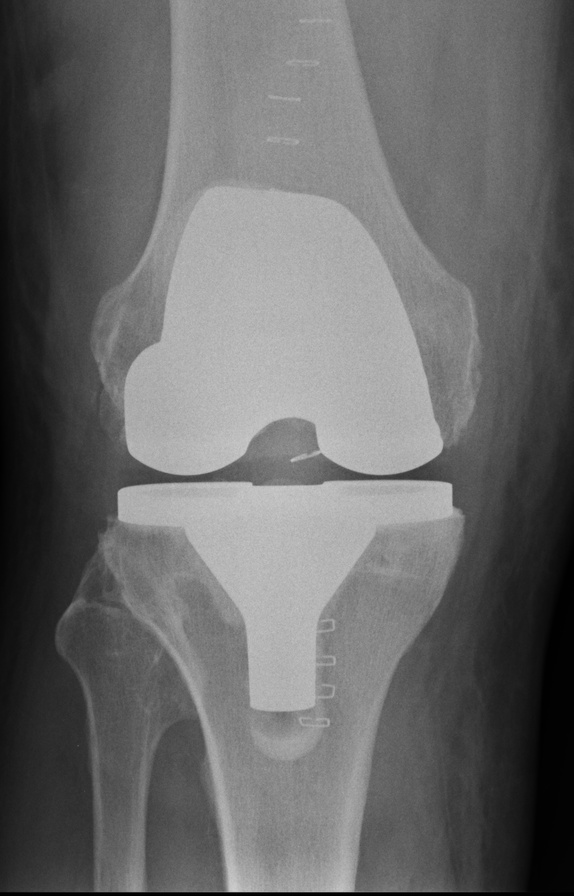 Knee_Depuy_Synthes_Sigma</td>
<td align="center" valign="top"><b>Option 1</b>  Knee_SmithAndNephew_Legion2</td>
<td align="center" valign="top"><b>Option 2</b>  Knee_SmithAndNephew_GenesisII</td>
<td align="center" valign="top"><b>Option 3</b> 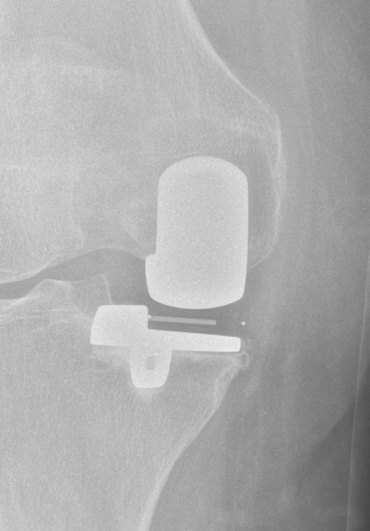 Knee_ZimmerBiomet_Oxford</td>
<td align="center" valign="top"><b>✅ Option 4</b> 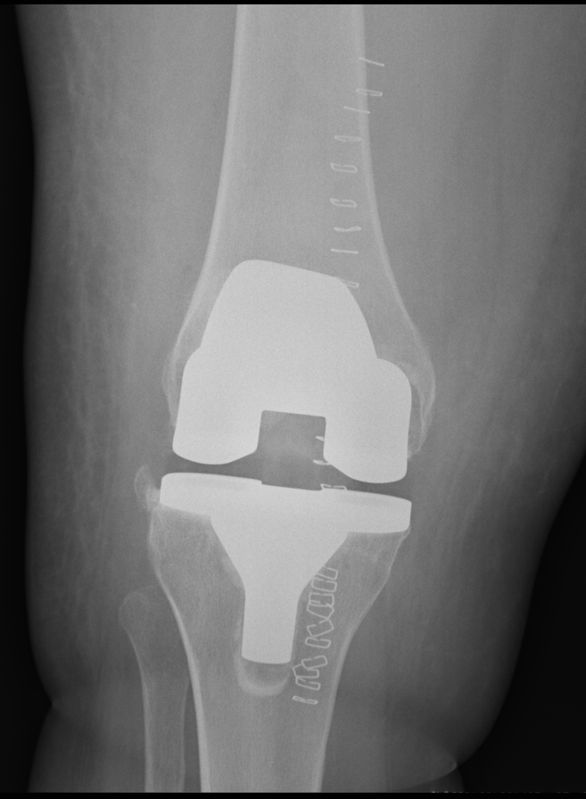 Knee_Depuy_Synthes_Sigma</td>
<td align="center" valign="middle"><b>Option 6</b>  <i>None of the above</i></td>
</tr></table>

### Q1057 · correct: option 1 · `Knee_SmithAndNephew_GenesisII`

<table><tr>
<td align="center" valign="top"><b>Query</b> 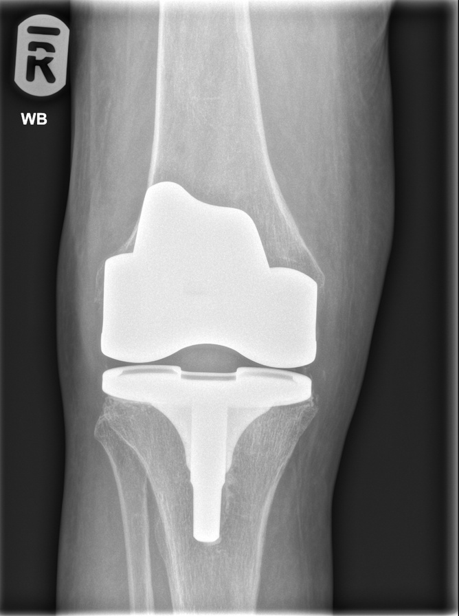 Knee_SmithAndNephew_GenesisII</td>
<td align="center" valign="top"><b>✅ Option 1</b>  Knee_SmithAndNephew_GenesisII</td>
<td align="center" valign="top"><b>Option 2</b> 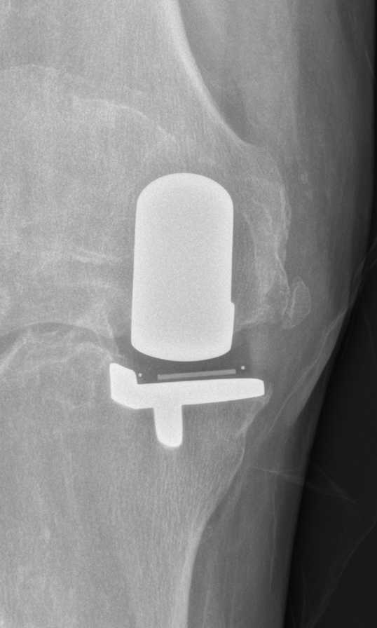 Knee_ZimmerBiomet_Oxford</td>
<td align="center" valign="top"><b>Option 3</b>  Knee_Depuy_Synthes_Sigma</td>
<td align="center" valign="top"><b>Option 4</b>  Knee_SmithAndNephew_Legion2</td>
<td align="center" valign="middle"><b>Option 6</b>  <i>None of the above</i></td>
</tr></table>

### Q1058 · correct: option 2 · `Knee_SmithAndNephew_GenesisII`

<table><tr>
<td align="center" valign="top"><b>Query</b> 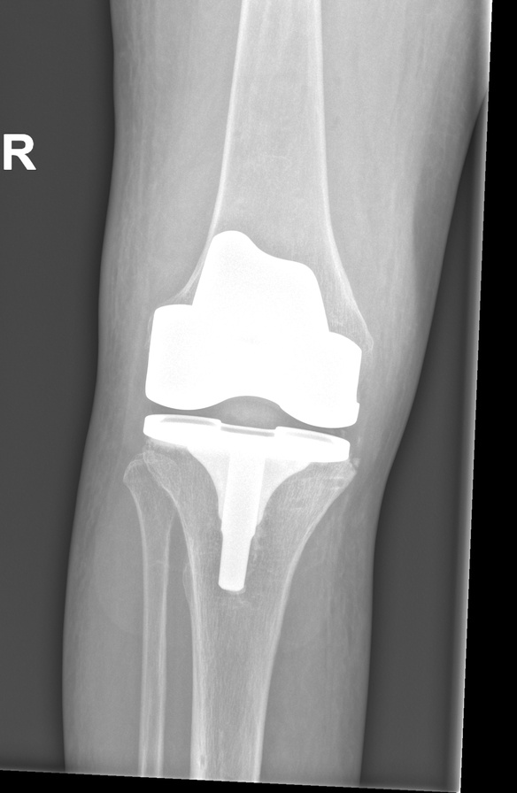 Knee_SmithAndNephew_GenesisII</td>
<td align="center" valign="top"><b>Option 1</b>  Knee_SmithAndNephew_Legion2</td>
<td align="center" valign="top"><b>✅ Option 2</b>  Knee_SmithAndNephew_GenesisII</td>
<td align="center" valign="top"><b>Option 3</b>  Knee_ZimmerBiomet_Oxford</td>
<td align="center" valign="top"><b>Option 4</b> 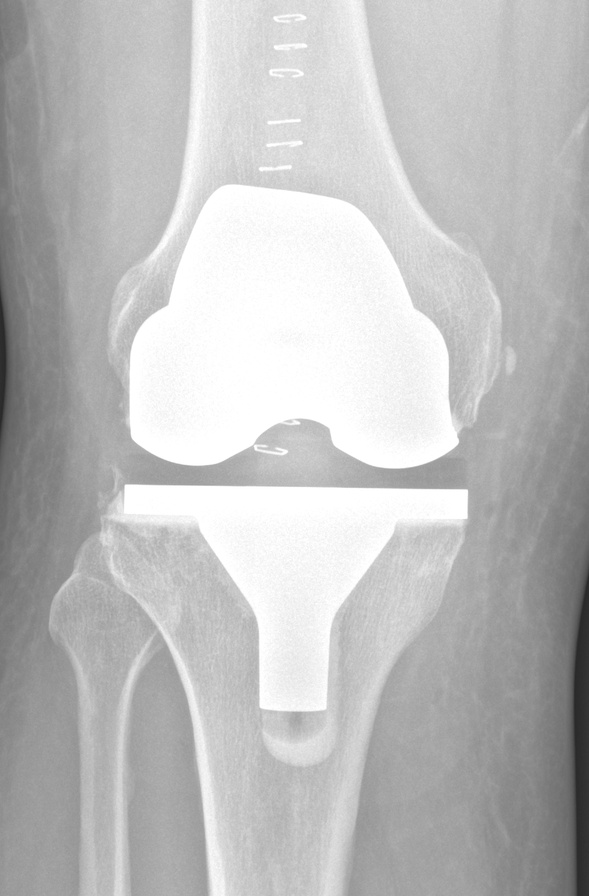 Knee_Depuy_Synthes_Sigma</td>
<td align="center" valign="middle"><b>Option 6</b>  <i>None of the above</i></td>
</tr></table>

### Q1059 · correct: option 2 · `Knee_SmithAndNephew_GenesisII`

<table><tr>
<td align="center" valign="top"><b>Query</b> 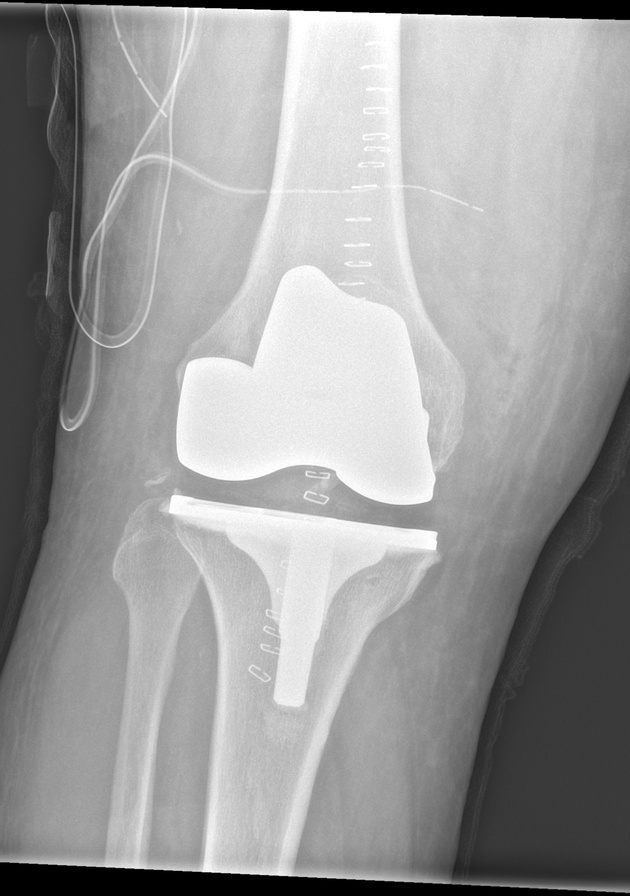 Knee_SmithAndNephew_GenesisII</td>
<td align="center" valign="top"><b>Option 1</b>  Knee_ZimmerBiomet_Oxford</td>
<td align="center" valign="top"><b>✅ Option 2</b>  Knee_SmithAndNephew_GenesisII</td>
<td align="center" valign="top"><b>Option 3</b>  Knee_Depuy_Synthes_Sigma</td>
<td align="center" valign="top"><b>Option 4</b> 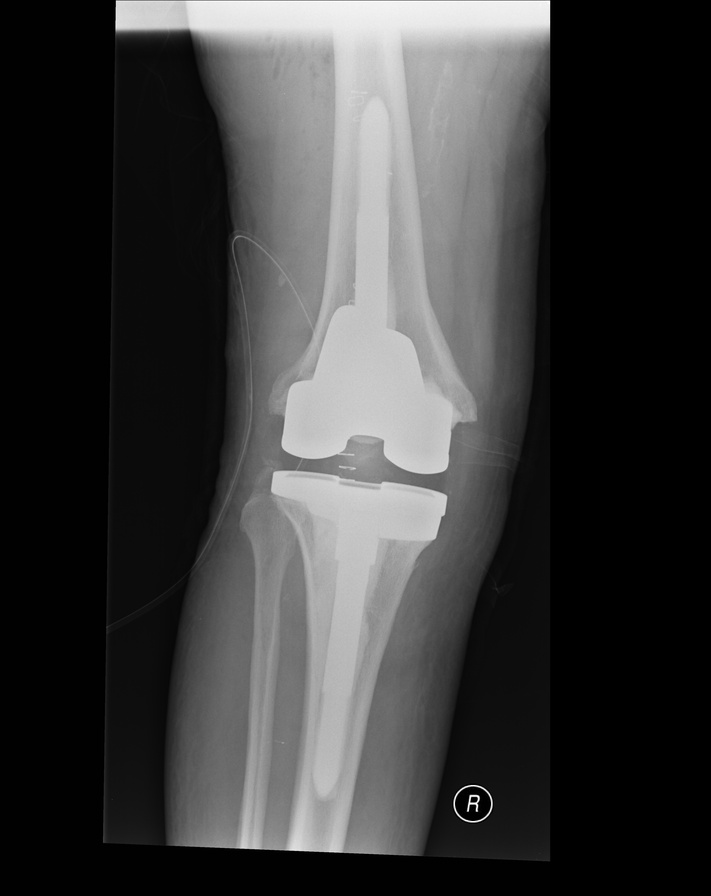 Knee_SmithAndNephew_Legion2</td>
<td align="center" valign="middle"><b>Option 6</b>  <i>None of the above</i></td>
</tr></table>

### Q1060 · correct: option 2 · `Knee_SmithAndNephew_GenesisII`

<table><tr>
<td align="center" valign="top"><b>Query</b> 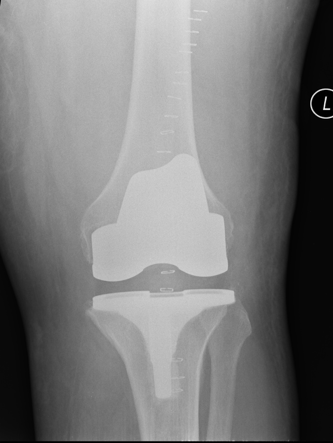 Knee_SmithAndNephew_GenesisII</td>
<td align="center" valign="top"><b>Option 1</b>  Knee_ZimmerBiomet_Oxford</td>
<td align="center" valign="top"><b>✅ Option 2</b>  Knee_SmithAndNephew_GenesisII</td>
<td align="center" valign="top"><b>Option 3</b>  Knee_Depuy_Synthes_Sigma</td>
<td align="center" valign="top"><b>Option 4</b>  Knee_SmithAndNephew_Legion2</td>
<td align="center" valign="middle"><b>Option 6</b>  <i>None of the above</i></td>
</tr></table>

### Q1061 · correct: option 1 · `Knee_SmithAndNephew_GenesisII`

<table><tr>
<td align="center" valign="top"><b>Query</b> 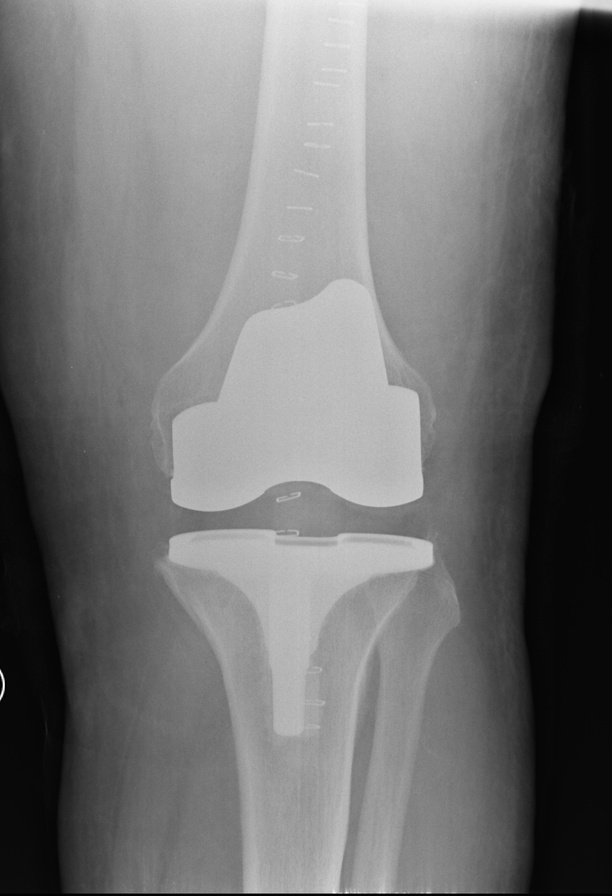 Knee_SmithAndNephew_GenesisII</td>
<td align="center" valign="top"><b>✅ Option 1</b>  Knee_SmithAndNephew_GenesisII</td>
<td align="center" valign="top"><b>Option 2</b>  Knee_Depuy_Synthes_Sigma</td>
<td align="center" valign="top"><b>Option 3</b>  Knee_SmithAndNephew_Legion2</td>
<td align="center" valign="top"><b>Option 4</b>  Knee_ZimmerBiomet_Oxford</td>
<td align="center" valign="middle"><b>Option 6</b>  <i>None of the above</i></td>
</tr></table>

### Q1062 · correct: option 4 · `Knee_SmithAndNephew_GenesisII`

<table><tr>
<td align="center" valign="top"><b>Query</b> 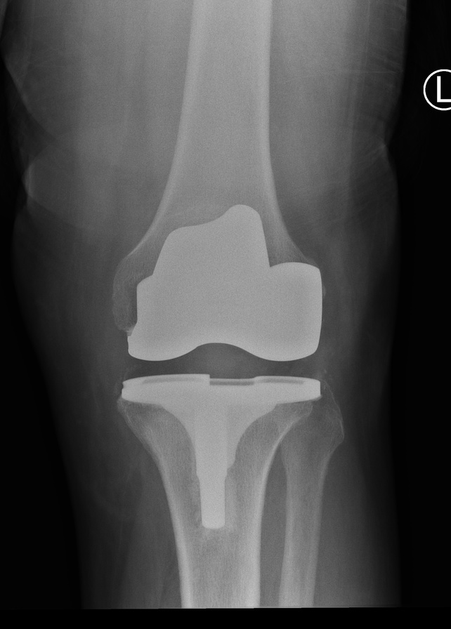 Knee_SmithAndNephew_GenesisII</td>
<td align="center" valign="top"><b>Option 1</b>  Knee_SmithAndNephew_Legion2</td>
<td align="center" valign="top"><b>Option 2</b>  Knee_Depuy_Synthes_Sigma</td>
<td align="center" valign="top"><b>Option 3</b>  Knee_ZimmerBiomet_Oxford</td>
<td align="center" valign="top"><b>✅ Option 4</b>  Knee_SmithAndNephew_GenesisII</td>
<td align="center" valign="middle"><b>Option 6</b>  <i>None of the above</i></td>
</tr></table>

### Q1063 · correct: option 2 · `Knee_Depuy_Synthes_Sigma`

<table><tr>
<td align="center" valign="top"><b>Query</b> 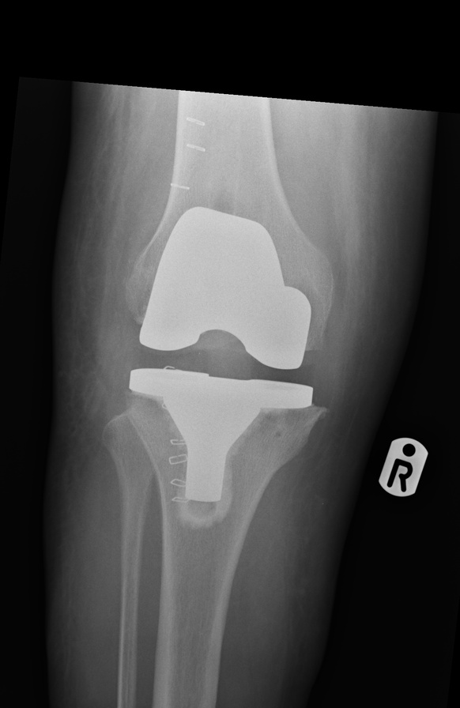 Knee_Depuy_Synthes_Sigma</td>
<td align="center" valign="top"><b>Option 1</b>  Knee_SmithAndNephew_GenesisII</td>
<td align="center" valign="top"><b>✅ Option 2</b>  Knee_Depuy_Synthes_Sigma</td>
<td align="center" valign="top"><b>Option 3</b>  Knee_SmithAndNephew_Legion2</td>
<td align="center" valign="top"><b>Option 4</b>  Knee_ZimmerBiomet_Oxford</td>
<td align="center" valign="middle"><b>Option 6</b>  <i>None of the above</i></td>
</tr></table>

### Q1064 · correct: option 4 · `Knee_Depuy_Synthes_Sigma`

<table><tr>
<td align="center" valign="top"><b>Query</b> 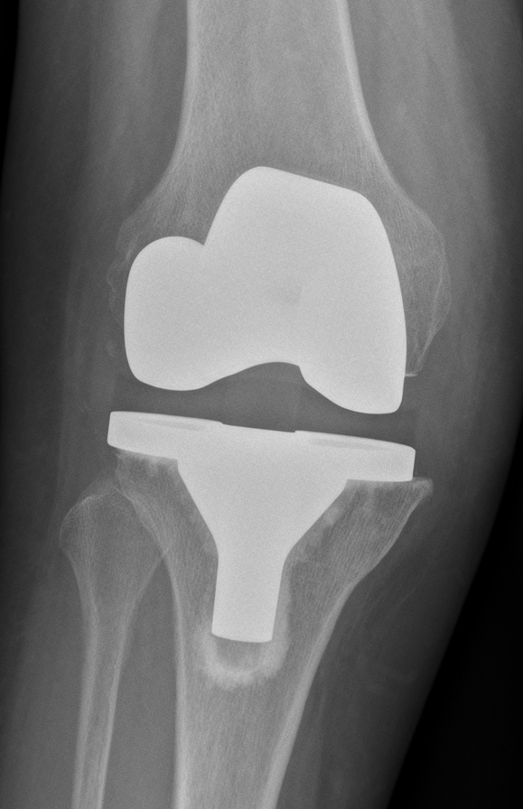 Knee_Depuy_Synthes_Sigma</td>
<td align="center" valign="top"><b>Option 1</b> 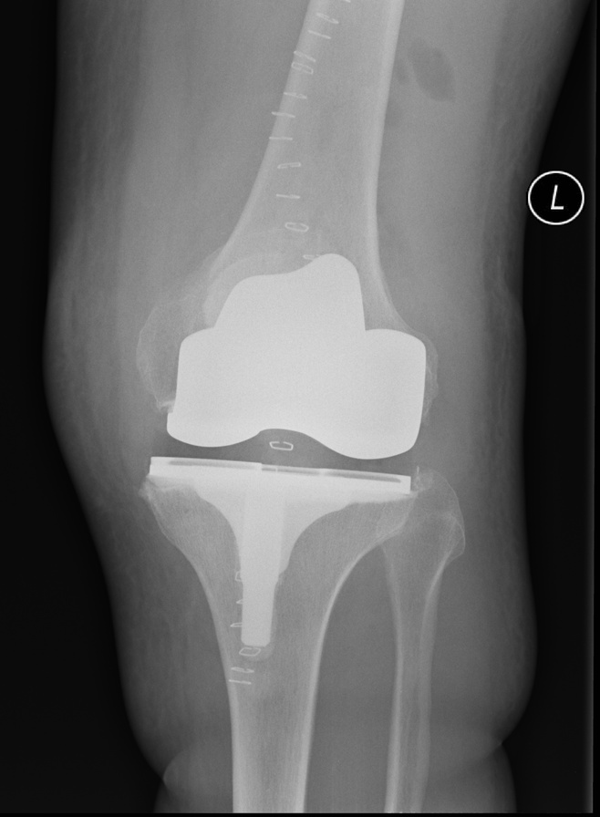 Knee_SmithAndNephew_GenesisII</td>
<td align="center" valign="top"><b>Option 2</b>  Knee_SmithAndNephew_Legion2</td>
<td align="center" valign="top"><b>Option 3</b>  Knee_ZimmerBiomet_Oxford</td>
<td align="center" valign="top"><b>✅ Option 4</b>  Knee_Depuy_Synthes_Sigma</td>
<td align="center" valign="middle"><b>Option 6</b>  <i>None of the above</i></td>
</tr></table>

### Q1065 · correct: option 4 · `Knee_Depuy_Synthes_Sigma`

<table><tr>
<td align="center" valign="top"><b>Query</b> 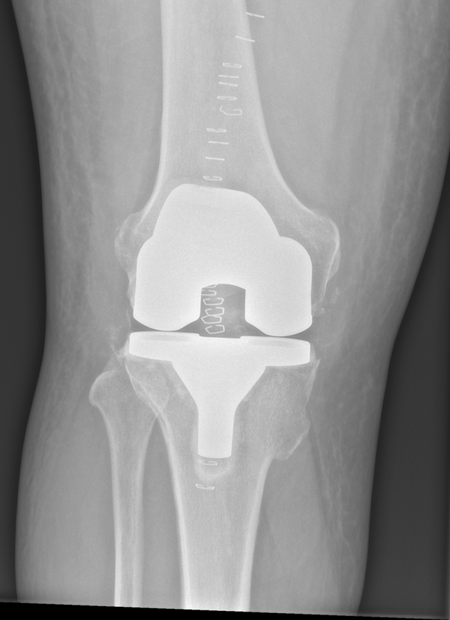 Knee_Depuy_Synthes_Sigma</td>
<td align="center" valign="top"><b>Option 1</b>  Knee_SmithAndNephew_Legion2</td>
<td align="center" valign="top"><b>Option 2</b>  Knee_ZimmerBiomet_Oxford</td>
<td align="center" valign="top"><b>Option 3</b>  Knee_SmithAndNephew_GenesisII</td>
<td align="center" valign="top"><b>✅ Option 4</b>  Knee_Depuy_Synthes_Sigma</td>
<td align="center" valign="middle"><b>Option 6</b>  <i>None of the above</i></td>
</tr></table>

### Q1066 · correct: option 2 · `Knee_SmithAndNephew_GenesisII`

<table><tr>
<td align="center" valign="top"><b>Query</b> 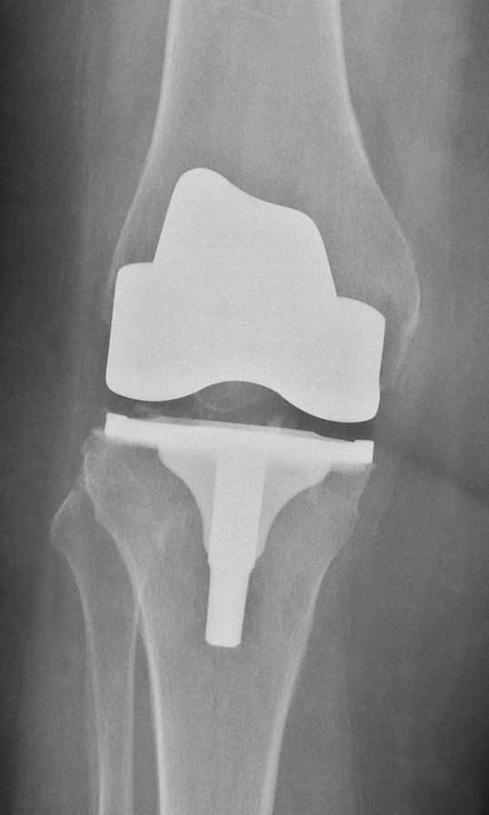 Knee_SmithAndNephew_GenesisII</td>
<td align="center" valign="top"><b>Option 1</b>  Knee_Depuy_Synthes_Sigma</td>
<td align="center" valign="top"><b>✅ Option 2</b>  Knee_SmithAndNephew_GenesisII</td>
<td align="center" valign="top"><b>Option 3</b>  Knee_ZimmerBiomet_Oxford</td>
<td align="center" valign="top"><b>Option 4</b>  Knee_SmithAndNephew_Legion2</td>
<td align="center" valign="middle"><b>Option 6</b>  <i>None of the above</i></td>
</tr></table>

### Q1067 · correct: option 1 · `Knee_SmithAndNephew_GenesisII`

<table><tr>
<td align="center" valign="top"><b>Query</b> 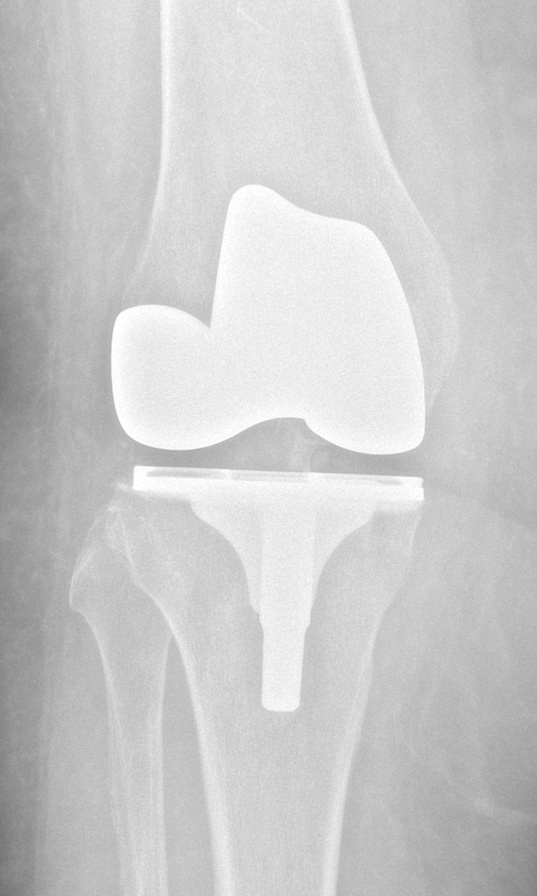 Knee_SmithAndNephew_GenesisII</td>
<td align="center" valign="top"><b>✅ Option 1</b>  Knee_SmithAndNephew_GenesisII</td>
<td align="center" valign="top"><b>Option 2</b> 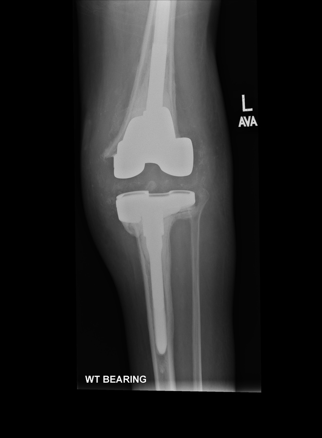 Knee_SmithAndNephew_Legion2</td>
<td align="center" valign="top"><b>Option 3</b>  Knee_ZimmerBiomet_Oxford</td>
<td align="center" valign="top"><b>Option 4</b>  Knee_Depuy_Synthes_Sigma</td>
<td align="center" valign="middle"><b>Option 6</b>  <i>None of the above</i></td>
</tr></table>

### Q1068 · correct: option 1 · `Knee_SmithAndNephew_GenesisII`

<table><tr>
<td align="center" valign="top"><b>Query</b> 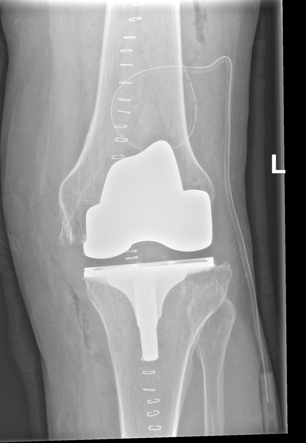 Knee_SmithAndNephew_GenesisII</td>
<td align="center" valign="top"><b>✅ Option 1</b>  Knee_SmithAndNephew_GenesisII</td>
<td align="center" valign="top"><b>Option 2</b>  Knee_ZimmerBiomet_Oxford</td>
<td align="center" valign="top"><b>Option 3</b>  Knee_SmithAndNephew_Legion2</td>
<td align="center" valign="top"><b>Option 4</b>  Knee_Depuy_Synthes_Sigma</td>
<td align="center" valign="middle"><b>Option 6</b>  <i>None of the above</i></td>
</tr></table>

### Q1069 · correct: option 4 · `Knee_SmithAndNephew_GenesisII`

<table><tr>
<td align="center" valign="top"><b>Query</b> 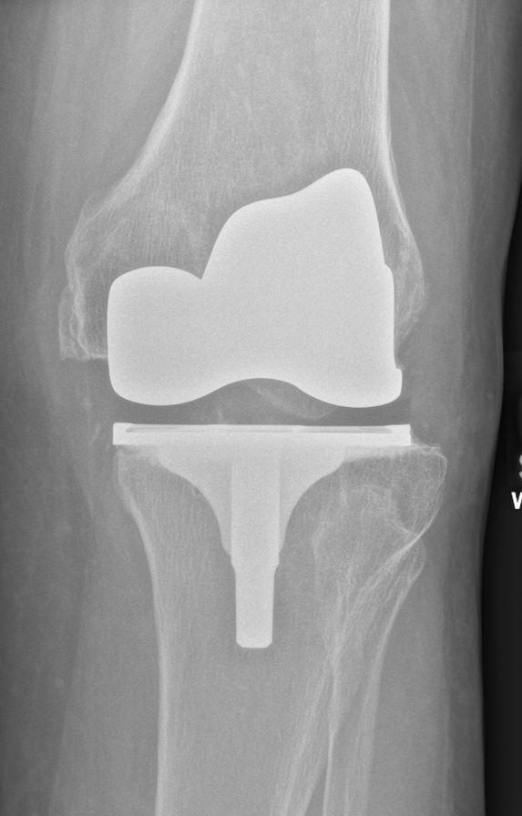 Knee_SmithAndNephew_GenesisII</td>
<td align="center" valign="top"><b>Option 1</b>  Knee_SmithAndNephew_Legion2</td>
<td align="center" valign="top"><b>Option 2</b>  Knee_Depuy_Synthes_Sigma</td>
<td align="center" valign="top"><b>Option 3</b>  Knee_ZimmerBiomet_Oxford</td>
<td align="center" valign="top"><b>✅ Option 4</b>  Knee_SmithAndNephew_GenesisII</td>
<td align="center" valign="middle"><b>Option 6</b>  <i>None of the above</i></td>
</tr></table>

### Q1070 · correct: option 1 · `Knee_SmithAndNephew_GenesisII`

<table><tr>
<td align="center" valign="top"><b>Query</b> 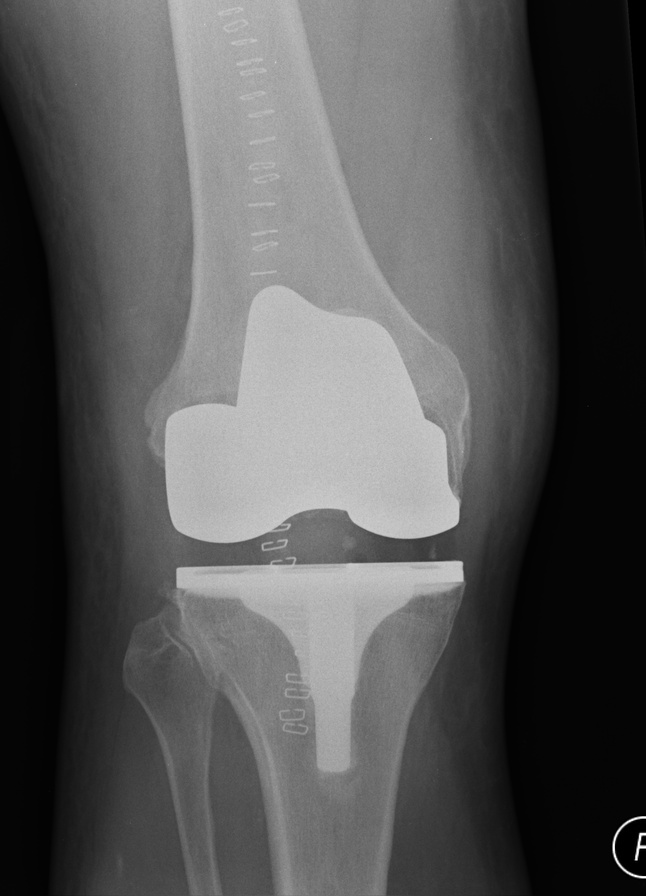 Knee_SmithAndNephew_GenesisII</td>
<td align="center" valign="top"><b>✅ Option 1</b>  Knee_SmithAndNephew_GenesisII</td>
<td align="center" valign="top"><b>Option 2</b>  Knee_Depuy_Synthes_Sigma</td>
<td align="center" valign="top"><b>Option 3</b>  Knee_ZimmerBiomet_Oxford</td>
<td align="center" valign="top"><b>Option 4</b>  Knee_SmithAndNephew_Legion2</td>
<td align="center" valign="middle"><b>Option 6</b>  <i>None of the above</i></td>
</tr></table>

### Q1071 · correct: option 1 · `Knee_Depuy_Synthes_Sigma`

<table><tr>
<td align="center" valign="top"><b>Query</b> 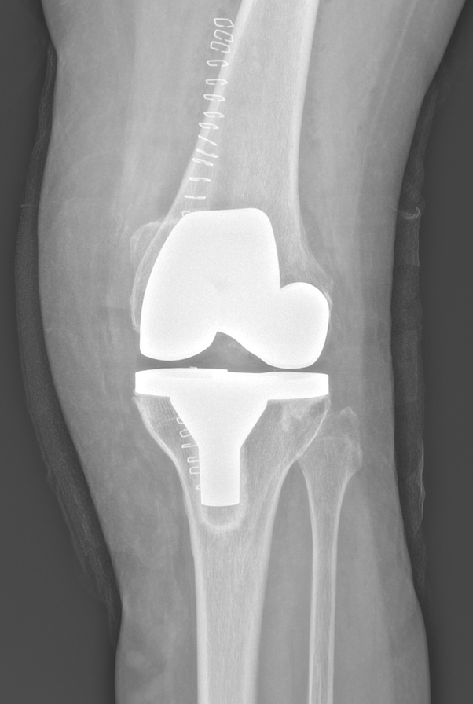 Knee_Depuy_Synthes_Sigma</td>
<td align="center" valign="top"><b>✅ Option 1</b>  Knee_Depuy_Synthes_Sigma</td>
<td align="center" valign="top"><b>Option 2</b>  Knee_SmithAndNephew_Legion2</td>
<td align="center" valign="top"><b>Option 3</b>  Knee_SmithAndNephew_GenesisII</td>
<td align="center" valign="top"><b>Option 4</b>  Knee_ZimmerBiomet_Oxford</td>
<td align="center" valign="middle"><b>Option 6</b>  <i>None of the above</i></td>
</tr></table>

### Q1072 · correct: option 1 · `Knee_SmithAndNephew_GenesisII`

<table><tr>
<td align="center" valign="top"><b>Query</b> 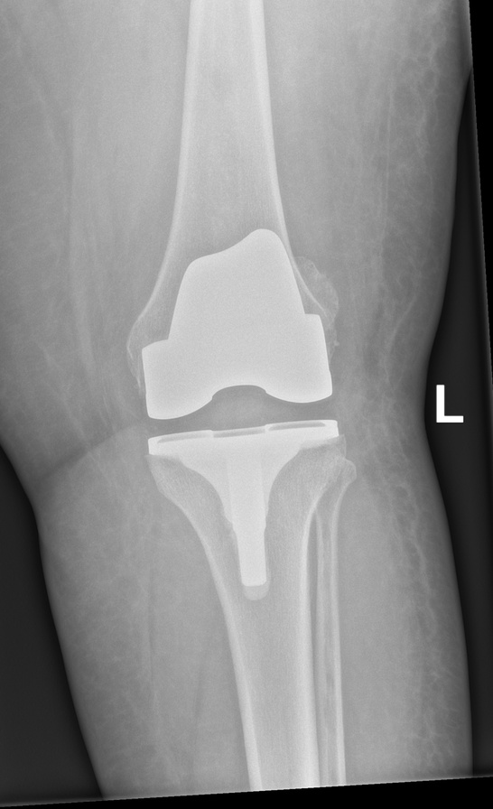 Knee_SmithAndNephew_GenesisII</td>
<td align="center" valign="top"><b>✅ Option 1</b>  Knee_SmithAndNephew_GenesisII</td>
<td align="center" valign="top"><b>Option 2</b>  Knee_Depuy_Synthes_Sigma</td>
<td align="center" valign="top"><b>Option 3</b>  Knee_ZimmerBiomet_Oxford</td>
<td align="center" valign="top"><b>Option 4</b>  Knee_SmithAndNephew_Legion2</td>
<td align="center" valign="middle"><b>Option 6</b>  <i>None of the above</i></td>
</tr></table>

### Q1073 · correct: option 1 · `Knee_SmithAndNephew_GenesisII`

<table><tr>
<td align="center" valign="top"><b>Query</b> 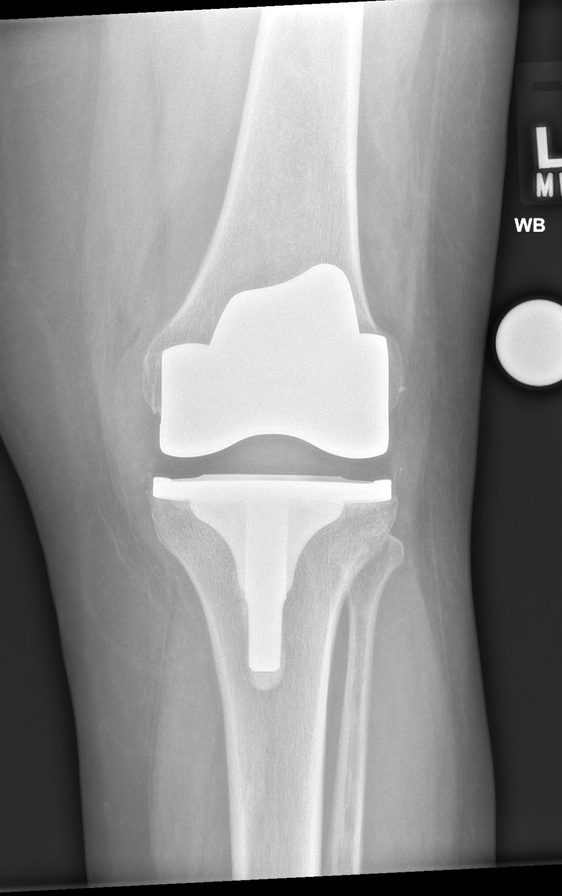 Knee_SmithAndNephew_GenesisII</td>
<td align="center" valign="top"><b>✅ Option 1</b>  Knee_SmithAndNephew_GenesisII</td>
<td align="center" valign="top"><b>Option 2</b>  Knee_ZimmerBiomet_Oxford</td>
<td align="center" valign="top"><b>Option 3</b>  Knee_Depuy_Synthes_Sigma</td>
<td align="center" valign="top"><b>Option 4</b>  Knee_SmithAndNephew_Legion2</td>
<td align="center" valign="middle"><b>Option 6</b>  <i>None of the above</i></td>
</tr></table>

### Q1074 · correct: option 1 · `Knee_SmithAndNephew_GenesisII`

<table><tr>
<td align="center" valign="top"><b>Query</b> 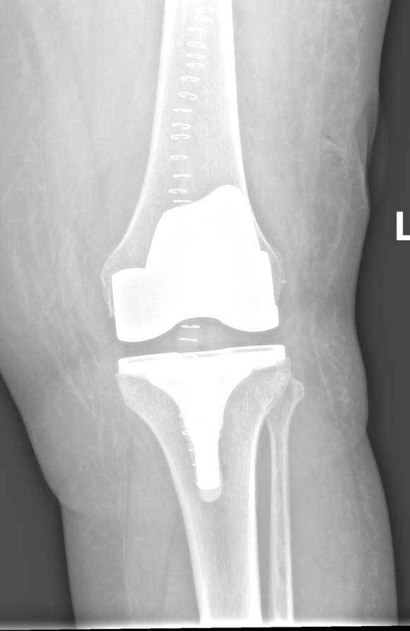 Knee_SmithAndNephew_GenesisII</td>
<td align="center" valign="top"><b>✅ Option 1</b>  Knee_SmithAndNephew_GenesisII</td>
<td align="center" valign="top"><b>Option 2</b>  Knee_ZimmerBiomet_Oxford</td>
<td align="center" valign="top"><b>Option 3</b>  Knee_SmithAndNephew_Legion2</td>
<td align="center" valign="top"><b>Option 4</b>  Knee_Depuy_Synthes_Sigma</td>
<td align="center" valign="middle"><b>Option 6</b>  <i>None of the above</i></td>
</tr></table>

### Q1075 · correct: option 2 · `Knee_Depuy_Synthes_Sigma`

<table><tr>
<td align="center" valign="top"><b>Query</b> 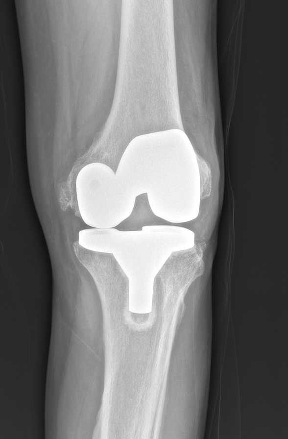 Knee_Depuy_Synthes_Sigma</td>
<td align="center" valign="top"><b>Option 1</b>  Knee_SmithAndNephew_Legion2</td>
<td align="center" valign="top"><b>✅ Option 2</b>  Knee_Depuy_Synthes_Sigma</td>
<td align="center" valign="top"><b>Option 3</b>  Knee_ZimmerBiomet_Oxford</td>
<td align="center" valign="top"><b>Option 4</b>  Knee_SmithAndNephew_GenesisII</td>
<td align="center" valign="middle"><b>Option 6</b>  <i>None of the above</i></td>
</tr></table>

### Q1076 · correct: option 1 · `Knee_Depuy_Synthes_Sigma`

<table><tr>
<td align="center" valign="top"><b>Query</b> 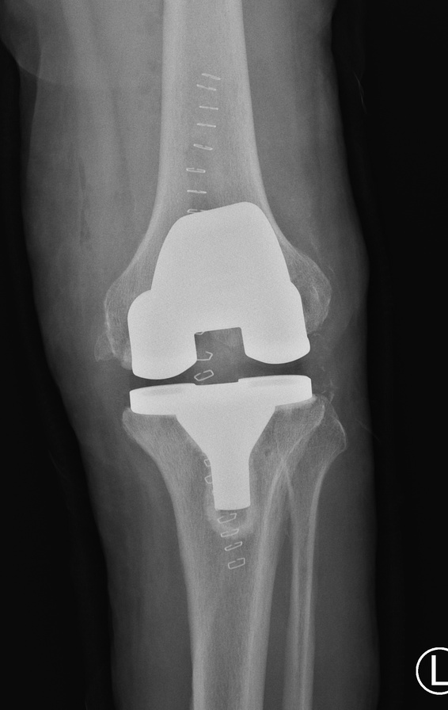 Knee_Depuy_Synthes_Sigma</td>
<td align="center" valign="top"><b>✅ Option 1</b>  Knee_Depuy_Synthes_Sigma</td>
<td align="center" valign="top"><b>Option 2</b>  Knee_ZimmerBiomet_Oxford</td>
<td align="center" valign="top"><b>Option 3</b>  Knee_SmithAndNephew_Legion2</td>
<td align="center" valign="top"><b>Option 4</b>  Knee_SmithAndNephew_GenesisII</td>
<td align="center" valign="middle"><b>Option 6</b>  <i>None of the above</i></td>
</tr></table>

### Q1077 · correct: option 4 · `Knee_Depuy_Synthes_Sigma`

<table><tr>
<td align="center" valign="top"><b>Query</b> 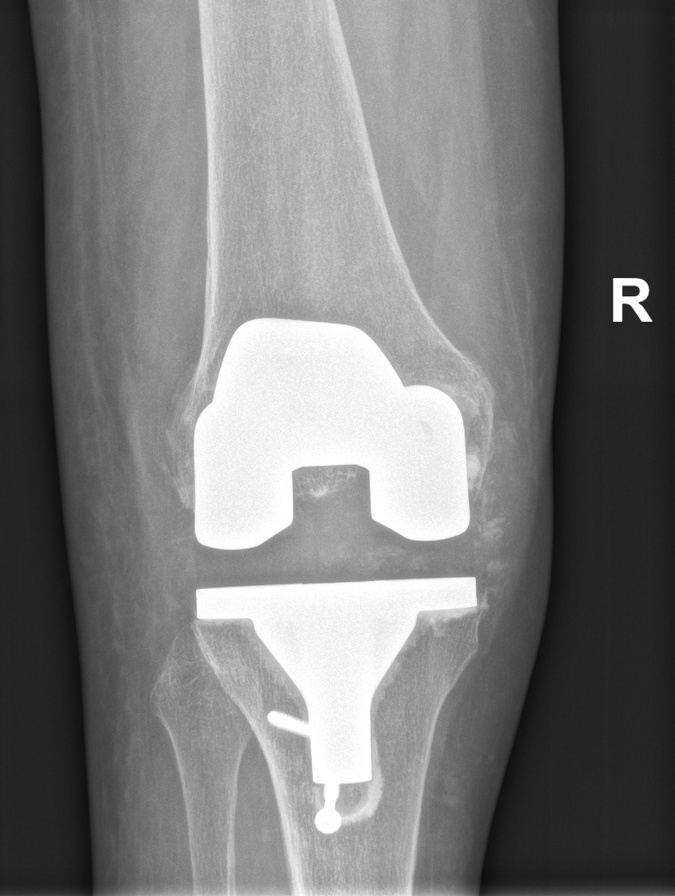 Knee_Depuy_Synthes_Sigma</td>
<td align="center" valign="top"><b>Option 1</b>  Knee_ZimmerBiomet_Oxford</td>
<td align="center" valign="top"><b>Option 2</b>  Knee_SmithAndNephew_Legion2</td>
<td align="center" valign="top"><b>Option 3</b>  Knee_SmithAndNephew_GenesisII</td>
<td align="center" valign="top"><b>✅ Option 4</b>  Knee_Depuy_Synthes_Sigma</td>
<td align="center" valign="middle"><b>Option 6</b>  <i>None of the above</i></td>
</tr></table>

### Q1078 · correct: option 2 · `Knee_Depuy_Synthes_Sigma`

<table><tr>
<td align="center" valign="top"><b>Query</b> 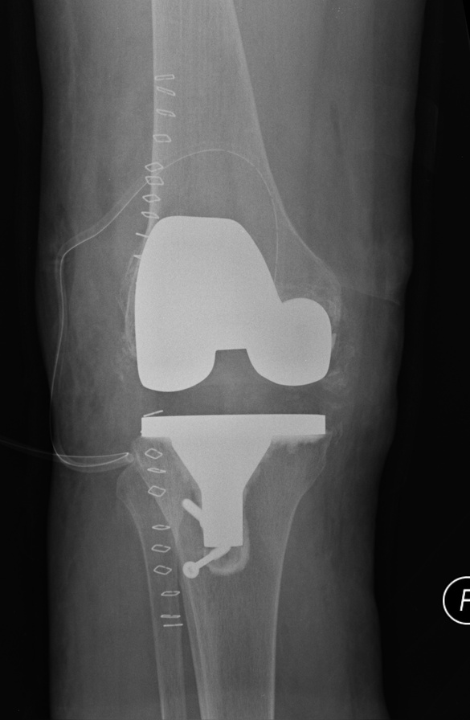 Knee_Depuy_Synthes_Sigma</td>
<td align="center" valign="top"><b>Option 1</b>  Knee_SmithAndNephew_GenesisII</td>
<td align="center" valign="top"><b>✅ Option 2</b>  Knee_Depuy_Synthes_Sigma</td>
<td align="center" valign="top"><b>Option 3</b>  Knee_SmithAndNephew_Legion2</td>
<td align="center" valign="top"><b>Option 4</b>  Knee_ZimmerBiomet_Oxford</td>
<td align="center" valign="middle"><b>Option 6</b>  <i>None of the above</i></td>
</tr></table>

### Q1079 · correct: option 4 · `Knee_Depuy_Synthes_Sigma`

<table><tr>
<td align="center" valign="top"><b>Query</b> 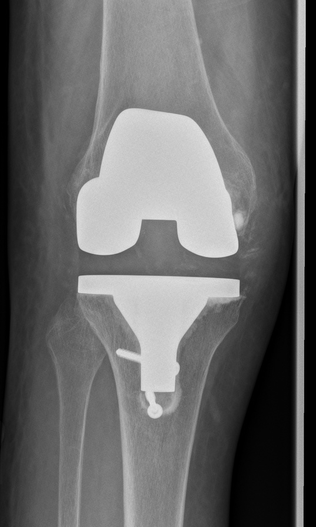 Knee_Depuy_Synthes_Sigma</td>
<td align="center" valign="top"><b>Option 1</b>  Knee_SmithAndNephew_GenesisII</td>
<td align="center" valign="top"><b>Option 2</b>  Knee_ZimmerBiomet_Oxford</td>
<td align="center" valign="top"><b>Option 3</b>  Knee_SmithAndNephew_Legion2</td>
<td align="center" valign="top"><b>✅ Option 4</b>  Knee_Depuy_Synthes_Sigma</td>
<td align="center" valign="middle"><b>Option 6</b>  <i>None of the above</i></td>
</tr></table>

### Q1080 · correct: option 4 · `Knee_SmithAndNephew_GenesisII`

<table><tr>
<td align="center" valign="top"><b>Query</b> 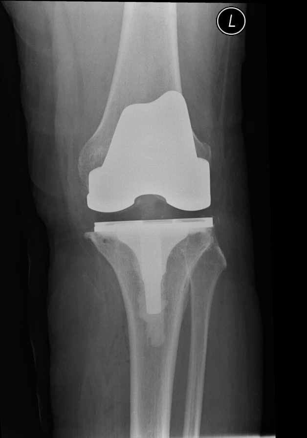 Knee_SmithAndNephew_GenesisII</td>
<td align="center" valign="top"><b>Option 1</b>  Knee_ZimmerBiomet_Oxford</td>
<td align="center" valign="top"><b>Option 2</b>  Knee_SmithAndNephew_Legion2</td>
<td align="center" valign="top"><b>Option 3</b>  Knee_Depuy_Synthes_Sigma</td>
<td align="center" valign="top"><b>✅ Option 4</b>  Knee_SmithAndNephew_GenesisII</td>
<td align="center" valign="middle"><b>Option 6</b>  <i>None of the above</i></td>
</tr></table>

### Q1081 · correct: option 2 · `Knee_SmithAndNephew_GenesisII`

<table><tr>
<td align="center" valign="top"><b>Query</b> 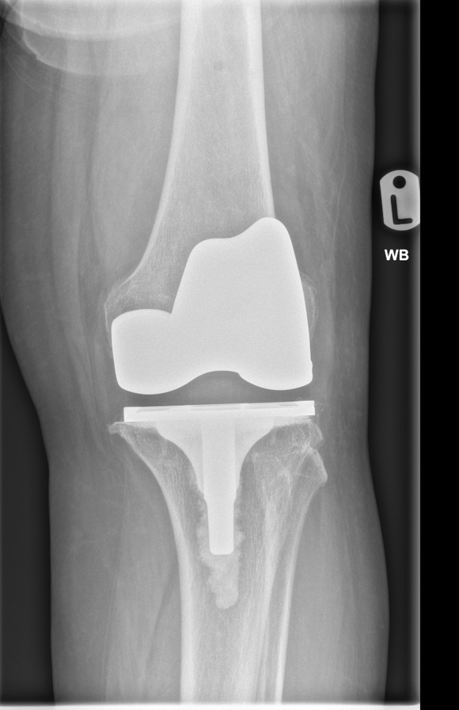 Knee_SmithAndNephew_GenesisII</td>
<td align="center" valign="top"><b>Option 1</b>  Knee_Depuy_Synthes_Sigma</td>
<td align="center" valign="top"><b>✅ Option 2</b>  Knee_SmithAndNephew_GenesisII</td>
<td align="center" valign="top"><b>Option 3</b>  Knee_ZimmerBiomet_Oxford</td>
<td align="center" valign="top"><b>Option 4</b>  Knee_SmithAndNephew_Legion2</td>
<td align="center" valign="middle"><b>Option 6</b>  <i>None of the above</i></td>
</tr></table>

### Q1082 · correct: option 1 · `Knee_SmithAndNephew_GenesisII`

<table><tr>
<td align="center" valign="top"><b>Query</b> 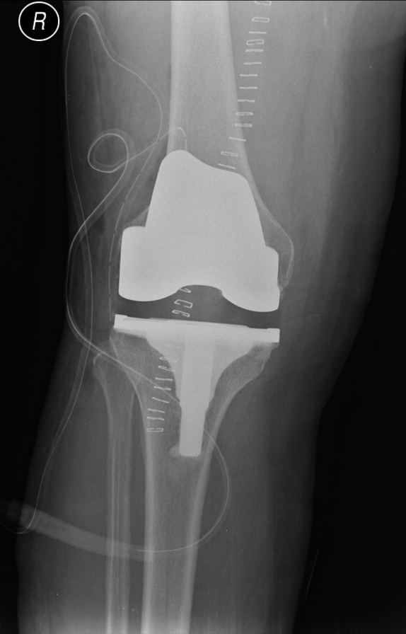 Knee_SmithAndNephew_GenesisII</td>
<td align="center" valign="top"><b>✅ Option 1</b>  Knee_SmithAndNephew_GenesisII</td>
<td align="center" valign="top"><b>Option 2</b>  Knee_Depuy_Synthes_Sigma</td>
<td align="center" valign="top"><b>Option 3</b> 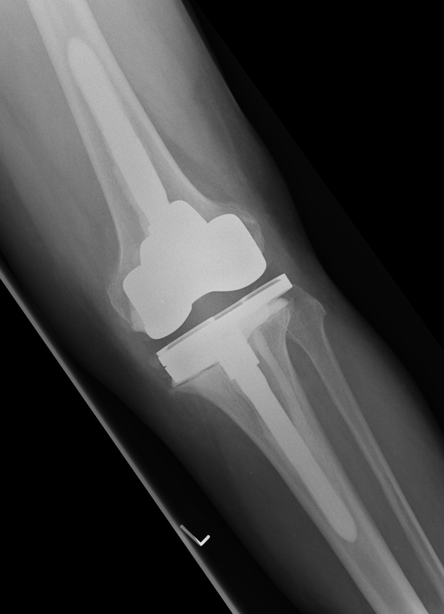 Knee_SmithAndNephew_Legion2</td>
<td align="center" valign="top"><b>Option 4</b>  Knee_ZimmerBiomet_Oxford</td>
<td align="center" valign="middle"><b>Option 6</b>  <i>None of the above</i></td>
</tr></table>

### Q1083 · correct: option 2 · `Knee_SmithAndNephew_GenesisII`

<table><tr>
<td align="center" valign="top"><b>Query</b> 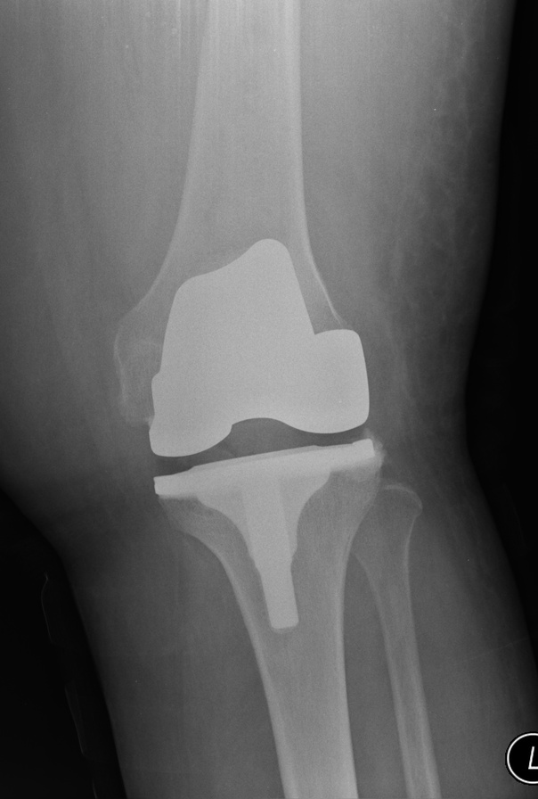 Knee_SmithAndNephew_GenesisII</td>
<td align="center" valign="top"><b>Option 1</b>  Knee_Depuy_Synthes_Sigma</td>
<td align="center" valign="top"><b>✅ Option 2</b>  Knee_SmithAndNephew_GenesisII</td>
<td align="center" valign="top"><b>Option 3</b>  Knee_SmithAndNephew_Legion2</td>
<td align="center" valign="top"><b>Option 4</b>  Knee_ZimmerBiomet_Oxford</td>
<td align="center" valign="middle"><b>Option 6</b>  <i>None of the above</i></td>
</tr></table>

### Q1084 · correct: option 3 · `Knee_Depuy_Synthes_Sigma`

<table><tr>
<td align="center" valign="top"><b>Query</b> 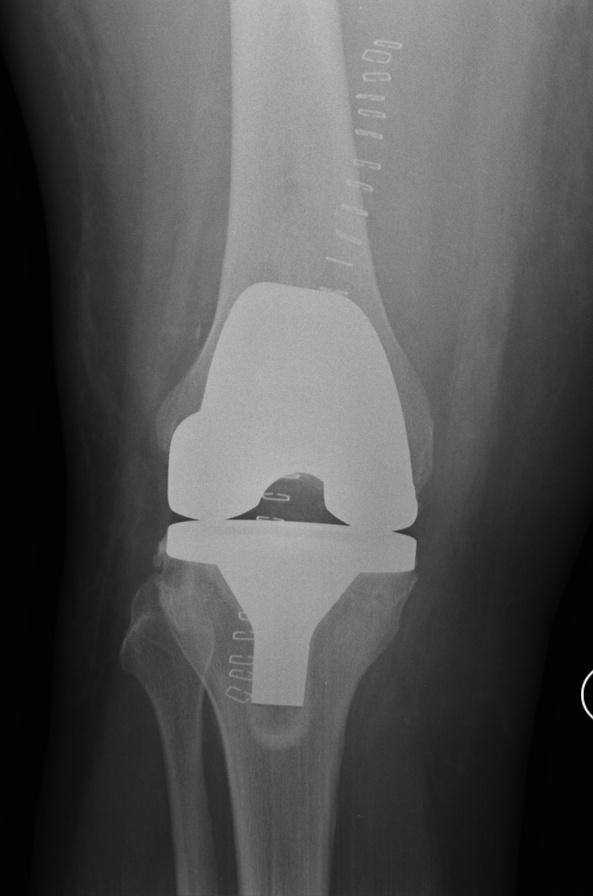 Knee_Depuy_Synthes_Sigma</td>
<td align="center" valign="top"><b>Option 1</b>  Knee_ZimmerBiomet_Oxford</td>
<td align="center" valign="top"><b>Option 2</b>  Knee_SmithAndNephew_GenesisII</td>
<td align="center" valign="top"><b>✅ Option 3</b>  Knee_Depuy_Synthes_Sigma</td>
<td align="center" valign="top"><b>Option 4</b>  Knee_SmithAndNephew_Legion2</td>
<td align="center" valign="middle"><b>Option 6</b>  <i>None of the above</i></td>
</tr></table>

### Q1085 · correct: option 1 · `Knee_Depuy_Synthes_Sigma`

<table><tr>
<td align="center" valign="top"><b>Query</b> 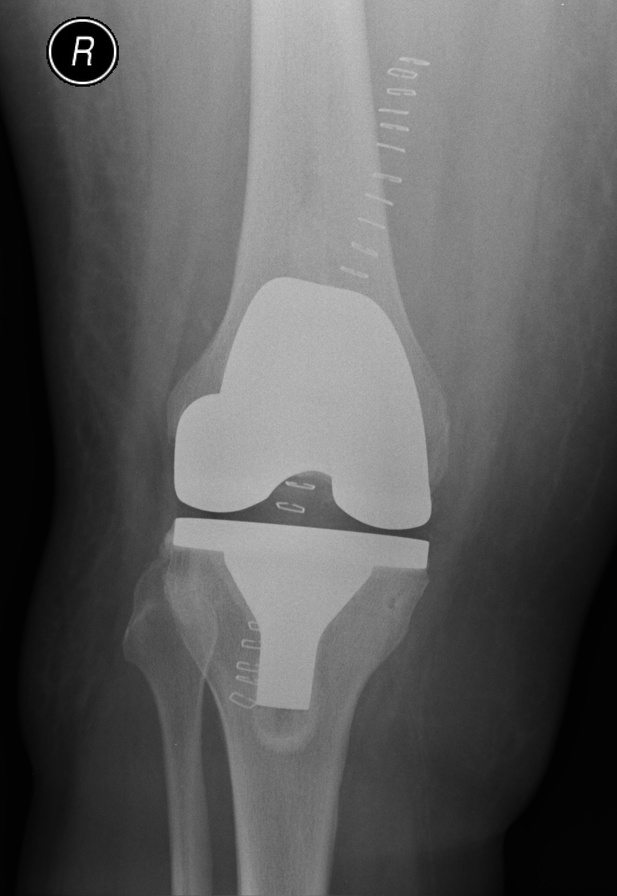 Knee_Depuy_Synthes_Sigma</td>
<td align="center" valign="top"><b>✅ Option 1</b>  Knee_Depuy_Synthes_Sigma</td>
<td align="center" valign="top"><b>Option 2</b>  Knee_SmithAndNephew_GenesisII</td>
<td align="center" valign="top"><b>Option 3</b>  Knee_SmithAndNephew_Legion2</td>
<td align="center" valign="top"><b>Option 4</b>  Knee_ZimmerBiomet_Oxford</td>
<td align="center" valign="middle"><b>Option 6</b>  <i>None of the above</i></td>
</tr></table>

### Q1086 · correct: option 4 · `Knee_Depuy_Synthes_Sigma`

<table><tr>
<td align="center" valign="top"><b>Query</b> 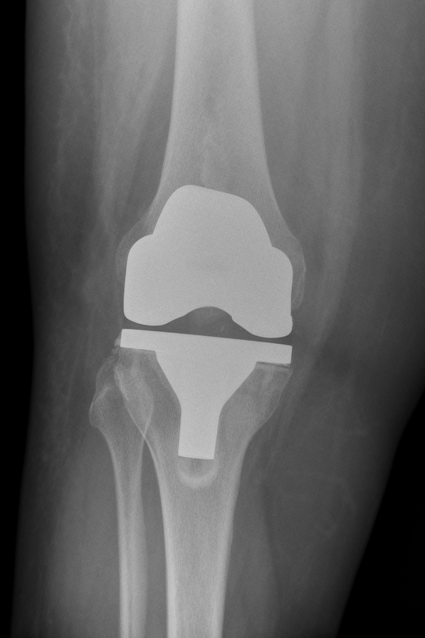 Knee_Depuy_Synthes_Sigma</td>
<td align="center" valign="top"><b>Option 1</b>  Knee_SmithAndNephew_Legion2</td>
<td align="center" valign="top"><b>Option 2</b>  Knee_SmithAndNephew_GenesisII</td>
<td align="center" valign="top"><b>Option 3</b>  Knee_ZimmerBiomet_Oxford</td>
<td align="center" valign="top"><b>✅ Option 4</b>  Knee_Depuy_Synthes_Sigma</td>
<td align="center" valign="middle"><b>Option 6</b>  <i>None of the above</i></td>
</tr></table>

### Q1087 · correct: option 1 · `Knee_Depuy_Synthes_Sigma`

<table><tr>
<td align="center" valign="top"><b>Query</b> 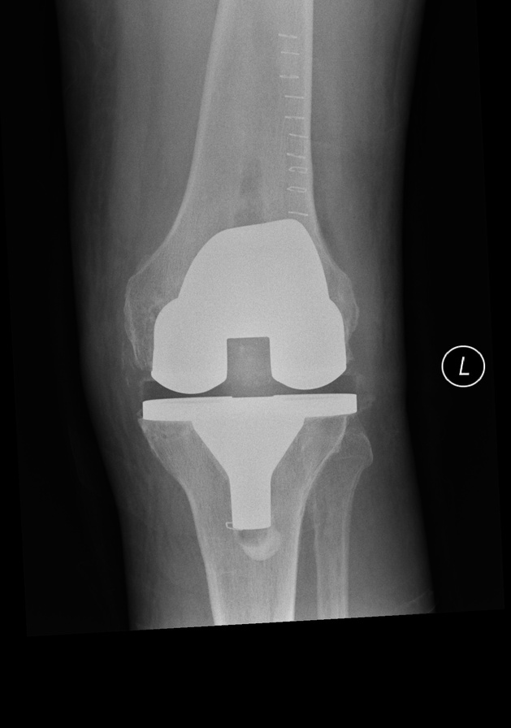 Knee_Depuy_Synthes_Sigma</td>
<td align="center" valign="top"><b>✅ Option 1</b>  Knee_Depuy_Synthes_Sigma</td>
<td align="center" valign="top"><b>Option 2</b>  Knee_SmithAndNephew_Legion2</td>
<td align="center" valign="top"><b>Option 3</b>  Knee_ZimmerBiomet_Oxford</td>
<td align="center" valign="top"><b>Option 4</b>  Knee_SmithAndNephew_GenesisII</td>
<td align="center" valign="middle"><b>Option 6</b>  <i>None of the above</i></td>
</tr></table>

### Q1088 · correct: option 3 · `Knee_SmithAndNephew_Legion2`

<table><tr>
<td align="center" valign="top"><b>Query</b>  Knee_SmithAndNephew_Legion2</td>
<td align="center" valign="top"><b>Option 1</b>  Knee_SmithAndNephew_GenesisII</td>
<td align="center" valign="top"><b>Option 2</b>  Knee_Depuy_Synthes_Sigma</td>
<td align="center" valign="top"><b>✅ Option 3</b>  Knee_SmithAndNephew_Legion2</td>
<td align="center" valign="top"><b>Option 4</b>  Knee_ZimmerBiomet_Oxford</td>
<td align="center" valign="middle"><b>Option 6</b>  <i>None of the above</i></td>
</tr></table>

### Q1089 · correct: option 3 · `Knee_SmithAndNephew_Legion2`

<table><tr>
<td align="center" valign="top"><b>Query</b>  Knee_SmithAndNephew_Legion2</td>
<td align="center" valign="top"><b>Option 1</b>  Knee_ZimmerBiomet_Oxford</td>
<td align="center" valign="top"><b>Option 2</b>  Knee_Depuy_Synthes_Sigma</td>
<td align="center" valign="top"><b>✅ Option 3</b>  Knee_SmithAndNephew_Legion2</td>
<td align="center" valign="top"><b>Option 4</b>  Knee_SmithAndNephew_GenesisII</td>
<td align="center" valign="middle"><b>Option 6</b>  <i>None of the above</i></td>
</tr></table>

### Q1090 · correct: option 4 · `Knee_SmithAndNephew_Legion2`

<table><tr>
<td align="center" valign="top"><b>Query</b>  Knee_SmithAndNephew_Legion2</td>
<td align="center" valign="top"><b>Option 1</b>  Knee_ZimmerBiomet_Oxford</td>
<td align="center" valign="top"><b>Option 2</b>  Knee_SmithAndNephew_GenesisII</td>
<td align="center" valign="top"><b>Option 3</b>  Knee_Depuy_Synthes_Sigma</td>
<td align="center" valign="top"><b>✅ Option 4</b>  Knee_SmithAndNephew_Legion2</td>
<td align="center" valign="middle"><b>Option 6</b>  <i>None of the above</i></td>
</tr></table>

### Q1091 · correct: option 2 · `Knee_SmithAndNephew_Legion2`

<table><tr>
<td align="center" valign="top"><b>Query</b>  Knee_SmithAndNephew_Legion2</td>
<td align="center" valign="top"><b>Option 1</b>  Knee_SmithAndNephew_GenesisII</td>
<td align="center" valign="top"><b>✅ Option 2</b>  Knee_SmithAndNephew_Legion2</td>
<td align="center" valign="top"><b>Option 3</b>  Knee_ZimmerBiomet_Oxford</td>
<td align="center" valign="top"><b>Option 4</b>  Knee_Depuy_Synthes_Sigma</td>
<td align="center" valign="middle"><b>Option 6</b>  <i>None of the above</i></td>
</tr></table>

### Q1092 · correct: option 3 · `Knee_SmithAndNephew_Legion2`

<table><tr>
<td align="center" valign="top"><b>Query</b>  Knee_SmithAndNephew_Legion2</td>
<td align="center" valign="top"><b>Option 1</b>  Knee_ZimmerBiomet_Oxford</td>
<td align="center" valign="top"><b>Option 2</b>  Knee_SmithAndNephew_GenesisII</td>
<td align="center" valign="top"><b>✅ Option 3</b>  Knee_SmithAndNephew_Legion2</td>
<td align="center" valign="top"><b>Option 4</b>  Knee_Depuy_Synthes_Sigma</td>
<td align="center" valign="middle"><b>Option 6</b>  <i>None of the above</i></td>
</tr></table>

### Q1093 · correct: option 1 · `Knee_SmithAndNephew_Legion2`

<table><tr>
<td align="center" valign="top"><b>Query</b>  Knee_SmithAndNephew_Legion2</td>
<td align="center" valign="top"><b>✅ Option 1</b>  Knee_SmithAndNephew_Legion2</td>
<td align="center" valign="top"><b>Option 2</b>  Knee_ZimmerBiomet_Oxford</td>
<td align="center" valign="top"><b>Option 3</b>  Knee_Depuy_Synthes_Sigma</td>
<td align="center" valign="top"><b>Option 4</b>  Knee_SmithAndNephew_GenesisII</td>
<td align="center" valign="middle"><b>Option 6</b>  <i>None of the above</i></td>
</tr></table>

### Q1094 · correct: option 3 · `Knee_Depuy_Synthes_Sigma`

<table><tr>
<td align="center" valign="top"><b>Query</b>  Knee_Depuy_Synthes_Sigma</td>
<td align="center" valign="top"><b>Option 1</b>  Knee_SmithAndNephew_GenesisII</td>
<td align="center" valign="top"><b>Option 2</b>  Knee_SmithAndNephew_Legion2</td>
<td align="center" valign="top"><b>✅ Option 3</b>  Knee_Depuy_Synthes_Sigma</td>
<td align="center" valign="top"><b>Option 4</b>  Knee_ZimmerBiomet_Oxford</td>
<td align="center" valign="middle"><b>Option 6</b>  <i>None of the above</i></td>
</tr></table>

### Q1095 · correct: option 4 · `Knee_SmithAndNephew_GenesisII`

<table><tr>
<td align="center" valign="top"><b>Query</b>  Knee_SmithAndNephew_GenesisII</td>
<td align="center" valign="top"><b>Option 1</b>  Knee_SmithAndNephew_Legion2</td>
<td align="center" valign="top"><b>Option 2</b>  Knee_ZimmerBiomet_Oxford</td>
<td align="center" valign="top"><b>Option 3</b>  Knee_Depuy_Synthes_Sigma</td>
<td align="center" valign="top"><b>✅ Option 4</b>  Knee_SmithAndNephew_GenesisII</td>
<td align="center" valign="middle"><b>Option 6</b>  <i>None of the above</i></td>
</tr></table>

### Q1096 · correct: option 2 · `Knee_Depuy_Synthes_Sigma`

<table><tr>
<td align="center" valign="top"><b>Query</b>  Knee_Depuy_Synthes_Sigma</td>
<td align="center" valign="top"><b>Option 1</b>  Knee_SmithAndNephew_GenesisII</td>
<td align="center" valign="top"><b>✅ Option 2</b>  Knee_Depuy_Synthes_Sigma</td>
<td align="center" valign="top"><b>Option 3</b>  Knee_SmithAndNephew_Legion2</td>
<td align="center" valign="top"><b>Option 4</b>  Knee_ZimmerBiomet_Oxford</td>
<td align="center" valign="middle"><b>Option 6</b>  <i>None of the above</i></td>
</tr></table>

### Q1097 · correct: option 3 · `Knee_SmithAndNephew_GenesisII`

<table><tr>
<td align="center" valign="top"><b>Query</b>  Knee_SmithAndNephew_GenesisII</td>
<td align="center" valign="top"><b>Option 1</b>  Knee_ZimmerBiomet_Oxford</td>
<td align="center" valign="top"><b>Option 2</b>  Knee_SmithAndNephew_Legion2</td>
<td align="center" valign="top"><b>✅ Option 3</b>  Knee_SmithAndNephew_GenesisII</td>
<td align="center" valign="top"><b>Option 4</b>  Knee_Depuy_Synthes_Sigma</td>
<td align="center" valign="middle"><b>Option 6</b>  <i>None of the above</i></td>
</tr></table>

### Q1098 · correct: option 2 · `Knee_SmithAndNephew_GenesisII`

<table><tr>
<td align="center" valign="top"><b>Query</b>  Knee_SmithAndNephew_GenesisII</td>
<td align="center" valign="top"><b>Option 1</b>  Knee_ZimmerBiomet_Oxford</td>
<td align="center" valign="top"><b>✅ Option 2</b>  Knee_SmithAndNephew_GenesisII</td>
<td align="center" valign="top"><b>Option 3</b>  Knee_SmithAndNephew_Legion2</td>
<td align="center" valign="top"><b>Option 4</b>  Knee_Depuy_Synthes_Sigma</td>
<td align="center" valign="middle"><b>Option 6</b>  <i>None of the above</i></td>
</tr></table>

### Q1099 · correct: option 3 · `Knee_SmithAndNephew_GenesisII`

<table><tr>
<td align="center" valign="top"><b>Query</b>  Knee_SmithAndNephew_GenesisII</td>
<td align="center" valign="top"><b>Option 1</b>  Knee_ZimmerBiomet_Oxford</td>
<td align="center" valign="top"><b>Option 2</b>  Knee_SmithAndNephew_Legion2</td>
<td align="center" valign="top"><b>✅ Option 3</b>  Knee_SmithAndNephew_GenesisII</td>
<td align="center" valign="top"><b>Option 4</b>  Knee_Depuy_Synthes_Sigma</td>
<td align="center" valign="middle"><b>Option 6</b>  <i>None of the above</i></td>
</tr></table>

### Q1100 · correct: option 2 · `Knee_Depuy_Synthes_Sigma`

<table><tr>
<td align="center" valign="top"><b>Query</b>  Knee_Depuy_Synthes_Sigma</td>
<td align="center" valign="top"><b>Option 1</b>  Knee_SmithAndNephew_GenesisII</td>
<td align="center" valign="top"><b>✅ Option 2</b>  Knee_Depuy_Synthes_Sigma</td>
<td align="center" valign="top"><b>Option 3</b>  Knee_ZimmerBiomet_Oxford</td>
<td align="center" valign="top"><b>Option 4</b>  Knee_SmithAndNephew_Legion2</td>
<td align="center" valign="middle"><b>Option 6</b>  <i>None of the above</i></td>
</tr></table>

### Q1101 · correct: option 1 · `Knee_Depuy_Synthes_Sigma`

<table><tr>
<td align="center" valign="top"><b>Query</b>  Knee_Depuy_Synthes_Sigma</td>
<td align="center" valign="top"><b>✅ Option 1</b>  Knee_Depuy_Synthes_Sigma</td>
<td align="center" valign="top"><b>Option 2</b>  Knee_ZimmerBiomet_Oxford</td>
<td align="center" valign="top"><b>Option 3</b>  Knee_SmithAndNephew_GenesisII</td>
<td align="center" valign="top"><b>Option 4</b>  Knee_SmithAndNephew_Legion2</td>
<td align="center" valign="middle"><b>Option 6</b>  <i>None of the above</i></td>
</tr></table>

### Q1102 · correct: option 3 · `Knee_Depuy_Synthes_Sigma`

<table><tr>
<td align="center" valign="top"><b>Query</b>  Knee_Depuy_Synthes_Sigma</td>
<td align="center" valign="top"><b>Option 1</b>  Knee_SmithAndNephew_Legion2</td>
<td align="center" valign="top"><b>Option 2</b>  Knee_ZimmerBiomet_Oxford</td>
<td align="center" valign="top"><b>✅ Option 3</b>  Knee_Depuy_Synthes_Sigma</td>
<td align="center" valign="top"><b>Option 4</b>  Knee_SmithAndNephew_GenesisII</td>
<td align="center" valign="middle"><b>Option 6</b>  <i>None of the above</i></td>
</tr></table>

### Q1103 · correct: option 3 · `Knee_SmithAndNephew_GenesisII`

<table><tr>
<td align="center" valign="top"><b>Query</b>  Knee_SmithAndNephew_GenesisII</td>
<td align="center" valign="top"><b>Option 1</b>  Knee_ZimmerBiomet_Oxford</td>
<td align="center" valign="top"><b>Option 2</b>  Knee_Depuy_Synthes_Sigma</td>
<td align="center" valign="top"><b>✅ Option 3</b>  Knee_SmithAndNephew_GenesisII</td>
<td align="center" valign="top"><b>Option 4</b>  Knee_SmithAndNephew_Legion2</td>
<td align="center" valign="middle"><b>Option 6</b>  <i>None of the above</i></td>
</tr></table>

