# OrthoNet knee · query set `train2` · page 2/2

[← all pages](README.md)

### Q1104 · correct: option 3 · `Knee_SmithAndNephew_GenesisII`

<table><tr>
<td align="center" valign="top"><b>Query</b> 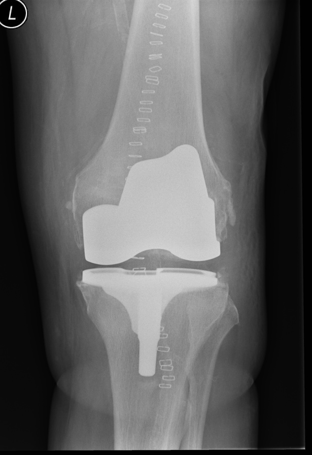 Knee_SmithAndNephew_GenesisII</td>
<td align="center" valign="top"><b>Option 1</b> 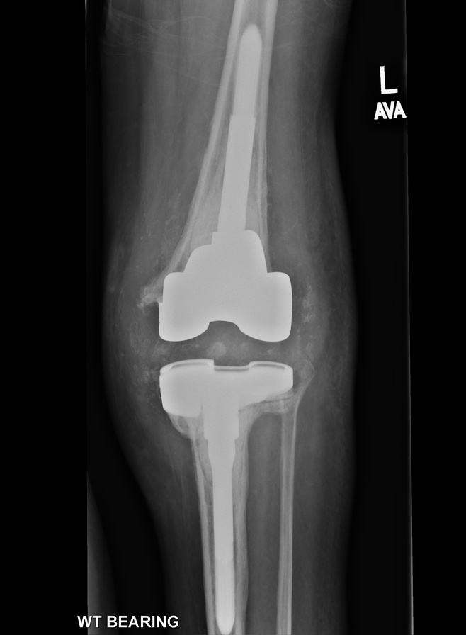 Knee_SmithAndNephew_Legion2</td>
<td align="center" valign="top"><b>Option 2</b> 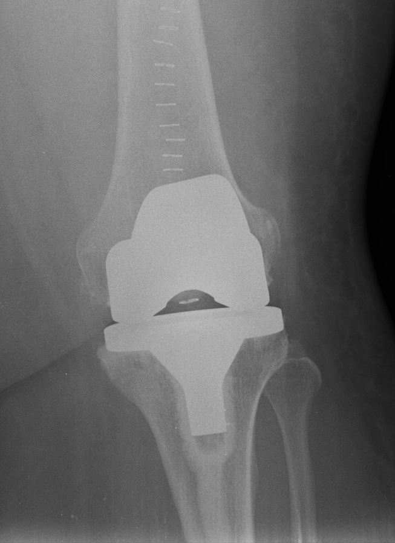 Knee_Depuy_Synthes_Sigma</td>
<td align="center" valign="top"><b>✅ Option 3</b> 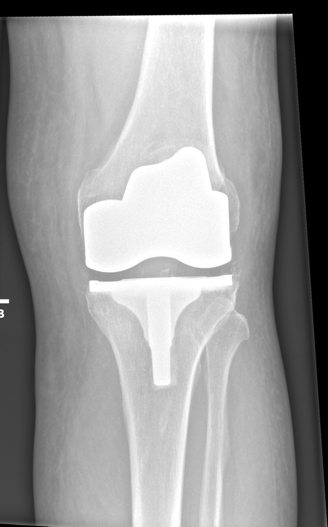 Knee_SmithAndNephew_GenesisII</td>
<td align="center" valign="top"><b>Option 4</b> 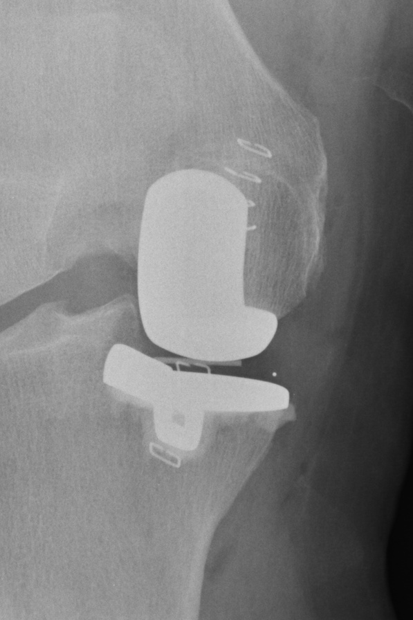 Knee_ZimmerBiomet_Oxford</td>
<td align="center" valign="middle"><b>Option 6</b>  <i>None of the above</i></td>
</tr></table>

### Q1105 · correct: option 1 · `Knee_SmithAndNephew_GenesisII`

<table><tr>
<td align="center" valign="top"><b>Query</b> 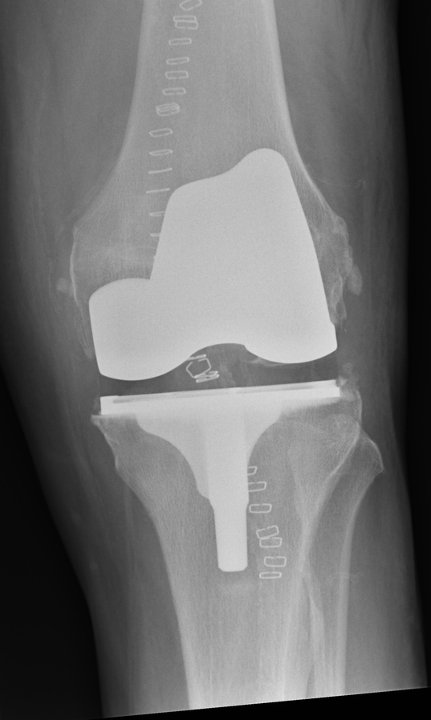 Knee_SmithAndNephew_GenesisII</td>
<td align="center" valign="top"><b>✅ Option 1</b> 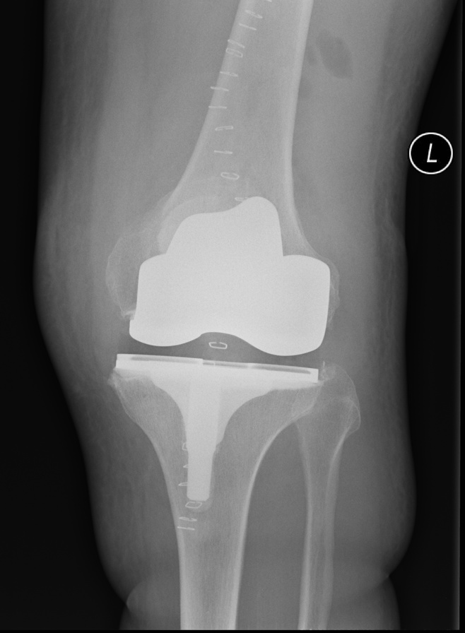 Knee_SmithAndNephew_GenesisII</td>
<td align="center" valign="top"><b>Option 2</b>  Knee_ZimmerBiomet_Oxford</td>
<td align="center" valign="top"><b>Option 3</b> 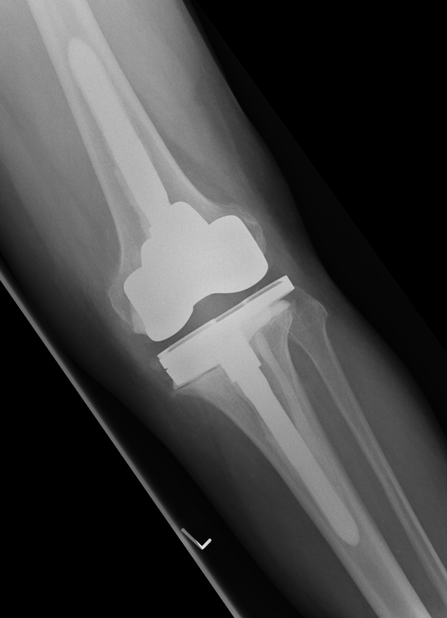 Knee_SmithAndNephew_Legion2</td>
<td align="center" valign="top"><b>Option 4</b>  Knee_Depuy_Synthes_Sigma</td>
<td align="center" valign="middle"><b>Option 6</b>  <i>None of the above</i></td>
</tr></table>

### Q1106 · correct: option 3 · `Knee_SmithAndNephew_GenesisII`

<table><tr>
<td align="center" valign="top"><b>Query</b> 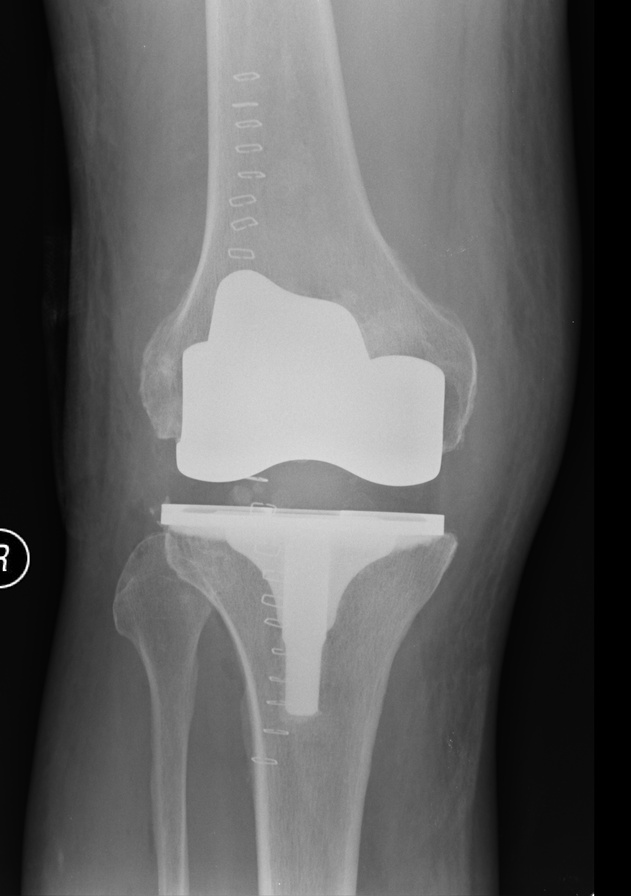 Knee_SmithAndNephew_GenesisII</td>
<td align="center" valign="top"><b>Option 1</b>  Knee_SmithAndNephew_Legion2</td>
<td align="center" valign="top"><b>Option 2</b>  Knee_Depuy_Synthes_Sigma</td>
<td align="center" valign="top"><b>✅ Option 3</b>  Knee_SmithAndNephew_GenesisII</td>
<td align="center" valign="top"><b>Option 4</b>  Knee_ZimmerBiomet_Oxford</td>
<td align="center" valign="middle"><b>Option 6</b>  <i>None of the above</i></td>
</tr></table>

### Q1107 · correct: option 3 · `Knee_SmithAndNephew_GenesisII`

<table><tr>
<td align="center" valign="top"><b>Query</b> 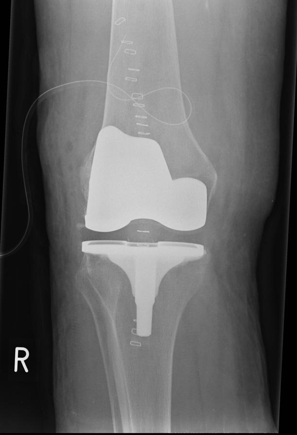 Knee_SmithAndNephew_GenesisII</td>
<td align="center" valign="top"><b>Option 1</b>  Knee_ZimmerBiomet_Oxford</td>
<td align="center" valign="top"><b>Option 2</b>  Knee_Depuy_Synthes_Sigma</td>
<td align="center" valign="top"><b>✅ Option 3</b>  Knee_SmithAndNephew_GenesisII</td>
<td align="center" valign="top"><b>Option 4</b>  Knee_SmithAndNephew_Legion2</td>
<td align="center" valign="middle"><b>Option 6</b>  <i>None of the above</i></td>
</tr></table>

### Q1108 · correct: option 2 · `Knee_SmithAndNephew_GenesisII`

<table><tr>
<td align="center" valign="top"><b>Query</b> 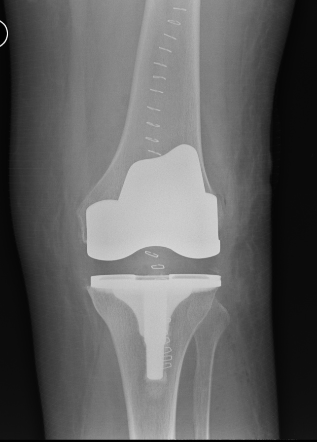 Knee_SmithAndNephew_GenesisII</td>
<td align="center" valign="top"><b>Option 1</b> 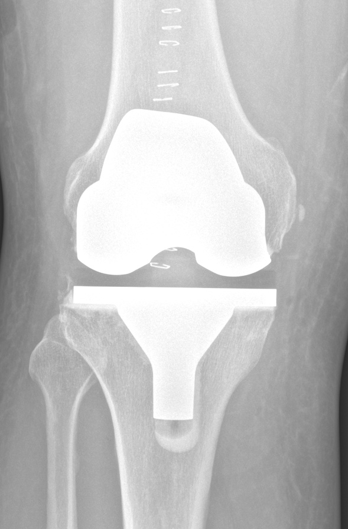 Knee_Depuy_Synthes_Sigma</td>
<td align="center" valign="top"><b>✅ Option 2</b>  Knee_SmithAndNephew_GenesisII</td>
<td align="center" valign="top"><b>Option 3</b> 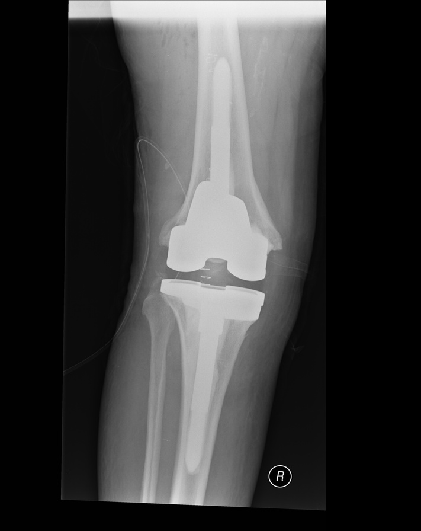 Knee_SmithAndNephew_Legion2</td>
<td align="center" valign="top"><b>Option 4</b>  Knee_ZimmerBiomet_Oxford</td>
<td align="center" valign="middle"><b>Option 6</b>  <i>None of the above</i></td>
</tr></table>

### Q1109 · correct: option 4 · `Knee_SmithAndNephew_GenesisII`

<table><tr>
<td align="center" valign="top"><b>Query</b> 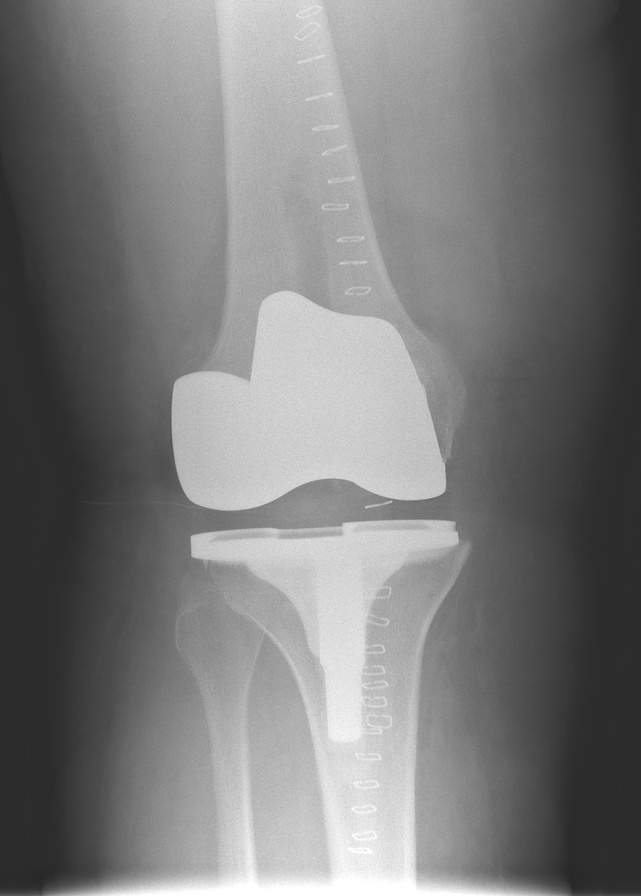 Knee_SmithAndNephew_GenesisII</td>
<td align="center" valign="top"><b>Option 1</b>  Knee_SmithAndNephew_Legion2</td>
<td align="center" valign="top"><b>Option 2</b> 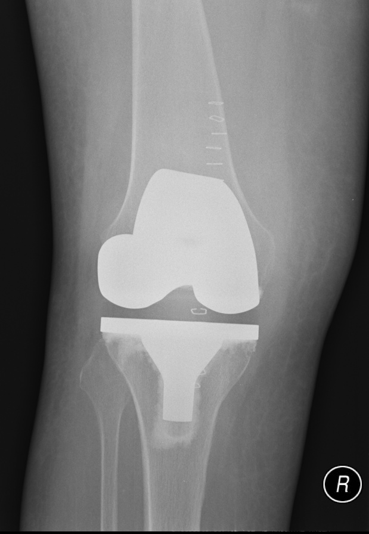 Knee_Depuy_Synthes_Sigma</td>
<td align="center" valign="top"><b>Option 3</b>  Knee_ZimmerBiomet_Oxford</td>
<td align="center" valign="top"><b>✅ Option 4</b>  Knee_SmithAndNephew_GenesisII</td>
<td align="center" valign="middle"><b>Option 6</b>  <i>None of the above</i></td>
</tr></table>

### Q1110 · correct: option 4 · `Knee_ZimmerBiomet_Oxford`

<table><tr>
<td align="center" valign="top"><b>Query</b> 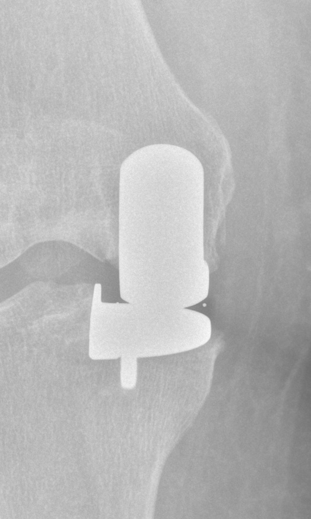 Knee_ZimmerBiomet_Oxford</td>
<td align="center" valign="top"><b>Option 1</b> 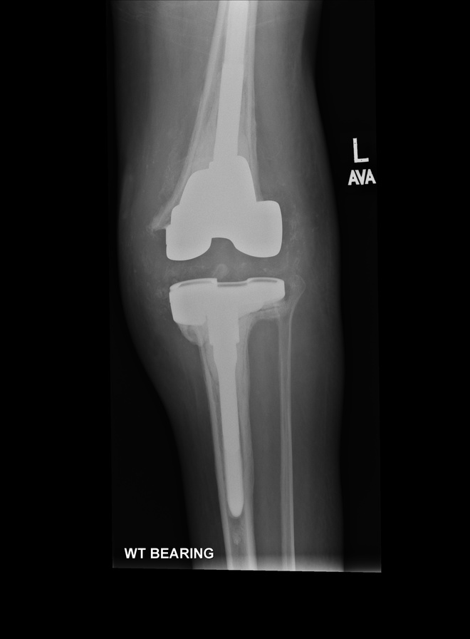 Knee_SmithAndNephew_Legion2</td>
<td align="center" valign="top"><b>Option 2</b> 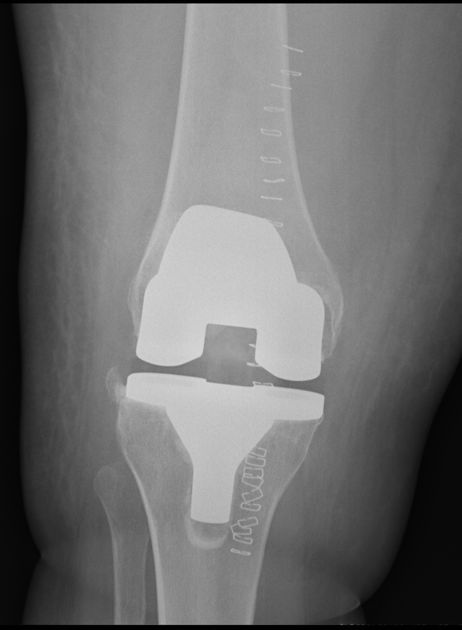 Knee_Depuy_Synthes_Sigma</td>
<td align="center" valign="top"><b>Option 3</b>  Knee_SmithAndNephew_GenesisII</td>
<td align="center" valign="top"><b>✅ Option 4</b> 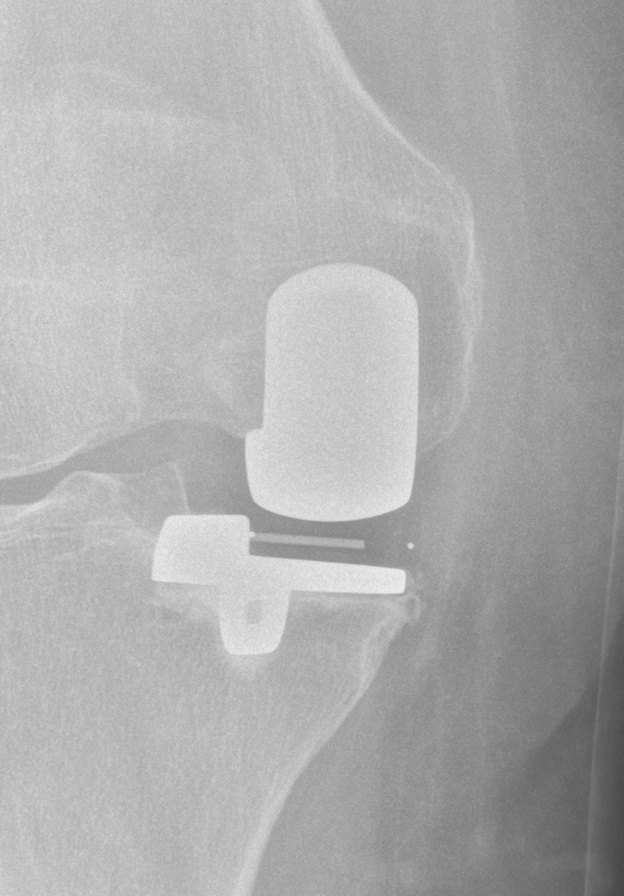 Knee_ZimmerBiomet_Oxford</td>
<td align="center" valign="middle"><b>Option 6</b>  <i>None of the above</i></td>
</tr></table>

### Q1111 · correct: option 3 · `Knee_ZimmerBiomet_Oxford`

<table><tr>
<td align="center" valign="top"><b>Query</b> 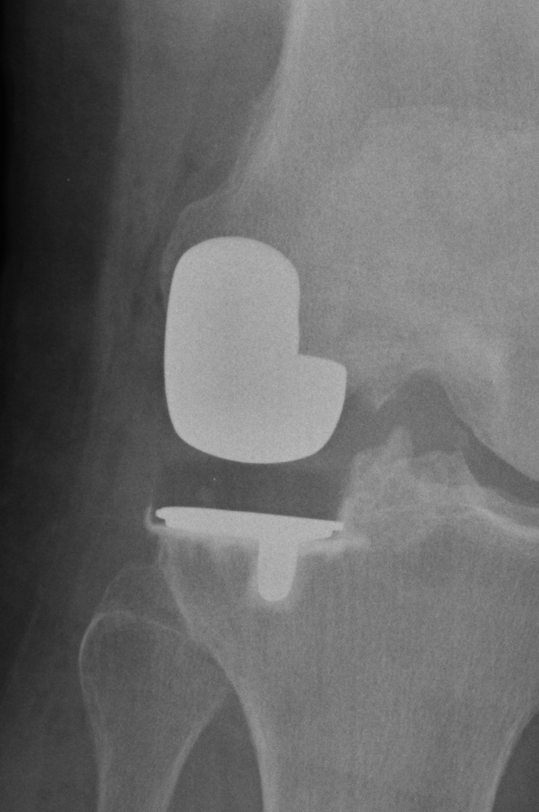 Knee_ZimmerBiomet_Oxford</td>
<td align="center" valign="top"><b>Option 1</b> 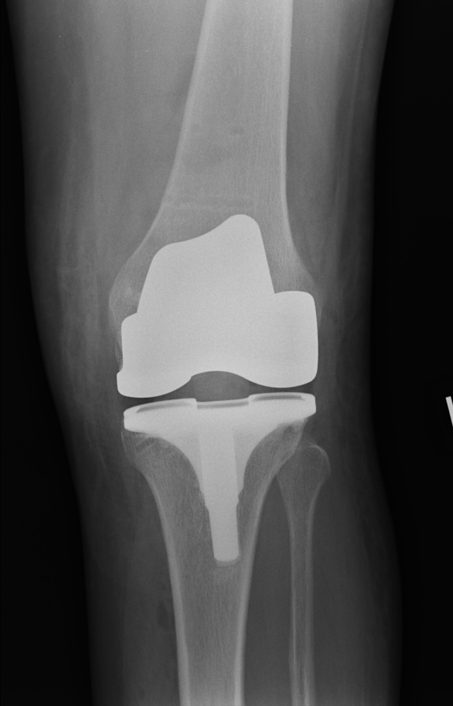 Knee_SmithAndNephew_GenesisII</td>
<td align="center" valign="top"><b>Option 2</b>  Knee_Depuy_Synthes_Sigma</td>
<td align="center" valign="top"><b>✅ Option 3</b> 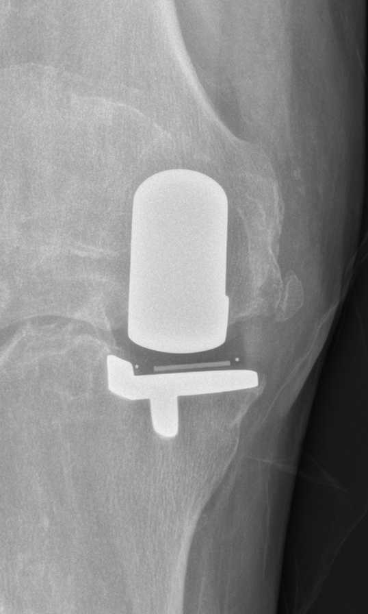 Knee_ZimmerBiomet_Oxford</td>
<td align="center" valign="top"><b>Option 4</b>  Knee_SmithAndNephew_Legion2</td>
<td align="center" valign="middle"><b>Option 6</b>  <i>None of the above</i></td>
</tr></table>

### Q1112 · correct: option 3 · `Knee_ZimmerBiomet_Oxford`

<table><tr>
<td align="center" valign="top"><b>Query</b> 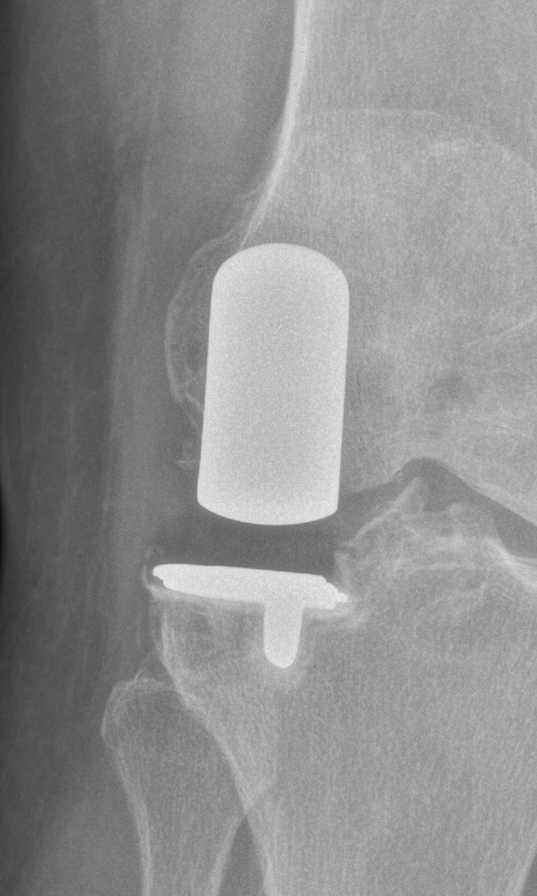 Knee_ZimmerBiomet_Oxford</td>
<td align="center" valign="top"><b>Option 1</b>  Knee_Depuy_Synthes_Sigma</td>
<td align="center" valign="top"><b>Option 2</b>  Knee_SmithAndNephew_GenesisII</td>
<td align="center" valign="top"><b>✅ Option 3</b>  Knee_ZimmerBiomet_Oxford</td>
<td align="center" valign="top"><b>Option 4</b>  Knee_SmithAndNephew_Legion2</td>
<td align="center" valign="middle"><b>Option 6</b>  <i>None of the above</i></td>
</tr></table>

### Q1113 · correct: option 4 · `Knee_ZimmerBiomet_Oxford`

<table><tr>
<td align="center" valign="top"><b>Query</b> 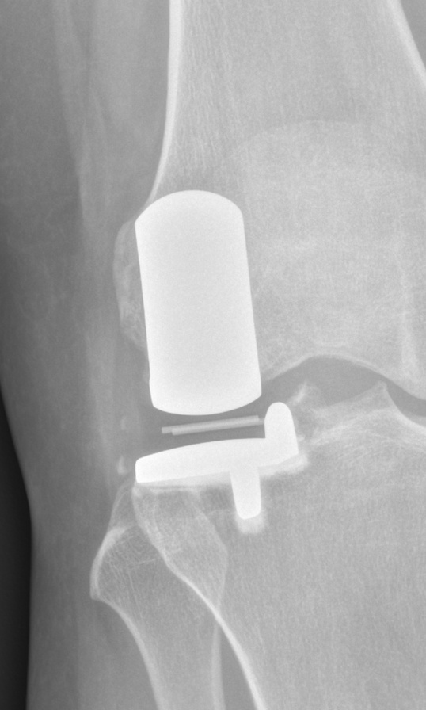 Knee_ZimmerBiomet_Oxford</td>
<td align="center" valign="top"><b>Option 1</b>  Knee_SmithAndNephew_Legion2</td>
<td align="center" valign="top"><b>Option 2</b>  Knee_Depuy_Synthes_Sigma</td>
<td align="center" valign="top"><b>Option 3</b>  Knee_SmithAndNephew_GenesisII</td>
<td align="center" valign="top"><b>✅ Option 4</b>  Knee_ZimmerBiomet_Oxford</td>
<td align="center" valign="middle"><b>Option 6</b>  <i>None of the above</i></td>
</tr></table>

### Q1114 · correct: option 1 · `Knee_ZimmerBiomet_Oxford`

<table><tr>
<td align="center" valign="top"><b>Query</b> 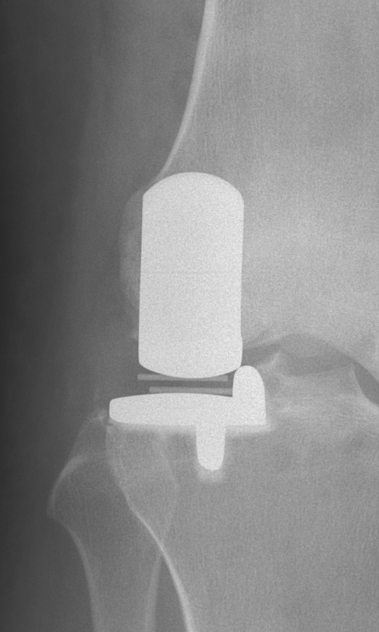 Knee_ZimmerBiomet_Oxford</td>
<td align="center" valign="top"><b>✅ Option 1</b>  Knee_ZimmerBiomet_Oxford</td>
<td align="center" valign="top"><b>Option 2</b>  Knee_SmithAndNephew_GenesisII</td>
<td align="center" valign="top"><b>Option 3</b>  Knee_Depuy_Synthes_Sigma</td>
<td align="center" valign="top"><b>Option 4</b>  Knee_SmithAndNephew_Legion2</td>
<td align="center" valign="middle"><b>Option 6</b>  <i>None of the above</i></td>
</tr></table>

### Q1115 · correct: option 3 · `Knee_ZimmerBiomet_Oxford`

<table><tr>
<td align="center" valign="top"><b>Query</b> 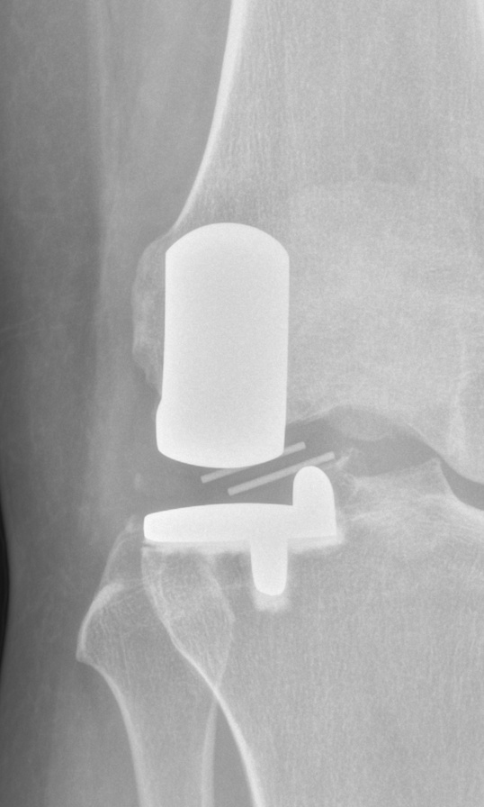 Knee_ZimmerBiomet_Oxford</td>
<td align="center" valign="top"><b>Option 1</b>  Knee_SmithAndNephew_Legion2</td>
<td align="center" valign="top"><b>Option 2</b>  Knee_SmithAndNephew_GenesisII</td>
<td align="center" valign="top"><b>✅ Option 3</b>  Knee_ZimmerBiomet_Oxford</td>
<td align="center" valign="top"><b>Option 4</b>  Knee_Depuy_Synthes_Sigma</td>
<td align="center" valign="middle"><b>Option 6</b>  <i>None of the above</i></td>
</tr></table>

### Q1116 · correct: option 4 · `Knee_ZimmerBiomet_Oxford`

<table><tr>
<td align="center" valign="top"><b>Query</b> 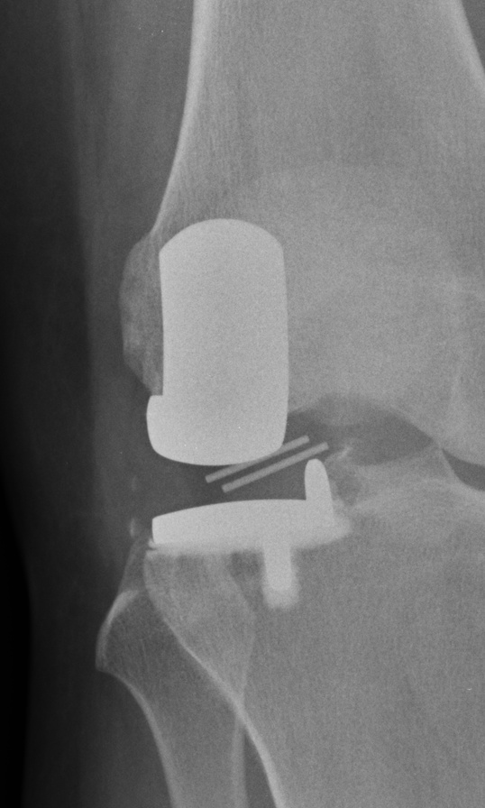 Knee_ZimmerBiomet_Oxford</td>
<td align="center" valign="top"><b>Option 1</b>  Knee_SmithAndNephew_GenesisII</td>
<td align="center" valign="top"><b>Option 2</b>  Knee_SmithAndNephew_Legion2</td>
<td align="center" valign="top"><b>Option 3</b>  Knee_Depuy_Synthes_Sigma</td>
<td align="center" valign="top"><b>✅ Option 4</b>  Knee_ZimmerBiomet_Oxford</td>
<td align="center" valign="middle"><b>Option 6</b>  <i>None of the above</i></td>
</tr></table>

### Q1117 · correct: option 2 · `Knee_ZimmerBiomet_Oxford`

<table><tr>
<td align="center" valign="top"><b>Query</b> 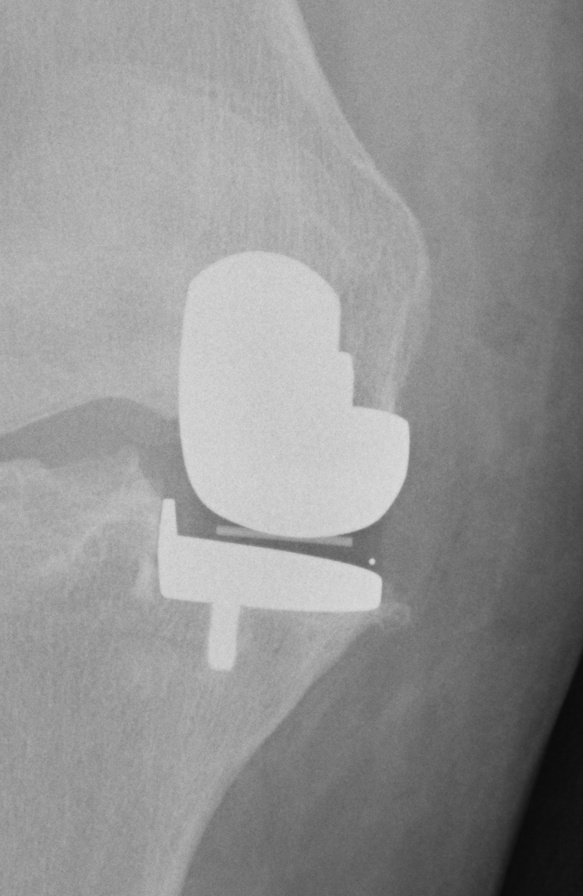 Knee_ZimmerBiomet_Oxford</td>
<td align="center" valign="top"><b>Option 1</b>  Knee_Depuy_Synthes_Sigma</td>
<td align="center" valign="top"><b>✅ Option 2</b>  Knee_ZimmerBiomet_Oxford</td>
<td align="center" valign="top"><b>Option 3</b>  Knee_SmithAndNephew_Legion2</td>
<td align="center" valign="top"><b>Option 4</b>  Knee_SmithAndNephew_GenesisII</td>
<td align="center" valign="middle"><b>Option 6</b>  <i>None of the above</i></td>
</tr></table>

### Q1118 · correct: option 3 · `Knee_ZimmerBiomet_Oxford`

<table><tr>
<td align="center" valign="top"><b>Query</b> 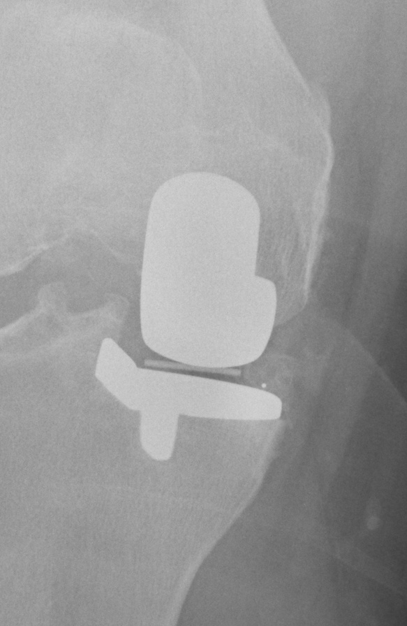 Knee_ZimmerBiomet_Oxford</td>
<td align="center" valign="top"><b>Option 1</b>  Knee_SmithAndNephew_GenesisII</td>
<td align="center" valign="top"><b>Option 2</b>  Knee_Depuy_Synthes_Sigma</td>
<td align="center" valign="top"><b>✅ Option 3</b>  Knee_ZimmerBiomet_Oxford</td>
<td align="center" valign="top"><b>Option 4</b>  Knee_SmithAndNephew_Legion2</td>
<td align="center" valign="middle"><b>Option 6</b>  <i>None of the above</i></td>
</tr></table>

### Q1119 · correct: option 3 · `Knee_ZimmerBiomet_Oxford`

<table><tr>
<td align="center" valign="top"><b>Query</b> 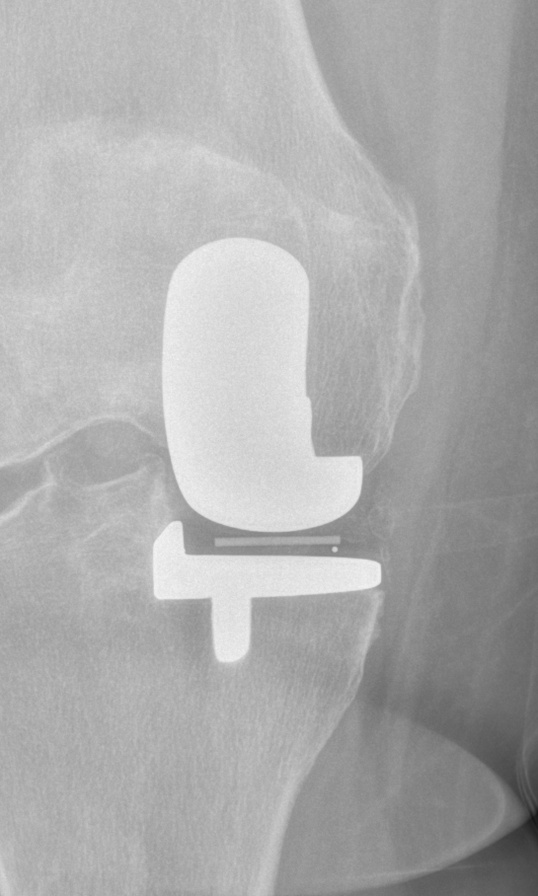 Knee_ZimmerBiomet_Oxford</td>
<td align="center" valign="top"><b>Option 1</b>  Knee_SmithAndNephew_GenesisII</td>
<td align="center" valign="top"><b>Option 2</b>  Knee_SmithAndNephew_Legion2</td>
<td align="center" valign="top"><b>✅ Option 3</b>  Knee_ZimmerBiomet_Oxford</td>
<td align="center" valign="top"><b>Option 4</b>  Knee_Depuy_Synthes_Sigma</td>
<td align="center" valign="middle"><b>Option 6</b>  <i>None of the above</i></td>
</tr></table>

### Q1120 · correct: option 4 · `Knee_ZimmerBiomet_Oxford`

<table><tr>
<td align="center" valign="top"><b>Query</b> 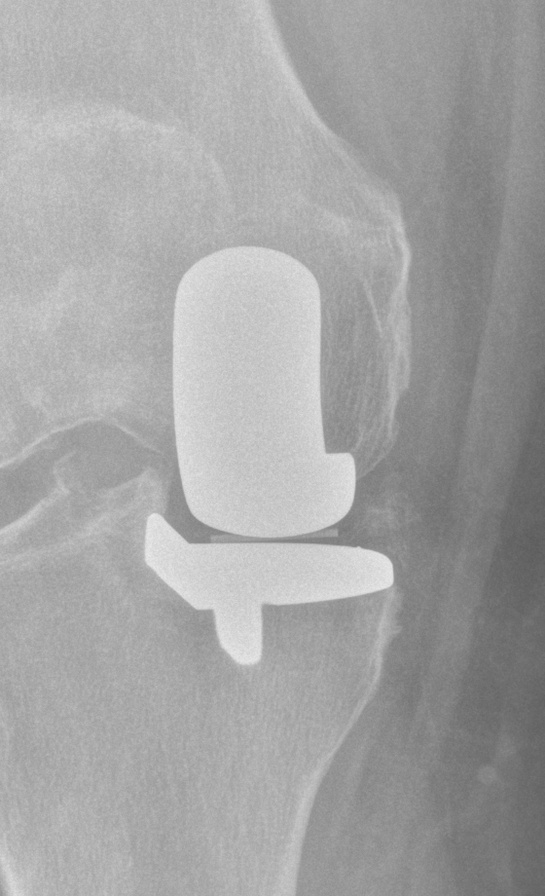 Knee_ZimmerBiomet_Oxford</td>
<td align="center" valign="top"><b>Option 1</b>  Knee_SmithAndNephew_GenesisII</td>
<td align="center" valign="top"><b>Option 2</b>  Knee_Depuy_Synthes_Sigma</td>
<td align="center" valign="top"><b>Option 3</b>  Knee_SmithAndNephew_Legion2</td>
<td align="center" valign="top"><b>✅ Option 4</b>  Knee_ZimmerBiomet_Oxford</td>
<td align="center" valign="middle"><b>Option 6</b>  <i>None of the above</i></td>
</tr></table>

### Q1121 · correct: option 3 · `Knee_ZimmerBiomet_Oxford`

<table><tr>
<td align="center" valign="top"><b>Query</b> 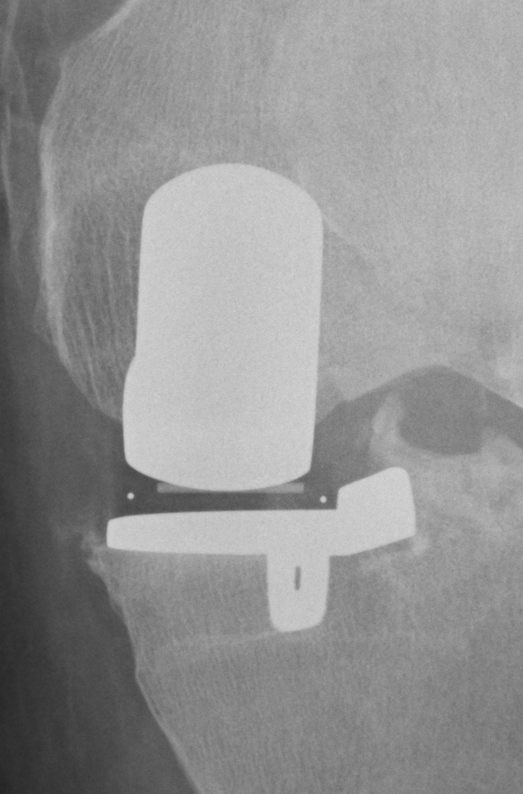 Knee_ZimmerBiomet_Oxford</td>
<td align="center" valign="top"><b>Option 1</b>  Knee_SmithAndNephew_GenesisII</td>
<td align="center" valign="top"><b>Option 2</b>  Knee_Depuy_Synthes_Sigma</td>
<td align="center" valign="top"><b>✅ Option 3</b>  Knee_ZimmerBiomet_Oxford</td>
<td align="center" valign="top"><b>Option 4</b>  Knee_SmithAndNephew_Legion2</td>
<td align="center" valign="middle"><b>Option 6</b>  <i>None of the above</i></td>
</tr></table>

### Q1122 · correct: option 1 · `Knee_ZimmerBiomet_Oxford`

<table><tr>
<td align="center" valign="top"><b>Query</b> 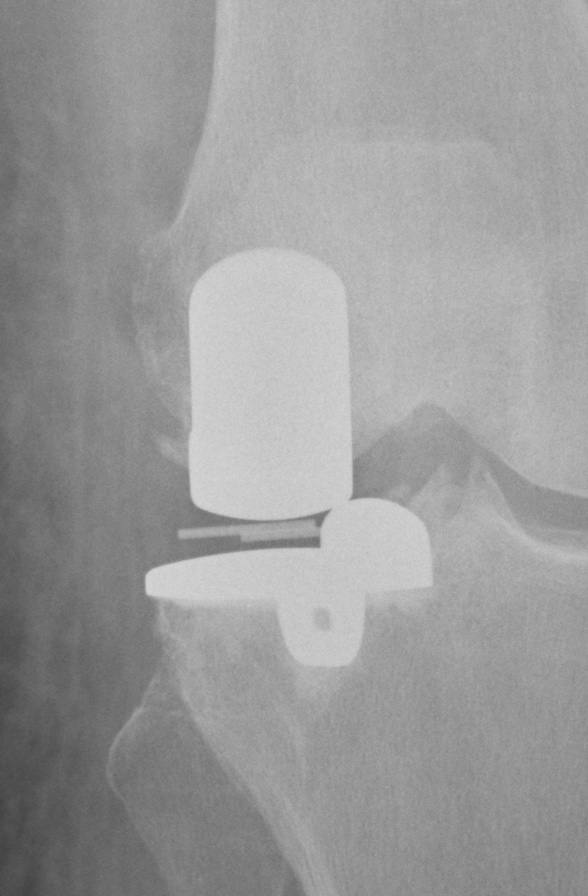 Knee_ZimmerBiomet_Oxford</td>
<td align="center" valign="top"><b>✅ Option 1</b>  Knee_ZimmerBiomet_Oxford</td>
<td align="center" valign="top"><b>Option 2</b>  Knee_SmithAndNephew_Legion2</td>
<td align="center" valign="top"><b>Option 3</b>  Knee_Depuy_Synthes_Sigma</td>
<td align="center" valign="top"><b>Option 4</b>  Knee_SmithAndNephew_GenesisII</td>
<td align="center" valign="middle"><b>Option 6</b>  <i>None of the above</i></td>
</tr></table>

### Q1123 · correct: option 1 · `Knee_ZimmerBiomet_Oxford`

<table><tr>
<td align="center" valign="top"><b>Query</b> 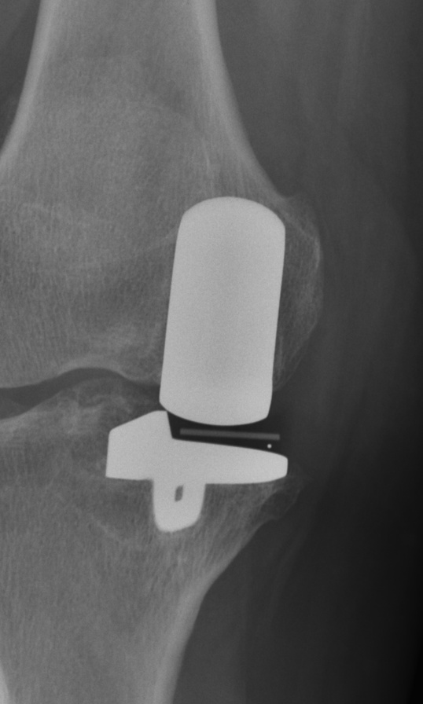 Knee_ZimmerBiomet_Oxford</td>
<td align="center" valign="top"><b>✅ Option 1</b>  Knee_ZimmerBiomet_Oxford</td>
<td align="center" valign="top"><b>Option 2</b>  Knee_Depuy_Synthes_Sigma</td>
<td align="center" valign="top"><b>Option 3</b>  Knee_SmithAndNephew_GenesisII</td>
<td align="center" valign="top"><b>Option 4</b>  Knee_SmithAndNephew_Legion2</td>
<td align="center" valign="middle"><b>Option 6</b>  <i>None of the above</i></td>
</tr></table>

### Q1124 · correct: option 3 · `Knee_ZimmerBiomet_Oxford`

<table><tr>
<td align="center" valign="top"><b>Query</b> 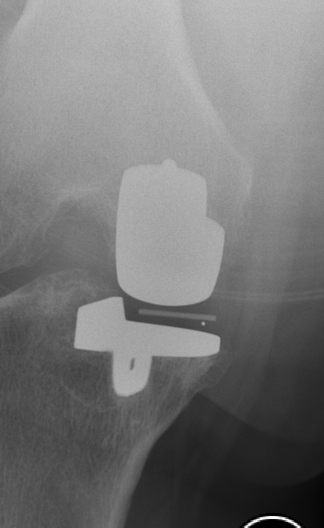 Knee_ZimmerBiomet_Oxford</td>
<td align="center" valign="top"><b>Option 1</b>  Knee_SmithAndNephew_Legion2</td>
<td align="center" valign="top"><b>Option 2</b>  Knee_Depuy_Synthes_Sigma</td>
<td align="center" valign="top"><b>✅ Option 3</b>  Knee_ZimmerBiomet_Oxford</td>
<td align="center" valign="top"><b>Option 4</b>  Knee_SmithAndNephew_GenesisII</td>
<td align="center" valign="middle"><b>Option 6</b>  <i>None of the above</i></td>
</tr></table>

### Q1125 · correct: option 1 · `Knee_ZimmerBiomet_Oxford`

<table><tr>
<td align="center" valign="top"><b>Query</b> 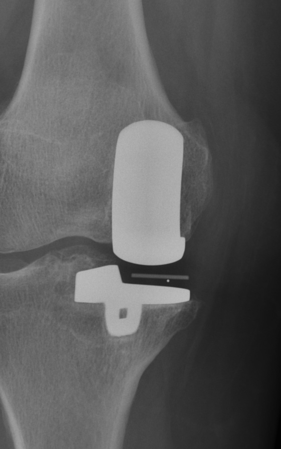 Knee_ZimmerBiomet_Oxford</td>
<td align="center" valign="top"><b>✅ Option 1</b>  Knee_ZimmerBiomet_Oxford</td>
<td align="center" valign="top"><b>Option 2</b>  Knee_Depuy_Synthes_Sigma</td>
<td align="center" valign="top"><b>Option 3</b>  Knee_SmithAndNephew_GenesisII</td>
<td align="center" valign="top"><b>Option 4</b>  Knee_SmithAndNephew_Legion2</td>
<td align="center" valign="middle"><b>Option 6</b>  <i>None of the above</i></td>
</tr></table>

### Q1126 · correct: option 3 · `Knee_ZimmerBiomet_Oxford`

<table><tr>
<td align="center" valign="top"><b>Query</b> 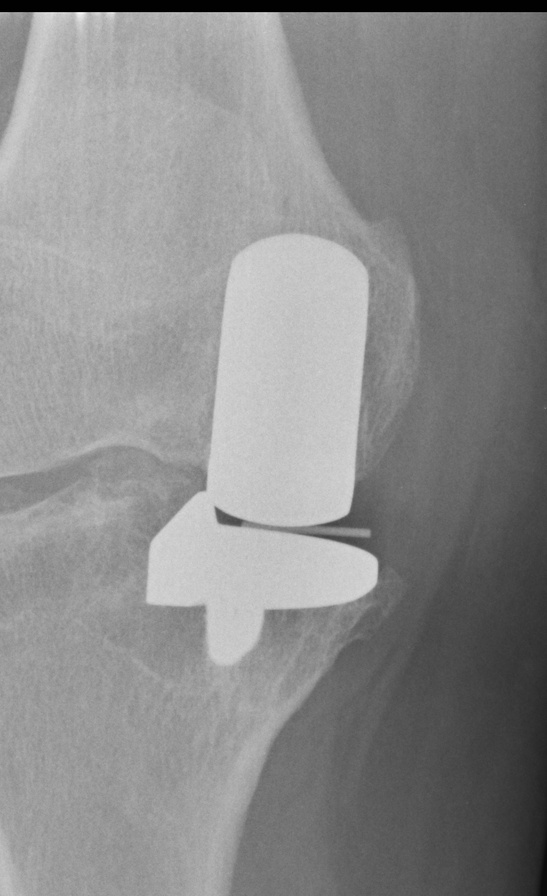 Knee_ZimmerBiomet_Oxford</td>
<td align="center" valign="top"><b>Option 1</b>  Knee_Depuy_Synthes_Sigma</td>
<td align="center" valign="top"><b>Option 2</b>  Knee_SmithAndNephew_GenesisII</td>
<td align="center" valign="top"><b>✅ Option 3</b>  Knee_ZimmerBiomet_Oxford</td>
<td align="center" valign="top"><b>Option 4</b>  Knee_SmithAndNephew_Legion2</td>
<td align="center" valign="middle"><b>Option 6</b>  <i>None of the above</i></td>
</tr></table>

### Q1127 · correct: option 4 · `Knee_ZimmerBiomet_Oxford`

<table><tr>
<td align="center" valign="top"><b>Query</b> 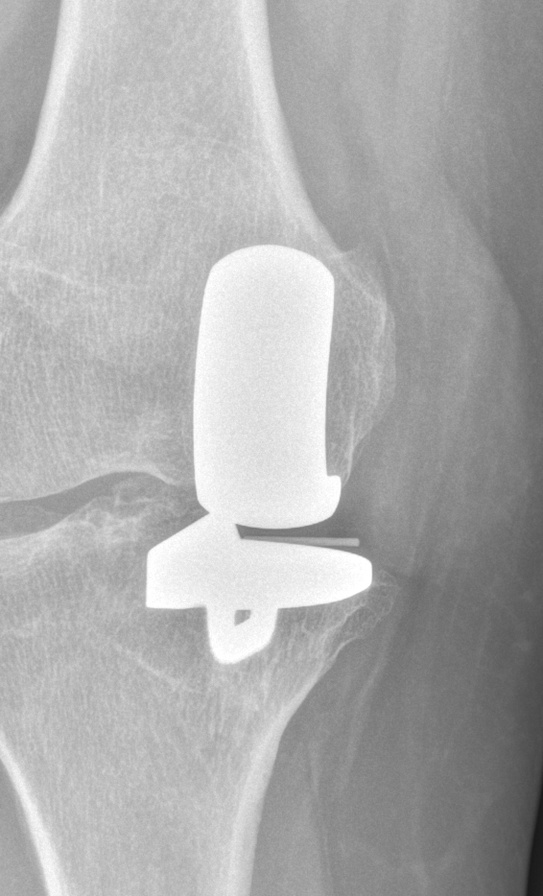 Knee_ZimmerBiomet_Oxford</td>
<td align="center" valign="top"><b>Option 1</b>  Knee_SmithAndNephew_Legion2</td>
<td align="center" valign="top"><b>Option 2</b>  Knee_SmithAndNephew_GenesisII</td>
<td align="center" valign="top"><b>Option 3</b>  Knee_Depuy_Synthes_Sigma</td>
<td align="center" valign="top"><b>✅ Option 4</b>  Knee_ZimmerBiomet_Oxford</td>
<td align="center" valign="middle"><b>Option 6</b>  <i>None of the above</i></td>
</tr></table>

### Q1128 · correct: option 4 · `Knee_ZimmerBiomet_Oxford`

<table><tr>
<td align="center" valign="top"><b>Query</b> 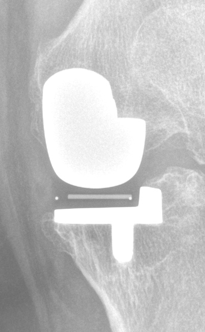 Knee_ZimmerBiomet_Oxford</td>
<td align="center" valign="top"><b>Option 1</b>  Knee_Depuy_Synthes_Sigma</td>
<td align="center" valign="top"><b>Option 2</b>  Knee_SmithAndNephew_GenesisII</td>
<td align="center" valign="top"><b>Option 3</b>  Knee_SmithAndNephew_Legion2</td>
<td align="center" valign="top"><b>✅ Option 4</b>  Knee_ZimmerBiomet_Oxford</td>
<td align="center" valign="middle"><b>Option 6</b>  <i>None of the above</i></td>
</tr></table>

