# Pacemakers (Howard et al.) · query set `test` · page 1/5

[← all pages](README.md)

### Q3079 · correct: option 3 · `BIO:Actros_Philos`

<table><tr>
<td align="center" valign="top"><b>Query</b> 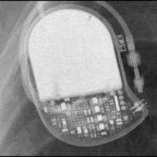 BIO:Actros_Philos</td>
<td align="center" valign="top"><b>Option 1</b> 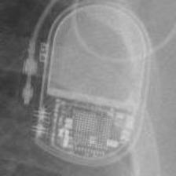 BIO:Evia</td>
<td align="center" valign="top"><b>Option 2</b> 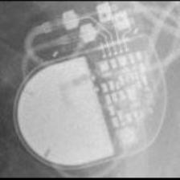 SOR:Reply</td>
<td align="center" valign="top"><b>✅ Option 3</b> 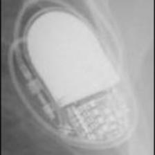 BIO:Actros_Philos</td>
<td align="center" valign="top"><b>Option 4</b> 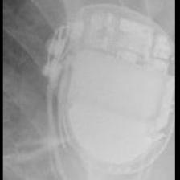 BOS:Ventak Prizm</td>
<td align="center" valign="top"><b>Option 5</b> 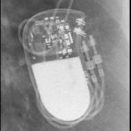 BIO:Cyclos</td>
<td align="center" valign="middle"><b>Option 6</b>  <i>None of the above</i></td>
</tr></table>

### Q3080 · correct: option 3 · `BIO:Actros_Philos`

<table><tr>
<td align="center" valign="top"><b>Query</b> 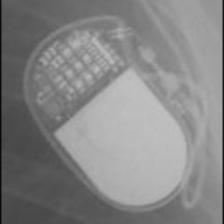 BIO:Actros_Philos</td>
<td align="center" valign="top"><b>Option 1</b> 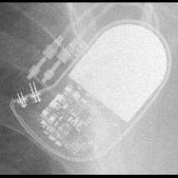 BIO:Cyclos</td>
<td align="center" valign="top"><b>Option 2</b>  MDT:Sigma</td>
<td align="center" valign="top"><b>✅ Option 3</b>  BIO:Actros_Philos</td>
<td align="center" valign="top"><b>Option 4</b>  SOR:Reply</td>
<td align="center" valign="top"><b>Option 5</b>  MDT:Adapta_Kappa_Sensia_Versa</td>
<td align="center" valign="middle"><b>Option 6</b>  <i>None of the above</i></td>
</tr></table>

### Q3081 · correct: option 2 · `BIO:Actros_Philos`

<table><tr>
<td align="center" valign="top"><b>Query</b>  BIO:Actros_Philos</td>
<td align="center" valign="top"><b>Option 1</b>  BIO:Cyclos</td>
<td align="center" valign="top"><b>✅ Option 2</b>  BIO:Actros_Philos</td>
<td align="center" valign="top"><b>Option 3</b>  MDT:Sigma</td>
<td align="center" valign="top"><b>Option 4</b>  BOS:Vitality</td>
<td align="center" valign="top"><b>Option 5</b>  BOS:Ventak Prizm</td>
<td align="center" valign="middle"><b>Option 6</b>  <i>None of the above</i></td>
</tr></table>

### Q3082 · correct: option 4 · `BIO:Actros_Philos`

<table><tr>
<td align="center" valign="top"><b>Query</b> 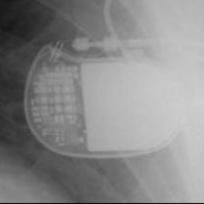 BIO:Actros_Philos</td>
<td align="center" valign="top"><b>Option 1</b>  MDT:Adapta_Kappa_Sensia_Versa</td>
<td align="center" valign="top"><b>Option 2</b>  MDT:Sigma</td>
<td align="center" valign="top"><b>Option 3</b> 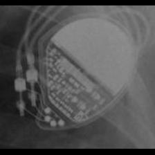 MDT:Vita II</td>
<td align="center" valign="top"><b>✅ Option 4</b>  BIO:Actros_Philos</td>
<td align="center" valign="top"><b>Option 5</b>  BIO:Cyclos</td>
<td align="center" valign="middle"><b>Option 6</b>  <i>None of the above</i></td>
</tr></table>

### Q3083 · correct: option 2 · `BIO:Actros_Philos`

<table><tr>
<td align="center" valign="top"><b>Query</b> 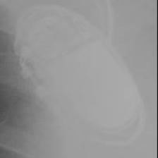 BIO:Actros_Philos</td>
<td align="center" valign="top"><b>Option 1</b> 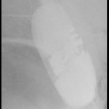 BOS:Emblem</td>
<td align="center" valign="top"><b>✅ Option 2</b>  BIO:Actros_Philos</td>
<td align="center" valign="top"><b>Option 3</b> 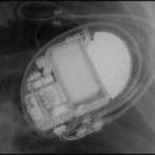 BOS:Ventak Prizm</td>
<td align="center" valign="top"><b>Option 4</b>  BIO:Cyclos</td>
<td align="center" valign="top"><b>Option 5</b>  SOR:Thesis</td>
<td align="center" valign="middle"><b>Option 6</b>  <i>None of the above</i></td>
</tr></table>

### Q3084 · correct: option 3 · `BIO:Cyclos`

<table><tr>
<td align="center" valign="top"><b>Query</b> 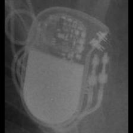 BIO:Cyclos</td>
<td align="center" valign="top"><b>Option 1</b> 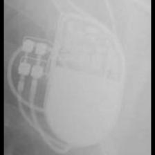 BOS:ContakTR_Discovery_Meridian_Pulsar Max</td>
<td align="center" valign="top"><b>Option 2</b>  MDT:Sigma</td>
<td align="center" valign="top"><b>✅ Option 3</b>  BIO:Cyclos</td>
<td align="center" valign="top"><b>Option 4</b>  BIO:Actros_Philos</td>
<td align="center" valign="top"><b>Option 5</b> 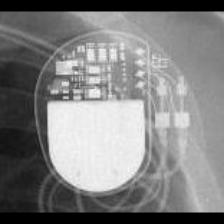 MDT:Adapta_Kappa_Sensia_Versa</td>
<td align="center" valign="middle"><b>Option 6</b>  <i>None of the above</i></td>
</tr></table>

### Q3085 · correct: option 4 · `BIO:Cyclos`

<table><tr>
<td align="center" valign="top"><b>Query</b> 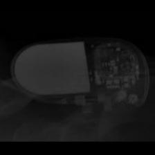 BIO:Cyclos</td>
<td align="center" valign="top"><b>Option 1</b>  MDT:Sigma</td>
<td align="center" valign="top"><b>Option 2</b>  BIO:Actros_Philos</td>
<td align="center" valign="top"><b>Option 3</b> 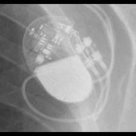 STJ:Zephyr</td>
<td align="center" valign="top"><b>✅ Option 4</b>  BIO:Cyclos</td>
<td align="center" valign="top"><b>Option 5</b> 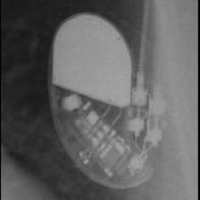 STJ:Identity</td>
<td align="center" valign="middle"><b>Option 6</b>  <i>None of the above</i></td>
</tr></table>

### Q3086 · correct: option 2 · `BIO:Cyclos`

<table><tr>
<td align="center" valign="top"><b>Query</b>  BIO:Cyclos</td>
<td align="center" valign="top"><b>Option 1</b> 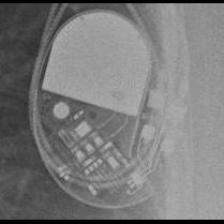 STJ:Identity</td>
<td align="center" valign="top"><b>✅ Option 2</b>  BIO:Cyclos</td>
<td align="center" valign="top"><b>Option 3</b>  BIO:Actros_Philos</td>
<td align="center" valign="top"><b>Option 4</b>  MDT:Adapta_Kappa_Sensia_Versa</td>
<td align="center" valign="top"><b>Option 5</b>  STJ:Zephyr</td>
<td align="center" valign="middle"><b>Option 6</b>  <i>None of the above</i></td>
</tr></table>

### Q3087 · correct: option 1 · `BIO:Cyclos`

<table><tr>
<td align="center" valign="top"><b>Query</b>  BIO:Cyclos</td>
<td align="center" valign="top"><b>✅ Option 1</b>  BIO:Cyclos</td>
<td align="center" valign="top"><b>Option 2</b>  BIO:Actros_Philos</td>
<td align="center" valign="top"><b>Option 3</b> 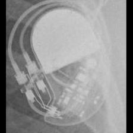 STJ:Identity</td>
<td align="center" valign="top"><b>Option 4</b>  STJ:Zephyr</td>
<td align="center" valign="top"><b>Option 5</b> 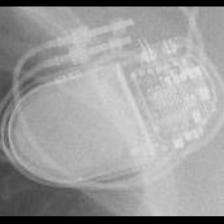 BIO:Evia</td>
<td align="center" valign="middle"><b>Option 6</b>  <i>None of the above</i></td>
</tr></table>

### Q3088 · correct: option 1 · `BIO:Cyclos`

<table><tr>
<td align="center" valign="top"><b>Query</b> 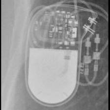 BIO:Cyclos</td>
<td align="center" valign="top"><b>✅ Option 1</b> 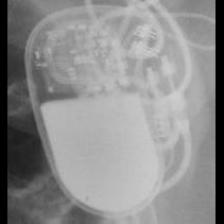 BIO:Cyclos</td>
<td align="center" valign="top"><b>Option 2</b> 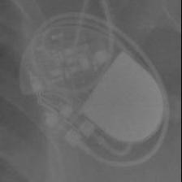 STJ:Identity</td>
<td align="center" valign="top"><b>Option 3</b>  BIO:Actros_Philos</td>
<td align="center" valign="top"><b>Option 4</b>  SOR:Reply</td>
<td align="center" valign="top"><b>Option 5</b> 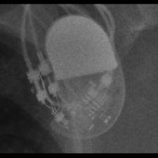 STJ:Zephyr</td>
<td align="center" valign="middle"><b>Option 6</b>  <i>None of the above</i></td>
</tr></table>

### Q3089 · correct: option 4 · `BIO:Evia`

<table><tr>
<td align="center" valign="top"><b>Query</b> 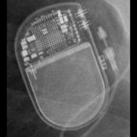 BIO:Evia</td>
<td align="center" valign="top"><b>Option 1</b>  MDT:Azure</td>
<td align="center" valign="top"><b>Option 2</b> 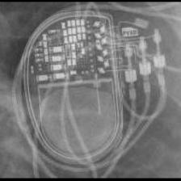 MDT:Syncra</td>
<td align="center" valign="top"><b>Option 3</b>  STJ:Accent</td>
<td align="center" valign="top"><b>✅ Option 4</b> 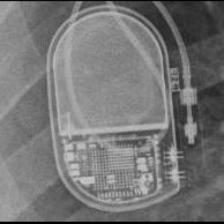 BIO:Evia</td>
<td align="center" valign="top"><b>Option 5</b> 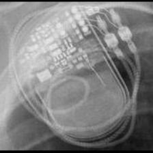 MDT:AT500</td>
<td align="center" valign="middle"><b>Option 6</b>  <i>None of the above</i></td>
</tr></table>

### Q3090 · correct: option 4 · `BIO:Evia`

<table><tr>
<td align="center" valign="top"><b>Query</b> 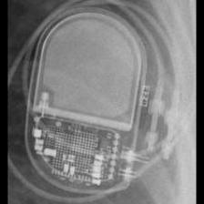 BIO:Evia</td>
<td align="center" valign="top"><b>Option 1</b>  MDT:AT500</td>
<td align="center" valign="top"><b>Option 2</b> 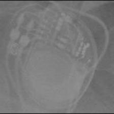 MDT:Azure</td>
<td align="center" valign="top"><b>Option 3</b>  STJ:Accent</td>
<td align="center" valign="top"><b>✅ Option 4</b> 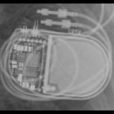 BIO:Evia</td>
<td align="center" valign="top"><b>Option 5</b>  MDT:Syncra</td>
<td align="center" valign="middle"><b>Option 6</b>  <i>None of the above</i></td>
</tr></table>

### Q3091 · correct: option 4 · `BIO:Evia`

<table><tr>
<td align="center" valign="top"><b>Query</b>  BIO:Evia</td>
<td align="center" valign="top"><b>Option 1</b>  MDT:Azure</td>
<td align="center" valign="top"><b>Option 2</b> 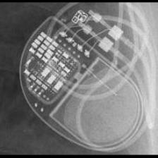 MDT:Advisa</td>
<td align="center" valign="top"><b>Option 3</b>  MDT:AT500</td>
<td align="center" valign="top"><b>✅ Option 4</b> 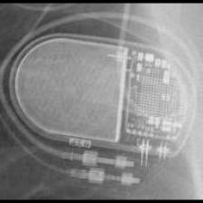 BIO:Evia</td>
<td align="center" valign="top"><b>Option 5</b>  STJ:Accent</td>
<td align="center" valign="middle"><b>Option 6</b>  <i>None of the above</i></td>
</tr></table>

### Q3092 · correct: option 6 (None of the above)

<table><tr>
<td align="center" valign="top"><b>Query</b> 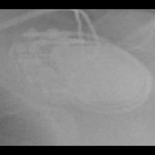 BIO:Evia</td>
<td align="center" valign="top"><b>Option 1</b> 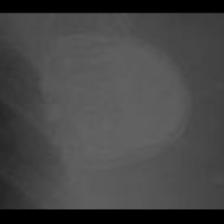 SOR:Thesis</td>
<td align="center" valign="top"><b>Option 2</b>  BIO:Cyclos</td>
<td align="center" valign="top"><b>Option 3</b> 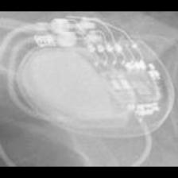 MDT:Azure</td>
<td align="center" valign="top"><b>Option 4</b> 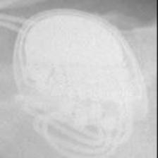 SOR:MiniSwing</td>
<td align="center" valign="top"><b>Option 5</b> 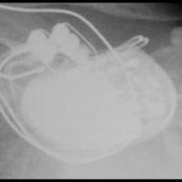 BOS:ContakTR_Discovery_Meridian_Pulsar Max</td>
<td align="center" valign="middle"><b>✅ Option 6</b>  <i>None of the above</i></td>
</tr></table>

### Q3093 · correct: option 2 · `BIO:Evia`

<table><tr>
<td align="center" valign="top"><b>Query</b> 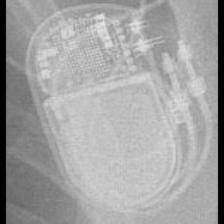 BIO:Evia</td>
<td align="center" valign="top"><b>Option 1</b>  MDT:AT500</td>
<td align="center" valign="top"><b>✅ Option 2</b>  BIO:Evia</td>
<td align="center" valign="top"><b>Option 3</b>  MDT:Azure</td>
<td align="center" valign="top"><b>Option 4</b> 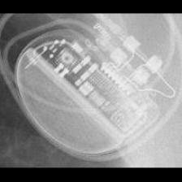 BOS:Ingenio</td>
<td align="center" valign="top"><b>Option 5</b>  MDT:Syncra</td>
<td align="center" valign="middle"><b>Option 6</b>  <i>None of the above</i></td>
</tr></table>

### Q3094 · correct: option 1 · `BOS:Altrua_Insignia`

<table><tr>
<td align="center" valign="top"><b>Query</b>  BOS:Altrua_Insignia</td>
<td align="center" valign="top"><b>✅ Option 1</b> 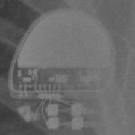 BOS:Altrua_Insignia</td>
<td align="center" valign="top"><b>Option 2</b> 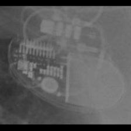 STJ:Allure Quadra</td>
<td align="center" valign="top"><b>Option 3</b>  MDT:Vita II</td>
<td align="center" valign="top"><b>Option 4</b> 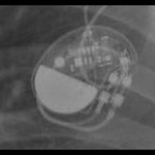 STJ:Victory</td>
<td align="center" valign="top"><b>Option 5</b>  SOR:Neway</td>
<td align="center" valign="middle"><b>Option 6</b>  <i>None of the above</i></td>
</tr></table>

### Q3095 · correct: option 3 · `BOS:Altrua_Insignia`

<table><tr>
<td align="center" valign="top"><b>Query</b> 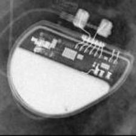 BOS:Altrua_Insignia</td>
<td align="center" valign="top"><b>Option 1</b> 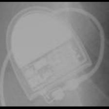 SOR:Elect XS Plus</td>
<td align="center" valign="top"><b>Option 2</b>  SOR:Neway</td>
<td align="center" valign="top"><b>✅ Option 3</b> 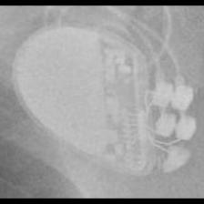 BOS:Altrua_Insignia</td>
<td align="center" valign="top"><b>Option 4</b>  MDT:Vita II</td>
<td align="center" valign="top"><b>Option 5</b> 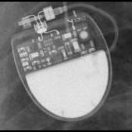 SOR:Rhapsody_Symphony</td>
<td align="center" valign="middle"><b>Option 6</b>  <i>None of the above</i></td>
</tr></table>

### Q3096 · correct: option 5 · `BOS:Altrua_Insignia`

<table><tr>
<td align="center" valign="top"><b>Query</b> 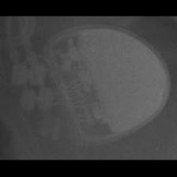 BOS:Altrua_Insignia</td>
<td align="center" valign="top"><b>Option 1</b>  SOR:MiniSwing</td>
<td align="center" valign="top"><b>Option 2</b>  SOR:Rhapsody_Symphony</td>
<td align="center" valign="top"><b>Option 3</b>  SOR:Elect</td>
<td align="center" valign="top"><b>Option 4</b>  BOS:ContakTR_Discovery_Meridian_Pulsar Max</td>
<td align="center" valign="top"><b>✅ Option 5</b>  BOS:Altrua_Insignia</td>
<td align="center" valign="middle"><b>Option 6</b>  <i>None of the above</i></td>
</tr></table>

### Q3097 · correct: option 1 · `BOS:Altrua_Insignia`

<table><tr>
<td align="center" valign="top"><b>Query</b>  BOS:Altrua_Insignia</td>
<td align="center" valign="top"><b>✅ Option 1</b>  BOS:Altrua_Insignia</td>
<td align="center" valign="top"><b>Option 2</b>  SOR:Elect</td>
<td align="center" valign="top"><b>Option 3</b>  BOS:ContakTR_Discovery_Meridian_Pulsar Max</td>
<td align="center" valign="top"><b>Option 4</b>  SOR:Elect XS Plus</td>
<td align="center" valign="top"><b>Option 5</b>  SOR:Rhapsody_Symphony</td>
<td align="center" valign="middle"><b>Option 6</b>  <i>None of the above</i></td>
</tr></table>

### Q3098 · correct: option 4 · `BOS:Altrua_Insignia`

<table><tr>
<td align="center" valign="top"><b>Query</b>  BOS:Altrua_Insignia</td>
<td align="center" valign="top"><b>Option 1</b>  STJ:Victory</td>
<td align="center" valign="top"><b>Option 2</b>  STJ:Zephyr</td>
<td align="center" valign="top"><b>Option 3</b>  MDT:Vita II</td>
<td align="center" valign="top"><b>✅ Option 4</b>  BOS:Altrua_Insignia</td>
<td align="center" valign="top"><b>Option 5</b>  MDT:C60 DR</td>
<td align="center" valign="middle"><b>Option 6</b>  <i>None of the above</i></td>
</tr></table>

### Q3099 · correct: option 5 · `BOS:Autogen_Teligen_Energen_Cognis`

<table><tr>
<td align="center" valign="top"><b>Query</b>  BOS:Autogen_Teligen_Energen_Cognis</td>
<td align="center" valign="top"><b>Option 1</b>  STJ:Ellipse</td>
<td align="center" valign="top"><b>Option 2</b>  BOS:Ingenio</td>
<td align="center" valign="top"><b>Option 3</b>  BOS:Visionist</td>
<td align="center" valign="top"><b>Option 4</b>  BOS:Proponent</td>
<td align="center" valign="top"><b>✅ Option 5</b>  BOS:Autogen_Teligen_Energen_Cognis</td>
<td align="center" valign="middle"><b>Option 6</b>  <i>None of the above</i></td>
</tr></table>

### Q3100 · correct: option 5 · `BOS:Autogen_Teligen_Energen_Cognis`

<table><tr>
<td align="center" valign="top"><b>Query</b>  BOS:Autogen_Teligen_Energen_Cognis</td>
<td align="center" valign="top"><b>Option 1</b>  BOS:Visionist</td>
<td align="center" valign="top"><b>Option 2</b>  BOS:Proponent</td>
<td align="center" valign="top"><b>Option 3</b>  MDT:Claria_Evera_Viva</td>
<td align="center" valign="top"><b>Option 4</b>  STJ:Ellipse</td>
<td align="center" valign="top"><b>✅ Option 5</b>  BOS:Autogen_Teligen_Energen_Cognis</td>
<td align="center" valign="middle"><b>Option 6</b>  <i>None of the above</i></td>
</tr></table>

### Q3101 · correct: option 1 · `BOS:Autogen_Teligen_Energen_Cognis`

<table><tr>
<td align="center" valign="top"><b>Query</b>  BOS:Autogen_Teligen_Energen_Cognis</td>
<td align="center" valign="top"><b>✅ Option 1</b>  BOS:Autogen_Teligen_Energen_Cognis</td>
<td align="center" valign="top"><b>Option 2</b>  BOS:Vitality</td>
<td align="center" valign="top"><b>Option 3</b>  BOS:ContakTR_Discovery_Meridian_Pulsar Max</td>
<td align="center" valign="top"><b>Option 4</b>  BOS:Emblem</td>
<td align="center" valign="top"><b>Option 5</b>  STJ:Ellipse</td>
<td align="center" valign="middle"><b>Option 6</b>  <i>None of the above</i></td>
</tr></table>

### Q3102 · correct: option 5 · `BOS:Autogen_Teligen_Energen_Cognis`

<table><tr>
<td align="center" valign="top"><b>Query</b>  BOS:Autogen_Teligen_Energen_Cognis</td>
<td align="center" valign="top"><b>Option 1</b>  BOS:Visionist</td>
<td align="center" valign="top"><b>Option 2</b>  MDT:Claria_Evera_Viva</td>
<td align="center" valign="top"><b>Option 3</b>  BOS:Contak Renewal 4</td>
<td align="center" valign="top"><b>Option 4</b>  STJ:Ellipse</td>
<td align="center" valign="top"><b>✅ Option 5</b>  BOS:Autogen_Teligen_Energen_Cognis</td>
<td align="center" valign="middle"><b>Option 6</b>  <i>None of the above</i></td>
</tr></table>

### Q3103 · correct: option 3 · `BOS:Autogen_Teligen_Energen_Cognis`

<table><tr>
<td align="center" valign="top"><b>Query</b>  BOS:Autogen_Teligen_Energen_Cognis</td>
<td align="center" valign="top"><b>Option 1</b>  BOS:Contak Renewal 4</td>
<td align="center" valign="top"><b>Option 2</b>  BOS:Visionist</td>
<td align="center" valign="top"><b>✅ Option 3</b>  BOS:Autogen_Teligen_Energen_Cognis</td>
<td align="center" valign="top"><b>Option 4</b>  BOS:Contak Renewal TR2</td>
<td align="center" valign="top"><b>Option 5</b>  MDT:Claria_Evera_Viva</td>
<td align="center" valign="middle"><b>Option 6</b>  <i>None of the above</i></td>
</tr></table>

### Q3104 · correct: option 3 · `BOS:Contak Renewal 4`

<table><tr>
<td align="center" valign="top"><b>Query</b>  BOS:Contak Renewal 4</td>
<td align="center" valign="top"><b>Option 1</b>  BOS:Vitality</td>
<td align="center" valign="top"><b>Option 2</b>  MDT:Maximo</td>
<td align="center" valign="top"><b>✅ Option 3</b>  BOS:Contak Renewal 4</td>
<td align="center" valign="top"><b>Option 4</b>  BIO:Cyclos</td>
<td align="center" valign="top"><b>Option 5</b>  BOS:Ventak Prizm</td>
<td align="center" valign="middle"><b>Option 6</b>  <i>None of the above</i></td>
</tr></table>

### Q3105 · correct: option 3 · `BOS:Contak Renewal 4`

<table><tr>
<td align="center" valign="top"><b>Query</b>  BOS:Contak Renewal 4</td>
<td align="center" valign="top"><b>Option 1</b>  MDT:Claria_Evera_Viva</td>
<td align="center" valign="top"><b>Option 2</b>  MDT:Concerto_Consulta_Maximo_Protecta_Secura</td>
<td align="center" valign="top"><b>✅ Option 3</b>  BOS:Contak Renewal 4</td>
<td align="center" valign="top"><b>Option 4</b>  BOS:Vitality</td>
<td align="center" valign="top"><b>Option 5</b>  MDT:Maximo</td>
<td align="center" valign="middle"><b>Option 6</b>  <i>None of the above</i></td>
</tr></table>

### Q3106 · correct: option 1 · `BOS:Contak Renewal 4`

<table><tr>
<td align="center" valign="top"><b>Query</b>  BOS:Contak Renewal 4</td>
<td align="center" valign="top"><b>✅ Option 1</b>  BOS:Contak Renewal 4</td>
<td align="center" valign="top"><b>Option 2</b>  BOS:Ventak Prizm</td>
<td align="center" valign="top"><b>Option 3</b>  MDT:Concerto_Consulta_Maximo_Protecta_Secura</td>
<td align="center" valign="top"><b>Option 4</b>  MDT:Maximo</td>
<td align="center" valign="top"><b>Option 5</b>  BOS:Vitality</td>
<td align="center" valign="middle"><b>Option 6</b>  <i>None of the above</i></td>
</tr></table>

### Q3107 · correct: option 1 · `BOS:Contak Renewal 4`

<table><tr>
<td align="center" valign="top"><b>Query</b>  BOS:Contak Renewal 4</td>
<td align="center" valign="top"><b>✅ Option 1</b>  BOS:Contak Renewal 4</td>
<td align="center" valign="top"><b>Option 2</b>  MDT:Claria_Evera_Viva</td>
<td align="center" valign="top"><b>Option 3</b>  MDT:Concerto_Consulta_Maximo_Protecta_Secura</td>
<td align="center" valign="top"><b>Option 4</b>  BOS:Vitality</td>
<td align="center" valign="top"><b>Option 5</b>  MDT:Maximo</td>
<td align="center" valign="middle"><b>Option 6</b>  <i>None of the above</i></td>
</tr></table>

### Q3108 · correct: option 5 · `BOS:Contak Renewal 4`

<table><tr>
<td align="center" valign="top"><b>Query</b>  BOS:Contak Renewal 4</td>
<td align="center" valign="top"><b>Option 1</b>  STJ:Quadra Assura_Unify</td>
<td align="center" valign="top"><b>Option 2</b>  MDT:Concerto_Consulta_Maximo_Protecta_Secura</td>
<td align="center" valign="top"><b>Option 3</b>  BOS:Vitality</td>
<td align="center" valign="top"><b>Option 4</b>  MDT:Maximo</td>
<td align="center" valign="top"><b>✅ Option 5</b>  BOS:Contak Renewal 4</td>
<td align="center" valign="middle"><b>Option 6</b>  <i>None of the above</i></td>
</tr></table>

### Q3109 · correct: option 3 · `BOS:Contak Renewal TR2`

<table><tr>
<td align="center" valign="top"><b>Query</b>  BOS:Contak Renewal TR2</td>
<td align="center" valign="top"><b>Option 1</b>  BOS:Ingenio</td>
<td align="center" valign="top"><b>Option 2</b>  MDT:Azure</td>
<td align="center" valign="top"><b>✅ Option 3</b>  BOS:Contak Renewal TR2</td>
<td align="center" valign="top"><b>Option 4</b>  BOS:Proponent</td>
<td align="center" valign="top"><b>Option 5</b>  BOS:Visionist</td>
<td align="center" valign="middle"><b>Option 6</b>  <i>None of the above</i></td>
</tr></table>

### Q3110 · correct: option 5 · `BOS:Contak Renewal TR2`

<table><tr>
<td align="center" valign="top"><b>Query</b>  BOS:Contak Renewal TR2</td>
<td align="center" valign="top"><b>Option 1</b>  MDT:Insync III</td>
<td align="center" valign="top"><b>Option 2</b>  BOS:Ingenio</td>
<td align="center" valign="top"><b>Option 3</b>  BOS:Proponent</td>
<td align="center" valign="top"><b>Option 4</b>  BOS:Visionist</td>
<td align="center" valign="top"><b>✅ Option 5</b>  BOS:Contak Renewal TR2</td>
<td align="center" valign="middle"><b>Option 6</b>  <i>None of the above</i></td>
</tr></table>

### Q3111 · correct: option 2 · `BOS:Contak Renewal TR2`

<table><tr>
<td align="center" valign="top"><b>Query</b>  BOS:Contak Renewal TR2</td>
<td align="center" valign="top"><b>Option 1</b>  BOS:Ingenio</td>
<td align="center" valign="top"><b>✅ Option 2</b>  BOS:Contak Renewal TR2</td>
<td align="center" valign="top"><b>Option 3</b>  STJ:Ellipse</td>
<td align="center" valign="top"><b>Option 4</b>  BOS:Proponent</td>
<td align="center" valign="top"><b>Option 5</b>  BOS:Visionist</td>
<td align="center" valign="middle"><b>Option 6</b>  <i>None of the above</i></td>
</tr></table>

### Q3112 · correct: option 2 · `BOS:Contak Renewal TR2`

<table><tr>
<td align="center" valign="top"><b>Query</b>  BOS:Contak Renewal TR2</td>
<td align="center" valign="top"><b>Option 1</b>  BOS:Proponent</td>
<td align="center" valign="top"><b>✅ Option 2</b>  BOS:Contak Renewal TR2</td>
<td align="center" valign="top"><b>Option 3</b>  BOS:Ingenio</td>
<td align="center" valign="top"><b>Option 4</b>  MDT:Insync III</td>
<td align="center" valign="top"><b>Option 5</b>  BOS:Visionist</td>
<td align="center" valign="middle"><b>Option 6</b>  <i>None of the above</i></td>
</tr></table>

### Q3113 · correct: option 3 · `BOS:Contak Renewal TR2`

<table><tr>
<td align="center" valign="top"><b>Query</b>  BOS:Contak Renewal TR2</td>
<td align="center" valign="top"><b>Option 1</b>  BOS:Ingenio</td>
<td align="center" valign="top"><b>Option 2</b>  BOS:Visionist</td>
<td align="center" valign="top"><b>✅ Option 3</b>  BOS:Contak Renewal TR2</td>
<td align="center" valign="top"><b>Option 4</b>  BOS:Proponent</td>
<td align="center" valign="top"><b>Option 5</b>  BIO:Evia</td>
<td align="center" valign="middle"><b>Option 6</b>  <i>None of the above</i></td>
</tr></table>

### Q3114 · correct: option 5 · `BOS:ContakTR_Discovery_Meridian_Pulsar Max`

<table><tr>
<td align="center" valign="top"><b>Query</b>  BOS:ContakTR_Discovery_Meridian_Pulsar Max</td>
<td align="center" valign="top"><b>Option 1</b>  BOS:Altrua_Insignia</td>
<td align="center" valign="top"><b>Option 2</b>  BIO:Actros_Philos</td>
<td align="center" valign="top"><b>Option 3</b>  SOR:Rhapsody_Symphony</td>
<td align="center" valign="top"><b>Option 4</b>  SOR:Elect XS Plus</td>
<td align="center" valign="top"><b>✅ Option 5</b>  BOS:ContakTR_Discovery_Meridian_Pulsar Max</td>
<td align="center" valign="middle"><b>Option 6</b>  <i>None of the above</i></td>
</tr></table>

### Q3115 · correct: option 1 · `BOS:ContakTR_Discovery_Meridian_Pulsar Max`

<table><tr>
<td align="center" valign="top"><b>Query</b>  BOS:ContakTR_Discovery_Meridian_Pulsar Max</td>
<td align="center" valign="top"><b>✅ Option 1</b>  BOS:ContakTR_Discovery_Meridian_Pulsar Max</td>
<td align="center" valign="top"><b>Option 2</b>  SOR:Rhapsody_Symphony</td>
<td align="center" valign="top"><b>Option 3</b>  MDT:Sigma</td>
<td align="center" valign="top"><b>Option 4</b>  SOR:Thesis</td>
<td align="center" valign="top"><b>Option 5</b>  MDT:C20_T20</td>
<td align="center" valign="middle"><b>Option 6</b>  <i>None of the above</i></td>
</tr></table>

### Q3116 · correct: option 2 · `BOS:ContakTR_Discovery_Meridian_Pulsar Max`

<table><tr>
<td align="center" valign="top"><b>Query</b>  BOS:ContakTR_Discovery_Meridian_Pulsar Max</td>
<td align="center" valign="top"><b>Option 1</b>  BIO:Actros_Philos</td>
<td align="center" valign="top"><b>✅ Option 2</b>  BOS:ContakTR_Discovery_Meridian_Pulsar Max</td>
<td align="center" valign="top"><b>Option 3</b>  MDT:C60 DR</td>
<td align="center" valign="top"><b>Option 4</b>  MDT:Sigma</td>
<td align="center" valign="top"><b>Option 5</b>  MDT:C20_T20</td>
<td align="center" valign="middle"><b>Option 6</b>  <i>None of the above</i></td>
</tr></table>

### Q3117 · correct: option 6 (None of the above)

<table><tr>
<td align="center" valign="top"><b>Query</b>  BOS:ContakTR_Discovery_Meridian_Pulsar Max</td>
<td align="center" valign="top"><b>Option 1</b>  STJ:Identity</td>
<td align="center" valign="top"><b>Option 2</b>  BOS:Ventak Prizm</td>
<td align="center" valign="top"><b>Option 3</b>  BIO:Actros_Philos</td>
<td align="center" valign="top"><b>Option 4</b>  BOS:Vitality</td>
<td align="center" valign="top"><b>Option 5</b>  MDT:Adapta_Kappa_Sensia_Versa</td>
<td align="center" valign="middle"><b>✅ Option 6</b>  <i>None of the above</i></td>
</tr></table>

### Q3118 · correct: option 4 · `BOS:ContakTR_Discovery_Meridian_Pulsar Max`

<table><tr>
<td align="center" valign="top"><b>Query</b>  BOS:ContakTR_Discovery_Meridian_Pulsar Max</td>
<td align="center" valign="top"><b>Option 1</b>  BIO:Actros_Philos</td>
<td align="center" valign="top"><b>Option 2</b>  MDT:C60 DR</td>
<td align="center" valign="top"><b>Option 3</b>  SOR:Thesis</td>
<td align="center" valign="top"><b>✅ Option 4</b>  BOS:ContakTR_Discovery_Meridian_Pulsar Max</td>
<td align="center" valign="top"><b>Option 5</b>  SOR:MiniSwing</td>
<td align="center" valign="middle"><b>Option 6</b>  <i>None of the above</i></td>
</tr></table>

### Q3119 · correct: option 3 · `BOS:Emblem`

<table><tr>
<td align="center" valign="top"><b>Query</b>  BOS:Emblem</td>
<td align="center" valign="top"><b>Option 1</b>  MDT:REVEAL</td>
<td align="center" valign="top"><b>Option 2</b>  BOS:Autogen_Teligen_Energen_Cognis</td>
<td align="center" valign="top"><b>✅ Option 3</b>  BOS:Emblem</td>
<td align="center" valign="top"><b>Option 4</b>  SOR:Ovatio</td>
<td align="center" valign="top"><b>Option 5</b>  MDT:REVEAL LINQ</td>
<td align="center" valign="middle"><b>Option 6</b>  <i>None of the above</i></td>
</tr></table>

### Q3120 · correct: option 2 · `BOS:Emblem`

<table><tr>
<td align="center" valign="top"><b>Query</b>  BOS:Emblem</td>
<td align="center" valign="top"><b>Option 1</b>  BOS:Altrua_Insignia</td>
<td align="center" valign="top"><b>✅ Option 2</b>  BOS:Emblem</td>
<td align="center" valign="top"><b>Option 3</b>  STJ:Quadra Assura_Unify</td>
<td align="center" valign="top"><b>Option 4</b>  MDT:REVEAL LINQ</td>
<td align="center" valign="top"><b>Option 5</b>  BOS:Autogen_Teligen_Energen_Cognis</td>
<td align="center" valign="middle"><b>Option 6</b>  <i>None of the above</i></td>
</tr></table>

### Q3121 · correct: option 4 · `BOS:Emblem`

<table><tr>
<td align="center" valign="top"><b>Query</b>  BOS:Emblem</td>
<td align="center" valign="top"><b>Option 1</b>  MDT:REVEAL</td>
<td align="center" valign="top"><b>Option 2</b>  SOR:Thesis</td>
<td align="center" valign="top"><b>Option 3</b>  SOR:MiniSwing</td>
<td align="center" valign="top"><b>✅ Option 4</b>  BOS:Emblem</td>
<td align="center" valign="top"><b>Option 5</b>  MDT:REVEAL LINQ</td>
<td align="center" valign="middle"><b>Option 6</b>  <i>None of the above</i></td>
</tr></table>

### Q3122 · correct: option 5 · `BOS:Emblem`

<table><tr>
<td align="center" valign="top"><b>Query</b>  BOS:Emblem</td>
<td align="center" valign="top"><b>Option 1</b>  MDT:REVEAL LINQ</td>
<td align="center" valign="top"><b>Option 2</b>  STJ:Ellipse</td>
<td align="center" valign="top"><b>Option 3</b>  SOR:Ovatio</td>
<td align="center" valign="top"><b>Option 4</b>  BOS:Autogen_Teligen_Energen_Cognis</td>
<td align="center" valign="top"><b>✅ Option 5</b>  BOS:Emblem</td>
<td align="center" valign="middle"><b>Option 6</b>  <i>None of the above</i></td>
</tr></table>

### Q3123 · correct: option 2 · `BOS:Emblem`

<table><tr>
<td align="center" valign="top"><b>Query</b>  BOS:Emblem</td>
<td align="center" valign="top"><b>Option 1</b>  STJ:Ellipse</td>
<td align="center" valign="top"><b>✅ Option 2</b>  BOS:Emblem</td>
<td align="center" valign="top"><b>Option 3</b>  MDT:REVEAL LINQ</td>
<td align="center" valign="top"><b>Option 4</b>  BOS:Vitality</td>
<td align="center" valign="top"><b>Option 5</b>  BOS:Altrua_Insignia</td>
<td align="center" valign="middle"><b>Option 6</b>  <i>None of the above</i></td>
</tr></table>

### Q3124 · correct: option 2 · `BOS:Ingenio`

<table><tr>
<td align="center" valign="top"><b>Query</b>  BOS:Ingenio</td>
<td align="center" valign="top"><b>Option 1</b>  BOS:Proponent</td>
<td align="center" valign="top"><b>✅ Option 2</b>  BOS:Ingenio</td>
<td align="center" valign="top"><b>Option 3</b>  BOS:Visionist</td>
<td align="center" valign="top"><b>Option 4</b>  BOS:Autogen_Teligen_Energen_Cognis</td>
<td align="center" valign="top"><b>Option 5</b>  BOS:Contak Renewal TR2</td>
<td align="center" valign="middle"><b>Option 6</b>  <i>None of the above</i></td>
</tr></table>

### Q3125 · correct: option 4 · `BOS:Ingenio`

<table><tr>
<td align="center" valign="top"><b>Query</b>  BOS:Ingenio</td>
<td align="center" valign="top"><b>Option 1</b>  BOS:Contak Renewal TR2</td>
<td align="center" valign="top"><b>Option 2</b>  BOS:Visionist</td>
<td align="center" valign="top"><b>Option 3</b>  BOS:Autogen_Teligen_Energen_Cognis</td>
<td align="center" valign="top"><b>✅ Option 4</b>  BOS:Ingenio</td>
<td align="center" valign="top"><b>Option 5</b>  BOS:Proponent</td>
<td align="center" valign="middle"><b>Option 6</b>  <i>None of the above</i></td>
</tr></table>

### Q3126 · correct: option 1 · `BOS:Ingenio`

<table><tr>
<td align="center" valign="top"><b>Query</b>  BOS:Ingenio</td>
<td align="center" valign="top"><b>✅ Option 1</b>  BOS:Ingenio</td>
<td align="center" valign="top"><b>Option 2</b>  BOS:Visionist</td>
<td align="center" valign="top"><b>Option 3</b>  BOS:Contak Renewal TR2</td>
<td align="center" valign="top"><b>Option 4</b>  BOS:Proponent</td>
<td align="center" valign="top"><b>Option 5</b>  BOS:Altrua_Insignia</td>
<td align="center" valign="middle"><b>Option 6</b>  <i>None of the above</i></td>
</tr></table>

### Q3127 · correct: option 5 · `BOS:Ingenio`

<table><tr>
<td align="center" valign="top"><b>Query</b>  BOS:Ingenio</td>
<td align="center" valign="top"><b>Option 1</b>  BOS:Contak Renewal TR2</td>
<td align="center" valign="top"><b>Option 2</b>  BOS:Autogen_Teligen_Energen_Cognis</td>
<td align="center" valign="top"><b>Option 3</b>  BOS:Proponent</td>
<td align="center" valign="top"><b>Option 4</b>  BOS:Visionist</td>
<td align="center" valign="top"><b>✅ Option 5</b>  BOS:Ingenio</td>
<td align="center" valign="middle"><b>Option 6</b>  <i>None of the above</i></td>
</tr></table>

### Q3128 · correct: option 2 · `BOS:Ingenio`

<table><tr>
<td align="center" valign="top"><b>Query</b>  BOS:Ingenio</td>
<td align="center" valign="top"><b>Option 1</b>  BOS:Proponent</td>
<td align="center" valign="top"><b>✅ Option 2</b>  BOS:Ingenio</td>
<td align="center" valign="top"><b>Option 3</b>  BOS:Contak Renewal TR2</td>
<td align="center" valign="top"><b>Option 4</b>  BOS:Visionist</td>
<td align="center" valign="top"><b>Option 5</b>  BOS:Altrua_Insignia</td>
<td align="center" valign="middle"><b>Option 6</b>  <i>None of the above</i></td>
</tr></table>

