# Pacemakers (Howard et al.) · query set `test` · page 2/5

[← all pages](README.md)

### Q3129 · correct: option 2 · `BOS:Proponent`

<table><tr>
<td align="center" valign="top"><b>Query</b> 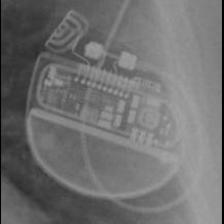 BOS:Proponent</td>
<td align="center" valign="top"><b>Option 1</b> 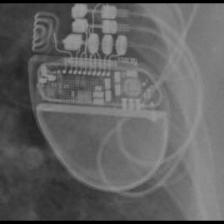 BOS:Visionist</td>
<td align="center" valign="top"><b>✅ Option 2</b> 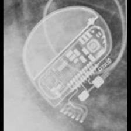 BOS:Proponent</td>
<td align="center" valign="top"><b>Option 3</b>  BOS:Contak Renewal TR2</td>
<td align="center" valign="top"><b>Option 4</b> 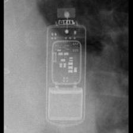 MDT:REVEAL</td>
<td align="center" valign="top"><b>Option 5</b> 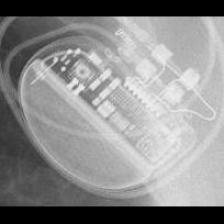 BOS:Ingenio</td>
<td align="center" valign="middle"><b>Option 6</b>  <i>None of the above</i></td>
</tr></table>

### Q3130 · correct: option 4 · `BOS:Proponent`

<table><tr>
<td align="center" valign="top"><b>Query</b> 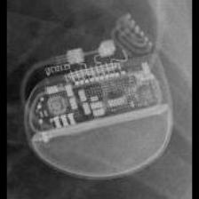 BOS:Proponent</td>
<td align="center" valign="top"><b>Option 1</b>  BOS:Ingenio</td>
<td align="center" valign="top"><b>Option 2</b> 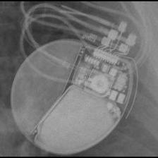 BOS:Autogen_Teligen_Energen_Cognis</td>
<td align="center" valign="top"><b>Option 3</b>  BOS:Visionist</td>
<td align="center" valign="top"><b>✅ Option 4</b>  BOS:Proponent</td>
<td align="center" valign="top"><b>Option 5</b>  BOS:Contak Renewal TR2</td>
<td align="center" valign="middle"><b>Option 6</b>  <i>None of the above</i></td>
</tr></table>

### Q3131 · correct: option 5 · `BOS:Proponent`

<table><tr>
<td align="center" valign="top"><b>Query</b> 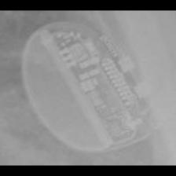 BOS:Proponent</td>
<td align="center" valign="top"><b>Option 1</b>  SOR:Elect</td>
<td align="center" valign="top"><b>Option 2</b>  BOS:Contak Renewal TR2</td>
<td align="center" valign="top"><b>Option 3</b>  BOS:Ingenio</td>
<td align="center" valign="top"><b>Option 4</b>  BOS:Visionist</td>
<td align="center" valign="top"><b>✅ Option 5</b>  BOS:Proponent</td>
<td align="center" valign="middle"><b>Option 6</b>  <i>None of the above</i></td>
</tr></table>

### Q3132 · correct: option 2 · `BOS:Proponent`

<table><tr>
<td align="center" valign="top"><b>Query</b> 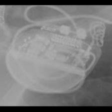 BOS:Proponent</td>
<td align="center" valign="top"><b>Option 1</b>  BOS:Ingenio</td>
<td align="center" valign="top"><b>✅ Option 2</b>  BOS:Proponent</td>
<td align="center" valign="top"><b>Option 3</b> 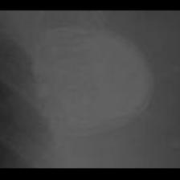 SOR:Thesis</td>
<td align="center" valign="top"><b>Option 4</b>  BOS:Contak Renewal TR2</td>
<td align="center" valign="top"><b>Option 5</b>  BOS:Visionist</td>
<td align="center" valign="middle"><b>Option 6</b>  <i>None of the above</i></td>
</tr></table>

### Q3133 · correct: option 3 · `BOS:Proponent`

<table><tr>
<td align="center" valign="top"><b>Query</b> 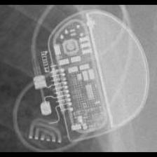 BOS:Proponent</td>
<td align="center" valign="top"><b>Option 1</b> 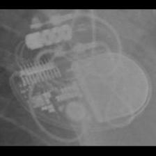 STJ:Allure Quadra</td>
<td align="center" valign="top"><b>Option 2</b> 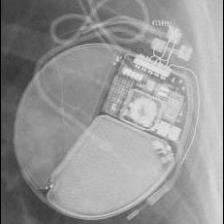 BOS:Autogen_Teligen_Energen_Cognis</td>
<td align="center" valign="top"><b>✅ Option 3</b>  BOS:Proponent</td>
<td align="center" valign="top"><b>Option 4</b>  BOS:Ingenio</td>
<td align="center" valign="top"><b>Option 5</b>  BOS:Visionist</td>
<td align="center" valign="middle"><b>Option 6</b>  <i>None of the above</i></td>
</tr></table>

### Q3134 · correct: option 4 · `BOS:Ventak Prizm`

<table><tr>
<td align="center" valign="top"><b>Query</b> 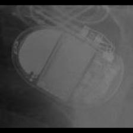 BOS:Ventak Prizm</td>
<td align="center" valign="top"><b>Option 1</b>  BOS:Vitality</td>
<td align="center" valign="top"><b>Option 2</b>  BIO:Actros_Philos</td>
<td align="center" valign="top"><b>Option 3</b> 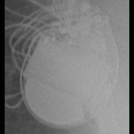 BOS:Contak Renewal 4</td>
<td align="center" valign="top"><b>✅ Option 4</b> 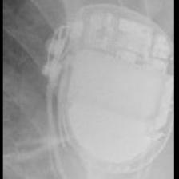 BOS:Ventak Prizm</td>
<td align="center" valign="top"><b>Option 5</b> 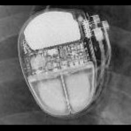 SOR:Ovatio</td>
<td align="center" valign="middle"><b>Option 6</b>  <i>None of the above</i></td>
</tr></table>

### Q3135 · correct: option 2 · `BOS:Ventak Prizm`

<table><tr>
<td align="center" valign="top"><b>Query</b>  BOS:Ventak Prizm</td>
<td align="center" valign="top"><b>Option 1</b>  MDT:Concerto_Consulta_Maximo_Protecta_Secura</td>
<td align="center" valign="top"><b>✅ Option 2</b>  BOS:Ventak Prizm</td>
<td align="center" valign="top"><b>Option 3</b>  BOS:Vitality</td>
<td align="center" valign="top"><b>Option 4</b>  MDT:Claria_Evera_Viva</td>
<td align="center" valign="top"><b>Option 5</b>  BIO:Actros_Philos</td>
<td align="center" valign="middle"><b>Option 6</b>  <i>None of the above</i></td>
</tr></table>

### Q3136 · correct: option 4 · `BOS:Ventak Prizm`

<table><tr>
<td align="center" valign="top"><b>Query</b>  BOS:Ventak Prizm</td>
<td align="center" valign="top"><b>Option 1</b>  BOS:Vitality</td>
<td align="center" valign="top"><b>Option 2</b>  SOR:Ovatio</td>
<td align="center" valign="top"><b>Option 3</b>  MDT:Concerto_Consulta_Maximo_Protecta_Secura</td>
<td align="center" valign="top"><b>✅ Option 4</b>  BOS:Ventak Prizm</td>
<td align="center" valign="top"><b>Option 5</b>  BIO:Actros_Philos</td>
<td align="center" valign="middle"><b>Option 6</b>  <i>None of the above</i></td>
</tr></table>

### Q3137 · correct: option 4 · `BOS:Ventak Prizm`

<table><tr>
<td align="center" valign="top"><b>Query</b> 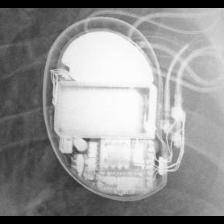 BOS:Ventak Prizm</td>
<td align="center" valign="top"><b>Option 1</b>  BOS:Vitality</td>
<td align="center" valign="top"><b>Option 2</b>  MDT:Concerto_Consulta_Maximo_Protecta_Secura</td>
<td align="center" valign="top"><b>Option 3</b> 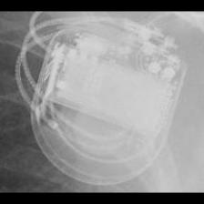 MDT:Maximo</td>
<td align="center" valign="top"><b>✅ Option 4</b>  BOS:Ventak Prizm</td>
<td align="center" valign="top"><b>Option 5</b>  BOS:Contak Renewal 4</td>
<td align="center" valign="middle"><b>Option 6</b>  <i>None of the above</i></td>
</tr></table>

### Q3138 · correct: option 4 · `BOS:Ventak Prizm`

<table><tr>
<td align="center" valign="top"><b>Query</b>  BOS:Ventak Prizm</td>
<td align="center" valign="top"><b>Option 1</b>  BIO:Actros_Philos</td>
<td align="center" valign="top"><b>Option 2</b>  SOR:Thesis</td>
<td align="center" valign="top"><b>Option 3</b> 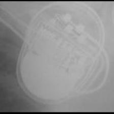 SOR:MiniSwing</td>
<td align="center" valign="top"><b>✅ Option 4</b>  BOS:Ventak Prizm</td>
<td align="center" valign="top"><b>Option 5</b> 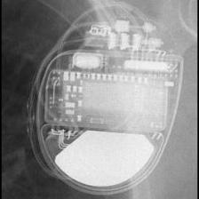 MDT:Claria_Evera_Viva</td>
<td align="center" valign="middle"><b>Option 6</b>  <i>None of the above</i></td>
</tr></table>

### Q3139 · correct: option 3 · `BOS:Visionist`

<table><tr>
<td align="center" valign="top"><b>Query</b> 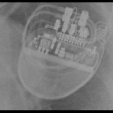 BOS:Visionist</td>
<td align="center" valign="top"><b>Option 1</b>  BOS:Contak Renewal TR2</td>
<td align="center" valign="top"><b>Option 2</b>  BOS:Altrua_Insignia</td>
<td align="center" valign="top"><b>✅ Option 3</b>  BOS:Visionist</td>
<td align="center" valign="top"><b>Option 4</b>  BOS:Proponent</td>
<td align="center" valign="top"><b>Option 5</b> 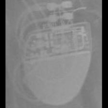 BOS:Ingenio</td>
<td align="center" valign="middle"><b>Option 6</b>  <i>None of the above</i></td>
</tr></table>

### Q3140 · correct: option 2 · `BOS:Visionist`

<table><tr>
<td align="center" valign="top"><b>Query</b> 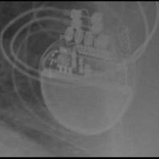 BOS:Visionist</td>
<td align="center" valign="top"><b>Option 1</b>  BOS:Contak Renewal TR2</td>
<td align="center" valign="top"><b>✅ Option 2</b> 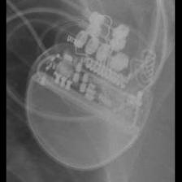 BOS:Visionist</td>
<td align="center" valign="top"><b>Option 3</b>  BOS:Autogen_Teligen_Energen_Cognis</td>
<td align="center" valign="top"><b>Option 4</b>  BOS:Proponent</td>
<td align="center" valign="top"><b>Option 5</b>  BOS:Ingenio</td>
<td align="center" valign="middle"><b>Option 6</b>  <i>None of the above</i></td>
</tr></table>

### Q3141 · correct: option 3 · `BOS:Visionist`

<table><tr>
<td align="center" valign="top"><b>Query</b> 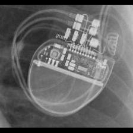 BOS:Visionist</td>
<td align="center" valign="top"><b>Option 1</b> 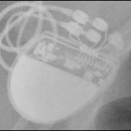 BOS:Altrua_Insignia</td>
<td align="center" valign="top"><b>Option 2</b>  BOS:Contak Renewal TR2</td>
<td align="center" valign="top"><b>✅ Option 3</b>  BOS:Visionist</td>
<td align="center" valign="top"><b>Option 4</b>  BOS:Proponent</td>
<td align="center" valign="top"><b>Option 5</b>  BOS:Ingenio</td>
<td align="center" valign="middle"><b>Option 6</b>  <i>None of the above</i></td>
</tr></table>

### Q3142 · correct: option 5 · `BOS:Visionist`

<table><tr>
<td align="center" valign="top"><b>Query</b> 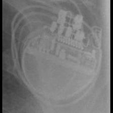 BOS:Visionist</td>
<td align="center" valign="top"><b>Option 1</b>  BOS:Proponent</td>
<td align="center" valign="top"><b>Option 2</b>  BOS:Altrua_Insignia</td>
<td align="center" valign="top"><b>Option 3</b>  BOS:Ingenio</td>
<td align="center" valign="top"><b>Option 4</b>  BOS:Contak Renewal TR2</td>
<td align="center" valign="top"><b>✅ Option 5</b>  BOS:Visionist</td>
<td align="center" valign="middle"><b>Option 6</b>  <i>None of the above</i></td>
</tr></table>

### Q3143 · correct: option 3 · `BOS:Visionist`

<table><tr>
<td align="center" valign="top"><b>Query</b> 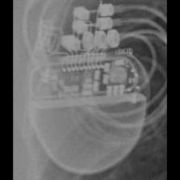 BOS:Visionist</td>
<td align="center" valign="top"><b>Option 1</b>  BOS:Contak Renewal TR2</td>
<td align="center" valign="top"><b>Option 2</b>  BOS:Altrua_Insignia</td>
<td align="center" valign="top"><b>✅ Option 3</b>  BOS:Visionist</td>
<td align="center" valign="top"><b>Option 4</b>  BOS:Ingenio</td>
<td align="center" valign="top"><b>Option 5</b>  BOS:Proponent</td>
<td align="center" valign="middle"><b>Option 6</b>  <i>None of the above</i></td>
</tr></table>

### Q3144 · correct: option 3 · `BOS:Vitality`

<table><tr>
<td align="center" valign="top"><b>Query</b> 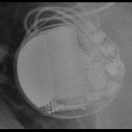 BOS:Vitality</td>
<td align="center" valign="top"><b>Option 1</b>  SOR:Elect</td>
<td align="center" valign="top"><b>Option 2</b>  BOS:Ventak Prizm</td>
<td align="center" valign="top"><b>✅ Option 3</b>  BOS:Vitality</td>
<td align="center" valign="top"><b>Option 4</b>  BOS:Contak Renewal 4</td>
<td align="center" valign="top"><b>Option 5</b> 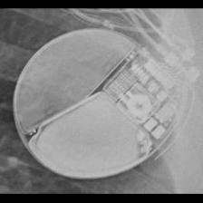 BOS:Autogen_Teligen_Energen_Cognis</td>
<td align="center" valign="middle"><b>Option 6</b>  <i>None of the above</i></td>
</tr></table>

### Q3145 · correct: option 2 · `BOS:Vitality`

<table><tr>
<td align="center" valign="top"><b>Query</b> 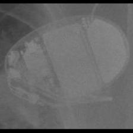 BOS:Vitality</td>
<td align="center" valign="top"><b>Option 1</b> 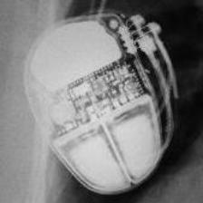 SOR:Ovatio</td>
<td align="center" valign="top"><b>✅ Option 2</b>  BOS:Vitality</td>
<td align="center" valign="top"><b>Option 3</b>  BOS:Autogen_Teligen_Energen_Cognis</td>
<td align="center" valign="top"><b>Option 4</b>  BOS:Ventak Prizm</td>
<td align="center" valign="top"><b>Option 5</b> 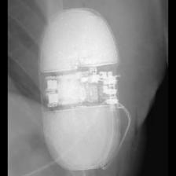 BOS:Emblem</td>
<td align="center" valign="middle"><b>Option 6</b>  <i>None of the above</i></td>
</tr></table>

### Q3146 · correct: option 5 · `BOS:Vitality`

<table><tr>
<td align="center" valign="top"><b>Query</b> 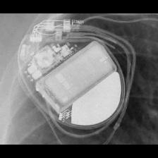 BOS:Vitality</td>
<td align="center" valign="top"><b>Option 1</b> 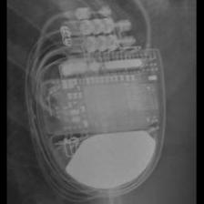 MDT:Claria_Evera_Viva</td>
<td align="center" valign="top"><b>Option 2</b>  BOS:Contak Renewal 4</td>
<td align="center" valign="top"><b>Option 3</b>  MDT:Concerto_Consulta_Maximo_Protecta_Secura</td>
<td align="center" valign="top"><b>Option 4</b> 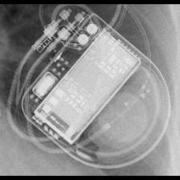 MDT:Maximo</td>
<td align="center" valign="top"><b>✅ Option 5</b>  BOS:Vitality</td>
<td align="center" valign="middle"><b>Option 6</b>  <i>None of the above</i></td>
</tr></table>

### Q3147 · correct: option 2 · `BOS:Vitality`

<table><tr>
<td align="center" valign="top"><b>Query</b> 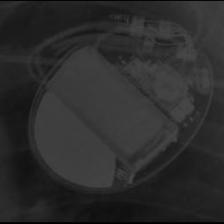 BOS:Vitality</td>
<td align="center" valign="top"><b>Option 1</b>  MDT:Claria_Evera_Viva</td>
<td align="center" valign="top"><b>✅ Option 2</b>  BOS:Vitality</td>
<td align="center" valign="top"><b>Option 3</b>  BOS:Ventak Prizm</td>
<td align="center" valign="top"><b>Option 4</b>  BOS:Contak Renewal 4</td>
<td align="center" valign="top"><b>Option 5</b>  MDT:Concerto_Consulta_Maximo_Protecta_Secura</td>
<td align="center" valign="middle"><b>Option 6</b>  <i>None of the above</i></td>
</tr></table>

### Q3148 · correct: option 3 · `BOS:Vitality`

<table><tr>
<td align="center" valign="top"><b>Query</b> 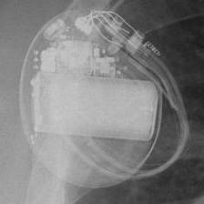 BOS:Vitality</td>
<td align="center" valign="top"><b>Option 1</b> 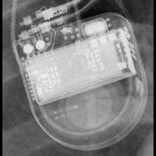 MDT:Maximo</td>
<td align="center" valign="top"><b>Option 2</b>  MDT:Concerto_Consulta_Maximo_Protecta_Secura</td>
<td align="center" valign="top"><b>✅ Option 3</b>  BOS:Vitality</td>
<td align="center" valign="top"><b>Option 4</b>  BOS:Contak Renewal 4</td>
<td align="center" valign="top"><b>Option 5</b>  BOS:Ventak Prizm</td>
<td align="center" valign="middle"><b>Option 6</b>  <i>None of the above</i></td>
</tr></table>

### Q3149 · correct: option 3 · `MDT:AT500`

<table><tr>
<td align="center" valign="top"><b>Query</b> 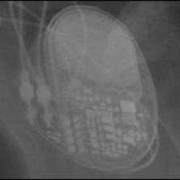 MDT:AT500</td>
<td align="center" valign="top"><b>Option 1</b>  MDT:Insync III</td>
<td align="center" valign="top"><b>Option 2</b> 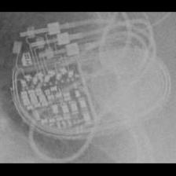 MDT:Syncra</td>
<td align="center" valign="top"><b>✅ Option 3</b>  MDT:AT500</td>
<td align="center" valign="top"><b>Option 4</b> 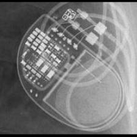 MDT:Advisa</td>
<td align="center" valign="top"><b>Option 5</b> 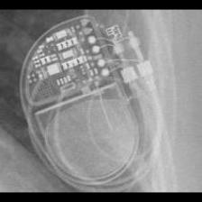 MDT:EnRhythm</td>
<td align="center" valign="middle"><b>Option 6</b>  <i>None of the above</i></td>
</tr></table>

### Q3150 · correct: option 4 · `MDT:AT500`

<table><tr>
<td align="center" valign="top"><b>Query</b>  MDT:AT500</td>
<td align="center" valign="top"><b>Option 1</b>  MDT:EnRhythm</td>
<td align="center" valign="top"><b>Option 2</b> 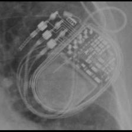 MDT:Syncra</td>
<td align="center" valign="top"><b>Option 3</b>  MDT:Advisa</td>
<td align="center" valign="top"><b>✅ Option 4</b>  MDT:AT500</td>
<td align="center" valign="top"><b>Option 5</b>  MDT:Insync III</td>
<td align="center" valign="middle"><b>Option 6</b>  <i>None of the above</i></td>
</tr></table>

### Q3151 · correct: option 1 · `MDT:AT500`

<table><tr>
<td align="center" valign="top"><b>Query</b> 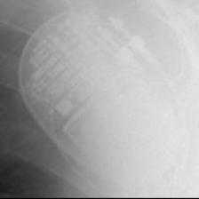 MDT:AT500</td>
<td align="center" valign="top"><b>✅ Option 1</b>  MDT:AT500</td>
<td align="center" valign="top"><b>Option 2</b>  MDT:Syncra</td>
<td align="center" valign="top"><b>Option 3</b>  STJ:Accent</td>
<td align="center" valign="top"><b>Option 4</b> 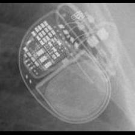 MDT:Advisa</td>
<td align="center" valign="top"><b>Option 5</b>  MDT:EnRhythm</td>
<td align="center" valign="middle"><b>Option 6</b>  <i>None of the above</i></td>
</tr></table>

### Q3152 · correct: option 3 · `MDT:AT500`

<table><tr>
<td align="center" valign="top"><b>Query</b>  MDT:AT500</td>
<td align="center" valign="top"><b>Option 1</b>  MDT:Syncra</td>
<td align="center" valign="top"><b>Option 2</b>  MDT:EnRhythm</td>
<td align="center" valign="top"><b>✅ Option 3</b>  MDT:AT500</td>
<td align="center" valign="top"><b>Option 4</b>  MDT:Insync III</td>
<td align="center" valign="top"><b>Option 5</b>  MDT:Advisa</td>
<td align="center" valign="middle"><b>Option 6</b>  <i>None of the above</i></td>
</tr></table>

### Q3153 · correct: option 5 · `MDT:AT500`

<table><tr>
<td align="center" valign="top"><b>Query</b> 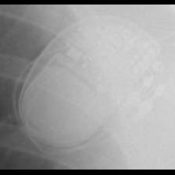 MDT:AT500</td>
<td align="center" valign="top"><b>Option 1</b>  SOR:Thesis</td>
<td align="center" valign="top"><b>Option 2</b>  STJ:Accent</td>
<td align="center" valign="top"><b>Option 3</b>  MDT:Advisa</td>
<td align="center" valign="top"><b>Option 4</b>  MDT:EnRhythm</td>
<td align="center" valign="top"><b>✅ Option 5</b>  MDT:AT500</td>
<td align="center" valign="middle"><b>Option 6</b>  <i>None of the above</i></td>
</tr></table>

### Q3154 · correct: option 5 · `MDT:Adapta_Kappa_Sensia_Versa`

<table><tr>
<td align="center" valign="top"><b>Query</b> 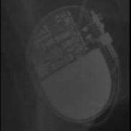 MDT:Adapta_Kappa_Sensia_Versa</td>
<td align="center" valign="top"><b>Option 1</b>  MDT:Sigma</td>
<td align="center" valign="top"><b>Option 2</b> 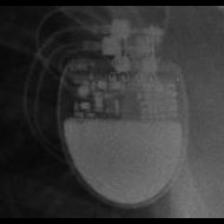 SOR:Rhapsody_Symphony</td>
<td align="center" valign="top"><b>Option 3</b>  MDT:C20_T20</td>
<td align="center" valign="top"><b>Option 4</b>  SOR:Reply</td>
<td align="center" valign="top"><b>✅ Option 5</b>  MDT:Adapta_Kappa_Sensia_Versa</td>
<td align="center" valign="middle"><b>Option 6</b>  <i>None of the above</i></td>
</tr></table>

### Q3155 · correct: option 5 · `MDT:Adapta_Kappa_Sensia_Versa`

<table><tr>
<td align="center" valign="top"><b>Query</b>  MDT:Adapta_Kappa_Sensia_Versa</td>
<td align="center" valign="top"><b>Option 1</b>  MDT:C20_T20</td>
<td align="center" valign="top"><b>Option 2</b>  STJ:Zephyr</td>
<td align="center" valign="top"><b>Option 3</b>  MDT:Sigma</td>
<td align="center" valign="top"><b>Option 4</b>  SOR:Reply</td>
<td align="center" valign="top"><b>✅ Option 5</b>  MDT:Adapta_Kappa_Sensia_Versa</td>
<td align="center" valign="middle"><b>Option 6</b>  <i>None of the above</i></td>
</tr></table>

### Q3156 · correct: option 4 · `MDT:Adapta_Kappa_Sensia_Versa`

<table><tr>
<td align="center" valign="top"><b>Query</b>  MDT:Adapta_Kappa_Sensia_Versa</td>
<td align="center" valign="top"><b>Option 1</b>  MDT:Vita II</td>
<td align="center" valign="top"><b>Option 2</b>  SOR:Reply</td>
<td align="center" valign="top"><b>Option 3</b>  MDT:C20_T20</td>
<td align="center" valign="top"><b>✅ Option 4</b>  MDT:Adapta_Kappa_Sensia_Versa</td>
<td align="center" valign="top"><b>Option 5</b>  MDT:Sigma</td>
<td align="center" valign="middle"><b>Option 6</b>  <i>None of the above</i></td>
</tr></table>

### Q3157 · correct: option 2 · `MDT:Adapta_Kappa_Sensia_Versa`

<table><tr>
<td align="center" valign="top"><b>Query</b>  MDT:Adapta_Kappa_Sensia_Versa</td>
<td align="center" valign="top"><b>Option 1</b>  MDT:C60 DR</td>
<td align="center" valign="top"><b>✅ Option 2</b>  MDT:Adapta_Kappa_Sensia_Versa</td>
<td align="center" valign="top"><b>Option 3</b>  MDT:Sigma</td>
<td align="center" valign="top"><b>Option 4</b>  MDT:C20_T20</td>
<td align="center" valign="top"><b>Option 5</b>  BIO:Actros_Philos</td>
<td align="center" valign="middle"><b>Option 6</b>  <i>None of the above</i></td>
</tr></table>

### Q3158 · correct: option 4 · `MDT:Adapta_Kappa_Sensia_Versa`

<table><tr>
<td align="center" valign="top"><b>Query</b>  MDT:Adapta_Kappa_Sensia_Versa</td>
<td align="center" valign="top"><b>Option 1</b>  MDT:Sigma</td>
<td align="center" valign="top"><b>Option 2</b>  MDT:C20_T20</td>
<td align="center" valign="top"><b>Option 3</b>  SOR:Reply</td>
<td align="center" valign="top"><b>✅ Option 4</b>  MDT:Adapta_Kappa_Sensia_Versa</td>
<td align="center" valign="top"><b>Option 5</b>  SOR:Rhapsody_Symphony</td>
<td align="center" valign="middle"><b>Option 6</b>  <i>None of the above</i></td>
</tr></table>

### Q3159 · correct: option 1 · `MDT:Advisa`

<table><tr>
<td align="center" valign="top"><b>Query</b>  MDT:Advisa</td>
<td align="center" valign="top"><b>✅ Option 1</b>  MDT:Advisa</td>
<td align="center" valign="top"><b>Option 2</b>  MDT:Insync III</td>
<td align="center" valign="top"><b>Option 3</b>  MDT:EnRhythm</td>
<td align="center" valign="top"><b>Option 4</b>  MDT:AT500</td>
<td align="center" valign="top"><b>Option 5</b>  MDT:Syncra</td>
<td align="center" valign="middle"><b>Option 6</b>  <i>None of the above</i></td>
</tr></table>

### Q3160 · correct: option 1 · `MDT:Advisa`

<table><tr>
<td align="center" valign="top"><b>Query</b>  MDT:Advisa</td>
<td align="center" valign="top"><b>✅ Option 1</b>  MDT:Advisa</td>
<td align="center" valign="top"><b>Option 2</b>  MDT:Insync III</td>
<td align="center" valign="top"><b>Option 3</b>  MDT:Syncra</td>
<td align="center" valign="top"><b>Option 4</b>  MDT:AT500</td>
<td align="center" valign="top"><b>Option 5</b>  MDT:EnRhythm</td>
<td align="center" valign="middle"><b>Option 6</b>  <i>None of the above</i></td>
</tr></table>

### Q3161 · correct: option 4 · `MDT:Advisa`

<table><tr>
<td align="center" valign="top"><b>Query</b>  MDT:Advisa</td>
<td align="center" valign="top"><b>Option 1</b>  MDT:AT500</td>
<td align="center" valign="top"><b>Option 2</b>  MDT:Azure</td>
<td align="center" valign="top"><b>Option 3</b>  MDT:Syncra</td>
<td align="center" valign="top"><b>✅ Option 4</b>  MDT:Advisa</td>
<td align="center" valign="top"><b>Option 5</b>  MDT:EnRhythm</td>
<td align="center" valign="middle"><b>Option 6</b>  <i>None of the above</i></td>
</tr></table>

### Q3162 · correct: option 1 · `MDT:Advisa`

<table><tr>
<td align="center" valign="top"><b>Query</b>  MDT:Advisa</td>
<td align="center" valign="top"><b>✅ Option 1</b>  MDT:Advisa</td>
<td align="center" valign="top"><b>Option 2</b>  MDT:AT500</td>
<td align="center" valign="top"><b>Option 3</b>  MDT:EnRhythm</td>
<td align="center" valign="top"><b>Option 4</b>  SOR:Thesis</td>
<td align="center" valign="top"><b>Option 5</b>  MDT:Syncra</td>
<td align="center" valign="middle"><b>Option 6</b>  <i>None of the above</i></td>
</tr></table>

### Q3163 · correct: option 1 · `MDT:Advisa`

<table><tr>
<td align="center" valign="top"><b>Query</b>  MDT:Advisa</td>
<td align="center" valign="top"><b>✅ Option 1</b>  MDT:Advisa</td>
<td align="center" valign="top"><b>Option 2</b>  MDT:Syncra</td>
<td align="center" valign="top"><b>Option 3</b>  MDT:Insync III</td>
<td align="center" valign="top"><b>Option 4</b>  MDT:EnRhythm</td>
<td align="center" valign="top"><b>Option 5</b>  MDT:AT500</td>
<td align="center" valign="middle"><b>Option 6</b>  <i>None of the above</i></td>
</tr></table>

### Q3164 · correct: option 1 · `MDT:Azure`

<table><tr>
<td align="center" valign="top"><b>Query</b>  MDT:Azure</td>
<td align="center" valign="top"><b>✅ Option 1</b>  MDT:Azure</td>
<td align="center" valign="top"><b>Option 2</b>  MDT:AT500</td>
<td align="center" valign="top"><b>Option 3</b>  MDT:Insync III</td>
<td align="center" valign="top"><b>Option 4</b>  MDT:Syncra</td>
<td align="center" valign="top"><b>Option 5</b>  MDT:EnRhythm</td>
<td align="center" valign="middle"><b>Option 6</b>  <i>None of the above</i></td>
</tr></table>

### Q3165 · correct: option 5 · `MDT:Azure`

<table><tr>
<td align="center" valign="top"><b>Query</b>  MDT:Azure</td>
<td align="center" valign="top"><b>Option 1</b>  MDT:AT500</td>
<td align="center" valign="top"><b>Option 2</b>  MDT:EnRhythm</td>
<td align="center" valign="top"><b>Option 3</b>  MDT:Advisa</td>
<td align="center" valign="top"><b>Option 4</b>  BIO:Evia</td>
<td align="center" valign="top"><b>✅ Option 5</b>  MDT:Azure</td>
<td align="center" valign="middle"><b>Option 6</b>  <i>None of the above</i></td>
</tr></table>

### Q3166 · correct: option 2 · `MDT:Azure`

<table><tr>
<td align="center" valign="top"><b>Query</b>  MDT:Azure</td>
<td align="center" valign="top"><b>Option 1</b>  MDT:AT500</td>
<td align="center" valign="top"><b>✅ Option 2</b>  MDT:Azure</td>
<td align="center" valign="top"><b>Option 3</b>  MDT:Syncra</td>
<td align="center" valign="top"><b>Option 4</b>  STJ:Accent</td>
<td align="center" valign="top"><b>Option 5</b>  MDT:Advisa</td>
<td align="center" valign="middle"><b>Option 6</b>  <i>None of the above</i></td>
</tr></table>

### Q3167 · correct: option 1 · `MDT:Azure`

<table><tr>
<td align="center" valign="top"><b>Query</b>  MDT:Azure</td>
<td align="center" valign="top"><b>✅ Option 1</b>  MDT:Azure</td>
<td align="center" valign="top"><b>Option 2</b>  MDT:Insync III</td>
<td align="center" valign="top"><b>Option 3</b>  MDT:EnRhythm</td>
<td align="center" valign="top"><b>Option 4</b>  MDT:Advisa</td>
<td align="center" valign="top"><b>Option 5</b>  MDT:AT500</td>
<td align="center" valign="middle"><b>Option 6</b>  <i>None of the above</i></td>
</tr></table>

### Q3168 · correct: option 5 · `MDT:Azure`

<table><tr>
<td align="center" valign="top"><b>Query</b>  MDT:Azure</td>
<td align="center" valign="top"><b>Option 1</b>  MDT:Insync III</td>
<td align="center" valign="top"><b>Option 2</b>  MDT:Syncra</td>
<td align="center" valign="top"><b>Option 3</b>  MDT:Advisa</td>
<td align="center" valign="top"><b>Option 4</b>  MDT:EnRhythm</td>
<td align="center" valign="top"><b>✅ Option 5</b>  MDT:Azure</td>
<td align="center" valign="middle"><b>Option 6</b>  <i>None of the above</i></td>
</tr></table>

### Q3169 · correct: option 2 · `MDT:C20_T20`

<table><tr>
<td align="center" valign="top"><b>Query</b>  MDT:C20_T20</td>
<td align="center" valign="top"><b>Option 1</b>  MDT:C60 DR</td>
<td align="center" valign="top"><b>✅ Option 2</b>  MDT:C20_T20</td>
<td align="center" valign="top"><b>Option 3</b>  MDT:Sigma</td>
<td align="center" valign="top"><b>Option 4</b>  STJ:Identity</td>
<td align="center" valign="top"><b>Option 5</b>  MDT:Adapta_Kappa_Sensia_Versa</td>
<td align="center" valign="middle"><b>Option 6</b>  <i>None of the above</i></td>
</tr></table>

### Q3170 · correct: option 1 · `MDT:C20_T20`

<table><tr>
<td align="center" valign="top"><b>Query</b>  MDT:C20_T20</td>
<td align="center" valign="top"><b>✅ Option 1</b>  MDT:C20_T20</td>
<td align="center" valign="top"><b>Option 2</b>  MDT:Sigma</td>
<td align="center" valign="top"><b>Option 3</b>  MDT:C60 DR</td>
<td align="center" valign="top"><b>Option 4</b>  SOR:Reply</td>
<td align="center" valign="top"><b>Option 5</b>  MDT:Vita II</td>
<td align="center" valign="middle"><b>Option 6</b>  <i>None of the above</i></td>
</tr></table>

### Q3171 · correct: option 5 · `MDT:C20_T20`

<table><tr>
<td align="center" valign="top"><b>Query</b>  MDT:C20_T20</td>
<td align="center" valign="top"><b>Option 1</b>  MDT:Sigma</td>
<td align="center" valign="top"><b>Option 2</b>  MDT:Vita II</td>
<td align="center" valign="top"><b>Option 3</b>  SOR:Rhapsody_Symphony</td>
<td align="center" valign="top"><b>Option 4</b>  MDT:C60 DR</td>
<td align="center" valign="top"><b>✅ Option 5</b>  MDT:C20_T20</td>
<td align="center" valign="middle"><b>Option 6</b>  <i>None of the above</i></td>
</tr></table>

### Q3172 · correct: option 4 · `MDT:C20_T20`

<table><tr>
<td align="center" valign="top"><b>Query</b>  MDT:C20_T20</td>
<td align="center" valign="top"><b>Option 1</b>  MDT:Adapta_Kappa_Sensia_Versa</td>
<td align="center" valign="top"><b>Option 2</b>  SOR:Rhapsody_Symphony</td>
<td align="center" valign="top"><b>Option 3</b>  MDT:Sigma</td>
<td align="center" valign="top"><b>✅ Option 4</b>  MDT:C20_T20</td>
<td align="center" valign="top"><b>Option 5</b>  MDT:C60 DR</td>
<td align="center" valign="middle"><b>Option 6</b>  <i>None of the above</i></td>
</tr></table>

### Q3173 · correct: option 4 · `MDT:C20_T20`

<table><tr>
<td align="center" valign="top"><b>Query</b>  MDT:C20_T20</td>
<td align="center" valign="top"><b>Option 1</b>  SOR:Reply</td>
<td align="center" valign="top"><b>Option 2</b>  MDT:Vita II</td>
<td align="center" valign="top"><b>Option 3</b>  MDT:C60 DR</td>
<td align="center" valign="top"><b>✅ Option 4</b>  MDT:C20_T20</td>
<td align="center" valign="top"><b>Option 5</b>  MDT:Sigma</td>
<td align="center" valign="middle"><b>Option 6</b>  <i>None of the above</i></td>
</tr></table>

### Q3174 · correct: option 1 · `MDT:C60 DR`

<table><tr>
<td align="center" valign="top"><b>Query</b>  MDT:C60 DR</td>
<td align="center" valign="top"><b>✅ Option 1</b>  MDT:C60 DR</td>
<td align="center" valign="top"><b>Option 2</b>  MDT:Adapta_Kappa_Sensia_Versa</td>
<td align="center" valign="top"><b>Option 3</b>  MDT:Vita II</td>
<td align="center" valign="top"><b>Option 4</b>  MDT:Sigma</td>
<td align="center" valign="top"><b>Option 5</b>  MDT:C20_T20</td>
<td align="center" valign="middle"><b>Option 6</b>  <i>None of the above</i></td>
</tr></table>

### Q3175 · correct: option 3 · `MDT:C60 DR`

<table><tr>
<td align="center" valign="top"><b>Query</b>  MDT:C60 DR</td>
<td align="center" valign="top"><b>Option 1</b>  MDT:Adapta_Kappa_Sensia_Versa</td>
<td align="center" valign="top"><b>Option 2</b>  MDT:C20_T20</td>
<td align="center" valign="top"><b>✅ Option 3</b>  MDT:C60 DR</td>
<td align="center" valign="top"><b>Option 4</b>  MDT:Sigma</td>
<td align="center" valign="top"><b>Option 5</b>  MDT:Vita II</td>
<td align="center" valign="middle"><b>Option 6</b>  <i>None of the above</i></td>
</tr></table>

### Q3176 · correct: option 2 · `MDT:C60 DR`

<table><tr>
<td align="center" valign="top"><b>Query</b>  MDT:C60 DR</td>
<td align="center" valign="top"><b>Option 1</b>  MDT:Sigma</td>
<td align="center" valign="top"><b>✅ Option 2</b>  MDT:C60 DR</td>
<td align="center" valign="top"><b>Option 3</b>  MDT:Adapta_Kappa_Sensia_Versa</td>
<td align="center" valign="top"><b>Option 4</b>  MDT:C20_T20</td>
<td align="center" valign="top"><b>Option 5</b>  BIO:Cyclos</td>
<td align="center" valign="middle"><b>Option 6</b>  <i>None of the above</i></td>
</tr></table>

### Q3177 · correct: option 4 · `MDT:C60 DR`

<table><tr>
<td align="center" valign="top"><b>Query</b>  MDT:C60 DR</td>
<td align="center" valign="top"><b>Option 1</b>  MDT:Adapta_Kappa_Sensia_Versa</td>
<td align="center" valign="top"><b>Option 2</b>  MDT:Vita II</td>
<td align="center" valign="top"><b>Option 3</b>  MDT:C20_T20</td>
<td align="center" valign="top"><b>✅ Option 4</b>  MDT:C60 DR</td>
<td align="center" valign="top"><b>Option 5</b>  STJ:Identity</td>
<td align="center" valign="middle"><b>Option 6</b>  <i>None of the above</i></td>
</tr></table>

### Q3178 · correct: option 2 · `MDT:C60 DR`

<table><tr>
<td align="center" valign="top"><b>Query</b>  MDT:C60 DR</td>
<td align="center" valign="top"><b>Option 1</b>  MDT:Vita II</td>
<td align="center" valign="top"><b>✅ Option 2</b>  MDT:C60 DR</td>
<td align="center" valign="top"><b>Option 3</b>  MDT:Adapta_Kappa_Sensia_Versa</td>
<td align="center" valign="top"><b>Option 4</b>  MDT:Sigma</td>
<td align="center" valign="top"><b>Option 5</b>  MDT:C20_T20</td>
<td align="center" valign="middle"><b>Option 6</b>  <i>None of the above</i></td>
</tr></table>

