# Pacemakers (Howard et al.) · query set `test` · page 3/5

[← all pages](README.md)

### Q3179 · correct: option 3 · `MDT:Claria_Evera_Viva`

<table><tr>
<td align="center" valign="top"><b>Query</b> 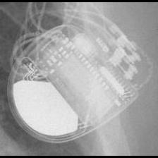 MDT:Claria_Evera_Viva</td>
<td align="center" valign="top"><b>Option 1</b>  BOS:Vitality</td>
<td align="center" valign="top"><b>Option 2</b>  MDT:Concerto_Consulta_Maximo_Protecta_Secura</td>
<td align="center" valign="top"><b>✅ Option 3</b> 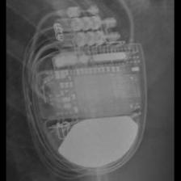 MDT:Claria_Evera_Viva</td>
<td align="center" valign="top"><b>Option 4</b> 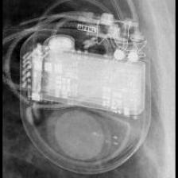 MDT:Maximo</td>
<td align="center" valign="top"><b>Option 5</b> 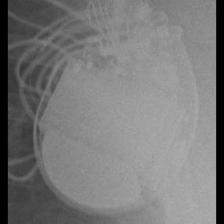 BOS:Contak Renewal 4</td>
<td align="center" valign="middle"><b>Option 6</b>  <i>None of the above</i></td>
</tr></table>

### Q3180 · correct: option 3 · `MDT:Claria_Evera_Viva`

<table><tr>
<td align="center" valign="top"><b>Query</b> 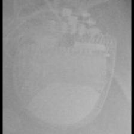 MDT:Claria_Evera_Viva</td>
<td align="center" valign="top"><b>Option 1</b>  BOS:Vitality</td>
<td align="center" valign="top"><b>Option 2</b>  SOR:MiniSwing</td>
<td align="center" valign="top"><b>✅ Option 3</b> 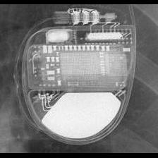 MDT:Claria_Evera_Viva</td>
<td align="center" valign="top"><b>Option 4</b>  MDT:Concerto_Consulta_Maximo_Protecta_Secura</td>
<td align="center" valign="top"><b>Option 5</b>  BOS:Contak Renewal 4</td>
<td align="center" valign="middle"><b>Option 6</b>  <i>None of the above</i></td>
</tr></table>

### Q3181 · correct: option 2 · `MDT:Claria_Evera_Viva`

<table><tr>
<td align="center" valign="top"><b>Query</b> 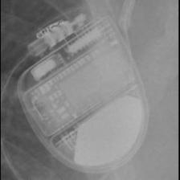 MDT:Claria_Evera_Viva</td>
<td align="center" valign="top"><b>Option 1</b>  MDT:Concerto_Consulta_Maximo_Protecta_Secura</td>
<td align="center" valign="top"><b>✅ Option 2</b>  MDT:Claria_Evera_Viva</td>
<td align="center" valign="top"><b>Option 3</b>  BOS:Vitality</td>
<td align="center" valign="top"><b>Option 4</b> 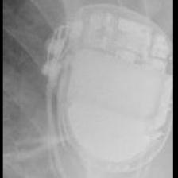 BOS:Ventak Prizm</td>
<td align="center" valign="top"><b>Option 5</b>  MDT:Maximo</td>
<td align="center" valign="middle"><b>Option 6</b>  <i>None of the above</i></td>
</tr></table>

### Q3182 · correct: option 4 · `MDT:Claria_Evera_Viva`

<table><tr>
<td align="center" valign="top"><b>Query</b> 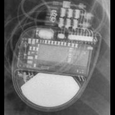 MDT:Claria_Evera_Viva</td>
<td align="center" valign="top"><b>Option 1</b>  BOS:Vitality</td>
<td align="center" valign="top"><b>Option 2</b>  BOS:Contak Renewal 4</td>
<td align="center" valign="top"><b>Option 3</b>  MDT:Maximo</td>
<td align="center" valign="top"><b>✅ Option 4</b>  MDT:Claria_Evera_Viva</td>
<td align="center" valign="top"><b>Option 5</b>  MDT:Concerto_Consulta_Maximo_Protecta_Secura</td>
<td align="center" valign="middle"><b>Option 6</b>  <i>None of the above</i></td>
</tr></table>

### Q3183 · correct: option 1 · `MDT:Claria_Evera_Viva`

<table><tr>
<td align="center" valign="top"><b>Query</b> 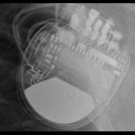 MDT:Claria_Evera_Viva</td>
<td align="center" valign="top"><b>✅ Option 1</b>  MDT:Claria_Evera_Viva</td>
<td align="center" valign="top"><b>Option 2</b>  BOS:Contak Renewal 4</td>
<td align="center" valign="top"><b>Option 3</b>  MDT:Concerto_Consulta_Maximo_Protecta_Secura</td>
<td align="center" valign="top"><b>Option 4</b>  MDT:Maximo</td>
<td align="center" valign="top"><b>Option 5</b>  BOS:Vitality</td>
<td align="center" valign="middle"><b>Option 6</b>  <i>None of the above</i></td>
</tr></table>

### Q3184 · correct: option 2 · `MDT:Concerto_Consulta_Maximo_Protecta_Secura`

<table><tr>
<td align="center" valign="top"><b>Query</b> 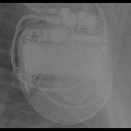 MDT:Concerto_Consulta_Maximo_Protecta_Secura</td>
<td align="center" valign="top"><b>Option 1</b> 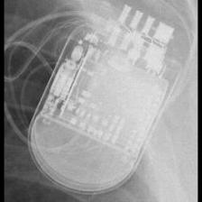 STJ:Quadra Assura_Unify</td>
<td align="center" valign="top"><b>✅ Option 2</b> 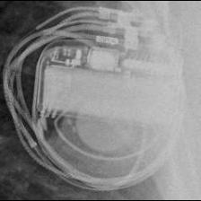 MDT:Concerto_Consulta_Maximo_Protecta_Secura</td>
<td align="center" valign="top"><b>Option 3</b>  MDT:Maximo</td>
<td align="center" valign="top"><b>Option 4</b>  MDT:Claria_Evera_Viva</td>
<td align="center" valign="top"><b>Option 5</b>  BOS:Vitality</td>
<td align="center" valign="middle"><b>Option 6</b>  <i>None of the above</i></td>
</tr></table>

### Q3185 · correct: option 1 · `MDT:Concerto_Consulta_Maximo_Protecta_Secura`

<table><tr>
<td align="center" valign="top"><b>Query</b> 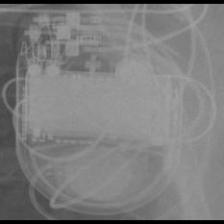 MDT:Concerto_Consulta_Maximo_Protecta_Secura</td>
<td align="center" valign="top"><b>✅ Option 1</b>  MDT:Concerto_Consulta_Maximo_Protecta_Secura</td>
<td align="center" valign="top"><b>Option 2</b> 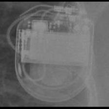 MDT:Maximo</td>
<td align="center" valign="top"><b>Option 3</b>  STJ:Quadra Assura_Unify</td>
<td align="center" valign="top"><b>Option 4</b>  BOS:Contak Renewal 4</td>
<td align="center" valign="top"><b>Option 5</b>  BOS:Vitality</td>
<td align="center" valign="middle"><b>Option 6</b>  <i>None of the above</i></td>
</tr></table>

### Q3186 · correct: option 1 · `MDT:Concerto_Consulta_Maximo_Protecta_Secura`

<table><tr>
<td align="center" valign="top"><b>Query</b> 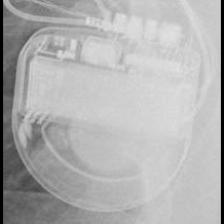 MDT:Concerto_Consulta_Maximo_Protecta_Secura</td>
<td align="center" valign="top"><b>✅ Option 1</b>  MDT:Concerto_Consulta_Maximo_Protecta_Secura</td>
<td align="center" valign="top"><b>Option 2</b>  MDT:Maximo</td>
<td align="center" valign="top"><b>Option 3</b>  BOS:Contak Renewal 4</td>
<td align="center" valign="top"><b>Option 4</b> 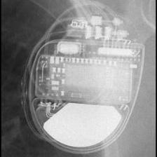 MDT:Claria_Evera_Viva</td>
<td align="center" valign="top"><b>Option 5</b>  BOS:Vitality</td>
<td align="center" valign="middle"><b>Option 6</b>  <i>None of the above</i></td>
</tr></table>

### Q3187 · correct: option 3 · `MDT:Concerto_Consulta_Maximo_Protecta_Secura`

<table><tr>
<td align="center" valign="top"><b>Query</b> 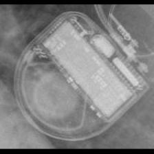 MDT:Concerto_Consulta_Maximo_Protecta_Secura</td>
<td align="center" valign="top"><b>Option 1</b>  MDT:Claria_Evera_Viva</td>
<td align="center" valign="top"><b>Option 2</b>  MDT:Maximo</td>
<td align="center" valign="top"><b>✅ Option 3</b> 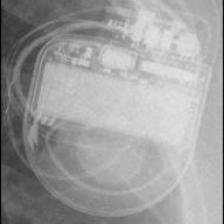 MDT:Concerto_Consulta_Maximo_Protecta_Secura</td>
<td align="center" valign="top"><b>Option 4</b>  BOS:Vitality</td>
<td align="center" valign="top"><b>Option 5</b>  BOS:Ventak Prizm</td>
<td align="center" valign="middle"><b>Option 6</b>  <i>None of the above</i></td>
</tr></table>

### Q3188 · correct: option 4 · `MDT:Concerto_Consulta_Maximo_Protecta_Secura`

<table><tr>
<td align="center" valign="top"><b>Query</b> 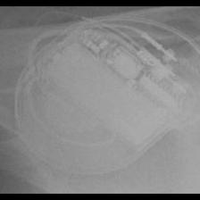 MDT:Concerto_Consulta_Maximo_Protecta_Secura</td>
<td align="center" valign="top"><b>Option 1</b>  BOS:Vitality</td>
<td align="center" valign="top"><b>Option 2</b>  MDT:Maximo</td>
<td align="center" valign="top"><b>Option 3</b>  MDT:Claria_Evera_Viva</td>
<td align="center" valign="top"><b>✅ Option 4</b>  MDT:Concerto_Consulta_Maximo_Protecta_Secura</td>
<td align="center" valign="top"><b>Option 5</b>  BOS:Contak Renewal 4</td>
<td align="center" valign="middle"><b>Option 6</b>  <i>None of the above</i></td>
</tr></table>

### Q3189 · correct: option 3 · `MDT:EnRhythm`

<table><tr>
<td align="center" valign="top"><b>Query</b>  MDT:EnRhythm</td>
<td align="center" valign="top"><b>Option 1</b> 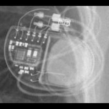 MDT:Azure</td>
<td align="center" valign="top"><b>Option 2</b>  MDT:Insync III</td>
<td align="center" valign="top"><b>✅ Option 3</b> 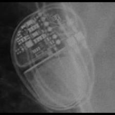 MDT:EnRhythm</td>
<td align="center" valign="top"><b>Option 4</b> 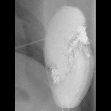 BOS:Emblem</td>
<td align="center" valign="top"><b>Option 5</b> 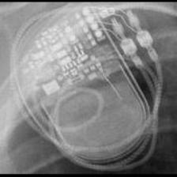 MDT:AT500</td>
<td align="center" valign="middle"><b>Option 6</b>  <i>None of the above</i></td>
</tr></table>

### Q3190 · correct: option 3 · `MDT:EnRhythm`

<table><tr>
<td align="center" valign="top"><b>Query</b> 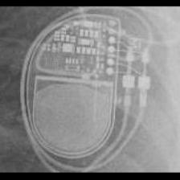 MDT:EnRhythm</td>
<td align="center" valign="top"><b>Option 1</b>  MDT:AT500</td>
<td align="center" valign="top"><b>Option 2</b> 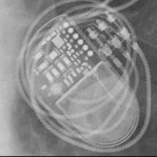 MDT:Insync III</td>
<td align="center" valign="top"><b>✅ Option 3</b> 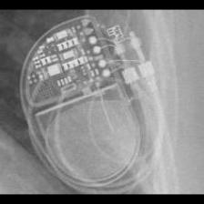 MDT:EnRhythm</td>
<td align="center" valign="top"><b>Option 4</b>  MDT:Advisa</td>
<td align="center" valign="top"><b>Option 5</b> 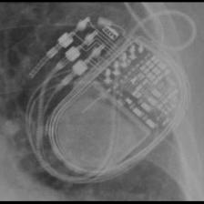 MDT:Syncra</td>
<td align="center" valign="middle"><b>Option 6</b>  <i>None of the above</i></td>
</tr></table>

### Q3191 · correct: option 1 · `MDT:EnRhythm`

<table><tr>
<td align="center" valign="top"><b>Query</b> 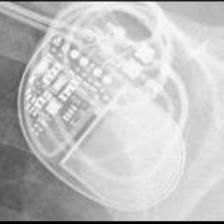 MDT:EnRhythm</td>
<td align="center" valign="top"><b>✅ Option 1</b>  MDT:EnRhythm</td>
<td align="center" valign="top"><b>Option 2</b> 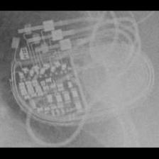 MDT:Syncra</td>
<td align="center" valign="top"><b>Option 3</b>  MDT:AT500</td>
<td align="center" valign="top"><b>Option 4</b>  MDT:Advisa</td>
<td align="center" valign="top"><b>Option 5</b>  MDT:Insync III</td>
<td align="center" valign="middle"><b>Option 6</b>  <i>None of the above</i></td>
</tr></table>

### Q3192 · correct: option 1 · `MDT:EnRhythm`

<table><tr>
<td align="center" valign="top"><b>Query</b>  MDT:EnRhythm</td>
<td align="center" valign="top"><b>✅ Option 1</b>  MDT:EnRhythm</td>
<td align="center" valign="top"><b>Option 2</b>  MDT:Insync III</td>
<td align="center" valign="top"><b>Option 3</b> 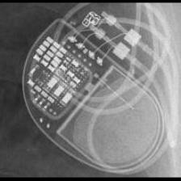 MDT:Advisa</td>
<td align="center" valign="top"><b>Option 4</b> 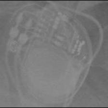 MDT:Azure</td>
<td align="center" valign="top"><b>Option 5</b>  MDT:AT500</td>
<td align="center" valign="middle"><b>Option 6</b>  <i>None of the above</i></td>
</tr></table>

### Q3193 · correct: option 5 · `MDT:EnRhythm`

<table><tr>
<td align="center" valign="top"><b>Query</b> 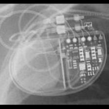 MDT:EnRhythm</td>
<td align="center" valign="top"><b>Option 1</b>  MDT:AT500</td>
<td align="center" valign="top"><b>Option 2</b>  MDT:Advisa</td>
<td align="center" valign="top"><b>Option 3</b>  MDT:Insync III</td>
<td align="center" valign="top"><b>Option 4</b>  MDT:Syncra</td>
<td align="center" valign="top"><b>✅ Option 5</b>  MDT:EnRhythm</td>
<td align="center" valign="middle"><b>Option 6</b>  <i>None of the above</i></td>
</tr></table>

### Q3194 · correct: option 5 · `MDT:Insync III`

<table><tr>
<td align="center" valign="top"><b>Query</b> 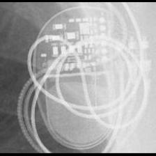 MDT:Insync III</td>
<td align="center" valign="top"><b>Option 1</b>  MDT:AT500</td>
<td align="center" valign="top"><b>Option 2</b>  MDT:EnRhythm</td>
<td align="center" valign="top"><b>Option 3</b> 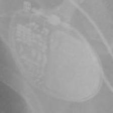 MDT:Advisa</td>
<td align="center" valign="top"><b>Option 4</b> 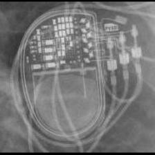 MDT:Syncra</td>
<td align="center" valign="top"><b>✅ Option 5</b>  MDT:Insync III</td>
<td align="center" valign="middle"><b>Option 6</b>  <i>None of the above</i></td>
</tr></table>

### Q3195 · correct: option 4 · `MDT:Insync III`

<table><tr>
<td align="center" valign="top"><b>Query</b> 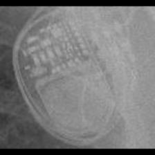 MDT:Insync III</td>
<td align="center" valign="top"><b>Option 1</b>  MDT:Syncra</td>
<td align="center" valign="top"><b>Option 2</b>  MDT:EnRhythm</td>
<td align="center" valign="top"><b>Option 3</b>  MDT:AT500</td>
<td align="center" valign="top"><b>✅ Option 4</b>  MDT:Insync III</td>
<td align="center" valign="top"><b>Option 5</b>  MDT:Advisa</td>
<td align="center" valign="middle"><b>Option 6</b>  <i>None of the above</i></td>
</tr></table>

### Q3196 · correct: option 4 · `MDT:Insync III`

<table><tr>
<td align="center" valign="top"><b>Query</b> 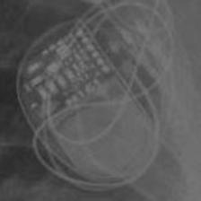 MDT:Insync III</td>
<td align="center" valign="top"><b>Option 1</b>  MDT:Azure</td>
<td align="center" valign="top"><b>Option 2</b> 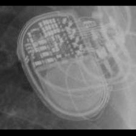 MDT:Syncra</td>
<td align="center" valign="top"><b>Option 3</b>  MDT:AT500</td>
<td align="center" valign="top"><b>✅ Option 4</b>  MDT:Insync III</td>
<td align="center" valign="top"><b>Option 5</b>  MDT:EnRhythm</td>
<td align="center" valign="middle"><b>Option 6</b>  <i>None of the above</i></td>
</tr></table>

### Q3197 · correct: option 2 · `MDT:Insync III`

<table><tr>
<td align="center" valign="top"><b>Query</b> 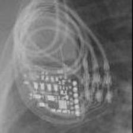 MDT:Insync III</td>
<td align="center" valign="top"><b>Option 1</b>  MDT:AT500</td>
<td align="center" valign="top"><b>✅ Option 2</b> 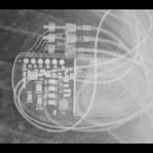 MDT:Insync III</td>
<td align="center" valign="top"><b>Option 3</b>  MDT:Azure</td>
<td align="center" valign="top"><b>Option 4</b>  MDT:Syncra</td>
<td align="center" valign="top"><b>Option 5</b>  MDT:EnRhythm</td>
<td align="center" valign="middle"><b>Option 6</b>  <i>None of the above</i></td>
</tr></table>

### Q3198 · correct: option 5 · `MDT:Insync III`

<table><tr>
<td align="center" valign="top"><b>Query</b> 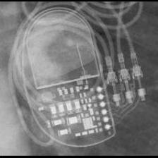 MDT:Insync III</td>
<td align="center" valign="top"><b>Option 1</b>  MDT:Syncra</td>
<td align="center" valign="top"><b>Option 2</b>  MDT:AT500</td>
<td align="center" valign="top"><b>Option 3</b>  MDT:EnRhythm</td>
<td align="center" valign="top"><b>Option 4</b>  MDT:Azure</td>
<td align="center" valign="top"><b>✅ Option 5</b>  MDT:Insync III</td>
<td align="center" valign="middle"><b>Option 6</b>  <i>None of the above</i></td>
</tr></table>

### Q3199 · correct: option 3 · `MDT:Maximo`

<table><tr>
<td align="center" valign="top"><b>Query</b> 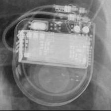 MDT:Maximo</td>
<td align="center" valign="top"><b>Option 1</b> 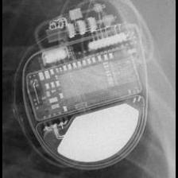 MDT:Claria_Evera_Viva</td>
<td align="center" valign="top"><b>Option 2</b>  BOS:Contak Renewal 4</td>
<td align="center" valign="top"><b>✅ Option 3</b>  MDT:Maximo</td>
<td align="center" valign="top"><b>Option 4</b>  STJ:Quadra Assura_Unify</td>
<td align="center" valign="top"><b>Option 5</b> 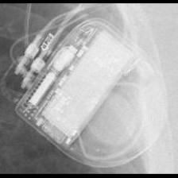 MDT:Concerto_Consulta_Maximo_Protecta_Secura</td>
<td align="center" valign="middle"><b>Option 6</b>  <i>None of the above</i></td>
</tr></table>

### Q3200 · correct: option 3 · `MDT:Maximo`

<table><tr>
<td align="center" valign="top"><b>Query</b> 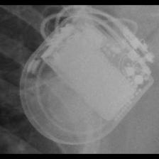 MDT:Maximo</td>
<td align="center" valign="top"><b>Option 1</b>  STJ:Quadra Assura_Unify</td>
<td align="center" valign="top"><b>Option 2</b>  MDT:Concerto_Consulta_Maximo_Protecta_Secura</td>
<td align="center" valign="top"><b>✅ Option 3</b>  MDT:Maximo</td>
<td align="center" valign="top"><b>Option 4</b>  BOS:Contak Renewal 4</td>
<td align="center" valign="top"><b>Option 5</b>  BOS:Vitality</td>
<td align="center" valign="middle"><b>Option 6</b>  <i>None of the above</i></td>
</tr></table>

### Q3201 · correct: option 5 · `MDT:Maximo`

<table><tr>
<td align="center" valign="top"><b>Query</b> 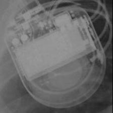 MDT:Maximo</td>
<td align="center" valign="top"><b>Option 1</b>  BOS:Contak Renewal 4</td>
<td align="center" valign="top"><b>Option 2</b>  STJ:Quadra Assura_Unify</td>
<td align="center" valign="top"><b>Option 3</b>  BOS:Vitality</td>
<td align="center" valign="top"><b>Option 4</b>  MDT:Concerto_Consulta_Maximo_Protecta_Secura</td>
<td align="center" valign="top"><b>✅ Option 5</b>  MDT:Maximo</td>
<td align="center" valign="middle"><b>Option 6</b>  <i>None of the above</i></td>
</tr></table>

### Q3202 · correct: option 2 · `MDT:Maximo`

<table><tr>
<td align="center" valign="top"><b>Query</b> 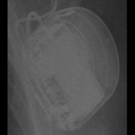 MDT:Maximo</td>
<td align="center" valign="top"><b>Option 1</b>  MDT:Concerto_Consulta_Maximo_Protecta_Secura</td>
<td align="center" valign="top"><b>✅ Option 2</b>  MDT:Maximo</td>
<td align="center" valign="top"><b>Option 3</b>  BOS:Vitality</td>
<td align="center" valign="top"><b>Option 4</b>  BOS:Ventak Prizm</td>
<td align="center" valign="top"><b>Option 5</b>  BOS:Contak Renewal 4</td>
<td align="center" valign="middle"><b>Option 6</b>  <i>None of the above</i></td>
</tr></table>

### Q3203 · correct: option 5 · `MDT:Maximo`

<table><tr>
<td align="center" valign="top"><b>Query</b> 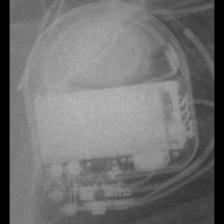 MDT:Maximo</td>
<td align="center" valign="top"><b>Option 1</b>  BOS:Vitality</td>
<td align="center" valign="top"><b>Option 2</b>  MDT:Concerto_Consulta_Maximo_Protecta_Secura</td>
<td align="center" valign="top"><b>Option 3</b>  BOS:Ventak Prizm</td>
<td align="center" valign="top"><b>Option 4</b>  STJ:Quadra Assura_Unify</td>
<td align="center" valign="top"><b>✅ Option 5</b>  MDT:Maximo</td>
<td align="center" valign="middle"><b>Option 6</b>  <i>None of the above</i></td>
</tr></table>

### Q3204 · correct: option 3 · `MDT:REVEAL`

<table><tr>
<td align="center" valign="top"><b>Query</b> 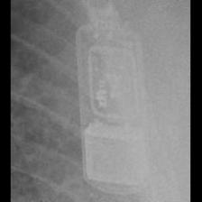 MDT:REVEAL</td>
<td align="center" valign="top"><b>Option 1</b>  STJ:Quadra Assura_Unify</td>
<td align="center" valign="top"><b>Option 2</b>  BOS:Proponent</td>
<td align="center" valign="top"><b>✅ Option 3</b>  MDT:REVEAL</td>
<td align="center" valign="top"><b>Option 4</b>  MDT:REVEAL LINQ</td>
<td align="center" valign="top"><b>Option 5</b>  BOS:Emblem</td>
<td align="center" valign="middle"><b>Option 6</b>  <i>None of the above</i></td>
</tr></table>

### Q3205 · correct: option 4 · `MDT:REVEAL`

<table><tr>
<td align="center" valign="top"><b>Query</b>  MDT:REVEAL</td>
<td align="center" valign="top"><b>Option 1</b>  BOS:Proponent</td>
<td align="center" valign="top"><b>Option 2</b>  BOS:Emblem</td>
<td align="center" valign="top"><b>Option 3</b>  MDT:REVEAL LINQ</td>
<td align="center" valign="top"><b>✅ Option 4</b>  MDT:REVEAL</td>
<td align="center" valign="top"><b>Option 5</b>  BOS:Visionist</td>
<td align="center" valign="middle"><b>Option 6</b>  <i>None of the above</i></td>
</tr></table>

### Q3206 · correct: option 4 · `MDT:REVEAL`

<table><tr>
<td align="center" valign="top"><b>Query</b>  MDT:REVEAL</td>
<td align="center" valign="top"><b>Option 1</b>  BOS:Visionist</td>
<td align="center" valign="top"><b>Option 2</b>  MDT:REVEAL LINQ</td>
<td align="center" valign="top"><b>Option 3</b>  BOS:Emblem</td>
<td align="center" valign="top"><b>✅ Option 4</b>  MDT:REVEAL</td>
<td align="center" valign="top"><b>Option 5</b>  BOS:Proponent</td>
<td align="center" valign="middle"><b>Option 6</b>  <i>None of the above</i></td>
</tr></table>

### Q3207 · correct: option 4 · `MDT:REVEAL`

<table><tr>
<td align="center" valign="top"><b>Query</b>  MDT:REVEAL</td>
<td align="center" valign="top"><b>Option 1</b>  BOS:Emblem</td>
<td align="center" valign="top"><b>Option 2</b>  BOS:Proponent</td>
<td align="center" valign="top"><b>Option 3</b>  BOS:Visionist</td>
<td align="center" valign="top"><b>✅ Option 4</b>  MDT:REVEAL</td>
<td align="center" valign="top"><b>Option 5</b>  MDT:REVEAL LINQ</td>
<td align="center" valign="middle"><b>Option 6</b>  <i>None of the above</i></td>
</tr></table>

### Q3208 · correct: option 5 · `MDT:REVEAL`

<table><tr>
<td align="center" valign="top"><b>Query</b>  MDT:REVEAL</td>
<td align="center" valign="top"><b>Option 1</b>  MDT:REVEAL LINQ</td>
<td align="center" valign="top"><b>Option 2</b>  BOS:Emblem</td>
<td align="center" valign="top"><b>Option 3</b>  BOS:Proponent</td>
<td align="center" valign="top"><b>Option 4</b>  BOS:Visionist</td>
<td align="center" valign="top"><b>✅ Option 5</b>  MDT:REVEAL</td>
<td align="center" valign="middle"><b>Option 6</b>  <i>None of the above</i></td>
</tr></table>

### Q3209 · correct: option 2 · `MDT:REVEAL LINQ`

<table><tr>
<td align="center" valign="top"><b>Query</b>  MDT:REVEAL LINQ</td>
<td align="center" valign="top"><b>Option 1</b>  MDT:REVEAL</td>
<td align="center" valign="top"><b>✅ Option 2</b>  MDT:REVEAL LINQ</td>
<td align="center" valign="top"><b>Option 3</b>  STJ:Ellipse</td>
<td align="center" valign="top"><b>Option 4</b>  STJ:Quadra Assura_Unify</td>
<td align="center" valign="top"><b>Option 5</b>  BOS:Emblem</td>
<td align="center" valign="middle"><b>Option 6</b>  <i>None of the above</i></td>
</tr></table>

### Q3210 · correct: option 1 · `MDT:REVEAL LINQ`

<table><tr>
<td align="center" valign="top"><b>Query</b>  MDT:REVEAL LINQ</td>
<td align="center" valign="top"><b>✅ Option 1</b>  MDT:REVEAL LINQ</td>
<td align="center" valign="top"><b>Option 2</b>  MDT:REVEAL</td>
<td align="center" valign="top"><b>Option 3</b>  SOR:Thesis</td>
<td align="center" valign="top"><b>Option 4</b>  BOS:Emblem</td>
<td align="center" valign="top"><b>Option 5</b>  STJ:Quadra Assura_Unify</td>
<td align="center" valign="middle"><b>Option 6</b>  <i>None of the above</i></td>
</tr></table>

### Q3211 · correct: option 5 · `MDT:REVEAL LINQ`

<table><tr>
<td align="center" valign="top"><b>Query</b>  MDT:REVEAL LINQ</td>
<td align="center" valign="top"><b>Option 1</b>  BOS:Emblem</td>
<td align="center" valign="top"><b>Option 2</b>  BOS:Visionist</td>
<td align="center" valign="top"><b>Option 3</b>  MDT:REVEAL</td>
<td align="center" valign="top"><b>Option 4</b>  STJ:Allure Quadra</td>
<td align="center" valign="top"><b>✅ Option 5</b>  MDT:REVEAL LINQ</td>
<td align="center" valign="middle"><b>Option 6</b>  <i>None of the above</i></td>
</tr></table>

### Q3212 · correct: option 3 · `MDT:REVEAL LINQ`

<table><tr>
<td align="center" valign="top"><b>Query</b>  MDT:REVEAL LINQ</td>
<td align="center" valign="top"><b>Option 1</b>  SOR:Thesis</td>
<td align="center" valign="top"><b>Option 2</b>  BOS:Contak Renewal TR2</td>
<td align="center" valign="top"><b>✅ Option 3</b>  MDT:REVEAL LINQ</td>
<td align="center" valign="top"><b>Option 4</b>  BOS:Emblem</td>
<td align="center" valign="top"><b>Option 5</b>  MDT:REVEAL</td>
<td align="center" valign="middle"><b>Option 6</b>  <i>None of the above</i></td>
</tr></table>

### Q3213 · correct: option 2 · `MDT:REVEAL LINQ`

<table><tr>
<td align="center" valign="top"><b>Query</b>  MDT:REVEAL LINQ</td>
<td align="center" valign="top"><b>Option 1</b>  BOS:Contak Renewal TR2</td>
<td align="center" valign="top"><b>✅ Option 2</b>  MDT:REVEAL LINQ</td>
<td align="center" valign="top"><b>Option 3</b>  SOR:Thesis</td>
<td align="center" valign="top"><b>Option 4</b>  BOS:Emblem</td>
<td align="center" valign="top"><b>Option 5</b>  MDT:REVEAL</td>
<td align="center" valign="middle"><b>Option 6</b>  <i>None of the above</i></td>
</tr></table>

### Q3214 · correct: option 1 · `MDT:Sigma`

<table><tr>
<td align="center" valign="top"><b>Query</b>  MDT:Sigma</td>
<td align="center" valign="top"><b>✅ Option 1</b>  MDT:Sigma</td>
<td align="center" valign="top"><b>Option 2</b>  MDT:C20_T20</td>
<td align="center" valign="top"><b>Option 3</b>  SOR:Reply</td>
<td align="center" valign="top"><b>Option 4</b>  BIO:Cyclos</td>
<td align="center" valign="top"><b>Option 5</b>  MDT:Adapta_Kappa_Sensia_Versa</td>
<td align="center" valign="middle"><b>Option 6</b>  <i>None of the above</i></td>
</tr></table>

### Q3215 · correct: option 3 · `MDT:Sigma`

<table><tr>
<td align="center" valign="top"><b>Query</b>  MDT:Sigma</td>
<td align="center" valign="top"><b>Option 1</b>  SOR:Reply</td>
<td align="center" valign="top"><b>Option 2</b>  STJ:Victory</td>
<td align="center" valign="top"><b>✅ Option 3</b>  MDT:Sigma</td>
<td align="center" valign="top"><b>Option 4</b>  MDT:Adapta_Kappa_Sensia_Versa</td>
<td align="center" valign="top"><b>Option 5</b>  MDT:C20_T20</td>
<td align="center" valign="middle"><b>Option 6</b>  <i>None of the above</i></td>
</tr></table>

### Q3216 · correct: option 4 · `MDT:Sigma`

<table><tr>
<td align="center" valign="top"><b>Query</b>  MDT:Sigma</td>
<td align="center" valign="top"><b>Option 1</b>  BIO:Actros_Philos</td>
<td align="center" valign="top"><b>Option 2</b>  MDT:C20_T20</td>
<td align="center" valign="top"><b>Option 3</b>  MDT:Adapta_Kappa_Sensia_Versa</td>
<td align="center" valign="top"><b>✅ Option 4</b>  MDT:Sigma</td>
<td align="center" valign="top"><b>Option 5</b>  SOR:Rhapsody_Symphony</td>
<td align="center" valign="middle"><b>Option 6</b>  <i>None of the above</i></td>
</tr></table>

### Q3217 · correct: option 3 · `MDT:Sigma`

<table><tr>
<td align="center" valign="top"><b>Query</b>  MDT:Sigma</td>
<td align="center" valign="top"><b>Option 1</b>  STJ:Victory</td>
<td align="center" valign="top"><b>Option 2</b>  MDT:Adapta_Kappa_Sensia_Versa</td>
<td align="center" valign="top"><b>✅ Option 3</b>  MDT:Sigma</td>
<td align="center" valign="top"><b>Option 4</b>  STJ:Zephyr</td>
<td align="center" valign="top"><b>Option 5</b>  STJ:Identity</td>
<td align="center" valign="middle"><b>Option 6</b>  <i>None of the above</i></td>
</tr></table>

### Q3218 · correct: option 1 · `MDT:Sigma`

<table><tr>
<td align="center" valign="top"><b>Query</b>  MDT:Sigma</td>
<td align="center" valign="top"><b>✅ Option 1</b>  MDT:Sigma</td>
<td align="center" valign="top"><b>Option 2</b>  MDT:Adapta_Kappa_Sensia_Versa</td>
<td align="center" valign="top"><b>Option 3</b>  BIO:Cyclos</td>
<td align="center" valign="top"><b>Option 4</b>  STJ:Zephyr</td>
<td align="center" valign="top"><b>Option 5</b>  MDT:C60 DR</td>
<td align="center" valign="middle"><b>Option 6</b>  <i>None of the above</i></td>
</tr></table>

### Q3219 · correct: option 5 · `MDT:Syncra`

<table><tr>
<td align="center" valign="top"><b>Query</b>  MDT:Syncra</td>
<td align="center" valign="top"><b>Option 1</b>  MDT:EnRhythm</td>
<td align="center" valign="top"><b>Option 2</b>  MDT:Insync III</td>
<td align="center" valign="top"><b>Option 3</b>  MDT:AT500</td>
<td align="center" valign="top"><b>Option 4</b>  MDT:Advisa</td>
<td align="center" valign="top"><b>✅ Option 5</b>  MDT:Syncra</td>
<td align="center" valign="middle"><b>Option 6</b>  <i>None of the above</i></td>
</tr></table>

### Q3220 · correct: option 5 · `MDT:Syncra`

<table><tr>
<td align="center" valign="top"><b>Query</b>  MDT:Syncra</td>
<td align="center" valign="top"><b>Option 1</b>  MDT:AT500</td>
<td align="center" valign="top"><b>Option 2</b>  MDT:Insync III</td>
<td align="center" valign="top"><b>Option 3</b>  MDT:EnRhythm</td>
<td align="center" valign="top"><b>Option 4</b>  MDT:Advisa</td>
<td align="center" valign="top"><b>✅ Option 5</b>  MDT:Syncra</td>
<td align="center" valign="middle"><b>Option 6</b>  <i>None of the above</i></td>
</tr></table>

### Q3221 · correct: option 5 · `MDT:Syncra`

<table><tr>
<td align="center" valign="top"><b>Query</b>  MDT:Syncra</td>
<td align="center" valign="top"><b>Option 1</b>  MDT:AT500</td>
<td align="center" valign="top"><b>Option 2</b>  MDT:Advisa</td>
<td align="center" valign="top"><b>Option 3</b>  MDT:EnRhythm</td>
<td align="center" valign="top"><b>Option 4</b>  MDT:Insync III</td>
<td align="center" valign="top"><b>✅ Option 5</b>  MDT:Syncra</td>
<td align="center" valign="middle"><b>Option 6</b>  <i>None of the above</i></td>
</tr></table>

### Q3222 · correct: option 5 · `MDT:Syncra`

<table><tr>
<td align="center" valign="top"><b>Query</b>  MDT:Syncra</td>
<td align="center" valign="top"><b>Option 1</b>  MDT:Advisa</td>
<td align="center" valign="top"><b>Option 2</b>  MDT:EnRhythm</td>
<td align="center" valign="top"><b>Option 3</b>  MDT:Insync III</td>
<td align="center" valign="top"><b>Option 4</b>  MDT:AT500</td>
<td align="center" valign="top"><b>✅ Option 5</b>  MDT:Syncra</td>
<td align="center" valign="middle"><b>Option 6</b>  <i>None of the above</i></td>
</tr></table>

### Q3223 · correct: option 4 · `MDT:Syncra`

<table><tr>
<td align="center" valign="top"><b>Query</b>  MDT:Syncra</td>
<td align="center" valign="top"><b>Option 1</b>  MDT:Advisa</td>
<td align="center" valign="top"><b>Option 2</b>  MDT:EnRhythm</td>
<td align="center" valign="top"><b>Option 3</b>  MDT:Insync III</td>
<td align="center" valign="top"><b>✅ Option 4</b>  MDT:Syncra</td>
<td align="center" valign="top"><b>Option 5</b>  MDT:AT500</td>
<td align="center" valign="middle"><b>Option 6</b>  <i>None of the above</i></td>
</tr></table>

### Q3224 · correct: option 5 · `MDT:Vita II`

<table><tr>
<td align="center" valign="top"><b>Query</b>  MDT:Vita II</td>
<td align="center" valign="top"><b>Option 1</b>  SOR:Thesis</td>
<td align="center" valign="top"><b>Option 2</b>  SOR:Elect XS Plus</td>
<td align="center" valign="top"><b>Option 3</b>  SOR:Elect</td>
<td align="center" valign="top"><b>Option 4</b>  SOR:Neway</td>
<td align="center" valign="top"><b>✅ Option 5</b>  MDT:Vita II</td>
<td align="center" valign="middle"><b>Option 6</b>  <i>None of the above</i></td>
</tr></table>

### Q3225 · correct: option 3 · `MDT:Vita II`

<table><tr>
<td align="center" valign="top"><b>Query</b>  MDT:Vita II</td>
<td align="center" valign="top"><b>Option 1</b>  MDT:AT500</td>
<td align="center" valign="top"><b>Option 2</b>  MDT:Adapta_Kappa_Sensia_Versa</td>
<td align="center" valign="top"><b>✅ Option 3</b>  MDT:Vita II</td>
<td align="center" valign="top"><b>Option 4</b>  MDT:EnRhythm</td>
<td align="center" valign="top"><b>Option 5</b>  MDT:C60 DR</td>
<td align="center" valign="middle"><b>Option 6</b>  <i>None of the above</i></td>
</tr></table>

### Q3226 · correct: option 5 · `MDT:Vita II`

<table><tr>
<td align="center" valign="top"><b>Query</b>  MDT:Vita II</td>
<td align="center" valign="top"><b>Option 1</b>  MDT:EnRhythm</td>
<td align="center" valign="top"><b>Option 2</b>  MDT:C60 DR</td>
<td align="center" valign="top"><b>Option 3</b>  MDT:AT500</td>
<td align="center" valign="top"><b>Option 4</b>  MDT:Syncra</td>
<td align="center" valign="top"><b>✅ Option 5</b>  MDT:Vita II</td>
<td align="center" valign="middle"><b>Option 6</b>  <i>None of the above</i></td>
</tr></table>

### Q3227 · correct: option 3 · `MDT:Vita II`

<table><tr>
<td align="center" valign="top"><b>Query</b>  MDT:Vita II</td>
<td align="center" valign="top"><b>Option 1</b>  MDT:AT500</td>
<td align="center" valign="top"><b>Option 2</b>  MDT:C60 DR</td>
<td align="center" valign="top"><b>✅ Option 3</b>  MDT:Vita II</td>
<td align="center" valign="top"><b>Option 4</b>  MDT:EnRhythm</td>
<td align="center" valign="top"><b>Option 5</b>  MDT:Syncra</td>
<td align="center" valign="middle"><b>Option 6</b>  <i>None of the above</i></td>
</tr></table>

### Q3228 · correct: option 1 · `MDT:Vita II`

<table><tr>
<td align="center" valign="top"><b>Query</b>  MDT:Vita II</td>
<td align="center" valign="top"><b>✅ Option 1</b>  MDT:Vita II</td>
<td align="center" valign="top"><b>Option 2</b>  SOR:Rhapsody_Symphony</td>
<td align="center" valign="top"><b>Option 3</b>  MDT:EnRhythm</td>
<td align="center" valign="top"><b>Option 4</b>  SOR:Reply</td>
<td align="center" valign="top"><b>Option 5</b>  MDT:C60 DR</td>
<td align="center" valign="middle"><b>Option 6</b>  <i>None of the above</i></td>
</tr></table>

