# Pacemakers (Howard et al.) · query set `test` · page 4/5

[← all pages](README.md)

### Q3229 · correct: option 1 · `SOR:Elect`

<table><tr>
<td align="center" valign="top"><b>Query</b> 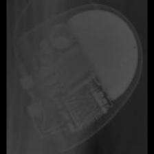 SOR:Elect</td>
<td align="center" valign="top"><b>✅ Option 1</b> 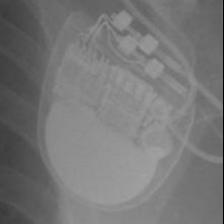 SOR:Elect</td>
<td align="center" valign="top"><b>Option 2</b> 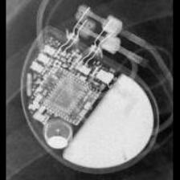 SOR:Neway</td>
<td align="center" valign="top"><b>Option 3</b> 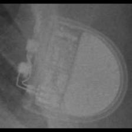 SOR:Elect XS Plus</td>
<td align="center" valign="top"><b>Option 4</b> 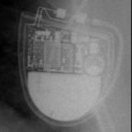 SOR:MiniSwing</td>
<td align="center" valign="top"><b>Option 5</b> 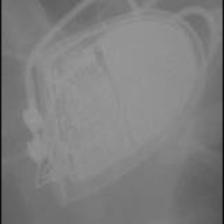 SOR:Thesis</td>
<td align="center" valign="middle"><b>Option 6</b>  <i>None of the above</i></td>
</tr></table>

### Q3230 · correct: option 1 · `SOR:Elect`

<table><tr>
<td align="center" valign="top"><b>Query</b>  SOR:Elect</td>
<td align="center" valign="top"><b>✅ Option 1</b>  SOR:Elect</td>
<td align="center" valign="top"><b>Option 2</b>  SOR:Elect XS Plus</td>
<td align="center" valign="top"><b>Option 3</b> 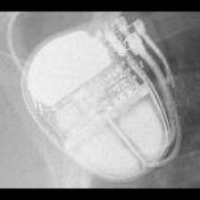 SOR:Ovatio</td>
<td align="center" valign="top"><b>Option 4</b>  SOR:Thesis</td>
<td align="center" valign="top"><b>Option 5</b> 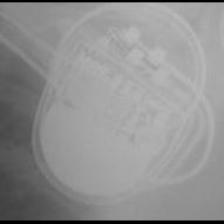 SOR:MiniSwing</td>
<td align="center" valign="middle"><b>Option 6</b>  <i>None of the above</i></td>
</tr></table>

### Q3231 · correct: option 3 · `SOR:Elect`

<table><tr>
<td align="center" valign="top"><b>Query</b> 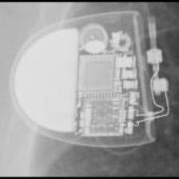 SOR:Elect</td>
<td align="center" valign="top"><b>Option 1</b>  SOR:MiniSwing</td>
<td align="center" valign="top"><b>Option 2</b>  SOR:Thesis</td>
<td align="center" valign="top"><b>✅ Option 3</b> 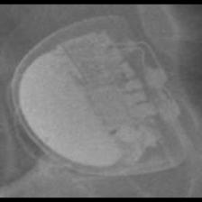 SOR:Elect</td>
<td align="center" valign="top"><b>Option 4</b>  SOR:Elect XS Plus</td>
<td align="center" valign="top"><b>Option 5</b>  SOR:Neway</td>
<td align="center" valign="middle"><b>Option 6</b>  <i>None of the above</i></td>
</tr></table>

### Q3232 · correct: option 3 · `SOR:Elect`

<table><tr>
<td align="center" valign="top"><b>Query</b> 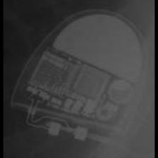 SOR:Elect</td>
<td align="center" valign="top"><b>Option 1</b>  SOR:MiniSwing</td>
<td align="center" valign="top"><b>Option 2</b> 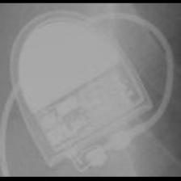 SOR:Elect XS Plus</td>
<td align="center" valign="top"><b>✅ Option 3</b> 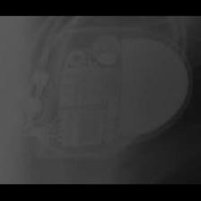 SOR:Elect</td>
<td align="center" valign="top"><b>Option 4</b>  SOR:Thesis</td>
<td align="center" valign="top"><b>Option 5</b> 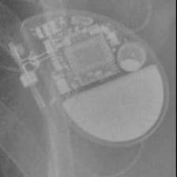 SOR:Neway</td>
<td align="center" valign="middle"><b>Option 6</b>  <i>None of the above</i></td>
</tr></table>

### Q3233 · correct: option 3 · `SOR:Elect`

<table><tr>
<td align="center" valign="top"><b>Query</b> 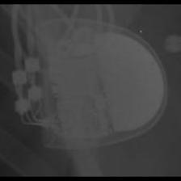 SOR:Elect</td>
<td align="center" valign="top"><b>Option 1</b>  SOR:Neway</td>
<td align="center" valign="top"><b>Option 2</b> 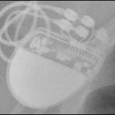 BOS:Altrua_Insignia</td>
<td align="center" valign="top"><b>✅ Option 3</b> 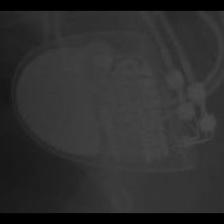 SOR:Elect</td>
<td align="center" valign="top"><b>Option 4</b>  SOR:Elect XS Plus</td>
<td align="center" valign="top"><b>Option 5</b>  SOR:MiniSwing</td>
<td align="center" valign="middle"><b>Option 6</b>  <i>None of the above</i></td>
</tr></table>

### Q3234 · correct: option 1 · `SOR:Elect XS Plus`

<table><tr>
<td align="center" valign="top"><b>Query</b> 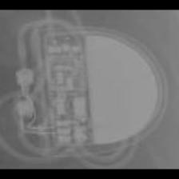 SOR:Elect XS Plus</td>
<td align="center" valign="top"><b>✅ Option 1</b> 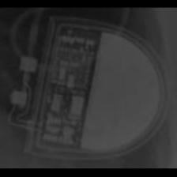 SOR:Elect XS Plus</td>
<td align="center" valign="top"><b>Option 2</b> 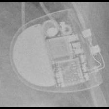 SOR:Elect</td>
<td align="center" valign="top"><b>Option 3</b>  SOR:MiniSwing</td>
<td align="center" valign="top"><b>Option 4</b> 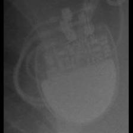 SOR:Rhapsody_Symphony</td>
<td align="center" valign="top"><b>Option 5</b>  BOS:Altrua_Insignia</td>
<td align="center" valign="middle"><b>Option 6</b>  <i>None of the above</i></td>
</tr></table>

### Q3235 · correct: option 2 · `SOR:Elect XS Plus`

<table><tr>
<td align="center" valign="top"><b>Query</b> 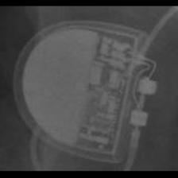 SOR:Elect XS Plus</td>
<td align="center" valign="top"><b>Option 1</b>  BOS:Proponent</td>
<td align="center" valign="top"><b>✅ Option 2</b>  SOR:Elect XS Plus</td>
<td align="center" valign="top"><b>Option 3</b>  SOR:Thesis</td>
<td align="center" valign="top"><b>Option 4</b>  SOR:Elect</td>
<td align="center" valign="top"><b>Option 5</b>  SOR:MiniSwing</td>
<td align="center" valign="middle"><b>Option 6</b>  <i>None of the above</i></td>
</tr></table>

### Q3236 · correct: option 1 · `SOR:Elect XS Plus`

<table><tr>
<td align="center" valign="top"><b>Query</b> 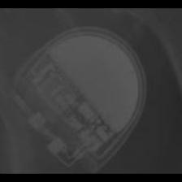 SOR:Elect XS Plus</td>
<td align="center" valign="top"><b>✅ Option 1</b>  SOR:Elect XS Plus</td>
<td align="center" valign="top"><b>Option 2</b>  SOR:Elect</td>
<td align="center" valign="top"><b>Option 3</b> 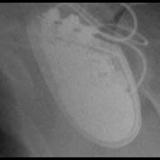 SOR:MiniSwing</td>
<td align="center" valign="top"><b>Option 4</b>  SOR:Rhapsody_Symphony</td>
<td align="center" valign="top"><b>Option 5</b>  SOR:Thesis</td>
<td align="center" valign="middle"><b>Option 6</b>  <i>None of the above</i></td>
</tr></table>

### Q3237 · correct: option 3 · `SOR:Elect XS Plus`

<table><tr>
<td align="center" valign="top"><b>Query</b> 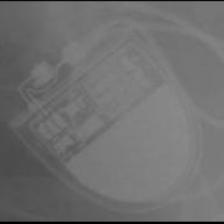 SOR:Elect XS Plus</td>
<td align="center" valign="top"><b>Option 1</b>  SOR:Thesis</td>
<td align="center" valign="top"><b>Option 2</b>  SOR:MiniSwing</td>
<td align="center" valign="top"><b>✅ Option 3</b>  SOR:Elect XS Plus</td>
<td align="center" valign="top"><b>Option 4</b>  BOS:Altrua_Insignia</td>
<td align="center" valign="top"><b>Option 5</b>  SOR:Elect</td>
<td align="center" valign="middle"><b>Option 6</b>  <i>None of the above</i></td>
</tr></table>

### Q3238 · correct: option 5 · `SOR:Elect XS Plus`

<table><tr>
<td align="center" valign="top"><b>Query</b> 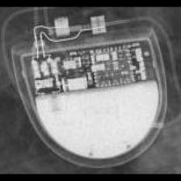 SOR:Elect XS Plus</td>
<td align="center" valign="top"><b>Option 1</b>  SOR:MiniSwing</td>
<td align="center" valign="top"><b>Option 2</b>  BOS:Ingenio</td>
<td align="center" valign="top"><b>Option 3</b> 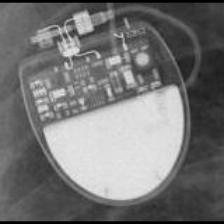 SOR:Rhapsody_Symphony</td>
<td align="center" valign="top"><b>Option 4</b> 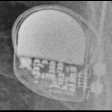 SOR:Reply</td>
<td align="center" valign="top"><b>✅ Option 5</b>  SOR:Elect XS Plus</td>
<td align="center" valign="middle"><b>Option 6</b>  <i>None of the above</i></td>
</tr></table>

### Q3239 · correct: option 5 · `SOR:MiniSwing`

<table><tr>
<td align="center" valign="top"><b>Query</b> 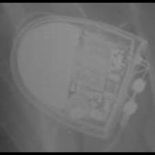 SOR:MiniSwing</td>
<td align="center" valign="top"><b>Option 1</b> 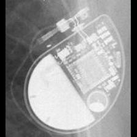 SOR:Neway</td>
<td align="center" valign="top"><b>Option 2</b>  SOR:Elect</td>
<td align="center" valign="top"><b>Option 3</b>  SOR:Elect XS Plus</td>
<td align="center" valign="top"><b>Option 4</b>  SOR:Thesis</td>
<td align="center" valign="top"><b>✅ Option 5</b>  SOR:MiniSwing</td>
<td align="center" valign="middle"><b>Option 6</b>  <i>None of the above</i></td>
</tr></table>

### Q3240 · correct: option 5 · `SOR:MiniSwing`

<table><tr>
<td align="center" valign="top"><b>Query</b> 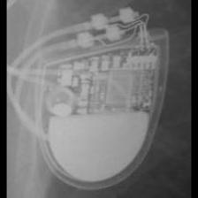 SOR:MiniSwing</td>
<td align="center" valign="top"><b>Option 1</b>  SOR:Elect XS Plus</td>
<td align="center" valign="top"><b>Option 2</b>  SOR:Elect</td>
<td align="center" valign="top"><b>Option 3</b>  SOR:Neway</td>
<td align="center" valign="top"><b>Option 4</b> 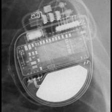 MDT:Claria_Evera_Viva</td>
<td align="center" valign="top"><b>✅ Option 5</b>  SOR:MiniSwing</td>
<td align="center" valign="middle"><b>Option 6</b>  <i>None of the above</i></td>
</tr></table>

### Q3241 · correct: option 5 · `SOR:MiniSwing`

<table><tr>
<td align="center" valign="top"><b>Query</b> 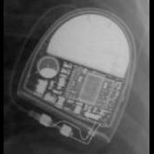 SOR:MiniSwing</td>
<td align="center" valign="top"><b>Option 1</b>  SOR:Elect XS Plus</td>
<td align="center" valign="top"><b>Option 2</b>  SOR:Thesis</td>
<td align="center" valign="top"><b>Option 3</b>  SOR:Elect</td>
<td align="center" valign="top"><b>Option 4</b>  SOR:Neway</td>
<td align="center" valign="top"><b>✅ Option 5</b>  SOR:MiniSwing</td>
<td align="center" valign="middle"><b>Option 6</b>  <i>None of the above</i></td>
</tr></table>

### Q3242 · correct: option 2 · `SOR:MiniSwing`

<table><tr>
<td align="center" valign="top"><b>Query</b>  SOR:MiniSwing</td>
<td align="center" valign="top"><b>Option 1</b>  SOR:Thesis</td>
<td align="center" valign="top"><b>✅ Option 2</b>  SOR:MiniSwing</td>
<td align="center" valign="top"><b>Option 3</b>  SOR:Elect</td>
<td align="center" valign="top"><b>Option 4</b>  SOR:Elect XS Plus</td>
<td align="center" valign="top"><b>Option 5</b> 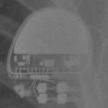 BOS:Altrua_Insignia</td>
<td align="center" valign="middle"><b>Option 6</b>  <i>None of the above</i></td>
</tr></table>

### Q3243 · correct: option 5 · `SOR:MiniSwing`

<table><tr>
<td align="center" valign="top"><b>Query</b> 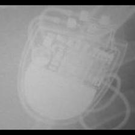 SOR:MiniSwing</td>
<td align="center" valign="top"><b>Option 1</b>  SOR:Elect XS Plus</td>
<td align="center" valign="top"><b>Option 2</b> 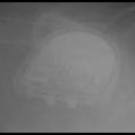 SOR:Thesis</td>
<td align="center" valign="top"><b>Option 3</b> 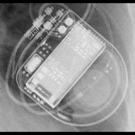 MDT:Maximo</td>
<td align="center" valign="top"><b>Option 4</b> 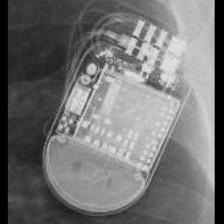 STJ:Quadra Assura_Unify</td>
<td align="center" valign="top"><b>✅ Option 5</b>  SOR:MiniSwing</td>
<td align="center" valign="middle"><b>Option 6</b>  <i>None of the above</i></td>
</tr></table>

### Q3244 · correct: option 5 · `SOR:Neway`

<table><tr>
<td align="center" valign="top"><b>Query</b> 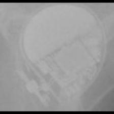 SOR:Neway</td>
<td align="center" valign="top"><b>Option 1</b> 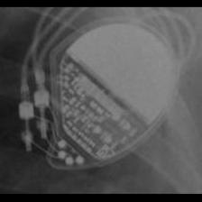 MDT:Vita II</td>
<td align="center" valign="top"><b>Option 2</b>  SOR:Elect</td>
<td align="center" valign="top"><b>Option 3</b> 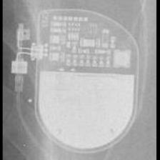 SOR:Reply</td>
<td align="center" valign="top"><b>Option 4</b>  BOS:Ventak Prizm</td>
<td align="center" valign="top"><b>✅ Option 5</b>  SOR:Neway</td>
<td align="center" valign="middle"><b>Option 6</b>  <i>None of the above</i></td>
</tr></table>

### Q3245 · correct: option 2 · `SOR:Neway`

<table><tr>
<td align="center" valign="top"><b>Query</b>  SOR:Neway</td>
<td align="center" valign="top"><b>Option 1</b>  SOR:Elect XS Plus</td>
<td align="center" valign="top"><b>✅ Option 2</b>  SOR:Neway</td>
<td align="center" valign="top"><b>Option 3</b> 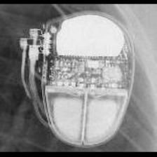 SOR:Ovatio</td>
<td align="center" valign="top"><b>Option 4</b>  SOR:Elect</td>
<td align="center" valign="top"><b>Option 5</b>  SOR:MiniSwing</td>
<td align="center" valign="middle"><b>Option 6</b>  <i>None of the above</i></td>
</tr></table>

### Q3246 · correct: option 5 · `SOR:Neway`

<table><tr>
<td align="center" valign="top"><b>Query</b> 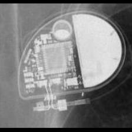 SOR:Neway</td>
<td align="center" valign="top"><b>Option 1</b>  SOR:Elect</td>
<td align="center" valign="top"><b>Option 2</b>  SOR:Elect XS Plus</td>
<td align="center" valign="top"><b>Option 3</b> 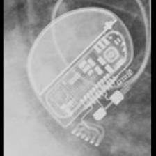 BOS:Proponent</td>
<td align="center" valign="top"><b>Option 4</b>  MDT:Vita II</td>
<td align="center" valign="top"><b>✅ Option 5</b>  SOR:Neway</td>
<td align="center" valign="middle"><b>Option 6</b>  <i>None of the above</i></td>
</tr></table>

### Q3247 · correct: option 1 · `SOR:Neway`

<table><tr>
<td align="center" valign="top"><b>Query</b>  SOR:Neway</td>
<td align="center" valign="top"><b>✅ Option 1</b>  SOR:Neway</td>
<td align="center" valign="top"><b>Option 2</b>  SOR:Elect</td>
<td align="center" valign="top"><b>Option 3</b>  MDT:Vita II</td>
<td align="center" valign="top"><b>Option 4</b>  BOS:Ventak Prizm</td>
<td align="center" valign="top"><b>Option 5</b>  SOR:MiniSwing</td>
<td align="center" valign="middle"><b>Option 6</b>  <i>None of the above</i></td>
</tr></table>

### Q3248 · correct: option 1 · `SOR:Neway`

<table><tr>
<td align="center" valign="top"><b>Query</b> 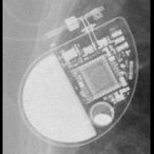 SOR:Neway</td>
<td align="center" valign="top"><b>✅ Option 1</b>  SOR:Neway</td>
<td align="center" valign="top"><b>Option 2</b>  SOR:Elect XS Plus</td>
<td align="center" valign="top"><b>Option 3</b>  SOR:Ovatio</td>
<td align="center" valign="top"><b>Option 4</b> 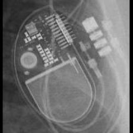 STJ:Allure Quadra</td>
<td align="center" valign="top"><b>Option 5</b>  SOR:Elect</td>
<td align="center" valign="middle"><b>Option 6</b>  <i>None of the above</i></td>
</tr></table>

### Q3249 · correct: option 2 · `SOR:Ovatio`

<table><tr>
<td align="center" valign="top"><b>Query</b> 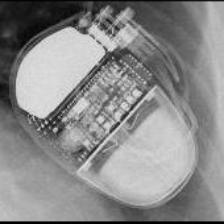 SOR:Ovatio</td>
<td align="center" valign="top"><b>Option 1</b>  SOR:Rhapsody_Symphony</td>
<td align="center" valign="top"><b>✅ Option 2</b>  SOR:Ovatio</td>
<td align="center" valign="top"><b>Option 3</b> 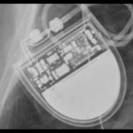 SOR:Elect XS Plus</td>
<td align="center" valign="top"><b>Option 4</b>  BOS:Ventak Prizm</td>
<td align="center" valign="top"><b>Option 5</b> 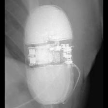 BOS:Emblem</td>
<td align="center" valign="middle"><b>Option 6</b>  <i>None of the above</i></td>
</tr></table>

### Q3250 · correct: option 3 · `SOR:Ovatio`

<table><tr>
<td align="center" valign="top"><b>Query</b> 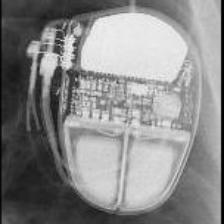 SOR:Ovatio</td>
<td align="center" valign="top"><b>Option 1</b>  BOS:Ventak Prizm</td>
<td align="center" valign="top"><b>Option 2</b>  SOR:Neway</td>
<td align="center" valign="top"><b>✅ Option 3</b>  SOR:Ovatio</td>
<td align="center" valign="top"><b>Option 4</b>  BOS:Vitality</td>
<td align="center" valign="top"><b>Option 5</b>  BOS:Emblem</td>
<td align="center" valign="middle"><b>Option 6</b>  <i>None of the above</i></td>
</tr></table>

### Q3251 · correct: option 2 · `SOR:Ovatio`

<table><tr>
<td align="center" valign="top"><b>Query</b>  SOR:Ovatio</td>
<td align="center" valign="top"><b>Option 1</b>  SOR:Neway</td>
<td align="center" valign="top"><b>✅ Option 2</b>  SOR:Ovatio</td>
<td align="center" valign="top"><b>Option 3</b>  MDT:Concerto_Consulta_Maximo_Protecta_Secura</td>
<td align="center" valign="top"><b>Option 4</b>  BOS:Vitality</td>
<td align="center" valign="top"><b>Option 5</b>  BOS:Ventak Prizm</td>
<td align="center" valign="middle"><b>Option 6</b>  <i>None of the above</i></td>
</tr></table>

### Q3252 · correct: option 4 · `SOR:Ovatio`

<table><tr>
<td align="center" valign="top"><b>Query</b>  SOR:Ovatio</td>
<td align="center" valign="top"><b>Option 1</b>  BOS:Autogen_Teligen_Energen_Cognis</td>
<td align="center" valign="top"><b>Option 2</b>  SOR:Neway</td>
<td align="center" valign="top"><b>Option 3</b>  SOR:Reply</td>
<td align="center" valign="top"><b>✅ Option 4</b>  SOR:Ovatio</td>
<td align="center" valign="top"><b>Option 5</b>  SOR:Elect XS Plus</td>
<td align="center" valign="middle"><b>Option 6</b>  <i>None of the above</i></td>
</tr></table>

### Q3253 · correct: option 1 · `SOR:Ovatio`

<table><tr>
<td align="center" valign="top"><b>Query</b>  SOR:Ovatio</td>
<td align="center" valign="top"><b>✅ Option 1</b>  SOR:Ovatio</td>
<td align="center" valign="top"><b>Option 2</b>  MDT:Claria_Evera_Viva</td>
<td align="center" valign="top"><b>Option 3</b>  BOS:Ventak Prizm</td>
<td align="center" valign="top"><b>Option 4</b>  BOS:Vitality</td>
<td align="center" valign="top"><b>Option 5</b>  BOS:Emblem</td>
<td align="center" valign="middle"><b>Option 6</b>  <i>None of the above</i></td>
</tr></table>

### Q3254 · correct: option 2 · `SOR:Reply`

<table><tr>
<td align="center" valign="top"><b>Query</b>  SOR:Reply</td>
<td align="center" valign="top"><b>Option 1</b>  MDT:Sigma</td>
<td align="center" valign="top"><b>✅ Option 2</b>  SOR:Reply</td>
<td align="center" valign="top"><b>Option 3</b>  SOR:Neway</td>
<td align="center" valign="top"><b>Option 4</b>  STJ:Identity</td>
<td align="center" valign="top"><b>Option 5</b>  BOS:Altrua_Insignia</td>
<td align="center" valign="middle"><b>Option 6</b>  <i>None of the above</i></td>
</tr></table>

### Q3255 · correct: option 5 · `SOR:Reply`

<table><tr>
<td align="center" valign="top"><b>Query</b>  SOR:Reply</td>
<td align="center" valign="top"><b>Option 1</b>  SOR:Rhapsody_Symphony</td>
<td align="center" valign="top"><b>Option 2</b>  MDT:Adapta_Kappa_Sensia_Versa</td>
<td align="center" valign="top"><b>Option 3</b>  BOS:ContakTR_Discovery_Meridian_Pulsar Max</td>
<td align="center" valign="top"><b>Option 4</b>  MDT:Sigma</td>
<td align="center" valign="top"><b>✅ Option 5</b>  SOR:Reply</td>
<td align="center" valign="middle"><b>Option 6</b>  <i>None of the above</i></td>
</tr></table>

### Q3256 · correct: option 4 · `SOR:Reply`

<table><tr>
<td align="center" valign="top"><b>Query</b>  SOR:Reply</td>
<td align="center" valign="top"><b>Option 1</b>  MDT:Adapta_Kappa_Sensia_Versa</td>
<td align="center" valign="top"><b>Option 2</b>  MDT:Sigma</td>
<td align="center" valign="top"><b>Option 3</b>  BIO:Cyclos</td>
<td align="center" valign="top"><b>✅ Option 4</b>  SOR:Reply</td>
<td align="center" valign="top"><b>Option 5</b>  BIO:Actros_Philos</td>
<td align="center" valign="middle"><b>Option 6</b>  <i>None of the above</i></td>
</tr></table>

### Q3257 · correct: option 5 · `SOR:Reply`

<table><tr>
<td align="center" valign="top"><b>Query</b>  SOR:Reply</td>
<td align="center" valign="top"><b>Option 1</b>  MDT:Advisa</td>
<td align="center" valign="top"><b>Option 2</b>  MDT:Vita II</td>
<td align="center" valign="top"><b>Option 3</b>  BOS:Altrua_Insignia</td>
<td align="center" valign="top"><b>Option 4</b>  MDT:Adapta_Kappa_Sensia_Versa</td>
<td align="center" valign="top"><b>✅ Option 5</b>  SOR:Reply</td>
<td align="center" valign="middle"><b>Option 6</b>  <i>None of the above</i></td>
</tr></table>

### Q3258 · correct: option 5 · `SOR:Reply`

<table><tr>
<td align="center" valign="top"><b>Query</b>  SOR:Reply</td>
<td align="center" valign="top"><b>Option 1</b>  MDT:Advisa</td>
<td align="center" valign="top"><b>Option 2</b>  MDT:Adapta_Kappa_Sensia_Versa</td>
<td align="center" valign="top"><b>Option 3</b>  MDT:Vita II</td>
<td align="center" valign="top"><b>Option 4</b>  BIO:Actros_Philos</td>
<td align="center" valign="top"><b>✅ Option 5</b>  SOR:Reply</td>
<td align="center" valign="middle"><b>Option 6</b>  <i>None of the above</i></td>
</tr></table>

### Q3259 · correct: option 3 · `SOR:Rhapsody_Symphony`

<table><tr>
<td align="center" valign="top"><b>Query</b>  SOR:Rhapsody_Symphony</td>
<td align="center" valign="top"><b>Option 1</b>  SOR:Elect XS Plus</td>
<td align="center" valign="top"><b>Option 2</b>  MDT:Sigma</td>
<td align="center" valign="top"><b>✅ Option 3</b>  SOR:Rhapsody_Symphony</td>
<td align="center" valign="top"><b>Option 4</b>  SOR:Reply</td>
<td align="center" valign="top"><b>Option 5</b>  BOS:Altrua_Insignia</td>
<td align="center" valign="middle"><b>Option 6</b>  <i>None of the above</i></td>
</tr></table>

### Q3260 · correct: option 1 · `SOR:Rhapsody_Symphony`

<table><tr>
<td align="center" valign="top"><b>Query</b>  SOR:Rhapsody_Symphony</td>
<td align="center" valign="top"><b>✅ Option 1</b>  SOR:Rhapsody_Symphony</td>
<td align="center" valign="top"><b>Option 2</b>  SOR:Neway</td>
<td align="center" valign="top"><b>Option 3</b>  BOS:Altrua_Insignia</td>
<td align="center" valign="top"><b>Option 4</b>  MDT:C20_T20</td>
<td align="center" valign="top"><b>Option 5</b>  MDT:Sigma</td>
<td align="center" valign="middle"><b>Option 6</b>  <i>None of the above</i></td>
</tr></table>

### Q3261 · correct: option 5 · `SOR:Rhapsody_Symphony`

<table><tr>
<td align="center" valign="top"><b>Query</b>  SOR:Rhapsody_Symphony</td>
<td align="center" valign="top"><b>Option 1</b>  MDT:Vita II</td>
<td align="center" valign="top"><b>Option 2</b>  BOS:Altrua_Insignia</td>
<td align="center" valign="top"><b>Option 3</b>  SOR:MiniSwing</td>
<td align="center" valign="top"><b>Option 4</b>  SOR:Neway</td>
<td align="center" valign="top"><b>✅ Option 5</b>  SOR:Rhapsody_Symphony</td>
<td align="center" valign="middle"><b>Option 6</b>  <i>None of the above</i></td>
</tr></table>

### Q3262 · correct: option 4 · `SOR:Rhapsody_Symphony`

<table><tr>
<td align="center" valign="top"><b>Query</b>  SOR:Rhapsody_Symphony</td>
<td align="center" valign="top"><b>Option 1</b>  SOR:Reply</td>
<td align="center" valign="top"><b>Option 2</b>  MDT:C20_T20</td>
<td align="center" valign="top"><b>Option 3</b>  MDT:C60 DR</td>
<td align="center" valign="top"><b>✅ Option 4</b>  SOR:Rhapsody_Symphony</td>
<td align="center" valign="top"><b>Option 5</b>  BOS:Altrua_Insignia</td>
<td align="center" valign="middle"><b>Option 6</b>  <i>None of the above</i></td>
</tr></table>

### Q3263 · correct: option 4 · `SOR:Rhapsody_Symphony`

<table><tr>
<td align="center" valign="top"><b>Query</b>  SOR:Rhapsody_Symphony</td>
<td align="center" valign="top"><b>Option 1</b>  MDT:Adapta_Kappa_Sensia_Versa</td>
<td align="center" valign="top"><b>Option 2</b>  SOR:Elect XS Plus</td>
<td align="center" valign="top"><b>Option 3</b>  MDT:Sigma</td>
<td align="center" valign="top"><b>✅ Option 4</b>  SOR:Rhapsody_Symphony</td>
<td align="center" valign="top"><b>Option 5</b>  BOS:Altrua_Insignia</td>
<td align="center" valign="middle"><b>Option 6</b>  <i>None of the above</i></td>
</tr></table>

### Q3264 · correct: option 2 · `SOR:Thesis`

<table><tr>
<td align="center" valign="top"><b>Query</b>  SOR:Thesis</td>
<td align="center" valign="top"><b>Option 1</b>  SOR:MiniSwing</td>
<td align="center" valign="top"><b>✅ Option 2</b>  SOR:Thesis</td>
<td align="center" valign="top"><b>Option 3</b>  BIO:Actros_Philos</td>
<td align="center" valign="top"><b>Option 4</b>  BOS:Emblem</td>
<td align="center" valign="top"><b>Option 5</b>  SOR:Elect XS Plus</td>
<td align="center" valign="middle"><b>Option 6</b>  <i>None of the above</i></td>
</tr></table>

### Q3265 · correct: option 4 · `SOR:Thesis`

<table><tr>
<td align="center" valign="top"><b>Query</b>  SOR:Thesis</td>
<td align="center" valign="top"><b>Option 1</b>  SOR:Elect XS Plus</td>
<td align="center" valign="top"><b>Option 2</b>  SOR:MiniSwing</td>
<td align="center" valign="top"><b>Option 3</b>  SOR:Elect</td>
<td align="center" valign="top"><b>✅ Option 4</b>  SOR:Thesis</td>
<td align="center" valign="top"><b>Option 5</b>  MDT:Vita II</td>
<td align="center" valign="middle"><b>Option 6</b>  <i>None of the above</i></td>
</tr></table>

### Q3266 · correct: option 4 · `SOR:Thesis`

<table><tr>
<td align="center" valign="top"><b>Query</b>  SOR:Thesis</td>
<td align="center" valign="top"><b>Option 1</b>  BOS:Ingenio</td>
<td align="center" valign="top"><b>Option 2</b>  SOR:MiniSwing</td>
<td align="center" valign="top"><b>Option 3</b>  MDT:C60 DR</td>
<td align="center" valign="top"><b>✅ Option 4</b>  SOR:Thesis</td>
<td align="center" valign="top"><b>Option 5</b>  SOR:Elect XS Plus</td>
<td align="center" valign="middle"><b>Option 6</b>  <i>None of the above</i></td>
</tr></table>

### Q3267 · correct: option 2 · `SOR:Thesis`

<table><tr>
<td align="center" valign="top"><b>Query</b>  SOR:Thesis</td>
<td align="center" valign="top"><b>Option 1</b>  MDT:Vita II</td>
<td align="center" valign="top"><b>✅ Option 2</b>  SOR:Thesis</td>
<td align="center" valign="top"><b>Option 3</b>  SOR:Elect XS Plus</td>
<td align="center" valign="top"><b>Option 4</b>  SOR:Elect</td>
<td align="center" valign="top"><b>Option 5</b>  SOR:MiniSwing</td>
<td align="center" valign="middle"><b>Option 6</b>  <i>None of the above</i></td>
</tr></table>

### Q3268 · correct: option 5 · `SOR:Thesis`

<table><tr>
<td align="center" valign="top"><b>Query</b>  SOR:Thesis</td>
<td align="center" valign="top"><b>Option 1</b>  SOR:Elect XS Plus</td>
<td align="center" valign="top"><b>Option 2</b>  SOR:MiniSwing</td>
<td align="center" valign="top"><b>Option 3</b>  SOR:Elect</td>
<td align="center" valign="top"><b>Option 4</b>  MDT:Vita II</td>
<td align="center" valign="top"><b>✅ Option 5</b>  SOR:Thesis</td>
<td align="center" valign="middle"><b>Option 6</b>  <i>None of the above</i></td>
</tr></table>

### Q3269 · correct: option 1 · `STJ:Accent`

<table><tr>
<td align="center" valign="top"><b>Query</b>  STJ:Accent</td>
<td align="center" valign="top"><b>✅ Option 1</b>  STJ:Accent</td>
<td align="center" valign="top"><b>Option 2</b>  BOS:Contak Renewal TR2</td>
<td align="center" valign="top"><b>Option 3</b>  STJ:Allure Quadra</td>
<td align="center" valign="top"><b>Option 4</b>  MDT:Syncra</td>
<td align="center" valign="top"><b>Option 5</b>  BIO:Evia</td>
<td align="center" valign="middle"><b>Option 6</b>  <i>None of the above</i></td>
</tr></table>

### Q3270 · correct: option 2 · `STJ:Accent`

<table><tr>
<td align="center" valign="top"><b>Query</b>  STJ:Accent</td>
<td align="center" valign="top"><b>Option 1</b>  STJ:Victory</td>
<td align="center" valign="top"><b>✅ Option 2</b>  STJ:Accent</td>
<td align="center" valign="top"><b>Option 3</b>  BOS:Contak Renewal TR2</td>
<td align="center" valign="top"><b>Option 4</b>  BOS:Visionist</td>
<td align="center" valign="top"><b>Option 5</b>  BOS:Ingenio</td>
<td align="center" valign="middle"><b>Option 6</b>  <i>None of the above</i></td>
</tr></table>

### Q3271 · correct: option 5 · `STJ:Accent`

<table><tr>
<td align="center" valign="top"><b>Query</b>  STJ:Accent</td>
<td align="center" valign="top"><b>Option 1</b>  MDT:Insync III</td>
<td align="center" valign="top"><b>Option 2</b>  STJ:Allure Quadra</td>
<td align="center" valign="top"><b>Option 3</b>  MDT:Syncra</td>
<td align="center" valign="top"><b>Option 4</b>  SOR:Neway</td>
<td align="center" valign="top"><b>✅ Option 5</b>  STJ:Accent</td>
<td align="center" valign="middle"><b>Option 6</b>  <i>None of the above</i></td>
</tr></table>

### Q3272 · correct: option 3 · `STJ:Accent`

<table><tr>
<td align="center" valign="top"><b>Query</b>  STJ:Accent</td>
<td align="center" valign="top"><b>Option 1</b>  BOS:Contak Renewal TR2</td>
<td align="center" valign="top"><b>Option 2</b>  MDT:REVEAL LINQ</td>
<td align="center" valign="top"><b>✅ Option 3</b>  STJ:Accent</td>
<td align="center" valign="top"><b>Option 4</b>  MDT:Azure</td>
<td align="center" valign="top"><b>Option 5</b>  STJ:Allure Quadra</td>
<td align="center" valign="middle"><b>Option 6</b>  <i>None of the above</i></td>
</tr></table>

### Q3273 · correct: option 1 · `STJ:Accent`

<table><tr>
<td align="center" valign="top"><b>Query</b>  STJ:Accent</td>
<td align="center" valign="top"><b>✅ Option 1</b>  STJ:Accent</td>
<td align="center" valign="top"><b>Option 2</b>  MDT:AT500</td>
<td align="center" valign="top"><b>Option 3</b>  MDT:Syncra</td>
<td align="center" valign="top"><b>Option 4</b>  MDT:EnRhythm</td>
<td align="center" valign="top"><b>Option 5</b>  MDT:Advisa</td>
<td align="center" valign="middle"><b>Option 6</b>  <i>None of the above</i></td>
</tr></table>

### Q3274 · correct: option 1 · `STJ:Allure Quadra`

<table><tr>
<td align="center" valign="top"><b>Query</b>  STJ:Allure Quadra</td>
<td align="center" valign="top"><b>✅ Option 1</b>  STJ:Allure Quadra</td>
<td align="center" valign="top"><b>Option 2</b>  STJ:Accent</td>
<td align="center" valign="top"><b>Option 3</b>  BOS:Visionist</td>
<td align="center" valign="top"><b>Option 4</b>  BOS:Contak Renewal TR2</td>
<td align="center" valign="top"><b>Option 5</b>  BOS:Altrua_Insignia</td>
<td align="center" valign="middle"><b>Option 6</b>  <i>None of the above</i></td>
</tr></table>

### Q3275 · correct: option 1 · `STJ:Allure Quadra`

<table><tr>
<td align="center" valign="top"><b>Query</b>  STJ:Allure Quadra</td>
<td align="center" valign="top"><b>✅ Option 1</b>  STJ:Allure Quadra</td>
<td align="center" valign="top"><b>Option 2</b>  MDT:Insync III</td>
<td align="center" valign="top"><b>Option 3</b>  MDT:Syncra</td>
<td align="center" valign="top"><b>Option 4</b>  STJ:Accent</td>
<td align="center" valign="top"><b>Option 5</b>  BOS:Altrua_Insignia</td>
<td align="center" valign="middle"><b>Option 6</b>  <i>None of the above</i></td>
</tr></table>

### Q3276 · correct: option 4 · `STJ:Allure Quadra`

<table><tr>
<td align="center" valign="top"><b>Query</b>  STJ:Allure Quadra</td>
<td align="center" valign="top"><b>Option 1</b>  BOS:Altrua_Insignia</td>
<td align="center" valign="top"><b>Option 2</b>  BIO:Evia</td>
<td align="center" valign="top"><b>Option 3</b>  STJ:Accent</td>
<td align="center" valign="top"><b>✅ Option 4</b>  STJ:Allure Quadra</td>
<td align="center" valign="top"><b>Option 5</b>  SOR:Neway</td>
<td align="center" valign="middle"><b>Option 6</b>  <i>None of the above</i></td>
</tr></table>

### Q3277 · correct: option 1 · `STJ:Allure Quadra`

<table><tr>
<td align="center" valign="top"><b>Query</b>  STJ:Allure Quadra</td>
<td align="center" valign="top"><b>✅ Option 1</b>  STJ:Allure Quadra</td>
<td align="center" valign="top"><b>Option 2</b>  BIO:Evia</td>
<td align="center" valign="top"><b>Option 3</b>  STJ:Accent</td>
<td align="center" valign="top"><b>Option 4</b>  BOS:Autogen_Teligen_Energen_Cognis</td>
<td align="center" valign="top"><b>Option 5</b>  BOS:Altrua_Insignia</td>
<td align="center" valign="middle"><b>Option 6</b>  <i>None of the above</i></td>
</tr></table>

### Q3278 · correct: option 5 · `STJ:Allure Quadra`

<table><tr>
<td align="center" valign="top"><b>Query</b>  STJ:Allure Quadra</td>
<td align="center" valign="top"><b>Option 1</b>  MDT:Insync III</td>
<td align="center" valign="top"><b>Option 2</b>  STJ:Accent</td>
<td align="center" valign="top"><b>Option 3</b>  BOS:Contak Renewal TR2</td>
<td align="center" valign="top"><b>Option 4</b>  MDT:Syncra</td>
<td align="center" valign="top"><b>✅ Option 5</b>  STJ:Allure Quadra</td>
<td align="center" valign="middle"><b>Option 6</b>  <i>None of the above</i></td>
</tr></table>

