# Pacemakers (Howard et al.) · query set `test` · page 5/5

[← all pages](README.md)

### Q3279 · correct: option 2 · `STJ:Ellipse`

<table><tr>
<td align="center" valign="top"><b>Query</b> 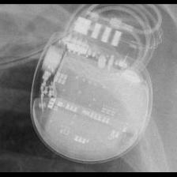 STJ:Ellipse</td>
<td align="center" valign="top"><b>Option 1</b> 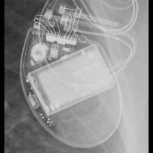 BOS:Contak Renewal 4</td>
<td align="center" valign="top"><b>✅ Option 2</b> 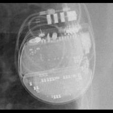 STJ:Ellipse</td>
<td align="center" valign="top"><b>Option 3</b> 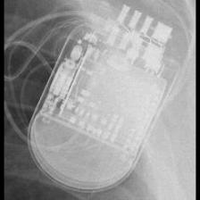 STJ:Quadra Assura_Unify</td>
<td align="center" valign="top"><b>Option 4</b> 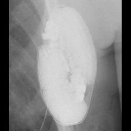 BOS:Emblem</td>
<td align="center" valign="top"><b>Option 5</b> 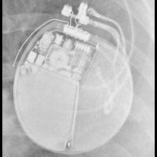 BOS:Autogen_Teligen_Energen_Cognis</td>
<td align="center" valign="middle"><b>Option 6</b>  <i>None of the above</i></td>
</tr></table>

### Q3280 · correct: option 4 · `STJ:Ellipse`

<table><tr>
<td align="center" valign="top"><b>Query</b> 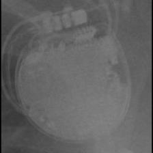 STJ:Ellipse</td>
<td align="center" valign="top"><b>Option 1</b>  BOS:Autogen_Teligen_Energen_Cognis</td>
<td align="center" valign="top"><b>Option 2</b>  BOS:Contak Renewal 4</td>
<td align="center" valign="top"><b>Option 3</b> 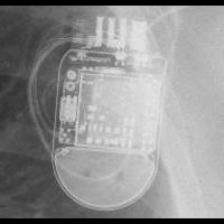 STJ:Quadra Assura_Unify</td>
<td align="center" valign="top"><b>✅ Option 4</b> 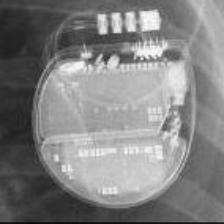 STJ:Ellipse</td>
<td align="center" valign="top"><b>Option 5</b>  BOS:Vitality</td>
<td align="center" valign="middle"><b>Option 6</b>  <i>None of the above</i></td>
</tr></table>

### Q3281 · correct: option 4 · `STJ:Ellipse`

<table><tr>
<td align="center" valign="top"><b>Query</b> 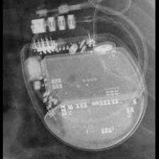 STJ:Ellipse</td>
<td align="center" valign="top"><b>Option 1</b>  BOS:Emblem</td>
<td align="center" valign="top"><b>Option 2</b>  BOS:Autogen_Teligen_Energen_Cognis</td>
<td align="center" valign="top"><b>Option 3</b>  BOS:Vitality</td>
<td align="center" valign="top"><b>✅ Option 4</b> 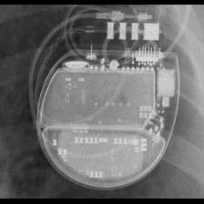 STJ:Ellipse</td>
<td align="center" valign="top"><b>Option 5</b>  BOS:Contak Renewal 4</td>
<td align="center" valign="middle"><b>Option 6</b>  <i>None of the above</i></td>
</tr></table>

### Q3282 · correct: option 3 · `STJ:Ellipse`

<table><tr>
<td align="center" valign="top"><b>Query</b> 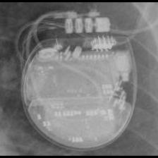 STJ:Ellipse</td>
<td align="center" valign="top"><b>Option 1</b>  BOS:Autogen_Teligen_Energen_Cognis</td>
<td align="center" valign="top"><b>Option 2</b> 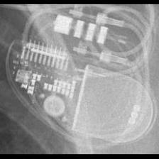 STJ:Allure Quadra</td>
<td align="center" valign="top"><b>✅ Option 3</b>  STJ:Ellipse</td>
<td align="center" valign="top"><b>Option 4</b> 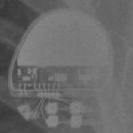 BOS:Altrua_Insignia</td>
<td align="center" valign="top"><b>Option 5</b>  BOS:Contak Renewal 4</td>
<td align="center" valign="middle"><b>Option 6</b>  <i>None of the above</i></td>
</tr></table>

### Q3283 · correct: option 1 · `STJ:Ellipse`

<table><tr>
<td align="center" valign="top"><b>Query</b> 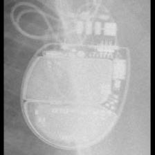 STJ:Ellipse</td>
<td align="center" valign="top"><b>✅ Option 1</b>  STJ:Ellipse</td>
<td align="center" valign="top"><b>Option 2</b>  BOS:Vitality</td>
<td align="center" valign="top"><b>Option 3</b>  BOS:Contak Renewal 4</td>
<td align="center" valign="top"><b>Option 4</b>  BOS:Autogen_Teligen_Energen_Cognis</td>
<td align="center" valign="top"><b>Option 5</b>  BOS:Emblem</td>
<td align="center" valign="middle"><b>Option 6</b>  <i>None of the above</i></td>
</tr></table>

### Q3284 · correct: option 5 · `STJ:Identity`

<table><tr>
<td align="center" valign="top"><b>Query</b> 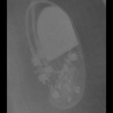 STJ:Identity</td>
<td align="center" valign="top"><b>Option 1</b> 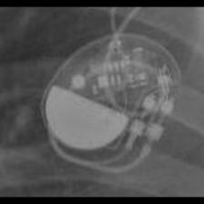 STJ:Victory</td>
<td align="center" valign="top"><b>Option 2</b> 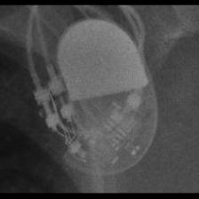 STJ:Zephyr</td>
<td align="center" valign="top"><b>Option 3</b>  MDT:Sigma</td>
<td align="center" valign="top"><b>Option 4</b>  MDT:Adapta_Kappa_Sensia_Versa</td>
<td align="center" valign="top"><b>✅ Option 5</b> 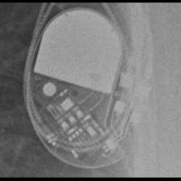 STJ:Identity</td>
<td align="center" valign="middle"><b>Option 6</b>  <i>None of the above</i></td>
</tr></table>

### Q3285 · correct: option 5 · `STJ:Identity`

<table><tr>
<td align="center" valign="top"><b>Query</b> 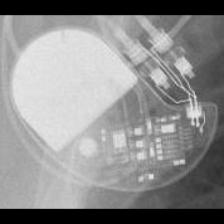 STJ:Identity</td>
<td align="center" valign="top"><b>Option 1</b>  MDT:C20_T20</td>
<td align="center" valign="top"><b>Option 2</b>  STJ:Zephyr</td>
<td align="center" valign="top"><b>Option 3</b>  BIO:Cyclos</td>
<td align="center" valign="top"><b>Option 4</b> 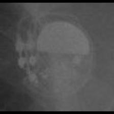 STJ:Victory</td>
<td align="center" valign="top"><b>✅ Option 5</b> 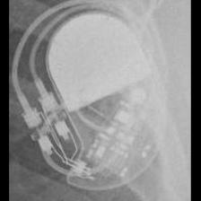 STJ:Identity</td>
<td align="center" valign="middle"><b>Option 6</b>  <i>None of the above</i></td>
</tr></table>

### Q3286 · correct: option 2 · `STJ:Identity`

<table><tr>
<td align="center" valign="top"><b>Query</b> 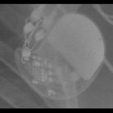 STJ:Identity</td>
<td align="center" valign="top"><b>Option 1</b>  MDT:C60 DR</td>
<td align="center" valign="top"><b>✅ Option 2</b>  STJ:Identity</td>
<td align="center" valign="top"><b>Option 3</b>  STJ:Zephyr</td>
<td align="center" valign="top"><b>Option 4</b>  STJ:Victory</td>
<td align="center" valign="top"><b>Option 5</b>  MDT:Adapta_Kappa_Sensia_Versa</td>
<td align="center" valign="middle"><b>Option 6</b>  <i>None of the above</i></td>
</tr></table>

### Q3287 · correct: option 4 · `STJ:Identity`

<table><tr>
<td align="center" valign="top"><b>Query</b> 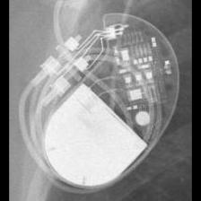 STJ:Identity</td>
<td align="center" valign="top"><b>Option 1</b> 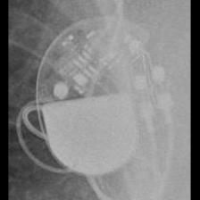 STJ:Zephyr</td>
<td align="center" valign="top"><b>Option 2</b> 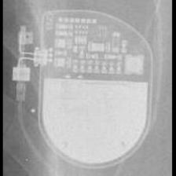 SOR:Reply</td>
<td align="center" valign="top"><b>Option 3</b>  STJ:Victory</td>
<td align="center" valign="top"><b>✅ Option 4</b>  STJ:Identity</td>
<td align="center" valign="top"><b>Option 5</b>  MDT:Adapta_Kappa_Sensia_Versa</td>
<td align="center" valign="middle"><b>Option 6</b>  <i>None of the above</i></td>
</tr></table>

### Q3288 · correct: option 4 · `STJ:Identity`

<table><tr>
<td align="center" valign="top"><b>Query</b> 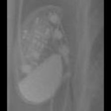 STJ:Identity</td>
<td align="center" valign="top"><b>Option 1</b>  MDT:C20_T20</td>
<td align="center" valign="top"><b>Option 2</b>  STJ:Zephyr</td>
<td align="center" valign="top"><b>Option 3</b>  STJ:Victory</td>
<td align="center" valign="top"><b>✅ Option 4</b>  STJ:Identity</td>
<td align="center" valign="top"><b>Option 5</b> 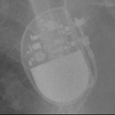 MDT:Sigma</td>
<td align="center" valign="middle"><b>Option 6</b>  <i>None of the above</i></td>
</tr></table>

### Q3289 · correct: option 2 · `STJ:Quadra Assura_Unify`

<table><tr>
<td align="center" valign="top"><b>Query</b> 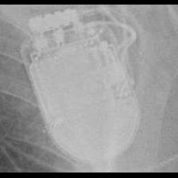 STJ:Quadra Assura_Unify</td>
<td align="center" valign="top"><b>Option 1</b> 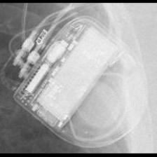 MDT:Concerto_Consulta_Maximo_Protecta_Secura</td>
<td align="center" valign="top"><b>✅ Option 2</b>  STJ:Quadra Assura_Unify</td>
<td align="center" valign="top"><b>Option 3</b> 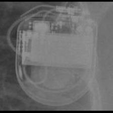 MDT:Maximo</td>
<td align="center" valign="top"><b>Option 4</b> 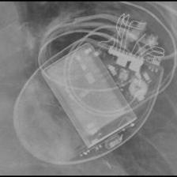 BOS:Contak Renewal 4</td>
<td align="center" valign="top"><b>Option 5</b> 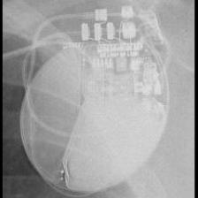 BOS:Autogen_Teligen_Energen_Cognis</td>
<td align="center" valign="middle"><b>Option 6</b>  <i>None of the above</i></td>
</tr></table>

### Q3290 · correct: option 4 · `STJ:Quadra Assura_Unify`

<table><tr>
<td align="center" valign="top"><b>Query</b> 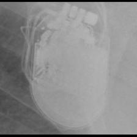 STJ:Quadra Assura_Unify</td>
<td align="center" valign="top"><b>Option 1</b>  BOS:Contak Renewal 4</td>
<td align="center" valign="top"><b>Option 2</b> 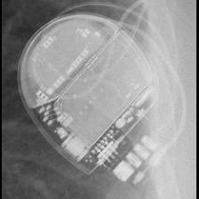 STJ:Ellipse</td>
<td align="center" valign="top"><b>Option 3</b>  MDT:Concerto_Consulta_Maximo_Protecta_Secura</td>
<td align="center" valign="top"><b>✅ Option 4</b>  STJ:Quadra Assura_Unify</td>
<td align="center" valign="top"><b>Option 5</b>  MDT:Maximo</td>
<td align="center" valign="middle"><b>Option 6</b>  <i>None of the above</i></td>
</tr></table>

### Q3291 · correct: option 4 · `STJ:Quadra Assura_Unify`

<table><tr>
<td align="center" valign="top"><b>Query</b> 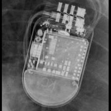 STJ:Quadra Assura_Unify</td>
<td align="center" valign="top"><b>Option 1</b>  MDT:Concerto_Consulta_Maximo_Protecta_Secura</td>
<td align="center" valign="top"><b>Option 2</b> 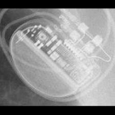 BOS:Ingenio</td>
<td align="center" valign="top"><b>Option 3</b>  BOS:Emblem</td>
<td align="center" valign="top"><b>✅ Option 4</b>  STJ:Quadra Assura_Unify</td>
<td align="center" valign="top"><b>Option 5</b>  MDT:Maximo</td>
<td align="center" valign="middle"><b>Option 6</b>  <i>None of the above</i></td>
</tr></table>

### Q3292 · correct: option 4 · `STJ:Quadra Assura_Unify`

<table><tr>
<td align="center" valign="top"><b>Query</b> 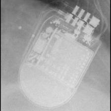 STJ:Quadra Assura_Unify</td>
<td align="center" valign="top"><b>Option 1</b>  BOS:Emblem</td>
<td align="center" valign="top"><b>Option 2</b>  MDT:Concerto_Consulta_Maximo_Protecta_Secura</td>
<td align="center" valign="top"><b>Option 3</b> 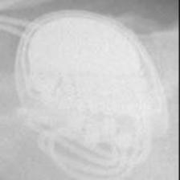 SOR:MiniSwing</td>
<td align="center" valign="top"><b>✅ Option 4</b>  STJ:Quadra Assura_Unify</td>
<td align="center" valign="top"><b>Option 5</b>  MDT:Maximo</td>
<td align="center" valign="middle"><b>Option 6</b>  <i>None of the above</i></td>
</tr></table>

### Q3293 · correct: option 1 · `STJ:Quadra Assura_Unify`

<table><tr>
<td align="center" valign="top"><b>Query</b> 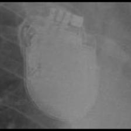 STJ:Quadra Assura_Unify</td>
<td align="center" valign="top"><b>✅ Option 1</b>  STJ:Quadra Assura_Unify</td>
<td align="center" valign="top"><b>Option 2</b>  SOR:MiniSwing</td>
<td align="center" valign="top"><b>Option 3</b>  MDT:Maximo</td>
<td align="center" valign="top"><b>Option 4</b>  STJ:Ellipse</td>
<td align="center" valign="top"><b>Option 5</b>  BOS:Emblem</td>
<td align="center" valign="middle"><b>Option 6</b>  <i>None of the above</i></td>
</tr></table>

### Q3294 · correct: option 5 · `STJ:Victory`

<table><tr>
<td align="center" valign="top"><b>Query</b> 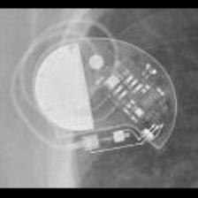 STJ:Victory</td>
<td align="center" valign="top"><b>Option 1</b> 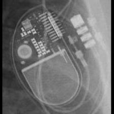 STJ:Allure Quadra</td>
<td align="center" valign="top"><b>Option 2</b>  STJ:Zephyr</td>
<td align="center" valign="top"><b>Option 3</b>  STJ:Identity</td>
<td align="center" valign="top"><b>Option 4</b>  MDT:C20_T20</td>
<td align="center" valign="top"><b>✅ Option 5</b>  STJ:Victory</td>
<td align="center" valign="middle"><b>Option 6</b>  <i>None of the above</i></td>
</tr></table>

### Q3295 · correct: option 5 · `STJ:Victory`

<table><tr>
<td align="center" valign="top"><b>Query</b>  STJ:Victory</td>
<td align="center" valign="top"><b>Option 1</b>  STJ:Identity</td>
<td align="center" valign="top"><b>Option 2</b>  MDT:C20_T20</td>
<td align="center" valign="top"><b>Option 3</b>  STJ:Zephyr</td>
<td align="center" valign="top"><b>Option 4</b>  MDT:Sigma</td>
<td align="center" valign="top"><b>✅ Option 5</b> 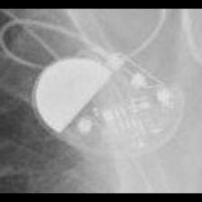 STJ:Victory</td>
<td align="center" valign="middle"><b>Option 6</b>  <i>None of the above</i></td>
</tr></table>

### Q3296 · correct: option 3 · `STJ:Victory`

<table><tr>
<td align="center" valign="top"><b>Query</b> 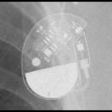 STJ:Victory</td>
<td align="center" valign="top"><b>Option 1</b>  MDT:C20_T20</td>
<td align="center" valign="top"><b>Option 2</b>  MDT:Sigma</td>
<td align="center" valign="top"><b>✅ Option 3</b>  STJ:Victory</td>
<td align="center" valign="top"><b>Option 4</b>  STJ:Zephyr</td>
<td align="center" valign="top"><b>Option 5</b>  STJ:Identity</td>
<td align="center" valign="middle"><b>Option 6</b>  <i>None of the above</i></td>
</tr></table>

### Q3297 · correct: option 5 · `STJ:Victory`

<table><tr>
<td align="center" valign="top"><b>Query</b>  STJ:Victory</td>
<td align="center" valign="top"><b>Option 1</b>  STJ:Zephyr</td>
<td align="center" valign="top"><b>Option 2</b>  STJ:Identity</td>
<td align="center" valign="top"><b>Option 3</b> 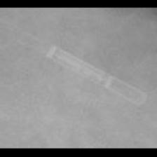 MDT:REVEAL LINQ</td>
<td align="center" valign="top"><b>Option 4</b>  MDT:Sigma</td>
<td align="center" valign="top"><b>✅ Option 5</b>  STJ:Victory</td>
<td align="center" valign="middle"><b>Option 6</b>  <i>None of the above</i></td>
</tr></table>

### Q3298 · correct: option 4 · `STJ:Victory`

<table><tr>
<td align="center" valign="top"><b>Query</b> 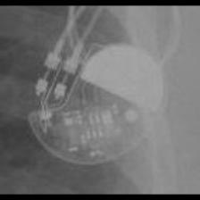 STJ:Victory</td>
<td align="center" valign="top"><b>Option 1</b> 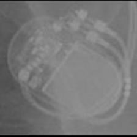 STJ:Accent</td>
<td align="center" valign="top"><b>Option 2</b>  STJ:Zephyr</td>
<td align="center" valign="top"><b>Option 3</b>  MDT:C20_T20</td>
<td align="center" valign="top"><b>✅ Option 4</b>  STJ:Victory</td>
<td align="center" valign="top"><b>Option 5</b>  STJ:Identity</td>
<td align="center" valign="middle"><b>Option 6</b>  <i>None of the above</i></td>
</tr></table>

### Q3299 · correct: option 4 · `STJ:Zephyr`

<table><tr>
<td align="center" valign="top"><b>Query</b> 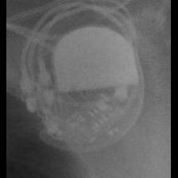 STJ:Zephyr</td>
<td align="center" valign="top"><b>Option 1</b>  MDT:Adapta_Kappa_Sensia_Versa</td>
<td align="center" valign="top"><b>Option 2</b>  MDT:Sigma</td>
<td align="center" valign="top"><b>Option 3</b>  STJ:Victory</td>
<td align="center" valign="top"><b>✅ Option 4</b>  STJ:Zephyr</td>
<td align="center" valign="top"><b>Option 5</b>  STJ:Identity</td>
<td align="center" valign="middle"><b>Option 6</b>  <i>None of the above</i></td>
</tr></table>

### Q3300 · correct: option 3 · `STJ:Zephyr`

<table><tr>
<td align="center" valign="top"><b>Query</b> 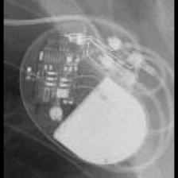 STJ:Zephyr</td>
<td align="center" valign="top"><b>Option 1</b>  BIO:Cyclos</td>
<td align="center" valign="top"><b>Option 2</b>  STJ:Victory</td>
<td align="center" valign="top"><b>✅ Option 3</b>  STJ:Zephyr</td>
<td align="center" valign="top"><b>Option 4</b>  STJ:Identity</td>
<td align="center" valign="top"><b>Option 5</b> 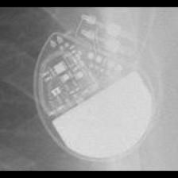 MDT:C60 DR</td>
<td align="center" valign="middle"><b>Option 6</b>  <i>None of the above</i></td>
</tr></table>

### Q3301 · correct: option 3 · `STJ:Zephyr`

<table><tr>
<td align="center" valign="top"><b>Query</b>  STJ:Zephyr</td>
<td align="center" valign="top"><b>Option 1</b>  BIO:Cyclos</td>
<td align="center" valign="top"><b>Option 2</b>  STJ:Identity</td>
<td align="center" valign="top"><b>✅ Option 3</b>  STJ:Zephyr</td>
<td align="center" valign="top"><b>Option 4</b>  MDT:C20_T20</td>
<td align="center" valign="top"><b>Option 5</b>  STJ:Victory</td>
<td align="center" valign="middle"><b>Option 6</b>  <i>None of the above</i></td>
</tr></table>

### Q3302 · correct: option 2 · `STJ:Zephyr`

<table><tr>
<td align="center" valign="top"><b>Query</b>  STJ:Zephyr</td>
<td align="center" valign="top"><b>Option 1</b>  MDT:Adapta_Kappa_Sensia_Versa</td>
<td align="center" valign="top"><b>✅ Option 2</b>  STJ:Zephyr</td>
<td align="center" valign="top"><b>Option 3</b>  STJ:Victory</td>
<td align="center" valign="top"><b>Option 4</b>  BIO:Cyclos</td>
<td align="center" valign="top"><b>Option 5</b>  STJ:Identity</td>
<td align="center" valign="middle"><b>Option 6</b>  <i>None of the above</i></td>
</tr></table>

### Q3303 · correct: option 4 · `STJ:Zephyr`

<table><tr>
<td align="center" valign="top"><b>Query</b>  STJ:Zephyr</td>
<td align="center" valign="top"><b>Option 1</b>  BIO:Cyclos</td>
<td align="center" valign="top"><b>Option 2</b>  STJ:Accent</td>
<td align="center" valign="top"><b>Option 3</b>  STJ:Identity</td>
<td align="center" valign="top"><b>✅ Option 4</b>  STJ:Zephyr</td>
<td align="center" valign="top"><b>Option 5</b>  STJ:Victory</td>
<td align="center" valign="middle"><b>Option 6</b>  <i>None of the above</i></td>
</tr></table>

