# Pacemakers (Howard et al.) · query set `train1` · page 1/6

[← all pages](README.md)

### Q3304 · correct: option 3 · `BIO:Actros_Philos`

<table><tr>
<td align="center" valign="top"><b>Query</b> 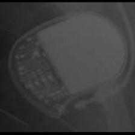 BIO:Actros_Philos</td>
<td align="center" valign="top"><b>Option 1</b> 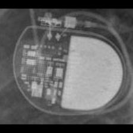 MDT:Adapta_Kappa_Sensia_Versa</td>
<td align="center" valign="top"><b>Option 2</b>  MDT:Sigma</td>
<td align="center" valign="top"><b>✅ Option 3</b>  BIO:Actros_Philos</td>
<td align="center" valign="top"><b>Option 4</b>  MDT:C20_T20</td>
<td align="center" valign="top"><b>Option 5</b>  BIO:Cyclos</td>
<td align="center" valign="middle"><b>Option 6</b>  <i>None of the above</i></td>
</tr></table>

### Q3305 · correct: option 1 · `BIO:Actros_Philos`

<table><tr>
<td align="center" valign="top"><b>Query</b> 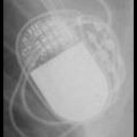 BIO:Actros_Philos</td>
<td align="center" valign="top"><b>✅ Option 1</b>  BIO:Actros_Philos</td>
<td align="center" valign="top"><b>Option 2</b>  MDT:Adapta_Kappa_Sensia_Versa</td>
<td align="center" valign="top"><b>Option 3</b>  STJ:Identity</td>
<td align="center" valign="top"><b>Option 4</b>  STJ:Zephyr</td>
<td align="center" valign="top"><b>Option 5</b> 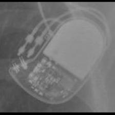 BIO:Cyclos</td>
<td align="center" valign="middle"><b>Option 6</b>  <i>None of the above</i></td>
</tr></table>

### Q3306 · correct: option 2 · `BIO:Actros_Philos`

<table><tr>
<td align="center" valign="top"><b>Query</b>  BIO:Actros_Philos</td>
<td align="center" valign="top"><b>Option 1</b>  MDT:Adapta_Kappa_Sensia_Versa</td>
<td align="center" valign="top"><b>✅ Option 2</b> 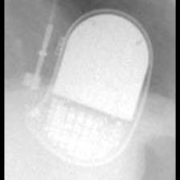 BIO:Actros_Philos</td>
<td align="center" valign="top"><b>Option 3</b>  BIO:Evia</td>
<td align="center" valign="top"><b>Option 4</b>  BOS:ContakTR_Discovery_Meridian_Pulsar Max</td>
<td align="center" valign="top"><b>Option 5</b> 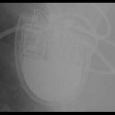 SOR:Thesis</td>
<td align="center" valign="middle"><b>Option 6</b>  <i>None of the above</i></td>
</tr></table>

### Q3307 · correct: option 1 · `BIO:Actros_Philos`

<table><tr>
<td align="center" valign="top"><b>Query</b> 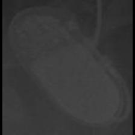 BIO:Actros_Philos</td>
<td align="center" valign="top"><b>✅ Option 1</b> 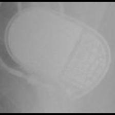 BIO:Actros_Philos</td>
<td align="center" valign="top"><b>Option 2</b> 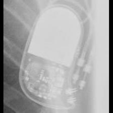 BIO:Cyclos</td>
<td align="center" valign="top"><b>Option 3</b>  SOR:Thesis</td>
<td align="center" valign="top"><b>Option 4</b>  BOS:Ventak Prizm</td>
<td align="center" valign="top"><b>Option 5</b>  BOS:ContakTR_Discovery_Meridian_Pulsar Max</td>
<td align="center" valign="middle"><b>Option 6</b>  <i>None of the above</i></td>
</tr></table>

### Q3308 · correct: option 1 · `BIO:Actros_Philos`

<table><tr>
<td align="center" valign="top"><b>Query</b>  BIO:Actros_Philos</td>
<td align="center" valign="top"><b>✅ Option 1</b>  BIO:Actros_Philos</td>
<td align="center" valign="top"><b>Option 2</b>  MDT:Adapta_Kappa_Sensia_Versa</td>
<td align="center" valign="top"><b>Option 3</b>  MDT:Sigma</td>
<td align="center" valign="top"><b>Option 4</b>  SOR:Reply</td>
<td align="center" valign="top"><b>Option 5</b>  BIO:Cyclos</td>
<td align="center" valign="middle"><b>Option 6</b>  <i>None of the above</i></td>
</tr></table>

### Q3309 · correct: option 1 · `BIO:Actros_Philos`

<table><tr>
<td align="center" valign="top"><b>Query</b> 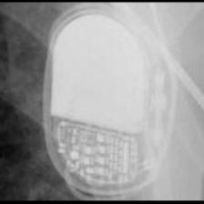 BIO:Actros_Philos</td>
<td align="center" valign="top"><b>✅ Option 1</b>  BIO:Actros_Philos</td>
<td align="center" valign="top"><b>Option 2</b>  MDT:Adapta_Kappa_Sensia_Versa</td>
<td align="center" valign="top"><b>Option 3</b>  SOR:Reply</td>
<td align="center" valign="top"><b>Option 4</b>  BIO:Cyclos</td>
<td align="center" valign="top"><b>Option 5</b> 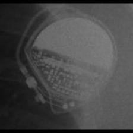 MDT:Vita II</td>
<td align="center" valign="middle"><b>Option 6</b>  <i>None of the above</i></td>
</tr></table>

### Q3310 · correct: option 4 · `BIO:Actros_Philos`

<table><tr>
<td align="center" valign="top"><b>Query</b> 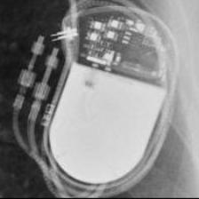 BIO:Actros_Philos</td>
<td align="center" valign="top"><b>Option 1</b>  STJ:Identity</td>
<td align="center" valign="top"><b>Option 2</b>  SOR:Reply</td>
<td align="center" valign="top"><b>Option 3</b>  MDT:Adapta_Kappa_Sensia_Versa</td>
<td align="center" valign="top"><b>✅ Option 4</b>  BIO:Actros_Philos</td>
<td align="center" valign="top"><b>Option 5</b>  BIO:Cyclos</td>
<td align="center" valign="middle"><b>Option 6</b>  <i>None of the above</i></td>
</tr></table>

### Q3311 · correct: option 3 · `BIO:Cyclos`

<table><tr>
<td align="center" valign="top"><b>Query</b> 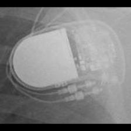 BIO:Cyclos</td>
<td align="center" valign="top"><b>Option 1</b>  MDT:Adapta_Kappa_Sensia_Versa</td>
<td align="center" valign="top"><b>Option 2</b>  STJ:Zephyr</td>
<td align="center" valign="top"><b>✅ Option 3</b>  BIO:Cyclos</td>
<td align="center" valign="top"><b>Option 4</b>  MDT:Sigma</td>
<td align="center" valign="top"><b>Option 5</b>  BIO:Actros_Philos</td>
<td align="center" valign="middle"><b>Option 6</b>  <i>None of the above</i></td>
</tr></table>

### Q3312 · correct: option 3 · `BIO:Cyclos`

<table><tr>
<td align="center" valign="top"><b>Query</b> 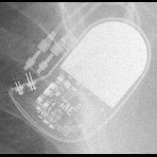 BIO:Cyclos</td>
<td align="center" valign="top"><b>Option 1</b>  STJ:Identity</td>
<td align="center" valign="top"><b>Option 2</b>  STJ:Zephyr</td>
<td align="center" valign="top"><b>✅ Option 3</b>  BIO:Cyclos</td>
<td align="center" valign="top"><b>Option 4</b>  MDT:Sigma</td>
<td align="center" valign="top"><b>Option 5</b>  BIO:Actros_Philos</td>
<td align="center" valign="middle"><b>Option 6</b>  <i>None of the above</i></td>
</tr></table>

### Q3313 · correct: option 2 · `BIO:Cyclos`

<table><tr>
<td align="center" valign="top"><b>Query</b> 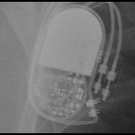 BIO:Cyclos</td>
<td align="center" valign="top"><b>Option 1</b>  STJ:Identity</td>
<td align="center" valign="top"><b>✅ Option 2</b>  BIO:Cyclos</td>
<td align="center" valign="top"><b>Option 3</b>  MDT:Adapta_Kappa_Sensia_Versa</td>
<td align="center" valign="top"><b>Option 4</b>  STJ:Zephyr</td>
<td align="center" valign="top"><b>Option 5</b>  BIO:Actros_Philos</td>
<td align="center" valign="middle"><b>Option 6</b>  <i>None of the above</i></td>
</tr></table>

### Q3314 · correct: option 1 · `BIO:Cyclos`

<table><tr>
<td align="center" valign="top"><b>Query</b> 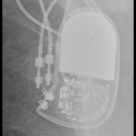 BIO:Cyclos</td>
<td align="center" valign="top"><b>✅ Option 1</b>  BIO:Cyclos</td>
<td align="center" valign="top"><b>Option 2</b> 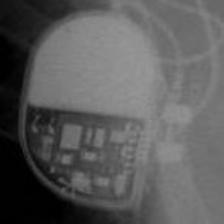 BOS:ContakTR_Discovery_Meridian_Pulsar Max</td>
<td align="center" valign="top"><b>Option 3</b> 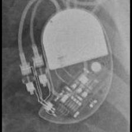 STJ:Identity</td>
<td align="center" valign="top"><b>Option 4</b>  STJ:Zephyr</td>
<td align="center" valign="top"><b>Option 5</b>  BIO:Actros_Philos</td>
<td align="center" valign="middle"><b>Option 6</b>  <i>None of the above</i></td>
</tr></table>

### Q3315 · correct: option 3 · `BIO:Cyclos`

<table><tr>
<td align="center" valign="top"><b>Query</b> 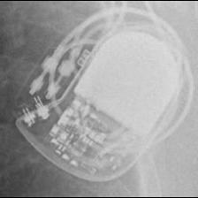 BIO:Cyclos</td>
<td align="center" valign="top"><b>Option 1</b>  STJ:Identity</td>
<td align="center" valign="top"><b>Option 2</b>  STJ:Zephyr</td>
<td align="center" valign="top"><b>✅ Option 3</b>  BIO:Cyclos</td>
<td align="center" valign="top"><b>Option 4</b>  SOR:Reply</td>
<td align="center" valign="top"><b>Option 5</b>  MDT:Adapta_Kappa_Sensia_Versa</td>
<td align="center" valign="middle"><b>Option 6</b>  <i>None of the above</i></td>
</tr></table>

### Q3316 · correct: option 2 · `BIO:Evia`

<table><tr>
<td align="center" valign="top"><b>Query</b> 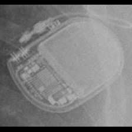 BIO:Evia</td>
<td align="center" valign="top"><b>Option 1</b>  MDT:Concerto_Consulta_Maximo_Protecta_Secura</td>
<td align="center" valign="top"><b>✅ Option 2</b>  BIO:Evia</td>
<td align="center" valign="top"><b>Option 3</b>  MDT:Maximo</td>
<td align="center" valign="top"><b>Option 4</b>  BOS:Ventak Prizm</td>
<td align="center" valign="top"><b>Option 5</b>  MDT:Azure</td>
<td align="center" valign="middle"><b>Option 6</b>  <i>None of the above</i></td>
</tr></table>

### Q3317 · correct: option 2 · `BIO:Evia`

<table><tr>
<td align="center" valign="top"><b>Query</b> 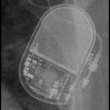 BIO:Evia</td>
<td align="center" valign="top"><b>Option 1</b>  SOR:Elect XS Plus</td>
<td align="center" valign="top"><b>✅ Option 2</b> 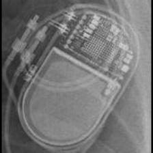 BIO:Evia</td>
<td align="center" valign="top"><b>Option 3</b>  BIO:Actros_Philos</td>
<td align="center" valign="top"><b>Option 4</b>  MDT:Azure</td>
<td align="center" valign="top"><b>Option 5</b>  BIO:Cyclos</td>
<td align="center" valign="middle"><b>Option 6</b>  <i>None of the above</i></td>
</tr></table>

### Q3318 · correct: option 3 · `BIO:Evia`

<table><tr>
<td align="center" valign="top"><b>Query</b> 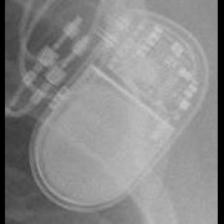 BIO:Evia</td>
<td align="center" valign="top"><b>Option 1</b> 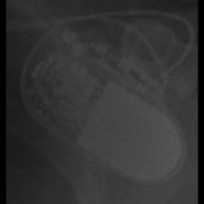 BIO:Cyclos</td>
<td align="center" valign="top"><b>Option 2</b>  BOS:ContakTR_Discovery_Meridian_Pulsar Max</td>
<td align="center" valign="top"><b>✅ Option 3</b>  BIO:Evia</td>
<td align="center" valign="top"><b>Option 4</b>  MDT:Azure</td>
<td align="center" valign="top"><b>Option 5</b>  STJ:Accent</td>
<td align="center" valign="middle"><b>Option 6</b>  <i>None of the above</i></td>
</tr></table>

### Q3319 · correct: option 4 · `BIO:Evia`

<table><tr>
<td align="center" valign="top"><b>Query</b>  BIO:Evia</td>
<td align="center" valign="top"><b>Option 1</b>  MDT:Concerto_Consulta_Maximo_Protecta_Secura</td>
<td align="center" valign="top"><b>Option 2</b>  BOS:ContakTR_Discovery_Meridian_Pulsar Max</td>
<td align="center" valign="top"><b>Option 3</b>  MDT:Azure</td>
<td align="center" valign="top"><b>✅ Option 4</b>  BIO:Evia</td>
<td align="center" valign="top"><b>Option 5</b> 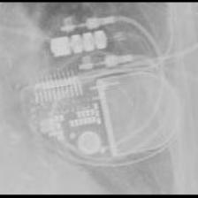 STJ:Allure Quadra</td>
<td align="center" valign="middle"><b>Option 6</b>  <i>None of the above</i></td>
</tr></table>

### Q3320 · correct: option 2 · `BOS:Altrua_Insignia`

<table><tr>
<td align="center" valign="top"><b>Query</b> 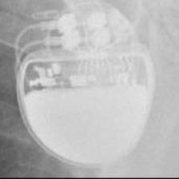 BOS:Altrua_Insignia</td>
<td align="center" valign="top"><b>Option 1</b> 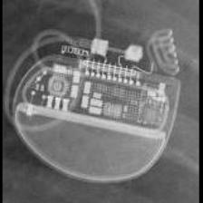 BOS:Proponent</td>
<td align="center" valign="top"><b>✅ Option 2</b>  BOS:Altrua_Insignia</td>
<td align="center" valign="top"><b>Option 3</b>  BOS:Ingenio</td>
<td align="center" valign="top"><b>Option 4</b> 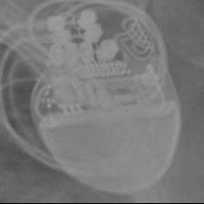 BOS:Visionist</td>
<td align="center" valign="top"><b>Option 5</b> 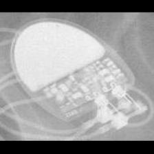 SOR:Rhapsody_Symphony</td>
<td align="center" valign="middle"><b>Option 6</b>  <i>None of the above</i></td>
</tr></table>

### Q3321 · correct: option 3 · `BOS:Altrua_Insignia`

<table><tr>
<td align="center" valign="top"><b>Query</b> 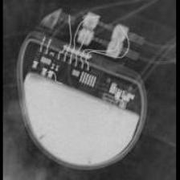 BOS:Altrua_Insignia</td>
<td align="center" valign="top"><b>Option 1</b> 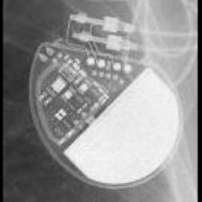 MDT:C60 DR</td>
<td align="center" valign="top"><b>Option 2</b>  STJ:Ellipse</td>
<td align="center" valign="top"><b>✅ Option 3</b>  BOS:Altrua_Insignia</td>
<td align="center" valign="top"><b>Option 4</b>  SOR:Elect XS Plus</td>
<td align="center" valign="top"><b>Option 5</b>  SOR:Rhapsody_Symphony</td>
<td align="center" valign="middle"><b>Option 6</b>  <i>None of the above</i></td>
</tr></table>

### Q3322 · correct: option 4 · `BOS:Altrua_Insignia`

<table><tr>
<td align="center" valign="top"><b>Query</b>  BOS:Altrua_Insignia</td>
<td align="center" valign="top"><b>Option 1</b>  MDT:Vita II</td>
<td align="center" valign="top"><b>Option 2</b>  MDT:C60 DR</td>
<td align="center" valign="top"><b>Option 3</b>  SOR:Reply</td>
<td align="center" valign="top"><b>✅ Option 4</b>  BOS:Altrua_Insignia</td>
<td align="center" valign="top"><b>Option 5</b>  BOS:ContakTR_Discovery_Meridian_Pulsar Max</td>
<td align="center" valign="middle"><b>Option 6</b>  <i>None of the above</i></td>
</tr></table>

### Q3323 · correct: option 4 · `BOS:Altrua_Insignia`

<table><tr>
<td align="center" valign="top"><b>Query</b> 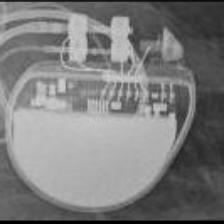 BOS:Altrua_Insignia</td>
<td align="center" valign="top"><b>Option 1</b>  BOS:Proponent</td>
<td align="center" valign="top"><b>Option 2</b>  BOS:Ingenio</td>
<td align="center" valign="top"><b>Option 3</b>  SOR:Rhapsody_Symphony</td>
<td align="center" valign="top"><b>✅ Option 4</b>  BOS:Altrua_Insignia</td>
<td align="center" valign="top"><b>Option 5</b>  SOR:Elect XS Plus</td>
<td align="center" valign="middle"><b>Option 6</b>  <i>None of the above</i></td>
</tr></table>

### Q3324 · correct: option 3 · `BOS:Altrua_Insignia`

<table><tr>
<td align="center" valign="top"><b>Query</b> 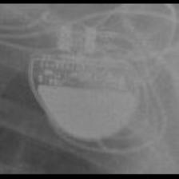 BOS:Altrua_Insignia</td>
<td align="center" valign="top"><b>Option 1</b>  BOS:Contak Renewal TR2</td>
<td align="center" valign="top"><b>Option 2</b>  SOR:Thesis</td>
<td align="center" valign="top"><b>✅ Option 3</b>  BOS:Altrua_Insignia</td>
<td align="center" valign="top"><b>Option 4</b>  SOR:Rhapsody_Symphony</td>
<td align="center" valign="top"><b>Option 5</b>  BOS:Visionist</td>
<td align="center" valign="middle"><b>Option 6</b>  <i>None of the above</i></td>
</tr></table>

### Q3325 · correct: option 4 · `BOS:Altrua_Insignia`

<table><tr>
<td align="center" valign="top"><b>Query</b> 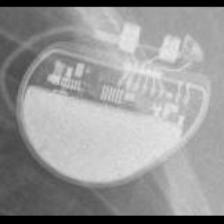 BOS:Altrua_Insignia</td>
<td align="center" valign="top"><b>Option 1</b>  SOR:Elect XS Plus</td>
<td align="center" valign="top"><b>Option 2</b>  SOR:Rhapsody_Symphony</td>
<td align="center" valign="top"><b>Option 3</b>  BOS:Proponent</td>
<td align="center" valign="top"><b>✅ Option 4</b>  BOS:Altrua_Insignia</td>
<td align="center" valign="top"><b>Option 5</b>  BOS:Ingenio</td>
<td align="center" valign="middle"><b>Option 6</b>  <i>None of the above</i></td>
</tr></table>

### Q3326 · correct: option 4 · `BOS:Altrua_Insignia`

<table><tr>
<td align="center" valign="top"><b>Query</b> 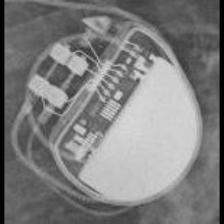 BOS:Altrua_Insignia</td>
<td align="center" valign="top"><b>Option 1</b> 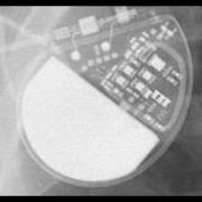 MDT:C20_T20</td>
<td align="center" valign="top"><b>Option 2</b> 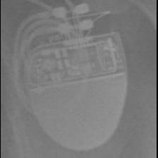 BOS:Ingenio</td>
<td align="center" valign="top"><b>Option 3</b> 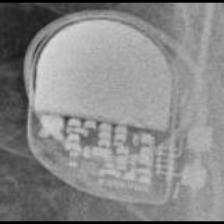 SOR:Reply</td>
<td align="center" valign="top"><b>✅ Option 4</b>  BOS:Altrua_Insignia</td>
<td align="center" valign="top"><b>Option 5</b>  MDT:C60 DR</td>
<td align="center" valign="middle"><b>Option 6</b>  <i>None of the above</i></td>
</tr></table>

### Q3327 · correct: option 1 · `BOS:Autogen_Teligen_Energen_Cognis`

<table><tr>
<td align="center" valign="top"><b>Query</b> 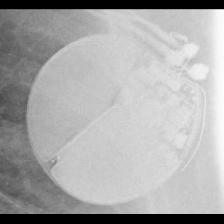 BOS:Autogen_Teligen_Energen_Cognis</td>
<td align="center" valign="top"><b>✅ Option 1</b> 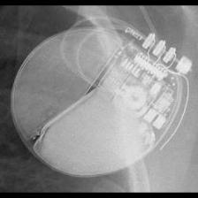 BOS:Autogen_Teligen_Energen_Cognis</td>
<td align="center" valign="top"><b>Option 2</b>  BIO:Actros_Philos</td>
<td align="center" valign="top"><b>Option 3</b>  STJ:Ellipse</td>
<td align="center" valign="top"><b>Option 4</b> 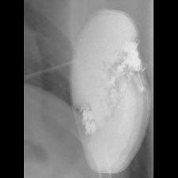 BOS:Emblem</td>
<td align="center" valign="top"><b>Option 5</b>  BOS:Contak Renewal 4</td>
<td align="center" valign="middle"><b>Option 6</b>  <i>None of the above</i></td>
</tr></table>

### Q3328 · correct: option 5 · `BOS:Autogen_Teligen_Energen_Cognis`

<table><tr>
<td align="center" valign="top"><b>Query</b> 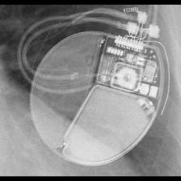 BOS:Autogen_Teligen_Energen_Cognis</td>
<td align="center" valign="top"><b>Option 1</b>  BOS:Emblem</td>
<td align="center" valign="top"><b>Option 2</b> 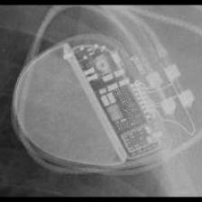 BOS:Ingenio</td>
<td align="center" valign="top"><b>Option 3</b>  BOS:Contak Renewal 4</td>
<td align="center" valign="top"><b>Option 4</b>  MDT:Concerto_Consulta_Maximo_Protecta_Secura</td>
<td align="center" valign="top"><b>✅ Option 5</b> 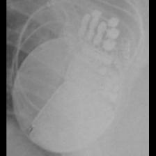 BOS:Autogen_Teligen_Energen_Cognis</td>
<td align="center" valign="middle"><b>Option 6</b>  <i>None of the above</i></td>
</tr></table>

### Q3329 · correct: option 5 · `BOS:Autogen_Teligen_Energen_Cognis`

<table><tr>
<td align="center" valign="top"><b>Query</b> 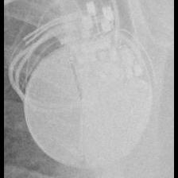 BOS:Autogen_Teligen_Energen_Cognis</td>
<td align="center" valign="top"><b>Option 1</b>  MDT:Concerto_Consulta_Maximo_Protecta_Secura</td>
<td align="center" valign="top"><b>Option 2</b>  STJ:Quadra Assura_Unify</td>
<td align="center" valign="top"><b>Option 3</b>  BOS:Emblem</td>
<td align="center" valign="top"><b>Option 4</b>  BOS:Contak Renewal 4</td>
<td align="center" valign="top"><b>✅ Option 5</b>  BOS:Autogen_Teligen_Energen_Cognis</td>
<td align="center" valign="middle"><b>Option 6</b>  <i>None of the above</i></td>
</tr></table>

### Q3330 · correct: option 4 · `BOS:Autogen_Teligen_Energen_Cognis`

<table><tr>
<td align="center" valign="top"><b>Query</b>  BOS:Autogen_Teligen_Energen_Cognis</td>
<td align="center" valign="top"><b>Option 1</b>  BOS:Contak Renewal 4</td>
<td align="center" valign="top"><b>Option 2</b>  MDT:Concerto_Consulta_Maximo_Protecta_Secura</td>
<td align="center" valign="top"><b>Option 3</b>  STJ:Quadra Assura_Unify</td>
<td align="center" valign="top"><b>✅ Option 4</b> 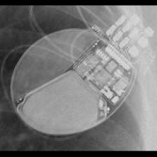 BOS:Autogen_Teligen_Energen_Cognis</td>
<td align="center" valign="top"><b>Option 5</b>  BOS:Emblem</td>
<td align="center" valign="middle"><b>Option 6</b>  <i>None of the above</i></td>
</tr></table>

### Q3331 · correct: option 5 · `BOS:Autogen_Teligen_Energen_Cognis`

<table><tr>
<td align="center" valign="top"><b>Query</b> 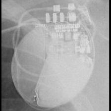 BOS:Autogen_Teligen_Energen_Cognis</td>
<td align="center" valign="top"><b>Option 1</b>  BOS:Contak Renewal 4</td>
<td align="center" valign="top"><b>Option 2</b>  STJ:Quadra Assura_Unify</td>
<td align="center" valign="top"><b>Option 3</b>  BOS:Emblem</td>
<td align="center" valign="top"><b>Option 4</b>  MDT:REVEAL</td>
<td align="center" valign="top"><b>✅ Option 5</b>  BOS:Autogen_Teligen_Energen_Cognis</td>
<td align="center" valign="middle"><b>Option 6</b>  <i>None of the above</i></td>
</tr></table>

### Q3332 · correct: option 5 · `BOS:Autogen_Teligen_Energen_Cognis`

<table><tr>
<td align="center" valign="top"><b>Query</b> 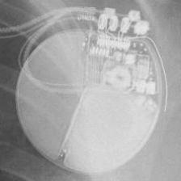 BOS:Autogen_Teligen_Energen_Cognis</td>
<td align="center" valign="top"><b>Option 1</b> 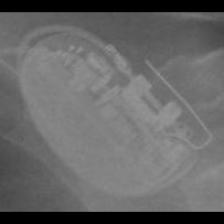 BOS:Ingenio</td>
<td align="center" valign="top"><b>Option 2</b>  BOS:Contak Renewal 4</td>
<td align="center" valign="top"><b>Option 3</b> 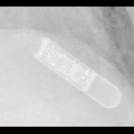 MDT:REVEAL LINQ</td>
<td align="center" valign="top"><b>Option 4</b>  BOS:Emblem</td>
<td align="center" valign="top"><b>✅ Option 5</b>  BOS:Autogen_Teligen_Energen_Cognis</td>
<td align="center" valign="middle"><b>Option 6</b>  <i>None of the above</i></td>
</tr></table>

### Q3333 · correct: option 3 · `BOS:Autogen_Teligen_Energen_Cognis`

<table><tr>
<td align="center" valign="top"><b>Query</b>  BOS:Autogen_Teligen_Energen_Cognis</td>
<td align="center" valign="top"><b>Option 1</b>  BOS:Emblem</td>
<td align="center" valign="top"><b>Option 2</b>  BOS:Contak Renewal 4</td>
<td align="center" valign="top"><b>✅ Option 3</b>  BOS:Autogen_Teligen_Energen_Cognis</td>
<td align="center" valign="top"><b>Option 4</b>  STJ:Ellipse</td>
<td align="center" valign="top"><b>Option 5</b>  BOS:Ingenio</td>
<td align="center" valign="middle"><b>Option 6</b>  <i>None of the above</i></td>
</tr></table>

### Q3334 · correct: option 1 · `BOS:Contak Renewal 4`

<table><tr>
<td align="center" valign="top"><b>Query</b>  BOS:Contak Renewal 4</td>
<td align="center" valign="top"><b>✅ Option 1</b>  BOS:Contak Renewal 4</td>
<td align="center" valign="top"><b>Option 2</b>  BOS:Vitality</td>
<td align="center" valign="top"><b>Option 3</b>  STJ:Quadra Assura_Unify</td>
<td align="center" valign="top"><b>Option 4</b>  MDT:Maximo</td>
<td align="center" valign="top"><b>Option 5</b>  MDT:Concerto_Consulta_Maximo_Protecta_Secura</td>
<td align="center" valign="middle"><b>Option 6</b>  <i>None of the above</i></td>
</tr></table>

### Q3335 · correct: option 2 · `BOS:Contak Renewal 4`

<table><tr>
<td align="center" valign="top"><b>Query</b>  BOS:Contak Renewal 4</td>
<td align="center" valign="top"><b>Option 1</b>  MDT:Maximo</td>
<td align="center" valign="top"><b>✅ Option 2</b>  BOS:Contak Renewal 4</td>
<td align="center" valign="top"><b>Option 3</b>  BOS:Autogen_Teligen_Energen_Cognis</td>
<td align="center" valign="top"><b>Option 4</b>  BOS:Vitality</td>
<td align="center" valign="top"><b>Option 5</b>  BOS:Ventak Prizm</td>
<td align="center" valign="middle"><b>Option 6</b>  <i>None of the above</i></td>
</tr></table>

### Q3336 · correct: option 1 · `BOS:Contak Renewal 4`

<table><tr>
<td align="center" valign="top"><b>Query</b>  BOS:Contak Renewal 4</td>
<td align="center" valign="top"><b>✅ Option 1</b>  BOS:Contak Renewal 4</td>
<td align="center" valign="top"><b>Option 2</b>  MDT:Concerto_Consulta_Maximo_Protecta_Secura</td>
<td align="center" valign="top"><b>Option 3</b>  BOS:Vitality</td>
<td align="center" valign="top"><b>Option 4</b>  BOS:Autogen_Teligen_Energen_Cognis</td>
<td align="center" valign="top"><b>Option 5</b>  MDT:Maximo</td>
<td align="center" valign="middle"><b>Option 6</b>  <i>None of the above</i></td>
</tr></table>

### Q3337 · correct: option 3 · `BOS:Contak Renewal 4`

<table><tr>
<td align="center" valign="top"><b>Query</b>  BOS:Contak Renewal 4</td>
<td align="center" valign="top"><b>Option 1</b>  STJ:Quadra Assura_Unify</td>
<td align="center" valign="top"><b>Option 2</b>  MDT:Maximo</td>
<td align="center" valign="top"><b>✅ Option 3</b>  BOS:Contak Renewal 4</td>
<td align="center" valign="top"><b>Option 4</b>  BOS:Vitality</td>
<td align="center" valign="top"><b>Option 5</b>  MDT:Concerto_Consulta_Maximo_Protecta_Secura</td>
<td align="center" valign="middle"><b>Option 6</b>  <i>None of the above</i></td>
</tr></table>

### Q3338 · correct: option 3 · `BOS:Contak Renewal 4`

<table><tr>
<td align="center" valign="top"><b>Query</b>  BOS:Contak Renewal 4</td>
<td align="center" valign="top"><b>Option 1</b>  MDT:Concerto_Consulta_Maximo_Protecta_Secura</td>
<td align="center" valign="top"><b>Option 2</b>  MDT:Maximo</td>
<td align="center" valign="top"><b>✅ Option 3</b>  BOS:Contak Renewal 4</td>
<td align="center" valign="top"><b>Option 4</b>  BOS:Autogen_Teligen_Energen_Cognis</td>
<td align="center" valign="top"><b>Option 5</b>  BOS:Vitality</td>
<td align="center" valign="middle"><b>Option 6</b>  <i>None of the above</i></td>
</tr></table>

### Q3339 · correct: option 3 · `BOS:Contak Renewal 4`

<table><tr>
<td align="center" valign="top"><b>Query</b>  BOS:Contak Renewal 4</td>
<td align="center" valign="top"><b>Option 1</b>  STJ:Ellipse</td>
<td align="center" valign="top"><b>Option 2</b>  MDT:Maximo</td>
<td align="center" valign="top"><b>✅ Option 3</b>  BOS:Contak Renewal 4</td>
<td align="center" valign="top"><b>Option 4</b>  MDT:Concerto_Consulta_Maximo_Protecta_Secura</td>
<td align="center" valign="top"><b>Option 5</b>  BOS:Vitality</td>
<td align="center" valign="middle"><b>Option 6</b>  <i>None of the above</i></td>
</tr></table>

### Q3340 · correct: option 5 · `BOS:Contak Renewal 4`

<table><tr>
<td align="center" valign="top"><b>Query</b>  BOS:Contak Renewal 4</td>
<td align="center" valign="top"><b>Option 1</b>  MDT:Maximo</td>
<td align="center" valign="top"><b>Option 2</b>  BOS:Vitality</td>
<td align="center" valign="top"><b>Option 3</b>  BOS:Contak Renewal TR2</td>
<td align="center" valign="top"><b>Option 4</b>  MDT:Concerto_Consulta_Maximo_Protecta_Secura</td>
<td align="center" valign="top"><b>✅ Option 5</b>  BOS:Contak Renewal 4</td>
<td align="center" valign="middle"><b>Option 6</b>  <i>None of the above</i></td>
</tr></table>

### Q3341 · correct: option 4 · `BOS:Contak Renewal TR2`

<table><tr>
<td align="center" valign="top"><b>Query</b>  BOS:Contak Renewal TR2</td>
<td align="center" valign="top"><b>Option 1</b>  BOS:Altrua_Insignia</td>
<td align="center" valign="top"><b>Option 2</b>  SOR:Elect</td>
<td align="center" valign="top"><b>Option 3</b>  BOS:Proponent</td>
<td align="center" valign="top"><b>✅ Option 4</b>  BOS:Contak Renewal TR2</td>
<td align="center" valign="top"><b>Option 5</b>  BOS:Visionist</td>
<td align="center" valign="middle"><b>Option 6</b>  <i>None of the above</i></td>
</tr></table>

### Q3342 · correct: option 3 · `BOS:Contak Renewal TR2`

<table><tr>
<td align="center" valign="top"><b>Query</b>  BOS:Contak Renewal TR2</td>
<td align="center" valign="top"><b>Option 1</b>  MDT:Azure</td>
<td align="center" valign="top"><b>Option 2</b>  MDT:EnRhythm</td>
<td align="center" valign="top"><b>✅ Option 3</b>  BOS:Contak Renewal TR2</td>
<td align="center" valign="top"><b>Option 4</b>  BOS:Visionist</td>
<td align="center" valign="top"><b>Option 5</b>  BOS:Proponent</td>
<td align="center" valign="middle"><b>Option 6</b>  <i>None of the above</i></td>
</tr></table>

### Q3343 · correct: option 3 · `BOS:Contak Renewal TR2`

<table><tr>
<td align="center" valign="top"><b>Query</b>  BOS:Contak Renewal TR2</td>
<td align="center" valign="top"><b>Option 1</b>  BOS:Altrua_Insignia</td>
<td align="center" valign="top"><b>Option 2</b>  STJ:Allure Quadra</td>
<td align="center" valign="top"><b>✅ Option 3</b>  BOS:Contak Renewal TR2</td>
<td align="center" valign="top"><b>Option 4</b>  BOS:Ingenio</td>
<td align="center" valign="top"><b>Option 5</b>  BIO:Evia</td>
<td align="center" valign="middle"><b>Option 6</b>  <i>None of the above</i></td>
</tr></table>

### Q3344 · correct: option 2 · `BOS:Contak Renewal TR2`

<table><tr>
<td align="center" valign="top"><b>Query</b>  BOS:Contak Renewal TR2</td>
<td align="center" valign="top"><b>Option 1</b>  BOS:Proponent</td>
<td align="center" valign="top"><b>✅ Option 2</b>  BOS:Contak Renewal TR2</td>
<td align="center" valign="top"><b>Option 3</b>  BOS:Ingenio</td>
<td align="center" valign="top"><b>Option 4</b>  BOS:Visionist</td>
<td align="center" valign="top"><b>Option 5</b>  MDT:Concerto_Consulta_Maximo_Protecta_Secura</td>
<td align="center" valign="middle"><b>Option 6</b>  <i>None of the above</i></td>
</tr></table>

### Q3345 · correct: option 3 · `BOS:Contak Renewal TR2`

<table><tr>
<td align="center" valign="top"><b>Query</b>  BOS:Contak Renewal TR2</td>
<td align="center" valign="top"><b>Option 1</b>  BOS:Proponent</td>
<td align="center" valign="top"><b>Option 2</b>  BOS:Visionist</td>
<td align="center" valign="top"><b>✅ Option 3</b>  BOS:Contak Renewal TR2</td>
<td align="center" valign="top"><b>Option 4</b>  STJ:Allure Quadra</td>
<td align="center" valign="top"><b>Option 5</b>  MDT:Insync III</td>
<td align="center" valign="middle"><b>Option 6</b>  <i>None of the above</i></td>
</tr></table>

### Q3346 · correct: option 2 · `BOS:Contak Renewal TR2`

<table><tr>
<td align="center" valign="top"><b>Query</b>  BOS:Contak Renewal TR2</td>
<td align="center" valign="top"><b>Option 1</b>  BOS:Visionist</td>
<td align="center" valign="top"><b>✅ Option 2</b>  BOS:Contak Renewal TR2</td>
<td align="center" valign="top"><b>Option 3</b>  BOS:Ingenio</td>
<td align="center" valign="top"><b>Option 4</b>  STJ:Allure Quadra</td>
<td align="center" valign="top"><b>Option 5</b>  BOS:Proponent</td>
<td align="center" valign="middle"><b>Option 6</b>  <i>None of the above</i></td>
</tr></table>

### Q3347 · correct: option 4 · `BOS:Contak Renewal TR2`

<table><tr>
<td align="center" valign="top"><b>Query</b>  BOS:Contak Renewal TR2</td>
<td align="center" valign="top"><b>Option 1</b>  MDT:Insync III</td>
<td align="center" valign="top"><b>Option 2</b>  BOS:Visionist</td>
<td align="center" valign="top"><b>Option 3</b>  BOS:Ingenio</td>
<td align="center" valign="top"><b>✅ Option 4</b>  BOS:Contak Renewal TR2</td>
<td align="center" valign="top"><b>Option 5</b>  BOS:Proponent</td>
<td align="center" valign="middle"><b>Option 6</b>  <i>None of the above</i></td>
</tr></table>

### Q3348 · correct: option 1 · `BOS:ContakTR_Discovery_Meridian_Pulsar Max`

<table><tr>
<td align="center" valign="top"><b>Query</b>  BOS:ContakTR_Discovery_Meridian_Pulsar Max</td>
<td align="center" valign="top"><b>✅ Option 1</b>  BOS:ContakTR_Discovery_Meridian_Pulsar Max</td>
<td align="center" valign="top"><b>Option 2</b>  BOS:Altrua_Insignia</td>
<td align="center" valign="top"><b>Option 3</b>  STJ:Identity</td>
<td align="center" valign="top"><b>Option 4</b>  BIO:Cyclos</td>
<td align="center" valign="top"><b>Option 5</b>  SOR:Elect XS Plus</td>
<td align="center" valign="middle"><b>Option 6</b>  <i>None of the above</i></td>
</tr></table>

### Q3349 · correct: option 5 · `BOS:ContakTR_Discovery_Meridian_Pulsar Max`

<table><tr>
<td align="center" valign="top"><b>Query</b>  BOS:ContakTR_Discovery_Meridian_Pulsar Max</td>
<td align="center" valign="top"><b>Option 1</b>  BIO:Actros_Philos</td>
<td align="center" valign="top"><b>Option 2</b>  MDT:Adapta_Kappa_Sensia_Versa</td>
<td align="center" valign="top"><b>Option 3</b>  STJ:Identity</td>
<td align="center" valign="top"><b>Option 4</b>  SOR:Thesis</td>
<td align="center" valign="top"><b>✅ Option 5</b>  BOS:ContakTR_Discovery_Meridian_Pulsar Max</td>
<td align="center" valign="middle"><b>Option 6</b>  <i>None of the above</i></td>
</tr></table>

### Q3350 · correct: option 4 · `BOS:ContakTR_Discovery_Meridian_Pulsar Max`

<table><tr>
<td align="center" valign="top"><b>Query</b>  BOS:ContakTR_Discovery_Meridian_Pulsar Max</td>
<td align="center" valign="top"><b>Option 1</b>  MDT:Adapta_Kappa_Sensia_Versa</td>
<td align="center" valign="top"><b>Option 2</b>  BIO:Actros_Philos</td>
<td align="center" valign="top"><b>Option 3</b>  MDT:Sigma</td>
<td align="center" valign="top"><b>✅ Option 4</b>  BOS:ContakTR_Discovery_Meridian_Pulsar Max</td>
<td align="center" valign="top"><b>Option 5</b>  SOR:Thesis</td>
<td align="center" valign="middle"><b>Option 6</b>  <i>None of the above</i></td>
</tr></table>

### Q3351 · correct: option 5 · `BOS:ContakTR_Discovery_Meridian_Pulsar Max`

<table><tr>
<td align="center" valign="top"><b>Query</b>  BOS:ContakTR_Discovery_Meridian_Pulsar Max</td>
<td align="center" valign="top"><b>Option 1</b>  MDT:C20_T20</td>
<td align="center" valign="top"><b>Option 2</b>  BOS:Altrua_Insignia</td>
<td align="center" valign="top"><b>Option 3</b>  SOR:Reply</td>
<td align="center" valign="top"><b>Option 4</b>  SOR:Rhapsody_Symphony</td>
<td align="center" valign="top"><b>✅ Option 5</b>  BOS:ContakTR_Discovery_Meridian_Pulsar Max</td>
<td align="center" valign="middle"><b>Option 6</b>  <i>None of the above</i></td>
</tr></table>

### Q3352 · correct: option 3 · `BOS:ContakTR_Discovery_Meridian_Pulsar Max`

<table><tr>
<td align="center" valign="top"><b>Query</b>  BOS:ContakTR_Discovery_Meridian_Pulsar Max</td>
<td align="center" valign="top"><b>Option 1</b>  BIO:Cyclos</td>
<td align="center" valign="top"><b>Option 2</b>  MDT:Sigma</td>
<td align="center" valign="top"><b>✅ Option 3</b>  BOS:ContakTR_Discovery_Meridian_Pulsar Max</td>
<td align="center" valign="top"><b>Option 4</b>  SOR:Rhapsody_Symphony</td>
<td align="center" valign="top"><b>Option 5</b>  BIO:Actros_Philos</td>
<td align="center" valign="middle"><b>Option 6</b>  <i>None of the above</i></td>
</tr></table>

### Q3353 · correct: option 4 · `BOS:ContakTR_Discovery_Meridian_Pulsar Max`

<table><tr>
<td align="center" valign="top"><b>Query</b>  BOS:ContakTR_Discovery_Meridian_Pulsar Max</td>
<td align="center" valign="top"><b>Option 1</b>  SOR:Thesis</td>
<td align="center" valign="top"><b>Option 2</b>  SOR:Ovatio</td>
<td align="center" valign="top"><b>Option 3</b>  STJ:Accent</td>
<td align="center" valign="top"><b>✅ Option 4</b>  BOS:ContakTR_Discovery_Meridian_Pulsar Max</td>
<td align="center" valign="top"><b>Option 5</b>  SOR:Reply</td>
<td align="center" valign="middle"><b>Option 6</b>  <i>None of the above</i></td>
</tr></table>

