# Pacemakers (Howard et al.) · query set `train1` · page 2/6

[← all pages](README.md)

### Q3354 · correct: option 5 · `BOS:ContakTR_Discovery_Meridian_Pulsar Max`

<table><tr>
<td align="center" valign="top"><b>Query</b> 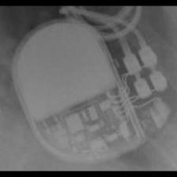 BOS:ContakTR_Discovery_Meridian_Pulsar Max</td>
<td align="center" valign="top"><b>Option 1</b>  BOS:Altrua_Insignia</td>
<td align="center" valign="top"><b>Option 2</b>  SOR:Reply</td>
<td align="center" valign="top"><b>Option 3</b>  SOR:Thesis</td>
<td align="center" valign="top"><b>Option 4</b>  BOS:Ventak Prizm</td>
<td align="center" valign="top"><b>✅ Option 5</b> 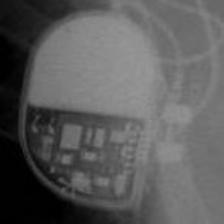 BOS:ContakTR_Discovery_Meridian_Pulsar Max</td>
<td align="center" valign="middle"><b>Option 6</b>  <i>None of the above</i></td>
</tr></table>

### Q3355 · correct: option 3 · `BOS:Emblem`

<table><tr>
<td align="center" valign="top"><b>Query</b> 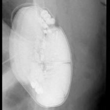 BOS:Emblem</td>
<td align="center" valign="top"><b>Option 1</b> 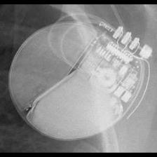 BOS:Autogen_Teligen_Energen_Cognis</td>
<td align="center" valign="top"><b>Option 2</b> 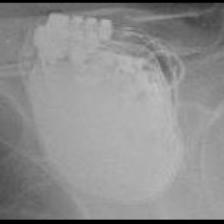 STJ:Quadra Assura_Unify</td>
<td align="center" valign="top"><b>✅ Option 3</b> 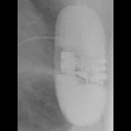 BOS:Emblem</td>
<td align="center" valign="top"><b>Option 4</b> 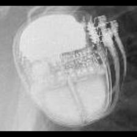 SOR:Ovatio</td>
<td align="center" valign="top"><b>Option 5</b> 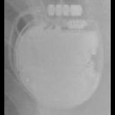 STJ:Ellipse</td>
<td align="center" valign="middle"><b>Option 6</b>  <i>None of the above</i></td>
</tr></table>

### Q3356 · correct: option 4 · `BOS:Emblem`

<table><tr>
<td align="center" valign="top"><b>Query</b> 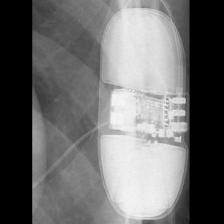 BOS:Emblem</td>
<td align="center" valign="top"><b>Option 1</b> 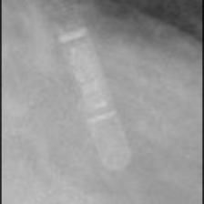 MDT:REVEAL LINQ</td>
<td align="center" valign="top"><b>Option 2</b>  SOR:Elect</td>
<td align="center" valign="top"><b>Option 3</b>  SOR:Ovatio</td>
<td align="center" valign="top"><b>✅ Option 4</b> 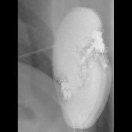 BOS:Emblem</td>
<td align="center" valign="top"><b>Option 5</b>  BOS:Autogen_Teligen_Energen_Cognis</td>
<td align="center" valign="middle"><b>Option 6</b>  <i>None of the above</i></td>
</tr></table>

### Q3357 · correct: option 4 · `BOS:Emblem`

<table><tr>
<td align="center" valign="top"><b>Query</b>  BOS:Emblem</td>
<td align="center" valign="top"><b>Option 1</b>  STJ:Quadra Assura_Unify</td>
<td align="center" valign="top"><b>Option 2</b>  MDT:REVEAL LINQ</td>
<td align="center" valign="top"><b>Option 3</b>  BOS:Contak Renewal 4</td>
<td align="center" valign="top"><b>✅ Option 4</b>  BOS:Emblem</td>
<td align="center" valign="top"><b>Option 5</b>  BOS:Autogen_Teligen_Energen_Cognis</td>
<td align="center" valign="middle"><b>Option 6</b>  <i>None of the above</i></td>
</tr></table>

### Q3358 · correct: option 1 · `BOS:Emblem`

<table><tr>
<td align="center" valign="top"><b>Query</b> 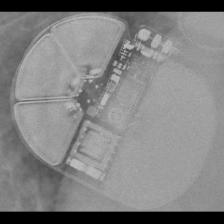 BOS:Emblem</td>
<td align="center" valign="top"><b>✅ Option 1</b>  BOS:Emblem</td>
<td align="center" valign="top"><b>Option 2</b> 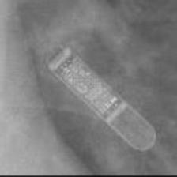 MDT:REVEAL LINQ</td>
<td align="center" valign="top"><b>Option 3</b>  SOR:Ovatio</td>
<td align="center" valign="top"><b>Option 4</b>  BOS:Ingenio</td>
<td align="center" valign="top"><b>Option 5</b>  BOS:Autogen_Teligen_Energen_Cognis</td>
<td align="center" valign="middle"><b>Option 6</b>  <i>None of the above</i></td>
</tr></table>

### Q3359 · correct: option 5 · `BOS:Emblem`

<table><tr>
<td align="center" valign="top"><b>Query</b> 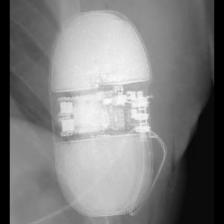 BOS:Emblem</td>
<td align="center" valign="top"><b>Option 1</b>  BOS:Autogen_Teligen_Energen_Cognis</td>
<td align="center" valign="top"><b>Option 2</b>  STJ:Quadra Assura_Unify</td>
<td align="center" valign="top"><b>Option 3</b>  SOR:Elect</td>
<td align="center" valign="top"><b>Option 4</b> 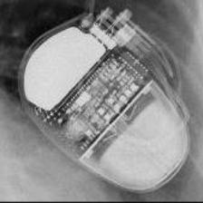 SOR:Ovatio</td>
<td align="center" valign="top"><b>✅ Option 5</b>  BOS:Emblem</td>
<td align="center" valign="middle"><b>Option 6</b>  <i>None of the above</i></td>
</tr></table>

### Q3360 · correct: option 2 · `BOS:Emblem`

<table><tr>
<td align="center" valign="top"><b>Query</b>  BOS:Emblem</td>
<td align="center" valign="top"><b>Option 1</b>  BOS:Autogen_Teligen_Energen_Cognis</td>
<td align="center" valign="top"><b>✅ Option 2</b> 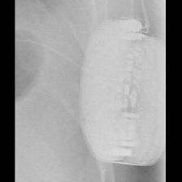 BOS:Emblem</td>
<td align="center" valign="top"><b>Option 3</b> 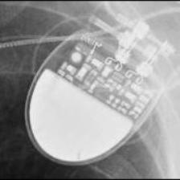 SOR:Rhapsody_Symphony</td>
<td align="center" valign="top"><b>Option 4</b> 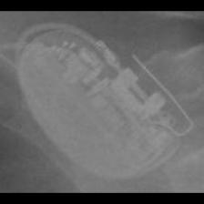 BOS:Ingenio</td>
<td align="center" valign="top"><b>Option 5</b>  SOR:Ovatio</td>
<td align="center" valign="middle"><b>Option 6</b>  <i>None of the above</i></td>
</tr></table>

### Q3361 · correct: option 1 · `BOS:Emblem`

<table><tr>
<td align="center" valign="top"><b>Query</b> 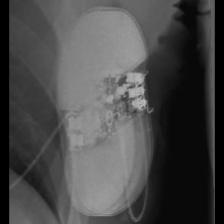 BOS:Emblem</td>
<td align="center" valign="top"><b>✅ Option 1</b>  BOS:Emblem</td>
<td align="center" valign="top"><b>Option 2</b>  BOS:Contak Renewal 4</td>
<td align="center" valign="top"><b>Option 3</b>  SOR:Thesis</td>
<td align="center" valign="top"><b>Option 4</b>  SOR:Ovatio</td>
<td align="center" valign="top"><b>Option 5</b>  BOS:Autogen_Teligen_Energen_Cognis</td>
<td align="center" valign="middle"><b>Option 6</b>  <i>None of the above</i></td>
</tr></table>

### Q3362 · correct: option 5 · `BOS:Ingenio`

<table><tr>
<td align="center" valign="top"><b>Query</b> 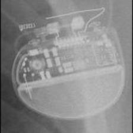 BOS:Ingenio</td>
<td align="center" valign="top"><b>Option 1</b> 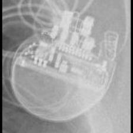 BOS:Visionist</td>
<td align="center" valign="top"><b>Option 2</b>  STJ:Allure Quadra</td>
<td align="center" valign="top"><b>Option 3</b> 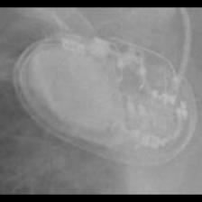 MDT:Azure</td>
<td align="center" valign="top"><b>Option 4</b>  BOS:Proponent</td>
<td align="center" valign="top"><b>✅ Option 5</b>  BOS:Ingenio</td>
<td align="center" valign="middle"><b>Option 6</b>  <i>None of the above</i></td>
</tr></table>

### Q3363 · correct: option 4 · `BOS:Ingenio`

<table><tr>
<td align="center" valign="top"><b>Query</b> 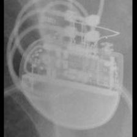 BOS:Ingenio</td>
<td align="center" valign="top"><b>Option 1</b>  BOS:Visionist</td>
<td align="center" valign="top"><b>Option 2</b>  BOS:Contak Renewal TR2</td>
<td align="center" valign="top"><b>Option 3</b>  BOS:Proponent</td>
<td align="center" valign="top"><b>✅ Option 4</b> 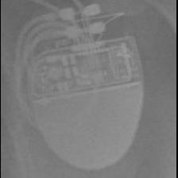 BOS:Ingenio</td>
<td align="center" valign="top"><b>Option 5</b>  SOR:MiniSwing</td>
<td align="center" valign="middle"><b>Option 6</b>  <i>None of the above</i></td>
</tr></table>

### Q3364 · correct: option 5 · `BOS:Ingenio`

<table><tr>
<td align="center" valign="top"><b>Query</b> 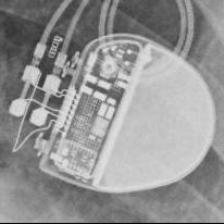 BOS:Ingenio</td>
<td align="center" valign="top"><b>Option 1</b>  BOS:Visionist</td>
<td align="center" valign="top"><b>Option 2</b>  SOR:Elect XS Plus</td>
<td align="center" valign="top"><b>Option 3</b>  BOS:Proponent</td>
<td align="center" valign="top"><b>Option 4</b>  BOS:Altrua_Insignia</td>
<td align="center" valign="top"><b>✅ Option 5</b>  BOS:Ingenio</td>
<td align="center" valign="middle"><b>Option 6</b>  <i>None of the above</i></td>
</tr></table>

### Q3365 · correct: option 2 · `BOS:Ingenio`

<table><tr>
<td align="center" valign="top"><b>Query</b> 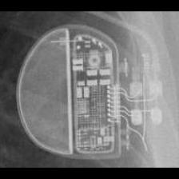 BOS:Ingenio</td>
<td align="center" valign="top"><b>Option 1</b>  BOS:Visionist</td>
<td align="center" valign="top"><b>✅ Option 2</b>  BOS:Ingenio</td>
<td align="center" valign="top"><b>Option 3</b>  BOS:Altrua_Insignia</td>
<td align="center" valign="top"><b>Option 4</b>  BIO:Evia</td>
<td align="center" valign="top"><b>Option 5</b> 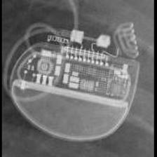 BOS:Proponent</td>
<td align="center" valign="middle"><b>Option 6</b>  <i>None of the above</i></td>
</tr></table>

### Q3366 · correct: option 1 · `BOS:Ingenio`

<table><tr>
<td align="center" valign="top"><b>Query</b> 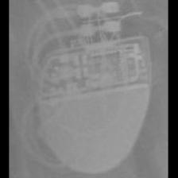 BOS:Ingenio</td>
<td align="center" valign="top"><b>✅ Option 1</b>  BOS:Ingenio</td>
<td align="center" valign="top"><b>Option 2</b>  BOS:Visionist</td>
<td align="center" valign="top"><b>Option 3</b>  BOS:Proponent</td>
<td align="center" valign="top"><b>Option 4</b>  BOS:Contak Renewal TR2</td>
<td align="center" valign="top"><b>Option 5</b>  STJ:Allure Quadra</td>
<td align="center" valign="middle"><b>Option 6</b>  <i>None of the above</i></td>
</tr></table>

### Q3367 · correct: option 1 · `BOS:Ingenio`

<table><tr>
<td align="center" valign="top"><b>Query</b> 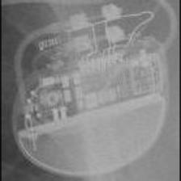 BOS:Ingenio</td>
<td align="center" valign="top"><b>✅ Option 1</b>  BOS:Ingenio</td>
<td align="center" valign="top"><b>Option 2</b>  STJ:Allure Quadra</td>
<td align="center" valign="top"><b>Option 3</b>  BOS:Visionist</td>
<td align="center" valign="top"><b>Option 4</b>  BOS:Proponent</td>
<td align="center" valign="top"><b>Option 5</b>  BOS:Contak Renewal TR2</td>
<td align="center" valign="middle"><b>Option 6</b>  <i>None of the above</i></td>
</tr></table>

### Q3368 · correct: option 1 · `BOS:Ingenio`

<table><tr>
<td align="center" valign="top"><b>Query</b> 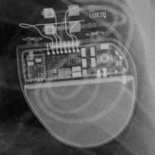 BOS:Ingenio</td>
<td align="center" valign="top"><b>✅ Option 1</b>  BOS:Ingenio</td>
<td align="center" valign="top"><b>Option 2</b>  MDT:Azure</td>
<td align="center" valign="top"><b>Option 3</b>  BOS:Visionist</td>
<td align="center" valign="top"><b>Option 4</b>  BOS:Contak Renewal TR2</td>
<td align="center" valign="top"><b>Option 5</b>  BOS:Proponent</td>
<td align="center" valign="middle"><b>Option 6</b>  <i>None of the above</i></td>
</tr></table>

### Q3369 · correct: option 2 · `BOS:Proponent`

<table><tr>
<td align="center" valign="top"><b>Query</b>  BOS:Proponent</td>
<td align="center" valign="top"><b>Option 1</b>  BOS:Ingenio</td>
<td align="center" valign="top"><b>✅ Option 2</b>  BOS:Proponent</td>
<td align="center" valign="top"><b>Option 3</b>  BOS:Visionist</td>
<td align="center" valign="top"><b>Option 4</b>  STJ:Allure Quadra</td>
<td align="center" valign="top"><b>Option 5</b>  BOS:Contak Renewal TR2</td>
<td align="center" valign="middle"><b>Option 6</b>  <i>None of the above</i></td>
</tr></table>

### Q3370 · correct: option 3 · `BOS:Proponent`

<table><tr>
<td align="center" valign="top"><b>Query</b> 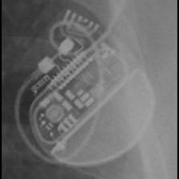 BOS:Proponent</td>
<td align="center" valign="top"><b>Option 1</b>  BOS:Visionist</td>
<td align="center" valign="top"><b>Option 2</b>  BOS:Altrua_Insignia</td>
<td align="center" valign="top"><b>✅ Option 3</b>  BOS:Proponent</td>
<td align="center" valign="top"><b>Option 4</b>  BOS:Ingenio</td>
<td align="center" valign="top"><b>Option 5</b>  BOS:Contak Renewal TR2</td>
<td align="center" valign="middle"><b>Option 6</b>  <i>None of the above</i></td>
</tr></table>

### Q3371 · correct: option 5 · `BOS:Proponent`

<table><tr>
<td align="center" valign="top"><b>Query</b> 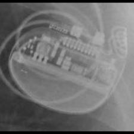 BOS:Proponent</td>
<td align="center" valign="top"><b>Option 1</b>  BOS:Ingenio</td>
<td align="center" valign="top"><b>Option 2</b>  BOS:Contak Renewal TR2</td>
<td align="center" valign="top"><b>Option 3</b>  BOS:Visionist</td>
<td align="center" valign="top"><b>Option 4</b>  STJ:Allure Quadra</td>
<td align="center" valign="top"><b>✅ Option 5</b>  BOS:Proponent</td>
<td align="center" valign="middle"><b>Option 6</b>  <i>None of the above</i></td>
</tr></table>

### Q3372 · correct: option 3 · `BOS:Proponent`

<table><tr>
<td align="center" valign="top"><b>Query</b> 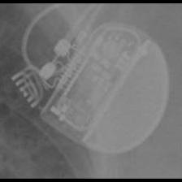 BOS:Proponent</td>
<td align="center" valign="top"><b>Option 1</b> 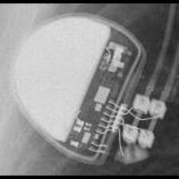 BOS:Altrua_Insignia</td>
<td align="center" valign="top"><b>Option 2</b>  BOS:Ingenio</td>
<td align="center" valign="top"><b>✅ Option 3</b>  BOS:Proponent</td>
<td align="center" valign="top"><b>Option 4</b>  MDT:REVEAL</td>
<td align="center" valign="top"><b>Option 5</b>  BOS:Visionist</td>
<td align="center" valign="middle"><b>Option 6</b>  <i>None of the above</i></td>
</tr></table>

### Q3373 · correct: option 5 · `BOS:Proponent`

<table><tr>
<td align="center" valign="top"><b>Query</b> 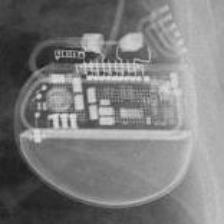 BOS:Proponent</td>
<td align="center" valign="top"><b>Option 1</b>  BOS:Ingenio</td>
<td align="center" valign="top"><b>Option 2</b>  BOS:Contak Renewal TR2</td>
<td align="center" valign="top"><b>Option 3</b>  STJ:Ellipse</td>
<td align="center" valign="top"><b>Option 4</b>  BOS:Visionist</td>
<td align="center" valign="top"><b>✅ Option 5</b>  BOS:Proponent</td>
<td align="center" valign="middle"><b>Option 6</b>  <i>None of the above</i></td>
</tr></table>

### Q3374 · correct: option 1 · `BOS:Proponent`

<table><tr>
<td align="center" valign="top"><b>Query</b> 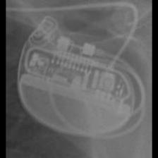 BOS:Proponent</td>
<td align="center" valign="top"><b>✅ Option 1</b>  BOS:Proponent</td>
<td align="center" valign="top"><b>Option 2</b>  BOS:Contak Renewal TR2</td>
<td align="center" valign="top"><b>Option 3</b>  STJ:Allure Quadra</td>
<td align="center" valign="top"><b>Option 4</b>  BOS:Visionist</td>
<td align="center" valign="top"><b>Option 5</b>  BOS:Ingenio</td>
<td align="center" valign="middle"><b>Option 6</b>  <i>None of the above</i></td>
</tr></table>

### Q3375 · correct: option 4 · `BOS:Proponent`

<table><tr>
<td align="center" valign="top"><b>Query</b> 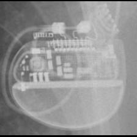 BOS:Proponent</td>
<td align="center" valign="top"><b>Option 1</b>  STJ:Allure Quadra</td>
<td align="center" valign="top"><b>Option 2</b>  BOS:Contak Renewal TR2</td>
<td align="center" valign="top"><b>Option 3</b>  BOS:Ingenio</td>
<td align="center" valign="top"><b>✅ Option 4</b>  BOS:Proponent</td>
<td align="center" valign="top"><b>Option 5</b>  BOS:Visionist</td>
<td align="center" valign="middle"><b>Option 6</b>  <i>None of the above</i></td>
</tr></table>

### Q3376 · correct: option 3 · `BOS:Ventak Prizm`

<table><tr>
<td align="center" valign="top"><b>Query</b> 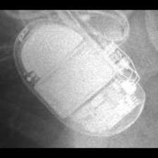 BOS:Ventak Prizm</td>
<td align="center" valign="top"><b>Option 1</b>  MDT:Concerto_Consulta_Maximo_Protecta_Secura</td>
<td align="center" valign="top"><b>Option 2</b>  BOS:Contak Renewal 4</td>
<td align="center" valign="top"><b>✅ Option 3</b>  BOS:Ventak Prizm</td>
<td align="center" valign="top"><b>Option 4</b>  MDT:Maximo</td>
<td align="center" valign="top"><b>Option 5</b> 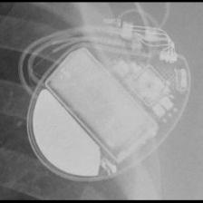 BOS:Vitality</td>
<td align="center" valign="middle"><b>Option 6</b>  <i>None of the above</i></td>
</tr></table>

### Q3377 · correct: option 1 · `BOS:Ventak Prizm`

<table><tr>
<td align="center" valign="top"><b>Query</b> 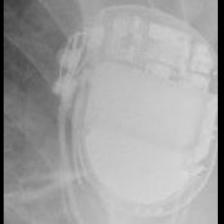 BOS:Ventak Prizm</td>
<td align="center" valign="top"><b>✅ Option 1</b>  BOS:Ventak Prizm</td>
<td align="center" valign="top"><b>Option 2</b>  BOS:Vitality</td>
<td align="center" valign="top"><b>Option 3</b>  MDT:Concerto_Consulta_Maximo_Protecta_Secura</td>
<td align="center" valign="top"><b>Option 4</b>  BOS:Contak Renewal 4</td>
<td align="center" valign="top"><b>Option 5</b>  MDT:Maximo</td>
<td align="center" valign="middle"><b>Option 6</b>  <i>None of the above</i></td>
</tr></table>

### Q3378 · correct: option 1 · `BOS:Ventak Prizm`

<table><tr>
<td align="center" valign="top"><b>Query</b> 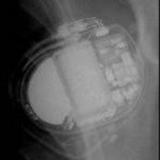 BOS:Ventak Prizm</td>
<td align="center" valign="top"><b>✅ Option 1</b>  BOS:Ventak Prizm</td>
<td align="center" valign="top"><b>Option 2</b>  BOS:ContakTR_Discovery_Meridian_Pulsar Max</td>
<td align="center" valign="top"><b>Option 3</b>  BOS:Contak Renewal 4</td>
<td align="center" valign="top"><b>Option 4</b>  BOS:Vitality</td>
<td align="center" valign="top"><b>Option 5</b>  MDT:Maximo</td>
<td align="center" valign="middle"><b>Option 6</b>  <i>None of the above</i></td>
</tr></table>

### Q3379 · correct: option 1 · `BOS:Ventak Prizm`

<table><tr>
<td align="center" valign="top"><b>Query</b> 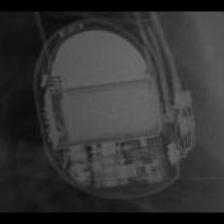 BOS:Ventak Prizm</td>
<td align="center" valign="top"><b>✅ Option 1</b>  BOS:Ventak Prizm</td>
<td align="center" valign="top"><b>Option 2</b>  SOR:Ovatio</td>
<td align="center" valign="top"><b>Option 3</b>  BOS:Vitality</td>
<td align="center" valign="top"><b>Option 4</b>  MDT:Adapta_Kappa_Sensia_Versa</td>
<td align="center" valign="top"><b>Option 5</b>  STJ:Identity</td>
<td align="center" valign="middle"><b>Option 6</b>  <i>None of the above</i></td>
</tr></table>

### Q3380 · correct: option 5 · `BOS:Ventak Prizm`

<table><tr>
<td align="center" valign="top"><b>Query</b>  BOS:Ventak Prizm</td>
<td align="center" valign="top"><b>Option 1</b>  BOS:Contak Renewal 4</td>
<td align="center" valign="top"><b>Option 2</b>  SOR:Neway</td>
<td align="center" valign="top"><b>Option 3</b>  BOS:Vitality</td>
<td align="center" valign="top"><b>Option 4</b>  MDT:Maximo</td>
<td align="center" valign="top"><b>✅ Option 5</b>  BOS:Ventak Prizm</td>
<td align="center" valign="middle"><b>Option 6</b>  <i>None of the above</i></td>
</tr></table>

### Q3381 · correct: option 4 · `BOS:Visionist`

<table><tr>
<td align="center" valign="top"><b>Query</b> 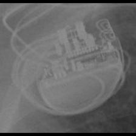 BOS:Visionist</td>
<td align="center" valign="top"><b>Option 1</b>  BOS:Contak Renewal TR2</td>
<td align="center" valign="top"><b>Option 2</b>  BOS:Proponent</td>
<td align="center" valign="top"><b>Option 3</b>  BOS:Ingenio</td>
<td align="center" valign="top"><b>✅ Option 4</b>  BOS:Visionist</td>
<td align="center" valign="top"><b>Option 5</b>  SOR:Elect</td>
<td align="center" valign="middle"><b>Option 6</b>  <i>None of the above</i></td>
</tr></table>

### Q3382 · correct: option 3 · `BOS:Visionist`

<table><tr>
<td align="center" valign="top"><b>Query</b> 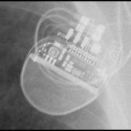 BOS:Visionist</td>
<td align="center" valign="top"><b>Option 1</b>  BOS:Ingenio</td>
<td align="center" valign="top"><b>Option 2</b>  BOS:Proponent</td>
<td align="center" valign="top"><b>✅ Option 3</b>  BOS:Visionist</td>
<td align="center" valign="top"><b>Option 4</b>  BOS:Contak Renewal TR2</td>
<td align="center" valign="top"><b>Option 5</b>  BOS:Autogen_Teligen_Energen_Cognis</td>
<td align="center" valign="middle"><b>Option 6</b>  <i>None of the above</i></td>
</tr></table>

### Q3383 · correct: option 4 · `BOS:Visionist`

<table><tr>
<td align="center" valign="top"><b>Query</b> 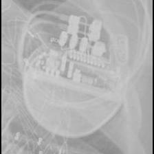 BOS:Visionist</td>
<td align="center" valign="top"><b>Option 1</b>  BOS:Proponent</td>
<td align="center" valign="top"><b>Option 2</b>  BOS:Contak Renewal TR2</td>
<td align="center" valign="top"><b>Option 3</b>  BOS:Autogen_Teligen_Energen_Cognis</td>
<td align="center" valign="top"><b>✅ Option 4</b> 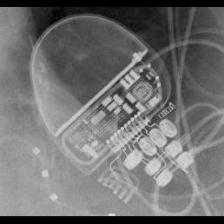 BOS:Visionist</td>
<td align="center" valign="top"><b>Option 5</b>  BOS:Ingenio</td>
<td align="center" valign="middle"><b>Option 6</b>  <i>None of the above</i></td>
</tr></table>

### Q3384 · correct: option 5 · `BOS:Visionist`

<table><tr>
<td align="center" valign="top"><b>Query</b> 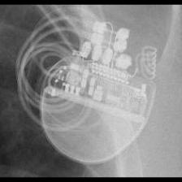 BOS:Visionist</td>
<td align="center" valign="top"><b>Option 1</b>  BOS:Contak Renewal TR2</td>
<td align="center" valign="top"><b>Option 2</b>  BOS:Ingenio</td>
<td align="center" valign="top"><b>Option 3</b>  BOS:Proponent</td>
<td align="center" valign="top"><b>Option 4</b>  BOS:Autogen_Teligen_Energen_Cognis</td>
<td align="center" valign="top"><b>✅ Option 5</b>  BOS:Visionist</td>
<td align="center" valign="middle"><b>Option 6</b>  <i>None of the above</i></td>
</tr></table>

### Q3385 · correct: option 1 · `BOS:Visionist`

<table><tr>
<td align="center" valign="top"><b>Query</b> 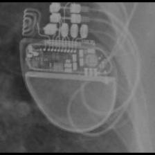 BOS:Visionist</td>
<td align="center" valign="top"><b>✅ Option 1</b>  BOS:Visionist</td>
<td align="center" valign="top"><b>Option 2</b>  BOS:Contak Renewal TR2</td>
<td align="center" valign="top"><b>Option 3</b>  BOS:Ingenio</td>
<td align="center" valign="top"><b>Option 4</b>  BOS:Proponent</td>
<td align="center" valign="top"><b>Option 5</b>  STJ:Allure Quadra</td>
<td align="center" valign="middle"><b>Option 6</b>  <i>None of the above</i></td>
</tr></table>

### Q3386 · correct: option 4 · `BOS:Visionist`

<table><tr>
<td align="center" valign="top"><b>Query</b>  BOS:Visionist</td>
<td align="center" valign="top"><b>Option 1</b>  BOS:Ingenio</td>
<td align="center" valign="top"><b>Option 2</b>  BOS:Contak Renewal TR2</td>
<td align="center" valign="top"><b>Option 3</b>  STJ:Allure Quadra</td>
<td align="center" valign="top"><b>✅ Option 4</b>  BOS:Visionist</td>
<td align="center" valign="top"><b>Option 5</b>  BOS:Proponent</td>
<td align="center" valign="middle"><b>Option 6</b>  <i>None of the above</i></td>
</tr></table>

### Q3387 · correct: option 5 · `BOS:Visionist`

<table><tr>
<td align="center" valign="top"><b>Query</b> 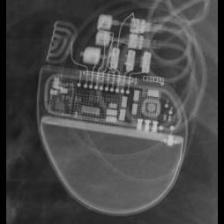 BOS:Visionist</td>
<td align="center" valign="top"><b>Option 1</b>  BOS:Ingenio</td>
<td align="center" valign="top"><b>Option 2</b>  BOS:Contak Renewal TR2</td>
<td align="center" valign="top"><b>Option 3</b>  BOS:Proponent</td>
<td align="center" valign="top"><b>Option 4</b>  STJ:Allure Quadra</td>
<td align="center" valign="top"><b>✅ Option 5</b>  BOS:Visionist</td>
<td align="center" valign="middle"><b>Option 6</b>  <i>None of the above</i></td>
</tr></table>

### Q3388 · correct: option 4 · `BOS:Vitality`

<table><tr>
<td align="center" valign="top"><b>Query</b>  BOS:Vitality</td>
<td align="center" valign="top"><b>Option 1</b>  BOS:Contak Renewal 4</td>
<td align="center" valign="top"><b>Option 2</b> 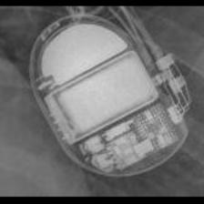 BOS:Ventak Prizm</td>
<td align="center" valign="top"><b>Option 3</b>  MDT:Claria_Evera_Viva</td>
<td align="center" valign="top"><b>✅ Option 4</b>  BOS:Vitality</td>
<td align="center" valign="top"><b>Option 5</b>  SOR:Ovatio</td>
<td align="center" valign="middle"><b>Option 6</b>  <i>None of the above</i></td>
</tr></table>

### Q3389 · correct: option 1 · `BOS:Vitality`

<table><tr>
<td align="center" valign="top"><b>Query</b>  BOS:Vitality</td>
<td align="center" valign="top"><b>✅ Option 1</b>  BOS:Vitality</td>
<td align="center" valign="top"><b>Option 2</b>  BOS:Ventak Prizm</td>
<td align="center" valign="top"><b>Option 3</b>  BOS:Altrua_Insignia</td>
<td align="center" valign="top"><b>Option 4</b>  BOS:Contak Renewal 4</td>
<td align="center" valign="top"><b>Option 5</b>  SOR:Ovatio</td>
<td align="center" valign="middle"><b>Option 6</b>  <i>None of the above</i></td>
</tr></table>

### Q3390 · correct: option 1 · `BOS:Vitality`

<table><tr>
<td align="center" valign="top"><b>Query</b>  BOS:Vitality</td>
<td align="center" valign="top"><b>✅ Option 1</b>  BOS:Vitality</td>
<td align="center" valign="top"><b>Option 2</b>  MDT:Maximo</td>
<td align="center" valign="top"><b>Option 3</b>  BOS:Ventak Prizm</td>
<td align="center" valign="top"><b>Option 4</b>  STJ:Quadra Assura_Unify</td>
<td align="center" valign="top"><b>Option 5</b>  MDT:Concerto_Consulta_Maximo_Protecta_Secura</td>
<td align="center" valign="middle"><b>Option 6</b>  <i>None of the above</i></td>
</tr></table>

### Q3391 · correct: option 5 · `BOS:Vitality`

<table><tr>
<td align="center" valign="top"><b>Query</b>  BOS:Vitality</td>
<td align="center" valign="top"><b>Option 1</b>  BOS:Ventak Prizm</td>
<td align="center" valign="top"><b>Option 2</b>  MDT:Concerto_Consulta_Maximo_Protecta_Secura</td>
<td align="center" valign="top"><b>Option 3</b>  MDT:Maximo</td>
<td align="center" valign="top"><b>Option 4</b>  BOS:Contak Renewal 4</td>
<td align="center" valign="top"><b>✅ Option 5</b>  BOS:Vitality</td>
<td align="center" valign="middle"><b>Option 6</b>  <i>None of the above</i></td>
</tr></table>

### Q3392 · correct: option 4 · `BOS:Vitality`

<table><tr>
<td align="center" valign="top"><b>Query</b>  BOS:Vitality</td>
<td align="center" valign="top"><b>Option 1</b>  BOS:Contak Renewal 4</td>
<td align="center" valign="top"><b>Option 2</b>  BOS:Ventak Prizm</td>
<td align="center" valign="top"><b>Option 3</b>  MDT:Claria_Evera_Viva</td>
<td align="center" valign="top"><b>✅ Option 4</b>  BOS:Vitality</td>
<td align="center" valign="top"><b>Option 5</b>  MDT:Maximo</td>
<td align="center" valign="middle"><b>Option 6</b>  <i>None of the above</i></td>
</tr></table>

### Q3393 · correct: option 2 · `BOS:Vitality`

<table><tr>
<td align="center" valign="top"><b>Query</b>  BOS:Vitality</td>
<td align="center" valign="top"><b>Option 1</b>  BOS:Ventak Prizm</td>
<td align="center" valign="top"><b>✅ Option 2</b>  BOS:Vitality</td>
<td align="center" valign="top"><b>Option 3</b>  MDT:Claria_Evera_Viva</td>
<td align="center" valign="top"><b>Option 4</b>  BOS:Contak Renewal 4</td>
<td align="center" valign="top"><b>Option 5</b>  MDT:Concerto_Consulta_Maximo_Protecta_Secura</td>
<td align="center" valign="middle"><b>Option 6</b>  <i>None of the above</i></td>
</tr></table>

### Q3394 · correct: option 2 · `BOS:Vitality`

<table><tr>
<td align="center" valign="top"><b>Query</b>  BOS:Vitality</td>
<td align="center" valign="top"><b>Option 1</b>  BOS:Ventak Prizm</td>
<td align="center" valign="top"><b>✅ Option 2</b>  BOS:Vitality</td>
<td align="center" valign="top"><b>Option 3</b>  MDT:Claria_Evera_Viva</td>
<td align="center" valign="top"><b>Option 4</b>  BOS:Autogen_Teligen_Energen_Cognis</td>
<td align="center" valign="top"><b>Option 5</b>  STJ:Ellipse</td>
<td align="center" valign="middle"><b>Option 6</b>  <i>None of the above</i></td>
</tr></table>

### Q3395 · correct: option 3 · `MDT:AT500`

<table><tr>
<td align="center" valign="top"><b>Query</b>  MDT:AT500</td>
<td align="center" valign="top"><b>Option 1</b>  MDT:EnRhythm</td>
<td align="center" valign="top"><b>Option 2</b>  MDT:Syncra</td>
<td align="center" valign="top"><b>✅ Option 3</b>  MDT:AT500</td>
<td align="center" valign="top"><b>Option 4</b>  MDT:Advisa</td>
<td align="center" valign="top"><b>Option 5</b>  MDT:Insync III</td>
<td align="center" valign="middle"><b>Option 6</b>  <i>None of the above</i></td>
</tr></table>

### Q3396 · correct: option 4 · `MDT:AT500`

<table><tr>
<td align="center" valign="top"><b>Query</b>  MDT:AT500</td>
<td align="center" valign="top"><b>Option 1</b>  MDT:Insync III</td>
<td align="center" valign="top"><b>Option 2</b>  MDT:EnRhythm</td>
<td align="center" valign="top"><b>Option 3</b>  MDT:Advisa</td>
<td align="center" valign="top"><b>✅ Option 4</b>  MDT:AT500</td>
<td align="center" valign="top"><b>Option 5</b>  MDT:Syncra</td>
<td align="center" valign="middle"><b>Option 6</b>  <i>None of the above</i></td>
</tr></table>

### Q3397 · correct: option 2 · `MDT:AT500`

<table><tr>
<td align="center" valign="top"><b>Query</b>  MDT:AT500</td>
<td align="center" valign="top"><b>Option 1</b>  MDT:Advisa</td>
<td align="center" valign="top"><b>✅ Option 2</b>  MDT:AT500</td>
<td align="center" valign="top"><b>Option 3</b>  MDT:EnRhythm</td>
<td align="center" valign="top"><b>Option 4</b>  MDT:Insync III</td>
<td align="center" valign="top"><b>Option 5</b>  MDT:Syncra</td>
<td align="center" valign="middle"><b>Option 6</b>  <i>None of the above</i></td>
</tr></table>

### Q3398 · correct: option 1 · `MDT:AT500`

<table><tr>
<td align="center" valign="top"><b>Query</b>  MDT:AT500</td>
<td align="center" valign="top"><b>✅ Option 1</b>  MDT:AT500</td>
<td align="center" valign="top"><b>Option 2</b>  MDT:EnRhythm</td>
<td align="center" valign="top"><b>Option 3</b>  MDT:Syncra</td>
<td align="center" valign="top"><b>Option 4</b>  MDT:Insync III</td>
<td align="center" valign="top"><b>Option 5</b>  MDT:Advisa</td>
<td align="center" valign="middle"><b>Option 6</b>  <i>None of the above</i></td>
</tr></table>

### Q3399 · correct: option 5 · `MDT:AT500`

<table><tr>
<td align="center" valign="top"><b>Query</b>  MDT:AT500</td>
<td align="center" valign="top"><b>Option 1</b>  MDT:Insync III</td>
<td align="center" valign="top"><b>Option 2</b>  MDT:Syncra</td>
<td align="center" valign="top"><b>Option 3</b>  MDT:EnRhythm</td>
<td align="center" valign="top"><b>Option 4</b>  MDT:Advisa</td>
<td align="center" valign="top"><b>✅ Option 5</b>  MDT:AT500</td>
<td align="center" valign="middle"><b>Option 6</b>  <i>None of the above</i></td>
</tr></table>

### Q3400 · correct: option 4 · `MDT:AT500`

<table><tr>
<td align="center" valign="top"><b>Query</b>  MDT:AT500</td>
<td align="center" valign="top"><b>Option 1</b>  MDT:EnRhythm</td>
<td align="center" valign="top"><b>Option 2</b>  MDT:Insync III</td>
<td align="center" valign="top"><b>Option 3</b>  MDT:Syncra</td>
<td align="center" valign="top"><b>✅ Option 4</b>  MDT:AT500</td>
<td align="center" valign="top"><b>Option 5</b>  MDT:Advisa</td>
<td align="center" valign="middle"><b>Option 6</b>  <i>None of the above</i></td>
</tr></table>

### Q3401 · correct: option 1 · `MDT:AT500`

<table><tr>
<td align="center" valign="top"><b>Query</b>  MDT:AT500</td>
<td align="center" valign="top"><b>✅ Option 1</b>  MDT:AT500</td>
<td align="center" valign="top"><b>Option 2</b>  MDT:Advisa</td>
<td align="center" valign="top"><b>Option 3</b>  MDT:Syncra</td>
<td align="center" valign="top"><b>Option 4</b>  MDT:EnRhythm</td>
<td align="center" valign="top"><b>Option 5</b>  MDT:Insync III</td>
<td align="center" valign="middle"><b>Option 6</b>  <i>None of the above</i></td>
</tr></table>

### Q3402 · correct: option 1 · `MDT:Adapta_Kappa_Sensia_Versa`

<table><tr>
<td align="center" valign="top"><b>Query</b>  MDT:Adapta_Kappa_Sensia_Versa</td>
<td align="center" valign="top"><b>✅ Option 1</b>  MDT:Adapta_Kappa_Sensia_Versa</td>
<td align="center" valign="top"><b>Option 2</b>  MDT:C20_T20</td>
<td align="center" valign="top"><b>Option 3</b>  MDT:Sigma</td>
<td align="center" valign="top"><b>Option 4</b>  SOR:Rhapsody_Symphony</td>
<td align="center" valign="top"><b>Option 5</b>  STJ:Zephyr</td>
<td align="center" valign="middle"><b>Option 6</b>  <i>None of the above</i></td>
</tr></table>

### Q3403 · correct: option 4 · `MDT:Adapta_Kappa_Sensia_Versa`

<table><tr>
<td align="center" valign="top"><b>Query</b>  MDT:Adapta_Kappa_Sensia_Versa</td>
<td align="center" valign="top"><b>Option 1</b>  SOR:Rhapsody_Symphony</td>
<td align="center" valign="top"><b>Option 2</b>  MDT:Sigma</td>
<td align="center" valign="top"><b>Option 3</b>  BIO:Actros_Philos</td>
<td align="center" valign="top"><b>✅ Option 4</b>  MDT:Adapta_Kappa_Sensia_Versa</td>
<td align="center" valign="top"><b>Option 5</b>  MDT:C20_T20</td>
<td align="center" valign="middle"><b>Option 6</b>  <i>None of the above</i></td>
</tr></table>

