# Pacemakers (Howard et al.) · query set `train1` · page 3/6

[← all pages](README.md)

### Q3404 · correct: option 1 · `MDT:Adapta_Kappa_Sensia_Versa`

<table><tr>
<td align="center" valign="top"><b>Query</b> 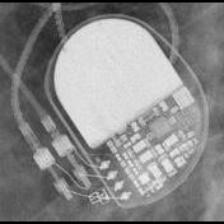 MDT:Adapta_Kappa_Sensia_Versa</td>
<td align="center" valign="top"><b>✅ Option 1</b>  MDT:Adapta_Kappa_Sensia_Versa</td>
<td align="center" valign="top"><b>Option 2</b>  STJ:Identity</td>
<td align="center" valign="top"><b>Option 3</b> 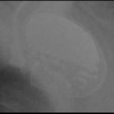 MDT:Sigma</td>
<td align="center" valign="top"><b>Option 4</b>  MDT:C60 DR</td>
<td align="center" valign="top"><b>Option 5</b>  MDT:C20_T20</td>
<td align="center" valign="middle"><b>Option 6</b>  <i>None of the above</i></td>
</tr></table>

### Q3405 · correct: option 2 · `MDT:Adapta_Kappa_Sensia_Versa`

<table><tr>
<td align="center" valign="top"><b>Query</b>  MDT:Adapta_Kappa_Sensia_Versa</td>
<td align="center" valign="top"><b>Option 1</b>  STJ:Zephyr</td>
<td align="center" valign="top"><b>✅ Option 2</b>  MDT:Adapta_Kappa_Sensia_Versa</td>
<td align="center" valign="top"><b>Option 3</b>  MDT:Sigma</td>
<td align="center" valign="top"><b>Option 4</b>  MDT:C60 DR</td>
<td align="center" valign="top"><b>Option 5</b> 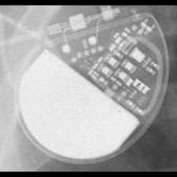 MDT:C20_T20</td>
<td align="center" valign="middle"><b>Option 6</b>  <i>None of the above</i></td>
</tr></table>

### Q3406 · correct: option 4 · `MDT:Adapta_Kappa_Sensia_Versa`

<table><tr>
<td align="center" valign="top"><b>Query</b> 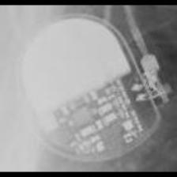 MDT:Adapta_Kappa_Sensia_Versa</td>
<td align="center" valign="top"><b>Option 1</b>  MDT:Sigma</td>
<td align="center" valign="top"><b>Option 2</b>  SOR:Reply</td>
<td align="center" valign="top"><b>Option 3</b>  BOS:ContakTR_Discovery_Meridian_Pulsar Max</td>
<td align="center" valign="top"><b>✅ Option 4</b>  MDT:Adapta_Kappa_Sensia_Versa</td>
<td align="center" valign="top"><b>Option 5</b>  MDT:C20_T20</td>
<td align="center" valign="middle"><b>Option 6</b>  <i>None of the above</i></td>
</tr></table>

### Q3407 · correct: option 1 · `MDT:Adapta_Kappa_Sensia_Versa`

<table><tr>
<td align="center" valign="top"><b>Query</b>  MDT:Adapta_Kappa_Sensia_Versa</td>
<td align="center" valign="top"><b>✅ Option 1</b>  MDT:Adapta_Kappa_Sensia_Versa</td>
<td align="center" valign="top"><b>Option 2</b>  MDT:Sigma</td>
<td align="center" valign="top"><b>Option 3</b>  BIO:Cyclos</td>
<td align="center" valign="top"><b>Option 4</b>  STJ:Identity</td>
<td align="center" valign="top"><b>Option 5</b>  MDT:AT500</td>
<td align="center" valign="middle"><b>Option 6</b>  <i>None of the above</i></td>
</tr></table>

### Q3408 · correct: option 3 · `MDT:Adapta_Kappa_Sensia_Versa`

<table><tr>
<td align="center" valign="top"><b>Query</b>  MDT:Adapta_Kappa_Sensia_Versa</td>
<td align="center" valign="top"><b>Option 1</b>  MDT:Sigma</td>
<td align="center" valign="top"><b>Option 2</b>  STJ:Zephyr</td>
<td align="center" valign="top"><b>✅ Option 3</b>  MDT:Adapta_Kappa_Sensia_Versa</td>
<td align="center" valign="top"><b>Option 4</b>  SOR:Reply</td>
<td align="center" valign="top"><b>Option 5</b>  STJ:Identity</td>
<td align="center" valign="middle"><b>Option 6</b>  <i>None of the above</i></td>
</tr></table>

### Q3409 · correct: option 3 · `MDT:Advisa`

<table><tr>
<td align="center" valign="top"><b>Query</b> 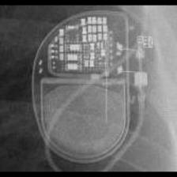 MDT:Advisa</td>
<td align="center" valign="top"><b>Option 1</b>  MDT:EnRhythm</td>
<td align="center" valign="top"><b>Option 2</b>  MDT:Azure</td>
<td align="center" valign="top"><b>✅ Option 3</b>  MDT:Advisa</td>
<td align="center" valign="top"><b>Option 4</b>  MDT:Syncra</td>
<td align="center" valign="top"><b>Option 5</b>  MDT:AT500</td>
<td align="center" valign="middle"><b>Option 6</b>  <i>None of the above</i></td>
</tr></table>

### Q3410 · correct: option 1 · `MDT:Advisa`

<table><tr>
<td align="center" valign="top"><b>Query</b>  MDT:Advisa</td>
<td align="center" valign="top"><b>✅ Option 1</b>  MDT:Advisa</td>
<td align="center" valign="top"><b>Option 2</b>  MDT:Syncra</td>
<td align="center" valign="top"><b>Option 3</b>  MDT:EnRhythm</td>
<td align="center" valign="top"><b>Option 4</b>  MDT:AT500</td>
<td align="center" valign="top"><b>Option 5</b>  MDT:Insync III</td>
<td align="center" valign="middle"><b>Option 6</b>  <i>None of the above</i></td>
</tr></table>

### Q3411 · correct: option 4 · `MDT:Advisa`

<table><tr>
<td align="center" valign="top"><b>Query</b> 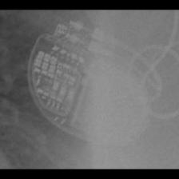 MDT:Advisa</td>
<td align="center" valign="top"><b>Option 1</b>  MDT:EnRhythm</td>
<td align="center" valign="top"><b>Option 2</b>  MDT:AT500</td>
<td align="center" valign="top"><b>Option 3</b>  MDT:Syncra</td>
<td align="center" valign="top"><b>✅ Option 4</b>  MDT:Advisa</td>
<td align="center" valign="top"><b>Option 5</b>  MDT:Insync III</td>
<td align="center" valign="middle"><b>Option 6</b>  <i>None of the above</i></td>
</tr></table>

### Q3412 · correct: option 1 · `MDT:Advisa`

<table><tr>
<td align="center" valign="top"><b>Query</b> 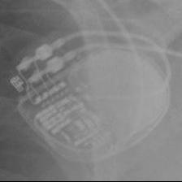 MDT:Advisa</td>
<td align="center" valign="top"><b>✅ Option 1</b>  MDT:Advisa</td>
<td align="center" valign="top"><b>Option 2</b>  MDT:EnRhythm</td>
<td align="center" valign="top"><b>Option 3</b>  MDT:AT500</td>
<td align="center" valign="top"><b>Option 4</b>  MDT:Azure</td>
<td align="center" valign="top"><b>Option 5</b>  MDT:Syncra</td>
<td align="center" valign="middle"><b>Option 6</b>  <i>None of the above</i></td>
</tr></table>

### Q3413 · correct: option 3 · `MDT:Advisa`

<table><tr>
<td align="center" valign="top"><b>Query</b> 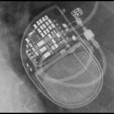 MDT:Advisa</td>
<td align="center" valign="top"><b>Option 1</b>  MDT:Syncra</td>
<td align="center" valign="top"><b>Option 2</b>  MDT:Azure</td>
<td align="center" valign="top"><b>✅ Option 3</b>  MDT:Advisa</td>
<td align="center" valign="top"><b>Option 4</b>  MDT:EnRhythm</td>
<td align="center" valign="top"><b>Option 5</b>  MDT:AT500</td>
<td align="center" valign="middle"><b>Option 6</b>  <i>None of the above</i></td>
</tr></table>

### Q3414 · correct: option 4 · `MDT:Advisa`

<table><tr>
<td align="center" valign="top"><b>Query</b>  MDT:Advisa</td>
<td align="center" valign="top"><b>Option 1</b>  MDT:AT500</td>
<td align="center" valign="top"><b>Option 2</b>  MDT:EnRhythm</td>
<td align="center" valign="top"><b>Option 3</b>  MDT:Syncra</td>
<td align="center" valign="top"><b>✅ Option 4</b>  MDT:Advisa</td>
<td align="center" valign="top"><b>Option 5</b>  MDT:Azure</td>
<td align="center" valign="middle"><b>Option 6</b>  <i>None of the above</i></td>
</tr></table>

### Q3415 · correct: option 4 · `MDT:Advisa`

<table><tr>
<td align="center" valign="top"><b>Query</b> 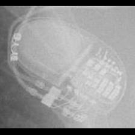 MDT:Advisa</td>
<td align="center" valign="top"><b>Option 1</b> 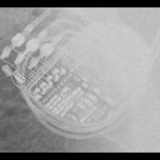 MDT:Syncra</td>
<td align="center" valign="top"><b>Option 2</b>  MDT:AT500</td>
<td align="center" valign="top"><b>Option 3</b>  STJ:Accent</td>
<td align="center" valign="top"><b>✅ Option 4</b>  MDT:Advisa</td>
<td align="center" valign="top"><b>Option 5</b>  MDT:EnRhythm</td>
<td align="center" valign="middle"><b>Option 6</b>  <i>None of the above</i></td>
</tr></table>

### Q3416 · correct: option 1 · `MDT:Azure`

<table><tr>
<td align="center" valign="top"><b>Query</b> 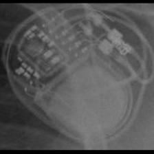 MDT:Azure</td>
<td align="center" valign="top"><b>✅ Option 1</b>  MDT:Azure</td>
<td align="center" valign="top"><b>Option 2</b>  MDT:EnRhythm</td>
<td align="center" valign="top"><b>Option 3</b>  MDT:Advisa</td>
<td align="center" valign="top"><b>Option 4</b>  MDT:Syncra</td>
<td align="center" valign="top"><b>Option 5</b>  MDT:AT500</td>
<td align="center" valign="middle"><b>Option 6</b>  <i>None of the above</i></td>
</tr></table>

### Q3417 · correct: option 5 · `MDT:Azure`

<table><tr>
<td align="center" valign="top"><b>Query</b> 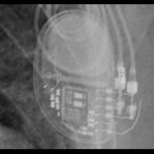 MDT:Azure</td>
<td align="center" valign="top"><b>Option 1</b>  MDT:Advisa</td>
<td align="center" valign="top"><b>Option 2</b>  MDT:Insync III</td>
<td align="center" valign="top"><b>Option 3</b>  BOS:Contak Renewal TR2</td>
<td align="center" valign="top"><b>Option 4</b>  MDT:AT500</td>
<td align="center" valign="top"><b>✅ Option 5</b> 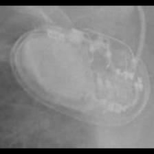 MDT:Azure</td>
<td align="center" valign="middle"><b>Option 6</b>  <i>None of the above</i></td>
</tr></table>

### Q3418 · correct: option 1 · `MDT:Azure`

<table><tr>
<td align="center" valign="top"><b>Query</b> 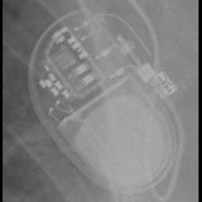 MDT:Azure</td>
<td align="center" valign="top"><b>✅ Option 1</b>  MDT:Azure</td>
<td align="center" valign="top"><b>Option 2</b>  STJ:Allure Quadra</td>
<td align="center" valign="top"><b>Option 3</b>  MDT:Advisa</td>
<td align="center" valign="top"><b>Option 4</b>  STJ:Accent</td>
<td align="center" valign="top"><b>Option 5</b>  BIO:Evia</td>
<td align="center" valign="middle"><b>Option 6</b>  <i>None of the above</i></td>
</tr></table>

### Q3419 · correct: option 2 · `MDT:Azure`

<table><tr>
<td align="center" valign="top"><b>Query</b> 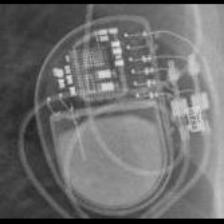 MDT:Azure</td>
<td align="center" valign="top"><b>Option 1</b>  MDT:Insync III</td>
<td align="center" valign="top"><b>✅ Option 2</b>  MDT:Azure</td>
<td align="center" valign="top"><b>Option 3</b>  MDT:EnRhythm</td>
<td align="center" valign="top"><b>Option 4</b>  MDT:AT500</td>
<td align="center" valign="top"><b>Option 5</b>  MDT:Advisa</td>
<td align="center" valign="middle"><b>Option 6</b>  <i>None of the above</i></td>
</tr></table>

### Q3420 · correct: option 1 · `MDT:Azure`

<table><tr>
<td align="center" valign="top"><b>Query</b>  MDT:Azure</td>
<td align="center" valign="top"><b>✅ Option 1</b>  MDT:Azure</td>
<td align="center" valign="top"><b>Option 2</b>  BOS:Contak Renewal TR2</td>
<td align="center" valign="top"><b>Option 3</b> 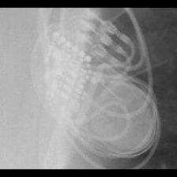 MDT:Insync III</td>
<td align="center" valign="top"><b>Option 4</b>  MDT:EnRhythm</td>
<td align="center" valign="top"><b>Option 5</b>  MDT:Advisa</td>
<td align="center" valign="middle"><b>Option 6</b>  <i>None of the above</i></td>
</tr></table>

### Q3421 · correct: option 4 · `MDT:Azure`

<table><tr>
<td align="center" valign="top"><b>Query</b>  MDT:Azure</td>
<td align="center" valign="top"><b>Option 1</b>  BIO:Evia</td>
<td align="center" valign="top"><b>Option 2</b>  MDT:Advisa</td>
<td align="center" valign="top"><b>Option 3</b>  STJ:Accent</td>
<td align="center" valign="top"><b>✅ Option 4</b>  MDT:Azure</td>
<td align="center" valign="top"><b>Option 5</b> 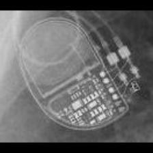 MDT:EnRhythm</td>
<td align="center" valign="middle"><b>Option 6</b>  <i>None of the above</i></td>
</tr></table>

### Q3422 · correct: option 4 · `MDT:Azure`

<table><tr>
<td align="center" valign="top"><b>Query</b> 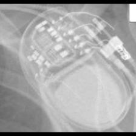 MDT:Azure</td>
<td align="center" valign="top"><b>Option 1</b>  MDT:Insync III</td>
<td align="center" valign="top"><b>Option 2</b>  STJ:Accent</td>
<td align="center" valign="top"><b>Option 3</b>  MDT:AT500</td>
<td align="center" valign="top"><b>✅ Option 4</b>  MDT:Azure</td>
<td align="center" valign="top"><b>Option 5</b>  MDT:EnRhythm</td>
<td align="center" valign="middle"><b>Option 6</b>  <i>None of the above</i></td>
</tr></table>

### Q3423 · correct: option 4 · `MDT:C20_T20`

<table><tr>
<td align="center" valign="top"><b>Query</b> 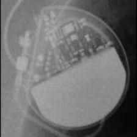 MDT:C20_T20</td>
<td align="center" valign="top"><b>Option 1</b> 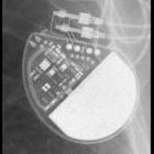 MDT:C60 DR</td>
<td align="center" valign="top"><b>Option 2</b>  SOR:Rhapsody_Symphony</td>
<td align="center" valign="top"><b>Option 3</b>  MDT:Sigma</td>
<td align="center" valign="top"><b>✅ Option 4</b>  MDT:C20_T20</td>
<td align="center" valign="top"><b>Option 5</b>  STJ:Zephyr</td>
<td align="center" valign="middle"><b>Option 6</b>  <i>None of the above</i></td>
</tr></table>

### Q3424 · correct: option 5 · `MDT:C20_T20`

<table><tr>
<td align="center" valign="top"><b>Query</b> 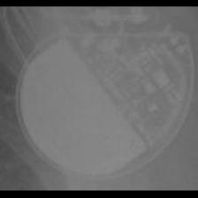 MDT:C20_T20</td>
<td align="center" valign="top"><b>Option 1</b>  MDT:C60 DR</td>
<td align="center" valign="top"><b>Option 2</b>  MDT:Adapta_Kappa_Sensia_Versa</td>
<td align="center" valign="top"><b>Option 3</b> 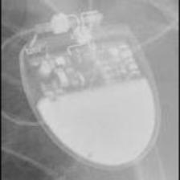 SOR:Rhapsody_Symphony</td>
<td align="center" valign="top"><b>Option 4</b> 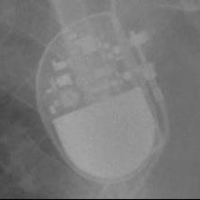 MDT:Sigma</td>
<td align="center" valign="top"><b>✅ Option 5</b>  MDT:C20_T20</td>
<td align="center" valign="middle"><b>Option 6</b>  <i>None of the above</i></td>
</tr></table>

### Q3425 · correct: option 2 · `MDT:C20_T20`

<table><tr>
<td align="center" valign="top"><b>Query</b> 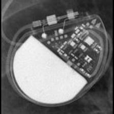 MDT:C20_T20</td>
<td align="center" valign="top"><b>Option 1</b>  MDT:C60 DR</td>
<td align="center" valign="top"><b>✅ Option 2</b>  MDT:C20_T20</td>
<td align="center" valign="top"><b>Option 3</b>  MDT:Vita II</td>
<td align="center" valign="top"><b>Option 4</b>  MDT:Adapta_Kappa_Sensia_Versa</td>
<td align="center" valign="top"><b>Option 5</b>  SOR:Elect XS Plus</td>
<td align="center" valign="middle"><b>Option 6</b>  <i>None of the above</i></td>
</tr></table>

### Q3426 · correct: option 4 · `MDT:C20_T20`

<table><tr>
<td align="center" valign="top"><b>Query</b> 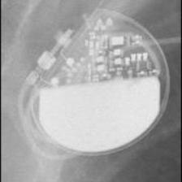 MDT:C20_T20</td>
<td align="center" valign="top"><b>Option 1</b>  SOR:Rhapsody_Symphony</td>
<td align="center" valign="top"><b>Option 2</b>  MDT:Adapta_Kappa_Sensia_Versa</td>
<td align="center" valign="top"><b>Option 3</b>  MDT:C60 DR</td>
<td align="center" valign="top"><b>✅ Option 4</b>  MDT:C20_T20</td>
<td align="center" valign="top"><b>Option 5</b>  MDT:Sigma</td>
<td align="center" valign="middle"><b>Option 6</b>  <i>None of the above</i></td>
</tr></table>

### Q3427 · correct: option 6 (None of the above)

<table><tr>
<td align="center" valign="top"><b>Query</b>  MDT:C20_T20</td>
<td align="center" valign="top"><b>Option 1</b> 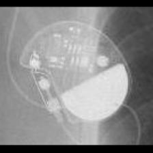 STJ:Victory</td>
<td align="center" valign="top"><b>Option 2</b>  BIO:Cyclos</td>
<td align="center" valign="top"><b>Option 3</b>  BOS:ContakTR_Discovery_Meridian_Pulsar Max</td>
<td align="center" valign="top"><b>Option 4</b> 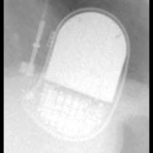 BIO:Actros_Philos</td>
<td align="center" valign="top"><b>Option 5</b> 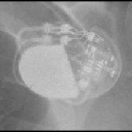 STJ:Zephyr</td>
<td align="center" valign="middle"><b>✅ Option 6</b>  <i>None of the above</i></td>
</tr></table>

### Q3428 · correct: option 3 · `MDT:C20_T20`

<table><tr>
<td align="center" valign="top"><b>Query</b>  MDT:C20_T20</td>
<td align="center" valign="top"><b>Option 1</b>  MDT:C60 DR</td>
<td align="center" valign="top"><b>Option 2</b>  STJ:Identity</td>
<td align="center" valign="top"><b>✅ Option 3</b>  MDT:C20_T20</td>
<td align="center" valign="top"><b>Option 4</b>  STJ:Zephyr</td>
<td align="center" valign="top"><b>Option 5</b> 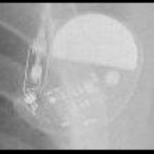 STJ:Victory</td>
<td align="center" valign="middle"><b>Option 6</b>  <i>None of the above</i></td>
</tr></table>

### Q3429 · correct: option 4 · `MDT:C20_T20`

<table><tr>
<td align="center" valign="top"><b>Query</b>  MDT:C20_T20</td>
<td align="center" valign="top"><b>Option 1</b>  MDT:C60 DR</td>
<td align="center" valign="top"><b>Option 2</b>  STJ:Zephyr</td>
<td align="center" valign="top"><b>Option 3</b>  STJ:Victory</td>
<td align="center" valign="top"><b>✅ Option 4</b>  MDT:C20_T20</td>
<td align="center" valign="top"><b>Option 5</b>  MDT:Sigma</td>
<td align="center" valign="middle"><b>Option 6</b>  <i>None of the above</i></td>
</tr></table>

### Q3430 · correct: option 1 · `MDT:C60 DR`

<table><tr>
<td align="center" valign="top"><b>Query</b> 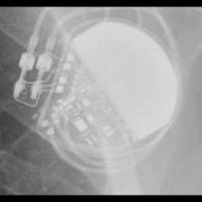 MDT:C60 DR</td>
<td align="center" valign="top"><b>✅ Option 1</b>  MDT:C60 DR</td>
<td align="center" valign="top"><b>Option 2</b>  MDT:C20_T20</td>
<td align="center" valign="top"><b>Option 3</b>  MDT:Adapta_Kappa_Sensia_Versa</td>
<td align="center" valign="top"><b>Option 4</b>  STJ:Zephyr</td>
<td align="center" valign="top"><b>Option 5</b>  STJ:Identity</td>
<td align="center" valign="middle"><b>Option 6</b>  <i>None of the above</i></td>
</tr></table>

### Q3431 · correct: option 5 · `MDT:C60 DR`

<table><tr>
<td align="center" valign="top"><b>Query</b>  MDT:C60 DR</td>
<td align="center" valign="top"><b>Option 1</b>  SOR:Rhapsody_Symphony</td>
<td align="center" valign="top"><b>Option 2</b>  MDT:Sigma</td>
<td align="center" valign="top"><b>Option 3</b>  STJ:Zephyr</td>
<td align="center" valign="top"><b>Option 4</b>  MDT:C20_T20</td>
<td align="center" valign="top"><b>✅ Option 5</b>  MDT:C60 DR</td>
<td align="center" valign="middle"><b>Option 6</b>  <i>None of the above</i></td>
</tr></table>

### Q3432 · correct: option 1 · `MDT:C60 DR`

<table><tr>
<td align="center" valign="top"><b>Query</b> 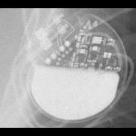 MDT:C60 DR</td>
<td align="center" valign="top"><b>✅ Option 1</b>  MDT:C60 DR</td>
<td align="center" valign="top"><b>Option 2</b>  STJ:Zephyr</td>
<td align="center" valign="top"><b>Option 3</b>  MDT:C20_T20</td>
<td align="center" valign="top"><b>Option 4</b>  MDT:Sigma</td>
<td align="center" valign="top"><b>Option 5</b> 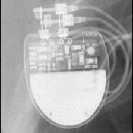 SOR:Rhapsody_Symphony</td>
<td align="center" valign="middle"><b>Option 6</b>  <i>None of the above</i></td>
</tr></table>

### Q3433 · correct: option 5 · `MDT:C60 DR`

<table><tr>
<td align="center" valign="top"><b>Query</b>  MDT:C60 DR</td>
<td align="center" valign="top"><b>Option 1</b>  MDT:Sigma</td>
<td align="center" valign="top"><b>Option 2</b>  MDT:C20_T20</td>
<td align="center" valign="top"><b>Option 3</b>  STJ:Zephyr</td>
<td align="center" valign="top"><b>Option 4</b>  MDT:Adapta_Kappa_Sensia_Versa</td>
<td align="center" valign="top"><b>✅ Option 5</b>  MDT:C60 DR</td>
<td align="center" valign="middle"><b>Option 6</b>  <i>None of the above</i></td>
</tr></table>

### Q3434 · correct: option 1 · `MDT:C60 DR`

<table><tr>
<td align="center" valign="top"><b>Query</b> 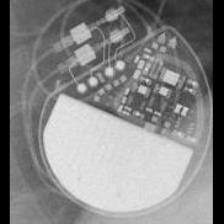 MDT:C60 DR</td>
<td align="center" valign="top"><b>✅ Option 1</b>  MDT:C60 DR</td>
<td align="center" valign="top"><b>Option 2</b>  MDT:Vita II</td>
<td align="center" valign="top"><b>Option 3</b>  SOR:Rhapsody_Symphony</td>
<td align="center" valign="top"><b>Option 4</b>  MDT:C20_T20</td>
<td align="center" valign="top"><b>Option 5</b>  BOS:Altrua_Insignia</td>
<td align="center" valign="middle"><b>Option 6</b>  <i>None of the above</i></td>
</tr></table>

### Q3435 · correct: option 1 · `MDT:C60 DR`

<table><tr>
<td align="center" valign="top"><b>Query</b> 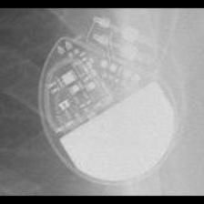 MDT:C60 DR</td>
<td align="center" valign="top"><b>✅ Option 1</b>  MDT:C60 DR</td>
<td align="center" valign="top"><b>Option 2</b>  SOR:Rhapsody_Symphony</td>
<td align="center" valign="top"><b>Option 3</b>  MDT:Sigma</td>
<td align="center" valign="top"><b>Option 4</b>  BIO:Cyclos</td>
<td align="center" valign="top"><b>Option 5</b>  MDT:C20_T20</td>
<td align="center" valign="middle"><b>Option 6</b>  <i>None of the above</i></td>
</tr></table>

### Q3436 · correct: option 5 · `MDT:C60 DR`

<table><tr>
<td align="center" valign="top"><b>Query</b> 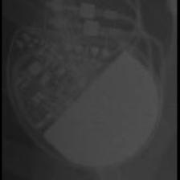 MDT:C60 DR</td>
<td align="center" valign="top"><b>Option 1</b>  MDT:C20_T20</td>
<td align="center" valign="top"><b>Option 2</b> 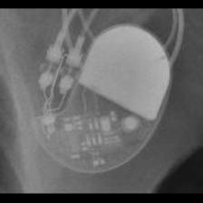 STJ:Zephyr</td>
<td align="center" valign="top"><b>Option 3</b>  MDT:Adapta_Kappa_Sensia_Versa</td>
<td align="center" valign="top"><b>Option 4</b>  MDT:Sigma</td>
<td align="center" valign="top"><b>✅ Option 5</b>  MDT:C60 DR</td>
<td align="center" valign="middle"><b>Option 6</b>  <i>None of the above</i></td>
</tr></table>

### Q3437 · correct: option 4 · `MDT:Claria_Evera_Viva`

<table><tr>
<td align="center" valign="top"><b>Query</b> 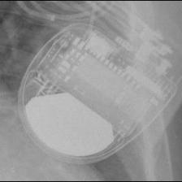 MDT:Claria_Evera_Viva</td>
<td align="center" valign="top"><b>Option 1</b>  BOS:Ventak Prizm</td>
<td align="center" valign="top"><b>Option 2</b>  MDT:Maximo</td>
<td align="center" valign="top"><b>Option 3</b>  BOS:Vitality</td>
<td align="center" valign="top"><b>✅ Option 4</b>  MDT:Claria_Evera_Viva</td>
<td align="center" valign="top"><b>Option 5</b>  MDT:Concerto_Consulta_Maximo_Protecta_Secura</td>
<td align="center" valign="middle"><b>Option 6</b>  <i>None of the above</i></td>
</tr></table>

### Q3438 · correct: option 3 · `MDT:Claria_Evera_Viva`

<table><tr>
<td align="center" valign="top"><b>Query</b> 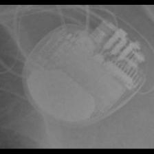 MDT:Claria_Evera_Viva</td>
<td align="center" valign="top"><b>Option 1</b>  MDT:Maximo</td>
<td align="center" valign="top"><b>Option 2</b> 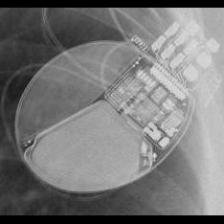 BOS:Autogen_Teligen_Energen_Cognis</td>
<td align="center" valign="top"><b>✅ Option 3</b> 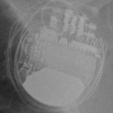 MDT:Claria_Evera_Viva</td>
<td align="center" valign="top"><b>Option 4</b>  BOS:Vitality</td>
<td align="center" valign="top"><b>Option 5</b>  MDT:Concerto_Consulta_Maximo_Protecta_Secura</td>
<td align="center" valign="middle"><b>Option 6</b>  <i>None of the above</i></td>
</tr></table>

### Q3439 · correct: option 5 · `MDT:Claria_Evera_Viva`

<table><tr>
<td align="center" valign="top"><b>Query</b> 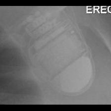 MDT:Claria_Evera_Viva</td>
<td align="center" valign="top"><b>Option 1</b>  SOR:Thesis</td>
<td align="center" valign="top"><b>Option 2</b> 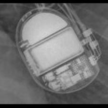 BOS:Ventak Prizm</td>
<td align="center" valign="top"><b>Option 3</b>  BOS:Vitality</td>
<td align="center" valign="top"><b>Option 4</b> 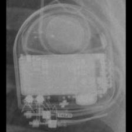 MDT:Maximo</td>
<td align="center" valign="top"><b>✅ Option 5</b>  MDT:Claria_Evera_Viva</td>
<td align="center" valign="middle"><b>Option 6</b>  <i>None of the above</i></td>
</tr></table>

### Q3440 · correct: option 1 · `MDT:Claria_Evera_Viva`

<table><tr>
<td align="center" valign="top"><b>Query</b> 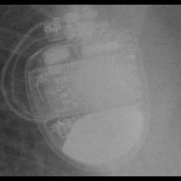 MDT:Claria_Evera_Viva</td>
<td align="center" valign="top"><b>✅ Option 1</b>  MDT:Claria_Evera_Viva</td>
<td align="center" valign="top"><b>Option 2</b>  MDT:Maximo</td>
<td align="center" valign="top"><b>Option 3</b>  BOS:Ventak Prizm</td>
<td align="center" valign="top"><b>Option 4</b>  BOS:Vitality</td>
<td align="center" valign="top"><b>Option 5</b>  MDT:Concerto_Consulta_Maximo_Protecta_Secura</td>
<td align="center" valign="middle"><b>Option 6</b>  <i>None of the above</i></td>
</tr></table>

### Q3441 · correct: option 2 · `MDT:Claria_Evera_Viva`

<table><tr>
<td align="center" valign="top"><b>Query</b> 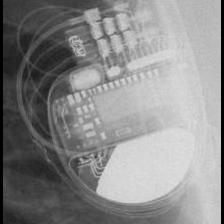 MDT:Claria_Evera_Viva</td>
<td align="center" valign="top"><b>Option 1</b>  MDT:Maximo</td>
<td align="center" valign="top"><b>✅ Option 2</b>  MDT:Claria_Evera_Viva</td>
<td align="center" valign="top"><b>Option 3</b>  BOS:Vitality</td>
<td align="center" valign="top"><b>Option 4</b>  MDT:Concerto_Consulta_Maximo_Protecta_Secura</td>
<td align="center" valign="top"><b>Option 5</b>  BOS:Visionist</td>
<td align="center" valign="middle"><b>Option 6</b>  <i>None of the above</i></td>
</tr></table>

### Q3442 · correct: option 4 · `MDT:Claria_Evera_Viva`

<table><tr>
<td align="center" valign="top"><b>Query</b> 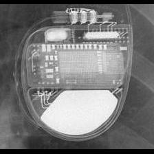 MDT:Claria_Evera_Viva</td>
<td align="center" valign="top"><b>Option 1</b>  BOS:Vitality</td>
<td align="center" valign="top"><b>Option 2</b>  MDT:Concerto_Consulta_Maximo_Protecta_Secura</td>
<td align="center" valign="top"><b>Option 3</b>  BOS:Ventak Prizm</td>
<td align="center" valign="top"><b>✅ Option 4</b>  MDT:Claria_Evera_Viva</td>
<td align="center" valign="top"><b>Option 5</b>  MDT:Maximo</td>
<td align="center" valign="middle"><b>Option 6</b>  <i>None of the above</i></td>
</tr></table>

### Q3443 · correct: option 5 · `MDT:Claria_Evera_Viva`

<table><tr>
<td align="center" valign="top"><b>Query</b> 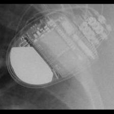 MDT:Claria_Evera_Viva</td>
<td align="center" valign="top"><b>Option 1</b>  BOS:Vitality</td>
<td align="center" valign="top"><b>Option 2</b>  MDT:Maximo</td>
<td align="center" valign="top"><b>Option 3</b>  MDT:Concerto_Consulta_Maximo_Protecta_Secura</td>
<td align="center" valign="top"><b>Option 4</b>  BOS:Ventak Prizm</td>
<td align="center" valign="top"><b>✅ Option 5</b>  MDT:Claria_Evera_Viva</td>
<td align="center" valign="middle"><b>Option 6</b>  <i>None of the above</i></td>
</tr></table>

### Q3444 · correct: option 2 · `MDT:Concerto_Consulta_Maximo_Protecta_Secura`

<table><tr>
<td align="center" valign="top"><b>Query</b> 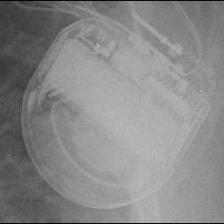 MDT:Concerto_Consulta_Maximo_Protecta_Secura</td>
<td align="center" valign="top"><b>Option 1</b>  STJ:Ellipse</td>
<td align="center" valign="top"><b>✅ Option 2</b>  MDT:Concerto_Consulta_Maximo_Protecta_Secura</td>
<td align="center" valign="top"><b>Option 3</b>  STJ:Quadra Assura_Unify</td>
<td align="center" valign="top"><b>Option 4</b>  BOS:Contak Renewal 4</td>
<td align="center" valign="top"><b>Option 5</b>  MDT:Maximo</td>
<td align="center" valign="middle"><b>Option 6</b>  <i>None of the above</i></td>
</tr></table>

### Q3445 · correct: option 2 · `MDT:Concerto_Consulta_Maximo_Protecta_Secura`

<table><tr>
<td align="center" valign="top"><b>Query</b> 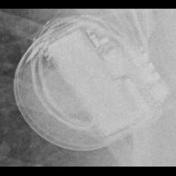 MDT:Concerto_Consulta_Maximo_Protecta_Secura</td>
<td align="center" valign="top"><b>Option 1</b>  BOS:Contak Renewal 4</td>
<td align="center" valign="top"><b>✅ Option 2</b>  MDT:Concerto_Consulta_Maximo_Protecta_Secura</td>
<td align="center" valign="top"><b>Option 3</b> 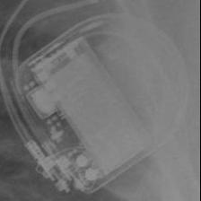 MDT:Maximo</td>
<td align="center" valign="top"><b>Option 4</b>  BOS:Vitality</td>
<td align="center" valign="top"><b>Option 5</b>  BOS:Ventak Prizm</td>
<td align="center" valign="middle"><b>Option 6</b>  <i>None of the above</i></td>
</tr></table>

### Q3446 · correct: option 2 · `MDT:Concerto_Consulta_Maximo_Protecta_Secura`

<table><tr>
<td align="center" valign="top"><b>Query</b>  MDT:Concerto_Consulta_Maximo_Protecta_Secura</td>
<td align="center" valign="top"><b>Option 1</b>  MDT:Maximo</td>
<td align="center" valign="top"><b>✅ Option 2</b>  MDT:Concerto_Consulta_Maximo_Protecta_Secura</td>
<td align="center" valign="top"><b>Option 3</b>  MDT:Claria_Evera_Viva</td>
<td align="center" valign="top"><b>Option 4</b>  BOS:Contak Renewal 4</td>
<td align="center" valign="top"><b>Option 5</b>  STJ:Quadra Assura_Unify</td>
<td align="center" valign="middle"><b>Option 6</b>  <i>None of the above</i></td>
</tr></table>

### Q3447 · correct: option 2 · `MDT:Concerto_Consulta_Maximo_Protecta_Secura`

<table><tr>
<td align="center" valign="top"><b>Query</b>  MDT:Concerto_Consulta_Maximo_Protecta_Secura</td>
<td align="center" valign="top"><b>Option 1</b>  MDT:Maximo</td>
<td align="center" valign="top"><b>✅ Option 2</b>  MDT:Concerto_Consulta_Maximo_Protecta_Secura</td>
<td align="center" valign="top"><b>Option 3</b>  MDT:Claria_Evera_Viva</td>
<td align="center" valign="top"><b>Option 4</b>  BOS:Contak Renewal 4</td>
<td align="center" valign="top"><b>Option 5</b>  STJ:Quadra Assura_Unify</td>
<td align="center" valign="middle"><b>Option 6</b>  <i>None of the above</i></td>
</tr></table>

### Q3448 · correct: option 4 · `MDT:Concerto_Consulta_Maximo_Protecta_Secura`

<table><tr>
<td align="center" valign="top"><b>Query</b>  MDT:Concerto_Consulta_Maximo_Protecta_Secura</td>
<td align="center" valign="top"><b>Option 1</b>  BOS:Vitality</td>
<td align="center" valign="top"><b>Option 2</b>  MDT:Maximo</td>
<td align="center" valign="top"><b>Option 3</b>  BOS:Contak Renewal 4</td>
<td align="center" valign="top"><b>✅ Option 4</b>  MDT:Concerto_Consulta_Maximo_Protecta_Secura</td>
<td align="center" valign="top"><b>Option 5</b>  STJ:Ellipse</td>
<td align="center" valign="middle"><b>Option 6</b>  <i>None of the above</i></td>
</tr></table>

### Q3449 · correct: option 3 · `MDT:Concerto_Consulta_Maximo_Protecta_Secura`

<table><tr>
<td align="center" valign="top"><b>Query</b>  MDT:Concerto_Consulta_Maximo_Protecta_Secura</td>
<td align="center" valign="top"><b>Option 1</b>  MDT:Claria_Evera_Viva</td>
<td align="center" valign="top"><b>Option 2</b>  BOS:Contak Renewal 4</td>
<td align="center" valign="top"><b>✅ Option 3</b>  MDT:Concerto_Consulta_Maximo_Protecta_Secura</td>
<td align="center" valign="top"><b>Option 4</b>  STJ:Quadra Assura_Unify</td>
<td align="center" valign="top"><b>Option 5</b>  MDT:Maximo</td>
<td align="center" valign="middle"><b>Option 6</b>  <i>None of the above</i></td>
</tr></table>

### Q3450 · correct: option 2 · `MDT:Concerto_Consulta_Maximo_Protecta_Secura`

<table><tr>
<td align="center" valign="top"><b>Query</b>  MDT:Concerto_Consulta_Maximo_Protecta_Secura</td>
<td align="center" valign="top"><b>Option 1</b>  MDT:Claria_Evera_Viva</td>
<td align="center" valign="top"><b>✅ Option 2</b>  MDT:Concerto_Consulta_Maximo_Protecta_Secura</td>
<td align="center" valign="top"><b>Option 3</b>  MDT:Maximo</td>
<td align="center" valign="top"><b>Option 4</b>  BOS:Vitality</td>
<td align="center" valign="top"><b>Option 5</b>  BOS:Contak Renewal 4</td>
<td align="center" valign="middle"><b>Option 6</b>  <i>None of the above</i></td>
</tr></table>

### Q3451 · correct: option 5 · `MDT:EnRhythm`

<table><tr>
<td align="center" valign="top"><b>Query</b>  MDT:EnRhythm</td>
<td align="center" valign="top"><b>Option 1</b>  MDT:Insync III</td>
<td align="center" valign="top"><b>Option 2</b>  MDT:Advisa</td>
<td align="center" valign="top"><b>Option 3</b>  MDT:Syncra</td>
<td align="center" valign="top"><b>Option 4</b>  MDT:AT500</td>
<td align="center" valign="top"><b>✅ Option 5</b>  MDT:EnRhythm</td>
<td align="center" valign="middle"><b>Option 6</b>  <i>None of the above</i></td>
</tr></table>

### Q3452 · correct: option 1 · `MDT:EnRhythm`

<table><tr>
<td align="center" valign="top"><b>Query</b>  MDT:EnRhythm</td>
<td align="center" valign="top"><b>✅ Option 1</b>  MDT:EnRhythm</td>
<td align="center" valign="top"><b>Option 2</b>  MDT:Insync III</td>
<td align="center" valign="top"><b>Option 3</b>  MDT:Advisa</td>
<td align="center" valign="top"><b>Option 4</b>  MDT:AT500</td>
<td align="center" valign="top"><b>Option 5</b>  MDT:Syncra</td>
<td align="center" valign="middle"><b>Option 6</b>  <i>None of the above</i></td>
</tr></table>

### Q3453 · correct: option 1 · `MDT:EnRhythm`

<table><tr>
<td align="center" valign="top"><b>Query</b>  MDT:EnRhythm</td>
<td align="center" valign="top"><b>✅ Option 1</b>  MDT:EnRhythm</td>
<td align="center" valign="top"><b>Option 2</b>  MDT:Insync III</td>
<td align="center" valign="top"><b>Option 3</b>  MDT:Advisa</td>
<td align="center" valign="top"><b>Option 4</b>  MDT:AT500</td>
<td align="center" valign="top"><b>Option 5</b>  MDT:Syncra</td>
<td align="center" valign="middle"><b>Option 6</b>  <i>None of the above</i></td>
</tr></table>

