# Pacemakers (Howard et al.) · query set `train1` · page 4/6

[← all pages](README.md)

### Q3454 · correct: option 4 · `MDT:EnRhythm`

<table><tr>
<td align="center" valign="top"><b>Query</b> 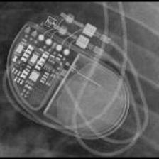 MDT:EnRhythm</td>
<td align="center" valign="top"><b>Option 1</b>  MDT:Insync III</td>
<td align="center" valign="top"><b>Option 2</b>  MDT:Syncra</td>
<td align="center" valign="top"><b>Option 3</b>  MDT:AT500</td>
<td align="center" valign="top"><b>✅ Option 4</b>  MDT:EnRhythm</td>
<td align="center" valign="top"><b>Option 5</b>  MDT:Advisa</td>
<td align="center" valign="middle"><b>Option 6</b>  <i>None of the above</i></td>
</tr></table>

### Q3455 · correct: option 4 · `MDT:EnRhythm`

<table><tr>
<td align="center" valign="top"><b>Query</b>  MDT:EnRhythm</td>
<td align="center" valign="top"><b>Option 1</b>  MDT:Advisa</td>
<td align="center" valign="top"><b>Option 2</b>  MDT:AT500</td>
<td align="center" valign="top"><b>Option 3</b>  MDT:Syncra</td>
<td align="center" valign="top"><b>✅ Option 4</b>  MDT:EnRhythm</td>
<td align="center" valign="top"><b>Option 5</b>  MDT:Insync III</td>
<td align="center" valign="middle"><b>Option 6</b>  <i>None of the above</i></td>
</tr></table>

### Q3456 · correct: option 1 · `MDT:EnRhythm`

<table><tr>
<td align="center" valign="top"><b>Query</b> 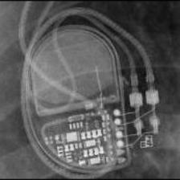 MDT:EnRhythm</td>
<td align="center" valign="top"><b>✅ Option 1</b>  MDT:EnRhythm</td>
<td align="center" valign="top"><b>Option 2</b>  MDT:AT500</td>
<td align="center" valign="top"><b>Option 3</b>  MDT:Insync III</td>
<td align="center" valign="top"><b>Option 4</b>  MDT:Syncra</td>
<td align="center" valign="top"><b>Option 5</b>  MDT:Advisa</td>
<td align="center" valign="middle"><b>Option 6</b>  <i>None of the above</i></td>
</tr></table>

### Q3457 · correct: option 4 · `MDT:EnRhythm`

<table><tr>
<td align="center" valign="top"><b>Query</b> 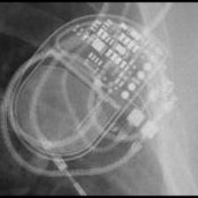 MDT:EnRhythm</td>
<td align="center" valign="top"><b>Option 1</b>  MDT:AT500</td>
<td align="center" valign="top"><b>Option 2</b> 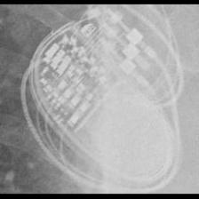 MDT:Syncra</td>
<td align="center" valign="top"><b>Option 3</b>  MDT:Insync III</td>
<td align="center" valign="top"><b>✅ Option 4</b>  MDT:EnRhythm</td>
<td align="center" valign="top"><b>Option 5</b>  MDT:Advisa</td>
<td align="center" valign="middle"><b>Option 6</b>  <i>None of the above</i></td>
</tr></table>

### Q3458 · correct: option 5 · `MDT:Insync III`

<table><tr>
<td align="center" valign="top"><b>Query</b> 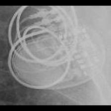 MDT:Insync III</td>
<td align="center" valign="top"><b>Option 1</b>  MDT:EnRhythm</td>
<td align="center" valign="top"><b>Option 2</b>  MDT:AT500</td>
<td align="center" valign="top"><b>Option 3</b>  MDT:Syncra</td>
<td align="center" valign="top"><b>Option 4</b>  MDT:Advisa</td>
<td align="center" valign="top"><b>✅ Option 5</b>  MDT:Insync III</td>
<td align="center" valign="middle"><b>Option 6</b>  <i>None of the above</i></td>
</tr></table>

### Q3459 · correct: option 5 · `MDT:Insync III`

<table><tr>
<td align="center" valign="top"><b>Query</b> 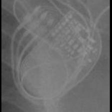 MDT:Insync III</td>
<td align="center" valign="top"><b>Option 1</b>  MDT:AT500</td>
<td align="center" valign="top"><b>Option 2</b>  MDT:EnRhythm</td>
<td align="center" valign="top"><b>Option 3</b>  MDT:Advisa</td>
<td align="center" valign="top"><b>Option 4</b>  MDT:Syncra</td>
<td align="center" valign="top"><b>✅ Option 5</b>  MDT:Insync III</td>
<td align="center" valign="middle"><b>Option 6</b>  <i>None of the above</i></td>
</tr></table>

### Q3460 · correct: option 5 · `MDT:Insync III`

<table><tr>
<td align="center" valign="top"><b>Query</b> 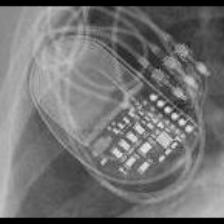 MDT:Insync III</td>
<td align="center" valign="top"><b>Option 1</b>  MDT:AT500</td>
<td align="center" valign="top"><b>Option 2</b>  MDT:Advisa</td>
<td align="center" valign="top"><b>Option 3</b>  MDT:Syncra</td>
<td align="center" valign="top"><b>Option 4</b>  MDT:EnRhythm</td>
<td align="center" valign="top"><b>✅ Option 5</b>  MDT:Insync III</td>
<td align="center" valign="middle"><b>Option 6</b>  <i>None of the above</i></td>
</tr></table>

### Q3461 · correct: option 5 · `MDT:Insync III`

<table><tr>
<td align="center" valign="top"><b>Query</b>  MDT:Insync III</td>
<td align="center" valign="top"><b>Option 1</b>  MDT:Advisa</td>
<td align="center" valign="top"><b>Option 2</b>  MDT:AT500</td>
<td align="center" valign="top"><b>Option 3</b>  MDT:EnRhythm</td>
<td align="center" valign="top"><b>Option 4</b>  MDT:Syncra</td>
<td align="center" valign="top"><b>✅ Option 5</b> 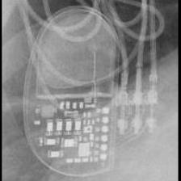 MDT:Insync III</td>
<td align="center" valign="middle"><b>Option 6</b>  <i>None of the above</i></td>
</tr></table>

### Q3462 · correct: option 1 · `MDT:Insync III`

<table><tr>
<td align="center" valign="top"><b>Query</b> 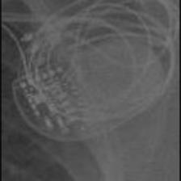 MDT:Insync III</td>
<td align="center" valign="top"><b>✅ Option 1</b>  MDT:Insync III</td>
<td align="center" valign="top"><b>Option 2</b>  MDT:AT500</td>
<td align="center" valign="top"><b>Option 3</b>  MDT:Advisa</td>
<td align="center" valign="top"><b>Option 4</b>  MDT:EnRhythm</td>
<td align="center" valign="top"><b>Option 5</b>  MDT:Syncra</td>
<td align="center" valign="middle"><b>Option 6</b>  <i>None of the above</i></td>
</tr></table>

### Q3463 · correct: option 3 · `MDT:Insync III`

<table><tr>
<td align="center" valign="top"><b>Query</b>  MDT:Insync III</td>
<td align="center" valign="top"><b>Option 1</b>  MDT:AT500</td>
<td align="center" valign="top"><b>Option 2</b>  MDT:EnRhythm</td>
<td align="center" valign="top"><b>✅ Option 3</b>  MDT:Insync III</td>
<td align="center" valign="top"><b>Option 4</b>  MDT:Syncra</td>
<td align="center" valign="top"><b>Option 5</b>  MDT:Advisa</td>
<td align="center" valign="middle"><b>Option 6</b>  <i>None of the above</i></td>
</tr></table>

### Q3464 · correct: option 1 · `MDT:Insync III`

<table><tr>
<td align="center" valign="top"><b>Query</b> 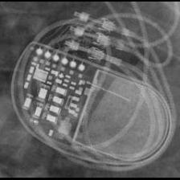 MDT:Insync III</td>
<td align="center" valign="top"><b>✅ Option 1</b>  MDT:Insync III</td>
<td align="center" valign="top"><b>Option 2</b>  MDT:EnRhythm</td>
<td align="center" valign="top"><b>Option 3</b>  MDT:AT500</td>
<td align="center" valign="top"><b>Option 4</b>  MDT:Syncra</td>
<td align="center" valign="top"><b>Option 5</b>  MDT:Advisa</td>
<td align="center" valign="middle"><b>Option 6</b>  <i>None of the above</i></td>
</tr></table>

### Q3465 · correct: option 3 · `MDT:Maximo`

<table><tr>
<td align="center" valign="top"><b>Query</b> 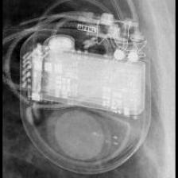 MDT:Maximo</td>
<td align="center" valign="top"><b>Option 1</b>  MDT:Concerto_Consulta_Maximo_Protecta_Secura</td>
<td align="center" valign="top"><b>Option 2</b>  STJ:Quadra Assura_Unify</td>
<td align="center" valign="top"><b>✅ Option 3</b>  MDT:Maximo</td>
<td align="center" valign="top"><b>Option 4</b>  BOS:Contak Renewal 4</td>
<td align="center" valign="top"><b>Option 5</b> 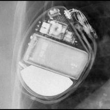 BOS:Vitality</td>
<td align="center" valign="middle"><b>Option 6</b>  <i>None of the above</i></td>
</tr></table>

### Q3466 · correct: option 4 · `MDT:Maximo`

<table><tr>
<td align="center" valign="top"><b>Query</b>  MDT:Maximo</td>
<td align="center" valign="top"><b>Option 1</b>  MDT:Concerto_Consulta_Maximo_Protecta_Secura</td>
<td align="center" valign="top"><b>Option 2</b>  BOS:Vitality</td>
<td align="center" valign="top"><b>Option 3</b>  BOS:Contak Renewal 4</td>
<td align="center" valign="top"><b>✅ Option 4</b>  MDT:Maximo</td>
<td align="center" valign="top"><b>Option 5</b>  STJ:Quadra Assura_Unify</td>
<td align="center" valign="middle"><b>Option 6</b>  <i>None of the above</i></td>
</tr></table>

### Q3467 · correct: option 4 · `MDT:Maximo`

<table><tr>
<td align="center" valign="top"><b>Query</b>  MDT:Maximo</td>
<td align="center" valign="top"><b>Option 1</b>  MDT:Concerto_Consulta_Maximo_Protecta_Secura</td>
<td align="center" valign="top"><b>Option 2</b>  BOS:Vitality</td>
<td align="center" valign="top"><b>Option 3</b>  BOS:Contak Renewal 4</td>
<td align="center" valign="top"><b>✅ Option 4</b>  MDT:Maximo</td>
<td align="center" valign="top"><b>Option 5</b>  STJ:Quadra Assura_Unify</td>
<td align="center" valign="middle"><b>Option 6</b>  <i>None of the above</i></td>
</tr></table>

### Q3468 · correct: option 1 · `MDT:Maximo`

<table><tr>
<td align="center" valign="top"><b>Query</b>  MDT:Maximo</td>
<td align="center" valign="top"><b>✅ Option 1</b>  MDT:Maximo</td>
<td align="center" valign="top"><b>Option 2</b>  BOS:Contak Renewal 4</td>
<td align="center" valign="top"><b>Option 3</b>  BOS:Vitality</td>
<td align="center" valign="top"><b>Option 4</b>  MDT:Claria_Evera_Viva</td>
<td align="center" valign="top"><b>Option 5</b>  MDT:Concerto_Consulta_Maximo_Protecta_Secura</td>
<td align="center" valign="middle"><b>Option 6</b>  <i>None of the above</i></td>
</tr></table>

### Q3469 · correct: option 2 · `MDT:Maximo`

<table><tr>
<td align="center" valign="top"><b>Query</b>  MDT:Maximo</td>
<td align="center" valign="top"><b>Option 1</b> 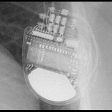 MDT:Claria_Evera_Viva</td>
<td align="center" valign="top"><b>✅ Option 2</b>  MDT:Maximo</td>
<td align="center" valign="top"><b>Option 3</b>  MDT:Concerto_Consulta_Maximo_Protecta_Secura</td>
<td align="center" valign="top"><b>Option 4</b>  STJ:Quadra Assura_Unify</td>
<td align="center" valign="top"><b>Option 5</b>  BOS:Contak Renewal 4</td>
<td align="center" valign="middle"><b>Option 6</b>  <i>None of the above</i></td>
</tr></table>

### Q3470 · correct: option 1 · `MDT:REVEAL`

<table><tr>
<td align="center" valign="top"><b>Query</b> 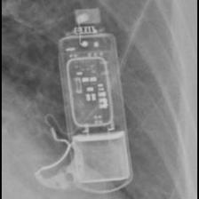 MDT:REVEAL</td>
<td align="center" valign="top"><b>✅ Option 1</b>  MDT:REVEAL</td>
<td align="center" valign="top"><b>Option 2</b> 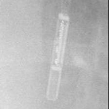 MDT:REVEAL LINQ</td>
<td align="center" valign="top"><b>Option 3</b> 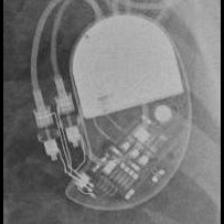 STJ:Identity</td>
<td align="center" valign="top"><b>Option 4</b>  BOS:Autogen_Teligen_Energen_Cognis</td>
<td align="center" valign="top"><b>Option 5</b> 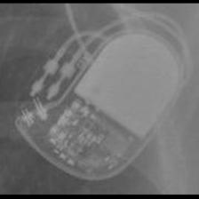 BIO:Cyclos</td>
<td align="center" valign="middle"><b>Option 6</b>  <i>None of the above</i></td>
</tr></table>

### Q3471 · correct: option 2 · `MDT:REVEAL`

<table><tr>
<td align="center" valign="top"><b>Query</b>  MDT:REVEAL</td>
<td align="center" valign="top"><b>Option 1</b>  STJ:Quadra Assura_Unify</td>
<td align="center" valign="top"><b>✅ Option 2</b> 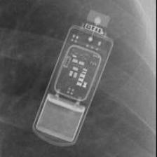 MDT:REVEAL</td>
<td align="center" valign="top"><b>Option 3</b>  BOS:Autogen_Teligen_Energen_Cognis</td>
<td align="center" valign="top"><b>Option 4</b>  BIO:Cyclos</td>
<td align="center" valign="top"><b>Option 5</b>  MDT:REVEAL LINQ</td>
<td align="center" valign="middle"><b>Option 6</b>  <i>None of the above</i></td>
</tr></table>

### Q3472 · correct: option 3 · `MDT:REVEAL`

<table><tr>
<td align="center" valign="top"><b>Query</b> 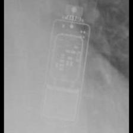 MDT:REVEAL</td>
<td align="center" valign="top"><b>Option 1</b>  STJ:Quadra Assura_Unify</td>
<td align="center" valign="top"><b>Option 2</b>  MDT:REVEAL LINQ</td>
<td align="center" valign="top"><b>✅ Option 3</b> 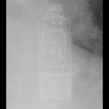 MDT:REVEAL</td>
<td align="center" valign="top"><b>Option 4</b>  BIO:Cyclos</td>
<td align="center" valign="top"><b>Option 5</b>  STJ:Zephyr</td>
<td align="center" valign="middle"><b>Option 6</b>  <i>None of the above</i></td>
</tr></table>

### Q3473 · correct: option 4 · `MDT:REVEAL`

<table><tr>
<td align="center" valign="top"><b>Query</b> 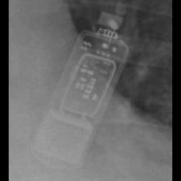 MDT:REVEAL</td>
<td align="center" valign="top"><b>Option 1</b>  MDT:REVEAL LINQ</td>
<td align="center" valign="top"><b>Option 2</b>  BOS:Autogen_Teligen_Energen_Cognis</td>
<td align="center" valign="top"><b>Option 3</b>  BIO:Cyclos</td>
<td align="center" valign="top"><b>✅ Option 4</b>  MDT:REVEAL</td>
<td align="center" valign="top"><b>Option 5</b>  BOS:Emblem</td>
<td align="center" valign="middle"><b>Option 6</b>  <i>None of the above</i></td>
</tr></table>

### Q3474 · correct: option 4 · `MDT:REVEAL LINQ`

<table><tr>
<td align="center" valign="top"><b>Query</b>  MDT:REVEAL LINQ</td>
<td align="center" valign="top"><b>Option 1</b>  BOS:Contak Renewal TR2</td>
<td align="center" valign="top"><b>Option 2</b> 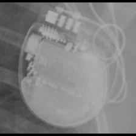 STJ:Ellipse</td>
<td align="center" valign="top"><b>Option 3</b>  MDT:REVEAL</td>
<td align="center" valign="top"><b>✅ Option 4</b> 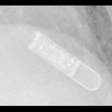 MDT:REVEAL LINQ</td>
<td align="center" valign="top"><b>Option 5</b> 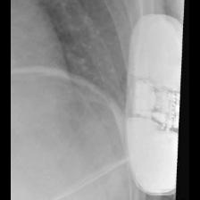 BOS:Emblem</td>
<td align="center" valign="middle"><b>Option 6</b>  <i>None of the above</i></td>
</tr></table>

### Q3475 · correct: option 3 · `MDT:REVEAL LINQ`

<table><tr>
<td align="center" valign="top"><b>Query</b>  MDT:REVEAL LINQ</td>
<td align="center" valign="top"><b>Option 1</b>  BOS:Contak Renewal TR2</td>
<td align="center" valign="top"><b>Option 2</b>  MDT:REVEAL</td>
<td align="center" valign="top"><b>✅ Option 3</b>  MDT:REVEAL LINQ</td>
<td align="center" valign="top"><b>Option 4</b>  BOS:Emblem</td>
<td align="center" valign="top"><b>Option 5</b>  STJ:Ellipse</td>
<td align="center" valign="middle"><b>Option 6</b>  <i>None of the above</i></td>
</tr></table>

### Q3476 · correct: option 5 · `MDT:REVEAL LINQ`

<table><tr>
<td align="center" valign="top"><b>Query</b> 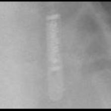 MDT:REVEAL LINQ</td>
<td align="center" valign="top"><b>Option 1</b>  BOS:Contak Renewal TR2</td>
<td align="center" valign="top"><b>Option 2</b>  STJ:Ellipse</td>
<td align="center" valign="top"><b>Option 3</b>  BOS:Emblem</td>
<td align="center" valign="top"><b>Option 4</b>  MDT:REVEAL</td>
<td align="center" valign="top"><b>✅ Option 5</b> 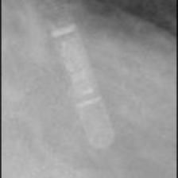 MDT:REVEAL LINQ</td>
<td align="center" valign="middle"><b>Option 6</b>  <i>None of the above</i></td>
</tr></table>

### Q3477 · correct: option 3 · `MDT:REVEAL LINQ`

<table><tr>
<td align="center" valign="top"><b>Query</b>  MDT:REVEAL LINQ</td>
<td align="center" valign="top"><b>Option 1</b>  BOS:Contak Renewal TR2</td>
<td align="center" valign="top"><b>Option 2</b>  STJ:Ellipse</td>
<td align="center" valign="top"><b>✅ Option 3</b> 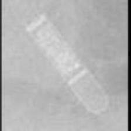 MDT:REVEAL LINQ</td>
<td align="center" valign="top"><b>Option 4</b>  MDT:REVEAL</td>
<td align="center" valign="top"><b>Option 5</b>  BOS:Emblem</td>
<td align="center" valign="middle"><b>Option 6</b>  <i>None of the above</i></td>
</tr></table>

### Q3478 · correct: option 3 · `MDT:REVEAL LINQ`

<table><tr>
<td align="center" valign="top"><b>Query</b> 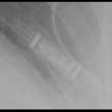 MDT:REVEAL LINQ</td>
<td align="center" valign="top"><b>Option 1</b>  BOS:Visionist</td>
<td align="center" valign="top"><b>Option 2</b>  BOS:Emblem</td>
<td align="center" valign="top"><b>✅ Option 3</b>  MDT:REVEAL LINQ</td>
<td align="center" valign="top"><b>Option 4</b>  BOS:Contak Renewal TR2</td>
<td align="center" valign="top"><b>Option 5</b>  MDT:REVEAL</td>
<td align="center" valign="middle"><b>Option 6</b>  <i>None of the above</i></td>
</tr></table>

### Q3479 · correct: option 3 · `MDT:REVEAL LINQ`

<table><tr>
<td align="center" valign="top"><b>Query</b>  MDT:REVEAL LINQ</td>
<td align="center" valign="top"><b>Option 1</b>  BOS:Contak Renewal TR2</td>
<td align="center" valign="top"><b>Option 2</b> 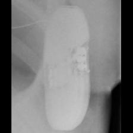 BOS:Emblem</td>
<td align="center" valign="top"><b>✅ Option 3</b>  MDT:REVEAL LINQ</td>
<td align="center" valign="top"><b>Option 4</b> 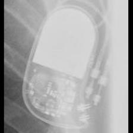 BIO:Cyclos</td>
<td align="center" valign="top"><b>Option 5</b>  STJ:Ellipse</td>
<td align="center" valign="middle"><b>Option 6</b>  <i>None of the above</i></td>
</tr></table>

### Q3480 · correct: option 3 · `MDT:Sigma`

<table><tr>
<td align="center" valign="top"><b>Query</b> 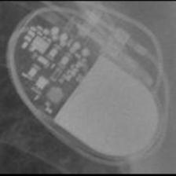 MDT:Sigma</td>
<td align="center" valign="top"><b>Option 1</b>  STJ:Identity</td>
<td align="center" valign="top"><b>Option 2</b>  MDT:Adapta_Kappa_Sensia_Versa</td>
<td align="center" valign="top"><b>✅ Option 3</b>  MDT:Sigma</td>
<td align="center" valign="top"><b>Option 4</b>  STJ:Zephyr</td>
<td align="center" valign="top"><b>Option 5</b>  BIO:Cyclos</td>
<td align="center" valign="middle"><b>Option 6</b>  <i>None of the above</i></td>
</tr></table>

### Q3481 · correct: option 2 · `MDT:Sigma`

<table><tr>
<td align="center" valign="top"><b>Query</b> 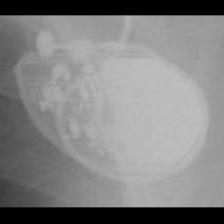 MDT:Sigma</td>
<td align="center" valign="top"><b>Option 1</b>  MDT:C20_T20</td>
<td align="center" valign="top"><b>✅ Option 2</b>  MDT:Sigma</td>
<td align="center" valign="top"><b>Option 3</b>  STJ:Victory</td>
<td align="center" valign="top"><b>Option 4</b>  STJ:Identity</td>
<td align="center" valign="top"><b>Option 5</b> 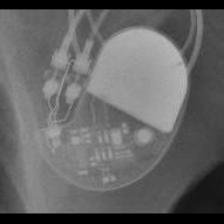 STJ:Zephyr</td>
<td align="center" valign="middle"><b>Option 6</b>  <i>None of the above</i></td>
</tr></table>

### Q3482 · correct: option 4 · `MDT:Sigma`

<table><tr>
<td align="center" valign="top"><b>Query</b> 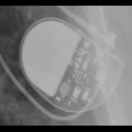 MDT:Sigma</td>
<td align="center" valign="top"><b>Option 1</b>  MDT:Adapta_Kappa_Sensia_Versa</td>
<td align="center" valign="top"><b>Option 2</b>  STJ:Zephyr</td>
<td align="center" valign="top"><b>Option 3</b> 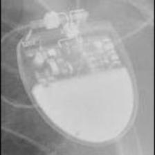 SOR:Rhapsody_Symphony</td>
<td align="center" valign="top"><b>✅ Option 4</b>  MDT:Sigma</td>
<td align="center" valign="top"><b>Option 5</b>  MDT:C20_T20</td>
<td align="center" valign="middle"><b>Option 6</b>  <i>None of the above</i></td>
</tr></table>

### Q3483 · correct: option 3 · `MDT:Sigma`

<table><tr>
<td align="center" valign="top"><b>Query</b>  MDT:Sigma</td>
<td align="center" valign="top"><b>Option 1</b> 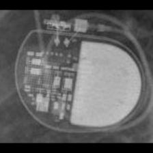 MDT:Adapta_Kappa_Sensia_Versa</td>
<td align="center" valign="top"><b>Option 2</b>  STJ:Zephyr</td>
<td align="center" valign="top"><b>✅ Option 3</b>  MDT:Sigma</td>
<td align="center" valign="top"><b>Option 4</b>  STJ:Identity</td>
<td align="center" valign="top"><b>Option 5</b>  BIO:Actros_Philos</td>
<td align="center" valign="middle"><b>Option 6</b>  <i>None of the above</i></td>
</tr></table>

### Q3484 · correct: option 4 · `MDT:Sigma`

<table><tr>
<td align="center" valign="top"><b>Query</b>  MDT:Sigma</td>
<td align="center" valign="top"><b>Option 1</b>  BIO:Cyclos</td>
<td align="center" valign="top"><b>Option 2</b>  MDT:Adapta_Kappa_Sensia_Versa</td>
<td align="center" valign="top"><b>Option 3</b>  MDT:C60 DR</td>
<td align="center" valign="top"><b>✅ Option 4</b>  MDT:Sigma</td>
<td align="center" valign="top"><b>Option 5</b>  STJ:Zephyr</td>
<td align="center" valign="middle"><b>Option 6</b>  <i>None of the above</i></td>
</tr></table>

### Q3485 · correct: option 5 · `MDT:Sigma`

<table><tr>
<td align="center" valign="top"><b>Query</b> 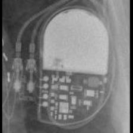 MDT:Sigma</td>
<td align="center" valign="top"><b>Option 1</b>  MDT:Adapta_Kappa_Sensia_Versa</td>
<td align="center" valign="top"><b>Option 2</b>  STJ:Identity</td>
<td align="center" valign="top"><b>Option 3</b>  SOR:Reply</td>
<td align="center" valign="top"><b>Option 4</b>  BOS:ContakTR_Discovery_Meridian_Pulsar Max</td>
<td align="center" valign="top"><b>✅ Option 5</b>  MDT:Sigma</td>
<td align="center" valign="middle"><b>Option 6</b>  <i>None of the above</i></td>
</tr></table>

### Q3486 · correct: option 4 · `MDT:Sigma`

<table><tr>
<td align="center" valign="top"><b>Query</b>  MDT:Sigma</td>
<td align="center" valign="top"><b>Option 1</b>  MDT:Adapta_Kappa_Sensia_Versa</td>
<td align="center" valign="top"><b>Option 2</b>  BOS:ContakTR_Discovery_Meridian_Pulsar Max</td>
<td align="center" valign="top"><b>Option 3</b>  STJ:Identity</td>
<td align="center" valign="top"><b>✅ Option 4</b>  MDT:Sigma</td>
<td align="center" valign="top"><b>Option 5</b> 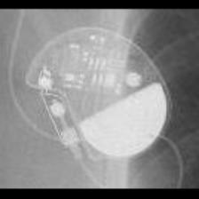 STJ:Victory</td>
<td align="center" valign="middle"><b>Option 6</b>  <i>None of the above</i></td>
</tr></table>

### Q3487 · correct: option 1 · `MDT:Syncra`

<table><tr>
<td align="center" valign="top"><b>Query</b> 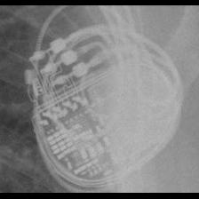 MDT:Syncra</td>
<td align="center" valign="top"><b>✅ Option 1</b>  MDT:Syncra</td>
<td align="center" valign="top"><b>Option 2</b>  MDT:AT500</td>
<td align="center" valign="top"><b>Option 3</b>  MDT:Insync III</td>
<td align="center" valign="top"><b>Option 4</b>  MDT:Advisa</td>
<td align="center" valign="top"><b>Option 5</b>  MDT:EnRhythm</td>
<td align="center" valign="middle"><b>Option 6</b>  <i>None of the above</i></td>
</tr></table>

### Q3488 · correct: option 1 · `MDT:Syncra`

<table><tr>
<td align="center" valign="top"><b>Query</b> 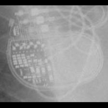 MDT:Syncra</td>
<td align="center" valign="top"><b>✅ Option 1</b>  MDT:Syncra</td>
<td align="center" valign="top"><b>Option 2</b>  MDT:Advisa</td>
<td align="center" valign="top"><b>Option 3</b>  MDT:AT500</td>
<td align="center" valign="top"><b>Option 4</b>  MDT:EnRhythm</td>
<td align="center" valign="top"><b>Option 5</b>  MDT:Insync III</td>
<td align="center" valign="middle"><b>Option 6</b>  <i>None of the above</i></td>
</tr></table>

### Q3489 · correct: option 5 · `MDT:Syncra`

<table><tr>
<td align="center" valign="top"><b>Query</b> 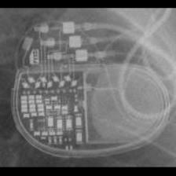 MDT:Syncra</td>
<td align="center" valign="top"><b>Option 1</b>  MDT:EnRhythm</td>
<td align="center" valign="top"><b>Option 2</b>  MDT:Insync III</td>
<td align="center" valign="top"><b>Option 3</b>  MDT:Advisa</td>
<td align="center" valign="top"><b>Option 4</b>  MDT:AT500</td>
<td align="center" valign="top"><b>✅ Option 5</b>  MDT:Syncra</td>
<td align="center" valign="middle"><b>Option 6</b>  <i>None of the above</i></td>
</tr></table>

### Q3490 · correct: option 2 · `MDT:Syncra`

<table><tr>
<td align="center" valign="top"><b>Query</b>  MDT:Syncra</td>
<td align="center" valign="top"><b>Option 1</b>  MDT:EnRhythm</td>
<td align="center" valign="top"><b>✅ Option 2</b>  MDT:Syncra</td>
<td align="center" valign="top"><b>Option 3</b>  MDT:Advisa</td>
<td align="center" valign="top"><b>Option 4</b>  MDT:AT500</td>
<td align="center" valign="top"><b>Option 5</b>  MDT:Insync III</td>
<td align="center" valign="middle"><b>Option 6</b>  <i>None of the above</i></td>
</tr></table>

### Q3491 · correct: option 3 · `MDT:Syncra`

<table><tr>
<td align="center" valign="top"><b>Query</b> 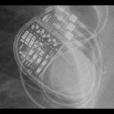 MDT:Syncra</td>
<td align="center" valign="top"><b>Option 1</b>  MDT:Advisa</td>
<td align="center" valign="top"><b>Option 2</b>  MDT:EnRhythm</td>
<td align="center" valign="top"><b>✅ Option 3</b>  MDT:Syncra</td>
<td align="center" valign="top"><b>Option 4</b>  MDT:AT500</td>
<td align="center" valign="top"><b>Option 5</b>  MDT:Insync III</td>
<td align="center" valign="middle"><b>Option 6</b>  <i>None of the above</i></td>
</tr></table>

### Q3492 · correct: option 5 · `MDT:Syncra`

<table><tr>
<td align="center" valign="top"><b>Query</b> 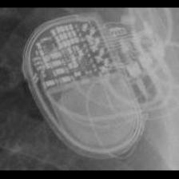 MDT:Syncra</td>
<td align="center" valign="top"><b>Option 1</b>  MDT:Advisa</td>
<td align="center" valign="top"><b>Option 2</b>  MDT:Insync III</td>
<td align="center" valign="top"><b>Option 3</b>  MDT:EnRhythm</td>
<td align="center" valign="top"><b>Option 4</b>  MDT:AT500</td>
<td align="center" valign="top"><b>✅ Option 5</b>  MDT:Syncra</td>
<td align="center" valign="middle"><b>Option 6</b>  <i>None of the above</i></td>
</tr></table>

### Q3493 · correct: option 1 · `MDT:Syncra`

<table><tr>
<td align="center" valign="top"><b>Query</b>  MDT:Syncra</td>
<td align="center" valign="top"><b>✅ Option 1</b>  MDT:Syncra</td>
<td align="center" valign="top"><b>Option 2</b>  MDT:AT500</td>
<td align="center" valign="top"><b>Option 3</b>  MDT:Advisa</td>
<td align="center" valign="top"><b>Option 4</b>  MDT:Insync III</td>
<td align="center" valign="top"><b>Option 5</b>  MDT:EnRhythm</td>
<td align="center" valign="middle"><b>Option 6</b>  <i>None of the above</i></td>
</tr></table>

### Q3494 · correct: option 3 · `MDT:Vita II`

<table><tr>
<td align="center" valign="top"><b>Query</b> 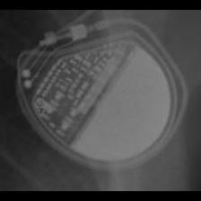 MDT:Vita II</td>
<td align="center" valign="top"><b>Option 1</b>  SOR:MiniSwing</td>
<td align="center" valign="top"><b>Option 2</b>  BIO:Actros_Philos</td>
<td align="center" valign="top"><b>✅ Option 3</b> 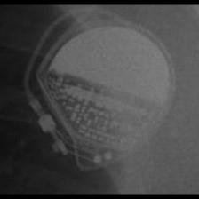 MDT:Vita II</td>
<td align="center" valign="top"><b>Option 4</b>  MDT:C20_T20</td>
<td align="center" valign="top"><b>Option 5</b> 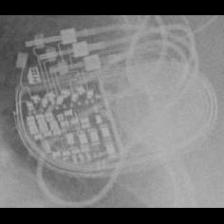 MDT:Syncra</td>
<td align="center" valign="middle"><b>Option 6</b>  <i>None of the above</i></td>
</tr></table>

### Q3495 · correct: option 1 · `MDT:Vita II`

<table><tr>
<td align="center" valign="top"><b>Query</b> 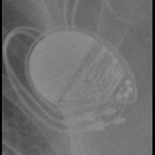 MDT:Vita II</td>
<td align="center" valign="top"><b>✅ Option 1</b> 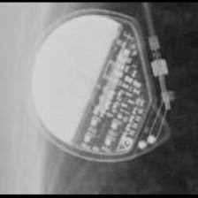 MDT:Vita II</td>
<td align="center" valign="top"><b>Option 2</b>  MDT:C60 DR</td>
<td align="center" valign="top"><b>Option 3</b>  STJ:Victory</td>
<td align="center" valign="top"><b>Option 4</b>  MDT:EnRhythm</td>
<td align="center" valign="top"><b>Option 5</b>  MDT:Adapta_Kappa_Sensia_Versa</td>
<td align="center" valign="middle"><b>Option 6</b>  <i>None of the above</i></td>
</tr></table>

### Q3496 · correct: option 2 · `MDT:Vita II`

<table><tr>
<td align="center" valign="top"><b>Query</b>  MDT:Vita II</td>
<td align="center" valign="top"><b>Option 1</b>  SOR:MiniSwing</td>
<td align="center" valign="top"><b>✅ Option 2</b>  MDT:Vita II</td>
<td align="center" valign="top"><b>Option 3</b>  STJ:Victory</td>
<td align="center" valign="top"><b>Option 4</b>  SOR:Elect</td>
<td align="center" valign="top"><b>Option 5</b>  MDT:C20_T20</td>
<td align="center" valign="middle"><b>Option 6</b>  <i>None of the above</i></td>
</tr></table>

### Q3497 · correct: option 4 · `MDT:Vita II`

<table><tr>
<td align="center" valign="top"><b>Query</b> 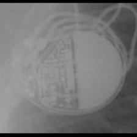 MDT:Vita II</td>
<td align="center" valign="top"><b>Option 1</b>  MDT:Advisa</td>
<td align="center" valign="top"><b>Option 2</b>  BIO:Actros_Philos</td>
<td align="center" valign="top"><b>Option 3</b>  MDT:EnRhythm</td>
<td align="center" valign="top"><b>✅ Option 4</b>  MDT:Vita II</td>
<td align="center" valign="top"><b>Option 5</b>  MDT:Syncra</td>
<td align="center" valign="middle"><b>Option 6</b>  <i>None of the above</i></td>
</tr></table>

### Q3498 · correct: option 3 · `SOR:Elect`

<table><tr>
<td align="center" valign="top"><b>Query</b> 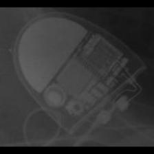 SOR:Elect</td>
<td align="center" valign="top"><b>Option 1</b>  SOR:Neway</td>
<td align="center" valign="top"><b>Option 2</b>  SOR:Elect XS Plus</td>
<td align="center" valign="top"><b>✅ Option 3</b>  SOR:Elect</td>
<td align="center" valign="top"><b>Option 4</b>  SOR:MiniSwing</td>
<td align="center" valign="top"><b>Option 5</b>  SOR:Rhapsody_Symphony</td>
<td align="center" valign="middle"><b>Option 6</b>  <i>None of the above</i></td>
</tr></table>

### Q3499 · correct: option 5 · `SOR:Elect`

<table><tr>
<td align="center" valign="top"><b>Query</b>  SOR:Elect</td>
<td align="center" valign="top"><b>Option 1</b>  SOR:MiniSwing</td>
<td align="center" valign="top"><b>Option 2</b>  SOR:Thesis</td>
<td align="center" valign="top"><b>Option 3</b>  SOR:Elect XS Plus</td>
<td align="center" valign="top"><b>Option 4</b>  BOS:Ingenio</td>
<td align="center" valign="top"><b>✅ Option 5</b>  SOR:Elect</td>
<td align="center" valign="middle"><b>Option 6</b>  <i>None of the above</i></td>
</tr></table>

### Q3500 · correct: option 1 · `SOR:Elect`

<table><tr>
<td align="center" valign="top"><b>Query</b>  SOR:Elect</td>
<td align="center" valign="top"><b>✅ Option 1</b>  SOR:Elect</td>
<td align="center" valign="top"><b>Option 2</b>  SOR:Neway</td>
<td align="center" valign="top"><b>Option 3</b>  SOR:Thesis</td>
<td align="center" valign="top"><b>Option 4</b>  SOR:Ovatio</td>
<td align="center" valign="top"><b>Option 5</b>  BOS:Ventak Prizm</td>
<td align="center" valign="middle"><b>Option 6</b>  <i>None of the above</i></td>
</tr></table>

### Q3501 · correct: option 1 · `SOR:Elect`

<table><tr>
<td align="center" valign="top"><b>Query</b>  SOR:Elect</td>
<td align="center" valign="top"><b>✅ Option 1</b>  SOR:Elect</td>
<td align="center" valign="top"><b>Option 2</b>  SOR:Neway</td>
<td align="center" valign="top"><b>Option 3</b>  SOR:MiniSwing</td>
<td align="center" valign="top"><b>Option 4</b>  SOR:Thesis</td>
<td align="center" valign="top"><b>Option 5</b>  SOR:Elect XS Plus</td>
<td align="center" valign="middle"><b>Option 6</b>  <i>None of the above</i></td>
</tr></table>

### Q3502 · correct: option 2 · `SOR:Elect`

<table><tr>
<td align="center" valign="top"><b>Query</b>  SOR:Elect</td>
<td align="center" valign="top"><b>Option 1</b>  BOS:Altrua_Insignia</td>
<td align="center" valign="top"><b>✅ Option 2</b>  SOR:Elect</td>
<td align="center" valign="top"><b>Option 3</b>  SOR:Elect XS Plus</td>
<td align="center" valign="top"><b>Option 4</b>  SOR:Thesis</td>
<td align="center" valign="top"><b>Option 5</b>  SOR:MiniSwing</td>
<td align="center" valign="middle"><b>Option 6</b>  <i>None of the above</i></td>
</tr></table>

### Q3503 · correct: option 3 · `SOR:Elect`

<table><tr>
<td align="center" valign="top"><b>Query</b>  SOR:Elect</td>
<td align="center" valign="top"><b>Option 1</b>  SOR:Elect XS Plus</td>
<td align="center" valign="top"><b>Option 2</b>  SOR:MiniSwing</td>
<td align="center" valign="top"><b>✅ Option 3</b>  SOR:Elect</td>
<td align="center" valign="top"><b>Option 4</b>  SOR:Neway</td>
<td align="center" valign="top"><b>Option 5</b>  SOR:Ovatio</td>
<td align="center" valign="middle"><b>Option 6</b>  <i>None of the above</i></td>
</tr></table>

