# Pacemakers (Howard et al.) · query set `train1` · page 5/6

[← all pages](README.md)

### Q3504 · correct: option 3 · `SOR:Elect`

<table><tr>
<td align="center" valign="top"><b>Query</b> 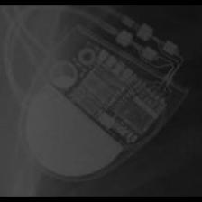 SOR:Elect</td>
<td align="center" valign="top"><b>Option 1</b> 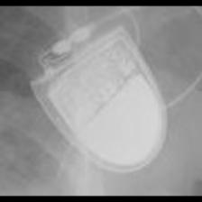 SOR:Thesis</td>
<td align="center" valign="top"><b>Option 2</b>  SOR:Neway</td>
<td align="center" valign="top"><b>✅ Option 3</b> 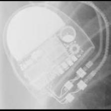 SOR:Elect</td>
<td align="center" valign="top"><b>Option 4</b>  SOR:Elect XS Plus</td>
<td align="center" valign="top"><b>Option 5</b>  SOR:MiniSwing</td>
<td align="center" valign="middle"><b>Option 6</b>  <i>None of the above</i></td>
</tr></table>

### Q3505 · correct: option 4 · `SOR:Elect XS Plus`

<table><tr>
<td align="center" valign="top"><b>Query</b> 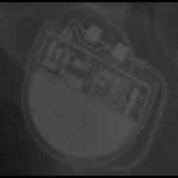 SOR:Elect XS Plus</td>
<td align="center" valign="top"><b>Option 1</b>  BOS:ContakTR_Discovery_Meridian_Pulsar Max</td>
<td align="center" valign="top"><b>Option 2</b>  SOR:MiniSwing</td>
<td align="center" valign="top"><b>Option 3</b>  SOR:Thesis</td>
<td align="center" valign="top"><b>✅ Option 4</b>  SOR:Elect XS Plus</td>
<td align="center" valign="top"><b>Option 5</b>  BOS:Altrua_Insignia</td>
<td align="center" valign="middle"><b>Option 6</b>  <i>None of the above</i></td>
</tr></table>

### Q3506 · correct: option 3 · `SOR:Elect XS Plus`

<table><tr>
<td align="center" valign="top"><b>Query</b> 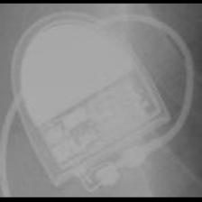 SOR:Elect XS Plus</td>
<td align="center" valign="top"><b>Option 1</b>  SOR:Elect</td>
<td align="center" valign="top"><b>Option 2</b> 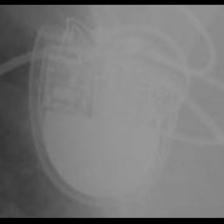 SOR:Thesis</td>
<td align="center" valign="top"><b>✅ Option 3</b>  SOR:Elect XS Plus</td>
<td align="center" valign="top"><b>Option 4</b> 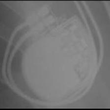 BOS:ContakTR_Discovery_Meridian_Pulsar Max</td>
<td align="center" valign="top"><b>Option 5</b>  SOR:MiniSwing</td>
<td align="center" valign="middle"><b>Option 6</b>  <i>None of the above</i></td>
</tr></table>

### Q3507 · correct: option 3 · `SOR:Elect XS Plus`

<table><tr>
<td align="center" valign="top"><b>Query</b> 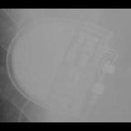 SOR:Elect XS Plus</td>
<td align="center" valign="top"><b>Option 1</b>  BOS:Altrua_Insignia</td>
<td align="center" valign="top"><b>Option 2</b>  BOS:ContakTR_Discovery_Meridian_Pulsar Max</td>
<td align="center" valign="top"><b>✅ Option 3</b>  SOR:Elect XS Plus</td>
<td align="center" valign="top"><b>Option 4</b>  SOR:Thesis</td>
<td align="center" valign="top"><b>Option 5</b>  SOR:MiniSwing</td>
<td align="center" valign="middle"><b>Option 6</b>  <i>None of the above</i></td>
</tr></table>

### Q3508 · correct: option 2 · `SOR:Elect XS Plus`

<table><tr>
<td align="center" valign="top"><b>Query</b> 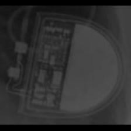 SOR:Elect XS Plus</td>
<td align="center" valign="top"><b>Option 1</b>  BOS:Altrua_Insignia</td>
<td align="center" valign="top"><b>✅ Option 2</b>  SOR:Elect XS Plus</td>
<td align="center" valign="top"><b>Option 3</b> 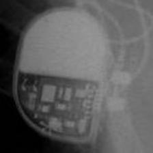 BOS:ContakTR_Discovery_Meridian_Pulsar Max</td>
<td align="center" valign="top"><b>Option 4</b>  SOR:Thesis</td>
<td align="center" valign="top"><b>Option 5</b>  SOR:MiniSwing</td>
<td align="center" valign="middle"><b>Option 6</b>  <i>None of the above</i></td>
</tr></table>

### Q3509 · correct: option 1 · `SOR:Elect XS Plus`

<table><tr>
<td align="center" valign="top"><b>Query</b> 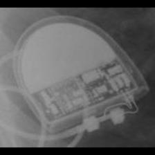 SOR:Elect XS Plus</td>
<td align="center" valign="top"><b>✅ Option 1</b>  SOR:Elect XS Plus</td>
<td align="center" valign="top"><b>Option 2</b> 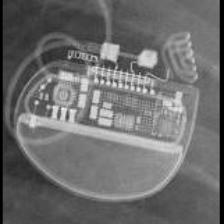 BOS:Proponent</td>
<td align="center" valign="top"><b>Option 3</b>  SOR:Thesis</td>
<td align="center" valign="top"><b>Option 4</b> 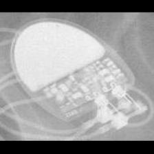 SOR:Rhapsody_Symphony</td>
<td align="center" valign="top"><b>Option 5</b>  SOR:MiniSwing</td>
<td align="center" valign="middle"><b>Option 6</b>  <i>None of the above</i></td>
</tr></table>

### Q3510 · correct: option 2 · `SOR:MiniSwing`

<table><tr>
<td align="center" valign="top"><b>Query</b> 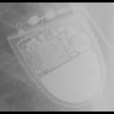 SOR:MiniSwing</td>
<td align="center" valign="top"><b>Option 1</b>  MDT:Claria_Evera_Viva</td>
<td align="center" valign="top"><b>✅ Option 2</b>  SOR:MiniSwing</td>
<td align="center" valign="top"><b>Option 3</b>  SOR:Thesis</td>
<td align="center" valign="top"><b>Option 4</b>  SOR:Elect XS Plus</td>
<td align="center" valign="top"><b>Option 5</b>  SOR:Elect</td>
<td align="center" valign="middle"><b>Option 6</b>  <i>None of the above</i></td>
</tr></table>

### Q3511 · correct: option 3 · `SOR:MiniSwing`

<table><tr>
<td align="center" valign="top"><b>Query</b> 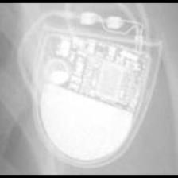 SOR:MiniSwing</td>
<td align="center" valign="top"><b>Option 1</b>  SOR:Elect XS Plus</td>
<td align="center" valign="top"><b>Option 2</b>  SOR:Thesis</td>
<td align="center" valign="top"><b>✅ Option 3</b> 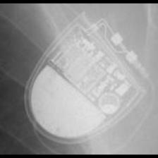 SOR:MiniSwing</td>
<td align="center" valign="top"><b>Option 4</b>  SOR:Elect</td>
<td align="center" valign="top"><b>Option 5</b> 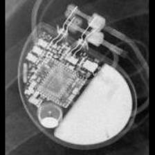 SOR:Neway</td>
<td align="center" valign="middle"><b>Option 6</b>  <i>None of the above</i></td>
</tr></table>

### Q3512 · correct: option 1 · `SOR:MiniSwing`

<table><tr>
<td align="center" valign="top"><b>Query</b>  SOR:MiniSwing</td>
<td align="center" valign="top"><b>✅ Option 1</b>  SOR:MiniSwing</td>
<td align="center" valign="top"><b>Option 2</b>  MDT:Claria_Evera_Viva</td>
<td align="center" valign="top"><b>Option 3</b>  STJ:Quadra Assura_Unify</td>
<td align="center" valign="top"><b>Option 4</b> 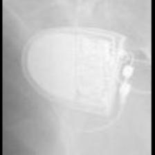 SOR:Thesis</td>
<td align="center" valign="top"><b>Option 5</b>  SOR:Elect</td>
<td align="center" valign="middle"><b>Option 6</b>  <i>None of the above</i></td>
</tr></table>

### Q3513 · correct: option 2 · `SOR:MiniSwing`

<table><tr>
<td align="center" valign="top"><b>Query</b>  SOR:MiniSwing</td>
<td align="center" valign="top"><b>Option 1</b>  SOR:Elect</td>
<td align="center" valign="top"><b>✅ Option 2</b>  SOR:MiniSwing</td>
<td align="center" valign="top"><b>Option 3</b>  SOR:Elect XS Plus</td>
<td align="center" valign="top"><b>Option 4</b>  SOR:Thesis</td>
<td align="center" valign="top"><b>Option 5</b>  MDT:Adapta_Kappa_Sensia_Versa</td>
<td align="center" valign="middle"><b>Option 6</b>  <i>None of the above</i></td>
</tr></table>

### Q3514 · correct: option 5 · `SOR:MiniSwing`

<table><tr>
<td align="center" valign="top"><b>Query</b> 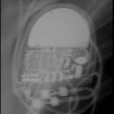 SOR:MiniSwing</td>
<td align="center" valign="top"><b>Option 1</b>  SOR:Elect</td>
<td align="center" valign="top"><b>Option 2</b>  SOR:Neway</td>
<td align="center" valign="top"><b>Option 3</b>  MDT:Vita II</td>
<td align="center" valign="top"><b>Option 4</b>  SOR:Rhapsody_Symphony</td>
<td align="center" valign="top"><b>✅ Option 5</b>  SOR:MiniSwing</td>
<td align="center" valign="middle"><b>Option 6</b>  <i>None of the above</i></td>
</tr></table>

### Q3515 · correct: option 2 · `SOR:Neway`

<table><tr>
<td align="center" valign="top"><b>Query</b> 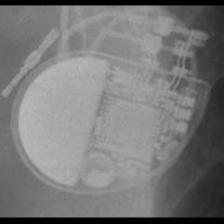 SOR:Neway</td>
<td align="center" valign="top"><b>Option 1</b>  BOS:Vitality</td>
<td align="center" valign="top"><b>✅ Option 2</b>  SOR:Neway</td>
<td align="center" valign="top"><b>Option 3</b>  SOR:Ovatio</td>
<td align="center" valign="top"><b>Option 4</b>  STJ:Zephyr</td>
<td align="center" valign="top"><b>Option 5</b>  SOR:Elect</td>
<td align="center" valign="middle"><b>Option 6</b>  <i>None of the above</i></td>
</tr></table>

### Q3516 · correct: option 2 · `SOR:Neway`

<table><tr>
<td align="center" valign="top"><b>Query</b> 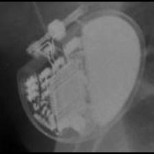 SOR:Neway</td>
<td align="center" valign="top"><b>Option 1</b>  BOS:Altrua_Insignia</td>
<td align="center" valign="top"><b>✅ Option 2</b>  SOR:Neway</td>
<td align="center" valign="top"><b>Option 3</b>  SOR:Elect XS Plus</td>
<td align="center" valign="top"><b>Option 4</b>  BOS:Ventak Prizm</td>
<td align="center" valign="top"><b>Option 5</b>  SOR:Elect</td>
<td align="center" valign="middle"><b>Option 6</b>  <i>None of the above</i></td>
</tr></table>

### Q3517 · correct: option 1 · `SOR:Neway`

<table><tr>
<td align="center" valign="top"><b>Query</b>  SOR:Neway</td>
<td align="center" valign="top"><b>✅ Option 1</b>  SOR:Neway</td>
<td align="center" valign="top"><b>Option 2</b>  STJ:Zephyr</td>
<td align="center" valign="top"><b>Option 3</b>  MDT:Sigma</td>
<td align="center" valign="top"><b>Option 4</b>  MDT:Adapta_Kappa_Sensia_Versa</td>
<td align="center" valign="top"><b>Option 5</b>  STJ:Victory</td>
<td align="center" valign="middle"><b>Option 6</b>  <i>None of the above</i></td>
</tr></table>

### Q3518 · correct: option 3 · `SOR:Neway`

<table><tr>
<td align="center" valign="top"><b>Query</b> 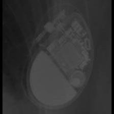 SOR:Neway</td>
<td align="center" valign="top"><b>Option 1</b>  SOR:MiniSwing</td>
<td align="center" valign="top"><b>Option 2</b>  SOR:Rhapsody_Symphony</td>
<td align="center" valign="top"><b>✅ Option 3</b>  SOR:Neway</td>
<td align="center" valign="top"><b>Option 4</b>  SOR:Elect</td>
<td align="center" valign="top"><b>Option 5</b> 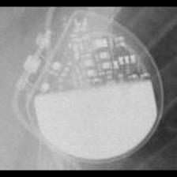 MDT:C20_T20</td>
<td align="center" valign="middle"><b>Option 6</b>  <i>None of the above</i></td>
</tr></table>

### Q3519 · correct: option 3 · `SOR:Neway`

<table><tr>
<td align="center" valign="top"><b>Query</b> 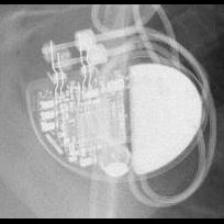 SOR:Neway</td>
<td align="center" valign="top"><b>Option 1</b>  MDT:Adapta_Kappa_Sensia_Versa</td>
<td align="center" valign="top"><b>Option 2</b>  MDT:C60 DR</td>
<td align="center" valign="top"><b>✅ Option 3</b>  SOR:Neway</td>
<td align="center" valign="top"><b>Option 4</b>  SOR:Elect</td>
<td align="center" valign="top"><b>Option 5</b>  SOR:Rhapsody_Symphony</td>
<td align="center" valign="middle"><b>Option 6</b>  <i>None of the above</i></td>
</tr></table>

### Q3520 · correct: option 2 · `SOR:Neway`

<table><tr>
<td align="center" valign="top"><b>Query</b> 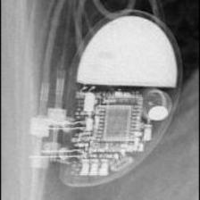 SOR:Neway</td>
<td align="center" valign="top"><b>Option 1</b>  BOS:Vitality</td>
<td align="center" valign="top"><b>✅ Option 2</b>  SOR:Neway</td>
<td align="center" valign="top"><b>Option 3</b>  SOR:MiniSwing</td>
<td align="center" valign="top"><b>Option 4</b>  SOR:Elect</td>
<td align="center" valign="top"><b>Option 5</b>  SOR:Ovatio</td>
<td align="center" valign="middle"><b>Option 6</b>  <i>None of the above</i></td>
</tr></table>

### Q3521 · correct: option 2 · `SOR:Ovatio`

<table><tr>
<td align="center" valign="top"><b>Query</b>  SOR:Ovatio</td>
<td align="center" valign="top"><b>Option 1</b> 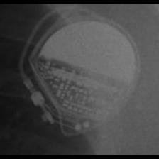 MDT:Vita II</td>
<td align="center" valign="top"><b>✅ Option 2</b> 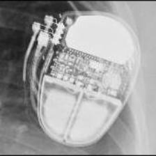 SOR:Ovatio</td>
<td align="center" valign="top"><b>Option 3</b>  BOS:Ventak Prizm</td>
<td align="center" valign="top"><b>Option 4</b>  BOS:ContakTR_Discovery_Meridian_Pulsar Max</td>
<td align="center" valign="top"><b>Option 5</b> 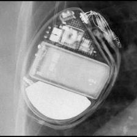 BOS:Vitality</td>
<td align="center" valign="middle"><b>Option 6</b>  <i>None of the above</i></td>
</tr></table>

### Q3522 · correct: option 3 · `SOR:Ovatio`

<table><tr>
<td align="center" valign="top"><b>Query</b> 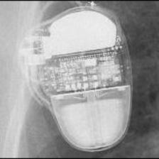 SOR:Ovatio</td>
<td align="center" valign="top"><b>Option 1</b>  SOR:Elect</td>
<td align="center" valign="top"><b>Option 2</b>  BOS:Vitality</td>
<td align="center" valign="top"><b>✅ Option 3</b>  SOR:Ovatio</td>
<td align="center" valign="top"><b>Option 4</b> 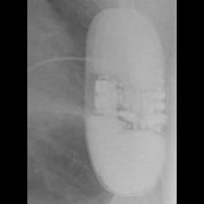 BOS:Emblem</td>
<td align="center" valign="top"><b>Option 5</b>  BOS:Ventak Prizm</td>
<td align="center" valign="middle"><b>Option 6</b>  <i>None of the above</i></td>
</tr></table>

### Q3523 · correct: option 4 · `SOR:Ovatio`

<table><tr>
<td align="center" valign="top"><b>Query</b>  SOR:Ovatio</td>
<td align="center" valign="top"><b>Option 1</b>  SOR:Neway</td>
<td align="center" valign="top"><b>Option 2</b> 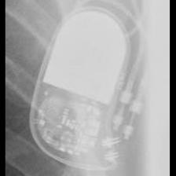 BIO:Cyclos</td>
<td align="center" valign="top"><b>Option 3</b>  BOS:Vitality</td>
<td align="center" valign="top"><b>✅ Option 4</b>  SOR:Ovatio</td>
<td align="center" valign="top"><b>Option 5</b>  BOS:Emblem</td>
<td align="center" valign="middle"><b>Option 6</b>  <i>None of the above</i></td>
</tr></table>

### Q3524 · correct: option 2 · `SOR:Ovatio`

<table><tr>
<td align="center" valign="top"><b>Query</b> 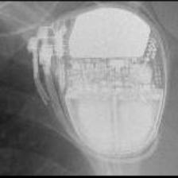 SOR:Ovatio</td>
<td align="center" valign="top"><b>Option 1</b>  BOS:Emblem</td>
<td align="center" valign="top"><b>✅ Option 2</b>  SOR:Ovatio</td>
<td align="center" valign="top"><b>Option 3</b>  MDT:Vita II</td>
<td align="center" valign="top"><b>Option 4</b>  BOS:Ventak Prizm</td>
<td align="center" valign="top"><b>Option 5</b>  SOR:Thesis</td>
<td align="center" valign="middle"><b>Option 6</b>  <i>None of the above</i></td>
</tr></table>

### Q3525 · correct: option 1 · `SOR:Reply`

<table><tr>
<td align="center" valign="top"><b>Query</b> 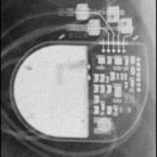 SOR:Reply</td>
<td align="center" valign="top"><b>✅ Option 1</b>  SOR:Reply</td>
<td align="center" valign="top"><b>Option 2</b>  SOR:Neway</td>
<td align="center" valign="top"><b>Option 3</b>  MDT:Adapta_Kappa_Sensia_Versa</td>
<td align="center" valign="top"><b>Option 4</b>  MDT:Vita II</td>
<td align="center" valign="top"><b>Option 5</b>  BIO:Actros_Philos</td>
<td align="center" valign="middle"><b>Option 6</b>  <i>None of the above</i></td>
</tr></table>

### Q3526 · correct: option 4 · `SOR:Reply`

<table><tr>
<td align="center" valign="top"><b>Query</b> 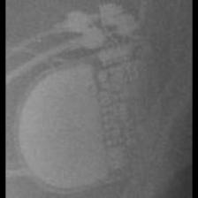 SOR:Reply</td>
<td align="center" valign="top"><b>Option 1</b>  BOS:ContakTR_Discovery_Meridian_Pulsar Max</td>
<td align="center" valign="top"><b>Option 2</b>  MDT:Adapta_Kappa_Sensia_Versa</td>
<td align="center" valign="top"><b>Option 3</b>  SOR:Neway</td>
<td align="center" valign="top"><b>✅ Option 4</b>  SOR:Reply</td>
<td align="center" valign="top"><b>Option 5</b>  SOR:Ovatio</td>
<td align="center" valign="middle"><b>Option 6</b>  <i>None of the above</i></td>
</tr></table>

### Q3527 · correct: option 1 · `SOR:Reply`

<table><tr>
<td align="center" valign="top"><b>Query</b> 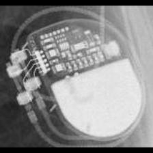 SOR:Reply</td>
<td align="center" valign="top"><b>✅ Option 1</b>  SOR:Reply</td>
<td align="center" valign="top"><b>Option 2</b>  MDT:C20_T20</td>
<td align="center" valign="top"><b>Option 3</b> 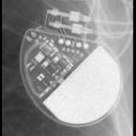 MDT:C60 DR</td>
<td align="center" valign="top"><b>Option 4</b>  MDT:Adapta_Kappa_Sensia_Versa</td>
<td align="center" valign="top"><b>Option 5</b> 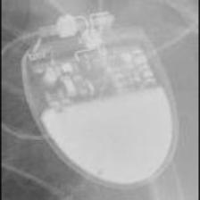 SOR:Rhapsody_Symphony</td>
<td align="center" valign="middle"><b>Option 6</b>  <i>None of the above</i></td>
</tr></table>

### Q3528 · correct: option 1 · `SOR:Reply`

<table><tr>
<td align="center" valign="top"><b>Query</b> 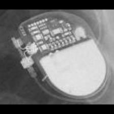 SOR:Reply</td>
<td align="center" valign="top"><b>✅ Option 1</b>  SOR:Reply</td>
<td align="center" valign="top"><b>Option 2</b>  SOR:Rhapsody_Symphony</td>
<td align="center" valign="top"><b>Option 3</b>  SOR:Elect XS Plus</td>
<td align="center" valign="top"><b>Option 4</b>  MDT:C20_T20</td>
<td align="center" valign="top"><b>Option 5</b> 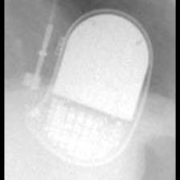 BIO:Actros_Philos</td>
<td align="center" valign="middle"><b>Option 6</b>  <i>None of the above</i></td>
</tr></table>

### Q3529 · correct: option 3 · `SOR:Reply`

<table><tr>
<td align="center" valign="top"><b>Query</b> 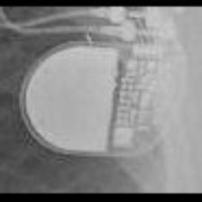 SOR:Reply</td>
<td align="center" valign="top"><b>Option 1</b>  BIO:Actros_Philos</td>
<td align="center" valign="top"><b>Option 2</b> 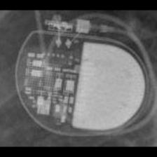 MDT:Adapta_Kappa_Sensia_Versa</td>
<td align="center" valign="top"><b>✅ Option 3</b>  SOR:Reply</td>
<td align="center" valign="top"><b>Option 4</b>  STJ:Zephyr</td>
<td align="center" valign="top"><b>Option 5</b>  SOR:Ovatio</td>
<td align="center" valign="middle"><b>Option 6</b>  <i>None of the above</i></td>
</tr></table>

### Q3530 · correct: option 1 · `SOR:Reply`

<table><tr>
<td align="center" valign="top"><b>Query</b>  SOR:Reply</td>
<td align="center" valign="top"><b>✅ Option 1</b>  SOR:Reply</td>
<td align="center" valign="top"><b>Option 2</b>  BIO:Actros_Philos</td>
<td align="center" valign="top"><b>Option 3</b> 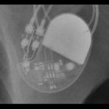 STJ:Zephyr</td>
<td align="center" valign="top"><b>Option 4</b>  STJ:Identity</td>
<td align="center" valign="top"><b>Option 5</b>  MDT:Adapta_Kappa_Sensia_Versa</td>
<td align="center" valign="middle"><b>Option 6</b>  <i>None of the above</i></td>
</tr></table>

### Q3531 · correct: option 2 · `SOR:Reply`

<table><tr>
<td align="center" valign="top"><b>Query</b> 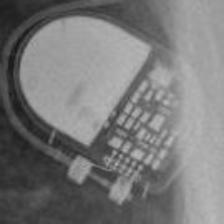 SOR:Reply</td>
<td align="center" valign="top"><b>Option 1</b>  MDT:Sigma</td>
<td align="center" valign="top"><b>✅ Option 2</b> 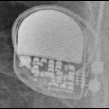 SOR:Reply</td>
<td align="center" valign="top"><b>Option 3</b>  MDT:AT500</td>
<td align="center" valign="top"><b>Option 4</b>  MDT:Adapta_Kappa_Sensia_Versa</td>
<td align="center" valign="top"><b>Option 5</b>  BIO:Actros_Philos</td>
<td align="center" valign="middle"><b>Option 6</b>  <i>None of the above</i></td>
</tr></table>

### Q3532 · correct: option 5 · `SOR:Rhapsody_Symphony`

<table><tr>
<td align="center" valign="top"><b>Query</b> 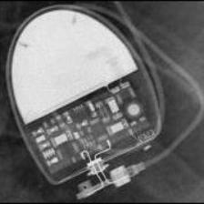 SOR:Rhapsody_Symphony</td>
<td align="center" valign="top"><b>Option 1</b>  SOR:Elect XS Plus</td>
<td align="center" valign="top"><b>Option 2</b> 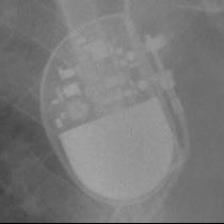 MDT:Sigma</td>
<td align="center" valign="top"><b>Option 3</b>  SOR:Neway</td>
<td align="center" valign="top"><b>Option 4</b>  SOR:MiniSwing</td>
<td align="center" valign="top"><b>✅ Option 5</b> 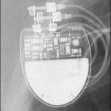 SOR:Rhapsody_Symphony</td>
<td align="center" valign="middle"><b>Option 6</b>  <i>None of the above</i></td>
</tr></table>

### Q3533 · correct: option 2 · `SOR:Rhapsody_Symphony`

<table><tr>
<td align="center" valign="top"><b>Query</b>  SOR:Rhapsody_Symphony</td>
<td align="center" valign="top"><b>Option 1</b>  MDT:Adapta_Kappa_Sensia_Versa</td>
<td align="center" valign="top"><b>✅ Option 2</b>  SOR:Rhapsody_Symphony</td>
<td align="center" valign="top"><b>Option 3</b>  MDT:Sigma</td>
<td align="center" valign="top"><b>Option 4</b>  MDT:C20_T20</td>
<td align="center" valign="top"><b>Option 5</b>  MDT:C60 DR</td>
<td align="center" valign="middle"><b>Option 6</b>  <i>None of the above</i></td>
</tr></table>

### Q3534 · correct: option 4 · `SOR:Rhapsody_Symphony`

<table><tr>
<td align="center" valign="top"><b>Query</b> 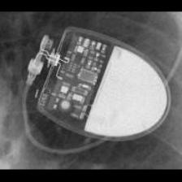 SOR:Rhapsody_Symphony</td>
<td align="center" valign="top"><b>Option 1</b>  SOR:Thesis</td>
<td align="center" valign="top"><b>Option 2</b>  BOS:Altrua_Insignia</td>
<td align="center" valign="top"><b>Option 3</b>  MDT:Sigma</td>
<td align="center" valign="top"><b>✅ Option 4</b>  SOR:Rhapsody_Symphony</td>
<td align="center" valign="top"><b>Option 5</b>  MDT:Adapta_Kappa_Sensia_Versa</td>
<td align="center" valign="middle"><b>Option 6</b>  <i>None of the above</i></td>
</tr></table>

### Q3535 · correct: option 2 · `SOR:Rhapsody_Symphony`

<table><tr>
<td align="center" valign="top"><b>Query</b> 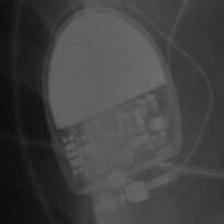 SOR:Rhapsody_Symphony</td>
<td align="center" valign="top"><b>Option 1</b>  SOR:MiniSwing</td>
<td align="center" valign="top"><b>✅ Option 2</b>  SOR:Rhapsody_Symphony</td>
<td align="center" valign="top"><b>Option 3</b>  SOR:Elect XS Plus</td>
<td align="center" valign="top"><b>Option 4</b>  MDT:Sigma</td>
<td align="center" valign="top"><b>Option 5</b>  SOR:Thesis</td>
<td align="center" valign="middle"><b>Option 6</b>  <i>None of the above</i></td>
</tr></table>

### Q3536 · correct: option 2 · `SOR:Rhapsody_Symphony`

<table><tr>
<td align="center" valign="top"><b>Query</b> 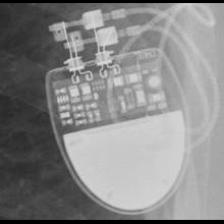 SOR:Rhapsody_Symphony</td>
<td align="center" valign="top"><b>Option 1</b>  MDT:C60 DR</td>
<td align="center" valign="top"><b>✅ Option 2</b>  SOR:Rhapsody_Symphony</td>
<td align="center" valign="top"><b>Option 3</b>  BOS:Altrua_Insignia</td>
<td align="center" valign="top"><b>Option 4</b>  SOR:Neway</td>
<td align="center" valign="top"><b>Option 5</b>  SOR:Reply</td>
<td align="center" valign="middle"><b>Option 6</b>  <i>None of the above</i></td>
</tr></table>

### Q3537 · correct: option 2 · `SOR:Rhapsody_Symphony`

<table><tr>
<td align="center" valign="top"><b>Query</b>  SOR:Rhapsody_Symphony</td>
<td align="center" valign="top"><b>Option 1</b>  SOR:Reply</td>
<td align="center" valign="top"><b>✅ Option 2</b>  SOR:Rhapsody_Symphony</td>
<td align="center" valign="top"><b>Option 3</b>  STJ:Identity</td>
<td align="center" valign="top"><b>Option 4</b>  SOR:Neway</td>
<td align="center" valign="top"><b>Option 5</b>  SOR:Elect XS Plus</td>
<td align="center" valign="middle"><b>Option 6</b>  <i>None of the above</i></td>
</tr></table>

### Q3538 · correct: option 5 · `SOR:Rhapsody_Symphony`

<table><tr>
<td align="center" valign="top"><b>Query</b>  SOR:Rhapsody_Symphony</td>
<td align="center" valign="top"><b>Option 1</b>  STJ:Identity</td>
<td align="center" valign="top"><b>Option 2</b>  SOR:Thesis</td>
<td align="center" valign="top"><b>Option 3</b>  STJ:Zephyr</td>
<td align="center" valign="top"><b>Option 4</b>  SOR:MiniSwing</td>
<td align="center" valign="top"><b>✅ Option 5</b>  SOR:Rhapsody_Symphony</td>
<td align="center" valign="middle"><b>Option 6</b>  <i>None of the above</i></td>
</tr></table>

### Q3539 · correct: option 4 · `SOR:Thesis`

<table><tr>
<td align="center" valign="top"><b>Query</b>  SOR:Thesis</td>
<td align="center" valign="top"><b>Option 1</b>  BOS:ContakTR_Discovery_Meridian_Pulsar Max</td>
<td align="center" valign="top"><b>Option 2</b>  SOR:Elect</td>
<td align="center" valign="top"><b>Option 3</b>  BOS:Emblem</td>
<td align="center" valign="top"><b>✅ Option 4</b>  SOR:Thesis</td>
<td align="center" valign="top"><b>Option 5</b>  SOR:MiniSwing</td>
<td align="center" valign="middle"><b>Option 6</b>  <i>None of the above</i></td>
</tr></table>

### Q3540 · correct: option 1 · `SOR:Thesis`

<table><tr>
<td align="center" valign="top"><b>Query</b>  SOR:Thesis</td>
<td align="center" valign="top"><b>✅ Option 1</b>  SOR:Thesis</td>
<td align="center" valign="top"><b>Option 2</b>  BOS:ContakTR_Discovery_Meridian_Pulsar Max</td>
<td align="center" valign="top"><b>Option 3</b>  SOR:MiniSwing</td>
<td align="center" valign="top"><b>Option 4</b>  SOR:Elect</td>
<td align="center" valign="top"><b>Option 5</b>  SOR:Elect XS Plus</td>
<td align="center" valign="middle"><b>Option 6</b>  <i>None of the above</i></td>
</tr></table>

### Q3541 · correct: option 2 · `SOR:Thesis`

<table><tr>
<td align="center" valign="top"><b>Query</b>  SOR:Thesis</td>
<td align="center" valign="top"><b>Option 1</b>  SOR:Elect XS Plus</td>
<td align="center" valign="top"><b>✅ Option 2</b>  SOR:Thesis</td>
<td align="center" valign="top"><b>Option 3</b>  SOR:Elect</td>
<td align="center" valign="top"><b>Option 4</b>  SOR:MiniSwing</td>
<td align="center" valign="top"><b>Option 5</b>  BIO:Actros_Philos</td>
<td align="center" valign="middle"><b>Option 6</b>  <i>None of the above</i></td>
</tr></table>

### Q3542 · correct: option 2 · `SOR:Thesis`

<table><tr>
<td align="center" valign="top"><b>Query</b>  SOR:Thesis</td>
<td align="center" valign="top"><b>Option 1</b>  BIO:Evia</td>
<td align="center" valign="top"><b>✅ Option 2</b>  SOR:Thesis</td>
<td align="center" valign="top"><b>Option 3</b>  BOS:Altrua_Insignia</td>
<td align="center" valign="top"><b>Option 4</b>  BOS:ContakTR_Discovery_Meridian_Pulsar Max</td>
<td align="center" valign="top"><b>Option 5</b>  BOS:Ingenio</td>
<td align="center" valign="middle"><b>Option 6</b>  <i>None of the above</i></td>
</tr></table>

### Q3543 · correct: option 3 · `SOR:Thesis`

<table><tr>
<td align="center" valign="top"><b>Query</b>  SOR:Thesis</td>
<td align="center" valign="top"><b>Option 1</b>  MDT:Sigma</td>
<td align="center" valign="top"><b>Option 2</b>  BOS:Ventak Prizm</td>
<td align="center" valign="top"><b>✅ Option 3</b>  SOR:Thesis</td>
<td align="center" valign="top"><b>Option 4</b>  BOS:ContakTR_Discovery_Meridian_Pulsar Max</td>
<td align="center" valign="top"><b>Option 5</b>  BOS:Contak Renewal 4</td>
<td align="center" valign="middle"><b>Option 6</b>  <i>None of the above</i></td>
</tr></table>

### Q3544 · correct: option 2 · `SOR:Thesis`

<table><tr>
<td align="center" valign="top"><b>Query</b>  SOR:Thesis</td>
<td align="center" valign="top"><b>Option 1</b>  SOR:Rhapsody_Symphony</td>
<td align="center" valign="top"><b>✅ Option 2</b>  SOR:Thesis</td>
<td align="center" valign="top"><b>Option 3</b>  SOR:Elect</td>
<td align="center" valign="top"><b>Option 4</b>  SOR:MiniSwing</td>
<td align="center" valign="top"><b>Option 5</b>  SOR:Elect XS Plus</td>
<td align="center" valign="middle"><b>Option 6</b>  <i>None of the above</i></td>
</tr></table>

### Q3545 · correct: option 2 · `SOR:Thesis`

<table><tr>
<td align="center" valign="top"><b>Query</b>  SOR:Thesis</td>
<td align="center" valign="top"><b>Option 1</b>  BIO:Actros_Philos</td>
<td align="center" valign="top"><b>✅ Option 2</b>  SOR:Thesis</td>
<td align="center" valign="top"><b>Option 3</b>  BIO:Cyclos</td>
<td align="center" valign="top"><b>Option 4</b>  MDT:Sigma</td>
<td align="center" valign="top"><b>Option 5</b>  BOS:ContakTR_Discovery_Meridian_Pulsar Max</td>
<td align="center" valign="middle"><b>Option 6</b>  <i>None of the above</i></td>
</tr></table>

### Q3546 · correct: option 2 · `STJ:Accent`

<table><tr>
<td align="center" valign="top"><b>Query</b>  STJ:Accent</td>
<td align="center" valign="top"><b>Option 1</b>  STJ:Zephyr</td>
<td align="center" valign="top"><b>✅ Option 2</b>  STJ:Accent</td>
<td align="center" valign="top"><b>Option 3</b>  STJ:Identity</td>
<td align="center" valign="top"><b>Option 4</b>  STJ:Allure Quadra</td>
<td align="center" valign="top"><b>Option 5</b>  SOR:Neway</td>
<td align="center" valign="middle"><b>Option 6</b>  <i>None of the above</i></td>
</tr></table>

### Q3547 · correct: option 3 · `STJ:Accent`

<table><tr>
<td align="center" valign="top"><b>Query</b>  STJ:Accent</td>
<td align="center" valign="top"><b>Option 1</b>  MDT:AT500</td>
<td align="center" valign="top"><b>Option 2</b>  MDT:Azure</td>
<td align="center" valign="top"><b>✅ Option 3</b>  STJ:Accent</td>
<td align="center" valign="top"><b>Option 4</b>  MDT:Insync III</td>
<td align="center" valign="top"><b>Option 5</b>  MDT:Advisa</td>
<td align="center" valign="middle"><b>Option 6</b>  <i>None of the above</i></td>
</tr></table>

### Q3548 · correct: option 5 · `STJ:Accent`

<table><tr>
<td align="center" valign="top"><b>Query</b>  STJ:Accent</td>
<td align="center" valign="top"><b>Option 1</b>  MDT:Insync III</td>
<td align="center" valign="top"><b>Option 2</b>  STJ:Allure Quadra</td>
<td align="center" valign="top"><b>Option 3</b>  MDT:EnRhythm</td>
<td align="center" valign="top"><b>Option 4</b>  BIO:Evia</td>
<td align="center" valign="top"><b>✅ Option 5</b>  STJ:Accent</td>
<td align="center" valign="middle"><b>Option 6</b>  <i>None of the above</i></td>
</tr></table>

### Q3549 · correct: option 2 · `STJ:Accent`

<table><tr>
<td align="center" valign="top"><b>Query</b>  STJ:Accent</td>
<td align="center" valign="top"><b>Option 1</b>  MDT:Syncra</td>
<td align="center" valign="top"><b>✅ Option 2</b>  STJ:Accent</td>
<td align="center" valign="top"><b>Option 3</b>  MDT:Azure</td>
<td align="center" valign="top"><b>Option 4</b>  MDT:EnRhythm</td>
<td align="center" valign="top"><b>Option 5</b>  STJ:Allure Quadra</td>
<td align="center" valign="middle"><b>Option 6</b>  <i>None of the above</i></td>
</tr></table>

### Q3550 · correct: option 5 · `STJ:Accent`

<table><tr>
<td align="center" valign="top"><b>Query</b>  STJ:Accent</td>
<td align="center" valign="top"><b>Option 1</b>  STJ:Allure Quadra</td>
<td align="center" valign="top"><b>Option 2</b>  BIO:Evia</td>
<td align="center" valign="top"><b>Option 3</b>  MDT:Insync III</td>
<td align="center" valign="top"><b>Option 4</b>  MDT:Advisa</td>
<td align="center" valign="top"><b>✅ Option 5</b>  STJ:Accent</td>
<td align="center" valign="middle"><b>Option 6</b>  <i>None of the above</i></td>
</tr></table>

### Q3551 · correct: option 3 · `STJ:Accent`

<table><tr>
<td align="center" valign="top"><b>Query</b>  STJ:Accent</td>
<td align="center" valign="top"><b>Option 1</b>  MDT:Advisa</td>
<td align="center" valign="top"><b>Option 2</b>  MDT:AT500</td>
<td align="center" valign="top"><b>✅ Option 3</b>  STJ:Accent</td>
<td align="center" valign="top"><b>Option 4</b>  BIO:Evia</td>
<td align="center" valign="top"><b>Option 5</b>  STJ:Allure Quadra</td>
<td align="center" valign="middle"><b>Option 6</b>  <i>None of the above</i></td>
</tr></table>

### Q3552 · correct: option 2 · `STJ:Accent`

<table><tr>
<td align="center" valign="top"><b>Query</b>  STJ:Accent</td>
<td align="center" valign="top"><b>Option 1</b>  BOS:Proponent</td>
<td align="center" valign="top"><b>✅ Option 2</b>  STJ:Accent</td>
<td align="center" valign="top"><b>Option 3</b>  BOS:Ingenio</td>
<td align="center" valign="top"><b>Option 4</b>  BOS:Altrua_Insignia</td>
<td align="center" valign="top"><b>Option 5</b>  BOS:Contak Renewal TR2</td>
<td align="center" valign="middle"><b>Option 6</b>  <i>None of the above</i></td>
</tr></table>

### Q3553 · correct: option 2 · `STJ:Allure Quadra`

<table><tr>
<td align="center" valign="top"><b>Query</b>  STJ:Allure Quadra</td>
<td align="center" valign="top"><b>Option 1</b>  STJ:Accent</td>
<td align="center" valign="top"><b>✅ Option 2</b>  STJ:Allure Quadra</td>
<td align="center" valign="top"><b>Option 3</b>  STJ:Ellipse</td>
<td align="center" valign="top"><b>Option 4</b>  MDT:Advisa</td>
<td align="center" valign="top"><b>Option 5</b>  MDT:Azure</td>
<td align="center" valign="middle"><b>Option 6</b>  <i>None of the above</i></td>
</tr></table>

