# Pacemakers (Howard et al.) · query set `train1` · page 6/6

[← all pages](README.md)

### Q3554 · correct: option 5 · `STJ:Allure Quadra`

<table><tr>
<td align="center" valign="top"><b>Query</b> 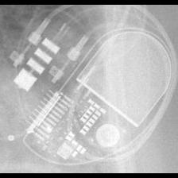 STJ:Allure Quadra</td>
<td align="center" valign="top"><b>Option 1</b> 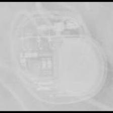 MDT:Azure</td>
<td align="center" valign="top"><b>Option 2</b>  STJ:Ellipse</td>
<td align="center" valign="top"><b>Option 3</b> 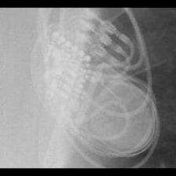 MDT:Insync III</td>
<td align="center" valign="top"><b>Option 4</b> 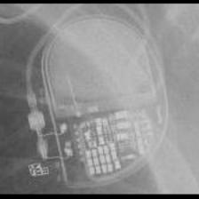 MDT:Advisa</td>
<td align="center" valign="top"><b>✅ Option 5</b>  STJ:Allure Quadra</td>
<td align="center" valign="middle"><b>Option 6</b>  <i>None of the above</i></td>
</tr></table>

### Q3555 · correct: option 2 · `STJ:Allure Quadra`

<table><tr>
<td align="center" valign="top"><b>Query</b> 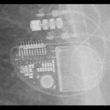 STJ:Allure Quadra</td>
<td align="center" valign="top"><b>Option 1</b>  STJ:Accent</td>
<td align="center" valign="top"><b>✅ Option 2</b>  STJ:Allure Quadra</td>
<td align="center" valign="top"><b>Option 3</b>  BOS:Ingenio</td>
<td align="center" valign="top"><b>Option 4</b>  MDT:Advisa</td>
<td align="center" valign="top"><b>Option 5</b>  BIO:Evia</td>
<td align="center" valign="middle"><b>Option 6</b>  <i>None of the above</i></td>
</tr></table>

### Q3556 · correct: option 5 · `STJ:Allure Quadra`

<table><tr>
<td align="center" valign="top"><b>Query</b> 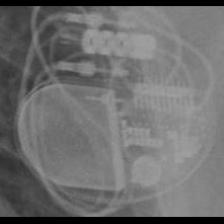 STJ:Allure Quadra</td>
<td align="center" valign="top"><b>Option 1</b>  MDT:Advisa</td>
<td align="center" valign="top"><b>Option 2</b>  BOS:Contak Renewal TR2</td>
<td align="center" valign="top"><b>Option 3</b>  STJ:Accent</td>
<td align="center" valign="top"><b>Option 4</b>  MDT:Azure</td>
<td align="center" valign="top"><b>✅ Option 5</b>  STJ:Allure Quadra</td>
<td align="center" valign="middle"><b>Option 6</b>  <i>None of the above</i></td>
</tr></table>

### Q3557 · correct: option 5 · `STJ:Allure Quadra`

<table><tr>
<td align="center" valign="top"><b>Query</b>  STJ:Allure Quadra</td>
<td align="center" valign="top"><b>Option 1</b>  MDT:Advisa</td>
<td align="center" valign="top"><b>Option 2</b> 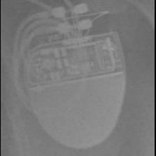 BOS:Ingenio</td>
<td align="center" valign="top"><b>Option 3</b>  STJ:Accent</td>
<td align="center" valign="top"><b>Option 4</b>  BOS:Altrua_Insignia</td>
<td align="center" valign="top"><b>✅ Option 5</b>  STJ:Allure Quadra</td>
<td align="center" valign="middle"><b>Option 6</b>  <i>None of the above</i></td>
</tr></table>

### Q3558 · correct: option 2 · `STJ:Allure Quadra`

<table><tr>
<td align="center" valign="top"><b>Query</b> 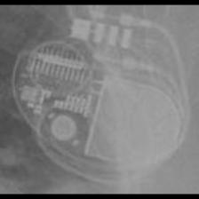 STJ:Allure Quadra</td>
<td align="center" valign="top"><b>Option 1</b>  STJ:Accent</td>
<td align="center" valign="top"><b>✅ Option 2</b>  STJ:Allure Quadra</td>
<td align="center" valign="top"><b>Option 3</b>  BOS:Contak Renewal TR2</td>
<td align="center" valign="top"><b>Option 4</b>  MDT:Advisa</td>
<td align="center" valign="top"><b>Option 5</b>  MDT:Azure</td>
<td align="center" valign="middle"><b>Option 6</b>  <i>None of the above</i></td>
</tr></table>

### Q3559 · correct: option 2 · `STJ:Allure Quadra`

<table><tr>
<td align="center" valign="top"><b>Query</b> 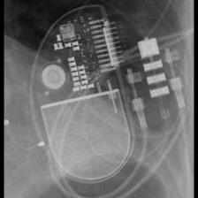 STJ:Allure Quadra</td>
<td align="center" valign="top"><b>Option 1</b>  BOS:Contak Renewal TR2</td>
<td align="center" valign="top"><b>✅ Option 2</b>  STJ:Allure Quadra</td>
<td align="center" valign="top"><b>Option 3</b>  MDT:Insync III</td>
<td align="center" valign="top"><b>Option 4</b>  MDT:Advisa</td>
<td align="center" valign="top"><b>Option 5</b>  STJ:Accent</td>
<td align="center" valign="middle"><b>Option 6</b>  <i>None of the above</i></td>
</tr></table>

### Q3560 · correct: option 5 · `STJ:Ellipse`

<table><tr>
<td align="center" valign="top"><b>Query</b> 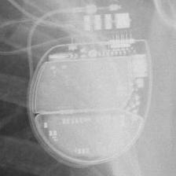 STJ:Ellipse</td>
<td align="center" valign="top"><b>Option 1</b> 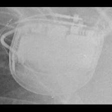 MDT:Concerto_Consulta_Maximo_Protecta_Secura</td>
<td align="center" valign="top"><b>Option 2</b> 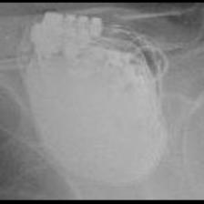 STJ:Quadra Assura_Unify</td>
<td align="center" valign="top"><b>Option 3</b> 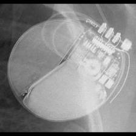 BOS:Autogen_Teligen_Energen_Cognis</td>
<td align="center" valign="top"><b>Option 4</b>  MDT:Azure</td>
<td align="center" valign="top"><b>✅ Option 5</b> 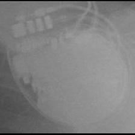 STJ:Ellipse</td>
<td align="center" valign="middle"><b>Option 6</b>  <i>None of the above</i></td>
</tr></table>

### Q3561 · correct: option 5 · `STJ:Ellipse`

<table><tr>
<td align="center" valign="top"><b>Query</b> 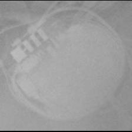 STJ:Ellipse</td>
<td align="center" valign="top"><b>Option 1</b>  STJ:Accent</td>
<td align="center" valign="top"><b>Option 2</b>  BOS:ContakTR_Discovery_Meridian_Pulsar Max</td>
<td align="center" valign="top"><b>Option 3</b>  BOS:Contak Renewal TR2</td>
<td align="center" valign="top"><b>Option 4</b>  STJ:Allure Quadra</td>
<td align="center" valign="top"><b>✅ Option 5</b> 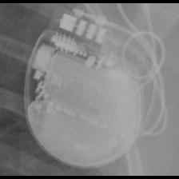 STJ:Ellipse</td>
<td align="center" valign="middle"><b>Option 6</b>  <i>None of the above</i></td>
</tr></table>

### Q3562 · correct: option 5 · `STJ:Ellipse`

<table><tr>
<td align="center" valign="top"><b>Query</b> 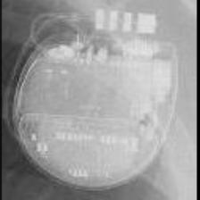 STJ:Ellipse</td>
<td align="center" valign="top"><b>Option 1</b>  BOS:Autogen_Teligen_Energen_Cognis</td>
<td align="center" valign="top"><b>Option 2</b> 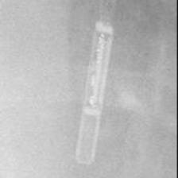 MDT:REVEAL LINQ</td>
<td align="center" valign="top"><b>Option 3</b>  MDT:Azure</td>
<td align="center" valign="top"><b>Option 4</b>  STJ:Quadra Assura_Unify</td>
<td align="center" valign="top"><b>✅ Option 5</b>  STJ:Ellipse</td>
<td align="center" valign="middle"><b>Option 6</b>  <i>None of the above</i></td>
</tr></table>

### Q3563 · correct: option 3 · `STJ:Ellipse`

<table><tr>
<td align="center" valign="top"><b>Query</b> 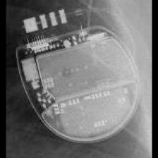 STJ:Ellipse</td>
<td align="center" valign="top"><b>Option 1</b>  MDT:REVEAL LINQ</td>
<td align="center" valign="top"><b>Option 2</b>  STJ:Quadra Assura_Unify</td>
<td align="center" valign="top"><b>✅ Option 3</b>  STJ:Ellipse</td>
<td align="center" valign="top"><b>Option 4</b> 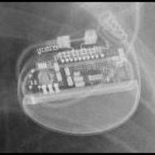 BOS:Proponent</td>
<td align="center" valign="top"><b>Option 5</b>  MDT:Concerto_Consulta_Maximo_Protecta_Secura</td>
<td align="center" valign="middle"><b>Option 6</b>  <i>None of the above</i></td>
</tr></table>

### Q3564 · correct: option 1 · `STJ:Ellipse`

<table><tr>
<td align="center" valign="top"><b>Query</b> 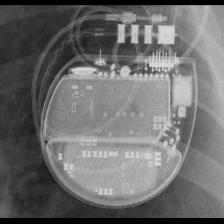 STJ:Ellipse</td>
<td align="center" valign="top"><b>✅ Option 1</b>  STJ:Ellipse</td>
<td align="center" valign="top"><b>Option 2</b>  MDT:Concerto_Consulta_Maximo_Protecta_Secura</td>
<td align="center" valign="top"><b>Option 3</b>  STJ:Quadra Assura_Unify</td>
<td align="center" valign="top"><b>Option 4</b>  MDT:Maximo</td>
<td align="center" valign="top"><b>Option 5</b>  BOS:Proponent</td>
<td align="center" valign="middle"><b>Option 6</b>  <i>None of the above</i></td>
</tr></table>

### Q3565 · correct: option 4 · `STJ:Ellipse`

<table><tr>
<td align="center" valign="top"><b>Query</b> 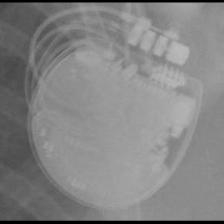 STJ:Ellipse</td>
<td align="center" valign="top"><b>Option 1</b>  STJ:Allure Quadra</td>
<td align="center" valign="top"><b>Option 2</b>  BOS:Autogen_Teligen_Energen_Cognis</td>
<td align="center" valign="top"><b>Option 3</b>  MDT:Concerto_Consulta_Maximo_Protecta_Secura</td>
<td align="center" valign="top"><b>✅ Option 4</b>  STJ:Ellipse</td>
<td align="center" valign="top"><b>Option 5</b>  STJ:Quadra Assura_Unify</td>
<td align="center" valign="middle"><b>Option 6</b>  <i>None of the above</i></td>
</tr></table>

### Q3566 · correct: option 1 · `STJ:Ellipse`

<table><tr>
<td align="center" valign="top"><b>Query</b> 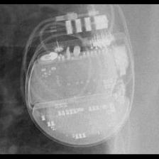 STJ:Ellipse</td>
<td align="center" valign="top"><b>✅ Option 1</b>  STJ:Ellipse</td>
<td align="center" valign="top"><b>Option 2</b>  MDT:Concerto_Consulta_Maximo_Protecta_Secura</td>
<td align="center" valign="top"><b>Option 3</b>  STJ:Quadra Assura_Unify</td>
<td align="center" valign="top"><b>Option 4</b>  MDT:Maximo</td>
<td align="center" valign="top"><b>Option 5</b>  MDT:Azure</td>
<td align="center" valign="middle"><b>Option 6</b>  <i>None of the above</i></td>
</tr></table>

### Q3567 · correct: option 4 · `STJ:Identity`

<table><tr>
<td align="center" valign="top"><b>Query</b> 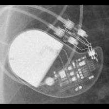 STJ:Identity</td>
<td align="center" valign="top"><b>Option 1</b>  STJ:Victory</td>
<td align="center" valign="top"><b>Option 2</b>  BIO:Cyclos</td>
<td align="center" valign="top"><b>Option 3</b>  MDT:C60 DR</td>
<td align="center" valign="top"><b>✅ Option 4</b> 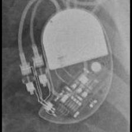 STJ:Identity</td>
<td align="center" valign="top"><b>Option 5</b>  STJ:Zephyr</td>
<td align="center" valign="middle"><b>Option 6</b>  <i>None of the above</i></td>
</tr></table>

### Q3568 · correct: option 6 (None of the above)

<table><tr>
<td align="center" valign="top"><b>Query</b> 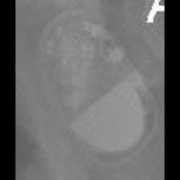 STJ:Identity</td>
<td align="center" valign="top"><b>Option 1</b> 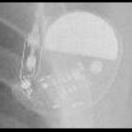 STJ:Victory</td>
<td align="center" valign="top"><b>Option 2</b>  MDT:Sigma</td>
<td align="center" valign="top"><b>Option 3</b>  MDT:C20_T20</td>
<td align="center" valign="top"><b>Option 4</b>  MDT:Adapta_Kappa_Sensia_Versa</td>
<td align="center" valign="top"><b>Option 5</b> 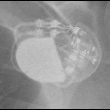 STJ:Zephyr</td>
<td align="center" valign="middle"><b>✅ Option 6</b>  <i>None of the above</i></td>
</tr></table>

### Q3569 · correct: option 1 · `STJ:Identity`

<table><tr>
<td align="center" valign="top"><b>Query</b> 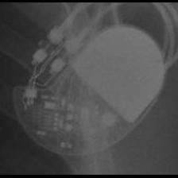 STJ:Identity</td>
<td align="center" valign="top"><b>✅ Option 1</b>  STJ:Identity</td>
<td align="center" valign="top"><b>Option 2</b>  BIO:Cyclos</td>
<td align="center" valign="top"><b>Option 3</b>  MDT:C20_T20</td>
<td align="center" valign="top"><b>Option 4</b>  STJ:Victory</td>
<td align="center" valign="top"><b>Option 5</b>  STJ:Zephyr</td>
<td align="center" valign="middle"><b>Option 6</b>  <i>None of the above</i></td>
</tr></table>

### Q3570 · correct: option 1 · `STJ:Identity`

<table><tr>
<td align="center" valign="top"><b>Query</b>  STJ:Identity</td>
<td align="center" valign="top"><b>✅ Option 1</b>  STJ:Identity</td>
<td align="center" valign="top"><b>Option 2</b>  STJ:Zephyr</td>
<td align="center" valign="top"><b>Option 3</b>  STJ:Victory</td>
<td align="center" valign="top"><b>Option 4</b>  BIO:Cyclos</td>
<td align="center" valign="top"><b>Option 5</b>  MDT:C60 DR</td>
<td align="center" valign="middle"><b>Option 6</b>  <i>None of the above</i></td>
</tr></table>

### Q3571 · correct: option 3 · `STJ:Identity`

<table><tr>
<td align="center" valign="top"><b>Query</b> 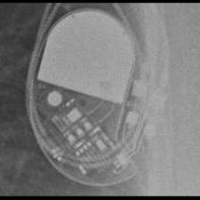 STJ:Identity</td>
<td align="center" valign="top"><b>Option 1</b>  MDT:Adapta_Kappa_Sensia_Versa</td>
<td align="center" valign="top"><b>Option 2</b>  STJ:Victory</td>
<td align="center" valign="top"><b>✅ Option 3</b>  STJ:Identity</td>
<td align="center" valign="top"><b>Option 4</b>  STJ:Zephyr</td>
<td align="center" valign="top"><b>Option 5</b>  MDT:C20_T20</td>
<td align="center" valign="middle"><b>Option 6</b>  <i>None of the above</i></td>
</tr></table>

### Q3572 · correct: option 2 · `STJ:Identity`

<table><tr>
<td align="center" valign="top"><b>Query</b>  STJ:Identity</td>
<td align="center" valign="top"><b>Option 1</b> 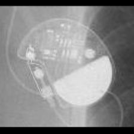 STJ:Victory</td>
<td align="center" valign="top"><b>✅ Option 2</b>  STJ:Identity</td>
<td align="center" valign="top"><b>Option 3</b>  MDT:Sigma</td>
<td align="center" valign="top"><b>Option 4</b>  MDT:C20_T20</td>
<td align="center" valign="top"><b>Option 5</b>  STJ:Zephyr</td>
<td align="center" valign="middle"><b>Option 6</b>  <i>None of the above</i></td>
</tr></table>

### Q3573 · correct: option 4 · `STJ:Identity`

<table><tr>
<td align="center" valign="top"><b>Query</b> 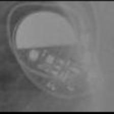 STJ:Identity</td>
<td align="center" valign="top"><b>Option 1</b> 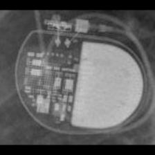 MDT:Adapta_Kappa_Sensia_Versa</td>
<td align="center" valign="top"><b>Option 2</b>  STJ:Zephyr</td>
<td align="center" valign="top"><b>Option 3</b>  STJ:Victory</td>
<td align="center" valign="top"><b>✅ Option 4</b>  STJ:Identity</td>
<td align="center" valign="top"><b>Option 5</b>  MDT:Sigma</td>
<td align="center" valign="middle"><b>Option 6</b>  <i>None of the above</i></td>
</tr></table>

### Q3574 · correct: option 3 · `STJ:Quadra Assura_Unify`

<table><tr>
<td align="center" valign="top"><b>Query</b>  STJ:Quadra Assura_Unify</td>
<td align="center" valign="top"><b>Option 1</b>  STJ:Ellipse</td>
<td align="center" valign="top"><b>Option 2</b>  MDT:Concerto_Consulta_Maximo_Protecta_Secura</td>
<td align="center" valign="top"><b>✅ Option 3</b> 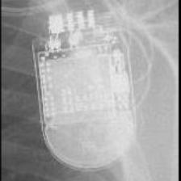 STJ:Quadra Assura_Unify</td>
<td align="center" valign="top"><b>Option 4</b>  MDT:Maximo</td>
<td align="center" valign="top"><b>Option 5</b>  BOS:Contak Renewal 4</td>
<td align="center" valign="middle"><b>Option 6</b>  <i>None of the above</i></td>
</tr></table>

### Q3575 · correct: option 2 · `STJ:Quadra Assura_Unify`

<table><tr>
<td align="center" valign="top"><b>Query</b>  STJ:Quadra Assura_Unify</td>
<td align="center" valign="top"><b>Option 1</b>  MDT:Concerto_Consulta_Maximo_Protecta_Secura</td>
<td align="center" valign="top"><b>✅ Option 2</b>  STJ:Quadra Assura_Unify</td>
<td align="center" valign="top"><b>Option 3</b>  BOS:Contak Renewal 4</td>
<td align="center" valign="top"><b>Option 4</b>  BOS:Autogen_Teligen_Energen_Cognis</td>
<td align="center" valign="top"><b>Option 5</b>  MDT:Maximo</td>
<td align="center" valign="middle"><b>Option 6</b>  <i>None of the above</i></td>
</tr></table>

### Q3576 · correct: option 4 · `STJ:Quadra Assura_Unify`

<table><tr>
<td align="center" valign="top"><b>Query</b>  STJ:Quadra Assura_Unify</td>
<td align="center" valign="top"><b>Option 1</b>  MDT:Concerto_Consulta_Maximo_Protecta_Secura</td>
<td align="center" valign="top"><b>Option 2</b> 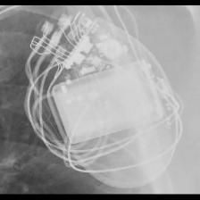 BOS:Contak Renewal 4</td>
<td align="center" valign="top"><b>Option 3</b> 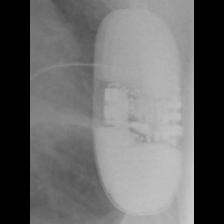 BOS:Emblem</td>
<td align="center" valign="top"><b>✅ Option 4</b>  STJ:Quadra Assura_Unify</td>
<td align="center" valign="top"><b>Option 5</b>  MDT:Maximo</td>
<td align="center" valign="middle"><b>Option 6</b>  <i>None of the above</i></td>
</tr></table>

### Q3577 · correct: option 1 · `STJ:Quadra Assura_Unify`

<table><tr>
<td align="center" valign="top"><b>Query</b> 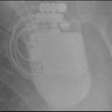 STJ:Quadra Assura_Unify</td>
<td align="center" valign="top"><b>✅ Option 1</b>  STJ:Quadra Assura_Unify</td>
<td align="center" valign="top"><b>Option 2</b>  BOS:Contak Renewal 4</td>
<td align="center" valign="top"><b>Option 3</b>  MDT:Maximo</td>
<td align="center" valign="top"><b>Option 4</b> 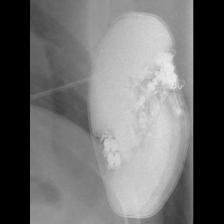 BOS:Emblem</td>
<td align="center" valign="top"><b>Option 5</b>  MDT:Concerto_Consulta_Maximo_Protecta_Secura</td>
<td align="center" valign="middle"><b>Option 6</b>  <i>None of the above</i></td>
</tr></table>

### Q3578 · correct: option 5 · `STJ:Quadra Assura_Unify`

<table><tr>
<td align="center" valign="top"><b>Query</b> 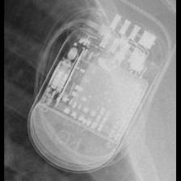 STJ:Quadra Assura_Unify</td>
<td align="center" valign="top"><b>Option 1</b>  BOS:Contak Renewal 4</td>
<td align="center" valign="top"><b>Option 2</b>  STJ:Ellipse</td>
<td align="center" valign="top"><b>Option 3</b>  MDT:Maximo</td>
<td align="center" valign="top"><b>Option 4</b>  MDT:Concerto_Consulta_Maximo_Protecta_Secura</td>
<td align="center" valign="top"><b>✅ Option 5</b>  STJ:Quadra Assura_Unify</td>
<td align="center" valign="middle"><b>Option 6</b>  <i>None of the above</i></td>
</tr></table>

### Q3579 · correct: option 4 · `STJ:Quadra Assura_Unify`

<table><tr>
<td align="center" valign="top"><b>Query</b> 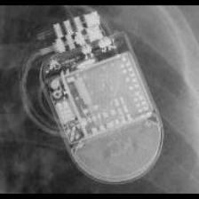 STJ:Quadra Assura_Unify</td>
<td align="center" valign="top"><b>Option 1</b>  BOS:Contak Renewal 4</td>
<td align="center" valign="top"><b>Option 2</b>  MDT:Maximo</td>
<td align="center" valign="top"><b>Option 3</b>  BOS:Autogen_Teligen_Energen_Cognis</td>
<td align="center" valign="top"><b>✅ Option 4</b>  STJ:Quadra Assura_Unify</td>
<td align="center" valign="top"><b>Option 5</b>  MDT:Concerto_Consulta_Maximo_Protecta_Secura</td>
<td align="center" valign="middle"><b>Option 6</b>  <i>None of the above</i></td>
</tr></table>

### Q3580 · correct: option 4 · `STJ:Quadra Assura_Unify`

<table><tr>
<td align="center" valign="top"><b>Query</b> 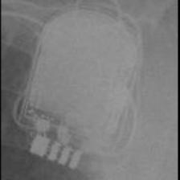 STJ:Quadra Assura_Unify</td>
<td align="center" valign="top"><b>Option 1</b>  STJ:Ellipse</td>
<td align="center" valign="top"><b>Option 2</b>  MDT:Maximo</td>
<td align="center" valign="top"><b>Option 3</b>  BOS:Contak Renewal 4</td>
<td align="center" valign="top"><b>✅ Option 4</b>  STJ:Quadra Assura_Unify</td>
<td align="center" valign="top"><b>Option 5</b>  MDT:Concerto_Consulta_Maximo_Protecta_Secura</td>
<td align="center" valign="middle"><b>Option 6</b>  <i>None of the above</i></td>
</tr></table>

### Q3581 · correct: option 2 · `STJ:Victory`

<table><tr>
<td align="center" valign="top"><b>Query</b> 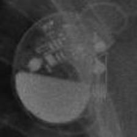 STJ:Victory</td>
<td align="center" valign="top"><b>Option 1</b>  MDT:Sigma</td>
<td align="center" valign="top"><b>✅ Option 2</b>  STJ:Victory</td>
<td align="center" valign="top"><b>Option 3</b>  STJ:Zephyr</td>
<td align="center" valign="top"><b>Option 4</b>  MDT:C20_T20</td>
<td align="center" valign="top"><b>Option 5</b>  STJ:Identity</td>
<td align="center" valign="middle"><b>Option 6</b>  <i>None of the above</i></td>
</tr></table>

### Q3582 · correct: option 1 · `STJ:Victory`

<table><tr>
<td align="center" valign="top"><b>Query</b> 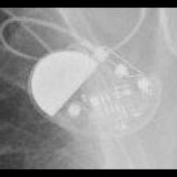 STJ:Victory</td>
<td align="center" valign="top"><b>✅ Option 1</b>  STJ:Victory</td>
<td align="center" valign="top"><b>Option 2</b>  MDT:Sigma</td>
<td align="center" valign="top"><b>Option 3</b>  MDT:C20_T20</td>
<td align="center" valign="top"><b>Option 4</b>  STJ:Zephyr</td>
<td align="center" valign="top"><b>Option 5</b>  STJ:Identity</td>
<td align="center" valign="middle"><b>Option 6</b>  <i>None of the above</i></td>
</tr></table>

### Q3583 · correct: option 3 · `STJ:Victory`

<table><tr>
<td align="center" valign="top"><b>Query</b>  STJ:Victory</td>
<td align="center" valign="top"><b>Option 1</b>  STJ:Zephyr</td>
<td align="center" valign="top"><b>Option 2</b>  MDT:C20_T20</td>
<td align="center" valign="top"><b>✅ Option 3</b>  STJ:Victory</td>
<td align="center" valign="top"><b>Option 4</b>  STJ:Identity</td>
<td align="center" valign="top"><b>Option 5</b>  MDT:Sigma</td>
<td align="center" valign="middle"><b>Option 6</b>  <i>None of the above</i></td>
</tr></table>

### Q3584 · correct: option 1 · `STJ:Victory`

<table><tr>
<td align="center" valign="top"><b>Query</b> 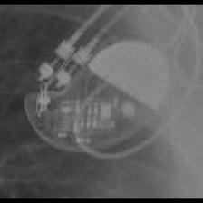 STJ:Victory</td>
<td align="center" valign="top"><b>✅ Option 1</b>  STJ:Victory</td>
<td align="center" valign="top"><b>Option 2</b>  STJ:Zephyr</td>
<td align="center" valign="top"><b>Option 3</b>  SOR:Rhapsody_Symphony</td>
<td align="center" valign="top"><b>Option 4</b>  BIO:Cyclos</td>
<td align="center" valign="top"><b>Option 5</b>  STJ:Identity</td>
<td align="center" valign="middle"><b>Option 6</b>  <i>None of the above</i></td>
</tr></table>

### Q3585 · correct: option 5 · `STJ:Victory`

<table><tr>
<td align="center" valign="top"><b>Query</b> 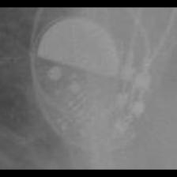 STJ:Victory</td>
<td align="center" valign="top"><b>Option 1</b>  MDT:C20_T20</td>
<td align="center" valign="top"><b>Option 2</b>  STJ:Identity</td>
<td align="center" valign="top"><b>Option 3</b>  STJ:Zephyr</td>
<td align="center" valign="top"><b>Option 4</b>  BIO:Cyclos</td>
<td align="center" valign="top"><b>✅ Option 5</b>  STJ:Victory</td>
<td align="center" valign="middle"><b>Option 6</b>  <i>None of the above</i></td>
</tr></table>

### Q3586 · correct: option 5 · `STJ:Victory`

<table><tr>
<td align="center" valign="top"><b>Query</b>  STJ:Victory</td>
<td align="center" valign="top"><b>Option 1</b>  MDT:Sigma</td>
<td align="center" valign="top"><b>Option 2</b>  STJ:Identity</td>
<td align="center" valign="top"><b>Option 3</b>  MDT:Adapta_Kappa_Sensia_Versa</td>
<td align="center" valign="top"><b>Option 4</b>  STJ:Zephyr</td>
<td align="center" valign="top"><b>✅ Option 5</b>  STJ:Victory</td>
<td align="center" valign="middle"><b>Option 6</b>  <i>None of the above</i></td>
</tr></table>

### Q3587 · correct: option 1 · `STJ:Zephyr`

<table><tr>
<td align="center" valign="top"><b>Query</b> 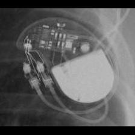 STJ:Zephyr</td>
<td align="center" valign="top"><b>✅ Option 1</b>  STJ:Zephyr</td>
<td align="center" valign="top"><b>Option 2</b>  MDT:C20_T20</td>
<td align="center" valign="top"><b>Option 3</b>  STJ:Identity</td>
<td align="center" valign="top"><b>Option 4</b>  STJ:Victory</td>
<td align="center" valign="top"><b>Option 5</b>  MDT:C60 DR</td>
<td align="center" valign="middle"><b>Option 6</b>  <i>None of the above</i></td>
</tr></table>

### Q3588 · correct: option 4 · `STJ:Zephyr`

<table><tr>
<td align="center" valign="top"><b>Query</b> 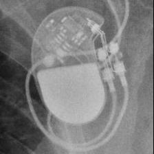 STJ:Zephyr</td>
<td align="center" valign="top"><b>Option 1</b>  MDT:C20_T20</td>
<td align="center" valign="top"><b>Option 2</b>  STJ:Victory</td>
<td align="center" valign="top"><b>Option 3</b>  STJ:Identity</td>
<td align="center" valign="top"><b>✅ Option 4</b>  STJ:Zephyr</td>
<td align="center" valign="top"><b>Option 5</b>  MDT:C60 DR</td>
<td align="center" valign="middle"><b>Option 6</b>  <i>None of the above</i></td>
</tr></table>

### Q3589 · correct: option 5 · `STJ:Zephyr`

<table><tr>
<td align="center" valign="top"><b>Query</b> 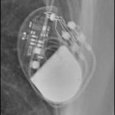 STJ:Zephyr</td>
<td align="center" valign="top"><b>Option 1</b>  MDT:Adapta_Kappa_Sensia_Versa</td>
<td align="center" valign="top"><b>Option 2</b>  STJ:Victory</td>
<td align="center" valign="top"><b>Option 3</b>  STJ:Identity</td>
<td align="center" valign="top"><b>Option 4</b>  MDT:C60 DR</td>
<td align="center" valign="top"><b>✅ Option 5</b>  STJ:Zephyr</td>
<td align="center" valign="middle"><b>Option 6</b>  <i>None of the above</i></td>
</tr></table>

### Q3590 · correct: option 4 · `STJ:Zephyr`

<table><tr>
<td align="center" valign="top"><b>Query</b> 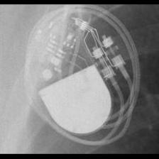 STJ:Zephyr</td>
<td align="center" valign="top"><b>Option 1</b>  STJ:Victory</td>
<td align="center" valign="top"><b>Option 2</b>  STJ:Identity</td>
<td align="center" valign="top"><b>Option 3</b>  MDT:C60 DR</td>
<td align="center" valign="top"><b>✅ Option 4</b>  STJ:Zephyr</td>
<td align="center" valign="top"><b>Option 5</b>  BIO:Cyclos</td>
<td align="center" valign="middle"><b>Option 6</b>  <i>None of the above</i></td>
</tr></table>

### Q3591 · correct: option 4 · `STJ:Zephyr`

<table><tr>
<td align="center" valign="top"><b>Query</b> 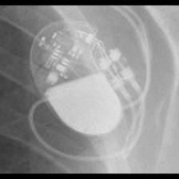 STJ:Zephyr</td>
<td align="center" valign="top"><b>Option 1</b>  STJ:Victory</td>
<td align="center" valign="top"><b>Option 2</b>  STJ:Identity</td>
<td align="center" valign="top"><b>Option 3</b>  MDT:Sigma</td>
<td align="center" valign="top"><b>✅ Option 4</b>  STJ:Zephyr</td>
<td align="center" valign="top"><b>Option 5</b>  MDT:Adapta_Kappa_Sensia_Versa</td>
<td align="center" valign="middle"><b>Option 6</b>  <i>None of the above</i></td>
</tr></table>

### Q3592 · correct: option 5 · `STJ:Zephyr`

<table><tr>
<td align="center" valign="top"><b>Query</b>  STJ:Zephyr</td>
<td align="center" valign="top"><b>Option 1</b>  STJ:Victory</td>
<td align="center" valign="top"><b>Option 2</b>  STJ:Identity</td>
<td align="center" valign="top"><b>Option 3</b>  MDT:C60 DR</td>
<td align="center" valign="top"><b>Option 4</b>  MDT:Adapta_Kappa_Sensia_Versa</td>
<td align="center" valign="top"><b>✅ Option 5</b>  STJ:Zephyr</td>
<td align="center" valign="middle"><b>Option 6</b>  <i>None of the above</i></td>
</tr></table>

### Q3593 · correct: option 1 · `STJ:Zephyr`

<table><tr>
<td align="center" valign="top"><b>Query</b>  STJ:Zephyr</td>
<td align="center" valign="top"><b>✅ Option 1</b>  STJ:Zephyr</td>
<td align="center" valign="top"><b>Option 2</b>  STJ:Identity</td>
<td align="center" valign="top"><b>Option 3</b>  STJ:Victory</td>
<td align="center" valign="top"><b>Option 4</b>  BIO:Cyclos</td>
<td align="center" valign="top"><b>Option 5</b>  BIO:Actros_Philos</td>
<td align="center" valign="middle"><b>Option 6</b>  <i>None of the above</i></td>
</tr></table>

