# Pacemakers (Howard et al.) · query set `train2` · page 1/6

[← all pages](README.md)

### Q3594 · correct: option 3 · `BIO:Actros_Philos`

<table><tr>
<td align="center" valign="top"><b>Query</b> 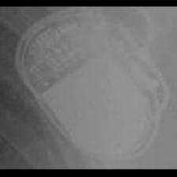 BIO:Actros_Philos</td>
<td align="center" valign="top"><b>Option 1</b> 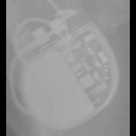 BOS:ContakTR_Discovery_Meridian_Pulsar Max</td>
<td align="center" valign="top"><b>Option 2</b>  BIO:Cyclos</td>
<td align="center" valign="top"><b>✅ Option 3</b> 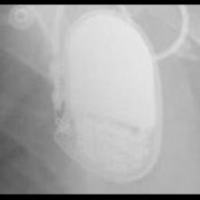 BIO:Actros_Philos</td>
<td align="center" valign="top"><b>Option 4</b>  SOR:Thesis</td>
<td align="center" valign="top"><b>Option 5</b> 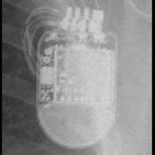 STJ:Quadra Assura_Unify</td>
<td align="center" valign="middle"><b>Option 6</b>  <i>None of the above</i></td>
</tr></table>

### Q3595 · correct: option 5 · `BIO:Actros_Philos`

<table><tr>
<td align="center" valign="top"><b>Query</b> 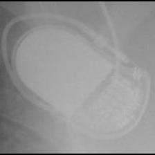 BIO:Actros_Philos</td>
<td align="center" valign="top"><b>Option 1</b>  MDT:Sigma</td>
<td align="center" valign="top"><b>Option 2</b> 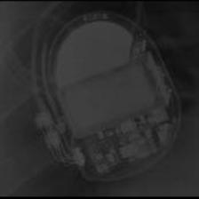 BOS:Ventak Prizm</td>
<td align="center" valign="top"><b>Option 3</b>  BIO:Cyclos</td>
<td align="center" valign="top"><b>Option 4</b>  MDT:C20_T20</td>
<td align="center" valign="top"><b>✅ Option 5</b>  BIO:Actros_Philos</td>
<td align="center" valign="middle"><b>Option 6</b>  <i>None of the above</i></td>
</tr></table>

### Q3596 · correct: option 2 · `BIO:Actros_Philos`

<table><tr>
<td align="center" valign="top"><b>Query</b> 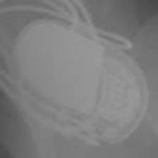 BIO:Actros_Philos</td>
<td align="center" valign="top"><b>Option 1</b>  MDT:Sigma</td>
<td align="center" valign="top"><b>✅ Option 2</b>  BIO:Actros_Philos</td>
<td align="center" valign="top"><b>Option 3</b>  BOS:ContakTR_Discovery_Meridian_Pulsar Max</td>
<td align="center" valign="top"><b>Option 4</b> 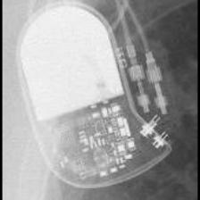 BIO:Cyclos</td>
<td align="center" valign="top"><b>Option 5</b> 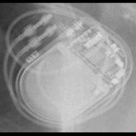 BIO:Evia</td>
<td align="center" valign="middle"><b>Option 6</b>  <i>None of the above</i></td>
</tr></table>

### Q3597 · correct: option 1 · `BIO:Actros_Philos`

<table><tr>
<td align="center" valign="top"><b>Query</b>  BIO:Actros_Philos</td>
<td align="center" valign="top"><b>✅ Option 1</b>  BIO:Actros_Philos</td>
<td align="center" valign="top"><b>Option 2</b>  MDT:Adapta_Kappa_Sensia_Versa</td>
<td align="center" valign="top"><b>Option 3</b>  BIO:Cyclos</td>
<td align="center" valign="top"><b>Option 4</b>  MDT:Sigma</td>
<td align="center" valign="top"><b>Option 5</b>  MDT:C20_T20</td>
<td align="center" valign="middle"><b>Option 6</b>  <i>None of the above</i></td>
</tr></table>

### Q3598 · correct: option 2 · `BIO:Actros_Philos`

<table><tr>
<td align="center" valign="top"><b>Query</b> 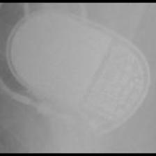 BIO:Actros_Philos</td>
<td align="center" valign="top"><b>Option 1</b>  MDT:Vita II</td>
<td align="center" valign="top"><b>✅ Option 2</b>  BIO:Actros_Philos</td>
<td align="center" valign="top"><b>Option 3</b>  MDT:Syncra</td>
<td align="center" valign="top"><b>Option 4</b>  SOR:Thesis</td>
<td align="center" valign="top"><b>Option 5</b>  BOS:ContakTR_Discovery_Meridian_Pulsar Max</td>
<td align="center" valign="middle"><b>Option 6</b>  <i>None of the above</i></td>
</tr></table>

### Q3599 · correct: option 3 · `BIO:Actros_Philos`

<table><tr>
<td align="center" valign="top"><b>Query</b>  BIO:Actros_Philos</td>
<td align="center" valign="top"><b>Option 1</b>  BIO:Cyclos</td>
<td align="center" valign="top"><b>Option 2</b>  MDT:C20_T20</td>
<td align="center" valign="top"><b>✅ Option 3</b>  BIO:Actros_Philos</td>
<td align="center" valign="top"><b>Option 4</b>  BOS:ContakTR_Discovery_Meridian_Pulsar Max</td>
<td align="center" valign="top"><b>Option 5</b>  MDT:C60 DR</td>
<td align="center" valign="middle"><b>Option 6</b>  <i>None of the above</i></td>
</tr></table>

### Q3600 · correct: option 4 · `BIO:Actros_Philos`

<table><tr>
<td align="center" valign="top"><b>Query</b>  BIO:Actros_Philos</td>
<td align="center" valign="top"><b>Option 1</b> 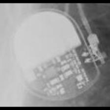 MDT:Adapta_Kappa_Sensia_Versa</td>
<td align="center" valign="top"><b>Option 2</b>  BOS:ContakTR_Discovery_Meridian_Pulsar Max</td>
<td align="center" valign="top"><b>Option 3</b>  MDT:C20_T20</td>
<td align="center" valign="top"><b>✅ Option 4</b>  BIO:Actros_Philos</td>
<td align="center" valign="top"><b>Option 5</b>  BIO:Cyclos</td>
<td align="center" valign="middle"><b>Option 6</b>  <i>None of the above</i></td>
</tr></table>

### Q3601 · correct: option 2 · `BIO:Cyclos`

<table><tr>
<td align="center" valign="top"><b>Query</b> 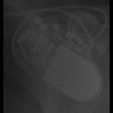 BIO:Cyclos</td>
<td align="center" valign="top"><b>Option 1</b>  MDT:C20_T20</td>
<td align="center" valign="top"><b>✅ Option 2</b>  BIO:Cyclos</td>
<td align="center" valign="top"><b>Option 3</b>  MDT:Sigma</td>
<td align="center" valign="top"><b>Option 4</b>  STJ:Identity</td>
<td align="center" valign="top"><b>Option 5</b>  BIO:Actros_Philos</td>
<td align="center" valign="middle"><b>Option 6</b>  <i>None of the above</i></td>
</tr></table>

### Q3602 · correct: option 1 · `BIO:Cyclos`

<table><tr>
<td align="center" valign="top"><b>Query</b> 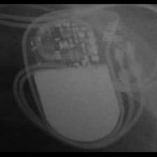 BIO:Cyclos</td>
<td align="center" valign="top"><b>✅ Option 1</b>  BIO:Cyclos</td>
<td align="center" valign="top"><b>Option 2</b>  MDT:C20_T20</td>
<td align="center" valign="top"><b>Option 3</b>  BIO:Actros_Philos</td>
<td align="center" valign="top"><b>Option 4</b>  MDT:Sigma</td>
<td align="center" valign="top"><b>Option 5</b> 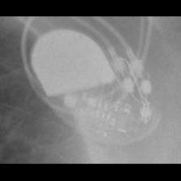 STJ:Zephyr</td>
<td align="center" valign="middle"><b>Option 6</b>  <i>None of the above</i></td>
</tr></table>

### Q3603 · correct: option 4 · `BIO:Cyclos`

<table><tr>
<td align="center" valign="top"><b>Query</b> 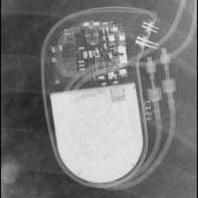 BIO:Cyclos</td>
<td align="center" valign="top"><b>Option 1</b>  BIO:Actros_Philos</td>
<td align="center" valign="top"><b>Option 2</b> 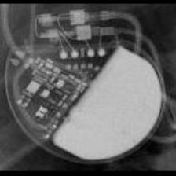 MDT:C60 DR</td>
<td align="center" valign="top"><b>Option 3</b> 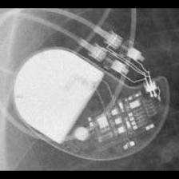 STJ:Identity</td>
<td align="center" valign="top"><b>✅ Option 4</b>  BIO:Cyclos</td>
<td align="center" valign="top"><b>Option 5</b>  BIO:Evia</td>
<td align="center" valign="middle"><b>Option 6</b>  <i>None of the above</i></td>
</tr></table>

### Q3604 · correct: option 4 · `BIO:Cyclos`

<table><tr>
<td align="center" valign="top"><b>Query</b> 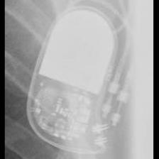 BIO:Cyclos</td>
<td align="center" valign="top"><b>Option 1</b>  BOS:ContakTR_Discovery_Meridian_Pulsar Max</td>
<td align="center" valign="top"><b>Option 2</b>  BIO:Actros_Philos</td>
<td align="center" valign="top"><b>Option 3</b>  MDT:Sigma</td>
<td align="center" valign="top"><b>✅ Option 4</b> 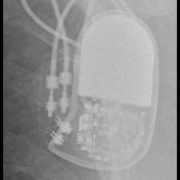 BIO:Cyclos</td>
<td align="center" valign="top"><b>Option 5</b>  MDT:Adapta_Kappa_Sensia_Versa</td>
<td align="center" valign="middle"><b>Option 6</b>  <i>None of the above</i></td>
</tr></table>

### Q3605 · correct: option 5 · `BIO:Cyclos`

<table><tr>
<td align="center" valign="top"><b>Query</b> 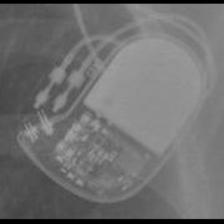 BIO:Cyclos</td>
<td align="center" valign="top"><b>Option 1</b>  MDT:Sigma</td>
<td align="center" valign="top"><b>Option 2</b>  STJ:Identity</td>
<td align="center" valign="top"><b>Option 3</b>  BIO:Actros_Philos</td>
<td align="center" valign="top"><b>Option 4</b>  MDT:C20_T20</td>
<td align="center" valign="top"><b>✅ Option 5</b>  BIO:Cyclos</td>
<td align="center" valign="middle"><b>Option 6</b>  <i>None of the above</i></td>
</tr></table>

### Q3606 · correct: option 5 · `BIO:Evia`

<table><tr>
<td align="center" valign="top"><b>Query</b> 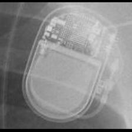 BIO:Evia</td>
<td align="center" valign="top"><b>Option 1</b> 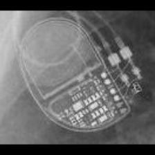 MDT:EnRhythm</td>
<td align="center" valign="top"><b>Option 2</b>  MDT:Maximo</td>
<td align="center" valign="top"><b>Option 3</b> 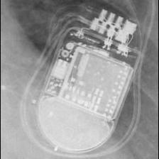 STJ:Quadra Assura_Unify</td>
<td align="center" valign="top"><b>Option 4</b>  MDT:Concerto_Consulta_Maximo_Protecta_Secura</td>
<td align="center" valign="top"><b>✅ Option 5</b> 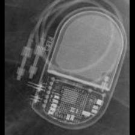 BIO:Evia</td>
<td align="center" valign="middle"><b>Option 6</b>  <i>None of the above</i></td>
</tr></table>

### Q3607 · correct: option 4 · `BIO:Evia`

<table><tr>
<td align="center" valign="top"><b>Query</b> 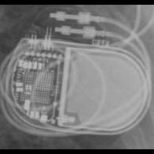 BIO:Evia</td>
<td align="center" valign="top"><b>Option 1</b>  MDT:Advisa</td>
<td align="center" valign="top"><b>Option 2</b> 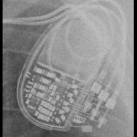 MDT:Syncra</td>
<td align="center" valign="top"><b>Option 3</b> 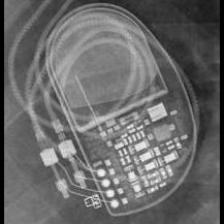 MDT:AT500</td>
<td align="center" valign="top"><b>✅ Option 4</b>  BIO:Evia</td>
<td align="center" valign="top"><b>Option 5</b>  MDT:EnRhythm</td>
<td align="center" valign="middle"><b>Option 6</b>  <i>None of the above</i></td>
</tr></table>

### Q3608 · correct: option 3 · `BIO:Evia`

<table><tr>
<td align="center" valign="top"><b>Query</b> 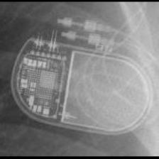 BIO:Evia</td>
<td align="center" valign="top"><b>Option 1</b>  MDT:EnRhythm</td>
<td align="center" valign="top"><b>Option 2</b> 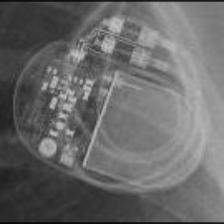 STJ:Accent</td>
<td align="center" valign="top"><b>✅ Option 3</b>  BIO:Evia</td>
<td align="center" valign="top"><b>Option 4</b> 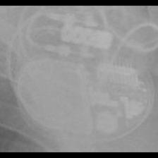 STJ:Allure Quadra</td>
<td align="center" valign="top"><b>Option 5</b>  MDT:Syncra</td>
<td align="center" valign="middle"><b>Option 6</b>  <i>None of the above</i></td>
</tr></table>

### Q3609 · correct: option 3 · `BIO:Evia`

<table><tr>
<td align="center" valign="top"><b>Query</b> 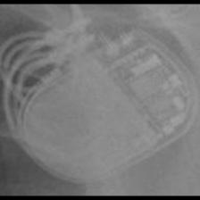 BIO:Evia</td>
<td align="center" valign="top"><b>Option 1</b>  MDT:Syncra</td>
<td align="center" valign="top"><b>Option 2</b>  MDT:Concerto_Consulta_Maximo_Protecta_Secura</td>
<td align="center" valign="top"><b>✅ Option 3</b>  BIO:Evia</td>
<td align="center" valign="top"><b>Option 4</b>  STJ:Quadra Assura_Unify</td>
<td align="center" valign="top"><b>Option 5</b>  STJ:Accent</td>
<td align="center" valign="middle"><b>Option 6</b>  <i>None of the above</i></td>
</tr></table>

### Q3610 · correct: option 3 · `BOS:Altrua_Insignia`

<table><tr>
<td align="center" valign="top"><b>Query</b> 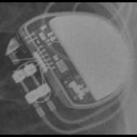 BOS:Altrua_Insignia</td>
<td align="center" valign="top"><b>Option 1</b> 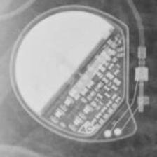 MDT:Vita II</td>
<td align="center" valign="top"><b>Option 2</b>  SOR:Elect XS Plus</td>
<td align="center" valign="top"><b>✅ Option 3</b> 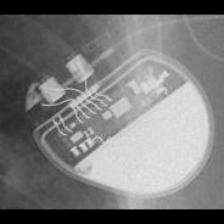 BOS:Altrua_Insignia</td>
<td align="center" valign="top"><b>Option 4</b> 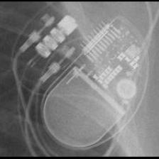 STJ:Allure Quadra</td>
<td align="center" valign="top"><b>Option 5</b>  MDT:C20_T20</td>
<td align="center" valign="middle"><b>Option 6</b>  <i>None of the above</i></td>
</tr></table>

### Q3611 · correct: option 4 · `BOS:Altrua_Insignia`

<table><tr>
<td align="center" valign="top"><b>Query</b> 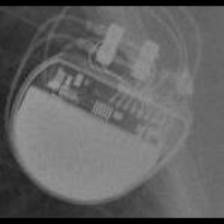 BOS:Altrua_Insignia</td>
<td align="center" valign="top"><b>Option 1</b> 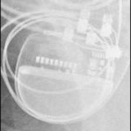 BOS:Contak Renewal TR2</td>
<td align="center" valign="top"><b>Option 2</b>  BOS:Visionist</td>
<td align="center" valign="top"><b>Option 3</b> 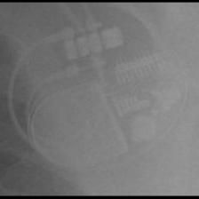 STJ:Allure Quadra</td>
<td align="center" valign="top"><b>✅ Option 4</b>  BOS:Altrua_Insignia</td>
<td align="center" valign="top"><b>Option 5</b> 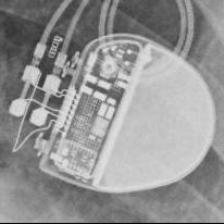 BOS:Ingenio</td>
<td align="center" valign="middle"><b>Option 6</b>  <i>None of the above</i></td>
</tr></table>

### Q3612 · correct: option 3 · `BOS:Altrua_Insignia`

<table><tr>
<td align="center" valign="top"><b>Query</b>  BOS:Altrua_Insignia</td>
<td align="center" valign="top"><b>Option 1</b> 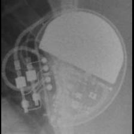 MDT:C60 DR</td>
<td align="center" valign="top"><b>Option 2</b> 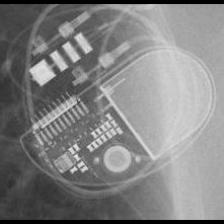 STJ:Allure Quadra</td>
<td align="center" valign="top"><b>✅ Option 3</b>  BOS:Altrua_Insignia</td>
<td align="center" valign="top"><b>Option 4</b> 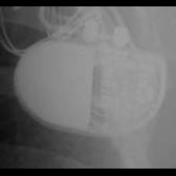 BOS:ContakTR_Discovery_Meridian_Pulsar Max</td>
<td align="center" valign="top"><b>Option 5</b>  MDT:C20_T20</td>
<td align="center" valign="middle"><b>Option 6</b>  <i>None of the above</i></td>
</tr></table>

### Q3613 · correct: option 4 · `BOS:Altrua_Insignia`

<table><tr>
<td align="center" valign="top"><b>Query</b> 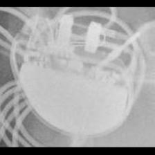 BOS:Altrua_Insignia</td>
<td align="center" valign="top"><b>Option 1</b>  MDT:C20_T20</td>
<td align="center" valign="top"><b>Option 2</b>  STJ:Zephyr</td>
<td align="center" valign="top"><b>Option 3</b>  BOS:Contak Renewal TR2</td>
<td align="center" valign="top"><b>✅ Option 4</b> 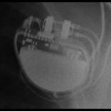 BOS:Altrua_Insignia</td>
<td align="center" valign="top"><b>Option 5</b> 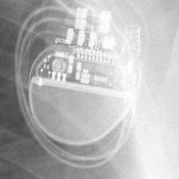 BOS:Visionist</td>
<td align="center" valign="middle"><b>Option 6</b>  <i>None of the above</i></td>
</tr></table>

### Q3614 · correct: option 4 · `BOS:Altrua_Insignia`

<table><tr>
<td align="center" valign="top"><b>Query</b> 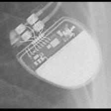 BOS:Altrua_Insignia</td>
<td align="center" valign="top"><b>Option 1</b>  MDT:C60 DR</td>
<td align="center" valign="top"><b>Option 2</b> 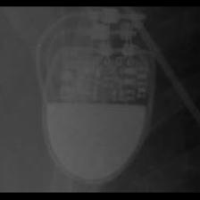 SOR:Rhapsody_Symphony</td>
<td align="center" valign="top"><b>Option 3</b>  BOS:Ingenio</td>
<td align="center" valign="top"><b>✅ Option 4</b>  BOS:Altrua_Insignia</td>
<td align="center" valign="top"><b>Option 5</b>  BOS:Visionist</td>
<td align="center" valign="middle"><b>Option 6</b>  <i>None of the above</i></td>
</tr></table>

### Q3615 · correct: option 5 · `BOS:Altrua_Insignia`

<table><tr>
<td align="center" valign="top"><b>Query</b> 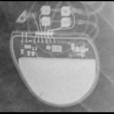 BOS:Altrua_Insignia</td>
<td align="center" valign="top"><b>Option 1</b>  BOS:Contak Renewal TR2</td>
<td align="center" valign="top"><b>Option 2</b>  BOS:Visionist</td>
<td align="center" valign="top"><b>Option 3</b>  SOR:Rhapsody_Symphony</td>
<td align="center" valign="top"><b>Option 4</b>  BOS:Ingenio</td>
<td align="center" valign="top"><b>✅ Option 5</b>  BOS:Altrua_Insignia</td>
<td align="center" valign="middle"><b>Option 6</b>  <i>None of the above</i></td>
</tr></table>

### Q3616 · correct: option 4 · `BOS:Altrua_Insignia`

<table><tr>
<td align="center" valign="top"><b>Query</b> 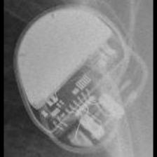 BOS:Altrua_Insignia</td>
<td align="center" valign="top"><b>Option 1</b>  STJ:Allure Quadra</td>
<td align="center" valign="top"><b>Option 2</b> 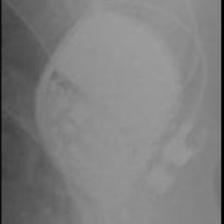 BOS:ContakTR_Discovery_Meridian_Pulsar Max</td>
<td align="center" valign="top"><b>Option 3</b>  BOS:Ventak Prizm</td>
<td align="center" valign="top"><b>✅ Option 4</b>  BOS:Altrua_Insignia</td>
<td align="center" valign="top"><b>Option 5</b>  SOR:Neway</td>
<td align="center" valign="middle"><b>Option 6</b>  <i>None of the above</i></td>
</tr></table>

### Q3617 · correct: option 4 · `BOS:Autogen_Teligen_Energen_Cognis`

<table><tr>
<td align="center" valign="top"><b>Query</b>  BOS:Autogen_Teligen_Energen_Cognis</td>
<td align="center" valign="top"><b>Option 1</b>  SOR:Neway</td>
<td align="center" valign="top"><b>Option 2</b>  STJ:Ellipse</td>
<td align="center" valign="top"><b>Option 3</b>  BOS:Emblem</td>
<td align="center" valign="top"><b>✅ Option 4</b>  BOS:Autogen_Teligen_Energen_Cognis</td>
<td align="center" valign="top"><b>Option 5</b>  MDT:REVEAL</td>
<td align="center" valign="middle"><b>Option 6</b>  <i>None of the above</i></td>
</tr></table>

### Q3618 · correct: option 4 · `BOS:Autogen_Teligen_Energen_Cognis`

<table><tr>
<td align="center" valign="top"><b>Query</b>  BOS:Autogen_Teligen_Energen_Cognis</td>
<td align="center" valign="top"><b>Option 1</b>  BOS:Contak Renewal 4</td>
<td align="center" valign="top"><b>Option 2</b>  MDT:Claria_Evera_Viva</td>
<td align="center" valign="top"><b>Option 3</b>  BOS:Emblem</td>
<td align="center" valign="top"><b>✅ Option 4</b>  BOS:Autogen_Teligen_Energen_Cognis</td>
<td align="center" valign="top"><b>Option 5</b>  BOS:Visionist</td>
<td align="center" valign="middle"><b>Option 6</b>  <i>None of the above</i></td>
</tr></table>

### Q3619 · correct: option 1 · `BOS:Autogen_Teligen_Energen_Cognis`

<table><tr>
<td align="center" valign="top"><b>Query</b>  BOS:Autogen_Teligen_Energen_Cognis</td>
<td align="center" valign="top"><b>✅ Option 1</b>  BOS:Autogen_Teligen_Energen_Cognis</td>
<td align="center" valign="top"><b>Option 2</b>  BOS:Emblem</td>
<td align="center" valign="top"><b>Option 3</b>  BOS:Visionist</td>
<td align="center" valign="top"><b>Option 4</b>  BOS:Ingenio</td>
<td align="center" valign="top"><b>Option 5</b>  BOS:Contak Renewal 4</td>
<td align="center" valign="middle"><b>Option 6</b>  <i>None of the above</i></td>
</tr></table>

### Q3620 · correct: option 2 · `BOS:Autogen_Teligen_Energen_Cognis`

<table><tr>
<td align="center" valign="top"><b>Query</b>  BOS:Autogen_Teligen_Energen_Cognis</td>
<td align="center" valign="top"><b>Option 1</b>  STJ:Ellipse</td>
<td align="center" valign="top"><b>✅ Option 2</b>  BOS:Autogen_Teligen_Energen_Cognis</td>
<td align="center" valign="top"><b>Option 3</b>  BOS:Emblem</td>
<td align="center" valign="top"><b>Option 4</b>  STJ:Quadra Assura_Unify</td>
<td align="center" valign="top"><b>Option 5</b>  BOS:Contak Renewal 4</td>
<td align="center" valign="middle"><b>Option 6</b>  <i>None of the above</i></td>
</tr></table>

### Q3621 · correct: option 2 · `BOS:Autogen_Teligen_Energen_Cognis`

<table><tr>
<td align="center" valign="top"><b>Query</b>  BOS:Autogen_Teligen_Energen_Cognis</td>
<td align="center" valign="top"><b>Option 1</b>  BOS:Contak Renewal 4</td>
<td align="center" valign="top"><b>✅ Option 2</b>  BOS:Autogen_Teligen_Energen_Cognis</td>
<td align="center" valign="top"><b>Option 3</b>  BOS:Ingenio</td>
<td align="center" valign="top"><b>Option 4</b>  MDT:REVEAL</td>
<td align="center" valign="top"><b>Option 5</b>  STJ:Ellipse</td>
<td align="center" valign="middle"><b>Option 6</b>  <i>None of the above</i></td>
</tr></table>

### Q3622 · correct: option 5 · `BOS:Autogen_Teligen_Energen_Cognis`

<table><tr>
<td align="center" valign="top"><b>Query</b>  BOS:Autogen_Teligen_Energen_Cognis</td>
<td align="center" valign="top"><b>Option 1</b>  STJ:Ellipse</td>
<td align="center" valign="top"><b>Option 2</b>  BOS:Contak Renewal 4</td>
<td align="center" valign="top"><b>Option 3</b>  STJ:Quadra Assura_Unify</td>
<td align="center" valign="top"><b>Option 4</b>  MDT:Concerto_Consulta_Maximo_Protecta_Secura</td>
<td align="center" valign="top"><b>✅ Option 5</b>  BOS:Autogen_Teligen_Energen_Cognis</td>
<td align="center" valign="middle"><b>Option 6</b>  <i>None of the above</i></td>
</tr></table>

### Q3623 · correct: option 4 · `BOS:Autogen_Teligen_Energen_Cognis`

<table><tr>
<td align="center" valign="top"><b>Query</b>  BOS:Autogen_Teligen_Energen_Cognis</td>
<td align="center" valign="top"><b>Option 1</b>  BOS:Vitality</td>
<td align="center" valign="top"><b>Option 2</b>  BOS:Contak Renewal 4</td>
<td align="center" valign="top"><b>Option 3</b>  STJ:Ellipse</td>
<td align="center" valign="top"><b>✅ Option 4</b>  BOS:Autogen_Teligen_Energen_Cognis</td>
<td align="center" valign="top"><b>Option 5</b>  BOS:Emblem</td>
<td align="center" valign="middle"><b>Option 6</b>  <i>None of the above</i></td>
</tr></table>

### Q3624 · correct: option 4 · `BOS:Contak Renewal 4`

<table><tr>
<td align="center" valign="top"><b>Query</b>  BOS:Contak Renewal 4</td>
<td align="center" valign="top"><b>Option 1</b>  BOS:Vitality</td>
<td align="center" valign="top"><b>Option 2</b>  STJ:Quadra Assura_Unify</td>
<td align="center" valign="top"><b>Option 3</b>  MDT:Maximo</td>
<td align="center" valign="top"><b>✅ Option 4</b>  BOS:Contak Renewal 4</td>
<td align="center" valign="top"><b>Option 5</b>  MDT:Concerto_Consulta_Maximo_Protecta_Secura</td>
<td align="center" valign="middle"><b>Option 6</b>  <i>None of the above</i></td>
</tr></table>

### Q3625 · correct: option 1 · `BOS:Contak Renewal 4`

<table><tr>
<td align="center" valign="top"><b>Query</b>  BOS:Contak Renewal 4</td>
<td align="center" valign="top"><b>✅ Option 1</b>  BOS:Contak Renewal 4</td>
<td align="center" valign="top"><b>Option 2</b>  BOS:Ventak Prizm</td>
<td align="center" valign="top"><b>Option 3</b>  MDT:Concerto_Consulta_Maximo_Protecta_Secura</td>
<td align="center" valign="top"><b>Option 4</b>  MDT:Maximo</td>
<td align="center" valign="top"><b>Option 5</b>  BOS:Vitality</td>
<td align="center" valign="middle"><b>Option 6</b>  <i>None of the above</i></td>
</tr></table>

### Q3626 · correct: option 2 · `BOS:Contak Renewal 4`

<table><tr>
<td align="center" valign="top"><b>Query</b>  BOS:Contak Renewal 4</td>
<td align="center" valign="top"><b>Option 1</b>  BOS:Vitality</td>
<td align="center" valign="top"><b>✅ Option 2</b>  BOS:Contak Renewal 4</td>
<td align="center" valign="top"><b>Option 3</b>  MDT:Claria_Evera_Viva</td>
<td align="center" valign="top"><b>Option 4</b>  MDT:Maximo</td>
<td align="center" valign="top"><b>Option 5</b>  MDT:Concerto_Consulta_Maximo_Protecta_Secura</td>
<td align="center" valign="middle"><b>Option 6</b>  <i>None of the above</i></td>
</tr></table>

### Q3627 · correct: option 2 · `BOS:Contak Renewal 4`

<table><tr>
<td align="center" valign="top"><b>Query</b>  BOS:Contak Renewal 4</td>
<td align="center" valign="top"><b>Option 1</b>  STJ:Quadra Assura_Unify</td>
<td align="center" valign="top"><b>✅ Option 2</b>  BOS:Contak Renewal 4</td>
<td align="center" valign="top"><b>Option 3</b>  MDT:Concerto_Consulta_Maximo_Protecta_Secura</td>
<td align="center" valign="top"><b>Option 4</b>  BOS:Vitality</td>
<td align="center" valign="top"><b>Option 5</b>  MDT:Maximo</td>
<td align="center" valign="middle"><b>Option 6</b>  <i>None of the above</i></td>
</tr></table>

### Q3628 · correct: option 4 · `BOS:Contak Renewal 4`

<table><tr>
<td align="center" valign="top"><b>Query</b>  BOS:Contak Renewal 4</td>
<td align="center" valign="top"><b>Option 1</b>  MDT:Maximo</td>
<td align="center" valign="top"><b>Option 2</b>  MDT:Concerto_Consulta_Maximo_Protecta_Secura</td>
<td align="center" valign="top"><b>Option 3</b>  BOS:Autogen_Teligen_Energen_Cognis</td>
<td align="center" valign="top"><b>✅ Option 4</b>  BOS:Contak Renewal 4</td>
<td align="center" valign="top"><b>Option 5</b>  BOS:Vitality</td>
<td align="center" valign="middle"><b>Option 6</b>  <i>None of the above</i></td>
</tr></table>

### Q3629 · correct: option 3 · `BOS:Contak Renewal 4`

<table><tr>
<td align="center" valign="top"><b>Query</b>  BOS:Contak Renewal 4</td>
<td align="center" valign="top"><b>Option 1</b>  BOS:Ventak Prizm</td>
<td align="center" valign="top"><b>Option 2</b>  MDT:Claria_Evera_Viva</td>
<td align="center" valign="top"><b>✅ Option 3</b>  BOS:Contak Renewal 4</td>
<td align="center" valign="top"><b>Option 4</b>  BOS:Vitality</td>
<td align="center" valign="top"><b>Option 5</b>  MDT:Concerto_Consulta_Maximo_Protecta_Secura</td>
<td align="center" valign="middle"><b>Option 6</b>  <i>None of the above</i></td>
</tr></table>

### Q3630 · correct: option 4 · `BOS:Contak Renewal 4`

<table><tr>
<td align="center" valign="top"><b>Query</b>  BOS:Contak Renewal 4</td>
<td align="center" valign="top"><b>Option 1</b>  STJ:Quadra Assura_Unify</td>
<td align="center" valign="top"><b>Option 2</b>  MDT:Maximo</td>
<td align="center" valign="top"><b>Option 3</b>  MDT:Concerto_Consulta_Maximo_Protecta_Secura</td>
<td align="center" valign="top"><b>✅ Option 4</b>  BOS:Contak Renewal 4</td>
<td align="center" valign="top"><b>Option 5</b>  BOS:Vitality</td>
<td align="center" valign="middle"><b>Option 6</b>  <i>None of the above</i></td>
</tr></table>

### Q3631 · correct: option 5 · `BOS:Contak Renewal TR2`

<table><tr>
<td align="center" valign="top"><b>Query</b>  BOS:Contak Renewal TR2</td>
<td align="center" valign="top"><b>Option 1</b>  BOS:Visionist</td>
<td align="center" valign="top"><b>Option 2</b>  BOS:Proponent</td>
<td align="center" valign="top"><b>Option 3</b>  BOS:Ingenio</td>
<td align="center" valign="top"><b>Option 4</b>  MDT:AT500</td>
<td align="center" valign="top"><b>✅ Option 5</b>  BOS:Contak Renewal TR2</td>
<td align="center" valign="middle"><b>Option 6</b>  <i>None of the above</i></td>
</tr></table>

### Q3632 · correct: option 3 · `BOS:Contak Renewal TR2`

<table><tr>
<td align="center" valign="top"><b>Query</b>  BOS:Contak Renewal TR2</td>
<td align="center" valign="top"><b>Option 1</b>  BOS:Visionist</td>
<td align="center" valign="top"><b>Option 2</b>  BOS:Ingenio</td>
<td align="center" valign="top"><b>✅ Option 3</b>  BOS:Contak Renewal TR2</td>
<td align="center" valign="top"><b>Option 4</b>  MDT:EnRhythm</td>
<td align="center" valign="top"><b>Option 5</b>  BOS:Proponent</td>
<td align="center" valign="middle"><b>Option 6</b>  <i>None of the above</i></td>
</tr></table>

### Q3633 · correct: option 3 · `BOS:Contak Renewal TR2`

<table><tr>
<td align="center" valign="top"><b>Query</b>  BOS:Contak Renewal TR2</td>
<td align="center" valign="top"><b>Option 1</b>  BOS:Proponent</td>
<td align="center" valign="top"><b>Option 2</b>  MDT:Insync III</td>
<td align="center" valign="top"><b>✅ Option 3</b>  BOS:Contak Renewal TR2</td>
<td align="center" valign="top"><b>Option 4</b>  BOS:Ingenio</td>
<td align="center" valign="top"><b>Option 5</b>  BOS:Visionist</td>
<td align="center" valign="middle"><b>Option 6</b>  <i>None of the above</i></td>
</tr></table>

### Q3634 · correct: option 2 · `BOS:Contak Renewal TR2`

<table><tr>
<td align="center" valign="top"><b>Query</b>  BOS:Contak Renewal TR2</td>
<td align="center" valign="top"><b>Option 1</b>  BOS:Ingenio</td>
<td align="center" valign="top"><b>✅ Option 2</b>  BOS:Contak Renewal TR2</td>
<td align="center" valign="top"><b>Option 3</b>  MDT:Insync III</td>
<td align="center" valign="top"><b>Option 4</b>  MDT:Azure</td>
<td align="center" valign="top"><b>Option 5</b>  BOS:Visionist</td>
<td align="center" valign="middle"><b>Option 6</b>  <i>None of the above</i></td>
</tr></table>

### Q3635 · correct: option 1 · `BOS:Contak Renewal TR2`

<table><tr>
<td align="center" valign="top"><b>Query</b>  BOS:Contak Renewal TR2</td>
<td align="center" valign="top"><b>✅ Option 1</b>  BOS:Contak Renewal TR2</td>
<td align="center" valign="top"><b>Option 2</b>  STJ:Allure Quadra</td>
<td align="center" valign="top"><b>Option 3</b>  BOS:Visionist</td>
<td align="center" valign="top"><b>Option 4</b>  BOS:Proponent</td>
<td align="center" valign="top"><b>Option 5</b>  BOS:Ingenio</td>
<td align="center" valign="middle"><b>Option 6</b>  <i>None of the above</i></td>
</tr></table>

### Q3636 · correct: option 3 · `BOS:Contak Renewal TR2`

<table><tr>
<td align="center" valign="top"><b>Query</b>  BOS:Contak Renewal TR2</td>
<td align="center" valign="top"><b>Option 1</b>  SOR:Elect</td>
<td align="center" valign="top"><b>Option 2</b>  MDT:Insync III</td>
<td align="center" valign="top"><b>✅ Option 3</b>  BOS:Contak Renewal TR2</td>
<td align="center" valign="top"><b>Option 4</b>  BOS:Visionist</td>
<td align="center" valign="top"><b>Option 5</b>  BOS:Proponent</td>
<td align="center" valign="middle"><b>Option 6</b>  <i>None of the above</i></td>
</tr></table>

### Q3637 · correct: option 4 · `BOS:Contak Renewal TR2`

<table><tr>
<td align="center" valign="top"><b>Query</b>  BOS:Contak Renewal TR2</td>
<td align="center" valign="top"><b>Option 1</b>  BOS:Visionist</td>
<td align="center" valign="top"><b>Option 2</b>  BOS:Ingenio</td>
<td align="center" valign="top"><b>Option 3</b>  STJ:Allure Quadra</td>
<td align="center" valign="top"><b>✅ Option 4</b>  BOS:Contak Renewal TR2</td>
<td align="center" valign="top"><b>Option 5</b>  BOS:Proponent</td>
<td align="center" valign="middle"><b>Option 6</b>  <i>None of the above</i></td>
</tr></table>

### Q3638 · correct: option 5 · `BOS:ContakTR_Discovery_Meridian_Pulsar Max`

<table><tr>
<td align="center" valign="top"><b>Query</b>  BOS:ContakTR_Discovery_Meridian_Pulsar Max</td>
<td align="center" valign="top"><b>Option 1</b>  SOR:Elect XS Plus</td>
<td align="center" valign="top"><b>Option 2</b>  MDT:Sigma</td>
<td align="center" valign="top"><b>Option 3</b>  SOR:Reply</td>
<td align="center" valign="top"><b>Option 4</b>  BOS:Altrua_Insignia</td>
<td align="center" valign="top"><b>✅ Option 5</b>  BOS:ContakTR_Discovery_Meridian_Pulsar Max</td>
<td align="center" valign="middle"><b>Option 6</b>  <i>None of the above</i></td>
</tr></table>

### Q3639 · correct: option 4 · `BOS:ContakTR_Discovery_Meridian_Pulsar Max`

<table><tr>
<td align="center" valign="top"><b>Query</b>  BOS:ContakTR_Discovery_Meridian_Pulsar Max</td>
<td align="center" valign="top"><b>Option 1</b>  MDT:Sigma</td>
<td align="center" valign="top"><b>Option 2</b>  BIO:Cyclos</td>
<td align="center" valign="top"><b>Option 3</b>  BIO:Actros_Philos</td>
<td align="center" valign="top"><b>✅ Option 4</b>  BOS:ContakTR_Discovery_Meridian_Pulsar Max</td>
<td align="center" valign="top"><b>Option 5</b>  MDT:Adapta_Kappa_Sensia_Versa</td>
<td align="center" valign="middle"><b>Option 6</b>  <i>None of the above</i></td>
</tr></table>

### Q3640 · correct: option 1 · `BOS:ContakTR_Discovery_Meridian_Pulsar Max`

<table><tr>
<td align="center" valign="top"><b>Query</b>  BOS:ContakTR_Discovery_Meridian_Pulsar Max</td>
<td align="center" valign="top"><b>✅ Option 1</b>  BOS:ContakTR_Discovery_Meridian_Pulsar Max</td>
<td align="center" valign="top"><b>Option 2</b>  MDT:C20_T20</td>
<td align="center" valign="top"><b>Option 3</b>  MDT:C60 DR</td>
<td align="center" valign="top"><b>Option 4</b>  MDT:Sigma</td>
<td align="center" valign="top"><b>Option 5</b>  MDT:Adapta_Kappa_Sensia_Versa</td>
<td align="center" valign="middle"><b>Option 6</b>  <i>None of the above</i></td>
</tr></table>

### Q3641 · correct: option 2 · `BOS:ContakTR_Discovery_Meridian_Pulsar Max`

<table><tr>
<td align="center" valign="top"><b>Query</b>  BOS:ContakTR_Discovery_Meridian_Pulsar Max</td>
<td align="center" valign="top"><b>Option 1</b>  MDT:C20_T20</td>
<td align="center" valign="top"><b>✅ Option 2</b>  BOS:ContakTR_Discovery_Meridian_Pulsar Max</td>
<td align="center" valign="top"><b>Option 3</b>  BIO:Actros_Philos</td>
<td align="center" valign="top"><b>Option 4</b>  BOS:Altrua_Insignia</td>
<td align="center" valign="top"><b>Option 5</b>  SOR:Rhapsody_Symphony</td>
<td align="center" valign="middle"><b>Option 6</b>  <i>None of the above</i></td>
</tr></table>

### Q3642 · correct: option 4 · `BOS:ContakTR_Discovery_Meridian_Pulsar Max`

<table><tr>
<td align="center" valign="top"><b>Query</b>  BOS:ContakTR_Discovery_Meridian_Pulsar Max</td>
<td align="center" valign="top"><b>Option 1</b>  MDT:Sigma</td>
<td align="center" valign="top"><b>Option 2</b>  MDT:Adapta_Kappa_Sensia_Versa</td>
<td align="center" valign="top"><b>Option 3</b>  BIO:Cyclos</td>
<td align="center" valign="top"><b>✅ Option 4</b>  BOS:ContakTR_Discovery_Meridian_Pulsar Max</td>
<td align="center" valign="top"><b>Option 5</b>  MDT:C20_T20</td>
<td align="center" valign="middle"><b>Option 6</b>  <i>None of the above</i></td>
</tr></table>

### Q3643 · correct: option 3 · `BOS:ContakTR_Discovery_Meridian_Pulsar Max`

<table><tr>
<td align="center" valign="top"><b>Query</b>  BOS:ContakTR_Discovery_Meridian_Pulsar Max</td>
<td align="center" valign="top"><b>Option 1</b>  BIO:Evia</td>
<td align="center" valign="top"><b>Option 2</b>  BOS:Contak Renewal TR2</td>
<td align="center" valign="top"><b>✅ Option 3</b>  BOS:ContakTR_Discovery_Meridian_Pulsar Max</td>
<td align="center" valign="top"><b>Option 4</b>  BOS:Altrua_Insignia</td>
<td align="center" valign="top"><b>Option 5</b>  MDT:Azure</td>
<td align="center" valign="middle"><b>Option 6</b>  <i>None of the above</i></td>
</tr></table>

