# Pacemakers (Howard et al.) · query set `train2` · page 2/6

[← all pages](README.md)

### Q3644 · correct: option 4 · `BOS:ContakTR_Discovery_Meridian_Pulsar Max`

<table><tr>
<td align="center" valign="top"><b>Query</b>  BOS:ContakTR_Discovery_Meridian_Pulsar Max</td>
<td align="center" valign="top"><b>Option 1</b> 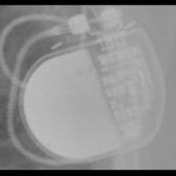 SOR:Reply</td>
<td align="center" valign="top"><b>Option 2</b>  MDT:C20_T20</td>
<td align="center" valign="top"><b>Option 3</b>  BIO:Actros_Philos</td>
<td align="center" valign="top"><b>✅ Option 4</b>  BOS:ContakTR_Discovery_Meridian_Pulsar Max</td>
<td align="center" valign="top"><b>Option 5</b>  BOS:Altrua_Insignia</td>
<td align="center" valign="middle"><b>Option 6</b>  <i>None of the above</i></td>
</tr></table>

### Q3645 · correct: option 3 · `BOS:Emblem`

<table><tr>
<td align="center" valign="top"><b>Query</b>  BOS:Emblem</td>
<td align="center" valign="top"><b>Option 1</b> 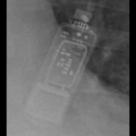 MDT:REVEAL</td>
<td align="center" valign="top"><b>Option 2</b>  MDT:REVEAL LINQ</td>
<td align="center" valign="top"><b>✅ Option 3</b>  BOS:Emblem</td>
<td align="center" valign="top"><b>Option 4</b>  BOS:Vitality</td>
<td align="center" valign="top"><b>Option 5</b> 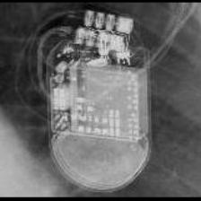 STJ:Quadra Assura_Unify</td>
<td align="center" valign="middle"><b>Option 6</b>  <i>None of the above</i></td>
</tr></table>

### Q3646 · correct: option 1 · `BOS:Emblem`

<table><tr>
<td align="center" valign="top"><b>Query</b> 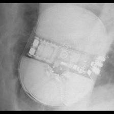 BOS:Emblem</td>
<td align="center" valign="top"><b>✅ Option 1</b>  BOS:Emblem</td>
<td align="center" valign="top"><b>Option 2</b>  STJ:Quadra Assura_Unify</td>
<td align="center" valign="top"><b>Option 3</b> 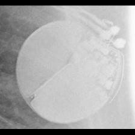 BOS:Autogen_Teligen_Energen_Cognis</td>
<td align="center" valign="top"><b>Option 4</b>  BOS:Vitality</td>
<td align="center" valign="top"><b>Option 5</b> 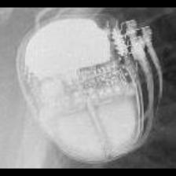 SOR:Ovatio</td>
<td align="center" valign="middle"><b>Option 6</b>  <i>None of the above</i></td>
</tr></table>

### Q3647 · correct: option 3 · `BOS:Emblem`

<table><tr>
<td align="center" valign="top"><b>Query</b> 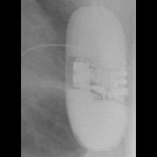 BOS:Emblem</td>
<td align="center" valign="top"><b>Option 1</b>  BOS:Autogen_Teligen_Energen_Cognis</td>
<td align="center" valign="top"><b>Option 2</b>  SOR:Ovatio</td>
<td align="center" valign="top"><b>✅ Option 3</b>  BOS:Emblem</td>
<td align="center" valign="top"><b>Option 4</b> 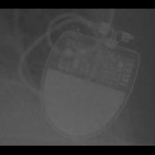 SOR:Rhapsody_Symphony</td>
<td align="center" valign="top"><b>Option 5</b>  SOR:Thesis</td>
<td align="center" valign="middle"><b>Option 6</b>  <i>None of the above</i></td>
</tr></table>

### Q3648 · correct: option 4 · `BOS:Emblem`

<table><tr>
<td align="center" valign="top"><b>Query</b> 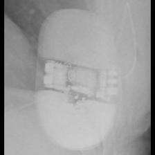 BOS:Emblem</td>
<td align="center" valign="top"><b>Option 1</b> 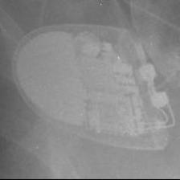 SOR:Elect</td>
<td align="center" valign="top"><b>Option 2</b>  BOS:Autogen_Teligen_Energen_Cognis</td>
<td align="center" valign="top"><b>Option 3</b>  SOR:Ovatio</td>
<td align="center" valign="top"><b>✅ Option 4</b>  BOS:Emblem</td>
<td align="center" valign="top"><b>Option 5</b>  BOS:ContakTR_Discovery_Meridian_Pulsar Max</td>
<td align="center" valign="middle"><b>Option 6</b>  <i>None of the above</i></td>
</tr></table>

### Q3649 · correct: option 1 · `BOS:Emblem`

<table><tr>
<td align="center" valign="top"><b>Query</b>  BOS:Emblem</td>
<td align="center" valign="top"><b>✅ Option 1</b>  BOS:Emblem</td>
<td align="center" valign="top"><b>Option 2</b>  MDT:REVEAL</td>
<td align="center" valign="top"><b>Option 3</b>  STJ:Ellipse</td>
<td align="center" valign="top"><b>Option 4</b>  SOR:Rhapsody_Symphony</td>
<td align="center" valign="top"><b>Option 5</b>  STJ:Victory</td>
<td align="center" valign="middle"><b>Option 6</b>  <i>None of the above</i></td>
</tr></table>

### Q3650 · correct: option 3 · `BOS:Emblem`

<table><tr>
<td align="center" valign="top"><b>Query</b> 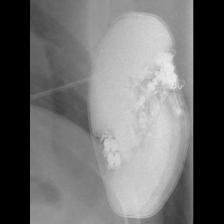 BOS:Emblem</td>
<td align="center" valign="top"><b>Option 1</b>  BOS:Vitality</td>
<td align="center" valign="top"><b>Option 2</b>  BOS:Autogen_Teligen_Energen_Cognis</td>
<td align="center" valign="top"><b>✅ Option 3</b>  BOS:Emblem</td>
<td align="center" valign="top"><b>Option 4</b> 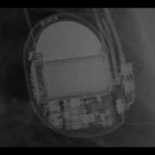 BOS:Ventak Prizm</td>
<td align="center" valign="top"><b>Option 5</b>  SOR:Ovatio</td>
<td align="center" valign="middle"><b>Option 6</b>  <i>None of the above</i></td>
</tr></table>

### Q3651 · correct: option 5 · `BOS:Emblem`

<table><tr>
<td align="center" valign="top"><b>Query</b> 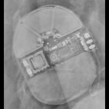 BOS:Emblem</td>
<td align="center" valign="top"><b>Option 1</b>  STJ:Ellipse</td>
<td align="center" valign="top"><b>Option 2</b>  SOR:Ovatio</td>
<td align="center" valign="top"><b>Option 3</b>  BOS:Autogen_Teligen_Energen_Cognis</td>
<td align="center" valign="top"><b>Option 4</b>  SOR:Neway</td>
<td align="center" valign="top"><b>✅ Option 5</b>  BOS:Emblem</td>
<td align="center" valign="middle"><b>Option 6</b>  <i>None of the above</i></td>
</tr></table>

### Q3652 · correct: option 3 · `BOS:Ingenio`

<table><tr>
<td align="center" valign="top"><b>Query</b> 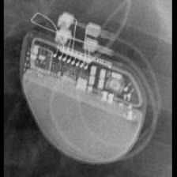 BOS:Ingenio</td>
<td align="center" valign="top"><b>Option 1</b> 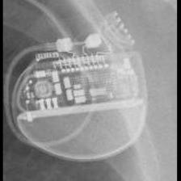 BOS:Proponent</td>
<td align="center" valign="top"><b>Option 2</b>  BOS:Altrua_Insignia</td>
<td align="center" valign="top"><b>✅ Option 3</b>  BOS:Ingenio</td>
<td align="center" valign="top"><b>Option 4</b>  BOS:Contak Renewal TR2</td>
<td align="center" valign="top"><b>Option 5</b>  BOS:Visionist</td>
<td align="center" valign="middle"><b>Option 6</b>  <i>None of the above</i></td>
</tr></table>

### Q3653 · correct: option 5 · `BOS:Ingenio`

<table><tr>
<td align="center" valign="top"><b>Query</b>  BOS:Ingenio</td>
<td align="center" valign="top"><b>Option 1</b>  BOS:Proponent</td>
<td align="center" valign="top"><b>Option 2</b>  BOS:Contak Renewal TR2</td>
<td align="center" valign="top"><b>Option 3</b>  BOS:Altrua_Insignia</td>
<td align="center" valign="top"><b>Option 4</b>  BOS:Visionist</td>
<td align="center" valign="top"><b>✅ Option 5</b>  BOS:Ingenio</td>
<td align="center" valign="middle"><b>Option 6</b>  <i>None of the above</i></td>
</tr></table>

### Q3654 · correct: option 1 · `BOS:Ingenio`

<table><tr>
<td align="center" valign="top"><b>Query</b> 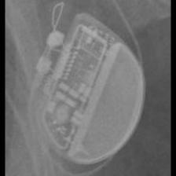 BOS:Ingenio</td>
<td align="center" valign="top"><b>✅ Option 1</b> 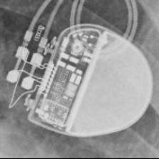 BOS:Ingenio</td>
<td align="center" valign="top"><b>Option 2</b>  BOS:Proponent</td>
<td align="center" valign="top"><b>Option 3</b>  BOS:Altrua_Insignia</td>
<td align="center" valign="top"><b>Option 4</b>  SOR:Elect XS Plus</td>
<td align="center" valign="top"><b>Option 5</b>  SOR:Elect</td>
<td align="center" valign="middle"><b>Option 6</b>  <i>None of the above</i></td>
</tr></table>

### Q3655 · correct: option 1 · `BOS:Ingenio`

<table><tr>
<td align="center" valign="top"><b>Query</b> 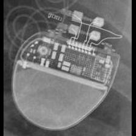 BOS:Ingenio</td>
<td align="center" valign="top"><b>✅ Option 1</b>  BOS:Ingenio</td>
<td align="center" valign="top"><b>Option 2</b>  BOS:Autogen_Teligen_Energen_Cognis</td>
<td align="center" valign="top"><b>Option 3</b>  MDT:Concerto_Consulta_Maximo_Protecta_Secura</td>
<td align="center" valign="top"><b>Option 4</b>  BOS:Visionist</td>
<td align="center" valign="top"><b>Option 5</b>  BOS:Proponent</td>
<td align="center" valign="middle"><b>Option 6</b>  <i>None of the above</i></td>
</tr></table>

### Q3656 · correct: option 2 · `BOS:Ingenio`

<table><tr>
<td align="center" valign="top"><b>Query</b> 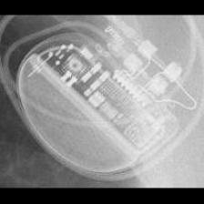 BOS:Ingenio</td>
<td align="center" valign="top"><b>Option 1</b>  STJ:Allure Quadra</td>
<td align="center" valign="top"><b>✅ Option 2</b>  BOS:Ingenio</td>
<td align="center" valign="top"><b>Option 3</b>  BOS:Proponent</td>
<td align="center" valign="top"><b>Option 4</b>  BOS:Contak Renewal TR2</td>
<td align="center" valign="top"><b>Option 5</b>  BOS:Visionist</td>
<td align="center" valign="middle"><b>Option 6</b>  <i>None of the above</i></td>
</tr></table>

### Q3657 · correct: option 2 · `BOS:Ingenio`

<table><tr>
<td align="center" valign="top"><b>Query</b> 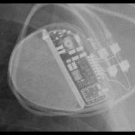 BOS:Ingenio</td>
<td align="center" valign="top"><b>Option 1</b>  BOS:Visionist</td>
<td align="center" valign="top"><b>✅ Option 2</b>  BOS:Ingenio</td>
<td align="center" valign="top"><b>Option 3</b>  BOS:Altrua_Insignia</td>
<td align="center" valign="top"><b>Option 4</b>  STJ:Allure Quadra</td>
<td align="center" valign="top"><b>Option 5</b>  BOS:Proponent</td>
<td align="center" valign="middle"><b>Option 6</b>  <i>None of the above</i></td>
</tr></table>

### Q3658 · correct: option 5 · `BOS:Ingenio`

<table><tr>
<td align="center" valign="top"><b>Query</b> 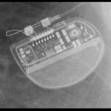 BOS:Ingenio</td>
<td align="center" valign="top"><b>Option 1</b>  BOS:Autogen_Teligen_Energen_Cognis</td>
<td align="center" valign="top"><b>Option 2</b>  BOS:Visionist</td>
<td align="center" valign="top"><b>Option 3</b>  BOS:Proponent</td>
<td align="center" valign="top"><b>Option 4</b>  BOS:Contak Renewal TR2</td>
<td align="center" valign="top"><b>✅ Option 5</b>  BOS:Ingenio</td>
<td align="center" valign="middle"><b>Option 6</b>  <i>None of the above</i></td>
</tr></table>

### Q3659 · correct: option 5 · `BOS:Proponent`

<table><tr>
<td align="center" valign="top"><b>Query</b> 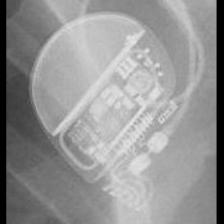 BOS:Proponent</td>
<td align="center" valign="top"><b>Option 1</b>  STJ:Allure Quadra</td>
<td align="center" valign="top"><b>Option 2</b>  BOS:Visionist</td>
<td align="center" valign="top"><b>Option 3</b>  BOS:Ingenio</td>
<td align="center" valign="top"><b>Option 4</b>  BOS:Altrua_Insignia</td>
<td align="center" valign="top"><b>✅ Option 5</b>  BOS:Proponent</td>
<td align="center" valign="middle"><b>Option 6</b>  <i>None of the above</i></td>
</tr></table>

### Q3660 · correct: option 1 · `BOS:Proponent`

<table><tr>
<td align="center" valign="top"><b>Query</b> 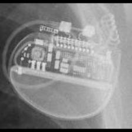 BOS:Proponent</td>
<td align="center" valign="top"><b>✅ Option 1</b>  BOS:Proponent</td>
<td align="center" valign="top"><b>Option 2</b>  BOS:Ingenio</td>
<td align="center" valign="top"><b>Option 3</b>  STJ:Allure Quadra</td>
<td align="center" valign="top"><b>Option 4</b>  BOS:Visionist</td>
<td align="center" valign="top"><b>Option 5</b> 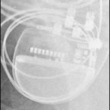 BOS:Contak Renewal TR2</td>
<td align="center" valign="middle"><b>Option 6</b>  <i>None of the above</i></td>
</tr></table>

### Q3661 · correct: option 2 · `BOS:Proponent`

<table><tr>
<td align="center" valign="top"><b>Query</b> 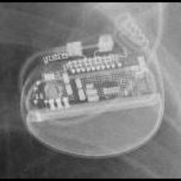 BOS:Proponent</td>
<td align="center" valign="top"><b>Option 1</b>  BOS:Contak Renewal TR2</td>
<td align="center" valign="top"><b>✅ Option 2</b>  BOS:Proponent</td>
<td align="center" valign="top"><b>Option 3</b>  BOS:Ingenio</td>
<td align="center" valign="top"><b>Option 4</b>  BOS:Altrua_Insignia</td>
<td align="center" valign="top"><b>Option 5</b>  BOS:Visionist</td>
<td align="center" valign="middle"><b>Option 6</b>  <i>None of the above</i></td>
</tr></table>

### Q3662 · correct: option 3 · `BOS:Proponent`

<table><tr>
<td align="center" valign="top"><b>Query</b> 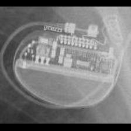 BOS:Proponent</td>
<td align="center" valign="top"><b>Option 1</b>  BOS:Visionist</td>
<td align="center" valign="top"><b>Option 2</b>  BOS:Ingenio</td>
<td align="center" valign="top"><b>✅ Option 3</b>  BOS:Proponent</td>
<td align="center" valign="top"><b>Option 4</b>  BOS:Contak Renewal TR2</td>
<td align="center" valign="top"><b>Option 5</b>  STJ:Allure Quadra</td>
<td align="center" valign="middle"><b>Option 6</b>  <i>None of the above</i></td>
</tr></table>

### Q3663 · correct: option 2 · `BOS:Proponent`

<table><tr>
<td align="center" valign="top"><b>Query</b>  BOS:Proponent</td>
<td align="center" valign="top"><b>Option 1</b>  BOS:Ingenio</td>
<td align="center" valign="top"><b>✅ Option 2</b>  BOS:Proponent</td>
<td align="center" valign="top"><b>Option 3</b>  BOS:Contak Renewal TR2</td>
<td align="center" valign="top"><b>Option 4</b>  BOS:Visionist</td>
<td align="center" valign="top"><b>Option 5</b>  STJ:Allure Quadra</td>
<td align="center" valign="middle"><b>Option 6</b>  <i>None of the above</i></td>
</tr></table>

### Q3664 · correct: option 4 · `BOS:Proponent`

<table><tr>
<td align="center" valign="top"><b>Query</b> 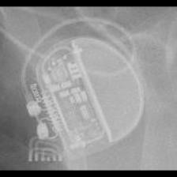 BOS:Proponent</td>
<td align="center" valign="top"><b>Option 1</b>  BOS:Visionist</td>
<td align="center" valign="top"><b>Option 2</b>  BOS:Contak Renewal TR2</td>
<td align="center" valign="top"><b>Option 3</b>  SOR:Elect XS Plus</td>
<td align="center" valign="top"><b>✅ Option 4</b>  BOS:Proponent</td>
<td align="center" valign="top"><b>Option 5</b>  BOS:Ingenio</td>
<td align="center" valign="middle"><b>Option 6</b>  <i>None of the above</i></td>
</tr></table>

### Q3665 · correct: option 5 · `BOS:Proponent`

<table><tr>
<td align="center" valign="top"><b>Query</b> 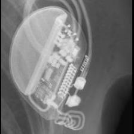 BOS:Proponent</td>
<td align="center" valign="top"><b>Option 1</b>  BOS:Autogen_Teligen_Energen_Cognis</td>
<td align="center" valign="top"><b>Option 2</b>  BOS:Contak Renewal TR2</td>
<td align="center" valign="top"><b>Option 3</b>  BOS:Ingenio</td>
<td align="center" valign="top"><b>Option 4</b>  BOS:Visionist</td>
<td align="center" valign="top"><b>✅ Option 5</b>  BOS:Proponent</td>
<td align="center" valign="middle"><b>Option 6</b>  <i>None of the above</i></td>
</tr></table>

### Q3666 · correct: option 5 · `BOS:Ventak Prizm`

<table><tr>
<td align="center" valign="top"><b>Query</b> 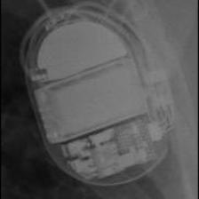 BOS:Ventak Prizm</td>
<td align="center" valign="top"><b>Option 1</b>  SOR:Thesis</td>
<td align="center" valign="top"><b>Option 2</b>  SOR:Ovatio</td>
<td align="center" valign="top"><b>Option 3</b>  BOS:Vitality</td>
<td align="center" valign="top"><b>Option 4</b>  MDT:Maximo</td>
<td align="center" valign="top"><b>✅ Option 5</b>  BOS:Ventak Prizm</td>
<td align="center" valign="middle"><b>Option 6</b>  <i>None of the above</i></td>
</tr></table>

### Q3667 · correct: option 1 · `BOS:Ventak Prizm`

<table><tr>
<td align="center" valign="top"><b>Query</b> 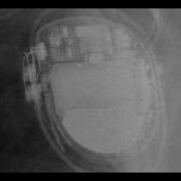 BOS:Ventak Prizm</td>
<td align="center" valign="top"><b>✅ Option 1</b>  BOS:Ventak Prizm</td>
<td align="center" valign="top"><b>Option 2</b>  MDT:Maximo</td>
<td align="center" valign="top"><b>Option 3</b> 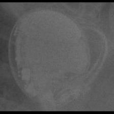 BOS:Vitality</td>
<td align="center" valign="top"><b>Option 4</b>  MDT:Concerto_Consulta_Maximo_Protecta_Secura</td>
<td align="center" valign="top"><b>Option 5</b>  MDT:Claria_Evera_Viva</td>
<td align="center" valign="middle"><b>Option 6</b>  <i>None of the above</i></td>
</tr></table>

### Q3668 · correct: option 5 · `BOS:Ventak Prizm`

<table><tr>
<td align="center" valign="top"><b>Query</b>  BOS:Ventak Prizm</td>
<td align="center" valign="top"><b>Option 1</b> 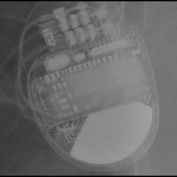 MDT:Claria_Evera_Viva</td>
<td align="center" valign="top"><b>Option 2</b>  BOS:Vitality</td>
<td align="center" valign="top"><b>Option 3</b> 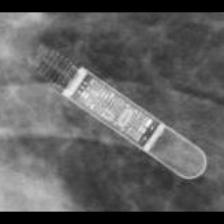 MDT:REVEAL LINQ</td>
<td align="center" valign="top"><b>Option 4</b>  SOR:Thesis</td>
<td align="center" valign="top"><b>✅ Option 5</b>  BOS:Ventak Prizm</td>
<td align="center" valign="middle"><b>Option 6</b>  <i>None of the above</i></td>
</tr></table>

### Q3669 · correct: option 3 · `BOS:Ventak Prizm`

<table><tr>
<td align="center" valign="top"><b>Query</b> 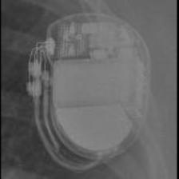 BOS:Ventak Prizm</td>
<td align="center" valign="top"><b>Option 1</b>  MDT:Maximo</td>
<td align="center" valign="top"><b>Option 2</b>  BOS:Vitality</td>
<td align="center" valign="top"><b>✅ Option 3</b>  BOS:Ventak Prizm</td>
<td align="center" valign="top"><b>Option 4</b>  MDT:Claria_Evera_Viva</td>
<td align="center" valign="top"><b>Option 5</b>  MDT:Concerto_Consulta_Maximo_Protecta_Secura</td>
<td align="center" valign="middle"><b>Option 6</b>  <i>None of the above</i></td>
</tr></table>

### Q3670 · correct: option 1 · `BOS:Ventak Prizm`

<table><tr>
<td align="center" valign="top"><b>Query</b> 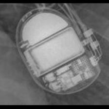 BOS:Ventak Prizm</td>
<td align="center" valign="top"><b>✅ Option 1</b> 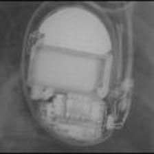 BOS:Ventak Prizm</td>
<td align="center" valign="top"><b>Option 2</b>  BIO:Evia</td>
<td align="center" valign="top"><b>Option 3</b>  SOR:Ovatio</td>
<td align="center" valign="top"><b>Option 4</b>  SOR:Elect XS Plus</td>
<td align="center" valign="top"><b>Option 5</b>  BOS:Vitality</td>
<td align="center" valign="middle"><b>Option 6</b>  <i>None of the above</i></td>
</tr></table>

### Q3671 · correct: option 2 · `BOS:Visionist`

<table><tr>
<td align="center" valign="top"><b>Query</b> 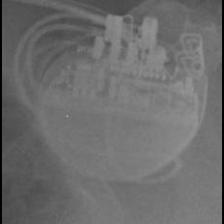 BOS:Visionist</td>
<td align="center" valign="top"><b>Option 1</b>  BOS:Proponent</td>
<td align="center" valign="top"><b>✅ Option 2</b>  BOS:Visionist</td>
<td align="center" valign="top"><b>Option 3</b>  BOS:Ingenio</td>
<td align="center" valign="top"><b>Option 4</b> 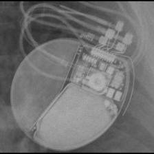 BOS:Autogen_Teligen_Energen_Cognis</td>
<td align="center" valign="top"><b>Option 5</b>  BOS:Contak Renewal TR2</td>
<td align="center" valign="middle"><b>Option 6</b>  <i>None of the above</i></td>
</tr></table>

### Q3672 · correct: option 2 · `BOS:Visionist`

<table><tr>
<td align="center" valign="top"><b>Query</b> 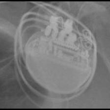 BOS:Visionist</td>
<td align="center" valign="top"><b>Option 1</b>  BOS:Contak Renewal TR2</td>
<td align="center" valign="top"><b>✅ Option 2</b>  BOS:Visionist</td>
<td align="center" valign="top"><b>Option 3</b> 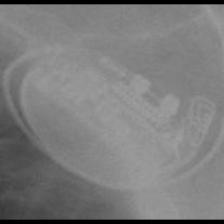 BOS:Proponent</td>
<td align="center" valign="top"><b>Option 4</b>  BOS:Altrua_Insignia</td>
<td align="center" valign="top"><b>Option 5</b>  BOS:Ingenio</td>
<td align="center" valign="middle"><b>Option 6</b>  <i>None of the above</i></td>
</tr></table>

### Q3673 · correct: option 1 · `BOS:Visionist`

<table><tr>
<td align="center" valign="top"><b>Query</b> 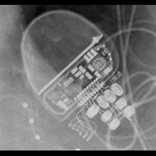 BOS:Visionist</td>
<td align="center" valign="top"><b>✅ Option 1</b>  BOS:Visionist</td>
<td align="center" valign="top"><b>Option 2</b>  BOS:Ingenio</td>
<td align="center" valign="top"><b>Option 3</b>  BOS:Proponent</td>
<td align="center" valign="top"><b>Option 4</b>  BOS:Autogen_Teligen_Energen_Cognis</td>
<td align="center" valign="top"><b>Option 5</b>  BOS:Contak Renewal TR2</td>
<td align="center" valign="middle"><b>Option 6</b>  <i>None of the above</i></td>
</tr></table>

### Q3674 · correct: option 5 · `BOS:Visionist`

<table><tr>
<td align="center" valign="top"><b>Query</b> 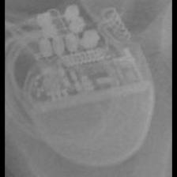 BOS:Visionist</td>
<td align="center" valign="top"><b>Option 1</b>  BOS:Contak Renewal TR2</td>
<td align="center" valign="top"><b>Option 2</b>  BOS:Proponent</td>
<td align="center" valign="top"><b>Option 3</b>  BOS:Ingenio</td>
<td align="center" valign="top"><b>Option 4</b>  BOS:Autogen_Teligen_Energen_Cognis</td>
<td align="center" valign="top"><b>✅ Option 5</b>  BOS:Visionist</td>
<td align="center" valign="middle"><b>Option 6</b>  <i>None of the above</i></td>
</tr></table>

### Q3675 · correct: option 4 · `BOS:Visionist`

<table><tr>
<td align="center" valign="top"><b>Query</b>  BOS:Visionist</td>
<td align="center" valign="top"><b>Option 1</b>  BOS:Autogen_Teligen_Energen_Cognis</td>
<td align="center" valign="top"><b>Option 2</b>  BOS:Contak Renewal TR2</td>
<td align="center" valign="top"><b>Option 3</b>  BOS:Proponent</td>
<td align="center" valign="top"><b>✅ Option 4</b>  BOS:Visionist</td>
<td align="center" valign="top"><b>Option 5</b>  BOS:Ingenio</td>
<td align="center" valign="middle"><b>Option 6</b>  <i>None of the above</i></td>
</tr></table>

### Q3676 · correct: option 4 · `BOS:Visionist`

<table><tr>
<td align="center" valign="top"><b>Query</b> 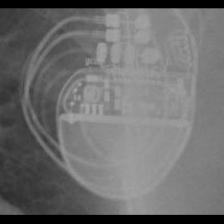 BOS:Visionist</td>
<td align="center" valign="top"><b>Option 1</b>  BOS:Autogen_Teligen_Energen_Cognis</td>
<td align="center" valign="top"><b>Option 2</b>  BOS:Contak Renewal TR2</td>
<td align="center" valign="top"><b>Option 3</b>  BOS:Ingenio</td>
<td align="center" valign="top"><b>✅ Option 4</b>  BOS:Visionist</td>
<td align="center" valign="top"><b>Option 5</b>  BOS:Proponent</td>
<td align="center" valign="middle"><b>Option 6</b>  <i>None of the above</i></td>
</tr></table>

### Q3677 · correct: option 4 · `BOS:Visionist`

<table><tr>
<td align="center" valign="top"><b>Query</b> 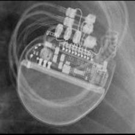 BOS:Visionist</td>
<td align="center" valign="top"><b>Option 1</b>  BOS:Ingenio</td>
<td align="center" valign="top"><b>Option 2</b>  BOS:Contak Renewal TR2</td>
<td align="center" valign="top"><b>Option 3</b>  BOS:Proponent</td>
<td align="center" valign="top"><b>✅ Option 4</b>  BOS:Visionist</td>
<td align="center" valign="top"><b>Option 5</b>  BOS:Autogen_Teligen_Energen_Cognis</td>
<td align="center" valign="middle"><b>Option 6</b>  <i>None of the above</i></td>
</tr></table>

### Q3678 · correct: option 1 · `BOS:Vitality`

<table><tr>
<td align="center" valign="top"><b>Query</b> 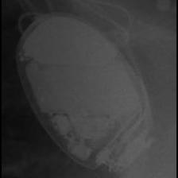 BOS:Vitality</td>
<td align="center" valign="top"><b>✅ Option 1</b>  BOS:Vitality</td>
<td align="center" valign="top"><b>Option 2</b>  BOS:Ventak Prizm</td>
<td align="center" valign="top"><b>Option 3</b>  SOR:Rhapsody_Symphony</td>
<td align="center" valign="top"><b>Option 4</b>  BOS:Emblem</td>
<td align="center" valign="top"><b>Option 5</b> 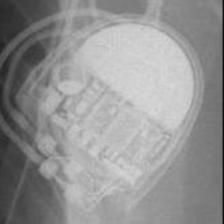 SOR:MiniSwing</td>
<td align="center" valign="middle"><b>Option 6</b>  <i>None of the above</i></td>
</tr></table>

### Q3679 · correct: option 4 · `BOS:Vitality`

<table><tr>
<td align="center" valign="top"><b>Query</b>  BOS:Vitality</td>
<td align="center" valign="top"><b>Option 1</b> 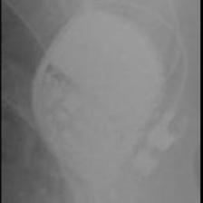 BOS:ContakTR_Discovery_Meridian_Pulsar Max</td>
<td align="center" valign="top"><b>Option 2</b>  BOS:Ventak Prizm</td>
<td align="center" valign="top"><b>Option 3</b>  SOR:Thesis</td>
<td align="center" valign="top"><b>✅ Option 4</b>  BOS:Vitality</td>
<td align="center" valign="top"><b>Option 5</b> 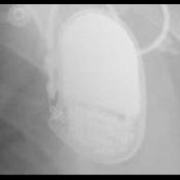 BIO:Actros_Philos</td>
<td align="center" valign="middle"><b>Option 6</b>  <i>None of the above</i></td>
</tr></table>

### Q3680 · correct: option 1 · `BOS:Vitality`

<table><tr>
<td align="center" valign="top"><b>Query</b> 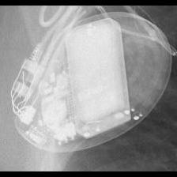 BOS:Vitality</td>
<td align="center" valign="top"><b>✅ Option 1</b>  BOS:Vitality</td>
<td align="center" valign="top"><b>Option 2</b>  BOS:Ventak Prizm</td>
<td align="center" valign="top"><b>Option 3</b>  BOS:Contak Renewal 4</td>
<td align="center" valign="top"><b>Option 4</b>  MDT:Maximo</td>
<td align="center" valign="top"><b>Option 5</b>  MDT:Concerto_Consulta_Maximo_Protecta_Secura</td>
<td align="center" valign="middle"><b>Option 6</b>  <i>None of the above</i></td>
</tr></table>

### Q3681 · correct: option 2 · `BOS:Vitality`

<table><tr>
<td align="center" valign="top"><b>Query</b> 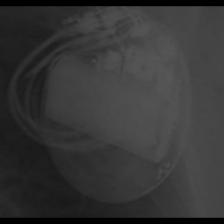 BOS:Vitality</td>
<td align="center" valign="top"><b>Option 1</b>  MDT:Concerto_Consulta_Maximo_Protecta_Secura</td>
<td align="center" valign="top"><b>✅ Option 2</b>  BOS:Vitality</td>
<td align="center" valign="top"><b>Option 3</b>  BOS:Ventak Prizm</td>
<td align="center" valign="top"><b>Option 4</b>  MDT:Maximo</td>
<td align="center" valign="top"><b>Option 5</b>  BOS:Contak Renewal 4</td>
<td align="center" valign="middle"><b>Option 6</b>  <i>None of the above</i></td>
</tr></table>

### Q3682 · correct: option 4 · `BOS:Vitality`

<table><tr>
<td align="center" valign="top"><b>Query</b>  BOS:Vitality</td>
<td align="center" valign="top"><b>Option 1</b>  BOS:Contak Renewal 4</td>
<td align="center" valign="top"><b>Option 2</b>  MDT:Concerto_Consulta_Maximo_Protecta_Secura</td>
<td align="center" valign="top"><b>Option 3</b>  MDT:Claria_Evera_Viva</td>
<td align="center" valign="top"><b>✅ Option 4</b>  BOS:Vitality</td>
<td align="center" valign="top"><b>Option 5</b>  BOS:Ventak Prizm</td>
<td align="center" valign="middle"><b>Option 6</b>  <i>None of the above</i></td>
</tr></table>

### Q3683 · correct: option 5 · `BOS:Vitality`

<table><tr>
<td align="center" valign="top"><b>Query</b>  BOS:Vitality</td>
<td align="center" valign="top"><b>Option 1</b>  BOS:Ventak Prizm</td>
<td align="center" valign="top"><b>Option 2</b>  MDT:Claria_Evera_Viva</td>
<td align="center" valign="top"><b>Option 3</b>  BOS:Contak Renewal 4</td>
<td align="center" valign="top"><b>Option 4</b>  SOR:Ovatio</td>
<td align="center" valign="top"><b>✅ Option 5</b>  BOS:Vitality</td>
<td align="center" valign="middle"><b>Option 6</b>  <i>None of the above</i></td>
</tr></table>

### Q3684 · correct: option 2 · `BOS:Vitality`

<table><tr>
<td align="center" valign="top"><b>Query</b>  BOS:Vitality</td>
<td align="center" valign="top"><b>Option 1</b>  BOS:Contak Renewal 4</td>
<td align="center" valign="top"><b>✅ Option 2</b>  BOS:Vitality</td>
<td align="center" valign="top"><b>Option 3</b>  MDT:Claria_Evera_Viva</td>
<td align="center" valign="top"><b>Option 4</b>  BOS:Ventak Prizm</td>
<td align="center" valign="top"><b>Option 5</b>  MDT:Concerto_Consulta_Maximo_Protecta_Secura</td>
<td align="center" valign="middle"><b>Option 6</b>  <i>None of the above</i></td>
</tr></table>

### Q3685 · correct: option 4 · `MDT:AT500`

<table><tr>
<td align="center" valign="top"><b>Query</b>  MDT:AT500</td>
<td align="center" valign="top"><b>Option 1</b>  MDT:Advisa</td>
<td align="center" valign="top"><b>Option 2</b>  MDT:Insync III</td>
<td align="center" valign="top"><b>Option 3</b>  MDT:EnRhythm</td>
<td align="center" valign="top"><b>✅ Option 4</b>  MDT:AT500</td>
<td align="center" valign="top"><b>Option 5</b>  MDT:Syncra</td>
<td align="center" valign="middle"><b>Option 6</b>  <i>None of the above</i></td>
</tr></table>

### Q3686 · correct: option 2 · `MDT:AT500`

<table><tr>
<td align="center" valign="top"><b>Query</b>  MDT:AT500</td>
<td align="center" valign="top"><b>Option 1</b>  MDT:EnRhythm</td>
<td align="center" valign="top"><b>✅ Option 2</b>  MDT:AT500</td>
<td align="center" valign="top"><b>Option 3</b>  MDT:Advisa</td>
<td align="center" valign="top"><b>Option 4</b>  MDT:Syncra</td>
<td align="center" valign="top"><b>Option 5</b>  MDT:Insync III</td>
<td align="center" valign="middle"><b>Option 6</b>  <i>None of the above</i></td>
</tr></table>

### Q3687 · correct: option 3 · `MDT:AT500`

<table><tr>
<td align="center" valign="top"><b>Query</b>  MDT:AT500</td>
<td align="center" valign="top"><b>Option 1</b>  MDT:EnRhythm</td>
<td align="center" valign="top"><b>Option 2</b>  MDT:Insync III</td>
<td align="center" valign="top"><b>✅ Option 3</b>  MDT:AT500</td>
<td align="center" valign="top"><b>Option 4</b>  MDT:Advisa</td>
<td align="center" valign="top"><b>Option 5</b>  MDT:Syncra</td>
<td align="center" valign="middle"><b>Option 6</b>  <i>None of the above</i></td>
</tr></table>

### Q3688 · correct: option 1 · `MDT:AT500`

<table><tr>
<td align="center" valign="top"><b>Query</b>  MDT:AT500</td>
<td align="center" valign="top"><b>✅ Option 1</b>  MDT:AT500</td>
<td align="center" valign="top"><b>Option 2</b>  MDT:EnRhythm</td>
<td align="center" valign="top"><b>Option 3</b>  MDT:Syncra</td>
<td align="center" valign="top"><b>Option 4</b>  MDT:Advisa</td>
<td align="center" valign="top"><b>Option 5</b>  MDT:Insync III</td>
<td align="center" valign="middle"><b>Option 6</b>  <i>None of the above</i></td>
</tr></table>

### Q3689 · correct: option 2 · `MDT:AT500`

<table><tr>
<td align="center" valign="top"><b>Query</b>  MDT:AT500</td>
<td align="center" valign="top"><b>Option 1</b>  MDT:EnRhythm</td>
<td align="center" valign="top"><b>✅ Option 2</b>  MDT:AT500</td>
<td align="center" valign="top"><b>Option 3</b>  MDT:Syncra</td>
<td align="center" valign="top"><b>Option 4</b>  MDT:Advisa</td>
<td align="center" valign="top"><b>Option 5</b>  MDT:Insync III</td>
<td align="center" valign="middle"><b>Option 6</b>  <i>None of the above</i></td>
</tr></table>

### Q3690 · correct: option 1 · `MDT:AT500`

<table><tr>
<td align="center" valign="top"><b>Query</b>  MDT:AT500</td>
<td align="center" valign="top"><b>✅ Option 1</b>  MDT:AT500</td>
<td align="center" valign="top"><b>Option 2</b>  MDT:EnRhythm</td>
<td align="center" valign="top"><b>Option 3</b>  MDT:Insync III</td>
<td align="center" valign="top"><b>Option 4</b>  MDT:Advisa</td>
<td align="center" valign="top"><b>Option 5</b>  MDT:Syncra</td>
<td align="center" valign="middle"><b>Option 6</b>  <i>None of the above</i></td>
</tr></table>

### Q3691 · correct: option 3 · `MDT:AT500`

<table><tr>
<td align="center" valign="top"><b>Query</b>  MDT:AT500</td>
<td align="center" valign="top"><b>Option 1</b>  MDT:Advisa</td>
<td align="center" valign="top"><b>Option 2</b>  MDT:EnRhythm</td>
<td align="center" valign="top"><b>✅ Option 3</b>  MDT:AT500</td>
<td align="center" valign="top"><b>Option 4</b>  MDT:Syncra</td>
<td align="center" valign="top"><b>Option 5</b>  MDT:Insync III</td>
<td align="center" valign="middle"><b>Option 6</b>  <i>None of the above</i></td>
</tr></table>

### Q3692 · correct: option 4 · `MDT:Adapta_Kappa_Sensia_Versa`

<table><tr>
<td align="center" valign="top"><b>Query</b>  MDT:Adapta_Kappa_Sensia_Versa</td>
<td align="center" valign="top"><b>Option 1</b>  MDT:C20_T20</td>
<td align="center" valign="top"><b>Option 2</b>  SOR:Reply</td>
<td align="center" valign="top"><b>Option 3</b>  BOS:ContakTR_Discovery_Meridian_Pulsar Max</td>
<td align="center" valign="top"><b>✅ Option 4</b>  MDT:Adapta_Kappa_Sensia_Versa</td>
<td align="center" valign="top"><b>Option 5</b>  MDT:Sigma</td>
<td align="center" valign="middle"><b>Option 6</b>  <i>None of the above</i></td>
</tr></table>

### Q3693 · correct: option 5 · `MDT:Adapta_Kappa_Sensia_Versa`

<table><tr>
<td align="center" valign="top"><b>Query</b>  MDT:Adapta_Kappa_Sensia_Versa</td>
<td align="center" valign="top"><b>Option 1</b>  MDT:C20_T20</td>
<td align="center" valign="top"><b>Option 2</b>  BIO:Actros_Philos</td>
<td align="center" valign="top"><b>Option 3</b>  SOR:Rhapsody_Symphony</td>
<td align="center" valign="top"><b>Option 4</b>  MDT:Sigma</td>
<td align="center" valign="top"><b>✅ Option 5</b>  MDT:Adapta_Kappa_Sensia_Versa</td>
<td align="center" valign="middle"><b>Option 6</b>  <i>None of the above</i></td>
</tr></table>

