# Pacemakers (Howard et al.) · query set `train2` · page 3/6

[← all pages](README.md)

### Q3694 · correct: option 6 (None of the above)

<table><tr>
<td align="center" valign="top"><b>Query</b> 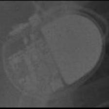 MDT:Adapta_Kappa_Sensia_Versa</td>
<td align="center" valign="top"><b>Option 1</b>  MDT:C20_T20</td>
<td align="center" valign="top"><b>Option 2</b> 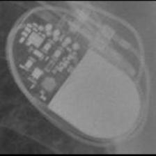 MDT:Sigma</td>
<td align="center" valign="top"><b>Option 3</b>  SOR:Rhapsody_Symphony</td>
<td align="center" valign="top"><b>Option 4</b>  BIO:Actros_Philos</td>
<td align="center" valign="top"><b>Option 5</b> 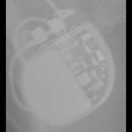 BOS:ContakTR_Discovery_Meridian_Pulsar Max</td>
<td align="center" valign="middle"><b>✅ Option 6</b>  <i>None of the above</i></td>
</tr></table>

### Q3695 · correct: option 4 · `MDT:Adapta_Kappa_Sensia_Versa`

<table><tr>
<td align="center" valign="top"><b>Query</b>  MDT:Adapta_Kappa_Sensia_Versa</td>
<td align="center" valign="top"><b>Option 1</b>  MDT:C60 DR</td>
<td align="center" valign="top"><b>Option 2</b>  MDT:Sigma</td>
<td align="center" valign="top"><b>Option 3</b>  MDT:C20_T20</td>
<td align="center" valign="top"><b>✅ Option 4</b>  MDT:Adapta_Kappa_Sensia_Versa</td>
<td align="center" valign="top"><b>Option 5</b>  STJ:Zephyr</td>
<td align="center" valign="middle"><b>Option 6</b>  <i>None of the above</i></td>
</tr></table>

### Q3696 · correct: option 2 · `MDT:Adapta_Kappa_Sensia_Versa`

<table><tr>
<td align="center" valign="top"><b>Query</b> 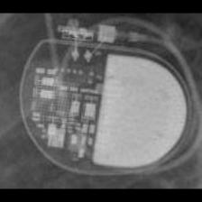 MDT:Adapta_Kappa_Sensia_Versa</td>
<td align="center" valign="top"><b>Option 1</b>  SOR:Reply</td>
<td align="center" valign="top"><b>✅ Option 2</b>  MDT:Adapta_Kappa_Sensia_Versa</td>
<td align="center" valign="top"><b>Option 3</b>  STJ:Zephyr</td>
<td align="center" valign="top"><b>Option 4</b>  MDT:Sigma</td>
<td align="center" valign="top"><b>Option 5</b>  STJ:Identity</td>
<td align="center" valign="middle"><b>Option 6</b>  <i>None of the above</i></td>
</tr></table>

### Q3697 · correct: option 3 · `MDT:Adapta_Kappa_Sensia_Versa`

<table><tr>
<td align="center" valign="top"><b>Query</b> 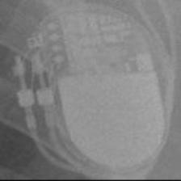 MDT:Adapta_Kappa_Sensia_Versa</td>
<td align="center" valign="top"><b>Option 1</b>  SOR:Reply</td>
<td align="center" valign="top"><b>Option 2</b>  MDT:C20_T20</td>
<td align="center" valign="top"><b>✅ Option 3</b>  MDT:Adapta_Kappa_Sensia_Versa</td>
<td align="center" valign="top"><b>Option 4</b>  MDT:Sigma</td>
<td align="center" valign="top"><b>Option 5</b>  BIO:Actros_Philos</td>
<td align="center" valign="middle"><b>Option 6</b>  <i>None of the above</i></td>
</tr></table>

### Q3698 · correct: option 3 · `MDT:Adapta_Kappa_Sensia_Versa`

<table><tr>
<td align="center" valign="top"><b>Query</b>  MDT:Adapta_Kappa_Sensia_Versa</td>
<td align="center" valign="top"><b>Option 1</b>  STJ:Zephyr</td>
<td align="center" valign="top"><b>Option 2</b>  BIO:Actros_Philos</td>
<td align="center" valign="top"><b>✅ Option 3</b>  MDT:Adapta_Kappa_Sensia_Versa</td>
<td align="center" valign="top"><b>Option 4</b>  MDT:Sigma</td>
<td align="center" valign="top"><b>Option 5</b>  SOR:Reply</td>
<td align="center" valign="middle"><b>Option 6</b>  <i>None of the above</i></td>
</tr></table>

### Q3699 · correct: option 4 · `MDT:Advisa`

<table><tr>
<td align="center" valign="top"><b>Query</b>  MDT:Advisa</td>
<td align="center" valign="top"><b>Option 1</b>  MDT:Azure</td>
<td align="center" valign="top"><b>Option 2</b>  MDT:Syncra</td>
<td align="center" valign="top"><b>Option 3</b> 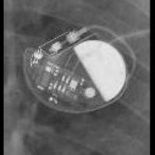 STJ:Victory</td>
<td align="center" valign="top"><b>✅ Option 4</b> 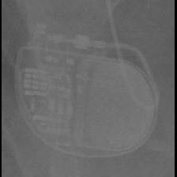 MDT:Advisa</td>
<td align="center" valign="top"><b>Option 5</b>  MDT:EnRhythm</td>
<td align="center" valign="middle"><b>Option 6</b>  <i>None of the above</i></td>
</tr></table>

### Q3700 · correct: option 4 · `MDT:Advisa`

<table><tr>
<td align="center" valign="top"><b>Query</b> 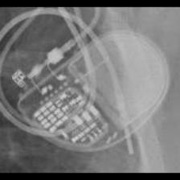 MDT:Advisa</td>
<td align="center" valign="top"><b>Option 1</b>  MDT:Syncra</td>
<td align="center" valign="top"><b>Option 2</b>  MDT:Azure</td>
<td align="center" valign="top"><b>Option 3</b>  MDT:EnRhythm</td>
<td align="center" valign="top"><b>✅ Option 4</b>  MDT:Advisa</td>
<td align="center" valign="top"><b>Option 5</b>  MDT:AT500</td>
<td align="center" valign="middle"><b>Option 6</b>  <i>None of the above</i></td>
</tr></table>

### Q3701 · correct: option 3 · `MDT:Advisa`

<table><tr>
<td align="center" valign="top"><b>Query</b> 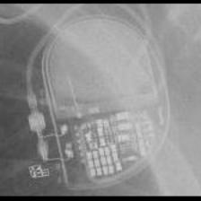 MDT:Advisa</td>
<td align="center" valign="top"><b>Option 1</b>  MDT:AT500</td>
<td align="center" valign="top"><b>Option 2</b>  MDT:EnRhythm</td>
<td align="center" valign="top"><b>✅ Option 3</b>  MDT:Advisa</td>
<td align="center" valign="top"><b>Option 4</b>  MDT:Azure</td>
<td align="center" valign="top"><b>Option 5</b>  MDT:Syncra</td>
<td align="center" valign="middle"><b>Option 6</b>  <i>None of the above</i></td>
</tr></table>

### Q3702 · correct: option 2 · `MDT:Advisa`

<table><tr>
<td align="center" valign="top"><b>Query</b> 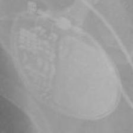 MDT:Advisa</td>
<td align="center" valign="top"><b>Option 1</b> 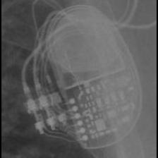 MDT:Insync III</td>
<td align="center" valign="top"><b>✅ Option 2</b>  MDT:Advisa</td>
<td align="center" valign="top"><b>Option 3</b>  MDT:Syncra</td>
<td align="center" valign="top"><b>Option 4</b>  MDT:AT500</td>
<td align="center" valign="top"><b>Option 5</b>  MDT:EnRhythm</td>
<td align="center" valign="middle"><b>Option 6</b>  <i>None of the above</i></td>
</tr></table>

### Q3703 · correct: option 4 · `MDT:Advisa`

<table><tr>
<td align="center" valign="top"><b>Query</b>  MDT:Advisa</td>
<td align="center" valign="top"><b>Option 1</b>  MDT:Syncra</td>
<td align="center" valign="top"><b>Option 2</b>  MDT:Insync III</td>
<td align="center" valign="top"><b>Option 3</b>  MDT:EnRhythm</td>
<td align="center" valign="top"><b>✅ Option 4</b>  MDT:Advisa</td>
<td align="center" valign="top"><b>Option 5</b>  MDT:AT500</td>
<td align="center" valign="middle"><b>Option 6</b>  <i>None of the above</i></td>
</tr></table>

### Q3704 · correct: option 1 · `MDT:Advisa`

<table><tr>
<td align="center" valign="top"><b>Query</b> 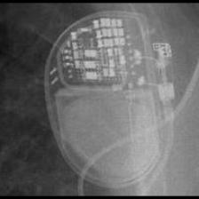 MDT:Advisa</td>
<td align="center" valign="top"><b>✅ Option 1</b>  MDT:Advisa</td>
<td align="center" valign="top"><b>Option 2</b>  MDT:AT500</td>
<td align="center" valign="top"><b>Option 3</b>  MDT:Insync III</td>
<td align="center" valign="top"><b>Option 4</b>  MDT:Syncra</td>
<td align="center" valign="top"><b>Option 5</b>  MDT:EnRhythm</td>
<td align="center" valign="middle"><b>Option 6</b>  <i>None of the above</i></td>
</tr></table>

### Q3705 · correct: option 4 · `MDT:Advisa`

<table><tr>
<td align="center" valign="top"><b>Query</b> 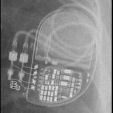 MDT:Advisa</td>
<td align="center" valign="top"><b>Option 1</b>  MDT:AT500</td>
<td align="center" valign="top"><b>Option 2</b>  MDT:Azure</td>
<td align="center" valign="top"><b>Option 3</b>  MDT:EnRhythm</td>
<td align="center" valign="top"><b>✅ Option 4</b>  MDT:Advisa</td>
<td align="center" valign="top"><b>Option 5</b>  MDT:Syncra</td>
<td align="center" valign="middle"><b>Option 6</b>  <i>None of the above</i></td>
</tr></table>

### Q3706 · correct: option 2 · `MDT:Azure`

<table><tr>
<td align="center" valign="top"><b>Query</b> 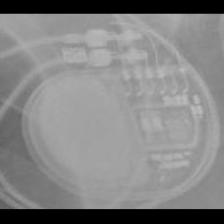 MDT:Azure</td>
<td align="center" valign="top"><b>Option 1</b>  MDT:EnRhythm</td>
<td align="center" valign="top"><b>✅ Option 2</b> 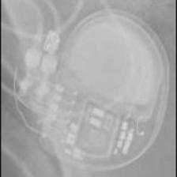 MDT:Azure</td>
<td align="center" valign="top"><b>Option 3</b>  MDT:Insync III</td>
<td align="center" valign="top"><b>Option 4</b>  MDT:Syncra</td>
<td align="center" valign="top"><b>Option 5</b>  BIO:Evia</td>
<td align="center" valign="middle"><b>Option 6</b>  <i>None of the above</i></td>
</tr></table>

### Q3707 · correct: option 1 · `MDT:Azure`

<table><tr>
<td align="center" valign="top"><b>Query</b> 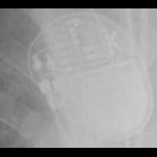 MDT:Azure</td>
<td align="center" valign="top"><b>✅ Option 1</b>  MDT:Azure</td>
<td align="center" valign="top"><b>Option 2</b>  MDT:AT500</td>
<td align="center" valign="top"><b>Option 3</b>  MDT:Advisa</td>
<td align="center" valign="top"><b>Option 4</b>  MDT:EnRhythm</td>
<td align="center" valign="top"><b>Option 5</b>  MDT:Syncra</td>
<td align="center" valign="middle"><b>Option 6</b>  <i>None of the above</i></td>
</tr></table>

### Q3708 · correct: option 5 · `MDT:Azure`

<table><tr>
<td align="center" valign="top"><b>Query</b> 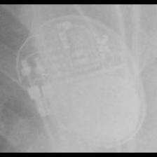 MDT:Azure</td>
<td align="center" valign="top"><b>Option 1</b>  MDT:Syncra</td>
<td align="center" valign="top"><b>Option 2</b>  MDT:EnRhythm</td>
<td align="center" valign="top"><b>Option 3</b>  MDT:AT500</td>
<td align="center" valign="top"><b>Option 4</b>  STJ:Accent</td>
<td align="center" valign="top"><b>✅ Option 5</b>  MDT:Azure</td>
<td align="center" valign="middle"><b>Option 6</b>  <i>None of the above</i></td>
</tr></table>

### Q3709 · correct: option 4 · `MDT:Azure`

<table><tr>
<td align="center" valign="top"><b>Query</b>  MDT:Azure</td>
<td align="center" valign="top"><b>Option 1</b>  MDT:EnRhythm</td>
<td align="center" valign="top"><b>Option 2</b>  MDT:Advisa</td>
<td align="center" valign="top"><b>Option 3</b>  MDT:Insync III</td>
<td align="center" valign="top"><b>✅ Option 4</b>  MDT:Azure</td>
<td align="center" valign="top"><b>Option 5</b>  BIO:Evia</td>
<td align="center" valign="middle"><b>Option 6</b>  <i>None of the above</i></td>
</tr></table>

### Q3710 · correct: option 1 · `MDT:Azure`

<table><tr>
<td align="center" valign="top"><b>Query</b> 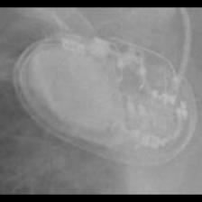 MDT:Azure</td>
<td align="center" valign="top"><b>✅ Option 1</b>  MDT:Azure</td>
<td align="center" valign="top"><b>Option 2</b>  MDT:Advisa</td>
<td align="center" valign="top"><b>Option 3</b>  BOS:Ingenio</td>
<td align="center" valign="top"><b>Option 4</b>  BIO:Evia</td>
<td align="center" valign="top"><b>Option 5</b> 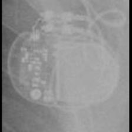 STJ:Accent</td>
<td align="center" valign="middle"><b>Option 6</b>  <i>None of the above</i></td>
</tr></table>

### Q3711 · correct: option 2 · `MDT:Azure`

<table><tr>
<td align="center" valign="top"><b>Query</b> 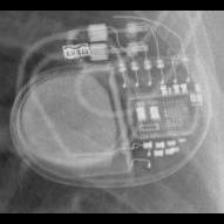 MDT:Azure</td>
<td align="center" valign="top"><b>Option 1</b>  MDT:Insync III</td>
<td align="center" valign="top"><b>✅ Option 2</b>  MDT:Azure</td>
<td align="center" valign="top"><b>Option 3</b>  MDT:Advisa</td>
<td align="center" valign="top"><b>Option 4</b>  MDT:Syncra</td>
<td align="center" valign="top"><b>Option 5</b>  MDT:EnRhythm</td>
<td align="center" valign="middle"><b>Option 6</b>  <i>None of the above</i></td>
</tr></table>

### Q3712 · correct: option 1 · `MDT:Azure`

<table><tr>
<td align="center" valign="top"><b>Query</b> 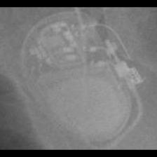 MDT:Azure</td>
<td align="center" valign="top"><b>✅ Option 1</b>  MDT:Azure</td>
<td align="center" valign="top"><b>Option 2</b>  BIO:Evia</td>
<td align="center" valign="top"><b>Option 3</b>  STJ:Allure Quadra</td>
<td align="center" valign="top"><b>Option 4</b>  MDT:Advisa</td>
<td align="center" valign="top"><b>Option 5</b>  MDT:EnRhythm</td>
<td align="center" valign="middle"><b>Option 6</b>  <i>None of the above</i></td>
</tr></table>

### Q3713 · correct: option 4 · `MDT:C20_T20`

<table><tr>
<td align="center" valign="top"><b>Query</b> 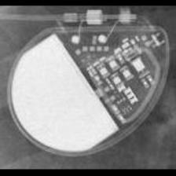 MDT:C20_T20</td>
<td align="center" valign="top"><b>Option 1</b>  MDT:Vita II</td>
<td align="center" valign="top"><b>Option 2</b>  MDT:C60 DR</td>
<td align="center" valign="top"><b>Option 3</b>  MDT:Adapta_Kappa_Sensia_Versa</td>
<td align="center" valign="top"><b>✅ Option 4</b> 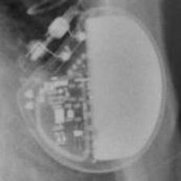 MDT:C20_T20</td>
<td align="center" valign="top"><b>Option 5</b>  MDT:Sigma</td>
<td align="center" valign="middle"><b>Option 6</b>  <i>None of the above</i></td>
</tr></table>

### Q3714 · correct: option 3 · `MDT:C20_T20`

<table><tr>
<td align="center" valign="top"><b>Query</b>  MDT:C20_T20</td>
<td align="center" valign="top"><b>Option 1</b>  MDT:C60 DR</td>
<td align="center" valign="top"><b>Option 2</b>  STJ:Victory</td>
<td align="center" valign="top"><b>✅ Option 3</b>  MDT:C20_T20</td>
<td align="center" valign="top"><b>Option 4</b>  MDT:Sigma</td>
<td align="center" valign="top"><b>Option 5</b>  STJ:Identity</td>
<td align="center" valign="middle"><b>Option 6</b>  <i>None of the above</i></td>
</tr></table>

### Q3715 · correct: option 4 · `MDT:C20_T20`

<table><tr>
<td align="center" valign="top"><b>Query</b> 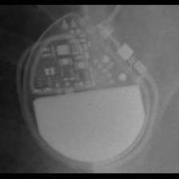 MDT:C20_T20</td>
<td align="center" valign="top"><b>Option 1</b>  STJ:Zephyr</td>
<td align="center" valign="top"><b>Option 2</b>  BOS:ContakTR_Discovery_Meridian_Pulsar Max</td>
<td align="center" valign="top"><b>Option 3</b>  MDT:C60 DR</td>
<td align="center" valign="top"><b>✅ Option 4</b>  MDT:C20_T20</td>
<td align="center" valign="top"><b>Option 5</b> 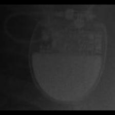 SOR:Rhapsody_Symphony</td>
<td align="center" valign="middle"><b>Option 6</b>  <i>None of the above</i></td>
</tr></table>

### Q3716 · correct: option 4 · `MDT:C20_T20`

<table><tr>
<td align="center" valign="top"><b>Query</b> 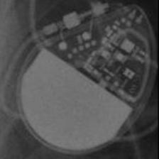 MDT:C20_T20</td>
<td align="center" valign="top"><b>Option 1</b>  MDT:C60 DR</td>
<td align="center" valign="top"><b>Option 2</b>  SOR:Rhapsody_Symphony</td>
<td align="center" valign="top"><b>Option 3</b>  STJ:Identity</td>
<td align="center" valign="top"><b>✅ Option 4</b>  MDT:C20_T20</td>
<td align="center" valign="top"><b>Option 5</b>  STJ:Zephyr</td>
<td align="center" valign="middle"><b>Option 6</b>  <i>None of the above</i></td>
</tr></table>

### Q3717 · correct: option 3 · `MDT:C20_T20`

<table><tr>
<td align="center" valign="top"><b>Query</b>  MDT:C20_T20</td>
<td align="center" valign="top"><b>Option 1</b>  MDT:Vita II</td>
<td align="center" valign="top"><b>Option 2</b>  STJ:Zephyr</td>
<td align="center" valign="top"><b>✅ Option 3</b>  MDT:C20_T20</td>
<td align="center" valign="top"><b>Option 4</b>  MDT:C60 DR</td>
<td align="center" valign="top"><b>Option 5</b>  STJ:Identity</td>
<td align="center" valign="middle"><b>Option 6</b>  <i>None of the above</i></td>
</tr></table>

### Q3718 · correct: option 2 · `MDT:C20_T20`

<table><tr>
<td align="center" valign="top"><b>Query</b> 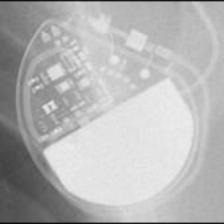 MDT:C20_T20</td>
<td align="center" valign="top"><b>Option 1</b>  MDT:C60 DR</td>
<td align="center" valign="top"><b>✅ Option 2</b>  MDT:C20_T20</td>
<td align="center" valign="top"><b>Option 3</b>  MDT:Sigma</td>
<td align="center" valign="top"><b>Option 4</b>  STJ:Zephyr</td>
<td align="center" valign="top"><b>Option 5</b>  STJ:Identity</td>
<td align="center" valign="middle"><b>Option 6</b>  <i>None of the above</i></td>
</tr></table>

### Q3719 · correct: option 4 · `MDT:C20_T20`

<table><tr>
<td align="center" valign="top"><b>Query</b> 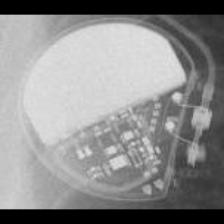 MDT:C20_T20</td>
<td align="center" valign="top"><b>Option 1</b>  MDT:C60 DR</td>
<td align="center" valign="top"><b>Option 2</b>  STJ:Identity</td>
<td align="center" valign="top"><b>Option 3</b>  MDT:Sigma</td>
<td align="center" valign="top"><b>✅ Option 4</b>  MDT:C20_T20</td>
<td align="center" valign="top"><b>Option 5</b>  MDT:Adapta_Kappa_Sensia_Versa</td>
<td align="center" valign="middle"><b>Option 6</b>  <i>None of the above</i></td>
</tr></table>

### Q3720 · correct: option 2 · `MDT:C60 DR`

<table><tr>
<td align="center" valign="top"><b>Query</b> 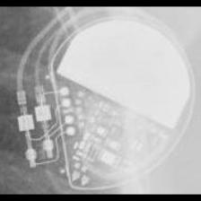 MDT:C60 DR</td>
<td align="center" valign="top"><b>Option 1</b>  MDT:Adapta_Kappa_Sensia_Versa</td>
<td align="center" valign="top"><b>✅ Option 2</b>  MDT:C60 DR</td>
<td align="center" valign="top"><b>Option 3</b>  MDT:Sigma</td>
<td align="center" valign="top"><b>Option 4</b>  MDT:Vita II</td>
<td align="center" valign="top"><b>Option 5</b>  MDT:C20_T20</td>
<td align="center" valign="middle"><b>Option 6</b>  <i>None of the above</i></td>
</tr></table>

### Q3721 · correct: option 1 · `MDT:C60 DR`

<table><tr>
<td align="center" valign="top"><b>Query</b> 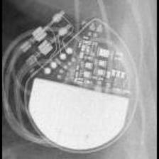 MDT:C60 DR</td>
<td align="center" valign="top"><b>✅ Option 1</b> 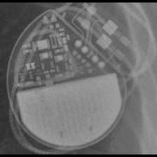 MDT:C60 DR</td>
<td align="center" valign="top"><b>Option 2</b>  MDT:C20_T20</td>
<td align="center" valign="top"><b>Option 3</b>  MDT:Adapta_Kappa_Sensia_Versa</td>
<td align="center" valign="top"><b>Option 4</b>  STJ:Zephyr</td>
<td align="center" valign="top"><b>Option 5</b>  SOR:Reply</td>
<td align="center" valign="middle"><b>Option 6</b>  <i>None of the above</i></td>
</tr></table>

### Q3722 · correct: option 1 · `MDT:C60 DR`

<table><tr>
<td align="center" valign="top"><b>Query</b>  MDT:C60 DR</td>
<td align="center" valign="top"><b>✅ Option 1</b>  MDT:C60 DR</td>
<td align="center" valign="top"><b>Option 2</b>  MDT:Vita II</td>
<td align="center" valign="top"><b>Option 3</b>  MDT:Adapta_Kappa_Sensia_Versa</td>
<td align="center" valign="top"><b>Option 4</b>  SOR:Reply</td>
<td align="center" valign="top"><b>Option 5</b>  MDT:C20_T20</td>
<td align="center" valign="middle"><b>Option 6</b>  <i>None of the above</i></td>
</tr></table>

### Q3723 · correct: option 2 · `MDT:C60 DR`

<table><tr>
<td align="center" valign="top"><b>Query</b> 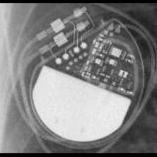 MDT:C60 DR</td>
<td align="center" valign="top"><b>Option 1</b>  MDT:Vita II</td>
<td align="center" valign="top"><b>✅ Option 2</b>  MDT:C60 DR</td>
<td align="center" valign="top"><b>Option 3</b>  SOR:Reply</td>
<td align="center" valign="top"><b>Option 4</b>  MDT:C20_T20</td>
<td align="center" valign="top"><b>Option 5</b>  BOS:Altrua_Insignia</td>
<td align="center" valign="middle"><b>Option 6</b>  <i>None of the above</i></td>
</tr></table>

### Q3724 · correct: option 5 · `MDT:C60 DR`

<table><tr>
<td align="center" valign="top"><b>Query</b> 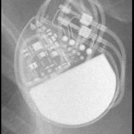 MDT:C60 DR</td>
<td align="center" valign="top"><b>Option 1</b>  BIO:Cyclos</td>
<td align="center" valign="top"><b>Option 2</b>  STJ:Zephyr</td>
<td align="center" valign="top"><b>Option 3</b>  SOR:Reply</td>
<td align="center" valign="top"><b>Option 4</b>  MDT:C20_T20</td>
<td align="center" valign="top"><b>✅ Option 5</b>  MDT:C60 DR</td>
<td align="center" valign="middle"><b>Option 6</b>  <i>None of the above</i></td>
</tr></table>

### Q3725 · correct: option 3 · `MDT:C60 DR`

<table><tr>
<td align="center" valign="top"><b>Query</b> 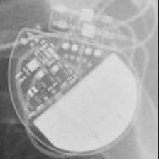 MDT:C60 DR</td>
<td align="center" valign="top"><b>Option 1</b> 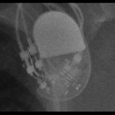 STJ:Zephyr</td>
<td align="center" valign="top"><b>Option 2</b>  MDT:Adapta_Kappa_Sensia_Versa</td>
<td align="center" valign="top"><b>✅ Option 3</b>  MDT:C60 DR</td>
<td align="center" valign="top"><b>Option 4</b>  MDT:C20_T20</td>
<td align="center" valign="top"><b>Option 5</b>  MDT:Sigma</td>
<td align="center" valign="middle"><b>Option 6</b>  <i>None of the above</i></td>
</tr></table>

### Q3726 · correct: option 4 · `MDT:C60 DR`

<table><tr>
<td align="center" valign="top"><b>Query</b> 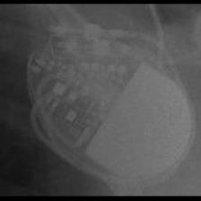 MDT:C60 DR</td>
<td align="center" valign="top"><b>Option 1</b>  MDT:Sigma</td>
<td align="center" valign="top"><b>Option 2</b>  STJ:Zephyr</td>
<td align="center" valign="top"><b>Option 3</b>  MDT:C20_T20</td>
<td align="center" valign="top"><b>✅ Option 4</b>  MDT:C60 DR</td>
<td align="center" valign="top"><b>Option 5</b>  BIO:Cyclos</td>
<td align="center" valign="middle"><b>Option 6</b>  <i>None of the above</i></td>
</tr></table>

### Q3727 · correct: option 5 · `MDT:Claria_Evera_Viva`

<table><tr>
<td align="center" valign="top"><b>Query</b> 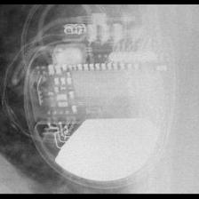 MDT:Claria_Evera_Viva</td>
<td align="center" valign="top"><b>Option 1</b>  BOS:Ventak Prizm</td>
<td align="center" valign="top"><b>Option 2</b>  MDT:Maximo</td>
<td align="center" valign="top"><b>Option 3</b>  MDT:Concerto_Consulta_Maximo_Protecta_Secura</td>
<td align="center" valign="top"><b>Option 4</b>  BOS:Vitality</td>
<td align="center" valign="top"><b>✅ Option 5</b>  MDT:Claria_Evera_Viva</td>
<td align="center" valign="middle"><b>Option 6</b>  <i>None of the above</i></td>
</tr></table>

### Q3728 · correct: option 3 · `MDT:Claria_Evera_Viva`

<table><tr>
<td align="center" valign="top"><b>Query</b> 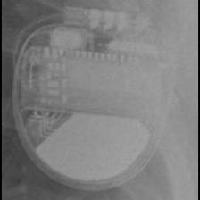 MDT:Claria_Evera_Viva</td>
<td align="center" valign="top"><b>Option 1</b>  MDT:Maximo</td>
<td align="center" valign="top"><b>Option 2</b>  BOS:Ventak Prizm</td>
<td align="center" valign="top"><b>✅ Option 3</b>  MDT:Claria_Evera_Viva</td>
<td align="center" valign="top"><b>Option 4</b>  MDT:Concerto_Consulta_Maximo_Protecta_Secura</td>
<td align="center" valign="top"><b>Option 5</b>  BOS:Vitality</td>
<td align="center" valign="middle"><b>Option 6</b>  <i>None of the above</i></td>
</tr></table>

### Q3729 · correct: option 1 · `MDT:Claria_Evera_Viva`

<table><tr>
<td align="center" valign="top"><b>Query</b> 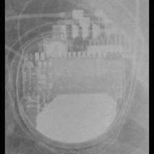 MDT:Claria_Evera_Viva</td>
<td align="center" valign="top"><b>✅ Option 1</b>  MDT:Claria_Evera_Viva</td>
<td align="center" valign="top"><b>Option 2</b>  MDT:Concerto_Consulta_Maximo_Protecta_Secura</td>
<td align="center" valign="top"><b>Option 3</b>  STJ:Quadra Assura_Unify</td>
<td align="center" valign="top"><b>Option 4</b>  MDT:Maximo</td>
<td align="center" valign="top"><b>Option 5</b>  BOS:Vitality</td>
<td align="center" valign="middle"><b>Option 6</b>  <i>None of the above</i></td>
</tr></table>

### Q3730 · correct: option 4 · `MDT:Claria_Evera_Viva`

<table><tr>
<td align="center" valign="top"><b>Query</b> 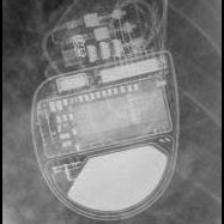 MDT:Claria_Evera_Viva</td>
<td align="center" valign="top"><b>Option 1</b>  STJ:Quadra Assura_Unify</td>
<td align="center" valign="top"><b>Option 2</b>  BOS:Vitality</td>
<td align="center" valign="top"><b>Option 3</b>  MDT:Concerto_Consulta_Maximo_Protecta_Secura</td>
<td align="center" valign="top"><b>✅ Option 4</b>  MDT:Claria_Evera_Viva</td>
<td align="center" valign="top"><b>Option 5</b>  MDT:Maximo</td>
<td align="center" valign="middle"><b>Option 6</b>  <i>None of the above</i></td>
</tr></table>

### Q3731 · correct: option 5 · `MDT:Claria_Evera_Viva`

<table><tr>
<td align="center" valign="top"><b>Query</b> 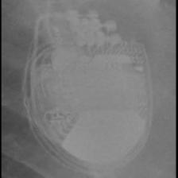 MDT:Claria_Evera_Viva</td>
<td align="center" valign="top"><b>Option 1</b>  BOS:Vitality</td>
<td align="center" valign="top"><b>Option 2</b>  MDT:Maximo</td>
<td align="center" valign="top"><b>Option 3</b>  MDT:Concerto_Consulta_Maximo_Protecta_Secura</td>
<td align="center" valign="top"><b>Option 4</b>  BOS:Contak Renewal 4</td>
<td align="center" valign="top"><b>✅ Option 5</b>  MDT:Claria_Evera_Viva</td>
<td align="center" valign="middle"><b>Option 6</b>  <i>None of the above</i></td>
</tr></table>

### Q3732 · correct: option 3 · `MDT:Claria_Evera_Viva`

<table><tr>
<td align="center" valign="top"><b>Query</b> 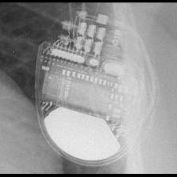 MDT:Claria_Evera_Viva</td>
<td align="center" valign="top"><b>Option 1</b>  MDT:Maximo</td>
<td align="center" valign="top"><b>Option 2</b>  BOS:Vitality</td>
<td align="center" valign="top"><b>✅ Option 3</b> 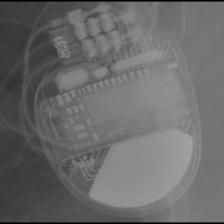 MDT:Claria_Evera_Viva</td>
<td align="center" valign="top"><b>Option 4</b>  MDT:Concerto_Consulta_Maximo_Protecta_Secura</td>
<td align="center" valign="top"><b>Option 5</b>  STJ:Quadra Assura_Unify</td>
<td align="center" valign="middle"><b>Option 6</b>  <i>None of the above</i></td>
</tr></table>

### Q3733 · correct: option 2 · `MDT:Claria_Evera_Viva`

<table><tr>
<td align="center" valign="top"><b>Query</b>  MDT:Claria_Evera_Viva</td>
<td align="center" valign="top"><b>Option 1</b>  MDT:Concerto_Consulta_Maximo_Protecta_Secura</td>
<td align="center" valign="top"><b>✅ Option 2</b> 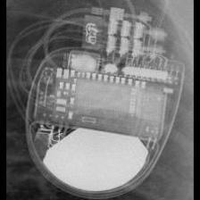 MDT:Claria_Evera_Viva</td>
<td align="center" valign="top"><b>Option 3</b>  MDT:Maximo</td>
<td align="center" valign="top"><b>Option 4</b>  STJ:Quadra Assura_Unify</td>
<td align="center" valign="top"><b>Option 5</b>  BOS:Vitality</td>
<td align="center" valign="middle"><b>Option 6</b>  <i>None of the above</i></td>
</tr></table>

### Q3734 · correct: option 1 · `MDT:Concerto_Consulta_Maximo_Protecta_Secura`

<table><tr>
<td align="center" valign="top"><b>Query</b> 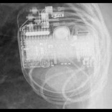 MDT:Concerto_Consulta_Maximo_Protecta_Secura</td>
<td align="center" valign="top"><b>✅ Option 1</b>  MDT:Concerto_Consulta_Maximo_Protecta_Secura</td>
<td align="center" valign="top"><b>Option 2</b>  STJ:Quadra Assura_Unify</td>
<td align="center" valign="top"><b>Option 3</b>  MDT:Maximo</td>
<td align="center" valign="top"><b>Option 4</b>  MDT:Claria_Evera_Viva</td>
<td align="center" valign="top"><b>Option 5</b>  BOS:Contak Renewal 4</td>
<td align="center" valign="middle"><b>Option 6</b>  <i>None of the above</i></td>
</tr></table>

### Q3735 · correct: option 2 · `MDT:Concerto_Consulta_Maximo_Protecta_Secura`

<table><tr>
<td align="center" valign="top"><b>Query</b> 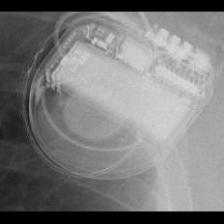 MDT:Concerto_Consulta_Maximo_Protecta_Secura</td>
<td align="center" valign="top"><b>Option 1</b>  BOS:Contak Renewal 4</td>
<td align="center" valign="top"><b>✅ Option 2</b>  MDT:Concerto_Consulta_Maximo_Protecta_Secura</td>
<td align="center" valign="top"><b>Option 3</b>  MDT:Maximo</td>
<td align="center" valign="top"><b>Option 4</b>  MDT:Claria_Evera_Viva</td>
<td align="center" valign="top"><b>Option 5</b>  STJ:Quadra Assura_Unify</td>
<td align="center" valign="middle"><b>Option 6</b>  <i>None of the above</i></td>
</tr></table>

### Q3736 · correct: option 5 · `MDT:Concerto_Consulta_Maximo_Protecta_Secura`

<table><tr>
<td align="center" valign="top"><b>Query</b> 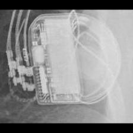 MDT:Concerto_Consulta_Maximo_Protecta_Secura</td>
<td align="center" valign="top"><b>Option 1</b>  MDT:Maximo</td>
<td align="center" valign="top"><b>Option 2</b>  BOS:Ingenio</td>
<td align="center" valign="top"><b>Option 3</b>  BOS:Contak Renewal 4</td>
<td align="center" valign="top"><b>Option 4</b>  STJ:Quadra Assura_Unify</td>
<td align="center" valign="top"><b>✅ Option 5</b>  MDT:Concerto_Consulta_Maximo_Protecta_Secura</td>
<td align="center" valign="middle"><b>Option 6</b>  <i>None of the above</i></td>
</tr></table>

### Q3737 · correct: option 2 · `MDT:Concerto_Consulta_Maximo_Protecta_Secura`

<table><tr>
<td align="center" valign="top"><b>Query</b> 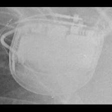 MDT:Concerto_Consulta_Maximo_Protecta_Secura</td>
<td align="center" valign="top"><b>Option 1</b>  MDT:Maximo</td>
<td align="center" valign="top"><b>✅ Option 2</b>  MDT:Concerto_Consulta_Maximo_Protecta_Secura</td>
<td align="center" valign="top"><b>Option 3</b> 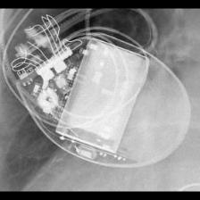 BOS:Contak Renewal 4</td>
<td align="center" valign="top"><b>Option 4</b>  BIO:Evia</td>
<td align="center" valign="top"><b>Option 5</b>  STJ:Quadra Assura_Unify</td>
<td align="center" valign="middle"><b>Option 6</b>  <i>None of the above</i></td>
</tr></table>

### Q3738 · correct: option 4 · `MDT:Concerto_Consulta_Maximo_Protecta_Secura`

<table><tr>
<td align="center" valign="top"><b>Query</b> 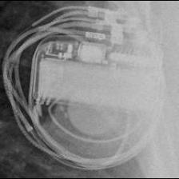 MDT:Concerto_Consulta_Maximo_Protecta_Secura</td>
<td align="center" valign="top"><b>Option 1</b>  BOS:Vitality</td>
<td align="center" valign="top"><b>Option 2</b>  STJ:Quadra Assura_Unify</td>
<td align="center" valign="top"><b>Option 3</b>  BOS:Contak Renewal 4</td>
<td align="center" valign="top"><b>✅ Option 4</b>  MDT:Concerto_Consulta_Maximo_Protecta_Secura</td>
<td align="center" valign="top"><b>Option 5</b>  MDT:Maximo</td>
<td align="center" valign="middle"><b>Option 6</b>  <i>None of the above</i></td>
</tr></table>

### Q3739 · correct: option 4 · `MDT:Concerto_Consulta_Maximo_Protecta_Secura`

<table><tr>
<td align="center" valign="top"><b>Query</b>  MDT:Concerto_Consulta_Maximo_Protecta_Secura</td>
<td align="center" valign="top"><b>Option 1</b>  BOS:Vitality</td>
<td align="center" valign="top"><b>Option 2</b>  BOS:Ventak Prizm</td>
<td align="center" valign="top"><b>Option 3</b>  BOS:Contak Renewal 4</td>
<td align="center" valign="top"><b>✅ Option 4</b>  MDT:Concerto_Consulta_Maximo_Protecta_Secura</td>
<td align="center" valign="top"><b>Option 5</b>  MDT:Maximo</td>
<td align="center" valign="middle"><b>Option 6</b>  <i>None of the above</i></td>
</tr></table>

### Q3740 · correct: option 1 · `MDT:Concerto_Consulta_Maximo_Protecta_Secura`

<table><tr>
<td align="center" valign="top"><b>Query</b>  MDT:Concerto_Consulta_Maximo_Protecta_Secura</td>
<td align="center" valign="top"><b>✅ Option 1</b>  MDT:Concerto_Consulta_Maximo_Protecta_Secura</td>
<td align="center" valign="top"><b>Option 2</b>  BOS:Contak Renewal 4</td>
<td align="center" valign="top"><b>Option 3</b>  MDT:Maximo</td>
<td align="center" valign="top"><b>Option 4</b>  MDT:Claria_Evera_Viva</td>
<td align="center" valign="top"><b>Option 5</b>  BOS:Vitality</td>
<td align="center" valign="middle"><b>Option 6</b>  <i>None of the above</i></td>
</tr></table>

### Q3741 · correct: option 5 · `MDT:EnRhythm`

<table><tr>
<td align="center" valign="top"><b>Query</b>  MDT:EnRhythm</td>
<td align="center" valign="top"><b>Option 1</b>  MDT:Advisa</td>
<td align="center" valign="top"><b>Option 2</b>  MDT:Syncra</td>
<td align="center" valign="top"><b>Option 3</b>  MDT:AT500</td>
<td align="center" valign="top"><b>Option 4</b>  MDT:Insync III</td>
<td align="center" valign="top"><b>✅ Option 5</b>  MDT:EnRhythm</td>
<td align="center" valign="middle"><b>Option 6</b>  <i>None of the above</i></td>
</tr></table>

### Q3742 · correct: option 1 · `MDT:EnRhythm`

<table><tr>
<td align="center" valign="top"><b>Query</b>  MDT:EnRhythm</td>
<td align="center" valign="top"><b>✅ Option 1</b>  MDT:EnRhythm</td>
<td align="center" valign="top"><b>Option 2</b>  MDT:Syncra</td>
<td align="center" valign="top"><b>Option 3</b>  MDT:Advisa</td>
<td align="center" valign="top"><b>Option 4</b>  MDT:Insync III</td>
<td align="center" valign="top"><b>Option 5</b>  MDT:AT500</td>
<td align="center" valign="middle"><b>Option 6</b>  <i>None of the above</i></td>
</tr></table>

### Q3743 · correct: option 5 · `MDT:EnRhythm`

<table><tr>
<td align="center" valign="top"><b>Query</b>  MDT:EnRhythm</td>
<td align="center" valign="top"><b>Option 1</b>  MDT:Insync III</td>
<td align="center" valign="top"><b>Option 2</b>  MDT:Advisa</td>
<td align="center" valign="top"><b>Option 3</b>  MDT:Syncra</td>
<td align="center" valign="top"><b>Option 4</b>  MDT:AT500</td>
<td align="center" valign="top"><b>✅ Option 5</b>  MDT:EnRhythm</td>
<td align="center" valign="middle"><b>Option 6</b>  <i>None of the above</i></td>
</tr></table>

