# Pacemakers (Howard et al.) · query set `train2` · page 4/6

[← all pages](README.md)

### Q3744 · correct: option 4 · `MDT:EnRhythm`

<table><tr>
<td align="center" valign="top"><b>Query</b> 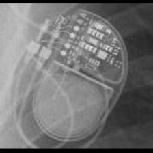 MDT:EnRhythm</td>
<td align="center" valign="top"><b>Option 1</b>  MDT:Syncra</td>
<td align="center" valign="top"><b>Option 2</b>  MDT:AT500</td>
<td align="center" valign="top"><b>Option 3</b>  MDT:Advisa</td>
<td align="center" valign="top"><b>✅ Option 4</b>  MDT:EnRhythm</td>
<td align="center" valign="top"><b>Option 5</b>  MDT:Insync III</td>
<td align="center" valign="middle"><b>Option 6</b>  <i>None of the above</i></td>
</tr></table>

### Q3745 · correct: option 1 · `MDT:EnRhythm`

<table><tr>
<td align="center" valign="top"><b>Query</b> 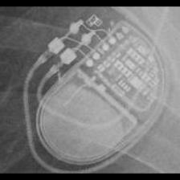 MDT:EnRhythm</td>
<td align="center" valign="top"><b>✅ Option 1</b>  MDT:EnRhythm</td>
<td align="center" valign="top"><b>Option 2</b>  MDT:Azure</td>
<td align="center" valign="top"><b>Option 3</b>  MDT:Syncra</td>
<td align="center" valign="top"><b>Option 4</b>  MDT:AT500</td>
<td align="center" valign="top"><b>Option 5</b>  MDT:Advisa</td>
<td align="center" valign="middle"><b>Option 6</b>  <i>None of the above</i></td>
</tr></table>

### Q3746 · correct: option 4 · `MDT:EnRhythm`

<table><tr>
<td align="center" valign="top"><b>Query</b>  MDT:EnRhythm</td>
<td align="center" valign="top"><b>Option 1</b>  MDT:AT500</td>
<td align="center" valign="top"><b>Option 2</b>  MDT:Insync III</td>
<td align="center" valign="top"><b>Option 3</b>  MDT:Advisa</td>
<td align="center" valign="top"><b>✅ Option 4</b>  MDT:EnRhythm</td>
<td align="center" valign="top"><b>Option 5</b>  MDT:Syncra</td>
<td align="center" valign="middle"><b>Option 6</b>  <i>None of the above</i></td>
</tr></table>

### Q3747 · correct: option 1 · `MDT:EnRhythm`

<table><tr>
<td align="center" valign="top"><b>Query</b> 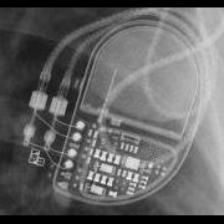 MDT:EnRhythm</td>
<td align="center" valign="top"><b>✅ Option 1</b>  MDT:EnRhythm</td>
<td align="center" valign="top"><b>Option 2</b>  MDT:Insync III</td>
<td align="center" valign="top"><b>Option 3</b>  MDT:Advisa</td>
<td align="center" valign="top"><b>Option 4</b>  MDT:Syncra</td>
<td align="center" valign="top"><b>Option 5</b>  MDT:AT500</td>
<td align="center" valign="middle"><b>Option 6</b>  <i>None of the above</i></td>
</tr></table>

### Q3748 · correct: option 4 · `MDT:Insync III`

<table><tr>
<td align="center" valign="top"><b>Query</b> 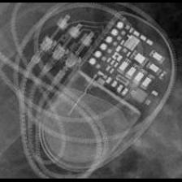 MDT:Insync III</td>
<td align="center" valign="top"><b>Option 1</b>  MDT:EnRhythm</td>
<td align="center" valign="top"><b>Option 2</b>  MDT:AT500</td>
<td align="center" valign="top"><b>Option 3</b>  MDT:Syncra</td>
<td align="center" valign="top"><b>✅ Option 4</b>  MDT:Insync III</td>
<td align="center" valign="top"><b>Option 5</b>  MDT:Advisa</td>
<td align="center" valign="middle"><b>Option 6</b>  <i>None of the above</i></td>
</tr></table>

### Q3749 · correct: option 5 · `MDT:Insync III`

<table><tr>
<td align="center" valign="top"><b>Query</b> 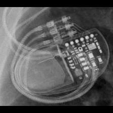 MDT:Insync III</td>
<td align="center" valign="top"><b>Option 1</b> 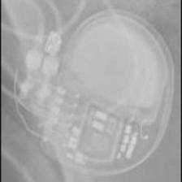 MDT:Azure</td>
<td align="center" valign="top"><b>Option 2</b>  MDT:Syncra</td>
<td align="center" valign="top"><b>Option 3</b>  MDT:EnRhythm</td>
<td align="center" valign="top"><b>Option 4</b>  MDT:AT500</td>
<td align="center" valign="top"><b>✅ Option 5</b>  MDT:Insync III</td>
<td align="center" valign="middle"><b>Option 6</b>  <i>None of the above</i></td>
</tr></table>

### Q3750 · correct: option 4 · `MDT:Insync III`

<table><tr>
<td align="center" valign="top"><b>Query</b> 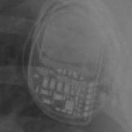 MDT:Insync III</td>
<td align="center" valign="top"><b>Option 1</b>  MDT:AT500</td>
<td align="center" valign="top"><b>Option 2</b>  MDT:Azure</td>
<td align="center" valign="top"><b>Option 3</b>  MDT:Advisa</td>
<td align="center" valign="top"><b>✅ Option 4</b>  MDT:Insync III</td>
<td align="center" valign="top"><b>Option 5</b>  MDT:Syncra</td>
<td align="center" valign="middle"><b>Option 6</b>  <i>None of the above</i></td>
</tr></table>

### Q3751 · correct: option 5 · `MDT:Insync III`

<table><tr>
<td align="center" valign="top"><b>Query</b> 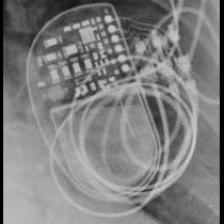 MDT:Insync III</td>
<td align="center" valign="top"><b>Option 1</b>  MDT:Advisa</td>
<td align="center" valign="top"><b>Option 2</b>  MDT:AT500</td>
<td align="center" valign="top"><b>Option 3</b>  MDT:EnRhythm</td>
<td align="center" valign="top"><b>Option 4</b>  MDT:Syncra</td>
<td align="center" valign="top"><b>✅ Option 5</b>  MDT:Insync III</td>
<td align="center" valign="middle"><b>Option 6</b>  <i>None of the above</i></td>
</tr></table>

### Q3752 · correct: option 2 · `MDT:Insync III`

<table><tr>
<td align="center" valign="top"><b>Query</b> 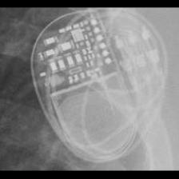 MDT:Insync III</td>
<td align="center" valign="top"><b>Option 1</b>  MDT:Syncra</td>
<td align="center" valign="top"><b>✅ Option 2</b>  MDT:Insync III</td>
<td align="center" valign="top"><b>Option 3</b>  MDT:Advisa</td>
<td align="center" valign="top"><b>Option 4</b>  MDT:AT500</td>
<td align="center" valign="top"><b>Option 5</b>  MDT:EnRhythm</td>
<td align="center" valign="middle"><b>Option 6</b>  <i>None of the above</i></td>
</tr></table>

### Q3753 · correct: option 5 · `MDT:Insync III`

<table><tr>
<td align="center" valign="top"><b>Query</b> 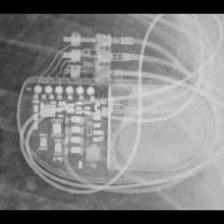 MDT:Insync III</td>
<td align="center" valign="top"><b>Option 1</b>  MDT:EnRhythm</td>
<td align="center" valign="top"><b>Option 2</b>  MDT:Azure</td>
<td align="center" valign="top"><b>Option 3</b>  MDT:Syncra</td>
<td align="center" valign="top"><b>Option 4</b>  BOS:Contak Renewal TR2</td>
<td align="center" valign="top"><b>✅ Option 5</b>  MDT:Insync III</td>
<td align="center" valign="middle"><b>Option 6</b>  <i>None of the above</i></td>
</tr></table>

### Q3754 · correct: option 1 · `MDT:Insync III`

<table><tr>
<td align="center" valign="top"><b>Query</b> 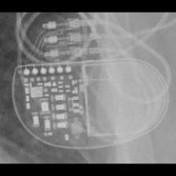 MDT:Insync III</td>
<td align="center" valign="top"><b>✅ Option 1</b>  MDT:Insync III</td>
<td align="center" valign="top"><b>Option 2</b>  MDT:Syncra</td>
<td align="center" valign="top"><b>Option 3</b>  MDT:EnRhythm</td>
<td align="center" valign="top"><b>Option 4</b>  MDT:Azure</td>
<td align="center" valign="top"><b>Option 5</b>  MDT:AT500</td>
<td align="center" valign="middle"><b>Option 6</b>  <i>None of the above</i></td>
</tr></table>

### Q3755 · correct: option 5 · `MDT:Maximo`

<table><tr>
<td align="center" valign="top"><b>Query</b> 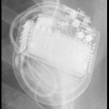 MDT:Maximo</td>
<td align="center" valign="top"><b>Option 1</b> 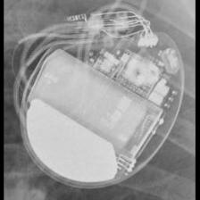 BOS:Vitality</td>
<td align="center" valign="top"><b>Option 2</b>  STJ:Quadra Assura_Unify</td>
<td align="center" valign="top"><b>Option 3</b>  BOS:Contak Renewal 4</td>
<td align="center" valign="top"><b>Option 4</b>  MDT:Concerto_Consulta_Maximo_Protecta_Secura</td>
<td align="center" valign="top"><b>✅ Option 5</b>  MDT:Maximo</td>
<td align="center" valign="middle"><b>Option 6</b>  <i>None of the above</i></td>
</tr></table>

### Q3756 · correct: option 1 · `MDT:Maximo`

<table><tr>
<td align="center" valign="top"><b>Query</b> 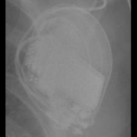 MDT:Maximo</td>
<td align="center" valign="top"><b>✅ Option 1</b>  MDT:Maximo</td>
<td align="center" valign="top"><b>Option 2</b>  BOS:Vitality</td>
<td align="center" valign="top"><b>Option 3</b>  BOS:Contak Renewal 4</td>
<td align="center" valign="top"><b>Option 4</b>  MDT:Concerto_Consulta_Maximo_Protecta_Secura</td>
<td align="center" valign="top"><b>Option 5</b>  BOS:Ventak Prizm</td>
<td align="center" valign="middle"><b>Option 6</b>  <i>None of the above</i></td>
</tr></table>

### Q3757 · correct: option 3 · `MDT:Maximo`

<table><tr>
<td align="center" valign="top"><b>Query</b> 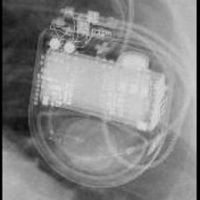 MDT:Maximo</td>
<td align="center" valign="top"><b>Option 1</b>  BOS:Vitality</td>
<td align="center" valign="top"><b>Option 2</b>  MDT:Concerto_Consulta_Maximo_Protecta_Secura</td>
<td align="center" valign="top"><b>✅ Option 3</b>  MDT:Maximo</td>
<td align="center" valign="top"><b>Option 4</b>  BOS:Contak Renewal 4</td>
<td align="center" valign="top"><b>Option 5</b>  STJ:Quadra Assura_Unify</td>
<td align="center" valign="middle"><b>Option 6</b>  <i>None of the above</i></td>
</tr></table>

### Q3758 · correct: option 4 · `MDT:Maximo`

<table><tr>
<td align="center" valign="top"><b>Query</b> 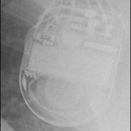 MDT:Maximo</td>
<td align="center" valign="top"><b>Option 1</b>  BOS:Contak Renewal 4</td>
<td align="center" valign="top"><b>Option 2</b>  MDT:Claria_Evera_Viva</td>
<td align="center" valign="top"><b>Option 3</b>  MDT:Concerto_Consulta_Maximo_Protecta_Secura</td>
<td align="center" valign="top"><b>✅ Option 4</b>  MDT:Maximo</td>
<td align="center" valign="top"><b>Option 5</b>  STJ:Quadra Assura_Unify</td>
<td align="center" valign="middle"><b>Option 6</b>  <i>None of the above</i></td>
</tr></table>

### Q3759 · correct: option 2 · `MDT:Maximo`

<table><tr>
<td align="center" valign="top"><b>Query</b> 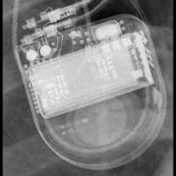 MDT:Maximo</td>
<td align="center" valign="top"><b>Option 1</b>  BOS:Contak Renewal 4</td>
<td align="center" valign="top"><b>✅ Option 2</b>  MDT:Maximo</td>
<td align="center" valign="top"><b>Option 3</b>  MDT:Concerto_Consulta_Maximo_Protecta_Secura</td>
<td align="center" valign="top"><b>Option 4</b>  BOS:Vitality</td>
<td align="center" valign="top"><b>Option 5</b>  STJ:Quadra Assura_Unify</td>
<td align="center" valign="middle"><b>Option 6</b>  <i>None of the above</i></td>
</tr></table>

### Q3760 · correct: option 1 · `MDT:REVEAL`

<table><tr>
<td align="center" valign="top"><b>Query</b> 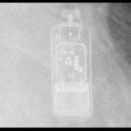 MDT:REVEAL</td>
<td align="center" valign="top"><b>✅ Option 1</b>  MDT:REVEAL</td>
<td align="center" valign="top"><b>Option 2</b> 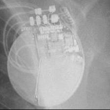 BOS:Autogen_Teligen_Energen_Cognis</td>
<td align="center" valign="top"><b>Option 3</b>  STJ:Quadra Assura_Unify</td>
<td align="center" valign="top"><b>Option 4</b>  MDT:REVEAL LINQ</td>
<td align="center" valign="top"><b>Option 5</b>  BOS:Ingenio</td>
<td align="center" valign="middle"><b>Option 6</b>  <i>None of the above</i></td>
</tr></table>

### Q3761 · correct: option 5 · `MDT:REVEAL`

<table><tr>
<td align="center" valign="top"><b>Query</b>  MDT:REVEAL</td>
<td align="center" valign="top"><b>Option 1</b>  BOS:Emblem</td>
<td align="center" valign="top"><b>Option 2</b> 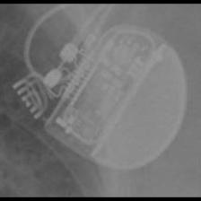 BOS:Proponent</td>
<td align="center" valign="top"><b>Option 3</b>  MDT:REVEAL LINQ</td>
<td align="center" valign="top"><b>Option 4</b> 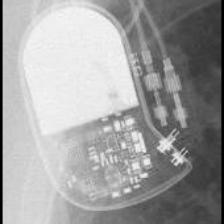 BIO:Cyclos</td>
<td align="center" valign="top"><b>✅ Option 5</b>  MDT:REVEAL</td>
<td align="center" valign="middle"><b>Option 6</b>  <i>None of the above</i></td>
</tr></table>

### Q3762 · correct: option 4 · `MDT:REVEAL`

<table><tr>
<td align="center" valign="top"><b>Query</b> 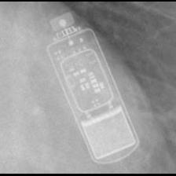 MDT:REVEAL</td>
<td align="center" valign="top"><b>Option 1</b>  STJ:Allure Quadra</td>
<td align="center" valign="top"><b>Option 2</b>  BOS:Autogen_Teligen_Energen_Cognis</td>
<td align="center" valign="top"><b>Option 3</b>  BOS:Ingenio</td>
<td align="center" valign="top"><b>✅ Option 4</b>  MDT:REVEAL</td>
<td align="center" valign="top"><b>Option 5</b>  MDT:REVEAL LINQ</td>
<td align="center" valign="middle"><b>Option 6</b>  <i>None of the above</i></td>
</tr></table>

### Q3763 · correct: option 5 · `MDT:REVEAL`

<table><tr>
<td align="center" valign="top"><b>Query</b> 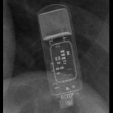 MDT:REVEAL</td>
<td align="center" valign="top"><b>Option 1</b>  STJ:Allure Quadra</td>
<td align="center" valign="top"><b>Option 2</b>  MDT:REVEAL LINQ</td>
<td align="center" valign="top"><b>Option 3</b>  BOS:Autogen_Teligen_Energen_Cognis</td>
<td align="center" valign="top"><b>Option 4</b>  BOS:Emblem</td>
<td align="center" valign="top"><b>✅ Option 5</b> 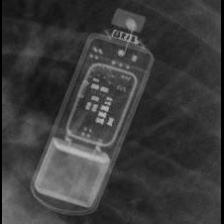 MDT:REVEAL</td>
<td align="center" valign="middle"><b>Option 6</b>  <i>None of the above</i></td>
</tr></table>

### Q3764 · correct: option 2 · `MDT:REVEAL LINQ`

<table><tr>
<td align="center" valign="top"><b>Query</b> 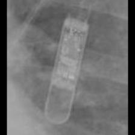 MDT:REVEAL LINQ</td>
<td align="center" valign="top"><b>Option 1</b> 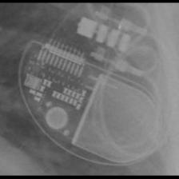 STJ:Allure Quadra</td>
<td align="center" valign="top"><b>✅ Option 2</b>  MDT:REVEAL LINQ</td>
<td align="center" valign="top"><b>Option 3</b>  BOS:Vitality</td>
<td align="center" valign="top"><b>Option 4</b>  MDT:REVEAL</td>
<td align="center" valign="top"><b>Option 5</b>  BOS:Emblem</td>
<td align="center" valign="middle"><b>Option 6</b>  <i>None of the above</i></td>
</tr></table>

### Q3765 · correct: option 5 · `MDT:REVEAL LINQ`

<table><tr>
<td align="center" valign="top"><b>Query</b> 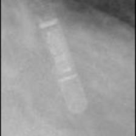 MDT:REVEAL LINQ</td>
<td align="center" valign="top"><b>Option 1</b>  MDT:REVEAL</td>
<td align="center" valign="top"><b>Option 2</b>  BOS:Vitality</td>
<td align="center" valign="top"><b>Option 3</b>  BOS:Emblem</td>
<td align="center" valign="top"><b>Option 4</b> 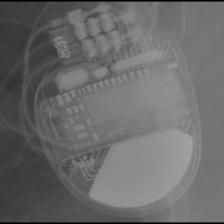 MDT:Claria_Evera_Viva</td>
<td align="center" valign="top"><b>✅ Option 5</b> 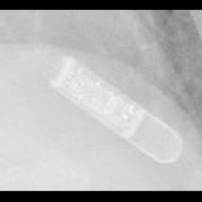 MDT:REVEAL LINQ</td>
<td align="center" valign="middle"><b>Option 6</b>  <i>None of the above</i></td>
</tr></table>

### Q3766 · correct: option 2 · `MDT:REVEAL LINQ`

<table><tr>
<td align="center" valign="top"><b>Query</b> 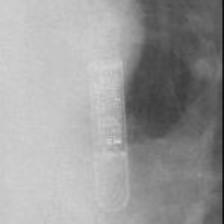 MDT:REVEAL LINQ</td>
<td align="center" valign="top"><b>Option 1</b>  MDT:Claria_Evera_Viva</td>
<td align="center" valign="top"><b>✅ Option 2</b>  MDT:REVEAL LINQ</td>
<td align="center" valign="top"><b>Option 3</b>  MDT:REVEAL</td>
<td align="center" valign="top"><b>Option 4</b>  BOS:Vitality</td>
<td align="center" valign="top"><b>Option 5</b>  BOS:Emblem</td>
<td align="center" valign="middle"><b>Option 6</b>  <i>None of the above</i></td>
</tr></table>

### Q3767 · correct: option 2 · `MDT:REVEAL LINQ`

<table><tr>
<td align="center" valign="top"><b>Query</b>  MDT:REVEAL LINQ</td>
<td align="center" valign="top"><b>Option 1</b>  MDT:REVEAL</td>
<td align="center" valign="top"><b>✅ Option 2</b> 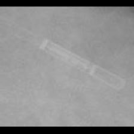 MDT:REVEAL LINQ</td>
<td align="center" valign="top"><b>Option 3</b>  MDT:Claria_Evera_Viva</td>
<td align="center" valign="top"><b>Option 4</b>  BOS:Emblem</td>
<td align="center" valign="top"><b>Option 5</b>  BOS:Vitality</td>
<td align="center" valign="middle"><b>Option 6</b>  <i>None of the above</i></td>
</tr></table>

### Q3768 · correct: option 3 · `MDT:REVEAL LINQ`

<table><tr>
<td align="center" valign="top"><b>Query</b>  MDT:REVEAL LINQ</td>
<td align="center" valign="top"><b>Option 1</b>  MDT:Claria_Evera_Viva</td>
<td align="center" valign="top"><b>Option 2</b>  MDT:REVEAL</td>
<td align="center" valign="top"><b>✅ Option 3</b>  MDT:REVEAL LINQ</td>
<td align="center" valign="top"><b>Option 4</b>  BOS:Emblem</td>
<td align="center" valign="top"><b>Option 5</b>  BOS:Vitality</td>
<td align="center" valign="middle"><b>Option 6</b>  <i>None of the above</i></td>
</tr></table>

### Q3769 · correct: option 1 · `MDT:Sigma`

<table><tr>
<td align="center" valign="top"><b>Query</b> 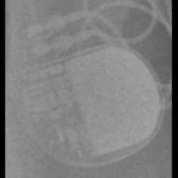 MDT:Sigma</td>
<td align="center" valign="top"><b>✅ Option 1</b> 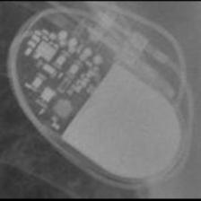 MDT:Sigma</td>
<td align="center" valign="top"><b>Option 2</b>  MDT:Adapta_Kappa_Sensia_Versa</td>
<td align="center" valign="top"><b>Option 3</b>  BIO:Cyclos</td>
<td align="center" valign="top"><b>Option 4</b>  SOR:Reply</td>
<td align="center" valign="top"><b>Option 5</b>  BIO:Actros_Philos</td>
<td align="center" valign="middle"><b>Option 6</b>  <i>None of the above</i></td>
</tr></table>

### Q3770 · correct: option 3 · `MDT:Sigma`

<table><tr>
<td align="center" valign="top"><b>Query</b> 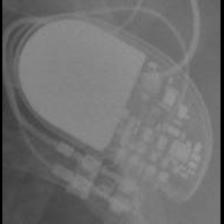 MDT:Sigma</td>
<td align="center" valign="top"><b>Option 1</b>  SOR:Reply</td>
<td align="center" valign="top"><b>Option 2</b>  MDT:Adapta_Kappa_Sensia_Versa</td>
<td align="center" valign="top"><b>✅ Option 3</b>  MDT:Sigma</td>
<td align="center" valign="top"><b>Option 4</b>  BIO:Cyclos</td>
<td align="center" valign="top"><b>Option 5</b>  BIO:Actros_Philos</td>
<td align="center" valign="middle"><b>Option 6</b>  <i>None of the above</i></td>
</tr></table>

### Q3771 · correct: option 3 · `MDT:Sigma`

<table><tr>
<td align="center" valign="top"><b>Query</b>  MDT:Sigma</td>
<td align="center" valign="top"><b>Option 1</b>  MDT:C20_T20</td>
<td align="center" valign="top"><b>Option 2</b>  STJ:Zephyr</td>
<td align="center" valign="top"><b>✅ Option 3</b>  MDT:Sigma</td>
<td align="center" valign="top"><b>Option 4</b> 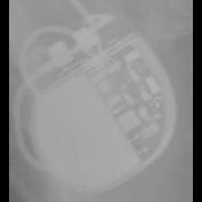 BOS:ContakTR_Discovery_Meridian_Pulsar Max</td>
<td align="center" valign="top"><b>Option 5</b>  MDT:Adapta_Kappa_Sensia_Versa</td>
<td align="center" valign="middle"><b>Option 6</b>  <i>None of the above</i></td>
</tr></table>

### Q3772 · correct: option 5 · `MDT:Sigma`

<table><tr>
<td align="center" valign="top"><b>Query</b> 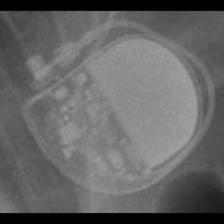 MDT:Sigma</td>
<td align="center" valign="top"><b>Option 1</b>  STJ:Identity</td>
<td align="center" valign="top"><b>Option 2</b>  MDT:C60 DR</td>
<td align="center" valign="top"><b>Option 3</b> 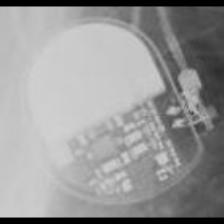 MDT:Adapta_Kappa_Sensia_Versa</td>
<td align="center" valign="top"><b>Option 4</b>  MDT:C20_T20</td>
<td align="center" valign="top"><b>✅ Option 5</b>  MDT:Sigma</td>
<td align="center" valign="middle"><b>Option 6</b>  <i>None of the above</i></td>
</tr></table>

### Q3773 · correct: option 4 · `MDT:Sigma`

<table><tr>
<td align="center" valign="top"><b>Query</b> 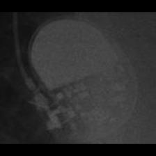 MDT:Sigma</td>
<td align="center" valign="top"><b>Option 1</b>  STJ:Identity</td>
<td align="center" valign="top"><b>Option 2</b>  STJ:Zephyr</td>
<td align="center" valign="top"><b>Option 3</b>  BOS:ContakTR_Discovery_Meridian_Pulsar Max</td>
<td align="center" valign="top"><b>✅ Option 4</b>  MDT:Sigma</td>
<td align="center" valign="top"><b>Option 5</b>  MDT:Adapta_Kappa_Sensia_Versa</td>
<td align="center" valign="middle"><b>Option 6</b>  <i>None of the above</i></td>
</tr></table>

### Q3774 · correct: option 2 · `MDT:Sigma`

<table><tr>
<td align="center" valign="top"><b>Query</b>  MDT:Sigma</td>
<td align="center" valign="top"><b>Option 1</b>  BIO:Actros_Philos</td>
<td align="center" valign="top"><b>✅ Option 2</b>  MDT:Sigma</td>
<td align="center" valign="top"><b>Option 3</b>  MDT:C20_T20</td>
<td align="center" valign="top"><b>Option 4</b>  MDT:Adapta_Kappa_Sensia_Versa</td>
<td align="center" valign="top"><b>Option 5</b>  BIO:Cyclos</td>
<td align="center" valign="middle"><b>Option 6</b>  <i>None of the above</i></td>
</tr></table>

### Q3775 · correct: option 2 · `MDT:Sigma`

<table><tr>
<td align="center" valign="top"><b>Query</b> 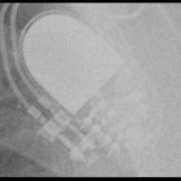 MDT:Sigma</td>
<td align="center" valign="top"><b>Option 1</b>  BIO:Cyclos</td>
<td align="center" valign="top"><b>✅ Option 2</b>  MDT:Sigma</td>
<td align="center" valign="top"><b>Option 3</b>  BIO:Actros_Philos</td>
<td align="center" valign="top"><b>Option 4</b>  MDT:Adapta_Kappa_Sensia_Versa</td>
<td align="center" valign="top"><b>Option 5</b>  SOR:Reply</td>
<td align="center" valign="middle"><b>Option 6</b>  <i>None of the above</i></td>
</tr></table>

### Q3776 · correct: option 4 · `MDT:Syncra`

<table><tr>
<td align="center" valign="top"><b>Query</b> 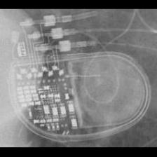 MDT:Syncra</td>
<td align="center" valign="top"><b>Option 1</b>  MDT:Advisa</td>
<td align="center" valign="top"><b>Option 2</b> 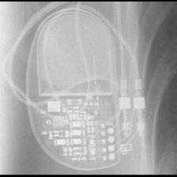 MDT:AT500</td>
<td align="center" valign="top"><b>Option 3</b>  MDT:Insync III</td>
<td align="center" valign="top"><b>✅ Option 4</b>  MDT:Syncra</td>
<td align="center" valign="top"><b>Option 5</b>  MDT:EnRhythm</td>
<td align="center" valign="middle"><b>Option 6</b>  <i>None of the above</i></td>
</tr></table>

### Q3777 · correct: option 1 · `MDT:Syncra`

<table><tr>
<td align="center" valign="top"><b>Query</b> 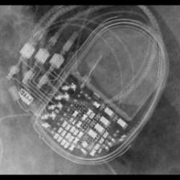 MDT:Syncra</td>
<td align="center" valign="top"><b>✅ Option 1</b>  MDT:Syncra</td>
<td align="center" valign="top"><b>Option 2</b>  MDT:Advisa</td>
<td align="center" valign="top"><b>Option 3</b>  MDT:Insync III</td>
<td align="center" valign="top"><b>Option 4</b>  MDT:EnRhythm</td>
<td align="center" valign="top"><b>Option 5</b>  MDT:AT500</td>
<td align="center" valign="middle"><b>Option 6</b>  <i>None of the above</i></td>
</tr></table>

### Q3778 · correct: option 5 · `MDT:Syncra`

<table><tr>
<td align="center" valign="top"><b>Query</b> 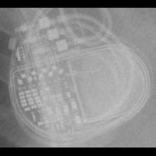 MDT:Syncra</td>
<td align="center" valign="top"><b>Option 1</b>  MDT:AT500</td>
<td align="center" valign="top"><b>Option 2</b>  MDT:Insync III</td>
<td align="center" valign="top"><b>Option 3</b>  MDT:EnRhythm</td>
<td align="center" valign="top"><b>Option 4</b>  MDT:Advisa</td>
<td align="center" valign="top"><b>✅ Option 5</b>  MDT:Syncra</td>
<td align="center" valign="middle"><b>Option 6</b>  <i>None of the above</i></td>
</tr></table>

### Q3779 · correct: option 5 · `MDT:Syncra`

<table><tr>
<td align="center" valign="top"><b>Query</b> 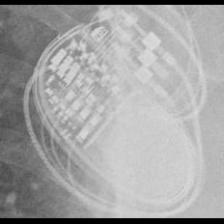 MDT:Syncra</td>
<td align="center" valign="top"><b>Option 1</b>  MDT:AT500</td>
<td align="center" valign="top"><b>Option 2</b>  MDT:EnRhythm</td>
<td align="center" valign="top"><b>Option 3</b>  MDT:Advisa</td>
<td align="center" valign="top"><b>Option 4</b>  MDT:Insync III</td>
<td align="center" valign="top"><b>✅ Option 5</b>  MDT:Syncra</td>
<td align="center" valign="middle"><b>Option 6</b>  <i>None of the above</i></td>
</tr></table>

### Q3780 · correct: option 5 · `MDT:Syncra`

<table><tr>
<td align="center" valign="top"><b>Query</b> 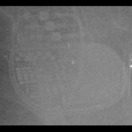 MDT:Syncra</td>
<td align="center" valign="top"><b>Option 1</b> 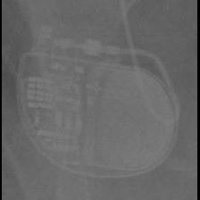 MDT:Advisa</td>
<td align="center" valign="top"><b>Option 2</b>  MDT:EnRhythm</td>
<td align="center" valign="top"><b>Option 3</b>  MDT:AT500</td>
<td align="center" valign="top"><b>Option 4</b>  MDT:Insync III</td>
<td align="center" valign="top"><b>✅ Option 5</b>  MDT:Syncra</td>
<td align="center" valign="middle"><b>Option 6</b>  <i>None of the above</i></td>
</tr></table>

### Q3781 · correct: option 4 · `MDT:Syncra`

<table><tr>
<td align="center" valign="top"><b>Query</b> 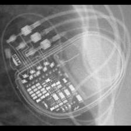 MDT:Syncra</td>
<td align="center" valign="top"><b>Option 1</b>  MDT:Advisa</td>
<td align="center" valign="top"><b>Option 2</b>  MDT:AT500</td>
<td align="center" valign="top"><b>Option 3</b>  MDT:Insync III</td>
<td align="center" valign="top"><b>✅ Option 4</b>  MDT:Syncra</td>
<td align="center" valign="top"><b>Option 5</b>  MDT:EnRhythm</td>
<td align="center" valign="middle"><b>Option 6</b>  <i>None of the above</i></td>
</tr></table>

### Q3782 · correct: option 4 · `MDT:Syncra`

<table><tr>
<td align="center" valign="top"><b>Query</b> 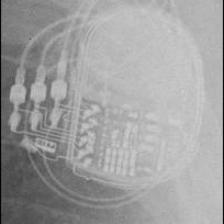 MDT:Syncra</td>
<td align="center" valign="top"><b>Option 1</b>  MDT:EnRhythm</td>
<td align="center" valign="top"><b>Option 2</b>  MDT:Insync III</td>
<td align="center" valign="top"><b>Option 3</b>  BOS:Ingenio</td>
<td align="center" valign="top"><b>✅ Option 4</b>  MDT:Syncra</td>
<td align="center" valign="top"><b>Option 5</b>  MDT:Advisa</td>
<td align="center" valign="middle"><b>Option 6</b>  <i>None of the above</i></td>
</tr></table>

### Q3783 · correct: option 3 · `MDT:Vita II`

<table><tr>
<td align="center" valign="top"><b>Query</b> 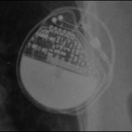 MDT:Vita II</td>
<td align="center" valign="top"><b>Option 1</b>  MDT:AT500</td>
<td align="center" valign="top"><b>Option 2</b>  MDT:Advisa</td>
<td align="center" valign="top"><b>✅ Option 3</b>  MDT:Vita II</td>
<td align="center" valign="top"><b>Option 4</b>  MDT:Syncra</td>
<td align="center" valign="top"><b>Option 5</b>  SOR:Reply</td>
<td align="center" valign="middle"><b>Option 6</b>  <i>None of the above</i></td>
</tr></table>

### Q3784 · correct: option 1 · `MDT:Vita II`

<table><tr>
<td align="center" valign="top"><b>Query</b> 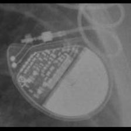 MDT:Vita II</td>
<td align="center" valign="top"><b>✅ Option 1</b>  MDT:Vita II</td>
<td align="center" valign="top"><b>Option 2</b>  SOR:Thesis</td>
<td align="center" valign="top"><b>Option 3</b>  MDT:AT500</td>
<td align="center" valign="top"><b>Option 4</b>  MDT:Syncra</td>
<td align="center" valign="top"><b>Option 5</b>  MDT:C60 DR</td>
<td align="center" valign="middle"><b>Option 6</b>  <i>None of the above</i></td>
</tr></table>

### Q3785 · correct: option 2 · `MDT:Vita II`

<table><tr>
<td align="center" valign="top"><b>Query</b>  MDT:Vita II</td>
<td align="center" valign="top"><b>Option 1</b>  SOR:Elect XS Plus</td>
<td align="center" valign="top"><b>✅ Option 2</b>  MDT:Vita II</td>
<td align="center" valign="top"><b>Option 3</b>  BIO:Cyclos</td>
<td align="center" valign="top"><b>Option 4</b>  SOR:Ovatio</td>
<td align="center" valign="top"><b>Option 5</b>  MDT:Syncra</td>
<td align="center" valign="middle"><b>Option 6</b>  <i>None of the above</i></td>
</tr></table>

### Q3786 · correct: option 3 · `MDT:Vita II`

<table><tr>
<td align="center" valign="top"><b>Query</b>  MDT:Vita II</td>
<td align="center" valign="top"><b>Option 1</b>  SOR:Rhapsody_Symphony</td>
<td align="center" valign="top"><b>Option 2</b>  BIO:Actros_Philos</td>
<td align="center" valign="top"><b>✅ Option 3</b>  MDT:Vita II</td>
<td align="center" valign="top"><b>Option 4</b>  SOR:Thesis</td>
<td align="center" valign="top"><b>Option 5</b>  BOS:Altrua_Insignia</td>
<td align="center" valign="middle"><b>Option 6</b>  <i>None of the above</i></td>
</tr></table>

### Q3787 · correct: option 4 · `MDT:Vita II`

<table><tr>
<td align="center" valign="top"><b>Query</b>  MDT:Vita II</td>
<td align="center" valign="top"><b>Option 1</b>  SOR:Rhapsody_Symphony</td>
<td align="center" valign="top"><b>Option 2</b>  SOR:Thesis</td>
<td align="center" valign="top"><b>Option 3</b>  SOR:Reply</td>
<td align="center" valign="top"><b>✅ Option 4</b>  MDT:Vita II</td>
<td align="center" valign="top"><b>Option 5</b>  BIO:Actros_Philos</td>
<td align="center" valign="middle"><b>Option 6</b>  <i>None of the above</i></td>
</tr></table>

### Q3788 · correct: option 6 (None of the above)

<table><tr>
<td align="center" valign="top"><b>Query</b>  SOR:Elect</td>
<td align="center" valign="top"><b>Option 1</b>  STJ:Victory</td>
<td align="center" valign="top"><b>Option 2</b>  MDT:Adapta_Kappa_Sensia_Versa</td>
<td align="center" valign="top"><b>Option 3</b>  BOS:ContakTR_Discovery_Meridian_Pulsar Max</td>
<td align="center" valign="top"><b>Option 4</b>  BOS:Emblem</td>
<td align="center" valign="top"><b>Option 5</b>  MDT:Sigma</td>
<td align="center" valign="middle"><b>✅ Option 6</b>  <i>None of the above</i></td>
</tr></table>

### Q3789 · correct: option 5 · `SOR:Elect`

<table><tr>
<td align="center" valign="top"><b>Query</b>  SOR:Elect</td>
<td align="center" valign="top"><b>Option 1</b>  SOR:Thesis</td>
<td align="center" valign="top"><b>Option 2</b>  BOS:Ventak Prizm</td>
<td align="center" valign="top"><b>Option 3</b>  SOR:Reply</td>
<td align="center" valign="top"><b>Option 4</b>  SOR:Elect XS Plus</td>
<td align="center" valign="top"><b>✅ Option 5</b>  SOR:Elect</td>
<td align="center" valign="middle"><b>Option 6</b>  <i>None of the above</i></td>
</tr></table>

### Q3790 · correct: option 2 · `SOR:Elect`

<table><tr>
<td align="center" valign="top"><b>Query</b>  SOR:Elect</td>
<td align="center" valign="top"><b>Option 1</b>  SOR:Neway</td>
<td align="center" valign="top"><b>✅ Option 2</b>  SOR:Elect</td>
<td align="center" valign="top"><b>Option 3</b>  BOS:Ventak Prizm</td>
<td align="center" valign="top"><b>Option 4</b>  SOR:Elect XS Plus</td>
<td align="center" valign="top"><b>Option 5</b>  SOR:MiniSwing</td>
<td align="center" valign="middle"><b>Option 6</b>  <i>None of the above</i></td>
</tr></table>

### Q3791 · correct: option 5 · `SOR:Elect`

<table><tr>
<td align="center" valign="top"><b>Query</b>  SOR:Elect</td>
<td align="center" valign="top"><b>Option 1</b>  SOR:Neway</td>
<td align="center" valign="top"><b>Option 2</b>  SOR:MiniSwing</td>
<td align="center" valign="top"><b>Option 3</b>  SOR:Elect XS Plus</td>
<td align="center" valign="top"><b>Option 4</b>  BOS:Ingenio</td>
<td align="center" valign="top"><b>✅ Option 5</b>  SOR:Elect</td>
<td align="center" valign="middle"><b>Option 6</b>  <i>None of the above</i></td>
</tr></table>

### Q3792 · correct: option 3 · `SOR:Elect`

<table><tr>
<td align="center" valign="top"><b>Query</b>  SOR:Elect</td>
<td align="center" valign="top"><b>Option 1</b>  SOR:MiniSwing</td>
<td align="center" valign="top"><b>Option 2</b>  SOR:Neway</td>
<td align="center" valign="top"><b>✅ Option 3</b>  SOR:Elect</td>
<td align="center" valign="top"><b>Option 4</b>  SOR:Elect XS Plus</td>
<td align="center" valign="top"><b>Option 5</b>  SOR:Rhapsody_Symphony</td>
<td align="center" valign="middle"><b>Option 6</b>  <i>None of the above</i></td>
</tr></table>

### Q3793 · correct: option 5 · `SOR:Elect`

<table><tr>
<td align="center" valign="top"><b>Query</b>  SOR:Elect</td>
<td align="center" valign="top"><b>Option 1</b>  SOR:MiniSwing</td>
<td align="center" valign="top"><b>Option 2</b>  SOR:Thesis</td>
<td align="center" valign="top"><b>Option 3</b>  SOR:Elect XS Plus</td>
<td align="center" valign="top"><b>Option 4</b>  SOR:Neway</td>
<td align="center" valign="top"><b>✅ Option 5</b>  SOR:Elect</td>
<td align="center" valign="middle"><b>Option 6</b>  <i>None of the above</i></td>
</tr></table>

