# Pacemakers (Howard et al.) · query set `train2` · page 5/6

[← all pages](README.md)

### Q3794 · correct: option 2 · `SOR:Elect`

<table><tr>
<td align="center" valign="top"><b>Query</b> 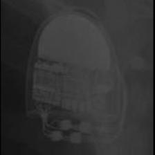 SOR:Elect</td>
<td align="center" valign="top"><b>Option 1</b>  SOR:Elect XS Plus</td>
<td align="center" valign="top"><b>✅ Option 2</b>  SOR:Elect</td>
<td align="center" valign="top"><b>Option 3</b> 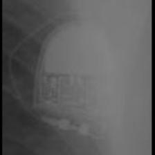 SOR:Thesis</td>
<td align="center" valign="top"><b>Option 4</b>  SOR:MiniSwing</td>
<td align="center" valign="top"><b>Option 5</b> 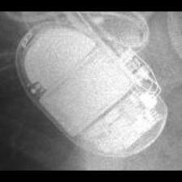 BOS:Ventak Prizm</td>
<td align="center" valign="middle"><b>Option 6</b>  <i>None of the above</i></td>
</tr></table>

### Q3795 · correct: option 2 · `SOR:Elect XS Plus`

<table><tr>
<td align="center" valign="top"><b>Query</b> 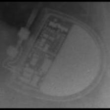 SOR:Elect XS Plus</td>
<td align="center" valign="top"><b>Option 1</b> 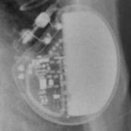 MDT:C20_T20</td>
<td align="center" valign="top"><b>✅ Option 2</b>  SOR:Elect XS Plus</td>
<td align="center" valign="top"><b>Option 3</b>  SOR:Thesis</td>
<td align="center" valign="top"><b>Option 4</b>  SOR:Elect</td>
<td align="center" valign="top"><b>Option 5</b>  BOS:Altrua_Insignia</td>
<td align="center" valign="middle"><b>Option 6</b>  <i>None of the above</i></td>
</tr></table>

### Q3796 · correct: option 5 · `SOR:Elect XS Plus`

<table><tr>
<td align="center" valign="top"><b>Query</b> 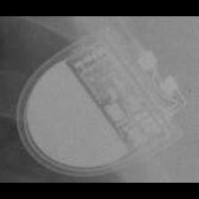 SOR:Elect XS Plus</td>
<td align="center" valign="top"><b>Option 1</b> 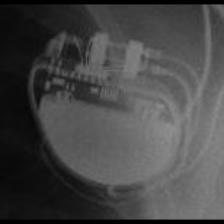 BOS:Altrua_Insignia</td>
<td align="center" valign="top"><b>Option 2</b> 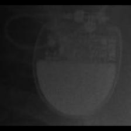 SOR:Rhapsody_Symphony</td>
<td align="center" valign="top"><b>Option 3</b> 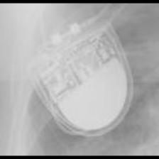 SOR:Thesis</td>
<td align="center" valign="top"><b>Option 4</b>  SOR:Elect</td>
<td align="center" valign="top"><b>✅ Option 5</b>  SOR:Elect XS Plus</td>
<td align="center" valign="middle"><b>Option 6</b>  <i>None of the above</i></td>
</tr></table>

### Q3797 · correct: option 2 · `SOR:Elect XS Plus`

<table><tr>
<td align="center" valign="top"><b>Query</b> 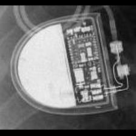 SOR:Elect XS Plus</td>
<td align="center" valign="top"><b>Option 1</b>  SOR:MiniSwing</td>
<td align="center" valign="top"><b>✅ Option 2</b>  SOR:Elect XS Plus</td>
<td align="center" valign="top"><b>Option 3</b> 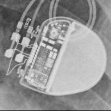 BOS:Ingenio</td>
<td align="center" valign="top"><b>Option 4</b>  BOS:Altrua_Insignia</td>
<td align="center" valign="top"><b>Option 5</b>  SOR:Elect</td>
<td align="center" valign="middle"><b>Option 6</b>  <i>None of the above</i></td>
</tr></table>

### Q3798 · correct: option 3 · `SOR:Elect XS Plus`

<table><tr>
<td align="center" valign="top"><b>Query</b> 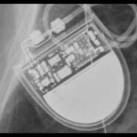 SOR:Elect XS Plus</td>
<td align="center" valign="top"><b>Option 1</b>  SOR:Elect</td>
<td align="center" valign="top"><b>Option 2</b>  SOR:Thesis</td>
<td align="center" valign="top"><b>✅ Option 3</b>  SOR:Elect XS Plus</td>
<td align="center" valign="top"><b>Option 4</b>  SOR:MiniSwing</td>
<td align="center" valign="top"><b>Option 5</b> 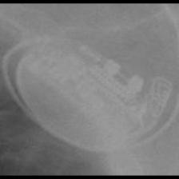 BOS:Proponent</td>
<td align="center" valign="middle"><b>Option 6</b>  <i>None of the above</i></td>
</tr></table>

### Q3799 · correct: option 1 · `SOR:Elect XS Plus`

<table><tr>
<td align="center" valign="top"><b>Query</b> 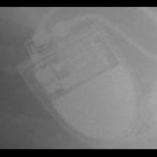 SOR:Elect XS Plus</td>
<td align="center" valign="top"><b>✅ Option 1</b>  SOR:Elect XS Plus</td>
<td align="center" valign="top"><b>Option 2</b>  MDT:Maximo</td>
<td align="center" valign="top"><b>Option 3</b>  SOR:Thesis</td>
<td align="center" valign="top"><b>Option 4</b>  BOS:Ventak Prizm</td>
<td align="center" valign="top"><b>Option 5</b>  SOR:Elect</td>
<td align="center" valign="middle"><b>Option 6</b>  <i>None of the above</i></td>
</tr></table>

### Q3800 · correct: option 1 · `SOR:MiniSwing`

<table><tr>
<td align="center" valign="top"><b>Query</b> 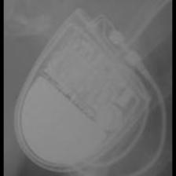 SOR:MiniSwing</td>
<td align="center" valign="top"><b>✅ Option 1</b>  SOR:MiniSwing</td>
<td align="center" valign="top"><b>Option 2</b>  SOR:Thesis</td>
<td align="center" valign="top"><b>Option 3</b>  BOS:Ventak Prizm</td>
<td align="center" valign="top"><b>Option 4</b>  SOR:Elect</td>
<td align="center" valign="top"><b>Option 5</b>  SOR:Elect XS Plus</td>
<td align="center" valign="middle"><b>Option 6</b>  <i>None of the above</i></td>
</tr></table>

### Q3801 · correct: option 1 · `SOR:MiniSwing`

<table><tr>
<td align="center" valign="top"><b>Query</b> 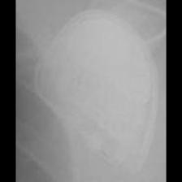 SOR:MiniSwing</td>
<td align="center" valign="top"><b>✅ Option 1</b>  SOR:MiniSwing</td>
<td align="center" valign="top"><b>Option 2</b> 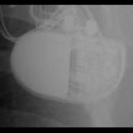 BOS:ContakTR_Discovery_Meridian_Pulsar Max</td>
<td align="center" valign="top"><b>Option 3</b>  SOR:Thesis</td>
<td align="center" valign="top"><b>Option 4</b>  BOS:Emblem</td>
<td align="center" valign="top"><b>Option 5</b>  SOR:Elect XS Plus</td>
<td align="center" valign="middle"><b>Option 6</b>  <i>None of the above</i></td>
</tr></table>

### Q3802 · correct: option 1 · `SOR:MiniSwing`

<table><tr>
<td align="center" valign="top"><b>Query</b> 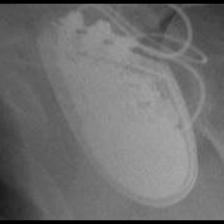 SOR:MiniSwing</td>
<td align="center" valign="top"><b>✅ Option 1</b> 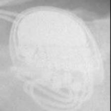 SOR:MiniSwing</td>
<td align="center" valign="top"><b>Option 2</b>  BIO:Evia</td>
<td align="center" valign="top"><b>Option 3</b> 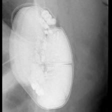 BOS:Emblem</td>
<td align="center" valign="top"><b>Option 4</b>  SOR:Thesis</td>
<td align="center" valign="top"><b>Option 5</b>  STJ:Quadra Assura_Unify</td>
<td align="center" valign="middle"><b>Option 6</b>  <i>None of the above</i></td>
</tr></table>

### Q3803 · correct: option 3 · `SOR:MiniSwing`

<table><tr>
<td align="center" valign="top"><b>Query</b> 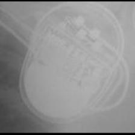 SOR:MiniSwing</td>
<td align="center" valign="top"><b>Option 1</b>  BOS:Proponent</td>
<td align="center" valign="top"><b>Option 2</b> 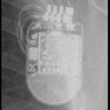 STJ:Quadra Assura_Unify</td>
<td align="center" valign="top"><b>✅ Option 3</b>  SOR:MiniSwing</td>
<td align="center" valign="top"><b>Option 4</b>  SOR:Thesis</td>
<td align="center" valign="top"><b>Option 5</b>  SOR:Elect XS Plus</td>
<td align="center" valign="middle"><b>Option 6</b>  <i>None of the above</i></td>
</tr></table>

### Q3804 · correct: option 3 · `SOR:MiniSwing`

<table><tr>
<td align="center" valign="top"><b>Query</b> 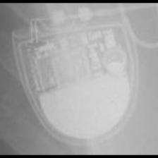 SOR:MiniSwing</td>
<td align="center" valign="top"><b>Option 1</b>  SOR:Elect XS Plus</td>
<td align="center" valign="top"><b>Option 2</b>  SOR:Thesis</td>
<td align="center" valign="top"><b>✅ Option 3</b>  SOR:MiniSwing</td>
<td align="center" valign="top"><b>Option 4</b>  SOR:Rhapsody_Symphony</td>
<td align="center" valign="top"><b>Option 5</b>  MDT:Claria_Evera_Viva</td>
<td align="center" valign="middle"><b>Option 6</b>  <i>None of the above</i></td>
</tr></table>

### Q3805 · correct: option 2 · `SOR:Neway`

<table><tr>
<td align="center" valign="top"><b>Query</b>  SOR:Neway</td>
<td align="center" valign="top"><b>Option 1</b>  SOR:Elect</td>
<td align="center" valign="top"><b>✅ Option 2</b>  SOR:Neway</td>
<td align="center" valign="top"><b>Option 3</b>  SOR:MiniSwing</td>
<td align="center" valign="top"><b>Option 4</b> 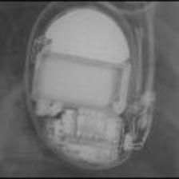 BOS:Ventak Prizm</td>
<td align="center" valign="top"><b>Option 5</b> 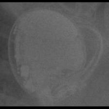 BOS:Vitality</td>
<td align="center" valign="middle"><b>Option 6</b>  <i>None of the above</i></td>
</tr></table>

### Q3806 · correct: option 1 · `SOR:Neway`

<table><tr>
<td align="center" valign="top"><b>Query</b> 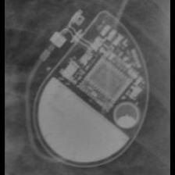 SOR:Neway</td>
<td align="center" valign="top"><b>✅ Option 1</b> 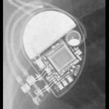 SOR:Neway</td>
<td align="center" valign="top"><b>Option 2</b>  SOR:MiniSwing</td>
<td align="center" valign="top"><b>Option 3</b>  SOR:Rhapsody_Symphony</td>
<td align="center" valign="top"><b>Option 4</b>  STJ:Victory</td>
<td align="center" valign="top"><b>Option 5</b>  SOR:Elect</td>
<td align="center" valign="middle"><b>Option 6</b>  <i>None of the above</i></td>
</tr></table>

### Q3807 · correct: option 3 · `SOR:Neway`

<table><tr>
<td align="center" valign="top"><b>Query</b> 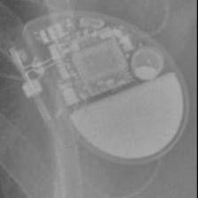 SOR:Neway</td>
<td align="center" valign="top"><b>Option 1</b>  SOR:MiniSwing</td>
<td align="center" valign="top"><b>Option 2</b>  SOR:Elect</td>
<td align="center" valign="top"><b>✅ Option 3</b>  SOR:Neway</td>
<td align="center" valign="top"><b>Option 4</b> 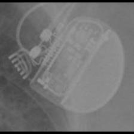 BOS:Proponent</td>
<td align="center" valign="top"><b>Option 5</b> 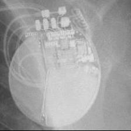 BOS:Autogen_Teligen_Energen_Cognis</td>
<td align="center" valign="middle"><b>Option 6</b>  <i>None of the above</i></td>
</tr></table>

### Q3808 · correct: option 2 · `SOR:Neway`

<table><tr>
<td align="center" valign="top"><b>Query</b> 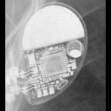 SOR:Neway</td>
<td align="center" valign="top"><b>Option 1</b> 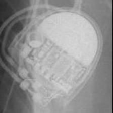 SOR:MiniSwing</td>
<td align="center" valign="top"><b>✅ Option 2</b> 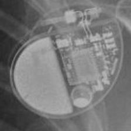 SOR:Neway</td>
<td align="center" valign="top"><b>Option 3</b>  BOS:Ventak Prizm</td>
<td align="center" valign="top"><b>Option 4</b>  BOS:Vitality</td>
<td align="center" valign="top"><b>Option 5</b>  SOR:Elect</td>
<td align="center" valign="middle"><b>Option 6</b>  <i>None of the above</i></td>
</tr></table>

### Q3809 · correct: option 1 · `SOR:Neway`

<table><tr>
<td align="center" valign="top"><b>Query</b> 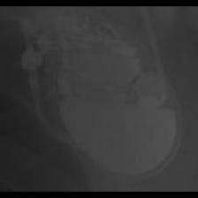 SOR:Neway</td>
<td align="center" valign="top"><b>✅ Option 1</b>  SOR:Neway</td>
<td align="center" valign="top"><b>Option 2</b>  SOR:Rhapsody_Symphony</td>
<td align="center" valign="top"><b>Option 3</b>  MDT:C20_T20</td>
<td align="center" valign="top"><b>Option 4</b>  BOS:Emblem</td>
<td align="center" valign="top"><b>Option 5</b>  SOR:Thesis</td>
<td align="center" valign="middle"><b>Option 6</b>  <i>None of the above</i></td>
</tr></table>

### Q3810 · correct: option 2 · `SOR:Neway`

<table><tr>
<td align="center" valign="top"><b>Query</b> 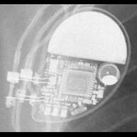 SOR:Neway</td>
<td align="center" valign="top"><b>Option 1</b>  SOR:Elect</td>
<td align="center" valign="top"><b>✅ Option 2</b>  SOR:Neway</td>
<td align="center" valign="top"><b>Option 3</b>  BOS:Ventak Prizm</td>
<td align="center" valign="top"><b>Option 4</b>  SOR:MiniSwing</td>
<td align="center" valign="top"><b>Option 5</b>  SOR:Elect XS Plus</td>
<td align="center" valign="middle"><b>Option 6</b>  <i>None of the above</i></td>
</tr></table>

### Q3811 · correct: option 2 · `SOR:Ovatio`

<table><tr>
<td align="center" valign="top"><b>Query</b> 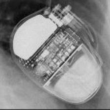 SOR:Ovatio</td>
<td align="center" valign="top"><b>Option 1</b> 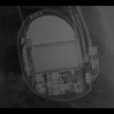 BOS:Ventak Prizm</td>
<td align="center" valign="top"><b>✅ Option 2</b>  SOR:Ovatio</td>
<td align="center" valign="top"><b>Option 3</b>  BOS:Emblem</td>
<td align="center" valign="top"><b>Option 4</b>  SOR:Reply</td>
<td align="center" valign="top"><b>Option 5</b> 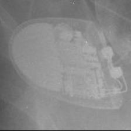 SOR:Elect</td>
<td align="center" valign="middle"><b>Option 6</b>  <i>None of the above</i></td>
</tr></table>

### Q3812 · correct: option 1 · `SOR:Ovatio`

<table><tr>
<td align="center" valign="top"><b>Query</b> 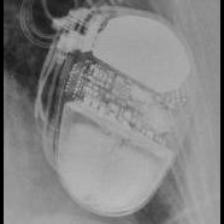 SOR:Ovatio</td>
<td align="center" valign="top"><b>✅ Option 1</b> 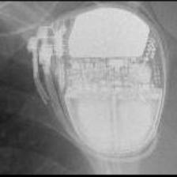 SOR:Ovatio</td>
<td align="center" valign="top"><b>Option 2</b>  SOR:Reply</td>
<td align="center" valign="top"><b>Option 3</b>  BOS:Ventak Prizm</td>
<td align="center" valign="top"><b>Option 4</b>  MDT:Vita II</td>
<td align="center" valign="top"><b>Option 5</b>  BOS:Emblem</td>
<td align="center" valign="middle"><b>Option 6</b>  <i>None of the above</i></td>
</tr></table>

### Q3813 · correct: option 1 · `SOR:Ovatio`

<table><tr>
<td align="center" valign="top"><b>Query</b> 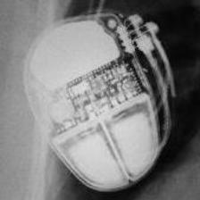 SOR:Ovatio</td>
<td align="center" valign="top"><b>✅ Option 1</b>  SOR:Ovatio</td>
<td align="center" valign="top"><b>Option 2</b>  SOR:MiniSwing</td>
<td align="center" valign="top"><b>Option 3</b>  BOS:Ventak Prizm</td>
<td align="center" valign="top"><b>Option 4</b>  SOR:Thesis</td>
<td align="center" valign="top"><b>Option 5</b>  BOS:Emblem</td>
<td align="center" valign="middle"><b>Option 6</b>  <i>None of the above</i></td>
</tr></table>

### Q3814 · correct: option 3 · `SOR:Ovatio`

<table><tr>
<td align="center" valign="top"><b>Query</b> 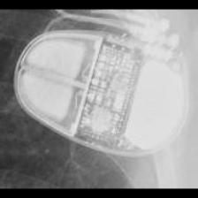 SOR:Ovatio</td>
<td align="center" valign="top"><b>Option 1</b> 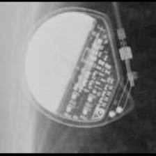 MDT:Vita II</td>
<td align="center" valign="top"><b>Option 2</b>  SOR:Elect XS Plus</td>
<td align="center" valign="top"><b>✅ Option 3</b> 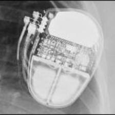 SOR:Ovatio</td>
<td align="center" valign="top"><b>Option 4</b> 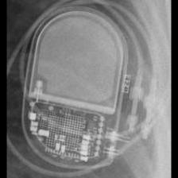 BIO:Evia</td>
<td align="center" valign="top"><b>Option 5</b>  BOS:Ventak Prizm</td>
<td align="center" valign="middle"><b>Option 6</b>  <i>None of the above</i></td>
</tr></table>

### Q3815 · correct: option 2 · `SOR:Reply`

<table><tr>
<td align="center" valign="top"><b>Query</b> 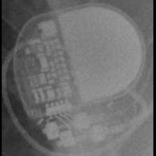 SOR:Reply</td>
<td align="center" valign="top"><b>Option 1</b>  BOS:Vitality</td>
<td align="center" valign="top"><b>✅ Option 2</b>  SOR:Reply</td>
<td align="center" valign="top"><b>Option 3</b>  MDT:C60 DR</td>
<td align="center" valign="top"><b>Option 4</b>  BOS:Ventak Prizm</td>
<td align="center" valign="top"><b>Option 5</b> 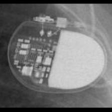 MDT:Adapta_Kappa_Sensia_Versa</td>
<td align="center" valign="middle"><b>Option 6</b>  <i>None of the above</i></td>
</tr></table>

### Q3816 · correct: option 4 · `SOR:Reply`

<table><tr>
<td align="center" valign="top"><b>Query</b> 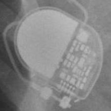 SOR:Reply</td>
<td align="center" valign="top"><b>Option 1</b>  MDT:Sigma</td>
<td align="center" valign="top"><b>Option 2</b>  BIO:Actros_Philos</td>
<td align="center" valign="top"><b>Option 3</b>  MDT:Adapta_Kappa_Sensia_Versa</td>
<td align="center" valign="top"><b>✅ Option 4</b>  SOR:Reply</td>
<td align="center" valign="top"><b>Option 5</b>  BOS:ContakTR_Discovery_Meridian_Pulsar Max</td>
<td align="center" valign="middle"><b>Option 6</b>  <i>None of the above</i></td>
</tr></table>

### Q3817 · correct: option 6 (None of the above)

<table><tr>
<td align="center" valign="top"><b>Query</b>  SOR:Reply</td>
<td align="center" valign="top"><b>Option 1</b> 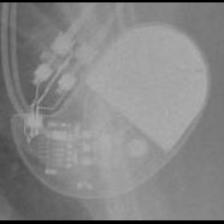 STJ:Identity</td>
<td align="center" valign="top"><b>Option 2</b>  BOS:ContakTR_Discovery_Meridian_Pulsar Max</td>
<td align="center" valign="top"><b>Option 3</b> 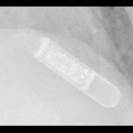 MDT:REVEAL LINQ</td>
<td align="center" valign="top"><b>Option 4</b>  SOR:Thesis</td>
<td align="center" valign="top"><b>Option 5</b>  STJ:Zephyr</td>
<td align="center" valign="middle"><b>✅ Option 6</b>  <i>None of the above</i></td>
</tr></table>

### Q3818 · correct: option 4 · `SOR:Reply`

<table><tr>
<td align="center" valign="top"><b>Query</b>  SOR:Reply</td>
<td align="center" valign="top"><b>Option 1</b>  MDT:Adapta_Kappa_Sensia_Versa</td>
<td align="center" valign="top"><b>Option 2</b>  MDT:AT500</td>
<td align="center" valign="top"><b>Option 3</b>  MDT:Sigma</td>
<td align="center" valign="top"><b>✅ Option 4</b>  SOR:Reply</td>
<td align="center" valign="top"><b>Option 5</b>  BOS:ContakTR_Discovery_Meridian_Pulsar Max</td>
<td align="center" valign="middle"><b>Option 6</b>  <i>None of the above</i></td>
</tr></table>

### Q3819 · correct: option 4 · `SOR:Reply`

<table><tr>
<td align="center" valign="top"><b>Query</b>  SOR:Reply</td>
<td align="center" valign="top"><b>Option 1</b>  MDT:Adapta_Kappa_Sensia_Versa</td>
<td align="center" valign="top"><b>Option 2</b>  MDT:Sigma</td>
<td align="center" valign="top"><b>Option 3</b>  STJ:Zephyr</td>
<td align="center" valign="top"><b>✅ Option 4</b>  SOR:Reply</td>
<td align="center" valign="top"><b>Option 5</b>  BIO:Actros_Philos</td>
<td align="center" valign="middle"><b>Option 6</b>  <i>None of the above</i></td>
</tr></table>

### Q3820 · correct: option 1 · `SOR:Reply`

<table><tr>
<td align="center" valign="top"><b>Query</b>  SOR:Reply</td>
<td align="center" valign="top"><b>✅ Option 1</b>  SOR:Reply</td>
<td align="center" valign="top"><b>Option 2</b>  MDT:Sigma</td>
<td align="center" valign="top"><b>Option 3</b>  STJ:Zephyr</td>
<td align="center" valign="top"><b>Option 4</b>  MDT:Adapta_Kappa_Sensia_Versa</td>
<td align="center" valign="top"><b>Option 5</b>  STJ:Identity</td>
<td align="center" valign="middle"><b>Option 6</b>  <i>None of the above</i></td>
</tr></table>

### Q3821 · correct: option 1 · `SOR:Reply`

<table><tr>
<td align="center" valign="top"><b>Query</b>  SOR:Reply</td>
<td align="center" valign="top"><b>✅ Option 1</b>  SOR:Reply</td>
<td align="center" valign="top"><b>Option 2</b>  BIO:Actros_Philos</td>
<td align="center" valign="top"><b>Option 3</b>  BOS:ContakTR_Discovery_Meridian_Pulsar Max</td>
<td align="center" valign="top"><b>Option 4</b>  SOR:MiniSwing</td>
<td align="center" valign="top"><b>Option 5</b>  MDT:Vita II</td>
<td align="center" valign="middle"><b>Option 6</b>  <i>None of the above</i></td>
</tr></table>

### Q3822 · correct: option 2 · `SOR:Rhapsody_Symphony`

<table><tr>
<td align="center" valign="top"><b>Query</b>  SOR:Rhapsody_Symphony</td>
<td align="center" valign="top"><b>Option 1</b>  MDT:Sigma</td>
<td align="center" valign="top"><b>✅ Option 2</b>  SOR:Rhapsody_Symphony</td>
<td align="center" valign="top"><b>Option 3</b>  MDT:Adapta_Kappa_Sensia_Versa</td>
<td align="center" valign="top"><b>Option 4</b>  MDT:C20_T20</td>
<td align="center" valign="top"><b>Option 5</b>  STJ:Victory</td>
<td align="center" valign="middle"><b>Option 6</b>  <i>None of the above</i></td>
</tr></table>

### Q3823 · correct: option 4 · `SOR:Rhapsody_Symphony`

<table><tr>
<td align="center" valign="top"><b>Query</b>  SOR:Rhapsody_Symphony</td>
<td align="center" valign="top"><b>Option 1</b>  SOR:Neway</td>
<td align="center" valign="top"><b>Option 2</b>  MDT:REVEAL</td>
<td align="center" valign="top"><b>Option 3</b>  BOS:Altrua_Insignia</td>
<td align="center" valign="top"><b>✅ Option 4</b>  SOR:Rhapsody_Symphony</td>
<td align="center" valign="top"><b>Option 5</b>  BOS:Emblem</td>
<td align="center" valign="middle"><b>Option 6</b>  <i>None of the above</i></td>
</tr></table>

### Q3824 · correct: option 3 · `SOR:Rhapsody_Symphony`

<table><tr>
<td align="center" valign="top"><b>Query</b>  SOR:Rhapsody_Symphony</td>
<td align="center" valign="top"><b>Option 1</b>  SOR:Thesis</td>
<td align="center" valign="top"><b>Option 2</b>  BOS:Emblem</td>
<td align="center" valign="top"><b>✅ Option 3</b>  SOR:Rhapsody_Symphony</td>
<td align="center" valign="top"><b>Option 4</b>  BOS:ContakTR_Discovery_Meridian_Pulsar Max</td>
<td align="center" valign="top"><b>Option 5</b>  MDT:C20_T20</td>
<td align="center" valign="middle"><b>Option 6</b>  <i>None of the above</i></td>
</tr></table>

### Q3825 · correct: option 4 · `SOR:Rhapsody_Symphony`

<table><tr>
<td align="center" valign="top"><b>Query</b>  SOR:Rhapsody_Symphony</td>
<td align="center" valign="top"><b>Option 1</b>  MDT:C20_T20</td>
<td align="center" valign="top"><b>Option 2</b>  BOS:ContakTR_Discovery_Meridian_Pulsar Max</td>
<td align="center" valign="top"><b>Option 3</b>  MDT:C60 DR</td>
<td align="center" valign="top"><b>✅ Option 4</b>  SOR:Rhapsody_Symphony</td>
<td align="center" valign="top"><b>Option 5</b>  MDT:Adapta_Kappa_Sensia_Versa</td>
<td align="center" valign="middle"><b>Option 6</b>  <i>None of the above</i></td>
</tr></table>

### Q3826 · correct: option 4 · `SOR:Rhapsody_Symphony`

<table><tr>
<td align="center" valign="top"><b>Query</b>  SOR:Rhapsody_Symphony</td>
<td align="center" valign="top"><b>Option 1</b>  SOR:Neway</td>
<td align="center" valign="top"><b>Option 2</b>  SOR:MiniSwing</td>
<td align="center" valign="top"><b>Option 3</b>  SOR:Elect XS Plus</td>
<td align="center" valign="top"><b>✅ Option 4</b>  SOR:Rhapsody_Symphony</td>
<td align="center" valign="top"><b>Option 5</b>  MDT:Sigma</td>
<td align="center" valign="middle"><b>Option 6</b>  <i>None of the above</i></td>
</tr></table>

### Q3827 · correct: option 4 · `SOR:Rhapsody_Symphony`

<table><tr>
<td align="center" valign="top"><b>Query</b>  SOR:Rhapsody_Symphony</td>
<td align="center" valign="top"><b>Option 1</b>  SOR:Neway</td>
<td align="center" valign="top"><b>Option 2</b>  BOS:Emblem</td>
<td align="center" valign="top"><b>Option 3</b>  SOR:MiniSwing</td>
<td align="center" valign="top"><b>✅ Option 4</b>  SOR:Rhapsody_Symphony</td>
<td align="center" valign="top"><b>Option 5</b>  MDT:Adapta_Kappa_Sensia_Versa</td>
<td align="center" valign="middle"><b>Option 6</b>  <i>None of the above</i></td>
</tr></table>

### Q3828 · correct: option 2 · `SOR:Rhapsody_Symphony`

<table><tr>
<td align="center" valign="top"><b>Query</b>  SOR:Rhapsody_Symphony</td>
<td align="center" valign="top"><b>Option 1</b>  STJ:Accent</td>
<td align="center" valign="top"><b>✅ Option 2</b>  SOR:Rhapsody_Symphony</td>
<td align="center" valign="top"><b>Option 3</b>  SOR:Elect XS Plus</td>
<td align="center" valign="top"><b>Option 4</b>  BOS:Altrua_Insignia</td>
<td align="center" valign="top"><b>Option 5</b>  SOR:Neway</td>
<td align="center" valign="middle"><b>Option 6</b>  <i>None of the above</i></td>
</tr></table>

### Q3829 · correct: option 2 · `SOR:Thesis`

<table><tr>
<td align="center" valign="top"><b>Query</b>  SOR:Thesis</td>
<td align="center" valign="top"><b>Option 1</b>  SOR:Elect XS Plus</td>
<td align="center" valign="top"><b>✅ Option 2</b>  SOR:Thesis</td>
<td align="center" valign="top"><b>Option 3</b>  MDT:Vita II</td>
<td align="center" valign="top"><b>Option 4</b>  BOS:ContakTR_Discovery_Meridian_Pulsar Max</td>
<td align="center" valign="top"><b>Option 5</b>  MDT:C20_T20</td>
<td align="center" valign="middle"><b>Option 6</b>  <i>None of the above</i></td>
</tr></table>

### Q3830 · correct: option 5 · `SOR:Thesis`

<table><tr>
<td align="center" valign="top"><b>Query</b>  SOR:Thesis</td>
<td align="center" valign="top"><b>Option 1</b>  SOR:Elect</td>
<td align="center" valign="top"><b>Option 2</b>  SOR:Elect XS Plus</td>
<td align="center" valign="top"><b>Option 3</b>  BOS:Ventak Prizm</td>
<td align="center" valign="top"><b>Option 4</b>  SOR:MiniSwing</td>
<td align="center" valign="top"><b>✅ Option 5</b>  SOR:Thesis</td>
<td align="center" valign="middle"><b>Option 6</b>  <i>None of the above</i></td>
</tr></table>

### Q3831 · correct: option 4 · `SOR:Thesis`

<table><tr>
<td align="center" valign="top"><b>Query</b>  SOR:Thesis</td>
<td align="center" valign="top"><b>Option 1</b>  SOR:Reply</td>
<td align="center" valign="top"><b>Option 2</b>  BOS:ContakTR_Discovery_Meridian_Pulsar Max</td>
<td align="center" valign="top"><b>Option 3</b>  SOR:Elect XS Plus</td>
<td align="center" valign="top"><b>✅ Option 4</b>  SOR:Thesis</td>
<td align="center" valign="top"><b>Option 5</b>  BIO:Actros_Philos</td>
<td align="center" valign="middle"><b>Option 6</b>  <i>None of the above</i></td>
</tr></table>

### Q3832 · correct: option 3 · `SOR:Thesis`

<table><tr>
<td align="center" valign="top"><b>Query</b>  SOR:Thesis</td>
<td align="center" valign="top"><b>Option 1</b>  SOR:Rhapsody_Symphony</td>
<td align="center" valign="top"><b>Option 2</b>  MDT:AT500</td>
<td align="center" valign="top"><b>✅ Option 3</b>  SOR:Thesis</td>
<td align="center" valign="top"><b>Option 4</b>  BOS:ContakTR_Discovery_Meridian_Pulsar Max</td>
<td align="center" valign="top"><b>Option 5</b>  SOR:Elect XS Plus</td>
<td align="center" valign="middle"><b>Option 6</b>  <i>None of the above</i></td>
</tr></table>

### Q3833 · correct: option 2 · `SOR:Thesis`

<table><tr>
<td align="center" valign="top"><b>Query</b>  SOR:Thesis</td>
<td align="center" valign="top"><b>Option 1</b>  SOR:Rhapsody_Symphony</td>
<td align="center" valign="top"><b>✅ Option 2</b>  SOR:Thesis</td>
<td align="center" valign="top"><b>Option 3</b>  SOR:Elect XS Plus</td>
<td align="center" valign="top"><b>Option 4</b>  BIO:Actros_Philos</td>
<td align="center" valign="top"><b>Option 5</b>  SOR:Ovatio</td>
<td align="center" valign="middle"><b>Option 6</b>  <i>None of the above</i></td>
</tr></table>

### Q3834 · correct: option 5 · `SOR:Thesis`

<table><tr>
<td align="center" valign="top"><b>Query</b>  SOR:Thesis</td>
<td align="center" valign="top"><b>Option 1</b>  BOS:Ventak Prizm</td>
<td align="center" valign="top"><b>Option 2</b>  SOR:Rhapsody_Symphony</td>
<td align="center" valign="top"><b>Option 3</b>  BIO:Actros_Philos</td>
<td align="center" valign="top"><b>Option 4</b>  SOR:Elect XS Plus</td>
<td align="center" valign="top"><b>✅ Option 5</b>  SOR:Thesis</td>
<td align="center" valign="middle"><b>Option 6</b>  <i>None of the above</i></td>
</tr></table>

### Q3835 · correct: option 1 · `STJ:Accent`

<table><tr>
<td align="center" valign="top"><b>Query</b>  STJ:Accent</td>
<td align="center" valign="top"><b>✅ Option 1</b>  STJ:Accent</td>
<td align="center" valign="top"><b>Option 2</b>  MDT:Azure</td>
<td align="center" valign="top"><b>Option 3</b>  BIO:Evia</td>
<td align="center" valign="top"><b>Option 4</b>  MDT:EnRhythm</td>
<td align="center" valign="top"><b>Option 5</b>  MDT:AT500</td>
<td align="center" valign="middle"><b>Option 6</b>  <i>None of the above</i></td>
</tr></table>

### Q3836 · correct: option 1 · `STJ:Accent`

<table><tr>
<td align="center" valign="top"><b>Query</b>  STJ:Accent</td>
<td align="center" valign="top"><b>✅ Option 1</b>  STJ:Accent</td>
<td align="center" valign="top"><b>Option 2</b>  STJ:Identity</td>
<td align="center" valign="top"><b>Option 3</b>  MDT:AT500</td>
<td align="center" valign="top"><b>Option 4</b>  STJ:Allure Quadra</td>
<td align="center" valign="top"><b>Option 5</b>  MDT:Advisa</td>
<td align="center" valign="middle"><b>Option 6</b>  <i>None of the above</i></td>
</tr></table>

### Q3837 · correct: option 5 · `STJ:Accent`

<table><tr>
<td align="center" valign="top"><b>Query</b>  STJ:Accent</td>
<td align="center" valign="top"><b>Option 1</b>  BOS:Contak Renewal TR2</td>
<td align="center" valign="top"><b>Option 2</b>  STJ:Allure Quadra</td>
<td align="center" valign="top"><b>Option 3</b>  BIO:Evia</td>
<td align="center" valign="top"><b>Option 4</b>  STJ:Identity</td>
<td align="center" valign="top"><b>✅ Option 5</b>  STJ:Accent</td>
<td align="center" valign="middle"><b>Option 6</b>  <i>None of the above</i></td>
</tr></table>

### Q3838 · correct: option 5 · `STJ:Accent`

<table><tr>
<td align="center" valign="top"><b>Query</b>  STJ:Accent</td>
<td align="center" valign="top"><b>Option 1</b>  MDT:Insync III</td>
<td align="center" valign="top"><b>Option 2</b>  MDT:Syncra</td>
<td align="center" valign="top"><b>Option 3</b>  MDT:Azure</td>
<td align="center" valign="top"><b>Option 4</b>  MDT:EnRhythm</td>
<td align="center" valign="top"><b>✅ Option 5</b>  STJ:Accent</td>
<td align="center" valign="middle"><b>Option 6</b>  <i>None of the above</i></td>
</tr></table>

### Q3839 · correct: option 2 · `STJ:Accent`

<table><tr>
<td align="center" valign="top"><b>Query</b>  STJ:Accent</td>
<td align="center" valign="top"><b>Option 1</b>  BIO:Evia</td>
<td align="center" valign="top"><b>✅ Option 2</b>  STJ:Accent</td>
<td align="center" valign="top"><b>Option 3</b>  MDT:Syncra</td>
<td align="center" valign="top"><b>Option 4</b>  STJ:Allure Quadra</td>
<td align="center" valign="top"><b>Option 5</b>  MDT:EnRhythm</td>
<td align="center" valign="middle"><b>Option 6</b>  <i>None of the above</i></td>
</tr></table>

### Q3840 · correct: option 3 · `STJ:Accent`

<table><tr>
<td align="center" valign="top"><b>Query</b>  STJ:Accent</td>
<td align="center" valign="top"><b>Option 1</b>  BOS:Ingenio</td>
<td align="center" valign="top"><b>Option 2</b>  STJ:Ellipse</td>
<td align="center" valign="top"><b>✅ Option 3</b>  STJ:Accent</td>
<td align="center" valign="top"><b>Option 4</b>  STJ:Quadra Assura_Unify</td>
<td align="center" valign="top"><b>Option 5</b>  BOS:Proponent</td>
<td align="center" valign="middle"><b>Option 6</b>  <i>None of the above</i></td>
</tr></table>

### Q3841 · correct: option 3 · `STJ:Accent`

<table><tr>
<td align="center" valign="top"><b>Query</b>  STJ:Accent</td>
<td align="center" valign="top"><b>Option 1</b>  MDT:Insync III</td>
<td align="center" valign="top"><b>Option 2</b>  BOS:Contak Renewal TR2</td>
<td align="center" valign="top"><b>✅ Option 3</b>  STJ:Accent</td>
<td align="center" valign="top"><b>Option 4</b>  STJ:Allure Quadra</td>
<td align="center" valign="top"><b>Option 5</b>  STJ:Identity</td>
<td align="center" valign="middle"><b>Option 6</b>  <i>None of the above</i></td>
</tr></table>

### Q3842 · correct: option 2 · `STJ:Allure Quadra`

<table><tr>
<td align="center" valign="top"><b>Query</b>  STJ:Allure Quadra</td>
<td align="center" valign="top"><b>Option 1</b>  BOS:Proponent</td>
<td align="center" valign="top"><b>✅ Option 2</b>  STJ:Allure Quadra</td>
<td align="center" valign="top"><b>Option 3</b>  BIO:Evia</td>
<td align="center" valign="top"><b>Option 4</b>  BOS:Altrua_Insignia</td>
<td align="center" valign="top"><b>Option 5</b>  STJ:Accent</td>
<td align="center" valign="middle"><b>Option 6</b>  <i>None of the above</i></td>
</tr></table>

### Q3843 · correct: option 1 · `STJ:Allure Quadra`

<table><tr>
<td align="center" valign="top"><b>Query</b>  STJ:Allure Quadra</td>
<td align="center" valign="top"><b>✅ Option 1</b>  STJ:Allure Quadra</td>
<td align="center" valign="top"><b>Option 2</b>  STJ:Accent</td>
<td align="center" valign="top"><b>Option 3</b>  BOS:Altrua_Insignia</td>
<td align="center" valign="top"><b>Option 4</b>  BOS:Contak Renewal TR2</td>
<td align="center" valign="top"><b>Option 5</b>  BIO:Evia</td>
<td align="center" valign="middle"><b>Option 6</b>  <i>None of the above</i></td>
</tr></table>

