# Pacemakers (Howard et al.) · query set `train2` · page 6/6

[← all pages](README.md)

### Q3844 · correct: option 4 · `STJ:Allure Quadra`

<table><tr>
<td align="center" valign="top"><b>Query</b> 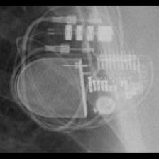 STJ:Allure Quadra</td>
<td align="center" valign="top"><b>Option 1</b> 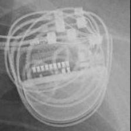 BOS:Contak Renewal TR2</td>
<td align="center" valign="top"><b>Option 2</b> 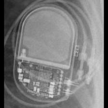 BIO:Evia</td>
<td align="center" valign="top"><b>Option 3</b> 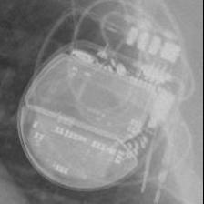 STJ:Ellipse</td>
<td align="center" valign="top"><b>✅ Option 4</b> 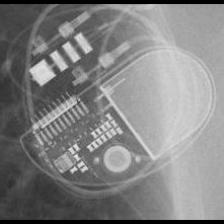 STJ:Allure Quadra</td>
<td align="center" valign="top"><b>Option 5</b> 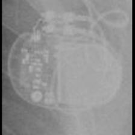 STJ:Accent</td>
<td align="center" valign="middle"><b>Option 6</b>  <i>None of the above</i></td>
</tr></table>

### Q3845 · correct: option 5 · `STJ:Allure Quadra`

<table><tr>
<td align="center" valign="top"><b>Query</b> 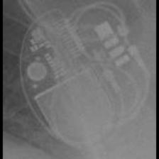 STJ:Allure Quadra</td>
<td align="center" valign="top"><b>Option 1</b>  MDT:EnRhythm</td>
<td align="center" valign="top"><b>Option 2</b> 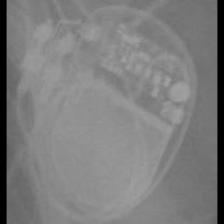 STJ:Accent</td>
<td align="center" valign="top"><b>Option 3</b>  BOS:Contak Renewal TR2</td>
<td align="center" valign="top"><b>Option 4</b>  STJ:Ellipse</td>
<td align="center" valign="top"><b>✅ Option 5</b>  STJ:Allure Quadra</td>
<td align="center" valign="middle"><b>Option 6</b>  <i>None of the above</i></td>
</tr></table>

### Q3846 · correct: option 5 · `STJ:Allure Quadra`

<table><tr>
<td align="center" valign="top"><b>Query</b> 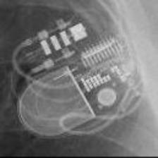 STJ:Allure Quadra</td>
<td align="center" valign="top"><b>Option 1</b>  STJ:Accent</td>
<td align="center" valign="top"><b>Option 2</b>  STJ:Ellipse</td>
<td align="center" valign="top"><b>Option 3</b>  BOS:Altrua_Insignia</td>
<td align="center" valign="top"><b>Option 4</b>  BOS:Visionist</td>
<td align="center" valign="top"><b>✅ Option 5</b>  STJ:Allure Quadra</td>
<td align="center" valign="middle"><b>Option 6</b>  <i>None of the above</i></td>
</tr></table>

### Q3847 · correct: option 1 · `STJ:Allure Quadra`

<table><tr>
<td align="center" valign="top"><b>Query</b> 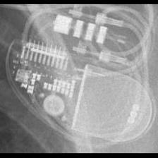 STJ:Allure Quadra</td>
<td align="center" valign="top"><b>✅ Option 1</b>  STJ:Allure Quadra</td>
<td align="center" valign="top"><b>Option 2</b>  STJ:Accent</td>
<td align="center" valign="top"><b>Option 3</b>  MDT:Syncra</td>
<td align="center" valign="top"><b>Option 4</b>  STJ:Ellipse</td>
<td align="center" valign="top"><b>Option 5</b>  BOS:Visionist</td>
<td align="center" valign="middle"><b>Option 6</b>  <i>None of the above</i></td>
</tr></table>

### Q3848 · correct: option 3 · `STJ:Allure Quadra`

<table><tr>
<td align="center" valign="top"><b>Query</b> 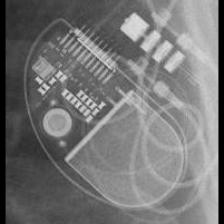 STJ:Allure Quadra</td>
<td align="center" valign="top"><b>Option 1</b> 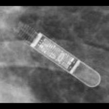 MDT:REVEAL LINQ</td>
<td align="center" valign="top"><b>Option 2</b>  BOS:Visionist</td>
<td align="center" valign="top"><b>✅ Option 3</b>  STJ:Allure Quadra</td>
<td align="center" valign="top"><b>Option 4</b>  STJ:Accent</td>
<td align="center" valign="top"><b>Option 5</b>  STJ:Ellipse</td>
<td align="center" valign="middle"><b>Option 6</b>  <i>None of the above</i></td>
</tr></table>

### Q3849 · correct: option 5 · `STJ:Ellipse`

<table><tr>
<td align="center" valign="top"><b>Query</b> 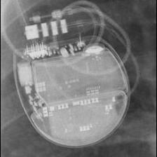 STJ:Ellipse</td>
<td align="center" valign="top"><b>Option 1</b> 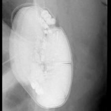 BOS:Emblem</td>
<td align="center" valign="top"><b>Option 2</b> 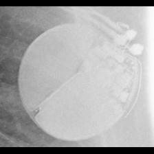 BOS:Autogen_Teligen_Energen_Cognis</td>
<td align="center" valign="top"><b>Option 3</b> 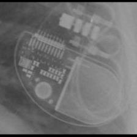 STJ:Allure Quadra</td>
<td align="center" valign="top"><b>Option 4</b>  STJ:Quadra Assura_Unify</td>
<td align="center" valign="top"><b>✅ Option 5</b> 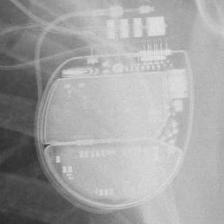 STJ:Ellipse</td>
<td align="center" valign="middle"><b>Option 6</b>  <i>None of the above</i></td>
</tr></table>

### Q3850 · correct: option 3 · `STJ:Ellipse`

<table><tr>
<td align="center" valign="top"><b>Query</b> 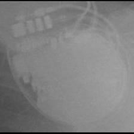 STJ:Ellipse</td>
<td align="center" valign="top"><b>Option 1</b>  MDT:Claria_Evera_Viva</td>
<td align="center" valign="top"><b>Option 2</b>  BOS:Autogen_Teligen_Energen_Cognis</td>
<td align="center" valign="top"><b>✅ Option 3</b>  STJ:Ellipse</td>
<td align="center" valign="top"><b>Option 4</b>  MDT:Concerto_Consulta_Maximo_Protecta_Secura</td>
<td align="center" valign="top"><b>Option 5</b>  BOS:Vitality</td>
<td align="center" valign="middle"><b>Option 6</b>  <i>None of the above</i></td>
</tr></table>

### Q3851 · correct: option 2 · `STJ:Ellipse`

<table><tr>
<td align="center" valign="top"><b>Query</b> 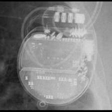 STJ:Ellipse</td>
<td align="center" valign="top"><b>Option 1</b>  STJ:Quadra Assura_Unify</td>
<td align="center" valign="top"><b>✅ Option 2</b> 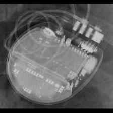 STJ:Ellipse</td>
<td align="center" valign="top"><b>Option 3</b>  BOS:Emblem</td>
<td align="center" valign="top"><b>Option 4</b>  BOS:Contak Renewal TR2</td>
<td align="center" valign="top"><b>Option 5</b>  BOS:Autogen_Teligen_Energen_Cognis</td>
<td align="center" valign="middle"><b>Option 6</b>  <i>None of the above</i></td>
</tr></table>

### Q3852 · correct: option 2 · `STJ:Ellipse`

<table><tr>
<td align="center" valign="top"><b>Query</b> 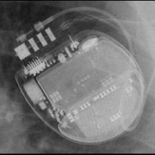 STJ:Ellipse</td>
<td align="center" valign="top"><b>Option 1</b>  BOS:Emblem</td>
<td align="center" valign="top"><b>✅ Option 2</b>  STJ:Ellipse</td>
<td align="center" valign="top"><b>Option 3</b>  STJ:Quadra Assura_Unify</td>
<td align="center" valign="top"><b>Option 4</b>  BOS:Autogen_Teligen_Energen_Cognis</td>
<td align="center" valign="top"><b>Option 5</b>  BOS:Vitality</td>
<td align="center" valign="middle"><b>Option 6</b>  <i>None of the above</i></td>
</tr></table>

### Q3853 · correct: option 1 · `STJ:Ellipse`

<table><tr>
<td align="center" valign="top"><b>Query</b> 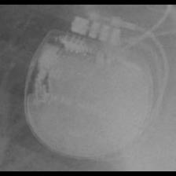 STJ:Ellipse</td>
<td align="center" valign="top"><b>✅ Option 1</b>  STJ:Ellipse</td>
<td align="center" valign="top"><b>Option 2</b>  STJ:Quadra Assura_Unify</td>
<td align="center" valign="top"><b>Option 3</b>  MDT:Concerto_Consulta_Maximo_Protecta_Secura</td>
<td align="center" valign="top"><b>Option 4</b>  BOS:Autogen_Teligen_Energen_Cognis</td>
<td align="center" valign="top"><b>Option 5</b>  BOS:Emblem</td>
<td align="center" valign="middle"><b>Option 6</b>  <i>None of the above</i></td>
</tr></table>

### Q3854 · correct: option 5 · `STJ:Ellipse`

<table><tr>
<td align="center" valign="top"><b>Query</b> 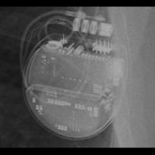 STJ:Ellipse</td>
<td align="center" valign="top"><b>Option 1</b>  BOS:Emblem</td>
<td align="center" valign="top"><b>Option 2</b>  STJ:Quadra Assura_Unify</td>
<td align="center" valign="top"><b>Option 3</b>  MDT:Claria_Evera_Viva</td>
<td align="center" valign="top"><b>Option 4</b>  BOS:Autogen_Teligen_Energen_Cognis</td>
<td align="center" valign="top"><b>✅ Option 5</b>  STJ:Ellipse</td>
<td align="center" valign="middle"><b>Option 6</b>  <i>None of the above</i></td>
</tr></table>

### Q3855 · correct: option 2 · `STJ:Ellipse`

<table><tr>
<td align="center" valign="top"><b>Query</b> 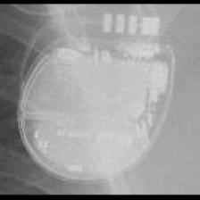 STJ:Ellipse</td>
<td align="center" valign="top"><b>Option 1</b>  BOS:Emblem</td>
<td align="center" valign="top"><b>✅ Option 2</b>  STJ:Ellipse</td>
<td align="center" valign="top"><b>Option 3</b> 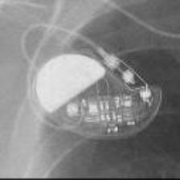 STJ:Victory</td>
<td align="center" valign="top"><b>Option 4</b>  STJ:Quadra Assura_Unify</td>
<td align="center" valign="top"><b>Option 5</b>  BOS:Autogen_Teligen_Energen_Cognis</td>
<td align="center" valign="middle"><b>Option 6</b>  <i>None of the above</i></td>
</tr></table>

### Q3856 · correct: option 1 · `STJ:Identity`

<table><tr>
<td align="center" valign="top"><b>Query</b> 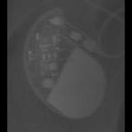 STJ:Identity</td>
<td align="center" valign="top"><b>✅ Option 1</b>  STJ:Identity</td>
<td align="center" valign="top"><b>Option 2</b>  STJ:Victory</td>
<td align="center" valign="top"><b>Option 3</b>  STJ:Zephyr</td>
<td align="center" valign="top"><b>Option 4</b>  MDT:C20_T20</td>
<td align="center" valign="top"><b>Option 5</b>  MDT:Adapta_Kappa_Sensia_Versa</td>
<td align="center" valign="middle"><b>Option 6</b>  <i>None of the above</i></td>
</tr></table>

### Q3857 · correct: option 5 · `STJ:Identity`

<table><tr>
<td align="center" valign="top"><b>Query</b> 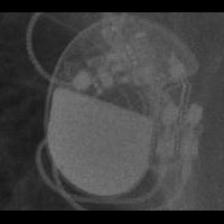 STJ:Identity</td>
<td align="center" valign="top"><b>Option 1</b>  MDT:C60 DR</td>
<td align="center" valign="top"><b>Option 2</b>  MDT:C20_T20</td>
<td align="center" valign="top"><b>Option 3</b> 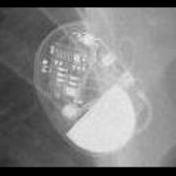 STJ:Victory</td>
<td align="center" valign="top"><b>Option 4</b> 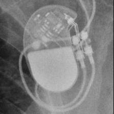 STJ:Zephyr</td>
<td align="center" valign="top"><b>✅ Option 5</b> 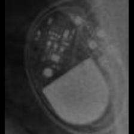 STJ:Identity</td>
<td align="center" valign="middle"><b>Option 6</b>  <i>None of the above</i></td>
</tr></table>

### Q3858 · correct: option 3 · `STJ:Identity`

<table><tr>
<td align="center" valign="top"><b>Query</b> 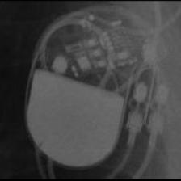 STJ:Identity</td>
<td align="center" valign="top"><b>Option 1</b> 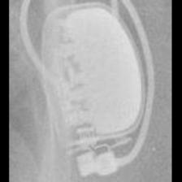 SOR:Reply</td>
<td align="center" valign="top"><b>Option 2</b>  MDT:C20_T20</td>
<td align="center" valign="top"><b>✅ Option 3</b>  STJ:Identity</td>
<td align="center" valign="top"><b>Option 4</b>  STJ:Victory</td>
<td align="center" valign="top"><b>Option 5</b> 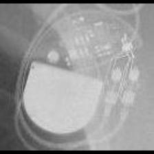 STJ:Zephyr</td>
<td align="center" valign="middle"><b>Option 6</b>  <i>None of the above</i></td>
</tr></table>

### Q3859 · correct: option 4 · `STJ:Identity`

<table><tr>
<td align="center" valign="top"><b>Query</b> 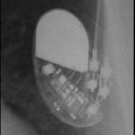 STJ:Identity</td>
<td align="center" valign="top"><b>Option 1</b>  MDT:C20_T20</td>
<td align="center" valign="top"><b>Option 2</b>  STJ:Victory</td>
<td align="center" valign="top"><b>Option 3</b>  STJ:Zephyr</td>
<td align="center" valign="top"><b>✅ Option 4</b>  STJ:Identity</td>
<td align="center" valign="top"><b>Option 5</b> 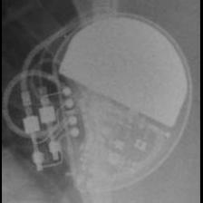 MDT:C60 DR</td>
<td align="center" valign="middle"><b>Option 6</b>  <i>None of the above</i></td>
</tr></table>

### Q3860 · correct: option 2 · `STJ:Identity`

<table><tr>
<td align="center" valign="top"><b>Query</b> 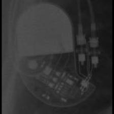 STJ:Identity</td>
<td align="center" valign="top"><b>Option 1</b>  MDT:C20_T20</td>
<td align="center" valign="top"><b>✅ Option 2</b>  STJ:Identity</td>
<td align="center" valign="top"><b>Option 3</b>  MDT:Sigma</td>
<td align="center" valign="top"><b>Option 4</b>  STJ:Zephyr</td>
<td align="center" valign="top"><b>Option 5</b> 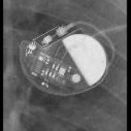 STJ:Victory</td>
<td align="center" valign="middle"><b>Option 6</b>  <i>None of the above</i></td>
</tr></table>

### Q3861 · correct: option 2 · `STJ:Identity`

<table><tr>
<td align="center" valign="top"><b>Query</b>  STJ:Identity</td>
<td align="center" valign="top"><b>Option 1</b>  STJ:Victory</td>
<td align="center" valign="top"><b>✅ Option 2</b>  STJ:Identity</td>
<td align="center" valign="top"><b>Option 3</b>  STJ:Zephyr</td>
<td align="center" valign="top"><b>Option 4</b>  MDT:C20_T20</td>
<td align="center" valign="top"><b>Option 5</b>  MDT:Adapta_Kappa_Sensia_Versa</td>
<td align="center" valign="middle"><b>Option 6</b>  <i>None of the above</i></td>
</tr></table>

### Q3862 · correct: option 1 · `STJ:Identity`

<table><tr>
<td align="center" valign="top"><b>Query</b> 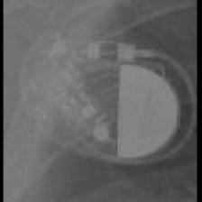 STJ:Identity</td>
<td align="center" valign="top"><b>✅ Option 1</b>  STJ:Identity</td>
<td align="center" valign="top"><b>Option 2</b> 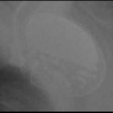 MDT:Sigma</td>
<td align="center" valign="top"><b>Option 3</b>  STJ:Victory</td>
<td align="center" valign="top"><b>Option 4</b>  MDT:C20_T20</td>
<td align="center" valign="top"><b>Option 5</b>  STJ:Zephyr</td>
<td align="center" valign="middle"><b>Option 6</b>  <i>None of the above</i></td>
</tr></table>

### Q3863 · correct: option 3 · `STJ:Quadra Assura_Unify`

<table><tr>
<td align="center" valign="top"><b>Query</b> 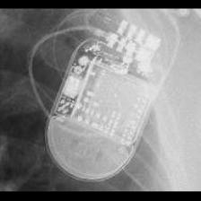 STJ:Quadra Assura_Unify</td>
<td align="center" valign="top"><b>Option 1</b>  STJ:Ellipse</td>
<td align="center" valign="top"><b>Option 2</b>  MDT:Maximo</td>
<td align="center" valign="top"><b>✅ Option 3</b> 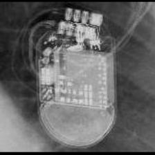 STJ:Quadra Assura_Unify</td>
<td align="center" valign="top"><b>Option 4</b>  BOS:Contak Renewal 4</td>
<td align="center" valign="top"><b>Option 5</b>  MDT:Concerto_Consulta_Maximo_Protecta_Secura</td>
<td align="center" valign="middle"><b>Option 6</b>  <i>None of the above</i></td>
</tr></table>

### Q3864 · correct: option 4 · `STJ:Quadra Assura_Unify`

<table><tr>
<td align="center" valign="top"><b>Query</b> 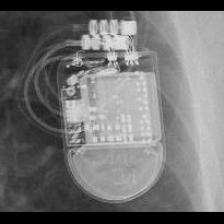 STJ:Quadra Assura_Unify</td>
<td align="center" valign="top"><b>Option 1</b>  STJ:Ellipse</td>
<td align="center" valign="top"><b>Option 2</b>  MDT:Maximo</td>
<td align="center" valign="top"><b>Option 3</b>  MDT:Concerto_Consulta_Maximo_Protecta_Secura</td>
<td align="center" valign="top"><b>✅ Option 4</b>  STJ:Quadra Assura_Unify</td>
<td align="center" valign="top"><b>Option 5</b>  BOS:Contak Renewal 4</td>
<td align="center" valign="middle"><b>Option 6</b>  <i>None of the above</i></td>
</tr></table>

### Q3865 · correct: option 4 · `STJ:Quadra Assura_Unify`

<table><tr>
<td align="center" valign="top"><b>Query</b> 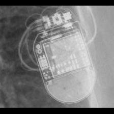 STJ:Quadra Assura_Unify</td>
<td align="center" valign="top"><b>Option 1</b>  MDT:Concerto_Consulta_Maximo_Protecta_Secura</td>
<td align="center" valign="top"><b>Option 2</b>  BOS:Contak Renewal 4</td>
<td align="center" valign="top"><b>Option 3</b>  MDT:Maximo</td>
<td align="center" valign="top"><b>✅ Option 4</b>  STJ:Quadra Assura_Unify</td>
<td align="center" valign="top"><b>Option 5</b>  BOS:Autogen_Teligen_Energen_Cognis</td>
<td align="center" valign="middle"><b>Option 6</b>  <i>None of the above</i></td>
</tr></table>

### Q3866 · correct: option 1 · `STJ:Quadra Assura_Unify`

<table><tr>
<td align="center" valign="top"><b>Query</b> 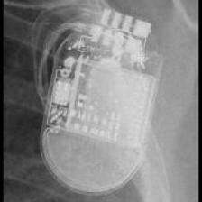 STJ:Quadra Assura_Unify</td>
<td align="center" valign="top"><b>✅ Option 1</b>  STJ:Quadra Assura_Unify</td>
<td align="center" valign="top"><b>Option 2</b>  BOS:Contak Renewal 4</td>
<td align="center" valign="top"><b>Option 3</b>  MDT:Concerto_Consulta_Maximo_Protecta_Secura</td>
<td align="center" valign="top"><b>Option 4</b>  MDT:Maximo</td>
<td align="center" valign="top"><b>Option 5</b>  MDT:Claria_Evera_Viva</td>
<td align="center" valign="middle"><b>Option 6</b>  <i>None of the above</i></td>
</tr></table>

### Q3867 · correct: option 3 · `STJ:Quadra Assura_Unify`

<table><tr>
<td align="center" valign="top"><b>Query</b>  STJ:Quadra Assura_Unify</td>
<td align="center" valign="top"><b>Option 1</b>  MDT:Claria_Evera_Viva</td>
<td align="center" valign="top"><b>Option 2</b>  BOS:Contak Renewal 4</td>
<td align="center" valign="top"><b>✅ Option 3</b>  STJ:Quadra Assura_Unify</td>
<td align="center" valign="top"><b>Option 4</b>  MDT:Concerto_Consulta_Maximo_Protecta_Secura</td>
<td align="center" valign="top"><b>Option 5</b>  MDT:Maximo</td>
<td align="center" valign="middle"><b>Option 6</b>  <i>None of the above</i></td>
</tr></table>

### Q3868 · correct: option 3 · `STJ:Quadra Assura_Unify`

<table><tr>
<td align="center" valign="top"><b>Query</b> 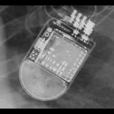 STJ:Quadra Assura_Unify</td>
<td align="center" valign="top"><b>Option 1</b>  BOS:Contak Renewal 4</td>
<td align="center" valign="top"><b>Option 2</b>  MDT:Claria_Evera_Viva</td>
<td align="center" valign="top"><b>✅ Option 3</b>  STJ:Quadra Assura_Unify</td>
<td align="center" valign="top"><b>Option 4</b>  MDT:Maximo</td>
<td align="center" valign="top"><b>Option 5</b>  MDT:Concerto_Consulta_Maximo_Protecta_Secura</td>
<td align="center" valign="middle"><b>Option 6</b>  <i>None of the above</i></td>
</tr></table>

### Q3869 · correct: option 1 · `STJ:Quadra Assura_Unify`

<table><tr>
<td align="center" valign="top"><b>Query</b>  STJ:Quadra Assura_Unify</td>
<td align="center" valign="top"><b>✅ Option 1</b>  STJ:Quadra Assura_Unify</td>
<td align="center" valign="top"><b>Option 2</b>  BOS:Contak Renewal 4</td>
<td align="center" valign="top"><b>Option 3</b>  MDT:Maximo</td>
<td align="center" valign="top"><b>Option 4</b>  STJ:Ellipse</td>
<td align="center" valign="top"><b>Option 5</b>  MDT:Concerto_Consulta_Maximo_Protecta_Secura</td>
<td align="center" valign="middle"><b>Option 6</b>  <i>None of the above</i></td>
</tr></table>

### Q3870 · correct: option 4 · `STJ:Victory`

<table><tr>
<td align="center" valign="top"><b>Query</b>  STJ:Victory</td>
<td align="center" valign="top"><b>Option 1</b>  MDT:Adapta_Kappa_Sensia_Versa</td>
<td align="center" valign="top"><b>Option 2</b>  MDT:Sigma</td>
<td align="center" valign="top"><b>Option 3</b>  STJ:Identity</td>
<td align="center" valign="top"><b>✅ Option 4</b>  STJ:Victory</td>
<td align="center" valign="top"><b>Option 5</b>  STJ:Zephyr</td>
<td align="center" valign="middle"><b>Option 6</b>  <i>None of the above</i></td>
</tr></table>

### Q3871 · correct: option 3 · `STJ:Victory`

<table><tr>
<td align="center" valign="top"><b>Query</b> 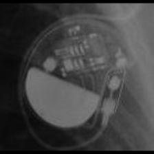 STJ:Victory</td>
<td align="center" valign="top"><b>Option 1</b>  MDT:C20_T20</td>
<td align="center" valign="top"><b>Option 2</b>  STJ:Zephyr</td>
<td align="center" valign="top"><b>✅ Option 3</b> 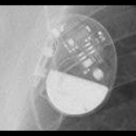 STJ:Victory</td>
<td align="center" valign="top"><b>Option 4</b>  STJ:Identity</td>
<td align="center" valign="top"><b>Option 5</b>  MDT:C60 DR</td>
<td align="center" valign="middle"><b>Option 6</b>  <i>None of the above</i></td>
</tr></table>

### Q3872 · correct: option 5 · `STJ:Victory`

<table><tr>
<td align="center" valign="top"><b>Query</b> 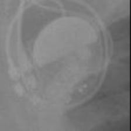 STJ:Victory</td>
<td align="center" valign="top"><b>Option 1</b>  STJ:Identity</td>
<td align="center" valign="top"><b>Option 2</b> 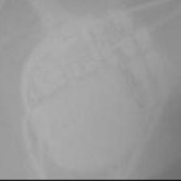 BOS:ContakTR_Discovery_Meridian_Pulsar Max</td>
<td align="center" valign="top"><b>Option 3</b> 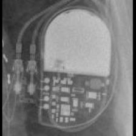 MDT:Sigma</td>
<td align="center" valign="top"><b>Option 4</b>  STJ:Zephyr</td>
<td align="center" valign="top"><b>✅ Option 5</b>  STJ:Victory</td>
<td align="center" valign="middle"><b>Option 6</b>  <i>None of the above</i></td>
</tr></table>

### Q3873 · correct: option 2 · `STJ:Victory`

<table><tr>
<td align="center" valign="top"><b>Query</b>  STJ:Victory</td>
<td align="center" valign="top"><b>Option 1</b>  STJ:Identity</td>
<td align="center" valign="top"><b>✅ Option 2</b>  STJ:Victory</td>
<td align="center" valign="top"><b>Option 3</b>  STJ:Accent</td>
<td align="center" valign="top"><b>Option 4</b>  STJ:Zephyr</td>
<td align="center" valign="top"><b>Option 5</b>  MDT:C60 DR</td>
<td align="center" valign="middle"><b>Option 6</b>  <i>None of the above</i></td>
</tr></table>

### Q3874 · correct: option 2 · `STJ:Victory`

<table><tr>
<td align="center" valign="top"><b>Query</b>  STJ:Victory</td>
<td align="center" valign="top"><b>Option 1</b>  STJ:Identity</td>
<td align="center" valign="top"><b>✅ Option 2</b>  STJ:Victory</td>
<td align="center" valign="top"><b>Option 3</b>  STJ:Zephyr</td>
<td align="center" valign="top"><b>Option 4</b>  MDT:Sigma</td>
<td align="center" valign="top"><b>Option 5</b>  MDT:C60 DR</td>
<td align="center" valign="middle"><b>Option 6</b>  <i>None of the above</i></td>
</tr></table>

### Q3875 · correct: option 3 · `STJ:Victory`

<table><tr>
<td align="center" valign="top"><b>Query</b>  STJ:Victory</td>
<td align="center" valign="top"><b>Option 1</b>  STJ:Identity</td>
<td align="center" valign="top"><b>Option 2</b>  STJ:Zephyr</td>
<td align="center" valign="top"><b>✅ Option 3</b>  STJ:Victory</td>
<td align="center" valign="top"><b>Option 4</b>  MDT:C20_T20</td>
<td align="center" valign="top"><b>Option 5</b>  MDT:C60 DR</td>
<td align="center" valign="middle"><b>Option 6</b>  <i>None of the above</i></td>
</tr></table>

### Q3876 · correct: option 1 · `STJ:Victory`

<table><tr>
<td align="center" valign="top"><b>Query</b>  STJ:Victory</td>
<td align="center" valign="top"><b>✅ Option 1</b>  STJ:Victory</td>
<td align="center" valign="top"><b>Option 2</b>  STJ:Zephyr</td>
<td align="center" valign="top"><b>Option 3</b>  STJ:Identity</td>
<td align="center" valign="top"><b>Option 4</b>  MDT:Adapta_Kappa_Sensia_Versa</td>
<td align="center" valign="top"><b>Option 5</b>  MDT:Sigma</td>
<td align="center" valign="middle"><b>Option 6</b>  <i>None of the above</i></td>
</tr></table>

### Q3877 · correct: option 2 · `STJ:Zephyr`

<table><tr>
<td align="center" valign="top"><b>Query</b>  STJ:Zephyr</td>
<td align="center" valign="top"><b>Option 1</b>  STJ:Victory</td>
<td align="center" valign="top"><b>✅ Option 2</b>  STJ:Zephyr</td>
<td align="center" valign="top"><b>Option 3</b>  MDT:Azure</td>
<td align="center" valign="top"><b>Option 4</b>  MDT:C60 DR</td>
<td align="center" valign="top"><b>Option 5</b>  STJ:Identity</td>
<td align="center" valign="middle"><b>Option 6</b>  <i>None of the above</i></td>
</tr></table>

### Q3878 · correct: option 3 · `STJ:Zephyr`

<table><tr>
<td align="center" valign="top"><b>Query</b>  STJ:Zephyr</td>
<td align="center" valign="top"><b>Option 1</b>  STJ:Identity</td>
<td align="center" valign="top"><b>Option 2</b>  BIO:Cyclos</td>
<td align="center" valign="top"><b>✅ Option 3</b>  STJ:Zephyr</td>
<td align="center" valign="top"><b>Option 4</b>  MDT:Adapta_Kappa_Sensia_Versa</td>
<td align="center" valign="top"><b>Option 5</b>  STJ:Victory</td>
<td align="center" valign="middle"><b>Option 6</b>  <i>None of the above</i></td>
</tr></table>

### Q3879 · correct: option 2 · `STJ:Zephyr`

<table><tr>
<td align="center" valign="top"><b>Query</b>  STJ:Zephyr</td>
<td align="center" valign="top"><b>Option 1</b>  BIO:Cyclos</td>
<td align="center" valign="top"><b>✅ Option 2</b>  STJ:Zephyr</td>
<td align="center" valign="top"><b>Option 3</b>  STJ:Victory</td>
<td align="center" valign="top"><b>Option 4</b>  STJ:Identity</td>
<td align="center" valign="top"><b>Option 5</b>  MDT:C60 DR</td>
<td align="center" valign="middle"><b>Option 6</b>  <i>None of the above</i></td>
</tr></table>

### Q3880 · correct: option 1 · `STJ:Zephyr`

<table><tr>
<td align="center" valign="top"><b>Query</b>  STJ:Zephyr</td>
<td align="center" valign="top"><b>✅ Option 1</b>  STJ:Zephyr</td>
<td align="center" valign="top"><b>Option 2</b>  BIO:Cyclos</td>
<td align="center" valign="top"><b>Option 3</b>  MDT:C20_T20</td>
<td align="center" valign="top"><b>Option 4</b>  STJ:Victory</td>
<td align="center" valign="top"><b>Option 5</b>  STJ:Identity</td>
<td align="center" valign="middle"><b>Option 6</b>  <i>None of the above</i></td>
</tr></table>

### Q3881 · correct: option 4 · `STJ:Zephyr`

<table><tr>
<td align="center" valign="top"><b>Query</b>  STJ:Zephyr</td>
<td align="center" valign="top"><b>Option 1</b>  STJ:Victory</td>
<td align="center" valign="top"><b>Option 2</b>  MDT:C60 DR</td>
<td align="center" valign="top"><b>Option 3</b>  STJ:Identity</td>
<td align="center" valign="top"><b>✅ Option 4</b>  STJ:Zephyr</td>
<td align="center" valign="top"><b>Option 5</b>  BOS:ContakTR_Discovery_Meridian_Pulsar Max</td>
<td align="center" valign="middle"><b>Option 6</b>  <i>None of the above</i></td>
</tr></table>

### Q3882 · correct: option 4 · `STJ:Zephyr`

<table><tr>
<td align="center" valign="top"><b>Query</b>  STJ:Zephyr</td>
<td align="center" valign="top"><b>Option 1</b>  STJ:Victory</td>
<td align="center" valign="top"><b>Option 2</b>  STJ:Identity</td>
<td align="center" valign="top"><b>Option 3</b>  MDT:Sigma</td>
<td align="center" valign="top"><b>✅ Option 4</b>  STJ:Zephyr</td>
<td align="center" valign="top"><b>Option 5</b>  MDT:C20_T20</td>
<td align="center" valign="middle"><b>Option 6</b>  <i>None of the above</i></td>
</tr></table>

### Q3883 · correct: option 4 · `STJ:Zephyr`

<table><tr>
<td align="center" valign="top"><b>Query</b>  STJ:Zephyr</td>
<td align="center" valign="top"><b>Option 1</b>  STJ:Identity</td>
<td align="center" valign="top"><b>Option 2</b>  MDT:C20_T20</td>
<td align="center" valign="top"><b>Option 3</b>  MDT:C60 DR</td>
<td align="center" valign="top"><b>✅ Option 4</b>  STJ:Zephyr</td>
<td align="center" valign="top"><b>Option 5</b>  STJ:Victory</td>
<td align="center" valign="middle"><b>Option 6</b>  <i>None of the above</i></td>
</tr></table>

