# Physionet (cardiac devices) · query set `test` · page 1/8

[← all pages](README.md)

### Q1334 · correct: option 3 · `Reveal XT`

<table><tr>
<td align="center" valign="top"><b>Query</b> 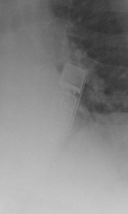 Reveal XT</td>
<td align="center" valign="top"><b>Option 1</b>  Reveal LINQ</td>
<td align="center" valign="top"><b>Option 2</b>  SJM Confirm</td>
<td align="center" valign="top"><b>✅ Option 3</b>  Reveal XT</td>
<td align="center" valign="top"><b>Option 4</b>  Confirm Rx DM3500</td>
<td align="center" valign="top"><b>Option 5</b>  Ilivia 7 VR-T</td>
<td align="center" valign="middle"><b>Option 6</b>  <i>None of the above</i></td>
</tr></table>

### Q1335 · correct: option 2 · `Confirm Rx DM3500`

<table><tr>
<td align="center" valign="top"><b>Query</b> 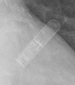 Confirm Rx DM3500</td>
<td align="center" valign="top"><b>Option 1</b>  Ilivia 7 VR-T</td>
<td align="center" valign="top"><b>✅ Option 2</b>  Confirm Rx DM3500</td>
<td align="center" valign="top"><b>Option 3</b>  Reveal XT</td>
<td align="center" valign="top"><b>Option 4</b>  SJM Confirm</td>
<td align="center" valign="top"><b>Option 5</b>  Reveal LINQ</td>
<td align="center" valign="middle"><b>Option 6</b>  <i>None of the above</i></td>
</tr></table>

### Q1336 · correct: option 4 · `Q20 SR MRI SureScan`

<table><tr>
<td align="center" valign="top"><b>Query</b> 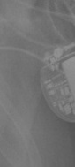 Q20 SR MRI SureScan</td>
<td align="center" valign="top"><b>Option 1</b>  Ecuro SR</td>
<td align="center" valign="top"><b>Option 2</b>  Enticos 4 DR</td>
<td align="center" valign="top"><b>Option 3</b>  Attesta DR MRI SureScan</td>
<td align="center" valign="top"><b>✅ Option 4</b>  Q20 SR MRI SureScan</td>
<td align="center" valign="top"><b>Option 5</b>  Enitra 8 HF-T QP</td>
<td align="center" valign="middle"><b>Option 6</b>  <i>None of the above</i></td>
</tr></table>

### Q1337 · correct: option 3 · `Q20 SR MRI SureScan`

<table><tr>
<td align="center" valign="top"><b>Query</b> 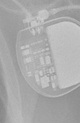 Q20 SR MRI SureScan</td>
<td align="center" valign="top"><b>Option 1</b>  Enticos 4 DR</td>
<td align="center" valign="top"><b>Option 2</b>  Enticos 4 SR</td>
<td align="center" valign="top"><b>✅ Option 3</b>  Q20 SR MRI SureScan</td>
<td align="center" valign="top"><b>Option 4</b>  Enitra 8 HF-T QP</td>
<td align="center" valign="top"><b>Option 5</b>  Attesta DR MRI SureScan</td>
<td align="center" valign="middle"><b>Option 6</b>  <i>None of the above</i></td>
</tr></table>

### Q1338 · correct: option 4 · `Q20 SR MRI SureScan`

<table><tr>
<td align="center" valign="top"><b>Query</b> 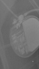 Q20 SR MRI SureScan</td>
<td align="center" valign="top"><b>Option 1</b>  Attesta DR MRI SureScan</td>
<td align="center" valign="top"><b>Option 2</b>  Enitra 8 HF-T QP</td>
<td align="center" valign="top"><b>Option 3</b>  Enticos 4 SR</td>
<td align="center" valign="top"><b>✅ Option 4</b>  Q20 SR MRI SureScan</td>
<td align="center" valign="top"><b>Option 5</b>  Enticos 4 DR</td>
<td align="center" valign="middle"><b>Option 6</b>  <i>None of the above</i></td>
</tr></table>

### Q1339 · correct: option 2 · `Q20 SR MRI SureScan`

<table><tr>
<td align="center" valign="top"><b>Query</b> 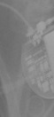 Q20 SR MRI SureScan</td>
<td align="center" valign="top"><b>Option 1</b>  Reveal LINQ</td>
<td align="center" valign="top"><b>✅ Option 2</b>  Q20 SR MRI SureScan</td>
<td align="center" valign="top"><b>Option 3</b>  Confirm Rx DM3500</td>
<td align="center" valign="top"><b>Option 4</b>  Attesta DR MRI SureScan</td>
<td align="center" valign="top"><b>Option 5</b>  SJM Confirm</td>
<td align="center" valign="middle"><b>Option 6</b>  <i>None of the above</i></td>
</tr></table>

### Q1340 · correct: option 4 · `Q20 SR MRI SureScan`

<table><tr>
<td align="center" valign="top"><b>Query</b> 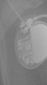 Q20 SR MRI SureScan</td>
<td align="center" valign="top"><b>Option 1</b>  Enitra 8 HF-T QP</td>
<td align="center" valign="top"><b>Option 2</b>  Enticos 4 DR</td>
<td align="center" valign="top"><b>Option 3</b>  Attesta DR MRI SureScan</td>
<td align="center" valign="top"><b>✅ Option 4</b>  Q20 SR MRI SureScan</td>
<td align="center" valign="top"><b>Option 5</b>  Enticos 4 SR</td>
<td align="center" valign="middle"><b>Option 6</b>  <i>None of the above</i></td>
</tr></table>

### Q1341 · correct: option 5 · `Q20 SR MRI SureScan`

<table><tr>
<td align="center" valign="top"><b>Query</b> 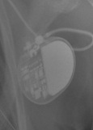 Q20 SR MRI SureScan</td>
<td align="center" valign="top"><b>Option 1</b>  Enitra 8 HF-T QP</td>
<td align="center" valign="top"><b>Option 2</b>  Attesta DR MRI SureScan</td>
<td align="center" valign="top"><b>Option 3</b>  Enticos 4 DR</td>
<td align="center" valign="top"><b>Option 4</b>  Enticos 4 SR</td>
<td align="center" valign="top"><b>✅ Option 5</b>  Q20 SR MRI SureScan</td>
<td align="center" valign="middle"><b>Option 6</b>  <i>None of the above</i></td>
</tr></table>

### Q1342 · correct: option 3 · `Q20 SR MRI SureScan`

<table><tr>
<td align="center" valign="top"><b>Query</b> 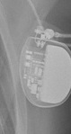 Q20 SR MRI SureScan</td>
<td align="center" valign="top"><b>Option 1</b>  Enticos 4 DR</td>
<td align="center" valign="top"><b>Option 2</b>  Enticos 4 SR</td>
<td align="center" valign="top"><b>✅ Option 3</b>  Q20 SR MRI SureScan</td>
<td align="center" valign="top"><b>Option 4</b>  Ecuro SR</td>
<td align="center" valign="top"><b>Option 5</b>  Attesta DR MRI SureScan</td>
<td align="center" valign="middle"><b>Option 6</b>  <i>None of the above</i></td>
</tr></table>

### Q1343 · correct: option 4 · `Q20 SR MRI SureScan`

<table><tr>
<td align="center" valign="top"><b>Query</b> 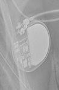 Q20 SR MRI SureScan</td>
<td align="center" valign="top"><b>Option 1</b>  Attesta DR MRI SureScan</td>
<td align="center" valign="top"><b>Option 2</b>  Enticos 4 DR</td>
<td align="center" valign="top"><b>Option 3</b>  Enticos 4 SR</td>
<td align="center" valign="top"><b>✅ Option 4</b>  Q20 SR MRI SureScan</td>
<td align="center" valign="top"><b>Option 5</b>  Enitra 8 HF-T QP</td>
<td align="center" valign="middle"><b>Option 6</b>  <i>None of the above</i></td>
</tr></table>

### Q1344 · correct: option 3 · `Q20 SR MRI SureScan`

<table><tr>
<td align="center" valign="top"><b>Query</b> 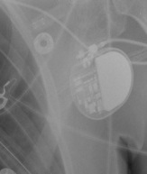 Q20 SR MRI SureScan</td>
<td align="center" valign="top"><b>Option 1</b>  Enticos 4 SR</td>
<td align="center" valign="top"><b>Option 2</b>  Enticos 4 DR</td>
<td align="center" valign="top"><b>✅ Option 3</b>  Q20 SR MRI SureScan</td>
<td align="center" valign="top"><b>Option 4</b>  Attesta DR MRI SureScan</td>
<td align="center" valign="top"><b>Option 5</b>  Ecuro SR</td>
<td align="center" valign="middle"><b>Option 6</b>  <i>None of the above</i></td>
</tr></table>

### Q1345 · correct: option 1 · `Mirro MRI VR SureScan`

<table><tr>
<td align="center" valign="top"><b>Query</b> 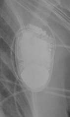 Mirro MRI VR SureScan</td>
<td align="center" valign="top"><b>✅ Option 1</b>  Mirro MRI VR SureScan</td>
<td align="center" valign="top"><b>Option 2</b>  Compia MRI Quad CRT-D SureScan</td>
<td align="center" valign="top"><b>Option 3</b>  Ellipse VR</td>
<td align="center" valign="top"><b>Option 4</b>  Quadra Assura</td>
<td align="center" valign="top"><b>Option 5</b>  Ilivia 7 HF-T QP</td>
<td align="center" valign="middle"><b>Option 6</b>  <i>None of the above</i></td>
</tr></table>

### Q1346 · correct: option 1 · `Mirro MRI VR SureScan`

<table><tr>
<td align="center" valign="top"><b>Query</b> 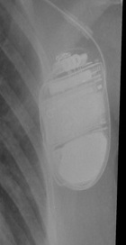 Mirro MRI VR SureScan</td>
<td align="center" valign="top"><b>✅ Option 1</b>  Mirro MRI VR SureScan</td>
<td align="center" valign="top"><b>Option 2</b>  Ilivia 7 HF-T QP</td>
<td align="center" valign="top"><b>Option 3</b>  Ellipse VR</td>
<td align="center" valign="top"><b>Option 4</b>  Ilivia 7 VR-T</td>
<td align="center" valign="top"><b>Option 5</b>  Compia MRI Quad CRT-D SureScan</td>
<td align="center" valign="middle"><b>Option 6</b>  <i>None of the above</i></td>
</tr></table>

### Q1347 · correct: option 5 · `Mirro MRI VR SureScan`

<table><tr>
<td align="center" valign="top"><b>Query</b> 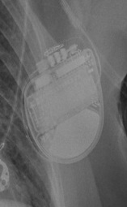 Mirro MRI VR SureScan</td>
<td align="center" valign="top"><b>Option 1</b>  Ilivia 7 HF-T QP</td>
<td align="center" valign="top"><b>Option 2</b>  Ellipse VR</td>
<td align="center" valign="top"><b>Option 3</b>  Compia MRI Quad CRT-D SureScan</td>
<td align="center" valign="top"><b>Option 4</b>  Serena Quad CRT-P MRI ScureScan</td>
<td align="center" valign="top"><b>✅ Option 5</b>  Mirro MRI VR SureScan</td>
<td align="center" valign="middle"><b>Option 6</b>  <i>None of the above</i></td>
</tr></table>

### Q1348 · correct: option 4 · `Mirro MRI VR SureScan`

<table><tr>
<td align="center" valign="top"><b>Query</b> 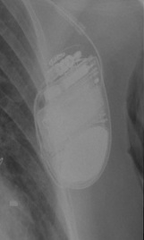 Mirro MRI VR SureScan</td>
<td align="center" valign="top"><b>Option 1</b>  Quadra Assura</td>
<td align="center" valign="top"><b>Option 2</b>  Ilivia 7 HF-T QP</td>
<td align="center" valign="top"><b>Option 3</b>  Compia MRI Quad CRT-D SureScan</td>
<td align="center" valign="top"><b>✅ Option 4</b>  Mirro MRI VR SureScan</td>
<td align="center" valign="top"><b>Option 5</b>  Ellipse VR</td>
<td align="center" valign="middle"><b>Option 6</b>  <i>None of the above</i></td>
</tr></table>

### Q1349 · correct: option 1 · `Mirro MRI VR SureScan`

<table><tr>
<td align="center" valign="top"><b>Query</b> 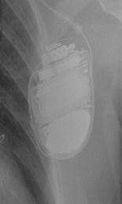 Mirro MRI VR SureScan</td>
<td align="center" valign="top"><b>✅ Option 1</b>  Mirro MRI VR SureScan</td>
<td align="center" valign="top"><b>Option 2</b>  Ilivia 7 VR-T</td>
<td align="center" valign="top"><b>Option 3</b>  Ellipse VR</td>
<td align="center" valign="top"><b>Option 4</b>  Compia MRI Quad CRT-D SureScan</td>
<td align="center" valign="top"><b>Option 5</b>  Ilivia 7 HF-T QP</td>
<td align="center" valign="middle"><b>Option 6</b>  <i>None of the above</i></td>
</tr></table>

### Q1350 · correct: option 2 · `Mirro MRI VR SureScan`

<table><tr>
<td align="center" valign="top"><b>Query</b> 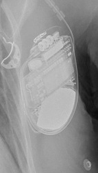 Mirro MRI VR SureScan</td>
<td align="center" valign="top"><b>Option 1</b>  Ilivia 7 VR-T</td>
<td align="center" valign="top"><b>✅ Option 2</b>  Mirro MRI VR SureScan</td>
<td align="center" valign="top"><b>Option 3</b>  Compia MRI Quad CRT-D SureScan</td>
<td align="center" valign="top"><b>Option 4</b>  Ilivia 7 HF-T QP</td>
<td align="center" valign="top"><b>Option 5</b>  Ellipse VR</td>
<td align="center" valign="middle"><b>Option 6</b>  <i>None of the above</i></td>
</tr></table>

### Q1351 · correct: option 1 · `Mirro MRI VR SureScan`

<table><tr>
<td align="center" valign="top"><b>Query</b> 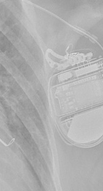 Mirro MRI VR SureScan</td>
<td align="center" valign="top"><b>✅ Option 1</b>  Mirro MRI VR SureScan</td>
<td align="center" valign="top"><b>Option 2</b> 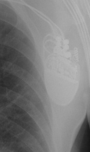 Valitude X4 CRT-P</td>
<td align="center" valign="top"><b>Option 3</b>  Ilivia 7 HF-T QP</td>
<td align="center" valign="top"><b>Option 4</b>  Compia MRI Quad CRT-D SureScan</td>
<td align="center" valign="top"><b>Option 5</b>  Ilivia 7 VR-T</td>
<td align="center" valign="middle"><b>Option 6</b>  <i>None of the above</i></td>
</tr></table>

### Q1352 · correct: option 1 · `Mirro MRI VR SureScan`

<table><tr>
<td align="center" valign="top"><b>Query</b> 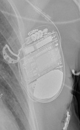 Mirro MRI VR SureScan</td>
<td align="center" valign="top"><b>✅ Option 1</b>  Mirro MRI VR SureScan</td>
<td align="center" valign="top"><b>Option 2</b>  Ilivia 7 HF-T QP</td>
<td align="center" valign="top"><b>Option 3</b>  Serena Quad CRT-P MRI ScureScan</td>
<td align="center" valign="top"><b>Option 4</b>  Compia MRI Quad CRT-D SureScan</td>
<td align="center" valign="top"><b>Option 5</b>  Ellipse VR</td>
<td align="center" valign="middle"><b>Option 6</b>  <i>None of the above</i></td>
</tr></table>

### Q1353 · correct: option 2 · `Q20 SR MRI SureScan`

<table><tr>
<td align="center" valign="top"><b>Query</b> 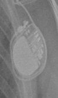 Q20 SR MRI SureScan</td>
<td align="center" valign="top"><b>Option 1</b>  Ecuro SR</td>
<td align="center" valign="top"><b>✅ Option 2</b>  Q20 SR MRI SureScan</td>
<td align="center" valign="top"><b>Option 3</b>  Enticos 4 DR</td>
<td align="center" valign="top"><b>Option 4</b>  Attesta DR MRI SureScan</td>
<td align="center" valign="top"><b>Option 5</b>  Enticos 4 SR</td>
<td align="center" valign="middle"><b>Option 6</b>  <i>None of the above</i></td>
</tr></table>

### Q1354 · correct: option 5 · `Mirro MRI VR SureScan`

<table><tr>
<td align="center" valign="top"><b>Query</b> 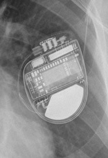 Mirro MRI VR SureScan</td>
<td align="center" valign="top"><b>Option 1</b>  Quadra Assura</td>
<td align="center" valign="top"><b>Option 2</b>  Ellipse VR</td>
<td align="center" valign="top"><b>Option 3</b>  Ilivia 7 HF-T QP</td>
<td align="center" valign="top"><b>Option 4</b>  Compia MRI Quad CRT-D SureScan</td>
<td align="center" valign="top"><b>✅ Option 5</b>  Mirro MRI VR SureScan</td>
<td align="center" valign="middle"><b>Option 6</b>  <i>None of the above</i></td>
</tr></table>

### Q1355 · correct: option 3 · `Enticos 4 DR`

<table><tr>
<td align="center" valign="top"><b>Query</b> 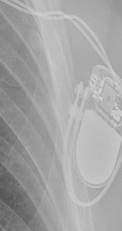 Enticos 4 DR</td>
<td align="center" valign="top"><b>Option 1</b>  Enticos 4 SR</td>
<td align="center" valign="top"><b>Option 2</b>  Attesta DR MRI SureScan</td>
<td align="center" valign="top"><b>✅ Option 3</b>  Enticos 4 DR</td>
<td align="center" valign="top"><b>Option 4</b>  Ecuro SR</td>
<td align="center" valign="top"><b>Option 5</b>  Enitra 6 DR-T</td>
<td align="center" valign="middle"><b>Option 6</b>  <i>None of the above</i></td>
</tr></table>

### Q1356 · correct: option 1 · `Enticos 4 DR`

<table><tr>
<td align="center" valign="top"><b>Query</b> 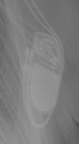 Enticos 4 DR</td>
<td align="center" valign="top"><b>✅ Option 1</b>  Enticos 4 DR</td>
<td align="center" valign="top"><b>Option 2</b>  Enitra 6 DR-T</td>
<td align="center" valign="top"><b>Option 3</b>  Ecuro SR</td>
<td align="center" valign="top"><b>Option 4</b>  Enticos 4 SR</td>
<td align="center" valign="top"><b>Option 5</b>  Enitra 8 HF-T QP</td>
<td align="center" valign="middle"><b>Option 6</b>  <i>None of the above</i></td>
</tr></table>

### Q1357 · correct: option 2 · `Enitra 8 HF-T QP`

<table><tr>
<td align="center" valign="top"><b>Query</b> 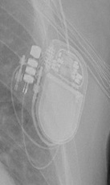 Enitra 8 HF-T QP</td>
<td align="center" valign="top"><b>Option 1</b>  Enitra 6 DR-T</td>
<td align="center" valign="top"><b>✅ Option 2</b>  Enitra 8 HF-T QP</td>
<td align="center" valign="top"><b>Option 3</b>  Etrinsa 8 HF-T</td>
<td align="center" valign="top"><b>Option 4</b>  Enticos 4 DR</td>
<td align="center" valign="top"><b>Option 5</b>  Enticos 4 SR</td>
<td align="center" valign="middle"><b>Option 6</b>  <i>None of the above</i></td>
</tr></table>

### Q1358 · correct: option 2 · `Enitra 8 HF-T QP`

<table><tr>
<td align="center" valign="top"><b>Query</b> 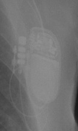 Enitra 8 HF-T QP</td>
<td align="center" valign="top"><b>Option 1</b>  Etrinsa 8 HF-T</td>
<td align="center" valign="top"><b>✅ Option 2</b>  Enitra 8 HF-T QP</td>
<td align="center" valign="top"><b>Option 3</b>  Enticos 4 DR</td>
<td align="center" valign="top"><b>Option 4</b>  Enitra 6 DR-T</td>
<td align="center" valign="top"><b>Option 5</b>  Enticos 4 SR</td>
<td align="center" valign="middle"><b>Option 6</b>  <i>None of the above</i></td>
</tr></table>

### Q1359 · correct: option 2 · `Enitra 8 HF-T QP`

<table><tr>
<td align="center" valign="top"><b>Query</b> 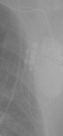 Enitra 8 HF-T QP</td>
<td align="center" valign="top"><b>Option 1</b>  Rivacor 7 HF-T QP</td>
<td align="center" valign="top"><b>✅ Option 2</b>  Enitra 8 HF-T QP</td>
<td align="center" valign="top"><b>Option 3</b>  Enitra 6 DR-T</td>
<td align="center" valign="top"><b>Option 4</b>  Ilivia 7 VR-T</td>
<td align="center" valign="top"><b>Option 5</b>  Etrinsa 8 HF-T</td>
<td align="center" valign="middle"><b>Option 6</b>  <i>None of the above</i></td>
</tr></table>

### Q1360 · correct: option 2 · `Enitra 8 HF-T QP`

<table><tr>
<td align="center" valign="top"><b>Query</b> 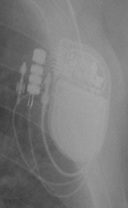 Enitra 8 HF-T QP</td>
<td align="center" valign="top"><b>Option 1</b>  Enticos 4 SR</td>
<td align="center" valign="top"><b>✅ Option 2</b>  Enitra 8 HF-T QP</td>
<td align="center" valign="top"><b>Option 3</b>  Ilivia 7 VR-T</td>
<td align="center" valign="top"><b>Option 4</b>  Enitra 6 DR-T</td>
<td align="center" valign="top"><b>Option 5</b>  Enticos 4 DR</td>
<td align="center" valign="middle"><b>Option 6</b>  <i>None of the above</i></td>
</tr></table>

### Q1361 · correct: option 5 · `Enitra 8 HF-T QP`

<table><tr>
<td align="center" valign="top"><b>Query</b>  Enitra 8 HF-T QP</td>
<td align="center" valign="top"><b>Option 1</b>  Quadra Allure MP</td>
<td align="center" valign="top"><b>Option 2</b>  Enticos 4 DR</td>
<td align="center" valign="top"><b>Option 3</b>  Etrinsa 8 HF-T</td>
<td align="center" valign="top"><b>Option 4</b>  Enitra 6 DR-T</td>
<td align="center" valign="top"><b>✅ Option 5</b>  Enitra 8 HF-T QP</td>
<td align="center" valign="middle"><b>Option 6</b>  <i>None of the above</i></td>
</tr></table>

### Q1362 · correct: option 5 · `Enitra 8 HF-T QP`

<table><tr>
<td align="center" valign="top"><b>Query</b> 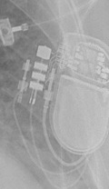 Enitra 8 HF-T QP</td>
<td align="center" valign="top"><b>Option 1</b>  Enitra 6 DR-T</td>
<td align="center" valign="top"><b>Option 2</b>  Etrinsa 8 HF-T</td>
<td align="center" valign="top"><b>Option 3</b>  Enticos 4 DR</td>
<td align="center" valign="top"><b>Option 4</b>  Attesta DR MRI SureScan</td>
<td align="center" valign="top"><b>✅ Option 5</b>  Enitra 8 HF-T QP</td>
<td align="center" valign="middle"><b>Option 6</b>  <i>None of the above</i></td>
</tr></table>

### Q1363 · correct: option 2 · `Enitra 8 HF-T QP`

<table><tr>
<td align="center" valign="top"><b>Query</b> 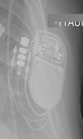 Enitra 8 HF-T QP</td>
<td align="center" valign="top"><b>Option 1</b>  Enticos 4 DR</td>
<td align="center" valign="top"><b>✅ Option 2</b>  Enitra 8 HF-T QP</td>
<td align="center" valign="top"><b>Option 3</b>  Etrinsa 8 HF-T</td>
<td align="center" valign="top"><b>Option 4</b>  Quadra Allure MP</td>
<td align="center" valign="top"><b>Option 5</b>  Enitra 6 DR-T</td>
<td align="center" valign="middle"><b>Option 6</b>  <i>None of the above</i></td>
</tr></table>

### Q1364 · correct: option 4 · `Attesta DR MRI SureScan`

<table><tr>
<td align="center" valign="top"><b>Query</b> 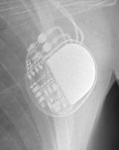 Attesta DR MRI SureScan</td>
<td align="center" valign="top"><b>Option 1</b>  Enticos 4 DR</td>
<td align="center" valign="top"><b>Option 2</b>  Enitra 8 HF-T QP</td>
<td align="center" valign="top"><b>Option 3</b>  Ecuro SR</td>
<td align="center" valign="top"><b>✅ Option 4</b>  Attesta DR MRI SureScan</td>
<td align="center" valign="top"><b>Option 5</b>  Q20 SR MRI SureScan</td>
<td align="center" valign="middle"><b>Option 6</b>  <i>None of the above</i></td>
</tr></table>

### Q1365 · correct: option 2 · `Reveal XT`

<table><tr>
<td align="center" valign="top"><b>Query</b>  Reveal XT</td>
<td align="center" valign="top"><b>Option 1</b>  Enitra 6 DR-T</td>
<td align="center" valign="top"><b>✅ Option 2</b>  Reveal XT</td>
<td align="center" valign="top"><b>Option 3</b>  Reveal LINQ</td>
<td align="center" valign="top"><b>Option 4</b>  Confirm Rx DM3500</td>
<td align="center" valign="top"><b>Option 5</b>  SJM Confirm</td>
<td align="center" valign="middle"><b>Option 6</b>  <i>None of the above</i></td>
</tr></table>

### Q1366 · correct: option 4 · `Reveal XT`

<table><tr>
<td align="center" valign="top"><b>Query</b> 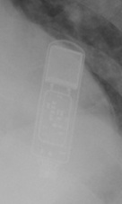 Reveal XT</td>
<td align="center" valign="top"><b>Option 1</b>  Confirm Rx DM3500</td>
<td align="center" valign="top"><b>Option 2</b>  SJM Confirm</td>
<td align="center" valign="top"><b>Option 3</b>  Reveal LINQ</td>
<td align="center" valign="top"><b>✅ Option 4</b>  Reveal XT</td>
<td align="center" valign="top"><b>Option 5</b>  Enitra 6 DR-T</td>
<td align="center" valign="middle"><b>Option 6</b>  <i>None of the above</i></td>
</tr></table>

### Q1367 · correct: option 5 · `Inogen EL ICD VR`

<table><tr>
<td align="center" valign="top"><b>Query</b> 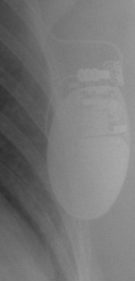 Inogen EL ICD VR</td>
<td align="center" valign="top"><b>Option 1</b>  Rivacor 5 VR-T DX</td>
<td align="center" valign="top"><b>Option 2</b>  Charisma X4 CRT-D</td>
<td align="center" valign="top"><b>Option 3</b>  Valitude X4 CRT-P</td>
<td align="center" valign="top"><b>Option 4</b>  Origen Mini ICD</td>
<td align="center" valign="top"><b>✅ Option 5</b> 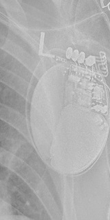 Inogen EL ICD VR</td>
<td align="center" valign="middle"><b>Option 6</b>  <i>None of the above</i></td>
</tr></table>

### Q1368 · correct: option 5 · `SJM Confirm`

<table><tr>
<td align="center" valign="top"><b>Query</b> 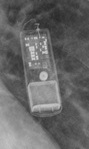 SJM Confirm</td>
<td align="center" valign="top"><b>Option 1</b>  Confirm Rx DM3500</td>
<td align="center" valign="top"><b>Option 2</b>  Quadra Allure MP</td>
<td align="center" valign="top"><b>Option 3</b> 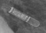 Reveal LINQ</td>
<td align="center" valign="top"><b>Option 4</b>  Reveal XT</td>
<td align="center" valign="top"><b>✅ Option 5</b>  SJM Confirm</td>
<td align="center" valign="middle"><b>Option 6</b>  <i>None of the above</i></td>
</tr></table>

### Q1369 · correct: option 4 · `Compia MRI Quad CRT-D SureScan`

<table><tr>
<td align="center" valign="top"><b>Query</b>  Compia MRI Quad CRT-D SureScan</td>
<td align="center" valign="top"><b>Option 1</b>  Serena Quad CRT-P MRI ScureScan</td>
<td align="center" valign="top"><b>Option 2</b>  Mirro MRI VR SureScan</td>
<td align="center" valign="top"><b>Option 3</b>  Ilivia 7 HF-T QP</td>
<td align="center" valign="top"><b>✅ Option 4</b>  Compia MRI Quad CRT-D SureScan</td>
<td align="center" valign="top"><b>Option 5</b>  Quadra Assura</td>
<td align="center" valign="middle"><b>Option 6</b>  <i>None of the above</i></td>
</tr></table>

### Q1370 · correct: option 5 · `Enticos 4 DR`

<table><tr>
<td align="center" valign="top"><b>Query</b>  Enticos 4 DR</td>
<td align="center" valign="top"><b>Option 1</b>  Enticos 4 SR</td>
<td align="center" valign="top"><b>Option 2</b>  Enitra 8 HF-T QP</td>
<td align="center" valign="top"><b>Option 3</b>  Ecuro SR</td>
<td align="center" valign="top"><b>Option 4</b>  Enitra 6 DR-T</td>
<td align="center" valign="top"><b>✅ Option 5</b>  Enticos 4 DR</td>
<td align="center" valign="middle"><b>Option 6</b>  <i>None of the above</i></td>
</tr></table>

### Q1371 · correct: option 3 · `Mirro MRI VR SureScan`

<table><tr>
<td align="center" valign="top"><b>Query</b> 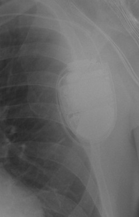 Mirro MRI VR SureScan</td>
<td align="center" valign="top"><b>Option 1</b>  Ellipse VR</td>
<td align="center" valign="top"><b>Option 2</b>  Ecuro SR</td>
<td align="center" valign="top"><b>✅ Option 3</b>  Mirro MRI VR SureScan</td>
<td align="center" valign="top"><b>Option 4</b>  Compia MRI Quad CRT-D SureScan</td>
<td align="center" valign="top"><b>Option 5</b>  Ilivia 7 VR-T</td>
<td align="center" valign="middle"><b>Option 6</b>  <i>None of the above</i></td>
</tr></table>

### Q1372 · correct: option 3 · `Attesta DR MRI SureScan`

<table><tr>
<td align="center" valign="top"><b>Query</b> 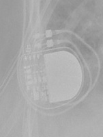 Attesta DR MRI SureScan</td>
<td align="center" valign="top"><b>Option 1</b>  Ilivia 7 HF-T QP</td>
<td align="center" valign="top"><b>Option 2</b>  Enticos 4 DR</td>
<td align="center" valign="top"><b>✅ Option 3</b>  Attesta DR MRI SureScan</td>
<td align="center" valign="top"><b>Option 4</b>  Enitra 8 HF-T QP</td>
<td align="center" valign="top"><b>Option 5</b>  Q20 SR MRI SureScan</td>
<td align="center" valign="middle"><b>Option 6</b>  <i>None of the above</i></td>
</tr></table>

### Q1373 · correct: option 3 · `Attesta DR MRI SureScan`

<table><tr>
<td align="center" valign="top"><b>Query</b> 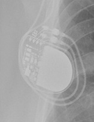 Attesta DR MRI SureScan</td>
<td align="center" valign="top"><b>Option 1</b>  Q20 SR MRI SureScan</td>
<td align="center" valign="top"><b>Option 2</b>  Enticos 4 DR</td>
<td align="center" valign="top"><b>✅ Option 3</b>  Attesta DR MRI SureScan</td>
<td align="center" valign="top"><b>Option 4</b>  Enticos 4 SR</td>
<td align="center" valign="top"><b>Option 5</b>  Ensura DR MRI SureScan</td>
<td align="center" valign="middle"><b>Option 6</b>  <i>None of the above</i></td>
</tr></table>

### Q1374 · correct: option 3 · `Attesta DR MRI SureScan`

<table><tr>
<td align="center" valign="top"><b>Query</b> 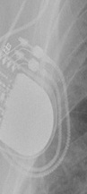 Attesta DR MRI SureScan</td>
<td align="center" valign="top"><b>Option 1</b>  Q20 SR MRI SureScan</td>
<td align="center" valign="top"><b>Option 2</b>  Enitra 8 HF-T QP</td>
<td align="center" valign="top"><b>✅ Option 3</b>  Attesta DR MRI SureScan</td>
<td align="center" valign="top"><b>Option 4</b>  Enticos 4 SR</td>
<td align="center" valign="top"><b>Option 5</b>  Enticos 4 DR</td>
<td align="center" valign="middle"><b>Option 6</b>  <i>None of the above</i></td>
</tr></table>

### Q1375 · correct: option 4 · `Attesta DR MRI SureScan`

<table><tr>
<td align="center" valign="top"><b>Query</b>  Attesta DR MRI SureScan</td>
<td align="center" valign="top"><b>Option 1</b>  Q20 SR MRI SureScan</td>
<td align="center" valign="top"><b>Option 2</b>  Enticos 4 DR</td>
<td align="center" valign="top"><b>Option 3</b>  Serena Quad CRT-P MRI ScureScan</td>
<td align="center" valign="top"><b>✅ Option 4</b>  Attesta DR MRI SureScan</td>
<td align="center" valign="top"><b>Option 5</b>  Ensura DR MRI SureScan</td>
<td align="center" valign="middle"><b>Option 6</b>  <i>None of the above</i></td>
</tr></table>

### Q1376 · correct: option 2 · `Serena Quad CRT-P MRI ScureScan`

<table><tr>
<td align="center" valign="top"><b>Query</b> 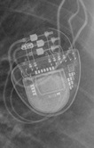 Serena Quad CRT-P MRI ScureScan</td>
<td align="center" valign="top"><b>Option 1</b>  Ellipse VR</td>
<td align="center" valign="top"><b>✅ Option 2</b>  Serena Quad CRT-P MRI ScureScan</td>
<td align="center" valign="top"><b>Option 3</b>  Compia MRI Quad CRT-D SureScan</td>
<td align="center" valign="top"><b>Option 4</b>  Etrinsa 8 HF-T</td>
<td align="center" valign="top"><b>Option 5</b>  Valitude X4 CRT-P</td>
<td align="center" valign="middle"><b>Option 6</b>  <i>None of the above</i></td>
</tr></table>

### Q1377 · correct: option 1 · `Quadra Allure MP`

<table><tr>
<td align="center" valign="top"><b>Query</b> 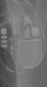 Quadra Allure MP</td>
<td align="center" valign="top"><b>✅ Option 1</b>  Quadra Allure MP</td>
<td align="center" valign="top"><b>Option 2</b> 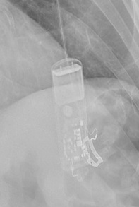 SJM Confirm</td>
<td align="center" valign="top"><b>Option 3</b>  Ilivia 7 HF-T QP</td>
<td align="center" valign="top"><b>Option 4</b>  Ensura DR MRI SureScan</td>
<td align="center" valign="top"><b>Option 5</b>  Enitra 8 HF-T QP</td>
<td align="center" valign="middle"><b>Option 6</b>  <i>None of the above</i></td>
</tr></table>

### Q1378 · correct: option 2 · `Quadra Allure MP`

<table><tr>
<td align="center" valign="top"><b>Query</b> 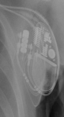 Quadra Allure MP</td>
<td align="center" valign="top"><b>Option 1</b>  SJM Confirm</td>
<td align="center" valign="top"><b>✅ Option 2</b>  Quadra Allure MP</td>
<td align="center" valign="top"><b>Option 3</b>  Ensura DR MRI SureScan</td>
<td align="center" valign="top"><b>Option 4</b>  Enitra 8 HF-T QP</td>
<td align="center" valign="top"><b>Option 5</b>  Ilivia 7 HF-T QP</td>
<td align="center" valign="middle"><b>Option 6</b>  <i>None of the above</i></td>
</tr></table>

### Q1379 · correct: option 5 · `Quadra Allure MP`

<table><tr>
<td align="center" valign="top"><b>Query</b> 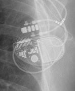 Quadra Allure MP</td>
<td align="center" valign="top"><b>Option 1</b>  Enitra 8 HF-T QP</td>
<td align="center" valign="top"><b>Option 2</b>  SJM Confirm</td>
<td align="center" valign="top"><b>Option 3</b>  Ilivia 7 HF-T QP</td>
<td align="center" valign="top"><b>Option 4</b>  Ensura DR MRI SureScan</td>
<td align="center" valign="top"><b>✅ Option 5</b> 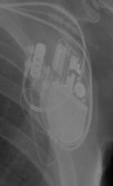 Quadra Allure MP</td>
<td align="center" valign="middle"><b>Option 6</b>  <i>None of the above</i></td>
</tr></table>

### Q1380 · correct: option 3 · `Quadra Allure MP`

<table><tr>
<td align="center" valign="top"><b>Query</b> 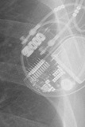 Quadra Allure MP</td>
<td align="center" valign="top"><b>Option 1</b>  Ecuro SR</td>
<td align="center" valign="top"><b>Option 2</b>  SJM Confirm</td>
<td align="center" valign="top"><b>✅ Option 3</b>  Quadra Allure MP</td>
<td align="center" valign="top"><b>Option 4</b>  Enitra 8 HF-T QP</td>
<td align="center" valign="top"><b>Option 5</b>  Ilivia 7 HF-T QP</td>
<td align="center" valign="middle"><b>Option 6</b>  <i>None of the above</i></td>
</tr></table>

### Q1381 · correct: option 1 · `Quadra Assura`

<table><tr>
<td align="center" valign="top"><b>Query</b>  Quadra Assura</td>
<td align="center" valign="top"><b>✅ Option 1</b>  Quadra Assura</td>
<td align="center" valign="top"><b>Option 2</b>  Ensura DR MRI SureScan</td>
<td align="center" valign="top"><b>Option 3</b>  Serena Quad CRT-P MRI ScureScan</td>
<td align="center" valign="top"><b>Option 4</b>  Ellipse VR</td>
<td align="center" valign="top"><b>Option 5</b>  Etrinsa 8 HF-T</td>
<td align="center" valign="middle"><b>Option 6</b>  <i>None of the above</i></td>
</tr></table>

### Q1382 · correct: option 5 · `Quadra Assura`

<table><tr>
<td align="center" valign="top"><b>Query</b> 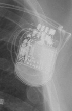 Quadra Assura</td>
<td align="center" valign="top"><b>Option 1</b>  Origen Mini ICD</td>
<td align="center" valign="top"><b>Option 2</b>  Ensura DR MRI SureScan</td>
<td align="center" valign="top"><b>Option 3</b>  Rivacor 5 VR-T DX</td>
<td align="center" valign="top"><b>Option 4</b>  Ellipse VR</td>
<td align="center" valign="top"><b>✅ Option 5</b>  Quadra Assura</td>
<td align="center" valign="middle"><b>Option 6</b>  <i>None of the above</i></td>
</tr></table>

### Q1383 · correct: option 1 · `Quadra Assura`

<table><tr>
<td align="center" valign="top"><b>Query</b> 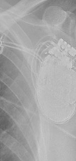 Quadra Assura</td>
<td align="center" valign="top"><b>✅ Option 1</b>  Quadra Assura</td>
<td align="center" valign="top"><b>Option 2</b> 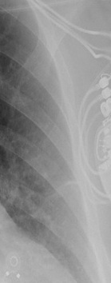 Valitude X4 CRT-P</td>
<td align="center" valign="top"><b>Option 3</b>  Inogen EL ICD VR</td>
<td align="center" valign="top"><b>Option 4</b>  Origen Mini ICD</td>
<td align="center" valign="top"><b>Option 5</b>  Ellipse VR</td>
<td align="center" valign="middle"><b>Option 6</b>  <i>None of the above</i></td>
</tr></table>

