# Physionet (cardiac devices) · query set `test` · page 2/8

[← all pages](README.md)

### Q1384 · correct: option 2 · `Quadra Assura`

<table><tr>
<td align="center" valign="top"><b>Query</b> 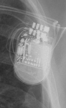 Quadra Assura</td>
<td align="center" valign="top"><b>Option 1</b>  Ellipse VR</td>
<td align="center" valign="top"><b>✅ Option 2</b>  Quadra Assura</td>
<td align="center" valign="top"><b>Option 3</b> 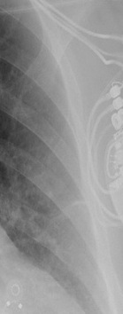 Valitude X4 CRT-P</td>
<td align="center" valign="top"><b>Option 4</b>  Ensura DR MRI SureScan</td>
<td align="center" valign="top"><b>Option 5</b>  Reveal XT</td>
<td align="center" valign="middle"><b>Option 6</b>  <i>None of the above</i></td>
</tr></table>

### Q1385 · correct: option 2 · `Serena Quad CRT-P MRI ScureScan`

<table><tr>
<td align="center" valign="top"><b>Query</b> 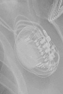 Serena Quad CRT-P MRI ScureScan</td>
<td align="center" valign="top"><b>Option 1</b> 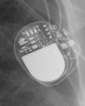 Attesta DR MRI SureScan</td>
<td align="center" valign="top"><b>✅ Option 2</b>  Serena Quad CRT-P MRI ScureScan</td>
<td align="center" valign="top"><b>Option 3</b> 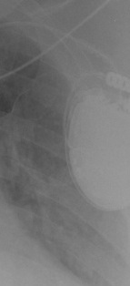 Ellipse VR</td>
<td align="center" valign="top"><b>Option 4</b>  Ensura DR MRI SureScan</td>
<td align="center" valign="top"><b>Option 5</b>  Etrinsa 8 HF-T</td>
<td align="center" valign="middle"><b>Option 6</b>  <i>None of the above</i></td>
</tr></table>

### Q1386 · correct: option 4 · `Serena Quad CRT-P MRI ScureScan`

<table><tr>
<td align="center" valign="top"><b>Query</b> 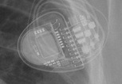 Serena Quad CRT-P MRI ScureScan</td>
<td align="center" valign="top"><b>Option 1</b>  Quadra Allure MP</td>
<td align="center" valign="top"><b>Option 2</b>  Ensura DR MRI SureScan</td>
<td align="center" valign="top"><b>Option 3</b> 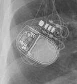 Enitra 8 HF-T QP</td>
<td align="center" valign="top"><b>✅ Option 4</b>  Serena Quad CRT-P MRI ScureScan</td>
<td align="center" valign="top"><b>Option 5</b>  Etrinsa 8 HF-T</td>
<td align="center" valign="middle"><b>Option 6</b>  <i>None of the above</i></td>
</tr></table>

### Q1387 · correct: option 1 · `Serena Quad CRT-P MRI ScureScan`

<table><tr>
<td align="center" valign="top"><b>Query</b> 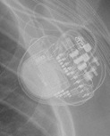 Serena Quad CRT-P MRI ScureScan</td>
<td align="center" valign="top"><b>✅ Option 1</b>  Serena Quad CRT-P MRI ScureScan</td>
<td align="center" valign="top"><b>Option 2</b>  Etrinsa 8 HF-T</td>
<td align="center" valign="top"><b>Option 3</b>  Attesta DR MRI SureScan</td>
<td align="center" valign="top"><b>Option 4</b>  Ensura DR MRI SureScan</td>
<td align="center" valign="top"><b>Option 5</b>  Enitra 8 HF-T QP</td>
<td align="center" valign="middle"><b>Option 6</b>  <i>None of the above</i></td>
</tr></table>

### Q1388 · correct: option 5 · `Attesta DR MRI SureScan`

<table><tr>
<td align="center" valign="top"><b>Query</b> 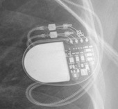 Attesta DR MRI SureScan</td>
<td align="center" valign="top"><b>Option 1</b>  Ensura DR MRI SureScan</td>
<td align="center" valign="top"><b>Option 2</b>  Q20 SR MRI SureScan</td>
<td align="center" valign="top"><b>Option 3</b>  Enitra 8 HF-T QP</td>
<td align="center" valign="top"><b>Option 4</b>  Enticos 4 DR</td>
<td align="center" valign="top"><b>✅ Option 5</b>  Attesta DR MRI SureScan</td>
<td align="center" valign="middle"><b>Option 6</b>  <i>None of the above</i></td>
</tr></table>

### Q1389 · correct: option 5 · `Enticos 4 DR`

<table><tr>
<td align="center" valign="top"><b>Query</b> 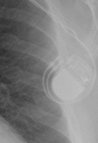 Enticos 4 DR</td>
<td align="center" valign="top"><b>Option 1</b>  Enitra 8 HF-T QP</td>
<td align="center" valign="top"><b>Option 2</b>  Enitra 6 DR-T</td>
<td align="center" valign="top"><b>Option 3</b>  Enticos 4 SR</td>
<td align="center" valign="top"><b>Option 4</b>  Ecuro SR</td>
<td align="center" valign="top"><b>✅ Option 5</b>  Enticos 4 DR</td>
<td align="center" valign="middle"><b>Option 6</b>  <i>None of the above</i></td>
</tr></table>

### Q1390 · correct: option 1 · `Enticos 4 DR`

<table><tr>
<td align="center" valign="top"><b>Query</b>  Enticos 4 DR</td>
<td align="center" valign="top"><b>✅ Option 1</b>  Enticos 4 DR</td>
<td align="center" valign="top"><b>Option 2</b>  Enitra 8 HF-T QP</td>
<td align="center" valign="top"><b>Option 3</b>  Enitra 6 DR-T</td>
<td align="center" valign="top"><b>Option 4</b>  Ecuro SR</td>
<td align="center" valign="top"><b>Option 5</b>  Enticos 4 SR</td>
<td align="center" valign="middle"><b>Option 6</b>  <i>None of the above</i></td>
</tr></table>

### Q1391 · correct: option 2 · `Attesta DR MRI SureScan`

<table><tr>
<td align="center" valign="top"><b>Query</b> 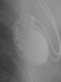 Attesta DR MRI SureScan</td>
<td align="center" valign="top"><b>Option 1</b>  Q20 SR MRI SureScan</td>
<td align="center" valign="top"><b>✅ Option 2</b>  Attesta DR MRI SureScan</td>
<td align="center" valign="top"><b>Option 3</b>  Enticos 4 DR</td>
<td align="center" valign="top"><b>Option 4</b>  Ensura DR MRI SureScan</td>
<td align="center" valign="top"><b>Option 5</b> 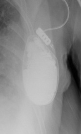 Ellipse VR</td>
<td align="center" valign="middle"><b>Option 6</b>  <i>None of the above</i></td>
</tr></table>

### Q1392 · correct: option 1 · `Q20 SR MRI SureScan`

<table><tr>
<td align="center" valign="top"><b>Query</b> 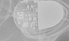 Q20 SR MRI SureScan</td>
<td align="center" valign="top"><b>✅ Option 1</b>  Q20 SR MRI SureScan</td>
<td align="center" valign="top"><b>Option 2</b>  Etrinsa 8 HF-T</td>
<td align="center" valign="top"><b>Option 3</b>  Enticos 4 DR</td>
<td align="center" valign="top"><b>Option 4</b>  Attesta DR MRI SureScan</td>
<td align="center" valign="top"><b>Option 5</b>  Serena Quad CRT-P MRI ScureScan</td>
<td align="center" valign="middle"><b>Option 6</b>  <i>None of the above</i></td>
</tr></table>

### Q1393 · correct: option 2 · `Q20 SR MRI SureScan`

<table><tr>
<td align="center" valign="top"><b>Query</b> 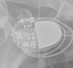 Q20 SR MRI SureScan</td>
<td align="center" valign="top"><b>Option 1</b>  Ecuro SR</td>
<td align="center" valign="top"><b>✅ Option 2</b>  Q20 SR MRI SureScan</td>
<td align="center" valign="top"><b>Option 3</b>  Enitra 8 HF-T QP</td>
<td align="center" valign="top"><b>Option 4</b>  Enticos 4 DR</td>
<td align="center" valign="top"><b>Option 5</b>  Attesta DR MRI SureScan</td>
<td align="center" valign="middle"><b>Option 6</b>  <i>None of the above</i></td>
</tr></table>

### Q1394 · correct: option 1 · `Q20 SR MRI SureScan`

<table><tr>
<td align="center" valign="top"><b>Query</b> 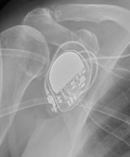 Q20 SR MRI SureScan</td>
<td align="center" valign="top"><b>✅ Option 1</b>  Q20 SR MRI SureScan</td>
<td align="center" valign="top"><b>Option 2</b>  Ensura DR MRI SureScan</td>
<td align="center" valign="top"><b>Option 3</b>  Enticos 4 DR</td>
<td align="center" valign="top"><b>Option 4</b>  Valitude X4 CRT-P</td>
<td align="center" valign="top"><b>Option 5</b>  Attesta DR MRI SureScan</td>
<td align="center" valign="middle"><b>Option 6</b>  <i>None of the above</i></td>
</tr></table>

### Q1395 · correct: option 4 · `Q20 SR MRI SureScan`

<table><tr>
<td align="center" valign="top"><b>Query</b> 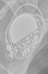 Q20 SR MRI SureScan</td>
<td align="center" valign="top"><b>Option 1</b>  Enitra 8 HF-T QP</td>
<td align="center" valign="top"><b>Option 2</b>  Enticos 4 DR</td>
<td align="center" valign="top"><b>Option 3</b>  Enticos 4 SR</td>
<td align="center" valign="top"><b>✅ Option 4</b>  Q20 SR MRI SureScan</td>
<td align="center" valign="top"><b>Option 5</b>  Attesta DR MRI SureScan</td>
<td align="center" valign="middle"><b>Option 6</b>  <i>None of the above</i></td>
</tr></table>

### Q1396 · correct: option 4 · `Q20 SR MRI SureScan`

<table><tr>
<td align="center" valign="top"><b>Query</b> 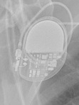 Q20 SR MRI SureScan</td>
<td align="center" valign="top"><b>Option 1</b>  Enitra 8 HF-T QP</td>
<td align="center" valign="top"><b>Option 2</b>  Enticos 4 DR</td>
<td align="center" valign="top"><b>Option 3</b>  Attesta DR MRI SureScan</td>
<td align="center" valign="top"><b>✅ Option 4</b>  Q20 SR MRI SureScan</td>
<td align="center" valign="top"><b>Option 5</b>  Enticos 4 SR</td>
<td align="center" valign="middle"><b>Option 6</b>  <i>None of the above</i></td>
</tr></table>

### Q1397 · correct: option 2 · `Reveal LINQ`

<table><tr>
<td align="center" valign="top"><b>Query</b> 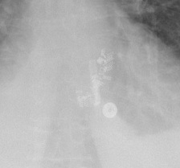 Reveal LINQ</td>
<td align="center" valign="top"><b>Option 1</b>  Reveal XT</td>
<td align="center" valign="top"><b>✅ Option 2</b>  Reveal LINQ</td>
<td align="center" valign="top"><b>Option 3</b>  Confirm Rx DM3500</td>
<td align="center" valign="top"><b>Option 4</b>  SJM Confirm</td>
<td align="center" valign="top"><b>Option 5</b>  Ensura DR MRI SureScan</td>
<td align="center" valign="middle"><b>Option 6</b>  <i>None of the above</i></td>
</tr></table>

### Q1398 · correct: option 5 · `Reveal LINQ`

<table><tr>
<td align="center" valign="top"><b>Query</b> 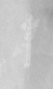 Reveal LINQ</td>
<td align="center" valign="top"><b>Option 1</b>  Confirm Rx DM3500</td>
<td align="center" valign="top"><b>Option 2</b>  Quadra Allure MP</td>
<td align="center" valign="top"><b>Option 3</b>  SJM Confirm</td>
<td align="center" valign="top"><b>Option 4</b>  Reveal XT</td>
<td align="center" valign="top"><b>✅ Option 5</b>  Reveal LINQ</td>
<td align="center" valign="middle"><b>Option 6</b>  <i>None of the above</i></td>
</tr></table>

### Q1399 · correct: option 1 · `Reveal LINQ`

<table><tr>
<td align="center" valign="top"><b>Query</b> 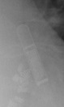 Reveal LINQ</td>
<td align="center" valign="top"><b>✅ Option 1</b>  Reveal LINQ</td>
<td align="center" valign="top"><b>Option 2</b>  Ecuro SR</td>
<td align="center" valign="top"><b>Option 3</b>  Reveal XT</td>
<td align="center" valign="top"><b>Option 4</b>  Confirm Rx DM3500</td>
<td align="center" valign="top"><b>Option 5</b>  SJM Confirm</td>
<td align="center" valign="middle"><b>Option 6</b>  <i>None of the above</i></td>
</tr></table>

### Q1400 · correct: option 2 · `Confirm Rx DM3500`

<table><tr>
<td align="center" valign="top"><b>Query</b> 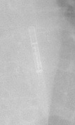 Confirm Rx DM3500</td>
<td align="center" valign="top"><b>Option 1</b>  Ilivia 7 VR-T</td>
<td align="center" valign="top"><b>✅ Option 2</b>  Confirm Rx DM3500</td>
<td align="center" valign="top"><b>Option 3</b>  SJM Confirm</td>
<td align="center" valign="top"><b>Option 4</b>  Reveal LINQ</td>
<td align="center" valign="top"><b>Option 5</b>  Reveal XT</td>
<td align="center" valign="middle"><b>Option 6</b>  <i>None of the above</i></td>
</tr></table>

### Q1401 · correct: option 2 · `Q20 SR MRI SureScan`

<table><tr>
<td align="center" valign="top"><b>Query</b>  Q20 SR MRI SureScan</td>
<td align="center" valign="top"><b>Option 1</b>  Enticos 4 SR</td>
<td align="center" valign="top"><b>✅ Option 2</b>  Q20 SR MRI SureScan</td>
<td align="center" valign="top"><b>Option 3</b>  Ecuro SR</td>
<td align="center" valign="top"><b>Option 4</b>  Enticos 4 DR</td>
<td align="center" valign="top"><b>Option 5</b>  Attesta DR MRI SureScan</td>
<td align="center" valign="middle"><b>Option 6</b>  <i>None of the above</i></td>
</tr></table>

### Q1402 · correct: option 2 · `Ensura DR MRI SureScan`

<table><tr>
<td align="center" valign="top"><b>Query</b>  Ensura DR MRI SureScan</td>
<td align="center" valign="top"><b>Option 1</b>  Etrinsa 8 HF-T</td>
<td align="center" valign="top"><b>✅ Option 2</b>  Ensura DR MRI SureScan</td>
<td align="center" valign="top"><b>Option 3</b>  Attesta DR MRI SureScan</td>
<td align="center" valign="top"><b>Option 4</b>  Quadra Assura</td>
<td align="center" valign="top"><b>Option 5</b>  Enitra 6 DR-T</td>
<td align="center" valign="middle"><b>Option 6</b>  <i>None of the above</i></td>
</tr></table>

### Q1403 · correct: option 5 · `Ensura DR MRI SureScan`

<table><tr>
<td align="center" valign="top"><b>Query</b> 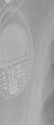 Ensura DR MRI SureScan</td>
<td align="center" valign="top"><b>Option 1</b>  Attesta DR MRI SureScan</td>
<td align="center" valign="top"><b>Option 2</b>  Ecuro SR</td>
<td align="center" valign="top"><b>Option 3</b>  Etrinsa 8 HF-T</td>
<td align="center" valign="top"><b>Option 4</b>  Q20 SR MRI SureScan</td>
<td align="center" valign="top"><b>✅ Option 5</b>  Ensura DR MRI SureScan</td>
<td align="center" valign="middle"><b>Option 6</b>  <i>None of the above</i></td>
</tr></table>

### Q1404 · correct: option 3 · `Enticos 4 SR`

<table><tr>
<td align="center" valign="top"><b>Query</b> 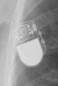 Enticos 4 SR</td>
<td align="center" valign="top"><b>Option 1</b>  Attesta DR MRI SureScan</td>
<td align="center" valign="top"><b>Option 2</b>  Ecuro SR</td>
<td align="center" valign="top"><b>✅ Option 3</b>  Enticos 4 SR</td>
<td align="center" valign="top"><b>Option 4</b>  Enticos 4 DR</td>
<td align="center" valign="top"><b>Option 5</b>  Enitra 6 DR-T</td>
<td align="center" valign="middle"><b>Option 6</b>  <i>None of the above</i></td>
</tr></table>

### Q1405 · correct: option 2 · `Enticos 4 SR`

<table><tr>
<td align="center" valign="top"><b>Query</b> 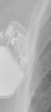 Enticos 4 SR</td>
<td align="center" valign="top"><b>Option 1</b>  SJM Confirm</td>
<td align="center" valign="top"><b>✅ Option 2</b>  Enticos 4 SR</td>
<td align="center" valign="top"><b>Option 3</b>  Ecuro SR</td>
<td align="center" valign="top"><b>Option 4</b>  Reveal XT</td>
<td align="center" valign="top"><b>Option 5</b>  Enticos 4 DR</td>
<td align="center" valign="middle"><b>Option 6</b>  <i>None of the above</i></td>
</tr></table>

### Q1406 · correct: option 5 · `Serena Quad CRT-P MRI ScureScan`

<table><tr>
<td align="center" valign="top"><b>Query</b> 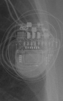 Serena Quad CRT-P MRI ScureScan</td>
<td align="center" valign="top"><b>Option 1</b>  Compia MRI Quad CRT-D SureScan</td>
<td align="center" valign="top"><b>Option 2</b>  Enitra 8 HF-T QP</td>
<td align="center" valign="top"><b>Option 3</b>  Etrinsa 8 HF-T</td>
<td align="center" valign="top"><b>Option 4</b>  Valitude X4 CRT-P</td>
<td align="center" valign="top"><b>✅ Option 5</b>  Serena Quad CRT-P MRI ScureScan</td>
<td align="center" valign="middle"><b>Option 6</b>  <i>None of the above</i></td>
</tr></table>

### Q1407 · correct: option 5 · `Enitra 8 HF-T QP`

<table><tr>
<td align="center" valign="top"><b>Query</b> 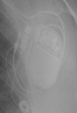 Enitra 8 HF-T QP</td>
<td align="center" valign="top"><b>Option 1</b>  Enticos 4 DR</td>
<td align="center" valign="top"><b>Option 2</b> 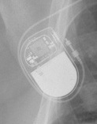 Enticos 4 SR</td>
<td align="center" valign="top"><b>Option 3</b>  Enitra 6 DR-T</td>
<td align="center" valign="top"><b>Option 4</b>  Etrinsa 8 HF-T</td>
<td align="center" valign="top"><b>✅ Option 5</b> 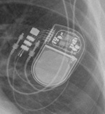 Enitra 8 HF-T QP</td>
<td align="center" valign="middle"><b>Option 6</b>  <i>None of the above</i></td>
</tr></table>

### Q1408 · correct: option 3 · `Enitra 8 HF-T QP`

<table><tr>
<td align="center" valign="top"><b>Query</b> 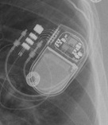 Enitra 8 HF-T QP</td>
<td align="center" valign="top"><b>Option 1</b>  Etrinsa 8 HF-T</td>
<td align="center" valign="top"><b>Option 2</b>  Quadra Allure MP</td>
<td align="center" valign="top"><b>✅ Option 3</b>  Enitra 8 HF-T QP</td>
<td align="center" valign="top"><b>Option 4</b>  Enitra 6 DR-T</td>
<td align="center" valign="top"><b>Option 5</b>  Enticos 4 SR</td>
<td align="center" valign="middle"><b>Option 6</b>  <i>None of the above</i></td>
</tr></table>

### Q1409 · correct: option 3 · `Enitra 8 HF-T QP`

<table><tr>
<td align="center" valign="top"><b>Query</b>  Enitra 8 HF-T QP</td>
<td align="center" valign="top"><b>Option 1</b>  Quadra Allure MP</td>
<td align="center" valign="top"><b>Option 2</b>  Enitra 6 DR-T</td>
<td align="center" valign="top"><b>✅ Option 3</b>  Enitra 8 HF-T QP</td>
<td align="center" valign="top"><b>Option 4</b>  Enticos 4 DR</td>
<td align="center" valign="top"><b>Option 5</b>  Etrinsa 8 HF-T</td>
<td align="center" valign="middle"><b>Option 6</b>  <i>None of the above</i></td>
</tr></table>

### Q1410 · correct: option 2 · `Enitra 8 HF-T QP`

<table><tr>
<td align="center" valign="top"><b>Query</b> 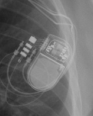 Enitra 8 HF-T QP</td>
<td align="center" valign="top"><b>Option 1</b>  Enticos 4 DR</td>
<td align="center" valign="top"><b>✅ Option 2</b>  Enitra 8 HF-T QP</td>
<td align="center" valign="top"><b>Option 3</b>  Etrinsa 8 HF-T</td>
<td align="center" valign="top"><b>Option 4</b>  Enitra 6 DR-T</td>
<td align="center" valign="top"><b>Option 5</b>  Quadra Allure MP</td>
<td align="center" valign="middle"><b>Option 6</b>  <i>None of the above</i></td>
</tr></table>

### Q1411 · correct: option 2 · `Enitra 8 HF-T QP`

<table><tr>
<td align="center" valign="top"><b>Query</b> 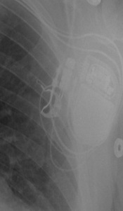 Enitra 8 HF-T QP</td>
<td align="center" valign="top"><b>Option 1</b>  Etrinsa 8 HF-T</td>
<td align="center" valign="top"><b>✅ Option 2</b>  Enitra 8 HF-T QP</td>
<td align="center" valign="top"><b>Option 3</b>  Enitra 6 DR-T</td>
<td align="center" valign="top"><b>Option 4</b>  Ensura DR MRI SureScan</td>
<td align="center" valign="top"><b>Option 5</b>  Enticos 4 DR</td>
<td align="center" valign="middle"><b>Option 6</b>  <i>None of the above</i></td>
</tr></table>

### Q1412 · correct: option 2 · `Mirro MRI VR SureScan`

<table><tr>
<td align="center" valign="top"><b>Query</b> 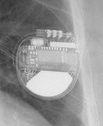 Mirro MRI VR SureScan</td>
<td align="center" valign="top"><b>Option 1</b>  Ellipse VR</td>
<td align="center" valign="top"><b>✅ Option 2</b>  Mirro MRI VR SureScan</td>
<td align="center" valign="top"><b>Option 3</b>  Ilivia 7 HF-T QP</td>
<td align="center" valign="top"><b>Option 4</b>  Compia MRI Quad CRT-D SureScan</td>
<td align="center" valign="top"><b>Option 5</b>  Serena Quad CRT-P MRI ScureScan</td>
<td align="center" valign="middle"><b>Option 6</b>  <i>None of the above</i></td>
</tr></table>

### Q1413 · correct: option 3 · `Mirro MRI VR SureScan`

<table><tr>
<td align="center" valign="top"><b>Query</b> 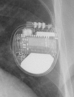 Mirro MRI VR SureScan</td>
<td align="center" valign="top"><b>Option 1</b>  Serena Quad CRT-P MRI ScureScan</td>
<td align="center" valign="top"><b>Option 2</b>  Compia MRI Quad CRT-D SureScan</td>
<td align="center" valign="top"><b>✅ Option 3</b>  Mirro MRI VR SureScan</td>
<td align="center" valign="top"><b>Option 4</b>  Ilivia 7 HF-T QP</td>
<td align="center" valign="top"><b>Option 5</b>  Ellipse VR</td>
<td align="center" valign="middle"><b>Option 6</b>  <i>None of the above</i></td>
</tr></table>

### Q1414 · correct: option 1 · `Mirro MRI VR SureScan`

<table><tr>
<td align="center" valign="top"><b>Query</b> 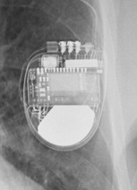 Mirro MRI VR SureScan</td>
<td align="center" valign="top"><b>✅ Option 1</b>  Mirro MRI VR SureScan</td>
<td align="center" valign="top"><b>Option 2</b>  Serena Quad CRT-P MRI ScureScan</td>
<td align="center" valign="top"><b>Option 3</b>  Ellipse VR</td>
<td align="center" valign="top"><b>Option 4</b>  Ilivia 7 HF-T QP</td>
<td align="center" valign="top"><b>Option 5</b>  Compia MRI Quad CRT-D SureScan</td>
<td align="center" valign="middle"><b>Option 6</b>  <i>None of the above</i></td>
</tr></table>

### Q1415 · correct: option 1 · `Mirro MRI VR SureScan`

<table><tr>
<td align="center" valign="top"><b>Query</b> 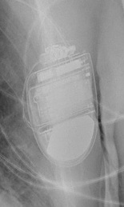 Mirro MRI VR SureScan</td>
<td align="center" valign="top"><b>✅ Option 1</b>  Mirro MRI VR SureScan</td>
<td align="center" valign="top"><b>Option 2</b>  Ilivia 7 VR-T</td>
<td align="center" valign="top"><b>Option 3</b>  Ilivia 7 HF-T QP</td>
<td align="center" valign="top"><b>Option 4</b>  Compia MRI Quad CRT-D SureScan</td>
<td align="center" valign="top"><b>Option 5</b>  Ellipse VR</td>
<td align="center" valign="middle"><b>Option 6</b>  <i>None of the above</i></td>
</tr></table>

### Q1416 · correct: option 4 · `Mirro MRI VR SureScan`

<table><tr>
<td align="center" valign="top"><b>Query</b> 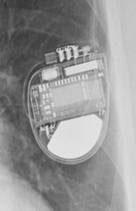 Mirro MRI VR SureScan</td>
<td align="center" valign="top"><b>Option 1</b>  Ilivia 7 HF-T QP</td>
<td align="center" valign="top"><b>Option 2</b>  Serena Quad CRT-P MRI ScureScan</td>
<td align="center" valign="top"><b>Option 3</b>  Ellipse VR</td>
<td align="center" valign="top"><b>✅ Option 4</b>  Mirro MRI VR SureScan</td>
<td align="center" valign="top"><b>Option 5</b>  Compia MRI Quad CRT-D SureScan</td>
<td align="center" valign="middle"><b>Option 6</b>  <i>None of the above</i></td>
</tr></table>

### Q1417 · correct: option 5 · `Mirro MRI VR SureScan`

<table><tr>
<td align="center" valign="top"><b>Query</b> 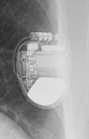 Mirro MRI VR SureScan</td>
<td align="center" valign="top"><b>Option 1</b>  Serena Quad CRT-P MRI ScureScan</td>
<td align="center" valign="top"><b>Option 2</b>  Compia MRI Quad CRT-D SureScan</td>
<td align="center" valign="top"><b>Option 3</b>  Ilivia 7 VR-T</td>
<td align="center" valign="top"><b>Option 4</b>  Ilivia 7 HF-T QP</td>
<td align="center" valign="top"><b>✅ Option 5</b>  Mirro MRI VR SureScan</td>
<td align="center" valign="middle"><b>Option 6</b>  <i>None of the above</i></td>
</tr></table>

### Q1418 · correct: option 2 · `Quadra Assura`

<table><tr>
<td align="center" valign="top"><b>Query</b> 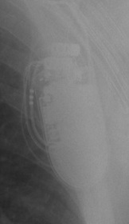 Quadra Assura</td>
<td align="center" valign="top"><b>Option 1</b>  Enitra 8 HF-T QP</td>
<td align="center" valign="top"><b>✅ Option 2</b>  Quadra Assura</td>
<td align="center" valign="top"><b>Option 3</b>  Ellipse VR</td>
<td align="center" valign="top"><b>Option 4</b>  Ensura DR MRI SureScan</td>
<td align="center" valign="top"><b>Option 5</b>  Rivacor 5 VR-T DX</td>
<td align="center" valign="middle"><b>Option 6</b>  <i>None of the above</i></td>
</tr></table>

### Q1419 · correct: option 1 · `Quadra Assura`

<table><tr>
<td align="center" valign="top"><b>Query</b> 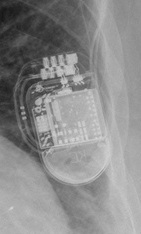 Quadra Assura</td>
<td align="center" valign="top"><b>✅ Option 1</b> 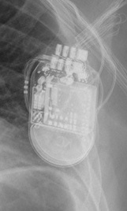 Quadra Assura</td>
<td align="center" valign="top"><b>Option 2</b>  Reveal XT</td>
<td align="center" valign="top"><b>Option 3</b>  Ellipse VR</td>
<td align="center" valign="top"><b>Option 4</b>  Valitude X4 CRT-P</td>
<td align="center" valign="top"><b>Option 5</b>  Rivacor 5 VR-T DX</td>
<td align="center" valign="middle"><b>Option 6</b>  <i>None of the above</i></td>
</tr></table>

### Q1420 · correct: option 3 · `Attesta DR MRI SureScan`

<table><tr>
<td align="center" valign="top"><b>Query</b> 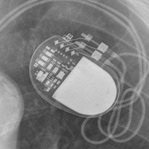 Attesta DR MRI SureScan</td>
<td align="center" valign="top"><b>Option 1</b>  Ecuro SR</td>
<td align="center" valign="top"><b>Option 2</b>  Enitra 8 HF-T QP</td>
<td align="center" valign="top"><b>✅ Option 3</b>  Attesta DR MRI SureScan</td>
<td align="center" valign="top"><b>Option 4</b>  Ensura DR MRI SureScan</td>
<td align="center" valign="top"><b>Option 5</b>  Q20 SR MRI SureScan</td>
<td align="center" valign="middle"><b>Option 6</b>  <i>None of the above</i></td>
</tr></table>

### Q1421 · correct: option 1 · `Attesta DR MRI SureScan`

<table><tr>
<td align="center" valign="top"><b>Query</b> 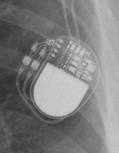 Attesta DR MRI SureScan</td>
<td align="center" valign="top"><b>✅ Option 1</b>  Attesta DR MRI SureScan</td>
<td align="center" valign="top"><b>Option 2</b>  Enticos 4 DR</td>
<td align="center" valign="top"><b>Option 3</b>  Enticos 4 SR</td>
<td align="center" valign="top"><b>Option 4</b>  Q20 SR MRI SureScan</td>
<td align="center" valign="top"><b>Option 5</b>  Ecuro SR</td>
<td align="center" valign="middle"><b>Option 6</b>  <i>None of the above</i></td>
</tr></table>

### Q1422 · correct: option 3 · `Enticos 4 DR`

<table><tr>
<td align="center" valign="top"><b>Query</b>  Enticos 4 DR</td>
<td align="center" valign="top"><b>Option 1</b>  Attesta DR MRI SureScan</td>
<td align="center" valign="top"><b>Option 2</b>  Enitra 8 HF-T QP</td>
<td align="center" valign="top"><b>✅ Option 3</b>  Enticos 4 DR</td>
<td align="center" valign="top"><b>Option 4</b>  Enticos 4 SR</td>
<td align="center" valign="top"><b>Option 5</b>  Enitra 6 DR-T</td>
<td align="center" valign="middle"><b>Option 6</b>  <i>None of the above</i></td>
</tr></table>

### Q1423 · correct: option 5 · `Attesta DR MRI SureScan`

<table><tr>
<td align="center" valign="top"><b>Query</b> 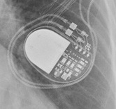 Attesta DR MRI SureScan</td>
<td align="center" valign="top"><b>Option 1</b>  Q20 SR MRI SureScan</td>
<td align="center" valign="top"><b>Option 2</b>  Ensura DR MRI SureScan</td>
<td align="center" valign="top"><b>Option 3</b>  Enticos 4 DR</td>
<td align="center" valign="top"><b>Option 4</b>  Enticos 4 SR</td>
<td align="center" valign="top"><b>✅ Option 5</b>  Attesta DR MRI SureScan</td>
<td align="center" valign="middle"><b>Option 6</b>  <i>None of the above</i></td>
</tr></table>

### Q1424 · correct: option 3 · `Attesta DR MRI SureScan`

<table><tr>
<td align="center" valign="top"><b>Query</b> 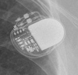 Attesta DR MRI SureScan</td>
<td align="center" valign="top"><b>Option 1</b>  Enticos 4 SR</td>
<td align="center" valign="top"><b>Option 2</b>  Ecuro SR</td>
<td align="center" valign="top"><b>✅ Option 3</b>  Attesta DR MRI SureScan</td>
<td align="center" valign="top"><b>Option 4</b>  Enticos 4 DR</td>
<td align="center" valign="top"><b>Option 5</b>  Q20 SR MRI SureScan</td>
<td align="center" valign="middle"><b>Option 6</b>  <i>None of the above</i></td>
</tr></table>

### Q1425 · correct: option 3 · `Attesta DR MRI SureScan`

<table><tr>
<td align="center" valign="top"><b>Query</b> 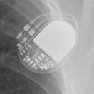 Attesta DR MRI SureScan</td>
<td align="center" valign="top"><b>Option 1</b>  Enitra 8 HF-T QP</td>
<td align="center" valign="top"><b>Option 2</b>  Ecuro SR</td>
<td align="center" valign="top"><b>✅ Option 3</b>  Attesta DR MRI SureScan</td>
<td align="center" valign="top"><b>Option 4</b>  Q20 SR MRI SureScan</td>
<td align="center" valign="top"><b>Option 5</b>  Enticos 4 SR</td>
<td align="center" valign="middle"><b>Option 6</b>  <i>None of the above</i></td>
</tr></table>

### Q1426 · correct: option 1 · `Ecuro SR`

<table><tr>
<td align="center" valign="top"><b>Query</b> 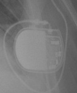 Ecuro SR</td>
<td align="center" valign="top"><b>✅ Option 1</b>  Ecuro SR</td>
<td align="center" valign="top"><b>Option 2</b>  Enticos 4 SR</td>
<td align="center" valign="top"><b>Option 3</b>  Q20 SR MRI SureScan</td>
<td align="center" valign="top"><b>Option 4</b>  Enitra 8 HF-T QP</td>
<td align="center" valign="top"><b>Option 5</b>  Enticos 4 DR</td>
<td align="center" valign="middle"><b>Option 6</b>  <i>None of the above</i></td>
</tr></table>

### Q1427 · correct: option 4 · `Ecuro SR`

<table><tr>
<td align="center" valign="top"><b>Query</b> 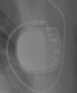 Ecuro SR</td>
<td align="center" valign="top"><b>Option 1</b>  Enitra 8 HF-T QP</td>
<td align="center" valign="top"><b>Option 2</b>  Enticos 4 SR</td>
<td align="center" valign="top"><b>Option 3</b>  Enticos 4 DR</td>
<td align="center" valign="top"><b>✅ Option 4</b>  Ecuro SR</td>
<td align="center" valign="top"><b>Option 5</b>  Enitra 6 DR-T</td>
<td align="center" valign="middle"><b>Option 6</b>  <i>None of the above</i></td>
</tr></table>

### Q1428 · correct: option 2 · `Ecuro SR`

<table><tr>
<td align="center" valign="top"><b>Query</b>  Ecuro SR</td>
<td align="center" valign="top"><b>Option 1</b>  Enitra 6 DR-T</td>
<td align="center" valign="top"><b>✅ Option 2</b>  Ecuro SR</td>
<td align="center" valign="top"><b>Option 3</b>  Enticos 4 SR</td>
<td align="center" valign="top"><b>Option 4</b>  Enitra 8 HF-T QP</td>
<td align="center" valign="top"><b>Option 5</b>  Enticos 4 DR</td>
<td align="center" valign="middle"><b>Option 6</b>  <i>None of the above</i></td>
</tr></table>

### Q1429 · correct: option 1 · `Ecuro SR`

<table><tr>
<td align="center" valign="top"><b>Query</b>  Ecuro SR</td>
<td align="center" valign="top"><b>✅ Option 1</b>  Ecuro SR</td>
<td align="center" valign="top"><b>Option 2</b>  Enticos 4 SR</td>
<td align="center" valign="top"><b>Option 3</b>  Enticos 4 DR</td>
<td align="center" valign="top"><b>Option 4</b>  Enitra 8 HF-T QP</td>
<td align="center" valign="top"><b>Option 5</b>  Enitra 6 DR-T</td>
<td align="center" valign="middle"><b>Option 6</b>  <i>None of the above</i></td>
</tr></table>

### Q1430 · correct: option 3 · `Rivacor 5 VR-T DX`

<table><tr>
<td align="center" valign="top"><b>Query</b>  Rivacor 5 VR-T DX</td>
<td align="center" valign="top"><b>Option 1</b>  Ilivia 7 VR-T</td>
<td align="center" valign="top"><b>Option 2</b>  Rivacor 7 HF-T QP</td>
<td align="center" valign="top"><b>✅ Option 3</b>  Rivacor 5 VR-T DX</td>
<td align="center" valign="top"><b>Option 4</b>  Quadra Assura</td>
<td align="center" valign="top"><b>Option 5</b>  Ilivia 7 HF-T QP</td>
<td align="center" valign="middle"><b>Option 6</b>  <i>None of the above</i></td>
</tr></table>

### Q1431 · correct: option 5 · `Enticos 4 SR`

<table><tr>
<td align="center" valign="top"><b>Query</b>  Enticos 4 SR</td>
<td align="center" valign="top"><b>Option 1</b>  Enticos 4 DR</td>
<td align="center" valign="top"><b>Option 2</b>  Attesta DR MRI SureScan</td>
<td align="center" valign="top"><b>Option 3</b>  Ecuro SR</td>
<td align="center" valign="top"><b>Option 4</b>  Enitra 6 DR-T</td>
<td align="center" valign="top"><b>✅ Option 5</b>  Enticos 4 SR</td>
<td align="center" valign="middle"><b>Option 6</b>  <i>None of the above</i></td>
</tr></table>

### Q1432 · correct: option 3 · `Enticos 4 SR`

<table><tr>
<td align="center" valign="top"><b>Query</b> 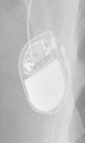 Enticos 4 SR</td>
<td align="center" valign="top"><b>Option 1</b>  Enitra 6 DR-T</td>
<td align="center" valign="top"><b>Option 2</b>  Enitra 8 HF-T QP</td>
<td align="center" valign="top"><b>✅ Option 3</b>  Enticos 4 SR</td>
<td align="center" valign="top"><b>Option 4</b>  Enticos 4 DR</td>
<td align="center" valign="top"><b>Option 5</b>  Ecuro SR</td>
<td align="center" valign="middle"><b>Option 6</b>  <i>None of the above</i></td>
</tr></table>

### Q1433 · correct: option 3 · `Enticos 4 SR`

<table><tr>
<td align="center" valign="top"><b>Query</b>  Enticos 4 SR</td>
<td align="center" valign="top"><b>Option 1</b>  Ecuro SR</td>
<td align="center" valign="top"><b>Option 2</b>  Enticos 4 DR</td>
<td align="center" valign="top"><b>✅ Option 3</b>  Enticos 4 SR</td>
<td align="center" valign="top"><b>Option 4</b>  Enitra 8 HF-T QP</td>
<td align="center" valign="top"><b>Option 5</b>  Enitra 6 DR-T</td>
<td align="center" valign="middle"><b>Option 6</b>  <i>None of the above</i></td>
</tr></table>

