# Physionet (cardiac devices) · query set `test` · page 3/8

[← all pages](README.md)

### Q1434 · correct: option 3 · `Enticos 4 SR`

<table><tr>
<td align="center" valign="top"><b>Query</b>  Enticos 4 SR</td>
<td align="center" valign="top"><b>Option 1</b>  Enitra 6 DR-T</td>
<td align="center" valign="top"><b>Option 2</b> 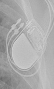 Enticos 4 DR</td>
<td align="center" valign="top"><b>✅ Option 3</b> 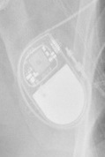 Enticos 4 SR</td>
<td align="center" valign="top"><b>Option 4</b>  Ecuro SR</td>
<td align="center" valign="top"><b>Option 5</b> 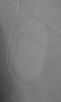 Enitra 8 HF-T QP</td>
<td align="center" valign="middle"><b>Option 6</b>  <i>None of the above</i></td>
</tr></table>

### Q1435 · correct: option 5 · `Attesta DR MRI SureScan`

<table><tr>
<td align="center" valign="top"><b>Query</b> 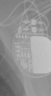 Attesta DR MRI SureScan</td>
<td align="center" valign="top"><b>Option 1</b>  Ensura DR MRI SureScan</td>
<td align="center" valign="top"><b>Option 2</b> 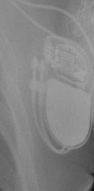 Enticos 4 DR</td>
<td align="center" valign="top"><b>Option 3</b> 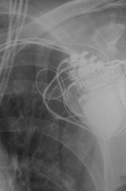 Serena Quad CRT-P MRI ScureScan</td>
<td align="center" valign="top"><b>Option 4</b> 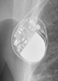 Q20 SR MRI SureScan</td>
<td align="center" valign="top"><b>✅ Option 5</b> 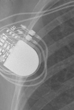 Attesta DR MRI SureScan</td>
<td align="center" valign="middle"><b>Option 6</b>  <i>None of the above</i></td>
</tr></table>

### Q1436 · correct: option 5 · `Confirm Rx DM3500`

<table><tr>
<td align="center" valign="top"><b>Query</b> 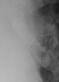 Confirm Rx DM3500</td>
<td align="center" valign="top"><b>Option 1</b>  Ensura DR MRI SureScan</td>
<td align="center" valign="top"><b>Option 2</b> 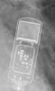 Reveal XT</td>
<td align="center" valign="top"><b>Option 3</b> 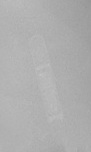 Reveal LINQ</td>
<td align="center" valign="top"><b>Option 4</b>  SJM Confirm</td>
<td align="center" valign="top"><b>✅ Option 5</b>  Confirm Rx DM3500</td>
<td align="center" valign="middle"><b>Option 6</b>  <i>None of the above</i></td>
</tr></table>

### Q1437 · correct: option 4 · `Confirm Rx DM3500`

<table><tr>
<td align="center" valign="top"><b>Query</b> 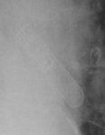 Confirm Rx DM3500</td>
<td align="center" valign="top"><b>Option 1</b>  SJM Confirm</td>
<td align="center" valign="top"><b>Option 2</b>  Ecuro SR</td>
<td align="center" valign="top"><b>Option 3</b>  Reveal XT</td>
<td align="center" valign="top"><b>✅ Option 4</b>  Confirm Rx DM3500</td>
<td align="center" valign="top"><b>Option 5</b>  Reveal LINQ</td>
<td align="center" valign="middle"><b>Option 6</b>  <i>None of the above</i></td>
</tr></table>

### Q1438 · correct: option 3 · `Confirm Rx DM3500`

<table><tr>
<td align="center" valign="top"><b>Query</b> 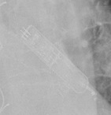 Confirm Rx DM3500</td>
<td align="center" valign="top"><b>Option 1</b>  Reveal XT</td>
<td align="center" valign="top"><b>Option 2</b>  Ilivia 7 VR-T</td>
<td align="center" valign="top"><b>✅ Option 3</b> 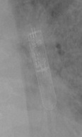 Confirm Rx DM3500</td>
<td align="center" valign="top"><b>Option 4</b> 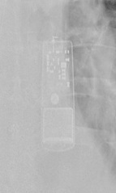 SJM Confirm</td>
<td align="center" valign="top"><b>Option 5</b>  Reveal LINQ</td>
<td align="center" valign="middle"><b>Option 6</b>  <i>None of the above</i></td>
</tr></table>

### Q1439 · correct: option 2 · `Confirm Rx DM3500`

<table><tr>
<td align="center" valign="top"><b>Query</b> 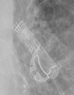 Confirm Rx DM3500</td>
<td align="center" valign="top"><b>Option 1</b>  Reveal LINQ</td>
<td align="center" valign="top"><b>✅ Option 2</b> 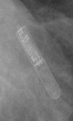 Confirm Rx DM3500</td>
<td align="center" valign="top"><b>Option 3</b>  SJM Confirm</td>
<td align="center" valign="top"><b>Option 4</b> 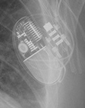 Quadra Allure MP</td>
<td align="center" valign="top"><b>Option 5</b>  Reveal XT</td>
<td align="center" valign="middle"><b>Option 6</b>  <i>None of the above</i></td>
</tr></table>

### Q1440 · correct: option 2 · `Confirm Rx DM3500`

<table><tr>
<td align="center" valign="top"><b>Query</b> 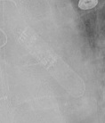 Confirm Rx DM3500</td>
<td align="center" valign="top"><b>Option 1</b>  SJM Confirm</td>
<td align="center" valign="top"><b>✅ Option 2</b>  Confirm Rx DM3500</td>
<td align="center" valign="top"><b>Option 3</b>  Reveal LINQ</td>
<td align="center" valign="top"><b>Option 4</b>  Reveal XT</td>
<td align="center" valign="top"><b>Option 5</b> 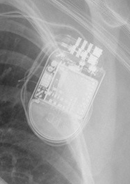 Quadra Assura</td>
<td align="center" valign="middle"><b>Option 6</b>  <i>None of the above</i></td>
</tr></table>

### Q1441 · correct: option 4 · `Confirm Rx DM3500`

<table><tr>
<td align="center" valign="top"><b>Query</b> 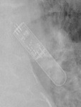 Confirm Rx DM3500</td>
<td align="center" valign="top"><b>Option 1</b>  Reveal LINQ</td>
<td align="center" valign="top"><b>Option 2</b>  Reveal XT</td>
<td align="center" valign="top"><b>Option 3</b>  Ilivia 7 VR-T</td>
<td align="center" valign="top"><b>✅ Option 4</b>  Confirm Rx DM3500</td>
<td align="center" valign="top"><b>Option 5</b>  SJM Confirm</td>
<td align="center" valign="middle"><b>Option 6</b>  <i>None of the above</i></td>
</tr></table>

### Q1442 · correct: option 4 · `Confirm Rx DM3500`

<table><tr>
<td align="center" valign="top"><b>Query</b> 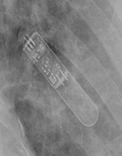 Confirm Rx DM3500</td>
<td align="center" valign="top"><b>Option 1</b>  Reveal XT</td>
<td align="center" valign="top"><b>Option 2</b>  Reveal LINQ</td>
<td align="center" valign="top"><b>Option 3</b> 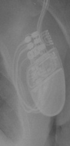 Valitude X4 CRT-P</td>
<td align="center" valign="top"><b>✅ Option 4</b>  Confirm Rx DM3500</td>
<td align="center" valign="top"><b>Option 5</b>  SJM Confirm</td>
<td align="center" valign="middle"><b>Option 6</b>  <i>None of the above</i></td>
</tr></table>

### Q1443 · correct: option 5 · `Confirm Rx DM3500`

<table><tr>
<td align="center" valign="top"><b>Query</b> 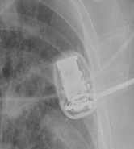 Confirm Rx DM3500</td>
<td align="center" valign="top"><b>Option 1</b> 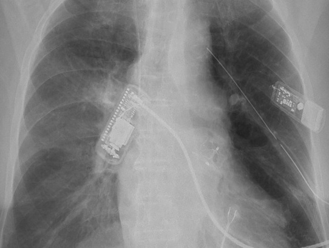 SJM Confirm</td>
<td align="center" valign="top"><b>Option 2</b> 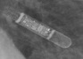 Reveal LINQ</td>
<td align="center" valign="top"><b>Option 3</b> 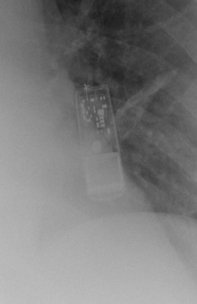 Reveal XT</td>
<td align="center" valign="top"><b>Option 4</b>  Quadra Assura</td>
<td align="center" valign="top"><b>✅ Option 5</b>  Confirm Rx DM3500</td>
<td align="center" valign="middle"><b>Option 6</b>  <i>None of the above</i></td>
</tr></table>

### Q1444 · correct: option 1 · `Confirm Rx DM3500`

<table><tr>
<td align="center" valign="top"><b>Query</b> 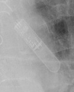 Confirm Rx DM3500</td>
<td align="center" valign="top"><b>✅ Option 1</b>  Confirm Rx DM3500</td>
<td align="center" valign="top"><b>Option 2</b>  Reveal LINQ</td>
<td align="center" valign="top"><b>Option 3</b>  Quadra Assura</td>
<td align="center" valign="top"><b>Option 4</b>  Reveal XT</td>
<td align="center" valign="top"><b>Option 5</b>  SJM Confirm</td>
<td align="center" valign="middle"><b>Option 6</b>  <i>None of the above</i></td>
</tr></table>

### Q1445 · correct: option 4 · `Confirm Rx DM3500`

<table><tr>
<td align="center" valign="top"><b>Query</b> 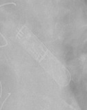 Confirm Rx DM3500</td>
<td align="center" valign="top"><b>Option 1</b>  Ecuro SR</td>
<td align="center" valign="top"><b>Option 2</b>  Reveal LINQ</td>
<td align="center" valign="top"><b>Option 3</b>  SJM Confirm</td>
<td align="center" valign="top"><b>✅ Option 4</b>  Confirm Rx DM3500</td>
<td align="center" valign="top"><b>Option 5</b>  Reveal XT</td>
<td align="center" valign="middle"><b>Option 6</b>  <i>None of the above</i></td>
</tr></table>

### Q1446 · correct: option 3 · `Mirro MRI VR SureScan`

<table><tr>
<td align="center" valign="top"><b>Query</b> 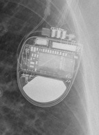 Mirro MRI VR SureScan</td>
<td align="center" valign="top"><b>Option 1</b>  Serena Quad CRT-P MRI ScureScan</td>
<td align="center" valign="top"><b>Option 2</b> 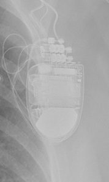 Compia MRI Quad CRT-D SureScan</td>
<td align="center" valign="top"><b>✅ Option 3</b> 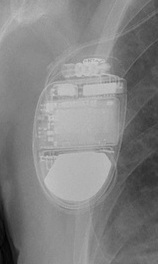 Mirro MRI VR SureScan</td>
<td align="center" valign="top"><b>Option 4</b>  Ilivia 7 HF-T QP</td>
<td align="center" valign="top"><b>Option 5</b> 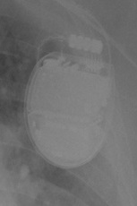 Ellipse VR</td>
<td align="center" valign="middle"><b>Option 6</b>  <i>None of the above</i></td>
</tr></table>

### Q1447 · correct: option 2 · `Ilivia 7 VR-T`

<table><tr>
<td align="center" valign="top"><b>Query</b> 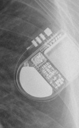 Ilivia 7 VR-T</td>
<td align="center" valign="top"><b>Option 1</b> 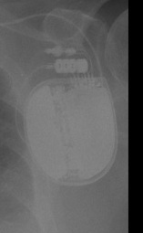 Rivacor 5 VR-T DX</td>
<td align="center" valign="top"><b>✅ Option 2</b> 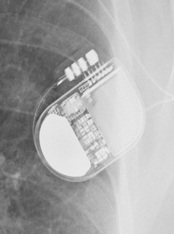 Ilivia 7 VR-T</td>
<td align="center" valign="top"><b>Option 3</b>  Ilivia 7 HF-T QP</td>
<td align="center" valign="top"><b>Option 4</b>  Mirro MRI VR SureScan</td>
<td align="center" valign="top"><b>Option 5</b> 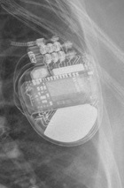 Compia MRI Quad CRT-D SureScan</td>
<td align="center" valign="middle"><b>Option 6</b>  <i>None of the above</i></td>
</tr></table>

### Q1448 · correct: option 3 · `Ilivia 7 VR-T`

<table><tr>
<td align="center" valign="top"><b>Query</b>  Ilivia 7 VR-T</td>
<td align="center" valign="top"><b>Option 1</b> 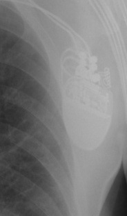 Valitude X4 CRT-P</td>
<td align="center" valign="top"><b>Option 2</b>  Enticos 4 DR</td>
<td align="center" valign="top"><b>✅ Option 3</b>  Ilivia 7 VR-T</td>
<td align="center" valign="top"><b>Option 4</b> 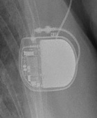 Ecuro SR</td>
<td align="center" valign="top"><b>Option 5</b> 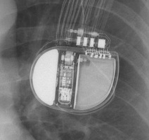 Rivacor 5 VR-T DX</td>
<td align="center" valign="middle"><b>Option 6</b>  <i>None of the above</i></td>
</tr></table>

### Q1449 · correct: option 2 · `Attesta DR MRI SureScan`

<table><tr>
<td align="center" valign="top"><b>Query</b> 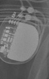 Attesta DR MRI SureScan</td>
<td align="center" valign="top"><b>Option 1</b> 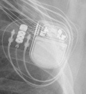 Enitra 8 HF-T QP</td>
<td align="center" valign="top"><b>✅ Option 2</b> 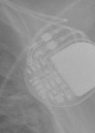 Attesta DR MRI SureScan</td>
<td align="center" valign="top"><b>Option 3</b> 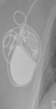 Enticos 4 SR</td>
<td align="center" valign="top"><b>Option 4</b>  Enticos 4 DR</td>
<td align="center" valign="top"><b>Option 5</b> 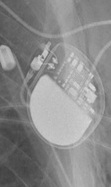 Q20 SR MRI SureScan</td>
<td align="center" valign="middle"><b>Option 6</b>  <i>None of the above</i></td>
</tr></table>

### Q1450 · correct: option 5 · `Attesta DR MRI SureScan`

<table><tr>
<td align="center" valign="top"><b>Query</b> 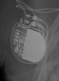 Attesta DR MRI SureScan</td>
<td align="center" valign="top"><b>Option 1</b>  Ilivia 7 HF-T QP</td>
<td align="center" valign="top"><b>Option 2</b>  Serena Quad CRT-P MRI ScureScan</td>
<td align="center" valign="top"><b>Option 3</b>  Enticos 4 DR</td>
<td align="center" valign="top"><b>Option 4</b>  Q20 SR MRI SureScan</td>
<td align="center" valign="top"><b>✅ Option 5</b>  Attesta DR MRI SureScan</td>
<td align="center" valign="middle"><b>Option 6</b>  <i>None of the above</i></td>
</tr></table>

### Q1451 · correct: option 4 · `Attesta DR MRI SureScan`

<table><tr>
<td align="center" valign="top"><b>Query</b> 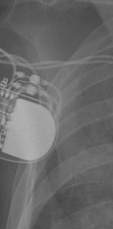 Attesta DR MRI SureScan</td>
<td align="center" valign="top"><b>Option 1</b>  Serena Quad CRT-P MRI ScureScan</td>
<td align="center" valign="top"><b>Option 2</b>  Enticos 4 DR</td>
<td align="center" valign="top"><b>Option 3</b>  Q20 SR MRI SureScan</td>
<td align="center" valign="top"><b>✅ Option 4</b> 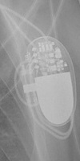 Attesta DR MRI SureScan</td>
<td align="center" valign="top"><b>Option 5</b> 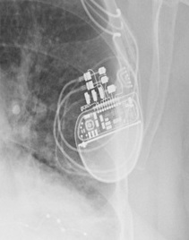 Valitude X4 CRT-P</td>
<td align="center" valign="middle"><b>Option 6</b>  <i>None of the above</i></td>
</tr></table>

### Q1452 · correct: option 1 · `Attesta DR MRI SureScan`

<table><tr>
<td align="center" valign="top"><b>Query</b> 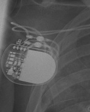 Attesta DR MRI SureScan</td>
<td align="center" valign="top"><b>✅ Option 1</b>  Attesta DR MRI SureScan</td>
<td align="center" valign="top"><b>Option 2</b>  Q20 SR MRI SureScan</td>
<td align="center" valign="top"><b>Option 3</b>  Enticos 4 DR</td>
<td align="center" valign="top"><b>Option 4</b>  Enitra 8 HF-T QP</td>
<td align="center" valign="top"><b>Option 5</b>  Serena Quad CRT-P MRI ScureScan</td>
<td align="center" valign="middle"><b>Option 6</b>  <i>None of the above</i></td>
</tr></table>

### Q1453 · correct: option 4 · `Attesta DR MRI SureScan`

<table><tr>
<td align="center" valign="top"><b>Query</b>  Attesta DR MRI SureScan</td>
<td align="center" valign="top"><b>Option 1</b>  Ecuro SR</td>
<td align="center" valign="top"><b>Option 2</b>  Serena Quad CRT-P MRI ScureScan</td>
<td align="center" valign="top"><b>Option 3</b>  Enticos 4 DR</td>
<td align="center" valign="top"><b>✅ Option 4</b>  Attesta DR MRI SureScan</td>
<td align="center" valign="top"><b>Option 5</b>  Q20 SR MRI SureScan</td>
<td align="center" valign="middle"><b>Option 6</b>  <i>None of the above</i></td>
</tr></table>

### Q1454 · correct: option 1 · `Attesta DR MRI SureScan`

<table><tr>
<td align="center" valign="top"><b>Query</b>  Attesta DR MRI SureScan</td>
<td align="center" valign="top"><b>✅ Option 1</b>  Attesta DR MRI SureScan</td>
<td align="center" valign="top"><b>Option 2</b>  Q20 SR MRI SureScan</td>
<td align="center" valign="top"><b>Option 3</b>  Ecuro SR</td>
<td align="center" valign="top"><b>Option 4</b>  Enticos 4 DR</td>
<td align="center" valign="top"><b>Option 5</b>  Serena Quad CRT-P MRI ScureScan</td>
<td align="center" valign="middle"><b>Option 6</b>  <i>None of the above</i></td>
</tr></table>

### Q1455 · correct: option 4 · `Attesta DR MRI SureScan`

<table><tr>
<td align="center" valign="top"><b>Query</b>  Attesta DR MRI SureScan</td>
<td align="center" valign="top"><b>Option 1</b>  Q20 SR MRI SureScan</td>
<td align="center" valign="top"><b>Option 2</b>  Enitra 8 HF-T QP</td>
<td align="center" valign="top"><b>Option 3</b>  Serena Quad CRT-P MRI ScureScan</td>
<td align="center" valign="top"><b>✅ Option 4</b>  Attesta DR MRI SureScan</td>
<td align="center" valign="top"><b>Option 5</b>  Enticos 4 DR</td>
<td align="center" valign="middle"><b>Option 6</b>  <i>None of the above</i></td>
</tr></table>

### Q1456 · correct: option 5 · `Mirro MRI VR SureScan`

<table><tr>
<td align="center" valign="top"><b>Query</b>  Mirro MRI VR SureScan</td>
<td align="center" valign="top"><b>Option 1</b>  Ellipse VR</td>
<td align="center" valign="top"><b>Option 2</b>  Compia MRI Quad CRT-D SureScan</td>
<td align="center" valign="top"><b>Option 3</b>  Ilivia 7 HF-T QP</td>
<td align="center" valign="top"><b>Option 4</b>  Ilivia 7 VR-T</td>
<td align="center" valign="top"><b>✅ Option 5</b>  Mirro MRI VR SureScan</td>
<td align="center" valign="middle"><b>Option 6</b>  <i>None of the above</i></td>
</tr></table>

### Q1457 · correct: option 1 · `Mirro MRI VR SureScan`

<table><tr>
<td align="center" valign="top"><b>Query</b>  Mirro MRI VR SureScan</td>
<td align="center" valign="top"><b>✅ Option 1</b>  Mirro MRI VR SureScan</td>
<td align="center" valign="top"><b>Option 2</b>  Compia MRI Quad CRT-D SureScan</td>
<td align="center" valign="top"><b>Option 3</b>  Ilivia 7 HF-T QP</td>
<td align="center" valign="top"><b>Option 4</b>  Ilivia 7 VR-T</td>
<td align="center" valign="top"><b>Option 5</b>  Ellipse VR</td>
<td align="center" valign="middle"><b>Option 6</b>  <i>None of the above</i></td>
</tr></table>

### Q1458 · correct: option 2 · `Mirro MRI VR SureScan`

<table><tr>
<td align="center" valign="top"><b>Query</b>  Mirro MRI VR SureScan</td>
<td align="center" valign="top"><b>Option 1</b>  Ilivia 7 VR-T</td>
<td align="center" valign="top"><b>✅ Option 2</b>  Mirro MRI VR SureScan</td>
<td align="center" valign="top"><b>Option 3</b>  Ellipse VR</td>
<td align="center" valign="top"><b>Option 4</b>  Compia MRI Quad CRT-D SureScan</td>
<td align="center" valign="top"><b>Option 5</b>  Ilivia 7 HF-T QP</td>
<td align="center" valign="middle"><b>Option 6</b>  <i>None of the above</i></td>
</tr></table>

### Q1459 · correct: option 1 · `Mirro MRI VR SureScan`

<table><tr>
<td align="center" valign="top"><b>Query</b>  Mirro MRI VR SureScan</td>
<td align="center" valign="top"><b>✅ Option 1</b>  Mirro MRI VR SureScan</td>
<td align="center" valign="top"><b>Option 2</b>  Ilivia 7 VR-T</td>
<td align="center" valign="top"><b>Option 3</b>  Ilivia 7 HF-T QP</td>
<td align="center" valign="top"><b>Option 4</b>  Ellipse VR</td>
<td align="center" valign="top"><b>Option 5</b>  Compia MRI Quad CRT-D SureScan</td>
<td align="center" valign="middle"><b>Option 6</b>  <i>None of the above</i></td>
</tr></table>

### Q1460 · correct: option 2 · `Mirro MRI VR SureScan`

<table><tr>
<td align="center" valign="top"><b>Query</b>  Mirro MRI VR SureScan</td>
<td align="center" valign="top"><b>Option 1</b>  Compia MRI Quad CRT-D SureScan</td>
<td align="center" valign="top"><b>✅ Option 2</b>  Mirro MRI VR SureScan</td>
<td align="center" valign="top"><b>Option 3</b>  Reveal XT</td>
<td align="center" valign="top"><b>Option 4</b>  Ilivia 7 VR-T</td>
<td align="center" valign="top"><b>Option 5</b>  Ilivia 7 HF-T QP</td>
<td align="center" valign="middle"><b>Option 6</b>  <i>None of the above</i></td>
</tr></table>

### Q1461 · correct: option 2 · `Enticos 4 DR`

<table><tr>
<td align="center" valign="top"><b>Query</b>  Enticos 4 DR</td>
<td align="center" valign="top"><b>Option 1</b>  Enitra 6 DR-T</td>
<td align="center" valign="top"><b>✅ Option 2</b>  Enticos 4 DR</td>
<td align="center" valign="top"><b>Option 3</b>  Enticos 4 SR</td>
<td align="center" valign="top"><b>Option 4</b>  Ecuro SR</td>
<td align="center" valign="top"><b>Option 5</b>  Enitra 8 HF-T QP</td>
<td align="center" valign="middle"><b>Option 6</b>  <i>None of the above</i></td>
</tr></table>

### Q1462 · correct: option 3 · `Enticos 4 DR`

<table><tr>
<td align="center" valign="top"><b>Query</b>  Enticos 4 DR</td>
<td align="center" valign="top"><b>Option 1</b>  Enitra 8 HF-T QP</td>
<td align="center" valign="top"><b>Option 2</b>  Enitra 6 DR-T</td>
<td align="center" valign="top"><b>✅ Option 3</b>  Enticos 4 DR</td>
<td align="center" valign="top"><b>Option 4</b>  Ecuro SR</td>
<td align="center" valign="top"><b>Option 5</b>  Enticos 4 SR</td>
<td align="center" valign="middle"><b>Option 6</b>  <i>None of the above</i></td>
</tr></table>

### Q1463 · correct: option 2 · `Enticos 4 DR`

<table><tr>
<td align="center" valign="top"><b>Query</b>  Enticos 4 DR</td>
<td align="center" valign="top"><b>Option 1</b>  Enticos 4 SR</td>
<td align="center" valign="top"><b>✅ Option 2</b>  Enticos 4 DR</td>
<td align="center" valign="top"><b>Option 3</b>  Enitra 6 DR-T</td>
<td align="center" valign="top"><b>Option 4</b>  Enitra 8 HF-T QP</td>
<td align="center" valign="top"><b>Option 5</b>  Ecuro SR</td>
<td align="center" valign="middle"><b>Option 6</b>  <i>None of the above</i></td>
</tr></table>

### Q1464 · correct: option 5 · `Enticos 4 DR`

<table><tr>
<td align="center" valign="top"><b>Query</b>  Enticos 4 DR</td>
<td align="center" valign="top"><b>Option 1</b>  Enticos 4 SR</td>
<td align="center" valign="top"><b>Option 2</b>  Enitra 8 HF-T QP</td>
<td align="center" valign="top"><b>Option 3</b>  Ecuro SR</td>
<td align="center" valign="top"><b>Option 4</b>  Enitra 6 DR-T</td>
<td align="center" valign="top"><b>✅ Option 5</b>  Enticos 4 DR</td>
<td align="center" valign="middle"><b>Option 6</b>  <i>None of the above</i></td>
</tr></table>

### Q1465 · correct: option 3 · `Enticos 4 DR`

<table><tr>
<td align="center" valign="top"><b>Query</b>  Enticos 4 DR</td>
<td align="center" valign="top"><b>Option 1</b>  Enticos 4 SR</td>
<td align="center" valign="top"><b>Option 2</b>  Ecuro SR</td>
<td align="center" valign="top"><b>✅ Option 3</b>  Enticos 4 DR</td>
<td align="center" valign="top"><b>Option 4</b>  Enitra 8 HF-T QP</td>
<td align="center" valign="top"><b>Option 5</b>  Enitra 6 DR-T</td>
<td align="center" valign="middle"><b>Option 6</b>  <i>None of the above</i></td>
</tr></table>

### Q1466 · correct: option 4 · `Enticos 4 DR`

<table><tr>
<td align="center" valign="top"><b>Query</b>  Enticos 4 DR</td>
<td align="center" valign="top"><b>Option 1</b>  Ecuro SR</td>
<td align="center" valign="top"><b>Option 2</b>  Enitra 8 HF-T QP</td>
<td align="center" valign="top"><b>Option 3</b>  Enticos 4 SR</td>
<td align="center" valign="top"><b>✅ Option 4</b>  Enticos 4 DR</td>
<td align="center" valign="top"><b>Option 5</b>  Enitra 6 DR-T</td>
<td align="center" valign="middle"><b>Option 6</b>  <i>None of the above</i></td>
</tr></table>

### Q1467 · correct: option 1 · `Enticos 4 DR`

<table><tr>
<td align="center" valign="top"><b>Query</b>  Enticos 4 DR</td>
<td align="center" valign="top"><b>✅ Option 1</b>  Enticos 4 DR</td>
<td align="center" valign="top"><b>Option 2</b>  Enitra 6 DR-T</td>
<td align="center" valign="top"><b>Option 3</b>  Etrinsa 8 HF-T</td>
<td align="center" valign="top"><b>Option 4</b>  Enticos 4 SR</td>
<td align="center" valign="top"><b>Option 5</b>  Enitra 8 HF-T QP</td>
<td align="center" valign="middle"><b>Option 6</b>  <i>None of the above</i></td>
</tr></table>

### Q1468 · correct: option 5 · `Enticos 4 DR`

<table><tr>
<td align="center" valign="top"><b>Query</b>  Enticos 4 DR</td>
<td align="center" valign="top"><b>Option 1</b>  Enticos 4 SR</td>
<td align="center" valign="top"><b>Option 2</b>  Reveal XT</td>
<td align="center" valign="top"><b>Option 3</b>  Ecuro SR</td>
<td align="center" valign="top"><b>Option 4</b>  Enitra 6 DR-T</td>
<td align="center" valign="top"><b>✅ Option 5</b>  Enticos 4 DR</td>
<td align="center" valign="middle"><b>Option 6</b>  <i>None of the above</i></td>
</tr></table>

### Q1469 · correct: option 5 · `Enticos 4 DR`

<table><tr>
<td align="center" valign="top"><b>Query</b>  Enticos 4 DR</td>
<td align="center" valign="top"><b>Option 1</b>  Enitra 8 HF-T QP</td>
<td align="center" valign="top"><b>Option 2</b>  Ecuro SR</td>
<td align="center" valign="top"><b>Option 3</b>  Enticos 4 SR</td>
<td align="center" valign="top"><b>Option 4</b>  Enitra 6 DR-T</td>
<td align="center" valign="top"><b>✅ Option 5</b>  Enticos 4 DR</td>
<td align="center" valign="middle"><b>Option 6</b>  <i>None of the above</i></td>
</tr></table>

### Q1470 · correct: option 3 · `Attesta DR MRI SureScan`

<table><tr>
<td align="center" valign="top"><b>Query</b>  Attesta DR MRI SureScan</td>
<td align="center" valign="top"><b>Option 1</b>  Ensura DR MRI SureScan</td>
<td align="center" valign="top"><b>Option 2</b>  Enticos 4 DR</td>
<td align="center" valign="top"><b>✅ Option 3</b>  Attesta DR MRI SureScan</td>
<td align="center" valign="top"><b>Option 4</b>  Q20 SR MRI SureScan</td>
<td align="center" valign="top"><b>Option 5</b>  Ecuro SR</td>
<td align="center" valign="middle"><b>Option 6</b>  <i>None of the above</i></td>
</tr></table>

### Q1471 · correct: option 4 · `Confirm Rx DM3500`

<table><tr>
<td align="center" valign="top"><b>Query</b>  Confirm Rx DM3500</td>
<td align="center" valign="top"><b>Option 1</b>  Reveal LINQ</td>
<td align="center" valign="top"><b>Option 2</b>  SJM Confirm</td>
<td align="center" valign="top"><b>Option 3</b>  Ensura DR MRI SureScan</td>
<td align="center" valign="top"><b>✅ Option 4</b>  Confirm Rx DM3500</td>
<td align="center" valign="top"><b>Option 5</b>  Reveal XT</td>
<td align="center" valign="middle"><b>Option 6</b>  <i>None of the above</i></td>
</tr></table>

### Q1472 · correct: option 1 · `Confirm Rx DM3500`

<table><tr>
<td align="center" valign="top"><b>Query</b>  Confirm Rx DM3500</td>
<td align="center" valign="top"><b>✅ Option 1</b>  Confirm Rx DM3500</td>
<td align="center" valign="top"><b>Option 2</b>  Quadra Assura</td>
<td align="center" valign="top"><b>Option 3</b>  SJM Confirm</td>
<td align="center" valign="top"><b>Option 4</b>  Reveal XT</td>
<td align="center" valign="top"><b>Option 5</b>  Reveal LINQ</td>
<td align="center" valign="middle"><b>Option 6</b>  <i>None of the above</i></td>
</tr></table>

### Q1473 · correct: option 5 · `Confirm Rx DM3500`

<table><tr>
<td align="center" valign="top"><b>Query</b>  Confirm Rx DM3500</td>
<td align="center" valign="top"><b>Option 1</b>  Ilivia 7 VR-T</td>
<td align="center" valign="top"><b>Option 2</b>  Reveal XT</td>
<td align="center" valign="top"><b>Option 3</b>  Reveal LINQ</td>
<td align="center" valign="top"><b>Option 4</b>  SJM Confirm</td>
<td align="center" valign="top"><b>✅ Option 5</b>  Confirm Rx DM3500</td>
<td align="center" valign="middle"><b>Option 6</b>  <i>None of the above</i></td>
</tr></table>

### Q1474 · correct: option 4 · `Quadra Assura`

<table><tr>
<td align="center" valign="top"><b>Query</b>  Quadra Assura</td>
<td align="center" valign="top"><b>Option 1</b>  Rivacor 5 VR-T DX</td>
<td align="center" valign="top"><b>Option 2</b>  Reveal XT</td>
<td align="center" valign="top"><b>Option 3</b>  Ellipse VR</td>
<td align="center" valign="top"><b>✅ Option 4</b>  Quadra Assura</td>
<td align="center" valign="top"><b>Option 5</b>  Ensura DR MRI SureScan</td>
<td align="center" valign="middle"><b>Option 6</b>  <i>None of the above</i></td>
</tr></table>

### Q1475 · correct: option 5 · `Reveal XT`

<table><tr>
<td align="center" valign="top"><b>Query</b>  Reveal XT</td>
<td align="center" valign="top"><b>Option 1</b>  SJM Confirm</td>
<td align="center" valign="top"><b>Option 2</b>  Confirm Rx DM3500</td>
<td align="center" valign="top"><b>Option 3</b>  Quadra Assura</td>
<td align="center" valign="top"><b>Option 4</b>  Reveal LINQ</td>
<td align="center" valign="top"><b>✅ Option 5</b>  Reveal XT</td>
<td align="center" valign="middle"><b>Option 6</b>  <i>None of the above</i></td>
</tr></table>

### Q1476 · correct: option 4 · `Q20 SR MRI SureScan`

<table><tr>
<td align="center" valign="top"><b>Query</b>  Q20 SR MRI SureScan</td>
<td align="center" valign="top"><b>Option 1</b>  Enitra 8 HF-T QP</td>
<td align="center" valign="top"><b>Option 2</b>  Enticos 4 SR</td>
<td align="center" valign="top"><b>Option 3</b>  Enticos 4 DR</td>
<td align="center" valign="top"><b>✅ Option 4</b>  Q20 SR MRI SureScan</td>
<td align="center" valign="top"><b>Option 5</b>  Attesta DR MRI SureScan</td>
<td align="center" valign="middle"><b>Option 6</b>  <i>None of the above</i></td>
</tr></table>

### Q1477 · correct: option 2 · `Attesta DR MRI SureScan`

<table><tr>
<td align="center" valign="top"><b>Query</b>  Attesta DR MRI SureScan</td>
<td align="center" valign="top"><b>Option 1</b>  Enticos 4 SR</td>
<td align="center" valign="top"><b>✅ Option 2</b>  Attesta DR MRI SureScan</td>
<td align="center" valign="top"><b>Option 3</b>  Q20 SR MRI SureScan</td>
<td align="center" valign="top"><b>Option 4</b>  Enitra 8 HF-T QP</td>
<td align="center" valign="top"><b>Option 5</b>  Enticos 4 DR</td>
<td align="center" valign="middle"><b>Option 6</b>  <i>None of the above</i></td>
</tr></table>

### Q1478 · correct: option 2 · `Attesta DR MRI SureScan`

<table><tr>
<td align="center" valign="top"><b>Query</b>  Attesta DR MRI SureScan</td>
<td align="center" valign="top"><b>Option 1</b>  Q20 SR MRI SureScan</td>
<td align="center" valign="top"><b>✅ Option 2</b>  Attesta DR MRI SureScan</td>
<td align="center" valign="top"><b>Option 3</b>  Enticos 4 DR</td>
<td align="center" valign="top"><b>Option 4</b>  Enitra 8 HF-T QP</td>
<td align="center" valign="top"><b>Option 5</b>  Enticos 4 SR</td>
<td align="center" valign="middle"><b>Option 6</b>  <i>None of the above</i></td>
</tr></table>

### Q1479 · correct: option 2 · `Reveal LINQ`

<table><tr>
<td align="center" valign="top"><b>Query</b>  Reveal LINQ</td>
<td align="center" valign="top"><b>Option 1</b>  Ilivia 7 VR-T</td>
<td align="center" valign="top"><b>✅ Option 2</b>  Reveal LINQ</td>
<td align="center" valign="top"><b>Option 3</b>  Reveal XT</td>
<td align="center" valign="top"><b>Option 4</b>  SJM Confirm</td>
<td align="center" valign="top"><b>Option 5</b>  Confirm Rx DM3500</td>
<td align="center" valign="middle"><b>Option 6</b>  <i>None of the above</i></td>
</tr></table>

### Q1480 · correct: option 1 · `Reveal LINQ`

<table><tr>
<td align="center" valign="top"><b>Query</b>  Reveal LINQ</td>
<td align="center" valign="top"><b>✅ Option 1</b>  Reveal LINQ</td>
<td align="center" valign="top"><b>Option 2</b>  Ilivia 7 VR-T</td>
<td align="center" valign="top"><b>Option 3</b>  Confirm Rx DM3500</td>
<td align="center" valign="top"><b>Option 4</b>  SJM Confirm</td>
<td align="center" valign="top"><b>Option 5</b>  Reveal XT</td>
<td align="center" valign="middle"><b>Option 6</b>  <i>None of the above</i></td>
</tr></table>

### Q1481 · correct: option 5 · `Compia MRI Quad CRT-D SureScan`

<table><tr>
<td align="center" valign="top"><b>Query</b>  Compia MRI Quad CRT-D SureScan</td>
<td align="center" valign="top"><b>Option 1</b>  Ilivia 7 VR-T</td>
<td align="center" valign="top"><b>Option 2</b>  Ilivia 7 HF-T QP</td>
<td align="center" valign="top"><b>Option 3</b>  Mirro MRI VR SureScan</td>
<td align="center" valign="top"><b>Option 4</b>  Serena Quad CRT-P MRI ScureScan</td>
<td align="center" valign="top"><b>✅ Option 5</b>  Compia MRI Quad CRT-D SureScan</td>
<td align="center" valign="middle"><b>Option 6</b>  <i>None of the above</i></td>
</tr></table>

### Q1482 · correct: option 5 · `Ellipse VR`

<table><tr>
<td align="center" valign="top"><b>Query</b>  Ellipse VR</td>
<td align="center" valign="top"><b>Option 1</b>  Mirro MRI VR SureScan</td>
<td align="center" valign="top"><b>Option 2</b>  Quadra Assura</td>
<td align="center" valign="top"><b>Option 3</b>  Enitra 8 HF-T QP</td>
<td align="center" valign="top"><b>Option 4</b>  Rivacor 5 VR-T DX</td>
<td align="center" valign="top"><b>✅ Option 5</b>  Ellipse VR</td>
<td align="center" valign="middle"><b>Option 6</b>  <i>None of the above</i></td>
</tr></table>

### Q1483 · correct: option 2 · `Ellipse VR`

<table><tr>
<td align="center" valign="top"><b>Query</b>  Ellipse VR</td>
<td align="center" valign="top"><b>Option 1</b>  Mirro MRI VR SureScan</td>
<td align="center" valign="top"><b>✅ Option 2</b>  Ellipse VR</td>
<td align="center" valign="top"><b>Option 3</b>  Origen Mini ICD</td>
<td align="center" valign="top"><b>Option 4</b>  Quadra Assura</td>
<td align="center" valign="top"><b>Option 5</b>  Rivacor 5 VR-T DX</td>
<td align="center" valign="middle"><b>Option 6</b>  <i>None of the above</i></td>
</tr></table>

