# Physionet (cardiac devices) · query set `test` · page 4/8

[← all pages](README.md)

### Q1484 · correct: option 3 · `Charisma X4 CRT-D`

<table><tr>
<td align="center" valign="top"><b>Query</b> 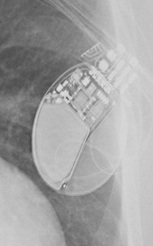 Charisma X4 CRT-D</td>
<td align="center" valign="top"><b>Option 1</b>  Inogen EL ICD VR</td>
<td align="center" valign="top"><b>Option 2</b>  Rivacor 7 HF-T QP</td>
<td align="center" valign="top"><b>✅ Option 3</b> 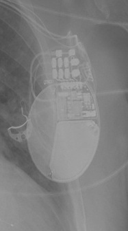 Charisma X4 CRT-D</td>
<td align="center" valign="top"><b>Option 4</b>  Origen Mini ICD</td>
<td align="center" valign="top"><b>Option 5</b>  Rivacor 5 VR-T DX</td>
<td align="center" valign="middle"><b>Option 6</b>  <i>None of the above</i></td>
</tr></table>

### Q1485 · correct: option 3 · `Ellipse VR`

<table><tr>
<td align="center" valign="top"><b>Query</b> 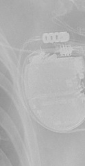 Ellipse VR</td>
<td align="center" valign="top"><b>Option 1</b>  Rivacor 5 VR-T DX</td>
<td align="center" valign="top"><b>Option 2</b>  Enitra 6 DR-T</td>
<td align="center" valign="top"><b>✅ Option 3</b>  Ellipse VR</td>
<td align="center" valign="top"><b>Option 4</b>  Ilivia 7 VR-T</td>
<td align="center" valign="top"><b>Option 5</b>  Quadra Assura</td>
<td align="center" valign="middle"><b>Option 6</b>  <i>None of the above</i></td>
</tr></table>

### Q1486 · correct: option 2 · `Ellipse VR`

<table><tr>
<td align="center" valign="top"><b>Query</b> 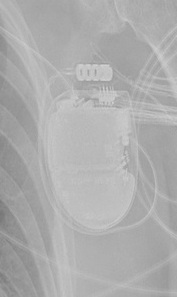 Ellipse VR</td>
<td align="center" valign="top"><b>Option 1</b>  Rivacor 7 HF-T QP</td>
<td align="center" valign="top"><b>✅ Option 2</b>  Ellipse VR</td>
<td align="center" valign="top"><b>Option 3</b>  Quadra Assura</td>
<td align="center" valign="top"><b>Option 4</b>  Rivacor 5 VR-T DX</td>
<td align="center" valign="top"><b>Option 5</b>  Origen Mini ICD</td>
<td align="center" valign="middle"><b>Option 6</b>  <i>None of the above</i></td>
</tr></table>

### Q1487 · correct: option 4 · `Ellipse VR`

<table><tr>
<td align="center" valign="top"><b>Query</b> 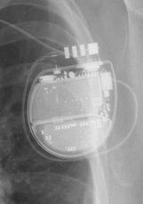 Ellipse VR</td>
<td align="center" valign="top"><b>Option 1</b>  Quadra Assura</td>
<td align="center" valign="top"><b>Option 2</b>  Rivacor 5 VR-T DX</td>
<td align="center" valign="top"><b>Option 3</b>  Origen Mini ICD</td>
<td align="center" valign="top"><b>✅ Option 4</b>  Ellipse VR</td>
<td align="center" valign="top"><b>Option 5</b>  Serena Quad CRT-P MRI ScureScan</td>
<td align="center" valign="middle"><b>Option 6</b>  <i>None of the above</i></td>
</tr></table>

### Q1488 · correct: option 3 · `Confirm Rx DM3500`

<table><tr>
<td align="center" valign="top"><b>Query</b> 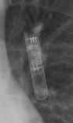 Confirm Rx DM3500</td>
<td align="center" valign="top"><b>Option 1</b>  Reveal LINQ</td>
<td align="center" valign="top"><b>Option 2</b>  SJM Confirm</td>
<td align="center" valign="top"><b>✅ Option 3</b>  Confirm Rx DM3500</td>
<td align="center" valign="top"><b>Option 4</b>  Reveal XT</td>
<td align="center" valign="top"><b>Option 5</b>  Quadra Assura</td>
<td align="center" valign="middle"><b>Option 6</b>  <i>None of the above</i></td>
</tr></table>

### Q1489 · correct: option 3 · `Mirro MRI VR SureScan`

<table><tr>
<td align="center" valign="top"><b>Query</b> 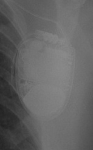 Mirro MRI VR SureScan</td>
<td align="center" valign="top"><b>Option 1</b>  Compia MRI Quad CRT-D SureScan</td>
<td align="center" valign="top"><b>Option 2</b>  Ilivia 7 HF-T QP</td>
<td align="center" valign="top"><b>✅ Option 3</b>  Mirro MRI VR SureScan</td>
<td align="center" valign="top"><b>Option 4</b>  Ilivia 7 VR-T</td>
<td align="center" valign="top"><b>Option 5</b>  Ellipse VR</td>
<td align="center" valign="middle"><b>Option 6</b>  <i>None of the above</i></td>
</tr></table>

### Q1490 · correct: option 2 · `Mirro MRI VR SureScan`

<table><tr>
<td align="center" valign="top"><b>Query</b> 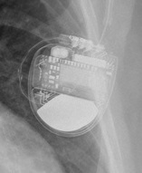 Mirro MRI VR SureScan</td>
<td align="center" valign="top"><b>Option 1</b>  Compia MRI Quad CRT-D SureScan</td>
<td align="center" valign="top"><b>✅ Option 2</b>  Mirro MRI VR SureScan</td>
<td align="center" valign="top"><b>Option 3</b>  Serena Quad CRT-P MRI ScureScan</td>
<td align="center" valign="top"><b>Option 4</b>  Ellipse VR</td>
<td align="center" valign="top"><b>Option 5</b>  Ilivia 7 HF-T QP</td>
<td align="center" valign="middle"><b>Option 6</b>  <i>None of the above</i></td>
</tr></table>

### Q1491 · correct: option 5 · `Ellipse VR`

<table><tr>
<td align="center" valign="top"><b>Query</b> 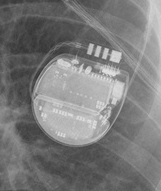 Ellipse VR</td>
<td align="center" valign="top"><b>Option 1</b>  Quadra Assura</td>
<td align="center" valign="top"><b>Option 2</b>  Rivacor 5 VR-T DX</td>
<td align="center" valign="top"><b>Option 3</b>  Origen Mini ICD</td>
<td align="center" valign="top"><b>Option 4</b>  Rivacor 7 HF-T QP</td>
<td align="center" valign="top"><b>✅ Option 5</b> 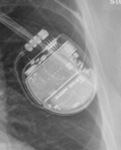 Ellipse VR</td>
<td align="center" valign="middle"><b>Option 6</b>  <i>None of the above</i></td>
</tr></table>

### Q1492 · correct: option 3 · `Attesta DR MRI SureScan`

<table><tr>
<td align="center" valign="top"><b>Query</b> 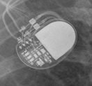 Attesta DR MRI SureScan</td>
<td align="center" valign="top"><b>Option 1</b>  Enitra 8 HF-T QP</td>
<td align="center" valign="top"><b>Option 2</b>  Enticos 4 DR</td>
<td align="center" valign="top"><b>✅ Option 3</b>  Attesta DR MRI SureScan</td>
<td align="center" valign="top"><b>Option 4</b>  Ensura DR MRI SureScan</td>
<td align="center" valign="top"><b>Option 5</b>  Q20 SR MRI SureScan</td>
<td align="center" valign="middle"><b>Option 6</b>  <i>None of the above</i></td>
</tr></table>

### Q1493 · correct: option 1 · `Mirro MRI VR SureScan`

<table><tr>
<td align="center" valign="top"><b>Query</b> 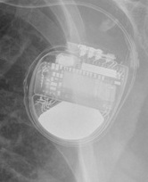 Mirro MRI VR SureScan</td>
<td align="center" valign="top"><b>✅ Option 1</b>  Mirro MRI VR SureScan</td>
<td align="center" valign="top"><b>Option 2</b>  Ilivia 7 VR-T</td>
<td align="center" valign="top"><b>Option 3</b>  Compia MRI Quad CRT-D SureScan</td>
<td align="center" valign="top"><b>Option 4</b>  Ilivia 7 HF-T QP</td>
<td align="center" valign="top"><b>Option 5</b>  Ellipse VR</td>
<td align="center" valign="middle"><b>Option 6</b>  <i>None of the above</i></td>
</tr></table>

### Q1494 · correct: option 2 · `Mirro MRI VR SureScan`

<table><tr>
<td align="center" valign="top"><b>Query</b> 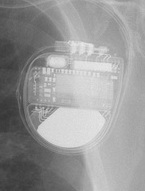 Mirro MRI VR SureScan</td>
<td align="center" valign="top"><b>Option 1</b>  Compia MRI Quad CRT-D SureScan</td>
<td align="center" valign="top"><b>✅ Option 2</b>  Mirro MRI VR SureScan</td>
<td align="center" valign="top"><b>Option 3</b>  Ilivia 7 HF-T QP</td>
<td align="center" valign="top"><b>Option 4</b>  Ilivia 7 VR-T</td>
<td align="center" valign="top"><b>Option 5</b>  Ellipse VR</td>
<td align="center" valign="middle"><b>Option 6</b>  <i>None of the above</i></td>
</tr></table>

### Q1495 · correct: option 4 · `Mirro MRI VR SureScan`

<table><tr>
<td align="center" valign="top"><b>Query</b> 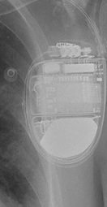 Mirro MRI VR SureScan</td>
<td align="center" valign="top"><b>Option 1</b>  Ilivia 7 HF-T QP</td>
<td align="center" valign="top"><b>Option 2</b>  Serena Quad CRT-P MRI ScureScan</td>
<td align="center" valign="top"><b>Option 3</b>  Ilivia 7 VR-T</td>
<td align="center" valign="top"><b>✅ Option 4</b>  Mirro MRI VR SureScan</td>
<td align="center" valign="top"><b>Option 5</b>  Compia MRI Quad CRT-D SureScan</td>
<td align="center" valign="middle"><b>Option 6</b>  <i>None of the above</i></td>
</tr></table>

### Q1496 · correct: option 2 · `Mirro MRI VR SureScan`

<table><tr>
<td align="center" valign="top"><b>Query</b> 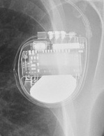 Mirro MRI VR SureScan</td>
<td align="center" valign="top"><b>Option 1</b>  Compia MRI Quad CRT-D SureScan</td>
<td align="center" valign="top"><b>✅ Option 2</b> 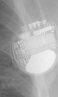 Mirro MRI VR SureScan</td>
<td align="center" valign="top"><b>Option 3</b>  Ilivia 7 VR-T</td>
<td align="center" valign="top"><b>Option 4</b>  Ellipse VR</td>
<td align="center" valign="top"><b>Option 5</b>  Ilivia 7 HF-T QP</td>
<td align="center" valign="middle"><b>Option 6</b>  <i>None of the above</i></td>
</tr></table>

### Q1497 · correct: option 4 · `Mirro MRI VR SureScan`

<table><tr>
<td align="center" valign="top"><b>Query</b> 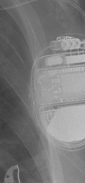 Mirro MRI VR SureScan</td>
<td align="center" valign="top"><b>Option 1</b>  Compia MRI Quad CRT-D SureScan</td>
<td align="center" valign="top"><b>Option 2</b>  Ilivia 7 HF-T QP</td>
<td align="center" valign="top"><b>Option 3</b>  Ellipse VR</td>
<td align="center" valign="top"><b>✅ Option 4</b>  Mirro MRI VR SureScan</td>
<td align="center" valign="top"><b>Option 5</b>  Ilivia 7 VR-T</td>
<td align="center" valign="middle"><b>Option 6</b>  <i>None of the above</i></td>
</tr></table>

### Q1498 · correct: option 2 · `Mirro MRI VR SureScan`

<table><tr>
<td align="center" valign="top"><b>Query</b> 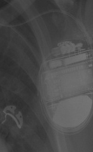 Mirro MRI VR SureScan</td>
<td align="center" valign="top"><b>Option 1</b>  Ellipse VR</td>
<td align="center" valign="top"><b>✅ Option 2</b>  Mirro MRI VR SureScan</td>
<td align="center" valign="top"><b>Option 3</b>  Ilivia 7 HF-T QP</td>
<td align="center" valign="top"><b>Option 4</b>  Serena Quad CRT-P MRI ScureScan</td>
<td align="center" valign="top"><b>Option 5</b>  Compia MRI Quad CRT-D SureScan</td>
<td align="center" valign="middle"><b>Option 6</b>  <i>None of the above</i></td>
</tr></table>

### Q1499 · correct: option 1 · `Enticos 4 DR`

<table><tr>
<td align="center" valign="top"><b>Query</b> 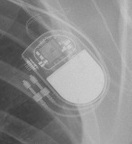 Enticos 4 DR</td>
<td align="center" valign="top"><b>✅ Option 1</b>  Enticos 4 DR</td>
<td align="center" valign="top"><b>Option 2</b>  Enticos 4 SR</td>
<td align="center" valign="top"><b>Option 3</b>  Ecuro SR</td>
<td align="center" valign="top"><b>Option 4</b>  Enitra 6 DR-T</td>
<td align="center" valign="top"><b>Option 5</b>  Attesta DR MRI SureScan</td>
<td align="center" valign="middle"><b>Option 6</b>  <i>None of the above</i></td>
</tr></table>

### Q1500 · correct: option 1 · `Confirm Rx DM3500`

<table><tr>
<td align="center" valign="top"><b>Query</b> 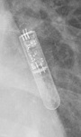 Confirm Rx DM3500</td>
<td align="center" valign="top"><b>✅ Option 1</b>  Confirm Rx DM3500</td>
<td align="center" valign="top"><b>Option 2</b>  Quadra Assura</td>
<td align="center" valign="top"><b>Option 3</b>  SJM Confirm</td>
<td align="center" valign="top"><b>Option 4</b>  Reveal LINQ</td>
<td align="center" valign="top"><b>Option 5</b>  Reveal XT</td>
<td align="center" valign="middle"><b>Option 6</b>  <i>None of the above</i></td>
</tr></table>

### Q1501 · correct: option 4 · `Valitude X4 CRT-P`

<table><tr>
<td align="center" valign="top"><b>Query</b> 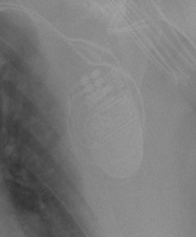 Valitude X4 CRT-P</td>
<td align="center" valign="top"><b>Option 1</b>  Compia MRI Quad CRT-D SureScan</td>
<td align="center" valign="top"><b>Option 2</b> 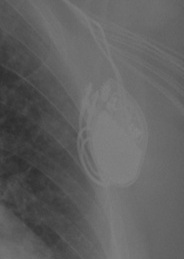 Enticos 4 DR</td>
<td align="center" valign="top"><b>Option 3</b> 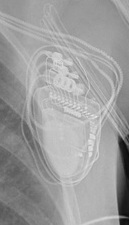 Serena Quad CRT-P MRI ScureScan</td>
<td align="center" valign="top"><b>✅ Option 4</b> 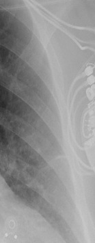 Valitude X4 CRT-P</td>
<td align="center" valign="top"><b>Option 5</b>  Ensura DR MRI SureScan</td>
<td align="center" valign="middle"><b>Option 6</b>  <i>None of the above</i></td>
</tr></table>

### Q1502 · correct: option 2 · `Valitude X4 CRT-P`

<table><tr>
<td align="center" valign="top"><b>Query</b>  Valitude X4 CRT-P</td>
<td align="center" valign="top"><b>Option 1</b>  Enticos 4 DR</td>
<td align="center" valign="top"><b>✅ Option 2</b>  Valitude X4 CRT-P</td>
<td align="center" valign="top"><b>Option 3</b>  Origen Mini ICD</td>
<td align="center" valign="top"><b>Option 4</b> 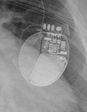 Inogen EL ICD VR</td>
<td align="center" valign="top"><b>Option 5</b>  Serena Quad CRT-P MRI ScureScan</td>
<td align="center" valign="middle"><b>Option 6</b>  <i>None of the above</i></td>
</tr></table>

### Q1503 · correct: option 2 · `Valitude X4 CRT-P`

<table><tr>
<td align="center" valign="top"><b>Query</b> 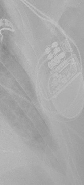 Valitude X4 CRT-P</td>
<td align="center" valign="top"><b>Option 1</b>  Reveal XT</td>
<td align="center" valign="top"><b>✅ Option 2</b>  Valitude X4 CRT-P</td>
<td align="center" valign="top"><b>Option 3</b> 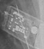 SJM Confirm</td>
<td align="center" valign="top"><b>Option 4</b>  Ensura DR MRI SureScan</td>
<td align="center" valign="top"><b>Option 5</b>  Serena Quad CRT-P MRI ScureScan</td>
<td align="center" valign="middle"><b>Option 6</b>  <i>None of the above</i></td>
</tr></table>

### Q1504 · correct: option 2 · `Serena Quad CRT-P MRI ScureScan`

<table><tr>
<td align="center" valign="top"><b>Query</b> 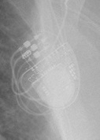 Serena Quad CRT-P MRI ScureScan</td>
<td align="center" valign="top"><b>Option 1</b>  Etrinsa 8 HF-T</td>
<td align="center" valign="top"><b>✅ Option 2</b>  Serena Quad CRT-P MRI ScureScan</td>
<td align="center" valign="top"><b>Option 3</b>  Valitude X4 CRT-P</td>
<td align="center" valign="top"><b>Option 4</b>  Compia MRI Quad CRT-D SureScan</td>
<td align="center" valign="top"><b>Option 5</b> 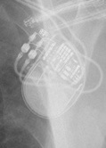 Ensura DR MRI SureScan</td>
<td align="center" valign="middle"><b>Option 6</b>  <i>None of the above</i></td>
</tr></table>

### Q1505 · correct: option 5 · `Enticos 4 SR`

<table><tr>
<td align="center" valign="top"><b>Query</b>  Enticos 4 SR</td>
<td align="center" valign="top"><b>Option 1</b>  Enitra 6 DR-T</td>
<td align="center" valign="top"><b>Option 2</b>  Enitra 8 HF-T QP</td>
<td align="center" valign="top"><b>Option 3</b>  Enticos 4 DR</td>
<td align="center" valign="top"><b>Option 4</b>  Ecuro SR</td>
<td align="center" valign="top"><b>✅ Option 5</b> 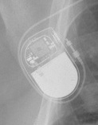 Enticos 4 SR</td>
<td align="center" valign="middle"><b>Option 6</b>  <i>None of the above</i></td>
</tr></table>

### Q1506 · correct: option 2 · `Enticos 4 SR`

<table><tr>
<td align="center" valign="top"><b>Query</b> 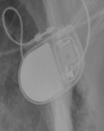 Enticos 4 SR</td>
<td align="center" valign="top"><b>Option 1</b>  Enitra 6 DR-T</td>
<td align="center" valign="top"><b>✅ Option 2</b>  Enticos 4 SR</td>
<td align="center" valign="top"><b>Option 3</b>  Ecuro SR</td>
<td align="center" valign="top"><b>Option 4</b>  Enitra 8 HF-T QP</td>
<td align="center" valign="top"><b>Option 5</b>  Enticos 4 DR</td>
<td align="center" valign="middle"><b>Option 6</b>  <i>None of the above</i></td>
</tr></table>

### Q1507 · correct: option 6 (None of the above)

<table><tr>
<td align="center" valign="top"><b>Query</b>  Enticos 4 SR</td>
<td align="center" valign="top"><b>Option 1</b>  Enticos 4 DR</td>
<td align="center" valign="top"><b>Option 2</b>  Ilivia 7 VR-T</td>
<td align="center" valign="top"><b>Option 3</b>  Ecuro SR</td>
<td align="center" valign="top"><b>Option 4</b>  Enitra 6 DR-T</td>
<td align="center" valign="top"><b>Option 5</b>  Q20 SR MRI SureScan</td>
<td align="center" valign="middle"><b>✅ Option 6</b>  <i>None of the above</i></td>
</tr></table>

### Q1508 · correct: option 5 · `Enticos 4 SR`

<table><tr>
<td align="center" valign="top"><b>Query</b> 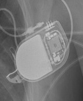 Enticos 4 SR</td>
<td align="center" valign="top"><b>Option 1</b>  Enticos 4 DR</td>
<td align="center" valign="top"><b>Option 2</b>  Enitra 6 DR-T</td>
<td align="center" valign="top"><b>Option 3</b>  Enitra 8 HF-T QP</td>
<td align="center" valign="top"><b>Option 4</b>  Ecuro SR</td>
<td align="center" valign="top"><b>✅ Option 5</b>  Enticos 4 SR</td>
<td align="center" valign="middle"><b>Option 6</b>  <i>None of the above</i></td>
</tr></table>

### Q1509 · correct: option 4 · `Enticos 4 SR`

<table><tr>
<td align="center" valign="top"><b>Query</b> 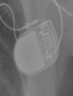 Enticos 4 SR</td>
<td align="center" valign="top"><b>Option 1</b>  Enitra 8 HF-T QP</td>
<td align="center" valign="top"><b>Option 2</b>  Ecuro SR</td>
<td align="center" valign="top"><b>Option 3</b>  Enitra 6 DR-T</td>
<td align="center" valign="top"><b>✅ Option 4</b>  Enticos 4 SR</td>
<td align="center" valign="top"><b>Option 5</b>  Enticos 4 DR</td>
<td align="center" valign="middle"><b>Option 6</b>  <i>None of the above</i></td>
</tr></table>

### Q1510 · correct: option 5 · `Enticos 4 SR`

<table><tr>
<td align="center" valign="top"><b>Query</b> 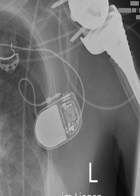 Enticos 4 SR</td>
<td align="center" valign="top"><b>Option 1</b> 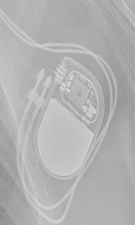 Enticos 4 DR</td>
<td align="center" valign="top"><b>Option 2</b>  Ecuro SR</td>
<td align="center" valign="top"><b>Option 3</b>  Ilivia 7 VR-T</td>
<td align="center" valign="top"><b>Option 4</b>  Enitra 6 DR-T</td>
<td align="center" valign="top"><b>✅ Option 5</b>  Enticos 4 SR</td>
<td align="center" valign="middle"><b>Option 6</b>  <i>None of the above</i></td>
</tr></table>

### Q1511 · correct: option 2 · `Enticos 4 SR`

<table><tr>
<td align="center" valign="top"><b>Query</b> 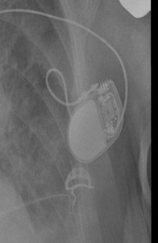 Enticos 4 SR</td>
<td align="center" valign="top"><b>Option 1</b>  Enticos 4 DR</td>
<td align="center" valign="top"><b>✅ Option 2</b>  Enticos 4 SR</td>
<td align="center" valign="top"><b>Option 3</b>  Ecuro SR</td>
<td align="center" valign="top"><b>Option 4</b>  Enitra 6 DR-T</td>
<td align="center" valign="top"><b>Option 5</b>  Ilivia 7 VR-T</td>
<td align="center" valign="middle"><b>Option 6</b>  <i>None of the above</i></td>
</tr></table>

### Q1512 · correct: option 3 · `Attesta DR MRI SureScan`

<table><tr>
<td align="center" valign="top"><b>Query</b> 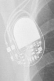 Attesta DR MRI SureScan</td>
<td align="center" valign="top"><b>Option 1</b>  Enticos 4 SR</td>
<td align="center" valign="top"><b>Option 2</b>  Q20 SR MRI SureScan</td>
<td align="center" valign="top"><b>✅ Option 3</b>  Attesta DR MRI SureScan</td>
<td align="center" valign="top"><b>Option 4</b>  Enitra 8 HF-T QP</td>
<td align="center" valign="top"><b>Option 5</b>  Enticos 4 DR</td>
<td align="center" valign="middle"><b>Option 6</b>  <i>None of the above</i></td>
</tr></table>

### Q1513 · correct: option 2 · `Q20 SR MRI SureScan`

<table><tr>
<td align="center" valign="top"><b>Query</b> 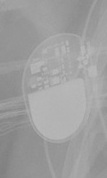 Q20 SR MRI SureScan</td>
<td align="center" valign="top"><b>Option 1</b>  Attesta DR MRI SureScan</td>
<td align="center" valign="top"><b>✅ Option 2</b>  Q20 SR MRI SureScan</td>
<td align="center" valign="top"><b>Option 3</b>  Enticos 4 DR</td>
<td align="center" valign="top"><b>Option 4</b>  Enitra 8 HF-T QP</td>
<td align="center" valign="top"><b>Option 5</b>  Enticos 4 SR</td>
<td align="center" valign="middle"><b>Option 6</b>  <i>None of the above</i></td>
</tr></table>

### Q1514 · correct: option 5 · `Q20 SR MRI SureScan`

<table><tr>
<td align="center" valign="top"><b>Query</b> 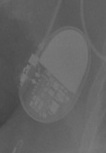 Q20 SR MRI SureScan</td>
<td align="center" valign="top"><b>Option 1</b>  Enticos 4 DR</td>
<td align="center" valign="top"><b>Option 2</b>  Enitra 8 HF-T QP</td>
<td align="center" valign="top"><b>Option 3</b>  Enticos 4 SR</td>
<td align="center" valign="top"><b>Option 4</b>  Attesta DR MRI SureScan</td>
<td align="center" valign="top"><b>✅ Option 5</b>  Q20 SR MRI SureScan</td>
<td align="center" valign="middle"><b>Option 6</b>  <i>None of the above</i></td>
</tr></table>

### Q1515 · correct: option 3 · `Q20 SR MRI SureScan`

<table><tr>
<td align="center" valign="top"><b>Query</b> 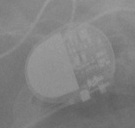 Q20 SR MRI SureScan</td>
<td align="center" valign="top"><b>Option 1</b>  Ecuro SR</td>
<td align="center" valign="top"><b>Option 2</b>  Enitra 8 HF-T QP</td>
<td align="center" valign="top"><b>✅ Option 3</b>  Q20 SR MRI SureScan</td>
<td align="center" valign="top"><b>Option 4</b>  Enticos 4 DR</td>
<td align="center" valign="top"><b>Option 5</b>  Attesta DR MRI SureScan</td>
<td align="center" valign="middle"><b>Option 6</b>  <i>None of the above</i></td>
</tr></table>

### Q1516 · correct: option 5 · `Q20 SR MRI SureScan`

<table><tr>
<td align="center" valign="top"><b>Query</b> 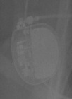 Q20 SR MRI SureScan</td>
<td align="center" valign="top"><b>Option 1</b>  Enticos 4 SR</td>
<td align="center" valign="top"><b>Option 2</b>  Attesta DR MRI SureScan</td>
<td align="center" valign="top"><b>Option 3</b>  Enticos 4 DR</td>
<td align="center" valign="top"><b>Option 4</b>  Ecuro SR</td>
<td align="center" valign="top"><b>✅ Option 5</b>  Q20 SR MRI SureScan</td>
<td align="center" valign="middle"><b>Option 6</b>  <i>None of the above</i></td>
</tr></table>

### Q1517 · correct: option 5 · `Q20 SR MRI SureScan`

<table><tr>
<td align="center" valign="top"><b>Query</b> 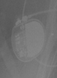 Q20 SR MRI SureScan</td>
<td align="center" valign="top"><b>Option 1</b>  Attesta DR MRI SureScan</td>
<td align="center" valign="top"><b>Option 2</b>  Enticos 4 DR</td>
<td align="center" valign="top"><b>Option 3</b>  Ecuro SR</td>
<td align="center" valign="top"><b>Option 4</b>  Enticos 4 SR</td>
<td align="center" valign="top"><b>✅ Option 5</b>  Q20 SR MRI SureScan</td>
<td align="center" valign="middle"><b>Option 6</b>  <i>None of the above</i></td>
</tr></table>

### Q1518 · correct: option 4 · `Enitra 8 HF-T QP`

<table><tr>
<td align="center" valign="top"><b>Query</b> 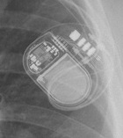 Enitra 8 HF-T QP</td>
<td align="center" valign="top"><b>Option 1</b>  Enitra 6 DR-T</td>
<td align="center" valign="top"><b>Option 2</b>  Etrinsa 8 HF-T</td>
<td align="center" valign="top"><b>Option 3</b>  Enticos 4 DR</td>
<td align="center" valign="top"><b>✅ Option 4</b>  Enitra 8 HF-T QP</td>
<td align="center" valign="top"><b>Option 5</b>  Enticos 4 SR</td>
<td align="center" valign="middle"><b>Option 6</b>  <i>None of the above</i></td>
</tr></table>

### Q1519 · correct: option 1 · `Reveal LINQ`

<table><tr>
<td align="center" valign="top"><b>Query</b> 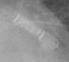 Reveal LINQ</td>
<td align="center" valign="top"><b>✅ Option 1</b> 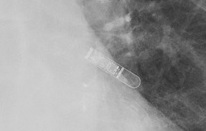 Reveal LINQ</td>
<td align="center" valign="top"><b>Option 2</b>  SJM Confirm</td>
<td align="center" valign="top"><b>Option 3</b>  Confirm Rx DM3500</td>
<td align="center" valign="top"><b>Option 4</b>  Reveal XT</td>
<td align="center" valign="top"><b>Option 5</b>  Ilivia 7 VR-T</td>
<td align="center" valign="middle"><b>Option 6</b>  <i>None of the above</i></td>
</tr></table>

### Q1520 · correct: option 2 · `Enticos 4 DR`

<table><tr>
<td align="center" valign="top"><b>Query</b> 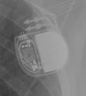 Enticos 4 DR</td>
<td align="center" valign="top"><b>Option 1</b>  Ecuro SR</td>
<td align="center" valign="top"><b>✅ Option 2</b>  Enticos 4 DR</td>
<td align="center" valign="top"><b>Option 3</b>  Enticos 4 SR</td>
<td align="center" valign="top"><b>Option 4</b>  Enitra 8 HF-T QP</td>
<td align="center" valign="top"><b>Option 5</b>  Enitra 6 DR-T</td>
<td align="center" valign="middle"><b>Option 6</b>  <i>None of the above</i></td>
</tr></table>

### Q1521 · correct: option 1 · `Mirro MRI VR SureScan`

<table><tr>
<td align="center" valign="top"><b>Query</b> 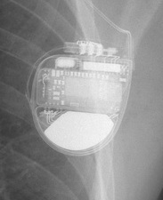 Mirro MRI VR SureScan</td>
<td align="center" valign="top"><b>✅ Option 1</b>  Mirro MRI VR SureScan</td>
<td align="center" valign="top"><b>Option 2</b>  Ilivia 7 HF-T QP</td>
<td align="center" valign="top"><b>Option 3</b>  Compia MRI Quad CRT-D SureScan</td>
<td align="center" valign="top"><b>Option 4</b>  Serena Quad CRT-P MRI ScureScan</td>
<td align="center" valign="top"><b>Option 5</b>  Ellipse VR</td>
<td align="center" valign="middle"><b>Option 6</b>  <i>None of the above</i></td>
</tr></table>

### Q1522 · correct: option 3 · `Q20 SR MRI SureScan`

<table><tr>
<td align="center" valign="top"><b>Query</b> 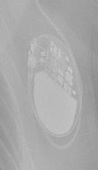 Q20 SR MRI SureScan</td>
<td align="center" valign="top"><b>Option 1</b>  Ecuro SR</td>
<td align="center" valign="top"><b>Option 2</b>  Enticos 4 DR</td>
<td align="center" valign="top"><b>✅ Option 3</b>  Q20 SR MRI SureScan</td>
<td align="center" valign="top"><b>Option 4</b>  Enticos 4 SR</td>
<td align="center" valign="top"><b>Option 5</b>  Attesta DR MRI SureScan</td>
<td align="center" valign="middle"><b>Option 6</b>  <i>None of the above</i></td>
</tr></table>

### Q1523 · correct: option 4 · `Q20 SR MRI SureScan`

<table><tr>
<td align="center" valign="top"><b>Query</b> 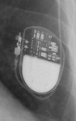 Q20 SR MRI SureScan</td>
<td align="center" valign="top"><b>Option 1</b>  Enticos 4 DR</td>
<td align="center" valign="top"><b>Option 2</b>  Attesta DR MRI SureScan</td>
<td align="center" valign="top"><b>Option 3</b>  Ecuro SR</td>
<td align="center" valign="top"><b>✅ Option 4</b>  Q20 SR MRI SureScan</td>
<td align="center" valign="top"><b>Option 5</b>  Enticos 4 SR</td>
<td align="center" valign="middle"><b>Option 6</b>  <i>None of the above</i></td>
</tr></table>

### Q1524 · correct: option 5 · `Charisma X4 CRT-D`

<table><tr>
<td align="center" valign="top"><b>Query</b> 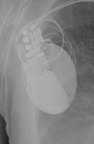 Charisma X4 CRT-D</td>
<td align="center" valign="top"><b>Option 1</b>  Rivacor 7 HF-T QP</td>
<td align="center" valign="top"><b>Option 2</b>  Origen Mini ICD</td>
<td align="center" valign="top"><b>Option 3</b>  Valitude X4 CRT-P</td>
<td align="center" valign="top"><b>Option 4</b>  Inogen EL ICD VR</td>
<td align="center" valign="top"><b>✅ Option 5</b>  Charisma X4 CRT-D</td>
<td align="center" valign="middle"><b>Option 6</b>  <i>None of the above</i></td>
</tr></table>

### Q1525 · correct: option 3 · `Charisma X4 CRT-D`

<table><tr>
<td align="center" valign="top"><b>Query</b>  Charisma X4 CRT-D</td>
<td align="center" valign="top"><b>Option 1</b>  Inogen EL ICD VR</td>
<td align="center" valign="top"><b>Option 2</b>  Valitude X4 CRT-P</td>
<td align="center" valign="top"><b>✅ Option 3</b>  Charisma X4 CRT-D</td>
<td align="center" valign="top"><b>Option 4</b>  Rivacor 7 HF-T QP</td>
<td align="center" valign="top"><b>Option 5</b>  Origen Mini ICD</td>
<td align="center" valign="middle"><b>Option 6</b>  <i>None of the above</i></td>
</tr></table>

### Q1526 · correct: option 3 · `Charisma X4 CRT-D`

<table><tr>
<td align="center" valign="top"><b>Query</b>  Charisma X4 CRT-D</td>
<td align="center" valign="top"><b>Option 1</b>  Inogen EL ICD VR</td>
<td align="center" valign="top"><b>Option 2</b>  Origen Mini ICD</td>
<td align="center" valign="top"><b>✅ Option 3</b>  Charisma X4 CRT-D</td>
<td align="center" valign="top"><b>Option 4</b>  Valitude X4 CRT-P</td>
<td align="center" valign="top"><b>Option 5</b>  Serena Quad CRT-P MRI ScureScan</td>
<td align="center" valign="middle"><b>Option 6</b>  <i>None of the above</i></td>
</tr></table>

### Q1527 · correct: option 1 · `Charisma X4 CRT-D`

<table><tr>
<td align="center" valign="top"><b>Query</b>  Charisma X4 CRT-D</td>
<td align="center" valign="top"><b>✅ Option 1</b>  Charisma X4 CRT-D</td>
<td align="center" valign="top"><b>Option 2</b>  Rivacor 7 HF-T QP</td>
<td align="center" valign="top"><b>Option 3</b>  Inogen EL ICD VR</td>
<td align="center" valign="top"><b>Option 4</b>  Origen Mini ICD</td>
<td align="center" valign="top"><b>Option 5</b>  Serena Quad CRT-P MRI ScureScan</td>
<td align="center" valign="middle"><b>Option 6</b>  <i>None of the above</i></td>
</tr></table>

### Q1528 · correct: option 1 · `Charisma X4 CRT-D`

<table><tr>
<td align="center" valign="top"><b>Query</b>  Charisma X4 CRT-D</td>
<td align="center" valign="top"><b>✅ Option 1</b>  Charisma X4 CRT-D</td>
<td align="center" valign="top"><b>Option 2</b>  Quadra Assura</td>
<td align="center" valign="top"><b>Option 3</b>  Inogen EL ICD VR</td>
<td align="center" valign="top"><b>Option 4</b>  Valitude X4 CRT-P</td>
<td align="center" valign="top"><b>Option 5</b>  Origen Mini ICD</td>
<td align="center" valign="middle"><b>Option 6</b>  <i>None of the above</i></td>
</tr></table>

### Q1529 · correct: option 5 · `Charisma X4 CRT-D`

<table><tr>
<td align="center" valign="top"><b>Query</b>  Charisma X4 CRT-D</td>
<td align="center" valign="top"><b>Option 1</b>  Rivacor 7 HF-T QP</td>
<td align="center" valign="top"><b>Option 2</b>  Valitude X4 CRT-P</td>
<td align="center" valign="top"><b>Option 3</b>  Origen Mini ICD</td>
<td align="center" valign="top"><b>Option 4</b>  Inogen EL ICD VR</td>
<td align="center" valign="top"><b>✅ Option 5</b>  Charisma X4 CRT-D</td>
<td align="center" valign="middle"><b>Option 6</b>  <i>None of the above</i></td>
</tr></table>

### Q1530 · correct: option 4 · `Charisma X4 CRT-D`

<table><tr>
<td align="center" valign="top"><b>Query</b>  Charisma X4 CRT-D</td>
<td align="center" valign="top"><b>Option 1</b>  Origen Mini ICD</td>
<td align="center" valign="top"><b>Option 2</b>  Rivacor 7 HF-T QP</td>
<td align="center" valign="top"><b>Option 3</b>  Rivacor 5 VR-T DX</td>
<td align="center" valign="top"><b>✅ Option 4</b>  Charisma X4 CRT-D</td>
<td align="center" valign="top"><b>Option 5</b>  Inogen EL ICD VR</td>
<td align="center" valign="middle"><b>Option 6</b>  <i>None of the above</i></td>
</tr></table>

### Q1531 · correct: option 6 (None of the above)

<table><tr>
<td align="center" valign="top"><b>Query</b>  Q20 SR MRI SureScan</td>
<td align="center" valign="top"><b>Option 1</b>  Ilivia 7 VR-T</td>
<td align="center" valign="top"><b>Option 2</b>  Ellipse VR</td>
<td align="center" valign="top"><b>Option 3</b>  Ecuro SR</td>
<td align="center" valign="top"><b>Option 4</b>  Enticos 4 SR</td>
<td align="center" valign="top"><b>Option 5</b>  Enitra 8 HF-T QP</td>
<td align="center" valign="middle"><b>✅ Option 6</b>  <i>None of the above</i></td>
</tr></table>

### Q1532 · correct: option 1 · `Serena Quad CRT-P MRI ScureScan`

<table><tr>
<td align="center" valign="top"><b>Query</b>  Serena Quad CRT-P MRI ScureScan</td>
<td align="center" valign="top"><b>✅ Option 1</b>  Serena Quad CRT-P MRI ScureScan</td>
<td align="center" valign="top"><b>Option 2</b>  Valitude X4 CRT-P</td>
<td align="center" valign="top"><b>Option 3</b>  Etrinsa 8 HF-T</td>
<td align="center" valign="top"><b>Option 4</b>  Compia MRI Quad CRT-D SureScan</td>
<td align="center" valign="top"><b>Option 5</b>  Mirro MRI VR SureScan</td>
<td align="center" valign="middle"><b>Option 6</b>  <i>None of the above</i></td>
</tr></table>

### Q1533 · correct: option 2 · `Serena Quad CRT-P MRI ScureScan`

<table><tr>
<td align="center" valign="top"><b>Query</b>  Serena Quad CRT-P MRI ScureScan</td>
<td align="center" valign="top"><b>Option 1</b>  Etrinsa 8 HF-T</td>
<td align="center" valign="top"><b>✅ Option 2</b>  Serena Quad CRT-P MRI ScureScan</td>
<td align="center" valign="top"><b>Option 3</b>  Enitra 8 HF-T QP</td>
<td align="center" valign="top"><b>Option 4</b>  Quadra Allure MP</td>
<td align="center" valign="top"><b>Option 5</b>  Attesta DR MRI SureScan</td>
<td align="center" valign="middle"><b>Option 6</b>  <i>None of the above</i></td>
</tr></table>

