# Physionet (cardiac devices) · query set `test` · page 5/8

[← all pages](README.md)

### Q1534 · correct: option 4 · `Enticos 4 SR`

<table><tr>
<td align="center" valign="top"><b>Query</b> 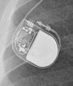 Enticos 4 SR</td>
<td align="center" valign="top"><b>Option 1</b>  Q20 SR MRI SureScan</td>
<td align="center" valign="top"><b>Option 2</b>  Ecuro SR</td>
<td align="center" valign="top"><b>Option 3</b>  Enitra 6 DR-T</td>
<td align="center" valign="top"><b>✅ Option 4</b>  Enticos 4 SR</td>
<td align="center" valign="top"><b>Option 5</b>  Enticos 4 DR</td>
<td align="center" valign="middle"><b>Option 6</b>  <i>None of the above</i></td>
</tr></table>

### Q1535 · correct: option 4 · `Ellipse VR`

<table><tr>
<td align="center" valign="top"><b>Query</b> 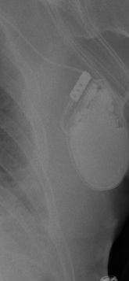 Ellipse VR</td>
<td align="center" valign="top"><b>Option 1</b>  Rivacor 5 VR-T DX</td>
<td align="center" valign="top"><b>Option 2</b>  Rivacor 7 HF-T QP</td>
<td align="center" valign="top"><b>Option 3</b>  Ilivia 7 HF-T QP</td>
<td align="center" valign="top"><b>✅ Option 4</b> 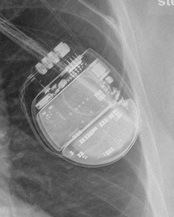 Ellipse VR</td>
<td align="center" valign="top"><b>Option 5</b>  Ilivia 7 VR-T</td>
<td align="center" valign="middle"><b>Option 6</b>  <i>None of the above</i></td>
</tr></table>

### Q1536 · correct: option 1 · `Enticos 4 DR`

<table><tr>
<td align="center" valign="top"><b>Query</b> 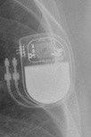 Enticos 4 DR</td>
<td align="center" valign="top"><b>✅ Option 1</b>  Enticos 4 DR</td>
<td align="center" valign="top"><b>Option 2</b>  Ecuro SR</td>
<td align="center" valign="top"><b>Option 3</b>  Enticos 4 SR</td>
<td align="center" valign="top"><b>Option 4</b>  Enitra 8 HF-T QP</td>
<td align="center" valign="top"><b>Option 5</b>  Enitra 6 DR-T</td>
<td align="center" valign="middle"><b>Option 6</b>  <i>None of the above</i></td>
</tr></table>

### Q1537 · correct: option 3 · `Enticos 4 DR`

<table><tr>
<td align="center" valign="top"><b>Query</b> 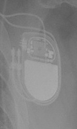 Enticos 4 DR</td>
<td align="center" valign="top"><b>Option 1</b>  Enitra 6 DR-T</td>
<td align="center" valign="top"><b>Option 2</b>  Enticos 4 SR</td>
<td align="center" valign="top"><b>✅ Option 3</b>  Enticos 4 DR</td>
<td align="center" valign="top"><b>Option 4</b>  Enitra 8 HF-T QP</td>
<td align="center" valign="top"><b>Option 5</b>  Ecuro SR</td>
<td align="center" valign="middle"><b>Option 6</b>  <i>None of the above</i></td>
</tr></table>

### Q1538 · correct: option 4 · `Attesta DR MRI SureScan`

<table><tr>
<td align="center" valign="top"><b>Query</b> 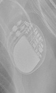 Attesta DR MRI SureScan</td>
<td align="center" valign="top"><b>Option 1</b>  Ensura DR MRI SureScan</td>
<td align="center" valign="top"><b>Option 2</b>  Enticos 4 DR</td>
<td align="center" valign="top"><b>Option 3</b>  Enticos 4 SR</td>
<td align="center" valign="top"><b>✅ Option 4</b>  Attesta DR MRI SureScan</td>
<td align="center" valign="top"><b>Option 5</b>  Q20 SR MRI SureScan</td>
<td align="center" valign="middle"><b>Option 6</b>  <i>None of the above</i></td>
</tr></table>

### Q1539 · correct: option 4 · `Attesta DR MRI SureScan`

<table><tr>
<td align="center" valign="top"><b>Query</b> 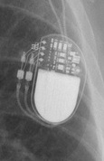 Attesta DR MRI SureScan</td>
<td align="center" valign="top"><b>Option 1</b>  Enticos 4 DR</td>
<td align="center" valign="top"><b>Option 2</b>  Q20 SR MRI SureScan</td>
<td align="center" valign="top"><b>Option 3</b>  Ecuro SR</td>
<td align="center" valign="top"><b>✅ Option 4</b>  Attesta DR MRI SureScan</td>
<td align="center" valign="top"><b>Option 5</b>  Enticos 4 SR</td>
<td align="center" valign="middle"><b>Option 6</b>  <i>None of the above</i></td>
</tr></table>

### Q1540 · correct: option 3 · `Attesta DR MRI SureScan`

<table><tr>
<td align="center" valign="top"><b>Query</b> 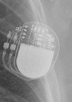 Attesta DR MRI SureScan</td>
<td align="center" valign="top"><b>Option 1</b>  Ensura DR MRI SureScan</td>
<td align="center" valign="top"><b>Option 2</b>  Q20 SR MRI SureScan</td>
<td align="center" valign="top"><b>✅ Option 3</b>  Attesta DR MRI SureScan</td>
<td align="center" valign="top"><b>Option 4</b>  Enticos 4 DR</td>
<td align="center" valign="top"><b>Option 5</b>  Enticos 4 SR</td>
<td align="center" valign="middle"><b>Option 6</b>  <i>None of the above</i></td>
</tr></table>

### Q1541 · correct: option 1 · `Attesta DR MRI SureScan`

<table><tr>
<td align="center" valign="top"><b>Query</b> 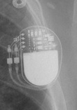 Attesta DR MRI SureScan</td>
<td align="center" valign="top"><b>✅ Option 1</b> 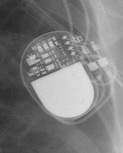 Attesta DR MRI SureScan</td>
<td align="center" valign="top"><b>Option 2</b>  Enitra 8 HF-T QP</td>
<td align="center" valign="top"><b>Option 3</b>  Enticos 4 SR</td>
<td align="center" valign="top"><b>Option 4</b>  Enticos 4 DR</td>
<td align="center" valign="top"><b>Option 5</b>  Q20 SR MRI SureScan</td>
<td align="center" valign="middle"><b>Option 6</b>  <i>None of the above</i></td>
</tr></table>

### Q1542 · correct: option 5 · `Attesta DR MRI SureScan`

<table><tr>
<td align="center" valign="top"><b>Query</b> 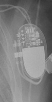 Attesta DR MRI SureScan</td>
<td align="center" valign="top"><b>Option 1</b>  Q20 SR MRI SureScan</td>
<td align="center" valign="top"><b>Option 2</b>  Enticos 4 DR</td>
<td align="center" valign="top"><b>Option 3</b>  Enticos 4 SR</td>
<td align="center" valign="top"><b>Option 4</b>  Enitra 8 HF-T QP</td>
<td align="center" valign="top"><b>✅ Option 5</b>  Attesta DR MRI SureScan</td>
<td align="center" valign="middle"><b>Option 6</b>  <i>None of the above</i></td>
</tr></table>

### Q1543 · correct: option 1 · `Attesta DR MRI SureScan`

<table><tr>
<td align="center" valign="top"><b>Query</b> 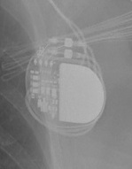 Attesta DR MRI SureScan</td>
<td align="center" valign="top"><b>✅ Option 1</b>  Attesta DR MRI SureScan</td>
<td align="center" valign="top"><b>Option 2</b>  Q20 SR MRI SureScan</td>
<td align="center" valign="top"><b>Option 3</b>  Ilivia 7 HF-T QP</td>
<td align="center" valign="top"><b>Option 4</b>  Enticos 4 DR</td>
<td align="center" valign="top"><b>Option 5</b>  Enitra 8 HF-T QP</td>
<td align="center" valign="middle"><b>Option 6</b>  <i>None of the above</i></td>
</tr></table>

### Q1544 · correct: option 2 · `Attesta DR MRI SureScan`

<table><tr>
<td align="center" valign="top"><b>Query</b> 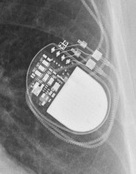 Attesta DR MRI SureScan</td>
<td align="center" valign="top"><b>Option 1</b>  Enticos 4 SR</td>
<td align="center" valign="top"><b>✅ Option 2</b>  Attesta DR MRI SureScan</td>
<td align="center" valign="top"><b>Option 3</b>  Q20 SR MRI SureScan</td>
<td align="center" valign="top"><b>Option 4</b>  Enticos 4 DR</td>
<td align="center" valign="top"><b>Option 5</b>  Ensura DR MRI SureScan</td>
<td align="center" valign="middle"><b>Option 6</b>  <i>None of the above</i></td>
</tr></table>

### Q1545 · correct: option 1 · `Ilivia 7 VR-T`

<table><tr>
<td align="center" valign="top"><b>Query</b>  Ilivia 7 VR-T</td>
<td align="center" valign="top"><b>✅ Option 1</b>  Ilivia 7 VR-T</td>
<td align="center" valign="top"><b>Option 2</b>  Mirro MRI VR SureScan</td>
<td align="center" valign="top"><b>Option 3</b>  Compia MRI Quad CRT-D SureScan</td>
<td align="center" valign="top"><b>Option 4</b>  Ilivia 7 HF-T QP</td>
<td align="center" valign="top"><b>Option 5</b>  Ecuro SR</td>
<td align="center" valign="middle"><b>Option 6</b>  <i>None of the above</i></td>
</tr></table>

### Q1546 · correct: option 2 · `Ilivia 7 VR-T`

<table><tr>
<td align="center" valign="top"><b>Query</b>  Ilivia 7 VR-T</td>
<td align="center" valign="top"><b>Option 1</b>  Ilivia 7 HF-T QP</td>
<td align="center" valign="top"><b>✅ Option 2</b>  Ilivia 7 VR-T</td>
<td align="center" valign="top"><b>Option 3</b>  Mirro MRI VR SureScan</td>
<td align="center" valign="top"><b>Option 4</b>  Reveal XT</td>
<td align="center" valign="top"><b>Option 5</b>  SJM Confirm</td>
<td align="center" valign="middle"><b>Option 6</b>  <i>None of the above</i></td>
</tr></table>

### Q1547 · correct: option 2 · `Ilivia 7 VR-T`

<table><tr>
<td align="center" valign="top"><b>Query</b>  Ilivia 7 VR-T</td>
<td align="center" valign="top"><b>Option 1</b>  Reveal XT</td>
<td align="center" valign="top"><b>✅ Option 2</b>  Ilivia 7 VR-T</td>
<td align="center" valign="top"><b>Option 3</b> 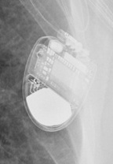 Mirro MRI VR SureScan</td>
<td align="center" valign="top"><b>Option 4</b>  Ilivia 7 HF-T QP</td>
<td align="center" valign="top"><b>Option 5</b>  Compia MRI Quad CRT-D SureScan</td>
<td align="center" valign="middle"><b>Option 6</b>  <i>None of the above</i></td>
</tr></table>

### Q1548 · correct: option 2 · `Ilivia 7 VR-T`

<table><tr>
<td align="center" valign="top"><b>Query</b> 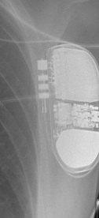 Ilivia 7 VR-T</td>
<td align="center" valign="top"><b>Option 1</b>  Reveal LINQ</td>
<td align="center" valign="top"><b>✅ Option 2</b>  Ilivia 7 VR-T</td>
<td align="center" valign="top"><b>Option 3</b>  Compia MRI Quad CRT-D SureScan</td>
<td align="center" valign="top"><b>Option 4</b>  Mirro MRI VR SureScan</td>
<td align="center" valign="top"><b>Option 5</b>  Ilivia 7 HF-T QP</td>
<td align="center" valign="middle"><b>Option 6</b>  <i>None of the above</i></td>
</tr></table>

### Q1549 · correct: option 2 · `Ilivia 7 VR-T`

<table><tr>
<td align="center" valign="top"><b>Query</b> 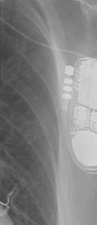 Ilivia 7 VR-T</td>
<td align="center" valign="top"><b>Option 1</b>  Ilivia 7 HF-T QP</td>
<td align="center" valign="top"><b>✅ Option 2</b>  Ilivia 7 VR-T</td>
<td align="center" valign="top"><b>Option 3</b>  Valitude X4 CRT-P</td>
<td align="center" valign="top"><b>Option 4</b>  Compia MRI Quad CRT-D SureScan</td>
<td align="center" valign="top"><b>Option 5</b>  Mirro MRI VR SureScan</td>
<td align="center" valign="middle"><b>Option 6</b>  <i>None of the above</i></td>
</tr></table>

### Q1550 · correct: option 4 · `Enticos 4 DR`

<table><tr>
<td align="center" valign="top"><b>Query</b> 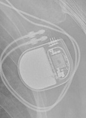 Enticos 4 DR</td>
<td align="center" valign="top"><b>Option 1</b>  Etrinsa 8 HF-T</td>
<td align="center" valign="top"><b>Option 2</b>  Enitra 8 HF-T QP</td>
<td align="center" valign="top"><b>Option 3</b>  Enitra 6 DR-T</td>
<td align="center" valign="top"><b>✅ Option 4</b>  Enticos 4 DR</td>
<td align="center" valign="top"><b>Option 5</b>  Enticos 4 SR</td>
<td align="center" valign="middle"><b>Option 6</b>  <i>None of the above</i></td>
</tr></table>

### Q1551 · correct: option 5 · `Attesta DR MRI SureScan`

<table><tr>
<td align="center" valign="top"><b>Query</b> 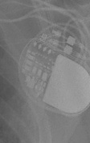 Attesta DR MRI SureScan</td>
<td align="center" valign="top"><b>Option 1</b>  Enticos 4 DR</td>
<td align="center" valign="top"><b>Option 2</b>  Q20 SR MRI SureScan</td>
<td align="center" valign="top"><b>Option 3</b>  Enitra 8 HF-T QP</td>
<td align="center" valign="top"><b>Option 4</b>  Enticos 4 SR</td>
<td align="center" valign="top"><b>✅ Option 5</b>  Attesta DR MRI SureScan</td>
<td align="center" valign="middle"><b>Option 6</b>  <i>None of the above</i></td>
</tr></table>

### Q1552 · correct: option 1 · `Attesta DR MRI SureScan`

<table><tr>
<td align="center" valign="top"><b>Query</b> 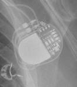 Attesta DR MRI SureScan</td>
<td align="center" valign="top"><b>✅ Option 1</b>  Attesta DR MRI SureScan</td>
<td align="center" valign="top"><b>Option 2</b>  Enticos 4 DR</td>
<td align="center" valign="top"><b>Option 3</b>  Enticos 4 SR</td>
<td align="center" valign="top"><b>Option 4</b>  Q20 SR MRI SureScan</td>
<td align="center" valign="top"><b>Option 5</b>  Ecuro SR</td>
<td align="center" valign="middle"><b>Option 6</b>  <i>None of the above</i></td>
</tr></table>

### Q1553 · correct: option 2 · `Attesta DR MRI SureScan`

<table><tr>
<td align="center" valign="top"><b>Query</b> 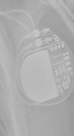 Attesta DR MRI SureScan</td>
<td align="center" valign="top"><b>Option 1</b>  Q20 SR MRI SureScan</td>
<td align="center" valign="top"><b>✅ Option 2</b>  Attesta DR MRI SureScan</td>
<td align="center" valign="top"><b>Option 3</b>  Enticos 4 SR</td>
<td align="center" valign="top"><b>Option 4</b>  Enticos 4 DR</td>
<td align="center" valign="top"><b>Option 5</b>  Ilivia 7 HF-T QP</td>
<td align="center" valign="middle"><b>Option 6</b>  <i>None of the above</i></td>
</tr></table>

### Q1554 · correct: option 6 (None of the above)

<table><tr>
<td align="center" valign="top"><b>Query</b> 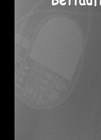 Valitude X4 CRT-P</td>
<td align="center" valign="top"><b>Option 1</b>  Enticos 4 SR</td>
<td align="center" valign="top"><b>Option 2</b>  Q20 SR MRI SureScan</td>
<td align="center" valign="top"><b>Option 3</b>  Enitra 8 HF-T QP</td>
<td align="center" valign="top"><b>Option 4</b>  Enticos 4 DR</td>
<td align="center" valign="top"><b>Option 5</b>  Attesta DR MRI SureScan</td>
<td align="center" valign="middle"><b>✅ Option 6</b>  <i>None of the above</i></td>
</tr></table>

### Q1555 · correct: option 4 · `Ensura DR MRI SureScan`

<table><tr>
<td align="center" valign="top"><b>Query</b> 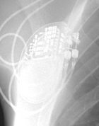 Ensura DR MRI SureScan</td>
<td align="center" valign="top"><b>Option 1</b>  Quadra Assura</td>
<td align="center" valign="top"><b>Option 2</b>  Serena Quad CRT-P MRI ScureScan</td>
<td align="center" valign="top"><b>Option 3</b>  Attesta DR MRI SureScan</td>
<td align="center" valign="top"><b>✅ Option 4</b>  Ensura DR MRI SureScan</td>
<td align="center" valign="top"><b>Option 5</b>  Etrinsa 8 HF-T</td>
<td align="center" valign="middle"><b>Option 6</b>  <i>None of the above</i></td>
</tr></table>

### Q1556 · correct: option 4 · `Ensura DR MRI SureScan`

<table><tr>
<td align="center" valign="top"><b>Query</b>  Ensura DR MRI SureScan</td>
<td align="center" valign="top"><b>Option 1</b>  Attesta DR MRI SureScan</td>
<td align="center" valign="top"><b>Option 2</b>  Etrinsa 8 HF-T</td>
<td align="center" valign="top"><b>Option 3</b>  Quadra Assura</td>
<td align="center" valign="top"><b>✅ Option 4</b>  Ensura DR MRI SureScan</td>
<td align="center" valign="top"><b>Option 5</b>  Enitra 6 DR-T</td>
<td align="center" valign="middle"><b>Option 6</b>  <i>None of the above</i></td>
</tr></table>

### Q1557 · correct: option 1 · `Ensura DR MRI SureScan`

<table><tr>
<td align="center" valign="top"><b>Query</b> 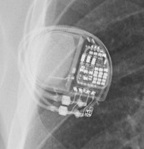 Ensura DR MRI SureScan</td>
<td align="center" valign="top"><b>✅ Option 1</b>  Ensura DR MRI SureScan</td>
<td align="center" valign="top"><b>Option 2</b>  Attesta DR MRI SureScan</td>
<td align="center" valign="top"><b>Option 3</b>  Etrinsa 8 HF-T</td>
<td align="center" valign="top"><b>Option 4</b>  Enticos 4 DR</td>
<td align="center" valign="top"><b>Option 5</b>  Enitra 6 DR-T</td>
<td align="center" valign="middle"><b>Option 6</b>  <i>None of the above</i></td>
</tr></table>

### Q1558 · correct: option 4 · `Quadra Allure MP`

<table><tr>
<td align="center" valign="top"><b>Query</b> 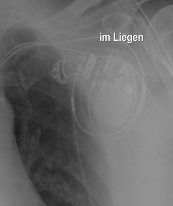 Quadra Allure MP</td>
<td align="center" valign="top"><b>Option 1</b>  Enitra 8 HF-T QP</td>
<td align="center" valign="top"><b>Option 2</b>  Enticos 4 DR</td>
<td align="center" valign="top"><b>Option 3</b>  Q20 SR MRI SureScan</td>
<td align="center" valign="top"><b>✅ Option 4</b> 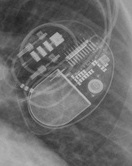 Quadra Allure MP</td>
<td align="center" valign="top"><b>Option 5</b>  Enticos 4 SR</td>
<td align="center" valign="middle"><b>Option 6</b>  <i>None of the above</i></td>
</tr></table>

### Q1559 · correct: option 5 · `Quadra Allure MP`

<table><tr>
<td align="center" valign="top"><b>Query</b> 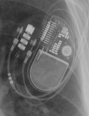 Quadra Allure MP</td>
<td align="center" valign="top"><b>Option 1</b>  Enitra 8 HF-T QP</td>
<td align="center" valign="top"><b>Option 2</b>  Ilivia 7 HF-T QP</td>
<td align="center" valign="top"><b>Option 3</b> 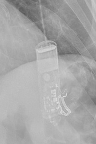 SJM Confirm</td>
<td align="center" valign="top"><b>Option 4</b>  Ensura DR MRI SureScan</td>
<td align="center" valign="top"><b>✅ Option 5</b>  Quadra Allure MP</td>
<td align="center" valign="middle"><b>Option 6</b>  <i>None of the above</i></td>
</tr></table>

### Q1560 · correct: option 2 · `Quadra Allure MP`

<table><tr>
<td align="center" valign="top"><b>Query</b> 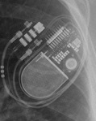 Quadra Allure MP</td>
<td align="center" valign="top"><b>Option 1</b>  Ensura DR MRI SureScan</td>
<td align="center" valign="top"><b>✅ Option 2</b>  Quadra Allure MP</td>
<td align="center" valign="top"><b>Option 3</b>  Enitra 8 HF-T QP</td>
<td align="center" valign="top"><b>Option 4</b>  Ilivia 7 HF-T QP</td>
<td align="center" valign="top"><b>Option 5</b>  SJM Confirm</td>
<td align="center" valign="middle"><b>Option 6</b>  <i>None of the above</i></td>
</tr></table>

### Q1561 · correct: option 3 · `Ecuro SR`

<table><tr>
<td align="center" valign="top"><b>Query</b> 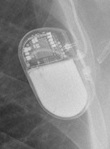 Ecuro SR</td>
<td align="center" valign="top"><b>Option 1</b>  Enitra 8 HF-T QP</td>
<td align="center" valign="top"><b>Option 2</b>  Enticos 4 DR</td>
<td align="center" valign="top"><b>✅ Option 3</b>  Ecuro SR</td>
<td align="center" valign="top"><b>Option 4</b>  Enticos 4 SR</td>
<td align="center" valign="top"><b>Option 5</b>  Enitra 6 DR-T</td>
<td align="center" valign="middle"><b>Option 6</b>  <i>None of the above</i></td>
</tr></table>

### Q1562 · correct: option 3 · `Mirro MRI VR SureScan`

<table><tr>
<td align="center" valign="top"><b>Query</b> 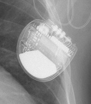 Mirro MRI VR SureScan</td>
<td align="center" valign="top"><b>Option 1</b>  Ellipse VR</td>
<td align="center" valign="top"><b>Option 2</b>  Compia MRI Quad CRT-D SureScan</td>
<td align="center" valign="top"><b>✅ Option 3</b>  Mirro MRI VR SureScan</td>
<td align="center" valign="top"><b>Option 4</b>  Ilivia 7 HF-T QP</td>
<td align="center" valign="top"><b>Option 5</b>  Serena Quad CRT-P MRI ScureScan</td>
<td align="center" valign="middle"><b>Option 6</b>  <i>None of the above</i></td>
</tr></table>

### Q1563 · correct: option 1 · `Q20 SR MRI SureScan`

<table><tr>
<td align="center" valign="top"><b>Query</b> 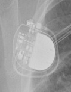 Q20 SR MRI SureScan</td>
<td align="center" valign="top"><b>✅ Option 1</b>  Q20 SR MRI SureScan</td>
<td align="center" valign="top"><b>Option 2</b>  Enticos 4 DR</td>
<td align="center" valign="top"><b>Option 3</b>  Enticos 4 SR</td>
<td align="center" valign="top"><b>Option 4</b>  Attesta DR MRI SureScan</td>
<td align="center" valign="top"><b>Option 5</b>  Ecuro SR</td>
<td align="center" valign="middle"><b>Option 6</b>  <i>None of the above</i></td>
</tr></table>

### Q1564 · correct: option 3 · `Q20 SR MRI SureScan`

<table><tr>
<td align="center" valign="top"><b>Query</b> 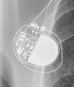 Q20 SR MRI SureScan</td>
<td align="center" valign="top"><b>Option 1</b>  Enticos 4 SR</td>
<td align="center" valign="top"><b>Option 2</b>  Attesta DR MRI SureScan</td>
<td align="center" valign="top"><b>✅ Option 3</b>  Q20 SR MRI SureScan</td>
<td align="center" valign="top"><b>Option 4</b>  Ecuro SR</td>
<td align="center" valign="top"><b>Option 5</b>  Enticos 4 DR</td>
<td align="center" valign="middle"><b>Option 6</b>  <i>None of the above</i></td>
</tr></table>

### Q1565 · correct: option 4 · `Q20 SR MRI SureScan`

<table><tr>
<td align="center" valign="top"><b>Query</b> 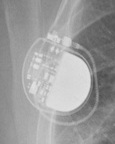 Q20 SR MRI SureScan</td>
<td align="center" valign="top"><b>Option 1</b>  Enticos 4 SR</td>
<td align="center" valign="top"><b>Option 2</b>  Ecuro SR</td>
<td align="center" valign="top"><b>Option 3</b>  Enticos 4 DR</td>
<td align="center" valign="top"><b>✅ Option 4</b>  Q20 SR MRI SureScan</td>
<td align="center" valign="top"><b>Option 5</b>  Attesta DR MRI SureScan</td>
<td align="center" valign="middle"><b>Option 6</b>  <i>None of the above</i></td>
</tr></table>

### Q1566 · correct: option 5 · `Attesta DR MRI SureScan`

<table><tr>
<td align="center" valign="top"><b>Query</b> 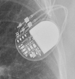 Attesta DR MRI SureScan</td>
<td align="center" valign="top"><b>Option 1</b>  Enticos 4 DR</td>
<td align="center" valign="top"><b>Option 2</b>  Q20 SR MRI SureScan</td>
<td align="center" valign="top"><b>Option 3</b>  Ecuro SR</td>
<td align="center" valign="top"><b>Option 4</b>  Ensura DR MRI SureScan</td>
<td align="center" valign="top"><b>✅ Option 5</b>  Attesta DR MRI SureScan</td>
<td align="center" valign="middle"><b>Option 6</b>  <i>None of the above</i></td>
</tr></table>

### Q1567 · correct: option 4 · `Rivacor 5 VR-T DX`

<table><tr>
<td align="center" valign="top"><b>Query</b> 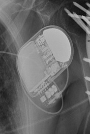 Rivacor 5 VR-T DX</td>
<td align="center" valign="top"><b>Option 1</b>  Rivacor 7 HF-T QP</td>
<td align="center" valign="top"><b>Option 2</b>  Ilivia 7 HF-T QP</td>
<td align="center" valign="top"><b>Option 3</b>  Ilivia 7 VR-T</td>
<td align="center" valign="top"><b>✅ Option 4</b>  Rivacor 5 VR-T DX</td>
<td align="center" valign="top"><b>Option 5</b>  Quadra Assura</td>
<td align="center" valign="middle"><b>Option 6</b>  <i>None of the above</i></td>
</tr></table>

### Q1568 · correct: option 5 · `Rivacor 5 VR-T DX`

<table><tr>
<td align="center" valign="top"><b>Query</b> 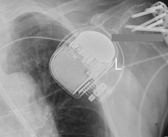 Rivacor 5 VR-T DX</td>
<td align="center" valign="top"><b>Option 1</b> 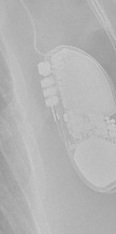 Ilivia 7 VR-T</td>
<td align="center" valign="top"><b>Option 2</b>  Rivacor 7 HF-T QP</td>
<td align="center" valign="top"><b>Option 3</b>  Ilivia 7 HF-T QP</td>
<td align="center" valign="top"><b>Option 4</b>  Ensura DR MRI SureScan</td>
<td align="center" valign="top"><b>✅ Option 5</b>  Rivacor 5 VR-T DX</td>
<td align="center" valign="middle"><b>Option 6</b>  <i>None of the above</i></td>
</tr></table>

### Q1569 · correct: option 1 · `Rivacor 5 VR-T DX`

<table><tr>
<td align="center" valign="top"><b>Query</b> 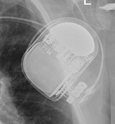 Rivacor 5 VR-T DX</td>
<td align="center" valign="top"><b>✅ Option 1</b>  Rivacor 5 VR-T DX</td>
<td align="center" valign="top"><b>Option 2</b>  Ilivia 7 VR-T</td>
<td align="center" valign="top"><b>Option 3</b>  Quadra Assura</td>
<td align="center" valign="top"><b>Option 4</b>  Ilivia 7 HF-T QP</td>
<td align="center" valign="top"><b>Option 5</b>  Rivacor 7 HF-T QP</td>
<td align="center" valign="middle"><b>Option 6</b>  <i>None of the above</i></td>
</tr></table>

### Q1570 · correct: option 1 · `Enitra 8 HF-T QP`

<table><tr>
<td align="center" valign="top"><b>Query</b> 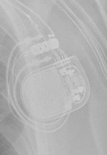 Enitra 8 HF-T QP</td>
<td align="center" valign="top"><b>✅ Option 1</b>  Enitra 8 HF-T QP</td>
<td align="center" valign="top"><b>Option 2</b>  Etrinsa 8 HF-T</td>
<td align="center" valign="top"><b>Option 3</b>  Enticos 4 DR</td>
<td align="center" valign="top"><b>Option 4</b>  Enitra 6 DR-T</td>
<td align="center" valign="top"><b>Option 5</b>  Enticos 4 SR</td>
<td align="center" valign="middle"><b>Option 6</b>  <i>None of the above</i></td>
</tr></table>

### Q1571 · correct: option 4 · `Confirm Rx DM3500`

<table><tr>
<td align="center" valign="top"><b>Query</b> 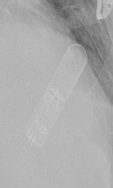 Confirm Rx DM3500</td>
<td align="center" valign="top"><b>Option 1</b>  Quadra Assura</td>
<td align="center" valign="top"><b>Option 2</b>  Reveal XT</td>
<td align="center" valign="top"><b>Option 3</b>  SJM Confirm</td>
<td align="center" valign="top"><b>✅ Option 4</b>  Confirm Rx DM3500</td>
<td align="center" valign="top"><b>Option 5</b>  Reveal LINQ</td>
<td align="center" valign="middle"><b>Option 6</b>  <i>None of the above</i></td>
</tr></table>

### Q1572 · correct: option 3 · `Q20 SR MRI SureScan`

<table><tr>
<td align="center" valign="top"><b>Query</b> 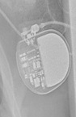 Q20 SR MRI SureScan</td>
<td align="center" valign="top"><b>Option 1</b>  Enticos 4 DR</td>
<td align="center" valign="top"><b>Option 2</b>  Enticos 4 SR</td>
<td align="center" valign="top"><b>✅ Option 3</b>  Q20 SR MRI SureScan</td>
<td align="center" valign="top"><b>Option 4</b>  Rivacor 5 VR-T DX</td>
<td align="center" valign="top"><b>Option 5</b>  Attesta DR MRI SureScan</td>
<td align="center" valign="middle"><b>Option 6</b>  <i>None of the above</i></td>
</tr></table>

### Q1573 · correct: option 3 · `Mirro MRI VR SureScan`

<table><tr>
<td align="center" valign="top"><b>Query</b> 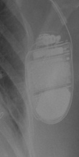 Mirro MRI VR SureScan</td>
<td align="center" valign="top"><b>Option 1</b>  Ilivia 7 HF-T QP</td>
<td align="center" valign="top"><b>Option 2</b>  Ilivia 7 VR-T</td>
<td align="center" valign="top"><b>✅ Option 3</b>  Mirro MRI VR SureScan</td>
<td align="center" valign="top"><b>Option 4</b>  Compia MRI Quad CRT-D SureScan</td>
<td align="center" valign="top"><b>Option 5</b>  Ellipse VR</td>
<td align="center" valign="middle"><b>Option 6</b>  <i>None of the above</i></td>
</tr></table>

### Q1574 · correct: option 2 · `Mirro MRI VR SureScan`

<table><tr>
<td align="center" valign="top"><b>Query</b> 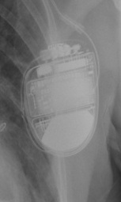 Mirro MRI VR SureScan</td>
<td align="center" valign="top"><b>Option 1</b>  Ellipse VR</td>
<td align="center" valign="top"><b>✅ Option 2</b>  Mirro MRI VR SureScan</td>
<td align="center" valign="top"><b>Option 3</b>  Ilivia 7 HF-T QP</td>
<td align="center" valign="top"><b>Option 4</b>  Compia MRI Quad CRT-D SureScan</td>
<td align="center" valign="top"><b>Option 5</b>  Ilivia 7 VR-T</td>
<td align="center" valign="middle"><b>Option 6</b>  <i>None of the above</i></td>
</tr></table>

### Q1575 · correct: option 4 · `Mirro MRI VR SureScan`

<table><tr>
<td align="center" valign="top"><b>Query</b> 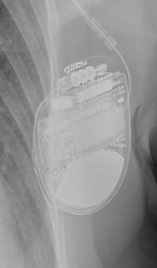 Mirro MRI VR SureScan</td>
<td align="center" valign="top"><b>Option 1</b>  Compia MRI Quad CRT-D SureScan</td>
<td align="center" valign="top"><b>Option 2</b>  Ilivia 7 VR-T</td>
<td align="center" valign="top"><b>Option 3</b>  Ilivia 7 HF-T QP</td>
<td align="center" valign="top"><b>✅ Option 4</b>  Mirro MRI VR SureScan</td>
<td align="center" valign="top"><b>Option 5</b>  Serena Quad CRT-P MRI ScureScan</td>
<td align="center" valign="middle"><b>Option 6</b>  <i>None of the above</i></td>
</tr></table>

### Q1576 · correct: option 1 · `Mirro MRI VR SureScan`

<table><tr>
<td align="center" valign="top"><b>Query</b> 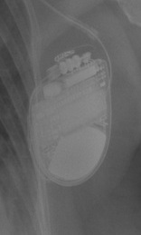 Mirro MRI VR SureScan</td>
<td align="center" valign="top"><b>✅ Option 1</b>  Mirro MRI VR SureScan</td>
<td align="center" valign="top"><b>Option 2</b>  Compia MRI Quad CRT-D SureScan</td>
<td align="center" valign="top"><b>Option 3</b>  Ilivia 7 HF-T QP</td>
<td align="center" valign="top"><b>Option 4</b>  Ellipse VR</td>
<td align="center" valign="top"><b>Option 5</b>  Serena Quad CRT-P MRI ScureScan</td>
<td align="center" valign="middle"><b>Option 6</b>  <i>None of the above</i></td>
</tr></table>

### Q1577 · correct: option 1 · `Enitra 8 HF-T QP`

<table><tr>
<td align="center" valign="top"><b>Query</b> 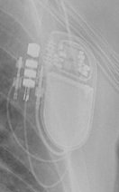 Enitra 8 HF-T QP</td>
<td align="center" valign="top"><b>✅ Option 1</b>  Enitra 8 HF-T QP</td>
<td align="center" valign="top"><b>Option 2</b>  Etrinsa 8 HF-T</td>
<td align="center" valign="top"><b>Option 3</b>  Enticos 4 DR</td>
<td align="center" valign="top"><b>Option 4</b>  Enitra 6 DR-T</td>
<td align="center" valign="top"><b>Option 5</b>  Ecuro SR</td>
<td align="center" valign="middle"><b>Option 6</b>  <i>None of the above</i></td>
</tr></table>

### Q1578 · correct: option 4 · `Enitra 8 HF-T QP`

<table><tr>
<td align="center" valign="top"><b>Query</b> 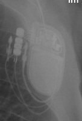 Enitra 8 HF-T QP</td>
<td align="center" valign="top"><b>Option 1</b>  Enitra 6 DR-T</td>
<td align="center" valign="top"><b>Option 2</b>  Enticos 4 SR</td>
<td align="center" valign="top"><b>Option 3</b>  Etrinsa 8 HF-T</td>
<td align="center" valign="top"><b>✅ Option 4</b>  Enitra 8 HF-T QP</td>
<td align="center" valign="top"><b>Option 5</b>  Enticos 4 DR</td>
<td align="center" valign="middle"><b>Option 6</b>  <i>None of the above</i></td>
</tr></table>

### Q1579 · correct: option 3 · `Enitra 8 HF-T QP`

<table><tr>
<td align="center" valign="top"><b>Query</b> 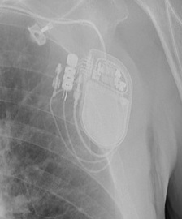 Enitra 8 HF-T QP</td>
<td align="center" valign="top"><b>Option 1</b>  Enticos 4 SR</td>
<td align="center" valign="top"><b>Option 2</b>  Enticos 4 DR</td>
<td align="center" valign="top"><b>✅ Option 3</b>  Enitra 8 HF-T QP</td>
<td align="center" valign="top"><b>Option 4</b>  Rivacor 7 HF-T QP</td>
<td align="center" valign="top"><b>Option 5</b>  Quadra Allure MP</td>
<td align="center" valign="middle"><b>Option 6</b>  <i>None of the above</i></td>
</tr></table>

### Q1580 · correct: option 2 · `Ellipse VR`

<table><tr>
<td align="center" valign="top"><b>Query</b> 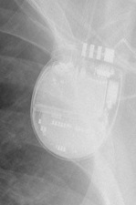 Ellipse VR</td>
<td align="center" valign="top"><b>Option 1</b>  Rivacor 5 VR-T DX</td>
<td align="center" valign="top"><b>✅ Option 2</b>  Ellipse VR</td>
<td align="center" valign="top"><b>Option 3</b>  Origen Mini ICD</td>
<td align="center" valign="top"><b>Option 4</b>  Quadra Assura</td>
<td align="center" valign="top"><b>Option 5</b> 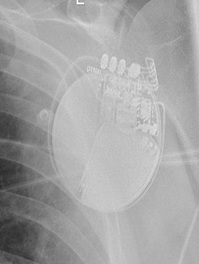 Inogen EL ICD VR</td>
<td align="center" valign="middle"><b>Option 6</b>  <i>None of the above</i></td>
</tr></table>

### Q1581 · correct: option 5 · `Reveal XT`

<table><tr>
<td align="center" valign="top"><b>Query</b>  Reveal XT</td>
<td align="center" valign="top"><b>Option 1</b>  Enitra 6 DR-T</td>
<td align="center" valign="top"><b>Option 2</b>  Reveal LINQ</td>
<td align="center" valign="top"><b>Option 3</b>  SJM Confirm</td>
<td align="center" valign="top"><b>Option 4</b>  Confirm Rx DM3500</td>
<td align="center" valign="top"><b>✅ Option 5</b>  Reveal XT</td>
<td align="center" valign="middle"><b>Option 6</b>  <i>None of the above</i></td>
</tr></table>

### Q1582 · correct: option 5 · `Quadra Allure MP`

<table><tr>
<td align="center" valign="top"><b>Query</b>  Quadra Allure MP</td>
<td align="center" valign="top"><b>Option 1</b>  Ilivia 7 HF-T QP</td>
<td align="center" valign="top"><b>Option 2</b>  Etrinsa 8 HF-T</td>
<td align="center" valign="top"><b>Option 3</b>  SJM Confirm</td>
<td align="center" valign="top"><b>Option 4</b>  Enitra 8 HF-T QP</td>
<td align="center" valign="top"><b>✅ Option 5</b>  Quadra Allure MP</td>
<td align="center" valign="middle"><b>Option 6</b>  <i>None of the above</i></td>
</tr></table>

### Q1583 · correct: option 1 · `Attesta DR MRI SureScan`

<table><tr>
<td align="center" valign="top"><b>Query</b>  Attesta DR MRI SureScan</td>
<td align="center" valign="top"><b>✅ Option 1</b>  Attesta DR MRI SureScan</td>
<td align="center" valign="top"><b>Option 2</b>  Q20 SR MRI SureScan</td>
<td align="center" valign="top"><b>Option 3</b>  Ensura DR MRI SureScan</td>
<td align="center" valign="top"><b>Option 4</b>  Ilivia 7 HF-T QP</td>
<td align="center" valign="top"><b>Option 5</b>  Enticos 4 DR</td>
<td align="center" valign="middle"><b>Option 6</b>  <i>None of the above</i></td>
</tr></table>

