# Physionet (cardiac devices) · query set `test` · page 6/8

[← all pages](README.md)

### Q1584 · correct: option 5 · `Quadra Assura`

<table><tr>
<td align="center" valign="top"><b>Query</b> 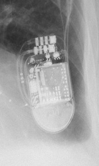 Quadra Assura</td>
<td align="center" valign="top"><b>Option 1</b>  Rivacor 5 VR-T DX</td>
<td align="center" valign="top"><b>Option 2</b>  Valitude X4 CRT-P</td>
<td align="center" valign="top"><b>Option 3</b>  Reveal XT</td>
<td align="center" valign="top"><b>Option 4</b>  Ellipse VR</td>
<td align="center" valign="top"><b>✅ Option 5</b>  Quadra Assura</td>
<td align="center" valign="middle"><b>Option 6</b>  <i>None of the above</i></td>
</tr></table>

### Q1585 · correct: option 6 (None of the above)

<table><tr>
<td align="center" valign="top"><b>Query</b> 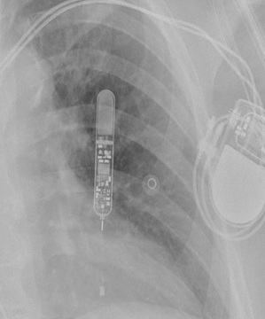 Enticos 4 DR</td>
<td align="center" valign="top"><b>Option 1</b>  Reveal LINQ</td>
<td align="center" valign="top"><b>Option 2</b>  Reveal XT</td>
<td align="center" valign="top"><b>Option 3</b>  Ilivia 7 VR-T</td>
<td align="center" valign="top"><b>Option 4</b>  Confirm Rx DM3500</td>
<td align="center" valign="top"><b>Option 5</b>  SJM Confirm</td>
<td align="center" valign="middle"><b>✅ Option 6</b>  <i>None of the above</i></td>
</tr></table>

### Q1586 · correct: option 5 · `Mirro MRI VR SureScan`

<table><tr>
<td align="center" valign="top"><b>Query</b> 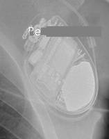 Mirro MRI VR SureScan</td>
<td align="center" valign="top"><b>Option 1</b>  Compia MRI Quad CRT-D SureScan</td>
<td align="center" valign="top"><b>Option 2</b>  Ilivia 7 VR-T</td>
<td align="center" valign="top"><b>Option 3</b>  Ensura DR MRI SureScan</td>
<td align="center" valign="top"><b>Option 4</b>  Ilivia 7 HF-T QP</td>
<td align="center" valign="top"><b>✅ Option 5</b> 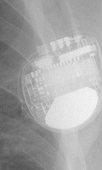 Mirro MRI VR SureScan</td>
<td align="center" valign="middle"><b>Option 6</b>  <i>None of the above</i></td>
</tr></table>

### Q1587 · correct: option 5 · `Confirm Rx DM3500`

<table><tr>
<td align="center" valign="top"><b>Query</b> 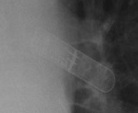 Confirm Rx DM3500</td>
<td align="center" valign="top"><b>Option 1</b>  Reveal XT</td>
<td align="center" valign="top"><b>Option 2</b>  Reveal LINQ</td>
<td align="center" valign="top"><b>Option 3</b>  Ilivia 7 VR-T</td>
<td align="center" valign="top"><b>Option 4</b>  SJM Confirm</td>
<td align="center" valign="top"><b>✅ Option 5</b>  Confirm Rx DM3500</td>
<td align="center" valign="middle"><b>Option 6</b>  <i>None of the above</i></td>
</tr></table>

### Q1588 · correct: option 2 · `Confirm Rx DM3500`

<table><tr>
<td align="center" valign="top"><b>Query</b> 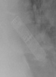 Confirm Rx DM3500</td>
<td align="center" valign="top"><b>Option 1</b>  SJM Confirm</td>
<td align="center" valign="top"><b>✅ Option 2</b>  Confirm Rx DM3500</td>
<td align="center" valign="top"><b>Option 3</b>  Reveal XT</td>
<td align="center" valign="top"><b>Option 4</b>  Reveal LINQ</td>
<td align="center" valign="top"><b>Option 5</b>  Quadra Assura</td>
<td align="center" valign="middle"><b>Option 6</b>  <i>None of the above</i></td>
</tr></table>

### Q1589 · correct: option 1 · `Confirm Rx DM3500`

<table><tr>
<td align="center" valign="top"><b>Query</b> 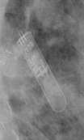 Confirm Rx DM3500</td>
<td align="center" valign="top"><b>✅ Option 1</b>  Confirm Rx DM3500</td>
<td align="center" valign="top"><b>Option 2</b>  Reveal XT</td>
<td align="center" valign="top"><b>Option 3</b> 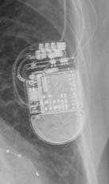 Quadra Assura</td>
<td align="center" valign="top"><b>Option 4</b>  Reveal LINQ</td>
<td align="center" valign="top"><b>Option 5</b>  SJM Confirm</td>
<td align="center" valign="middle"><b>Option 6</b>  <i>None of the above</i></td>
</tr></table>

### Q1590 · correct: option 5 · `Confirm Rx DM3500`

<table><tr>
<td align="center" valign="top"><b>Query</b> 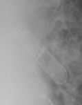 Confirm Rx DM3500</td>
<td align="center" valign="top"><b>Option 1</b>  SJM Confirm</td>
<td align="center" valign="top"><b>Option 2</b>  Ecuro SR</td>
<td align="center" valign="top"><b>Option 3</b>  Reveal XT</td>
<td align="center" valign="top"><b>Option 4</b>  Reveal LINQ</td>
<td align="center" valign="top"><b>✅ Option 5</b>  Confirm Rx DM3500</td>
<td align="center" valign="middle"><b>Option 6</b>  <i>None of the above</i></td>
</tr></table>

### Q1591 · correct: option 3 · `Enticos 4 DR`

<table><tr>
<td align="center" valign="top"><b>Query</b> 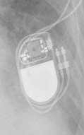 Enticos 4 DR</td>
<td align="center" valign="top"><b>Option 1</b>  Attesta DR MRI SureScan</td>
<td align="center" valign="top"><b>Option 2</b>  Enticos 4 SR</td>
<td align="center" valign="top"><b>✅ Option 3</b>  Enticos 4 DR</td>
<td align="center" valign="top"><b>Option 4</b>  Enitra 8 HF-T QP</td>
<td align="center" valign="top"><b>Option 5</b>  Enitra 6 DR-T</td>
<td align="center" valign="middle"><b>Option 6</b>  <i>None of the above</i></td>
</tr></table>

### Q1592 · correct: option 1 · `Enticos 4 DR`

<table><tr>
<td align="center" valign="top"><b>Query</b>  Enticos 4 DR</td>
<td align="center" valign="top"><b>✅ Option 1</b>  Enticos 4 DR</td>
<td align="center" valign="top"><b>Option 2</b>  Enitra 6 DR-T</td>
<td align="center" valign="top"><b>Option 3</b>  Ecuro SR</td>
<td align="center" valign="top"><b>Option 4</b>  Enitra 8 HF-T QP</td>
<td align="center" valign="top"><b>Option 5</b>  Enticos 4 SR</td>
<td align="center" valign="middle"><b>Option 6</b>  <i>None of the above</i></td>
</tr></table>

### Q1593 · correct: option 4 · `Attesta DR MRI SureScan`

<table><tr>
<td align="center" valign="top"><b>Query</b> 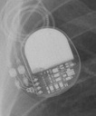 Attesta DR MRI SureScan</td>
<td align="center" valign="top"><b>Option 1</b>  Enticos 4 SR</td>
<td align="center" valign="top"><b>Option 2</b>  Enitra 8 HF-T QP</td>
<td align="center" valign="top"><b>Option 3</b>  Ensura DR MRI SureScan</td>
<td align="center" valign="top"><b>✅ Option 4</b>  Attesta DR MRI SureScan</td>
<td align="center" valign="top"><b>Option 5</b>  Q20 SR MRI SureScan</td>
<td align="center" valign="middle"><b>Option 6</b>  <i>None of the above</i></td>
</tr></table>

### Q1594 · correct: option 5 · `Confirm Rx DM3500`

<table><tr>
<td align="center" valign="top"><b>Query</b> 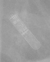 Confirm Rx DM3500</td>
<td align="center" valign="top"><b>Option 1</b>  SJM Confirm</td>
<td align="center" valign="top"><b>Option 2</b>  Reveal XT</td>
<td align="center" valign="top"><b>Option 3</b>  Reveal LINQ</td>
<td align="center" valign="top"><b>Option 4</b>  Ensura DR MRI SureScan</td>
<td align="center" valign="top"><b>✅ Option 5</b>  Confirm Rx DM3500</td>
<td align="center" valign="middle"><b>Option 6</b>  <i>None of the above</i></td>
</tr></table>

### Q1595 · correct: option 2 · `Confirm Rx DM3500`

<table><tr>
<td align="center" valign="top"><b>Query</b>  Confirm Rx DM3500</td>
<td align="center" valign="top"><b>Option 1</b>  SJM Confirm</td>
<td align="center" valign="top"><b>✅ Option 2</b>  Confirm Rx DM3500</td>
<td align="center" valign="top"><b>Option 3</b>  Reveal LINQ</td>
<td align="center" valign="top"><b>Option 4</b>  Quadra Assura</td>
<td align="center" valign="top"><b>Option 5</b>  Reveal XT</td>
<td align="center" valign="middle"><b>Option 6</b>  <i>None of the above</i></td>
</tr></table>

### Q1596 · correct: option 1 · `Attesta DR MRI SureScan`

<table><tr>
<td align="center" valign="top"><b>Query</b> 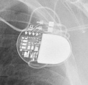 Attesta DR MRI SureScan</td>
<td align="center" valign="top"><b>✅ Option 1</b>  Attesta DR MRI SureScan</td>
<td align="center" valign="top"><b>Option 2</b>  Enticos 4 DR</td>
<td align="center" valign="top"><b>Option 3</b>  Serena Quad CRT-P MRI ScureScan</td>
<td align="center" valign="top"><b>Option 4</b>  Ensura DR MRI SureScan</td>
<td align="center" valign="top"><b>Option 5</b>  Q20 SR MRI SureScan</td>
<td align="center" valign="middle"><b>Option 6</b>  <i>None of the above</i></td>
</tr></table>

### Q1597 · correct: option 3 · `Ellipse VR`

<table><tr>
<td align="center" valign="top"><b>Query</b> 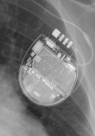 Ellipse VR</td>
<td align="center" valign="top"><b>Option 1</b>  Origen Mini ICD</td>
<td align="center" valign="top"><b>Option 2</b>  Quadra Assura</td>
<td align="center" valign="top"><b>✅ Option 3</b> 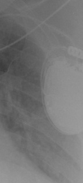 Ellipse VR</td>
<td align="center" valign="top"><b>Option 4</b>  Rivacor 7 HF-T QP</td>
<td align="center" valign="top"><b>Option 5</b>  Rivacor 5 VR-T DX</td>
<td align="center" valign="middle"><b>Option 6</b>  <i>None of the above</i></td>
</tr></table>

### Q1598 · correct: option 3 · `Ellipse VR`

<table><tr>
<td align="center" valign="top"><b>Query</b> 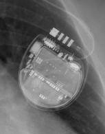 Ellipse VR</td>
<td align="center" valign="top"><b>Option 1</b>  Q20 SR MRI SureScan</td>
<td align="center" valign="top"><b>Option 2</b>  Rivacor 5 VR-T DX</td>
<td align="center" valign="top"><b>✅ Option 3</b>  Ellipse VR</td>
<td align="center" valign="top"><b>Option 4</b>  Mirro MRI VR SureScan</td>
<td align="center" valign="top"><b>Option 5</b>  Quadra Assura</td>
<td align="center" valign="middle"><b>Option 6</b>  <i>None of the above</i></td>
</tr></table>

### Q1599 · correct: option 1 · `Ellipse VR`

<table><tr>
<td align="center" valign="top"><b>Query</b> 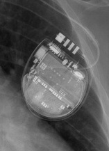 Ellipse VR</td>
<td align="center" valign="top"><b>✅ Option 1</b>  Ellipse VR</td>
<td align="center" valign="top"><b>Option 2</b>  Mirro MRI VR SureScan</td>
<td align="center" valign="top"><b>Option 3</b>  Q20 SR MRI SureScan</td>
<td align="center" valign="top"><b>Option 4</b>  Rivacor 5 VR-T DX</td>
<td align="center" valign="top"><b>Option 5</b>  Compia MRI Quad CRT-D SureScan</td>
<td align="center" valign="middle"><b>Option 6</b>  <i>None of the above</i></td>
</tr></table>

### Q1600 · correct: option 4 · `Ellipse VR`

<table><tr>
<td align="center" valign="top"><b>Query</b> 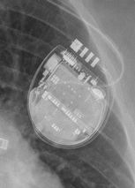 Ellipse VR</td>
<td align="center" valign="top"><b>Option 1</b>  Rivacor 7 HF-T QP</td>
<td align="center" valign="top"><b>Option 2</b>  Rivacor 5 VR-T DX</td>
<td align="center" valign="top"><b>Option 3</b>  Quadra Assura</td>
<td align="center" valign="top"><b>✅ Option 4</b> 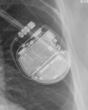 Ellipse VR</td>
<td align="center" valign="top"><b>Option 5</b>  Mirro MRI VR SureScan</td>
<td align="center" valign="middle"><b>Option 6</b>  <i>None of the above</i></td>
</tr></table>

### Q1601 · correct: option 4 · `Ellipse VR`

<table><tr>
<td align="center" valign="top"><b>Query</b> 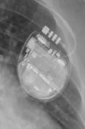 Ellipse VR</td>
<td align="center" valign="top"><b>Option 1</b>  Origen Mini ICD</td>
<td align="center" valign="top"><b>Option 2</b>  Rivacor 5 VR-T DX</td>
<td align="center" valign="top"><b>Option 3</b>  Q20 SR MRI SureScan</td>
<td align="center" valign="top"><b>✅ Option 4</b>  Ellipse VR</td>
<td align="center" valign="top"><b>Option 5</b>  Quadra Assura</td>
<td align="center" valign="middle"><b>Option 6</b>  <i>None of the above</i></td>
</tr></table>

### Q1602 · correct: option 2 · `Ellipse VR`

<table><tr>
<td align="center" valign="top"><b>Query</b> 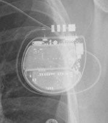 Ellipse VR</td>
<td align="center" valign="top"><b>Option 1</b>  Rivacor 5 VR-T DX</td>
<td align="center" valign="top"><b>✅ Option 2</b>  Ellipse VR</td>
<td align="center" valign="top"><b>Option 3</b>  Origen Mini ICD</td>
<td align="center" valign="top"><b>Option 4</b>  Serena Quad CRT-P MRI ScureScan</td>
<td align="center" valign="top"><b>Option 5</b>  Rivacor 7 HF-T QP</td>
<td align="center" valign="middle"><b>Option 6</b>  <i>None of the above</i></td>
</tr></table>

### Q1603 · correct: option 2 · `Attesta DR MRI SureScan`

<table><tr>
<td align="center" valign="top"><b>Query</b> 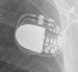 Attesta DR MRI SureScan</td>
<td align="center" valign="top"><b>Option 1</b>  Enitra 8 HF-T QP</td>
<td align="center" valign="top"><b>✅ Option 2</b>  Attesta DR MRI SureScan</td>
<td align="center" valign="top"><b>Option 3</b>  Q20 SR MRI SureScan</td>
<td align="center" valign="top"><b>Option 4</b>  Enticos 4 DR</td>
<td align="center" valign="top"><b>Option 5</b>  Ecuro SR</td>
<td align="center" valign="middle"><b>Option 6</b>  <i>None of the above</i></td>
</tr></table>

### Q1604 · correct: option 1 · `Mirro MRI VR SureScan`

<table><tr>
<td align="center" valign="top"><b>Query</b> 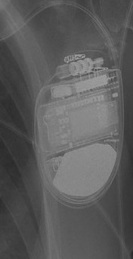 Mirro MRI VR SureScan</td>
<td align="center" valign="top"><b>✅ Option 1</b>  Mirro MRI VR SureScan</td>
<td align="center" valign="top"><b>Option 2</b>  Compia MRI Quad CRT-D SureScan</td>
<td align="center" valign="top"><b>Option 3</b>  Ilivia 7 VR-T</td>
<td align="center" valign="top"><b>Option 4</b>  Ellipse VR</td>
<td align="center" valign="top"><b>Option 5</b>  Ilivia 7 HF-T QP</td>
<td align="center" valign="middle"><b>Option 6</b>  <i>None of the above</i></td>
</tr></table>

### Q1605 · correct: option 2 · `Valitude X4 CRT-P`

<table><tr>
<td align="center" valign="top"><b>Query</b> 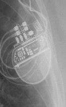 Valitude X4 CRT-P</td>
<td align="center" valign="top"><b>Option 1</b>  Serena Quad CRT-P MRI ScureScan</td>
<td align="center" valign="top"><b>✅ Option 2</b>  Valitude X4 CRT-P</td>
<td align="center" valign="top"><b>Option 3</b> 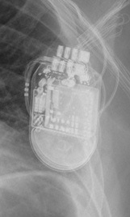 Quadra Assura</td>
<td align="center" valign="top"><b>Option 4</b> 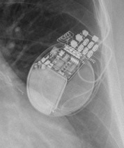 Charisma X4 CRT-D</td>
<td align="center" valign="top"><b>Option 5</b>  Origen Mini ICD</td>
<td align="center" valign="middle"><b>Option 6</b>  <i>None of the above</i></td>
</tr></table>

### Q1606 · correct: option 4 · `Valitude X4 CRT-P`

<table><tr>
<td align="center" valign="top"><b>Query</b>  Valitude X4 CRT-P</td>
<td align="center" valign="top"><b>Option 1</b>  Charisma X4 CRT-D</td>
<td align="center" valign="top"><b>Option 2</b>  Quadra Assura</td>
<td align="center" valign="top"><b>Option 3</b>  Quadra Allure MP</td>
<td align="center" valign="top"><b>✅ Option 4</b>  Valitude X4 CRT-P</td>
<td align="center" valign="top"><b>Option 5</b>  Serena Quad CRT-P MRI ScureScan</td>
<td align="center" valign="middle"><b>Option 6</b>  <i>None of the above</i></td>
</tr></table>

### Q1607 · correct: option 2 · `Enticos 4 SR`

<table><tr>
<td align="center" valign="top"><b>Query</b> 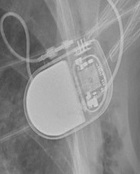 Enticos 4 SR</td>
<td align="center" valign="top"><b>Option 1</b>  Enticos 4 DR</td>
<td align="center" valign="top"><b>✅ Option 2</b>  Enticos 4 SR</td>
<td align="center" valign="top"><b>Option 3</b>  Ecuro SR</td>
<td align="center" valign="top"><b>Option 4</b>  Enitra 8 HF-T QP</td>
<td align="center" valign="top"><b>Option 5</b>  Enitra 6 DR-T</td>
<td align="center" valign="middle"><b>Option 6</b>  <i>None of the above</i></td>
</tr></table>

### Q1608 · correct: option 4 · `Q20 SR MRI SureScan`

<table><tr>
<td align="center" valign="top"><b>Query</b> 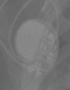 Q20 SR MRI SureScan</td>
<td align="center" valign="top"><b>Option 1</b>  Enitra 6 DR-T</td>
<td align="center" valign="top"><b>Option 2</b>  Attesta DR MRI SureScan</td>
<td align="center" valign="top"><b>Option 3</b>  Enticos 4 DR</td>
<td align="center" valign="top"><b>✅ Option 4</b>  Q20 SR MRI SureScan</td>
<td align="center" valign="top"><b>Option 5</b>  Enitra 8 HF-T QP</td>
<td align="center" valign="middle"><b>Option 6</b>  <i>None of the above</i></td>
</tr></table>

### Q1609 · correct: option 4 · `Enticos 4 DR`

<table><tr>
<td align="center" valign="top"><b>Query</b> 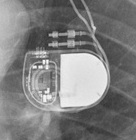 Enticos 4 DR</td>
<td align="center" valign="top"><b>Option 1</b>  Attesta DR MRI SureScan</td>
<td align="center" valign="top"><b>Option 2</b>  Enticos 4 SR</td>
<td align="center" valign="top"><b>Option 3</b>  Enitra 6 DR-T</td>
<td align="center" valign="top"><b>✅ Option 4</b>  Enticos 4 DR</td>
<td align="center" valign="top"><b>Option 5</b>  Ecuro SR</td>
<td align="center" valign="middle"><b>Option 6</b>  <i>None of the above</i></td>
</tr></table>

### Q1610 · correct: option 2 · `Quadra Assura`

<table><tr>
<td align="center" valign="top"><b>Query</b> 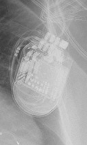 Quadra Assura</td>
<td align="center" valign="top"><b>Option 1</b>  Valitude X4 CRT-P</td>
<td align="center" valign="top"><b>✅ Option 2</b>  Quadra Assura</td>
<td align="center" valign="top"><b>Option 3</b>  Ensura DR MRI SureScan</td>
<td align="center" valign="top"><b>Option 4</b>  Reveal XT</td>
<td align="center" valign="top"><b>Option 5</b>  Ellipse VR</td>
<td align="center" valign="middle"><b>Option 6</b>  <i>None of the above</i></td>
</tr></table>

### Q1611 · correct: option 5 · `Charisma X4 CRT-D`

<table><tr>
<td align="center" valign="top"><b>Query</b> 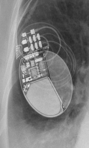 Charisma X4 CRT-D</td>
<td align="center" valign="top"><b>Option 1</b>  Origen Mini ICD</td>
<td align="center" valign="top"><b>Option 2</b> 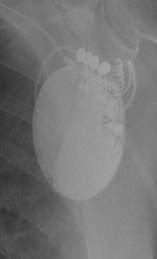 Inogen EL ICD VR</td>
<td align="center" valign="top"><b>Option 3</b>  Rivacor 7 HF-T QP</td>
<td align="center" valign="top"><b>Option 4</b>  Rivacor 5 VR-T DX</td>
<td align="center" valign="top"><b>✅ Option 5</b>  Charisma X4 CRT-D</td>
<td align="center" valign="middle"><b>Option 6</b>  <i>None of the above</i></td>
</tr></table>

### Q1612 · correct: option 1 · `Ilivia 7 VR-T`

<table><tr>
<td align="center" valign="top"><b>Query</b>  Ilivia 7 VR-T</td>
<td align="center" valign="top"><b>✅ Option 1</b>  Ilivia 7 VR-T</td>
<td align="center" valign="top"><b>Option 2</b>  Compia MRI Quad CRT-D SureScan</td>
<td align="center" valign="top"><b>Option 3</b>  Ilivia 7 HF-T QP</td>
<td align="center" valign="top"><b>Option 4</b>  Rivacor 5 VR-T DX</td>
<td align="center" valign="top"><b>Option 5</b> 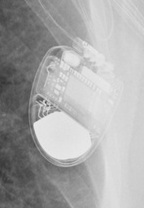 Mirro MRI VR SureScan</td>
<td align="center" valign="middle"><b>Option 6</b>  <i>None of the above</i></td>
</tr></table>

### Q1613 · correct: option 2 · `Ellipse VR`

<table><tr>
<td align="center" valign="top"><b>Query</b> 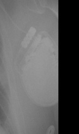 Ellipse VR</td>
<td align="center" valign="top"><b>Option 1</b>  Ilivia 7 VR-T</td>
<td align="center" valign="top"><b>✅ Option 2</b>  Ellipse VR</td>
<td align="center" valign="top"><b>Option 3</b>  Rivacor 7 HF-T QP</td>
<td align="center" valign="top"><b>Option 4</b>  Reveal XT</td>
<td align="center" valign="top"><b>Option 5</b>  Rivacor 5 VR-T DX</td>
<td align="center" valign="middle"><b>Option 6</b>  <i>None of the above</i></td>
</tr></table>

### Q1614 · correct: option 1 · `Mirro MRI VR SureScan`

<table><tr>
<td align="center" valign="top"><b>Query</b> 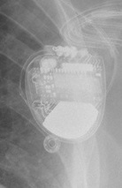 Mirro MRI VR SureScan</td>
<td align="center" valign="top"><b>✅ Option 1</b>  Mirro MRI VR SureScan</td>
<td align="center" valign="top"><b>Option 2</b>  Ilivia 7 HF-T QP</td>
<td align="center" valign="top"><b>Option 3</b>  Compia MRI Quad CRT-D SureScan</td>
<td align="center" valign="top"><b>Option 4</b>  Serena Quad CRT-P MRI ScureScan</td>
<td align="center" valign="top"><b>Option 5</b>  Ellipse VR</td>
<td align="center" valign="middle"><b>Option 6</b>  <i>None of the above</i></td>
</tr></table>

### Q1615 · correct: option 5 · `Q20 SR MRI SureScan`

<table><tr>
<td align="center" valign="top"><b>Query</b> 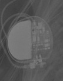 Q20 SR MRI SureScan</td>
<td align="center" valign="top"><b>Option 1</b>  Enitra 8 HF-T QP</td>
<td align="center" valign="top"><b>Option 2</b>  Enticos 4 DR</td>
<td align="center" valign="top"><b>Option 3</b>  Attesta DR MRI SureScan</td>
<td align="center" valign="top"><b>Option 4</b>  Enticos 4 SR</td>
<td align="center" valign="top"><b>✅ Option 5</b>  Q20 SR MRI SureScan</td>
<td align="center" valign="middle"><b>Option 6</b>  <i>None of the above</i></td>
</tr></table>

### Q1616 · correct: option 2 · `Attesta DR MRI SureScan`

<table><tr>
<td align="center" valign="top"><b>Query</b> 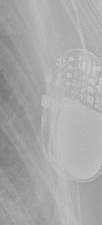 Attesta DR MRI SureScan</td>
<td align="center" valign="top"><b>Option 1</b>  Ensura DR MRI SureScan</td>
<td align="center" valign="top"><b>✅ Option 2</b> 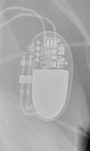 Attesta DR MRI SureScan</td>
<td align="center" valign="top"><b>Option 3</b>  Q20 SR MRI SureScan</td>
<td align="center" valign="top"><b>Option 4</b>  Enitra 8 HF-T QP</td>
<td align="center" valign="top"><b>Option 5</b>  Enticos 4 DR</td>
<td align="center" valign="middle"><b>Option 6</b>  <i>None of the above</i></td>
</tr></table>

### Q1617 · correct: option 2 · `Attesta DR MRI SureScan`

<table><tr>
<td align="center" valign="top"><b>Query</b> 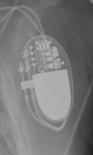 Attesta DR MRI SureScan</td>
<td align="center" valign="top"><b>Option 1</b>  Enticos 4 SR</td>
<td align="center" valign="top"><b>✅ Option 2</b>  Attesta DR MRI SureScan</td>
<td align="center" valign="top"><b>Option 3</b>  Ecuro SR</td>
<td align="center" valign="top"><b>Option 4</b>  Enticos 4 DR</td>
<td align="center" valign="top"><b>Option 5</b>  Q20 SR MRI SureScan</td>
<td align="center" valign="middle"><b>Option 6</b>  <i>None of the above</i></td>
</tr></table>

### Q1618 · correct: option 5 · `Ilivia 7 VR-T`

<table><tr>
<td align="center" valign="top"><b>Query</b> 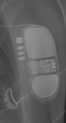 Ilivia 7 VR-T</td>
<td align="center" valign="top"><b>Option 1</b>  Mirro MRI VR SureScan</td>
<td align="center" valign="top"><b>Option 2</b>  Ilivia 7 HF-T QP</td>
<td align="center" valign="top"><b>Option 3</b>  Rivacor 7 HF-T QP</td>
<td align="center" valign="top"><b>Option 4</b>  Rivacor 5 VR-T DX</td>
<td align="center" valign="top"><b>✅ Option 5</b>  Ilivia 7 VR-T</td>
<td align="center" valign="middle"><b>Option 6</b>  <i>None of the above</i></td>
</tr></table>

### Q1619 · correct: option 5 · `Ilivia 7 VR-T`

<table><tr>
<td align="center" valign="top"><b>Query</b> 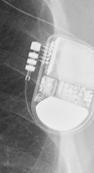 Ilivia 7 VR-T</td>
<td align="center" valign="top"><b>Option 1</b>  Rivacor 5 VR-T DX</td>
<td align="center" valign="top"><b>Option 2</b>  Ilivia 7 HF-T QP</td>
<td align="center" valign="top"><b>Option 3</b>  Compia MRI Quad CRT-D SureScan</td>
<td align="center" valign="top"><b>Option 4</b>  Mirro MRI VR SureScan</td>
<td align="center" valign="top"><b>✅ Option 5</b>  Ilivia 7 VR-T</td>
<td align="center" valign="middle"><b>Option 6</b>  <i>None of the above</i></td>
</tr></table>

### Q1620 · correct: option 1 · `Attesta DR MRI SureScan`

<table><tr>
<td align="center" valign="top"><b>Query</b> 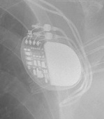 Attesta DR MRI SureScan</td>
<td align="center" valign="top"><b>✅ Option 1</b>  Attesta DR MRI SureScan</td>
<td align="center" valign="top"><b>Option 2</b>  Ilivia 7 HF-T QP</td>
<td align="center" valign="top"><b>Option 3</b>  Q20 SR MRI SureScan</td>
<td align="center" valign="top"><b>Option 4</b>  Enticos 4 DR</td>
<td align="center" valign="top"><b>Option 5</b>  Serena Quad CRT-P MRI ScureScan</td>
<td align="center" valign="middle"><b>Option 6</b>  <i>None of the above</i></td>
</tr></table>

### Q1621 · correct: option 3 · `Valitude X4 CRT-P`

<table><tr>
<td align="center" valign="top"><b>Query</b> 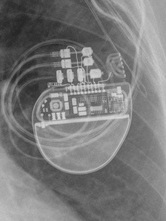 Valitude X4 CRT-P</td>
<td align="center" valign="top"><b>Option 1</b>  Charisma X4 CRT-D</td>
<td align="center" valign="top"><b>Option 2</b>  Serena Quad CRT-P MRI ScureScan</td>
<td align="center" valign="top"><b>✅ Option 3</b>  Valitude X4 CRT-P</td>
<td align="center" valign="top"><b>Option 4</b>  Quadra Assura</td>
<td align="center" valign="top"><b>Option 5</b> 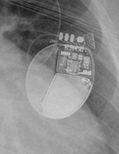 Inogen EL ICD VR</td>
<td align="center" valign="middle"><b>Option 6</b>  <i>None of the above</i></td>
</tr></table>

### Q1622 · correct: option 5 · `Enitra 8 HF-T QP`

<table><tr>
<td align="center" valign="top"><b>Query</b> 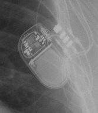 Enitra 8 HF-T QP</td>
<td align="center" valign="top"><b>Option 1</b>  Etrinsa 8 HF-T</td>
<td align="center" valign="top"><b>Option 2</b>  Enticos 4 DR</td>
<td align="center" valign="top"><b>Option 3</b>  Enitra 6 DR-T</td>
<td align="center" valign="top"><b>Option 4</b>  Quadra Allure MP</td>
<td align="center" valign="top"><b>✅ Option 5</b>  Enitra 8 HF-T QP</td>
<td align="center" valign="middle"><b>Option 6</b>  <i>None of the above</i></td>
</tr></table>

### Q1623 · correct: option 3 · `Rivacor 5 VR-T DX`

<table><tr>
<td align="center" valign="top"><b>Query</b> 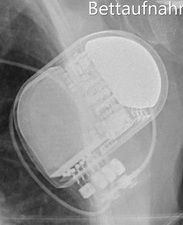 Rivacor 5 VR-T DX</td>
<td align="center" valign="top"><b>Option 1</b>  Quadra Assura</td>
<td align="center" valign="top"><b>Option 2</b>  Ilivia 7 HF-T QP</td>
<td align="center" valign="top"><b>✅ Option 3</b>  Rivacor 5 VR-T DX</td>
<td align="center" valign="top"><b>Option 4</b>  Rivacor 7 HF-T QP</td>
<td align="center" valign="top"><b>Option 5</b>  Ilivia 7 VR-T</td>
<td align="center" valign="middle"><b>Option 6</b>  <i>None of the above</i></td>
</tr></table>

### Q1624 · correct: option 3 · `Q20 SR MRI SureScan`

<table><tr>
<td align="center" valign="top"><b>Query</b> 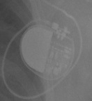 Q20 SR MRI SureScan</td>
<td align="center" valign="top"><b>Option 1</b>  Ecuro SR</td>
<td align="center" valign="top"><b>Option 2</b>  Enticos 4 SR</td>
<td align="center" valign="top"><b>✅ Option 3</b>  Q20 SR MRI SureScan</td>
<td align="center" valign="top"><b>Option 4</b>  Enticos 4 DR</td>
<td align="center" valign="top"><b>Option 5</b>  Attesta DR MRI SureScan</td>
<td align="center" valign="middle"><b>Option 6</b>  <i>None of the above</i></td>
</tr></table>

### Q1625 · correct: option 2 · `Q20 SR MRI SureScan`

<table><tr>
<td align="center" valign="top"><b>Query</b> 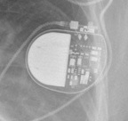 Q20 SR MRI SureScan</td>
<td align="center" valign="top"><b>Option 1</b>  Ecuro SR</td>
<td align="center" valign="top"><b>✅ Option 2</b>  Q20 SR MRI SureScan</td>
<td align="center" valign="top"><b>Option 3</b>  Attesta DR MRI SureScan</td>
<td align="center" valign="top"><b>Option 4</b>  Enticos 4 DR</td>
<td align="center" valign="top"><b>Option 5</b>  Enticos 4 SR</td>
<td align="center" valign="middle"><b>Option 6</b>  <i>None of the above</i></td>
</tr></table>

### Q1626 · correct: option 4 · `Q20 SR MRI SureScan`

<table><tr>
<td align="center" valign="top"><b>Query</b> 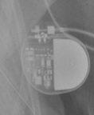 Q20 SR MRI SureScan</td>
<td align="center" valign="top"><b>Option 1</b>  Attesta DR MRI SureScan</td>
<td align="center" valign="top"><b>Option 2</b>  Enticos 4 DR</td>
<td align="center" valign="top"><b>Option 3</b>  Ecuro SR</td>
<td align="center" valign="top"><b>✅ Option 4</b>  Q20 SR MRI SureScan</td>
<td align="center" valign="top"><b>Option 5</b>  Enticos 4 SR</td>
<td align="center" valign="middle"><b>Option 6</b>  <i>None of the above</i></td>
</tr></table>

### Q1627 · correct: option 4 · `Mirro MRI VR SureScan`

<table><tr>
<td align="center" valign="top"><b>Query</b> 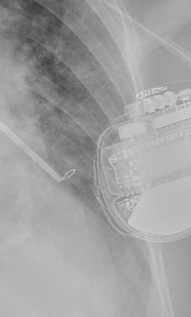 Mirro MRI VR SureScan</td>
<td align="center" valign="top"><b>Option 1</b>  Ilivia 7 VR-T</td>
<td align="center" valign="top"><b>Option 2</b>  Ilivia 7 HF-T QP</td>
<td align="center" valign="top"><b>Option 3</b>  Serena Quad CRT-P MRI ScureScan</td>
<td align="center" valign="top"><b>✅ Option 4</b>  Mirro MRI VR SureScan</td>
<td align="center" valign="top"><b>Option 5</b>  Compia MRI Quad CRT-D SureScan</td>
<td align="center" valign="middle"><b>Option 6</b>  <i>None of the above</i></td>
</tr></table>

### Q1628 · correct: option 1 · `Mirro MRI VR SureScan`

<table><tr>
<td align="center" valign="top"><b>Query</b>  Mirro MRI VR SureScan</td>
<td align="center" valign="top"><b>✅ Option 1</b>  Mirro MRI VR SureScan</td>
<td align="center" valign="top"><b>Option 2</b>  Ilivia 7 VR-T</td>
<td align="center" valign="top"><b>Option 3</b>  Ellipse VR</td>
<td align="center" valign="top"><b>Option 4</b>  Ilivia 7 HF-T QP</td>
<td align="center" valign="top"><b>Option 5</b>  Compia MRI Quad CRT-D SureScan</td>
<td align="center" valign="middle"><b>Option 6</b>  <i>None of the above</i></td>
</tr></table>

### Q1629 · correct: option 3 · `Mirro MRI VR SureScan`

<table><tr>
<td align="center" valign="top"><b>Query</b>  Mirro MRI VR SureScan</td>
<td align="center" valign="top"><b>Option 1</b>  Ilivia 7 HF-T QP</td>
<td align="center" valign="top"><b>Option 2</b>  Ilivia 7 VR-T</td>
<td align="center" valign="top"><b>✅ Option 3</b>  Mirro MRI VR SureScan</td>
<td align="center" valign="top"><b>Option 4</b>  Compia MRI Quad CRT-D SureScan</td>
<td align="center" valign="top"><b>Option 5</b>  Ellipse VR</td>
<td align="center" valign="middle"><b>Option 6</b>  <i>None of the above</i></td>
</tr></table>

### Q1630 · correct: option 3 · `Reveal XT`

<table><tr>
<td align="center" valign="top"><b>Query</b>  Reveal XT</td>
<td align="center" valign="top"><b>Option 1</b>  Confirm Rx DM3500</td>
<td align="center" valign="top"><b>Option 2</b>  Enitra 6 DR-T</td>
<td align="center" valign="top"><b>✅ Option 3</b>  Reveal XT</td>
<td align="center" valign="top"><b>Option 4</b>  Reveal LINQ</td>
<td align="center" valign="top"><b>Option 5</b>  SJM Confirm</td>
<td align="center" valign="middle"><b>Option 6</b>  <i>None of the above</i></td>
</tr></table>

### Q1631 · correct: option 1 · `Attesta DR MRI SureScan`

<table><tr>
<td align="center" valign="top"><b>Query</b>  Attesta DR MRI SureScan</td>
<td align="center" valign="top"><b>✅ Option 1</b>  Attesta DR MRI SureScan</td>
<td align="center" valign="top"><b>Option 2</b>  Ecuro SR</td>
<td align="center" valign="top"><b>Option 3</b>  Enticos 4 DR</td>
<td align="center" valign="top"><b>Option 4</b>  Q20 SR MRI SureScan</td>
<td align="center" valign="top"><b>Option 5</b>  Enticos 4 SR</td>
<td align="center" valign="middle"><b>Option 6</b>  <i>None of the above</i></td>
</tr></table>

### Q1632 · correct: option 1 · `Q20 SR MRI SureScan`

<table><tr>
<td align="center" valign="top"><b>Query</b>  Q20 SR MRI SureScan</td>
<td align="center" valign="top"><b>✅ Option 1</b>  Q20 SR MRI SureScan</td>
<td align="center" valign="top"><b>Option 2</b>  Enticos 4 DR</td>
<td align="center" valign="top"><b>Option 3</b>  Attesta DR MRI SureScan</td>
<td align="center" valign="top"><b>Option 4</b>  Enitra 8 HF-T QP</td>
<td align="center" valign="top"><b>Option 5</b>  Serena Quad CRT-P MRI ScureScan</td>
<td align="center" valign="middle"><b>Option 6</b>  <i>None of the above</i></td>
</tr></table>

### Q1633 · correct: option 3 · `Q20 SR MRI SureScan`

<table><tr>
<td align="center" valign="top"><b>Query</b>  Q20 SR MRI SureScan</td>
<td align="center" valign="top"><b>Option 1</b>  Attesta DR MRI SureScan</td>
<td align="center" valign="top"><b>Option 2</b>  Enitra 8 HF-T QP</td>
<td align="center" valign="top"><b>✅ Option 3</b>  Q20 SR MRI SureScan</td>
<td align="center" valign="top"><b>Option 4</b>  Enticos 4 SR</td>
<td align="center" valign="top"><b>Option 5</b>  Enticos 4 DR</td>
<td align="center" valign="middle"><b>Option 6</b>  <i>None of the above</i></td>
</tr></table>

