# Physionet (cardiac devices) · query set `test` · page 7/8

[← all pages](README.md)

### Q1634 · correct: option 1 · `Q20 SR MRI SureScan`

<table><tr>
<td align="center" valign="top"><b>Query</b> 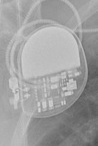 Q20 SR MRI SureScan</td>
<td align="center" valign="top"><b>✅ Option 1</b>  Q20 SR MRI SureScan</td>
<td align="center" valign="top"><b>Option 2</b>  Enticos 4 SR</td>
<td align="center" valign="top"><b>Option 3</b> 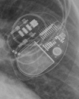 Quadra Allure MP</td>
<td align="center" valign="top"><b>Option 4</b>  Attesta DR MRI SureScan</td>
<td align="center" valign="top"><b>Option 5</b>  Enitra 8 HF-T QP</td>
<td align="center" valign="middle"><b>Option 6</b>  <i>None of the above</i></td>
</tr></table>

### Q1635 · correct: option 3 · `Reveal LINQ`

<table><tr>
<td align="center" valign="top"><b>Query</b> 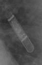 Reveal LINQ</td>
<td align="center" valign="top"><b>Option 1</b>  Confirm Rx DM3500</td>
<td align="center" valign="top"><b>Option 2</b>  Reveal XT</td>
<td align="center" valign="top"><b>✅ Option 3</b>  Reveal LINQ</td>
<td align="center" valign="top"><b>Option 4</b>  SJM Confirm</td>
<td align="center" valign="top"><b>Option 5</b>  Ilivia 7 VR-T</td>
<td align="center" valign="middle"><b>Option 6</b>  <i>None of the above</i></td>
</tr></table>

### Q1636 · correct: option 1 · `Ensura DR MRI SureScan`

<table><tr>
<td align="center" valign="top"><b>Query</b> 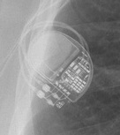 Ensura DR MRI SureScan</td>
<td align="center" valign="top"><b>✅ Option 1</b>  Ensura DR MRI SureScan</td>
<td align="center" valign="top"><b>Option 2</b> 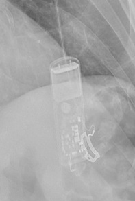 SJM Confirm</td>
<td align="center" valign="top"><b>Option 3</b>  Attesta DR MRI SureScan</td>
<td align="center" valign="top"><b>Option 4</b>  Enitra 6 DR-T</td>
<td align="center" valign="top"><b>Option 5</b>  Etrinsa 8 HF-T</td>
<td align="center" valign="middle"><b>Option 6</b>  <i>None of the above</i></td>
</tr></table>

### Q1637 · correct: option 1 · `Enitra 8 HF-T QP`

<table><tr>
<td align="center" valign="top"><b>Query</b> 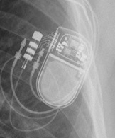 Enitra 8 HF-T QP</td>
<td align="center" valign="top"><b>✅ Option 1</b>  Enitra 8 HF-T QP</td>
<td align="center" valign="top"><b>Option 2</b>  Quadra Allure MP</td>
<td align="center" valign="top"><b>Option 3</b>  Enitra 6 DR-T</td>
<td align="center" valign="top"><b>Option 4</b>  Enticos 4 DR</td>
<td align="center" valign="top"><b>Option 5</b>  Etrinsa 8 HF-T</td>
<td align="center" valign="middle"><b>Option 6</b>  <i>None of the above</i></td>
</tr></table>

### Q1638 · correct: option 2 · `Enticos 4 DR`

<table><tr>
<td align="center" valign="top"><b>Query</b>  Enticos 4 DR</td>
<td align="center" valign="top"><b>Option 1</b>  Enticos 4 SR</td>
<td align="center" valign="top"><b>✅ Option 2</b>  Enticos 4 DR</td>
<td align="center" valign="top"><b>Option 3</b>  Enitra 8 HF-T QP</td>
<td align="center" valign="top"><b>Option 4</b>  Enitra 6 DR-T</td>
<td align="center" valign="top"><b>Option 5</b>  Ecuro SR</td>
<td align="center" valign="middle"><b>Option 6</b>  <i>None of the above</i></td>
</tr></table>

### Q1639 · correct: option 4 · `Ecuro SR`

<table><tr>
<td align="center" valign="top"><b>Query</b>  Ecuro SR</td>
<td align="center" valign="top"><b>Option 1</b> 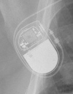 Enticos 4 SR</td>
<td align="center" valign="top"><b>Option 2</b>  Enitra 6 DR-T</td>
<td align="center" valign="top"><b>Option 3</b>  Enitra 8 HF-T QP</td>
<td align="center" valign="top"><b>✅ Option 4</b>  Ecuro SR</td>
<td align="center" valign="top"><b>Option 5</b>  Etrinsa 8 HF-T</td>
<td align="center" valign="middle"><b>Option 6</b>  <i>None of the above</i></td>
</tr></table>

### Q1640 · correct: option 5 · `Enticos 4 SR`

<table><tr>
<td align="center" valign="top"><b>Query</b> 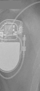 Enticos 4 SR</td>
<td align="center" valign="top"><b>Option 1</b>  Attesta DR MRI SureScan</td>
<td align="center" valign="top"><b>Option 2</b>  Enticos 4 DR</td>
<td align="center" valign="top"><b>Option 3</b>  Reveal XT</td>
<td align="center" valign="top"><b>Option 4</b>  Ecuro SR</td>
<td align="center" valign="top"><b>✅ Option 5</b>  Enticos 4 SR</td>
<td align="center" valign="middle"><b>Option 6</b>  <i>None of the above</i></td>
</tr></table>

### Q1641 · correct: option 3 · `Confirm Rx DM3500`

<table><tr>
<td align="center" valign="top"><b>Query</b> 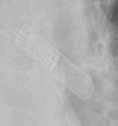 Confirm Rx DM3500</td>
<td align="center" valign="top"><b>Option 1</b>  SJM Confirm</td>
<td align="center" valign="top"><b>Option 2</b>  Reveal LINQ</td>
<td align="center" valign="top"><b>✅ Option 3</b>  Confirm Rx DM3500</td>
<td align="center" valign="top"><b>Option 4</b>  Reveal XT</td>
<td align="center" valign="top"><b>Option 5</b> 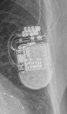 Quadra Assura</td>
<td align="center" valign="middle"><b>Option 6</b>  <i>None of the above</i></td>
</tr></table>

### Q1642 · correct: option 3 · `Confirm Rx DM3500`

<table><tr>
<td align="center" valign="top"><b>Query</b> 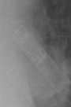 Confirm Rx DM3500</td>
<td align="center" valign="top"><b>Option 1</b>  Quadra Assura</td>
<td align="center" valign="top"><b>Option 2</b>  Reveal LINQ</td>
<td align="center" valign="top"><b>✅ Option 3</b>  Confirm Rx DM3500</td>
<td align="center" valign="top"><b>Option 4</b>  SJM Confirm</td>
<td align="center" valign="top"><b>Option 5</b>  Reveal XT</td>
<td align="center" valign="middle"><b>Option 6</b>  <i>None of the above</i></td>
</tr></table>

### Q1643 · correct: option 5 · `Confirm Rx DM3500`

<table><tr>
<td align="center" valign="top"><b>Query</b> 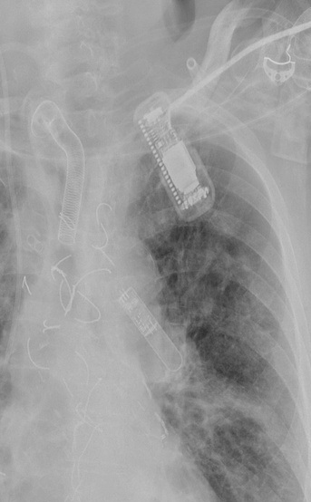 Confirm Rx DM3500</td>
<td align="center" valign="top"><b>Option 1</b>  SJM Confirm</td>
<td align="center" valign="top"><b>Option 2</b>  Reveal XT</td>
<td align="center" valign="top"><b>Option 3</b>  Ilivia 7 VR-T</td>
<td align="center" valign="top"><b>Option 4</b>  Reveal LINQ</td>
<td align="center" valign="top"><b>✅ Option 5</b>  Confirm Rx DM3500</td>
<td align="center" valign="middle"><b>Option 6</b>  <i>None of the above</i></td>
</tr></table>

### Q1644 · correct: option 1 · `Confirm Rx DM3500`

<table><tr>
<td align="center" valign="top"><b>Query</b> 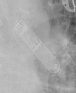 Confirm Rx DM3500</td>
<td align="center" valign="top"><b>✅ Option 1</b>  Confirm Rx DM3500</td>
<td align="center" valign="top"><b>Option 2</b>  Reveal XT</td>
<td align="center" valign="top"><b>Option 3</b>  Quadra Assura</td>
<td align="center" valign="top"><b>Option 4</b>  Reveal LINQ</td>
<td align="center" valign="top"><b>Option 5</b>  SJM Confirm</td>
<td align="center" valign="middle"><b>Option 6</b>  <i>None of the above</i></td>
</tr></table>

### Q1645 · correct: option 1 · `Attesta DR MRI SureScan`

<table><tr>
<td align="center" valign="top"><b>Query</b> 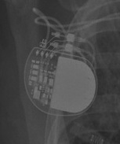 Attesta DR MRI SureScan</td>
<td align="center" valign="top"><b>✅ Option 1</b>  Attesta DR MRI SureScan</td>
<td align="center" valign="top"><b>Option 2</b>  Serena Quad CRT-P MRI ScureScan</td>
<td align="center" valign="top"><b>Option 3</b>  Enticos 4 DR</td>
<td align="center" valign="top"><b>Option 4</b>  Enitra 8 HF-T QP</td>
<td align="center" valign="top"><b>Option 5</b>  Q20 SR MRI SureScan</td>
<td align="center" valign="middle"><b>Option 6</b>  <i>None of the above</i></td>
</tr></table>

### Q1646 · correct: option 1 · `Attesta DR MRI SureScan`

<table><tr>
<td align="center" valign="top"><b>Query</b> 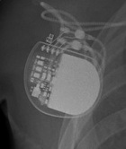 Attesta DR MRI SureScan</td>
<td align="center" valign="top"><b>✅ Option 1</b>  Attesta DR MRI SureScan</td>
<td align="center" valign="top"><b>Option 2</b>  Enticos 4 DR</td>
<td align="center" valign="top"><b>Option 3</b>  Serena Quad CRT-P MRI ScureScan</td>
<td align="center" valign="top"><b>Option 4</b>  Q20 SR MRI SureScan</td>
<td align="center" valign="top"><b>Option 5</b>  Enitra 8 HF-T QP</td>
<td align="center" valign="middle"><b>Option 6</b>  <i>None of the above</i></td>
</tr></table>

### Q1647 · correct: option 3 · `Ensura DR MRI SureScan`

<table><tr>
<td align="center" valign="top"><b>Query</b> 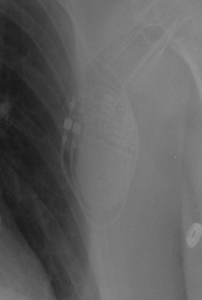 Ensura DR MRI SureScan</td>
<td align="center" valign="top"><b>Option 1</b>  Etrinsa 8 HF-T</td>
<td align="center" valign="top"><b>Option 2</b>  Enitra 6 DR-T</td>
<td align="center" valign="top"><b>✅ Option 3</b>  Ensura DR MRI SureScan</td>
<td align="center" valign="top"><b>Option 4</b>  Enticos 4 DR</td>
<td align="center" valign="top"><b>Option 5</b>  Attesta DR MRI SureScan</td>
<td align="center" valign="middle"><b>Option 6</b>  <i>None of the above</i></td>
</tr></table>

### Q1648 · correct: option 2 · `Mirro MRI VR SureScan`

<table><tr>
<td align="center" valign="top"><b>Query</b> 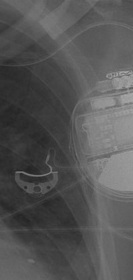 Mirro MRI VR SureScan</td>
<td align="center" valign="top"><b>Option 1</b>  Ecuro SR</td>
<td align="center" valign="top"><b>✅ Option 2</b>  Mirro MRI VR SureScan</td>
<td align="center" valign="top"><b>Option 3</b>  Compia MRI Quad CRT-D SureScan</td>
<td align="center" valign="top"><b>Option 4</b>  Ellipse VR</td>
<td align="center" valign="top"><b>Option 5</b>  Ilivia 7 HF-T QP</td>
<td align="center" valign="middle"><b>Option 6</b>  <i>None of the above</i></td>
</tr></table>

### Q1649 · correct: option 3 · `Attesta DR MRI SureScan`

<table><tr>
<td align="center" valign="top"><b>Query</b> 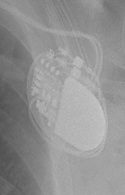 Attesta DR MRI SureScan</td>
<td align="center" valign="top"><b>Option 1</b>  Enticos 4 DR</td>
<td align="center" valign="top"><b>Option 2</b>  Ecuro SR</td>
<td align="center" valign="top"><b>✅ Option 3</b>  Attesta DR MRI SureScan</td>
<td align="center" valign="top"><b>Option 4</b>  Enticos 4 SR</td>
<td align="center" valign="top"><b>Option 5</b>  Q20 SR MRI SureScan</td>
<td align="center" valign="middle"><b>Option 6</b>  <i>None of the above</i></td>
</tr></table>

### Q1650 · correct: option 5 · `Enticos 4 SR`

<table><tr>
<td align="center" valign="top"><b>Query</b> 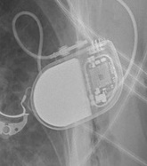 Enticos 4 SR</td>
<td align="center" valign="top"><b>Option 1</b>  Enitra 6 DR-T</td>
<td align="center" valign="top"><b>Option 2</b>  Enitra 8 HF-T QP</td>
<td align="center" valign="top"><b>Option 3</b>  Ecuro SR</td>
<td align="center" valign="top"><b>Option 4</b>  Enticos 4 DR</td>
<td align="center" valign="top"><b>✅ Option 5</b>  Enticos 4 SR</td>
<td align="center" valign="middle"><b>Option 6</b>  <i>None of the above</i></td>
</tr></table>

### Q1651 · correct: option 4 · `Ecuro SR`

<table><tr>
<td align="center" valign="top"><b>Query</b>  Ecuro SR</td>
<td align="center" valign="top"><b>Option 1</b>  Enitra 8 HF-T QP</td>
<td align="center" valign="top"><b>Option 2</b>  Attesta DR MRI SureScan</td>
<td align="center" valign="top"><b>Option 3</b>  Enticos 4 DR</td>
<td align="center" valign="top"><b>✅ Option 4</b>  Ecuro SR</td>
<td align="center" valign="top"><b>Option 5</b>  Enticos 4 SR</td>
<td align="center" valign="middle"><b>Option 6</b>  <i>None of the above</i></td>
</tr></table>

### Q1652 · correct: option 2 · `Inogen EL ICD VR`

<table><tr>
<td align="center" valign="top"><b>Query</b> 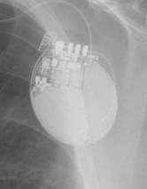 Inogen EL ICD VR</td>
<td align="center" valign="top"><b>Option 1</b>  Origen Mini ICD</td>
<td align="center" valign="top"><b>✅ Option 2</b>  Inogen EL ICD VR</td>
<td align="center" valign="top"><b>Option 3</b>  Charisma X4 CRT-D</td>
<td align="center" valign="top"><b>Option 4</b>  Quadra Assura</td>
<td align="center" valign="top"><b>Option 5</b>  Rivacor 5 VR-T DX</td>
<td align="center" valign="middle"><b>Option 6</b>  <i>None of the above</i></td>
</tr></table>

### Q1653 · correct: option 1 · `Enitra 8 HF-T QP`

<table><tr>
<td align="center" valign="top"><b>Query</b> 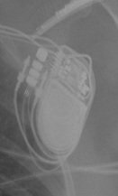 Enitra 8 HF-T QP</td>
<td align="center" valign="top"><b>✅ Option 1</b>  Enitra 8 HF-T QP</td>
<td align="center" valign="top"><b>Option 2</b>  Etrinsa 8 HF-T</td>
<td align="center" valign="top"><b>Option 3</b>  Quadra Allure MP</td>
<td align="center" valign="top"><b>Option 4</b>  Enticos 4 DR</td>
<td align="center" valign="top"><b>Option 5</b>  Enitra 6 DR-T</td>
<td align="center" valign="middle"><b>Option 6</b>  <i>None of the above</i></td>
</tr></table>

### Q1654 · correct: option 4 · `Attesta DR MRI SureScan`

<table><tr>
<td align="center" valign="top"><b>Query</b> 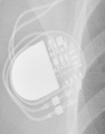 Attesta DR MRI SureScan</td>
<td align="center" valign="top"><b>Option 1</b>  Enticos 4 SR</td>
<td align="center" valign="top"><b>Option 2</b>  Ensura DR MRI SureScan</td>
<td align="center" valign="top"><b>Option 3</b>  Q20 SR MRI SureScan</td>
<td align="center" valign="top"><b>✅ Option 4</b>  Attesta DR MRI SureScan</td>
<td align="center" valign="top"><b>Option 5</b>  Ecuro SR</td>
<td align="center" valign="middle"><b>Option 6</b>  <i>None of the above</i></td>
</tr></table>

### Q1655 · correct: option 1 · `Q20 SR MRI SureScan`

<table><tr>
<td align="center" valign="top"><b>Query</b> 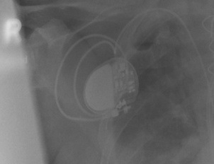 Q20 SR MRI SureScan</td>
<td align="center" valign="top"><b>✅ Option 1</b>  Q20 SR MRI SureScan</td>
<td align="center" valign="top"><b>Option 2</b>  Enticos 4 SR</td>
<td align="center" valign="top"><b>Option 3</b>  Attesta DR MRI SureScan</td>
<td align="center" valign="top"><b>Option 4</b>  Ecuro SR</td>
<td align="center" valign="top"><b>Option 5</b>  Enticos 4 DR</td>
<td align="center" valign="middle"><b>Option 6</b>  <i>None of the above</i></td>
</tr></table>

### Q1656 · correct: option 1 · `Ellipse VR`

<table><tr>
<td align="center" valign="top"><b>Query</b> 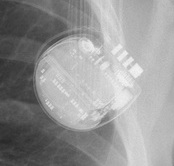 Ellipse VR</td>
<td align="center" valign="top"><b>✅ Option 1</b>  Ellipse VR</td>
<td align="center" valign="top"><b>Option 2</b>  Rivacor 5 VR-T DX</td>
<td align="center" valign="top"><b>Option 3</b>  SJM Confirm</td>
<td align="center" valign="top"><b>Option 4</b>  Q20 SR MRI SureScan</td>
<td align="center" valign="top"><b>Option 5</b> 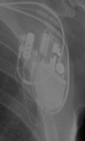 Quadra Allure MP</td>
<td align="center" valign="middle"><b>Option 6</b>  <i>None of the above</i></td>
</tr></table>

### Q1657 · correct: option 2 · `Charisma X4 CRT-D`

<table><tr>
<td align="center" valign="top"><b>Query</b> 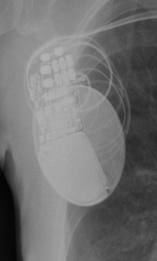 Charisma X4 CRT-D</td>
<td align="center" valign="top"><b>Option 1</b> 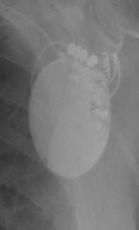 Inogen EL ICD VR</td>
<td align="center" valign="top"><b>✅ Option 2</b>  Charisma X4 CRT-D</td>
<td align="center" valign="top"><b>Option 3</b>  Rivacor 7 HF-T QP</td>
<td align="center" valign="top"><b>Option 4</b>  Origen Mini ICD</td>
<td align="center" valign="top"><b>Option 5</b>  Valitude X4 CRT-P</td>
<td align="center" valign="middle"><b>Option 6</b>  <i>None of the above</i></td>
</tr></table>

### Q1658 · correct: option 2 · `Ilivia 7 VR-T`

<table><tr>
<td align="center" valign="top"><b>Query</b> 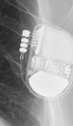 Ilivia 7 VR-T</td>
<td align="center" valign="top"><b>Option 1</b> 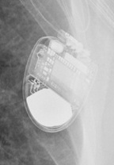 Mirro MRI VR SureScan</td>
<td align="center" valign="top"><b>✅ Option 2</b>  Ilivia 7 VR-T</td>
<td align="center" valign="top"><b>Option 3</b> 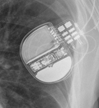 Rivacor 7 HF-T QP</td>
<td align="center" valign="top"><b>Option 4</b>  Compia MRI Quad CRT-D SureScan</td>
<td align="center" valign="top"><b>Option 5</b>  Ilivia 7 HF-T QP</td>
<td align="center" valign="middle"><b>Option 6</b>  <i>None of the above</i></td>
</tr></table>

### Q1659 · correct: option 5 · `Ensura DR MRI SureScan`

<table><tr>
<td align="center" valign="top"><b>Query</b> 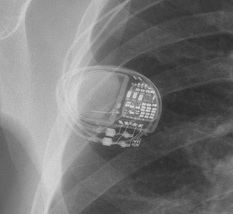 Ensura DR MRI SureScan</td>
<td align="center" valign="top"><b>Option 1</b>  Enitra 6 DR-T</td>
<td align="center" valign="top"><b>Option 2</b>  Attesta DR MRI SureScan</td>
<td align="center" valign="top"><b>Option 3</b>  Etrinsa 8 HF-T</td>
<td align="center" valign="top"><b>Option 4</b>  Valitude X4 CRT-P</td>
<td align="center" valign="top"><b>✅ Option 5</b>  Ensura DR MRI SureScan</td>
<td align="center" valign="middle"><b>Option 6</b>  <i>None of the above</i></td>
</tr></table>

### Q1660 · correct: option 4 · `Rivacor 5 VR-T DX`

<table><tr>
<td align="center" valign="top"><b>Query</b>  Rivacor 5 VR-T DX</td>
<td align="center" valign="top"><b>Option 1</b>  Ilivia 7 VR-T</td>
<td align="center" valign="top"><b>Option 2</b>  Ecuro SR</td>
<td align="center" valign="top"><b>Option 3</b>  Rivacor 7 HF-T QP</td>
<td align="center" valign="top"><b>✅ Option 4</b>  Rivacor 5 VR-T DX</td>
<td align="center" valign="top"><b>Option 5</b>  Ilivia 7 HF-T QP</td>
<td align="center" valign="middle"><b>Option 6</b>  <i>None of the above</i></td>
</tr></table>

### Q1661 · correct: option 3 · `Rivacor 5 VR-T DX`

<table><tr>
<td align="center" valign="top"><b>Query</b> 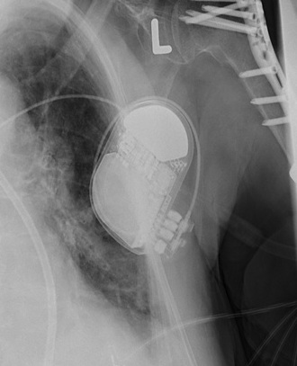 Rivacor 5 VR-T DX</td>
<td align="center" valign="top"><b>Option 1</b>  SJM Confirm</td>
<td align="center" valign="top"><b>Option 2</b>  Ilivia 7 HF-T QP</td>
<td align="center" valign="top"><b>✅ Option 3</b>  Rivacor 5 VR-T DX</td>
<td align="center" valign="top"><b>Option 4</b> 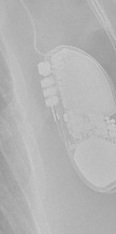 Ilivia 7 VR-T</td>
<td align="center" valign="top"><b>Option 5</b>  Rivacor 7 HF-T QP</td>
<td align="center" valign="middle"><b>Option 6</b>  <i>None of the above</i></td>
</tr></table>

### Q1662 · correct: option 3 · `Rivacor 5 VR-T DX`

<table><tr>
<td align="center" valign="top"><b>Query</b>  Rivacor 5 VR-T DX</td>
<td align="center" valign="top"><b>Option 1</b>  Mirro MRI VR SureScan</td>
<td align="center" valign="top"><b>Option 2</b>  Ilivia 7 VR-T</td>
<td align="center" valign="top"><b>✅ Option 3</b>  Rivacor 5 VR-T DX</td>
<td align="center" valign="top"><b>Option 4</b>  Compia MRI Quad CRT-D SureScan</td>
<td align="center" valign="top"><b>Option 5</b>  Rivacor 7 HF-T QP</td>
<td align="center" valign="middle"><b>Option 6</b>  <i>None of the above</i></td>
</tr></table>

### Q1663 · correct: option 3 · `Q20 SR MRI SureScan`

<table><tr>
<td align="center" valign="top"><b>Query</b> 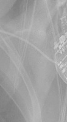 Q20 SR MRI SureScan</td>
<td align="center" valign="top"><b>Option 1</b>  Attesta DR MRI SureScan</td>
<td align="center" valign="top"><b>Option 2</b>  Confirm Rx DM3500</td>
<td align="center" valign="top"><b>✅ Option 3</b>  Q20 SR MRI SureScan</td>
<td align="center" valign="top"><b>Option 4</b>  Valitude X4 CRT-P</td>
<td align="center" valign="top"><b>Option 5</b>  Ensura DR MRI SureScan</td>
<td align="center" valign="middle"><b>Option 6</b>  <i>None of the above</i></td>
</tr></table>

### Q1664 · correct: option 1 · `Reveal LINQ`

<table><tr>
<td align="center" valign="top"><b>Query</b>  Reveal LINQ</td>
<td align="center" valign="top"><b>✅ Option 1</b>  Reveal LINQ</td>
<td align="center" valign="top"><b>Option 2</b>  SJM Confirm</td>
<td align="center" valign="top"><b>Option 3</b>  Reveal XT</td>
<td align="center" valign="top"><b>Option 4</b>  Confirm Rx DM3500</td>
<td align="center" valign="top"><b>Option 5</b>  Ilivia 7 VR-T</td>
<td align="center" valign="middle"><b>Option 6</b>  <i>None of the above</i></td>
</tr></table>

### Q1665 · correct: option 1 · `Rivacor 5 VR-T DX`

<table><tr>
<td align="center" valign="top"><b>Query</b> 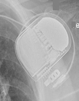 Rivacor 5 VR-T DX</td>
<td align="center" valign="top"><b>✅ Option 1</b>  Rivacor 5 VR-T DX</td>
<td align="center" valign="top"><b>Option 2</b>  Ilivia 7 HF-T QP</td>
<td align="center" valign="top"><b>Option 3</b>  Rivacor 7 HF-T QP</td>
<td align="center" valign="top"><b>Option 4</b>  Ilivia 7 VR-T</td>
<td align="center" valign="top"><b>Option 5</b>  Quadra Assura</td>
<td align="center" valign="middle"><b>Option 6</b>  <i>None of the above</i></td>
</tr></table>

### Q1666 · correct: option 6 (None of the above)

<table><tr>
<td align="center" valign="top"><b>Query</b>  Reveal LINQ</td>
<td align="center" valign="top"><b>Option 1</b>  Serena Quad CRT-P MRI ScureScan</td>
<td align="center" valign="top"><b>Option 2</b>  Ecuro SR</td>
<td align="center" valign="top"><b>Option 3</b>  Reveal XT</td>
<td align="center" valign="top"><b>Option 4</b> 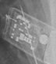 SJM Confirm</td>
<td align="center" valign="top"><b>Option 5</b> 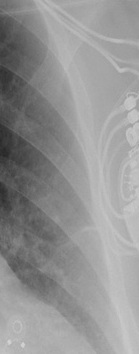 Valitude X4 CRT-P</td>
<td align="center" valign="middle"><b>✅ Option 6</b>  <i>None of the above</i></td>
</tr></table>

### Q1667 · correct: option 5 · `Reveal XT`

<table><tr>
<td align="center" valign="top"><b>Query</b> 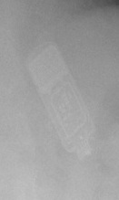 Reveal XT</td>
<td align="center" valign="top"><b>Option 1</b> 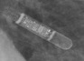 Reveal LINQ</td>
<td align="center" valign="top"><b>Option 2</b>  Confirm Rx DM3500</td>
<td align="center" valign="top"><b>Option 3</b>  Quadra Assura</td>
<td align="center" valign="top"><b>Option 4</b>  SJM Confirm</td>
<td align="center" valign="top"><b>✅ Option 5</b>  Reveal XT</td>
<td align="center" valign="middle"><b>Option 6</b>  <i>None of the above</i></td>
</tr></table>

### Q1668 · correct: option 2 · `Reveal LINQ`

<table><tr>
<td align="center" valign="top"><b>Query</b> 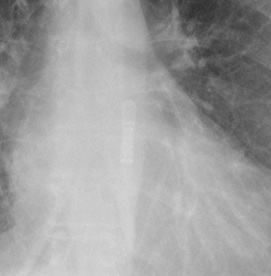 Reveal LINQ</td>
<td align="center" valign="top"><b>Option 1</b>  Ilivia 7 VR-T</td>
<td align="center" valign="top"><b>✅ Option 2</b>  Reveal LINQ</td>
<td align="center" valign="top"><b>Option 3</b>  Reveal XT</td>
<td align="center" valign="top"><b>Option 4</b>  Confirm Rx DM3500</td>
<td align="center" valign="top"><b>Option 5</b>  SJM Confirm</td>
<td align="center" valign="middle"><b>Option 6</b>  <i>None of the above</i></td>
</tr></table>

### Q1669 · correct: option 1 · `Reveal LINQ`

<table><tr>
<td align="center" valign="top"><b>Query</b> 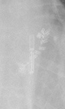 Reveal LINQ</td>
<td align="center" valign="top"><b>✅ Option 1</b>  Reveal LINQ</td>
<td align="center" valign="top"><b>Option 2</b>  SJM Confirm</td>
<td align="center" valign="top"><b>Option 3</b>  Reveal XT</td>
<td align="center" valign="top"><b>Option 4</b>  Confirm Rx DM3500</td>
<td align="center" valign="top"><b>Option 5</b>  Ensura DR MRI SureScan</td>
<td align="center" valign="middle"><b>Option 6</b>  <i>None of the above</i></td>
</tr></table>

### Q1670 · correct: option 3 · `Rivacor 5 VR-T DX`

<table><tr>
<td align="center" valign="top"><b>Query</b>  Rivacor 5 VR-T DX</td>
<td align="center" valign="top"><b>Option 1</b>  Ilivia 7 HF-T QP</td>
<td align="center" valign="top"><b>Option 2</b>  Quadra Allure MP</td>
<td align="center" valign="top"><b>✅ Option 3</b>  Rivacor 5 VR-T DX</td>
<td align="center" valign="top"><b>Option 4</b>  Rivacor 7 HF-T QP</td>
<td align="center" valign="top"><b>Option 5</b>  Ilivia 7 VR-T</td>
<td align="center" valign="middle"><b>Option 6</b>  <i>None of the above</i></td>
</tr></table>

### Q1671 · correct: option 4 · `Ensura DR MRI SureScan`

<table><tr>
<td align="center" valign="top"><b>Query</b> 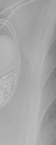 Ensura DR MRI SureScan</td>
<td align="center" valign="top"><b>Option 1</b>  Enticos 4 DR</td>
<td align="center" valign="top"><b>Option 2</b>  Etrinsa 8 HF-T</td>
<td align="center" valign="top"><b>Option 3</b>  Ecuro SR</td>
<td align="center" valign="top"><b>✅ Option 4</b>  Ensura DR MRI SureScan</td>
<td align="center" valign="top"><b>Option 5</b>  Valitude X4 CRT-P</td>
<td align="center" valign="middle"><b>Option 6</b>  <i>None of the above</i></td>
</tr></table>

### Q1672 · correct: option 6 (None of the above)

<table><tr>
<td align="center" valign="top"><b>Query</b> 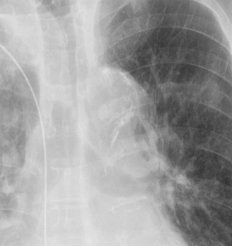 Enticos 4 SR</td>
<td align="center" valign="top"><b>Option 1</b>  SJM Confirm</td>
<td align="center" valign="top"><b>Option 2</b> 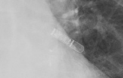 Reveal LINQ</td>
<td align="center" valign="top"><b>Option 3</b> 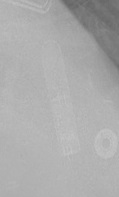 Confirm Rx DM3500</td>
<td align="center" valign="top"><b>Option 4</b>  Ilivia 7 VR-T</td>
<td align="center" valign="top"><b>Option 5</b>  Reveal XT</td>
<td align="center" valign="middle"><b>✅ Option 6</b>  <i>None of the above</i></td>
</tr></table>

### Q1673 · correct: option 5 · `Rivacor 5 VR-T DX`

<table><tr>
<td align="center" valign="top"><b>Query</b> 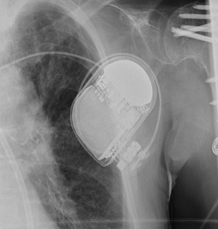 Rivacor 5 VR-T DX</td>
<td align="center" valign="top"><b>Option 1</b>  Ecuro SR</td>
<td align="center" valign="top"><b>Option 2</b>  Rivacor 7 HF-T QP</td>
<td align="center" valign="top"><b>Option 3</b>  Ilivia 7 VR-T</td>
<td align="center" valign="top"><b>Option 4</b>  Ilivia 7 HF-T QP</td>
<td align="center" valign="top"><b>✅ Option 5</b>  Rivacor 5 VR-T DX</td>
<td align="center" valign="middle"><b>Option 6</b>  <i>None of the above</i></td>
</tr></table>

### Q1674 · correct: option 1 · `Ilivia 7 VR-T`

<table><tr>
<td align="center" valign="top"><b>Query</b>  Ilivia 7 VR-T</td>
<td align="center" valign="top"><b>✅ Option 1</b>  Ilivia 7 VR-T</td>
<td align="center" valign="top"><b>Option 2</b>  Valitude X4 CRT-P</td>
<td align="center" valign="top"><b>Option 3</b>  Reveal XT</td>
<td align="center" valign="top"><b>Option 4</b>  SJM Confirm</td>
<td align="center" valign="top"><b>Option 5</b>  Enticos 4 DR</td>
<td align="center" valign="middle"><b>Option 6</b>  <i>None of the above</i></td>
</tr></table>

### Q1675 · correct: option 1 · `Q20 SR MRI SureScan`

<table><tr>
<td align="center" valign="top"><b>Query</b> 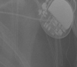 Q20 SR MRI SureScan</td>
<td align="center" valign="top"><b>✅ Option 1</b>  Q20 SR MRI SureScan</td>
<td align="center" valign="top"><b>Option 2</b>  Enitra 8 HF-T QP</td>
<td align="center" valign="top"><b>Option 3</b>  Enticos 4 DR</td>
<td align="center" valign="top"><b>Option 4</b>  Attesta DR MRI SureScan</td>
<td align="center" valign="top"><b>Option 5</b>  Ecuro SR</td>
<td align="center" valign="middle"><b>Option 6</b>  <i>None of the above</i></td>
</tr></table>

### Q1676 · correct: option 5 · `Compia MRI Quad CRT-D SureScan`

<table><tr>
<td align="center" valign="top"><b>Query</b> 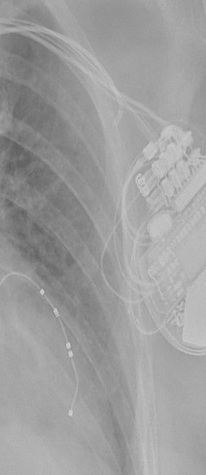 Compia MRI Quad CRT-D SureScan</td>
<td align="center" valign="top"><b>Option 1</b>  Mirro MRI VR SureScan</td>
<td align="center" valign="top"><b>Option 2</b>  Serena Quad CRT-P MRI ScureScan</td>
<td align="center" valign="top"><b>Option 3</b>  Valitude X4 CRT-P</td>
<td align="center" valign="top"><b>Option 4</b>  Ilivia 7 HF-T QP</td>
<td align="center" valign="top"><b>✅ Option 5</b>  Compia MRI Quad CRT-D SureScan</td>
<td align="center" valign="middle"><b>Option 6</b>  <i>None of the above</i></td>
</tr></table>

### Q1677 · correct: option 4 · `Confirm Rx DM3500`

<table><tr>
<td align="center" valign="top"><b>Query</b> 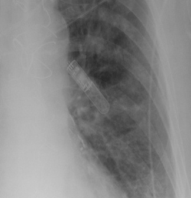 Confirm Rx DM3500</td>
<td align="center" valign="top"><b>Option 1</b>  Reveal LINQ</td>
<td align="center" valign="top"><b>Option 2</b>  Reveal XT</td>
<td align="center" valign="top"><b>Option 3</b>  SJM Confirm</td>
<td align="center" valign="top"><b>✅ Option 4</b>  Confirm Rx DM3500</td>
<td align="center" valign="top"><b>Option 5</b>  Ilivia 7 VR-T</td>
<td align="center" valign="middle"><b>Option 6</b>  <i>None of the above</i></td>
</tr></table>

### Q1678 · correct: option 4 · `Confirm Rx DM3500`

<table><tr>
<td align="center" valign="top"><b>Query</b> 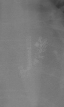 Confirm Rx DM3500</td>
<td align="center" valign="top"><b>Option 1</b>  Reveal LINQ</td>
<td align="center" valign="top"><b>Option 2</b>  SJM Confirm</td>
<td align="center" valign="top"><b>Option 3</b>  Reveal XT</td>
<td align="center" valign="top"><b>✅ Option 4</b>  Confirm Rx DM3500</td>
<td align="center" valign="top"><b>Option 5</b>  Quadra Allure MP</td>
<td align="center" valign="middle"><b>Option 6</b>  <i>None of the above</i></td>
</tr></table>

### Q1679 · correct: option 2 · `Q20 SR MRI SureScan`

<table><tr>
<td align="center" valign="top"><b>Query</b>  Q20 SR MRI SureScan</td>
<td align="center" valign="top"><b>Option 1</b>  Ilivia 7 VR-T</td>
<td align="center" valign="top"><b>✅ Option 2</b>  Q20 SR MRI SureScan</td>
<td align="center" valign="top"><b>Option 3</b>  Rivacor 7 HF-T QP</td>
<td align="center" valign="top"><b>Option 4</b>  Enticos 4 DR</td>
<td align="center" valign="top"><b>Option 5</b>  Attesta DR MRI SureScan</td>
<td align="center" valign="middle"><b>Option 6</b>  <i>None of the above</i></td>
</tr></table>

### Q1680 · correct: option 1 · `Attesta DR MRI SureScan`

<table><tr>
<td align="center" valign="top"><b>Query</b>  Attesta DR MRI SureScan</td>
<td align="center" valign="top"><b>✅ Option 1</b>  Attesta DR MRI SureScan</td>
<td align="center" valign="top"><b>Option 2</b>  SJM Confirm</td>
<td align="center" valign="top"><b>Option 3</b>  Enticos 4 DR</td>
<td align="center" valign="top"><b>Option 4</b>  Valitude X4 CRT-P</td>
<td align="center" valign="top"><b>Option 5</b>  Q20 SR MRI SureScan</td>
<td align="center" valign="middle"><b>Option 6</b>  <i>None of the above</i></td>
</tr></table>

### Q1681 · correct: option 5 · `Confirm Rx DM3500`

<table><tr>
<td align="center" valign="top"><b>Query</b>  Confirm Rx DM3500</td>
<td align="center" valign="top"><b>Option 1</b>  Reveal XT</td>
<td align="center" valign="top"><b>Option 2</b>  SJM Confirm</td>
<td align="center" valign="top"><b>Option 3</b>  Ilivia 7 VR-T</td>
<td align="center" valign="top"><b>Option 4</b>  Reveal LINQ</td>
<td align="center" valign="top"><b>✅ Option 5</b>  Confirm Rx DM3500</td>
<td align="center" valign="middle"><b>Option 6</b>  <i>None of the above</i></td>
</tr></table>

### Q1682 · correct: option 4 · `Q20 SR MRI SureScan`

<table><tr>
<td align="center" valign="top"><b>Query</b>  Q20 SR MRI SureScan</td>
<td align="center" valign="top"><b>Option 1</b>  Enticos 4 SR</td>
<td align="center" valign="top"><b>Option 2</b>  Enticos 4 DR</td>
<td align="center" valign="top"><b>Option 3</b>  Ensura DR MRI SureScan</td>
<td align="center" valign="top"><b>✅ Option 4</b>  Q20 SR MRI SureScan</td>
<td align="center" valign="top"><b>Option 5</b>  Ecuro SR</td>
<td align="center" valign="middle"><b>Option 6</b>  <i>None of the above</i></td>
</tr></table>

### Q1683 · correct: option 2 · `Confirm Rx DM3500`

<table><tr>
<td align="center" valign="top"><b>Query</b>  Confirm Rx DM3500</td>
<td align="center" valign="top"><b>Option 1</b>  Reveal XT</td>
<td align="center" valign="top"><b>✅ Option 2</b>  Confirm Rx DM3500</td>
<td align="center" valign="top"><b>Option 3</b>  SJM Confirm</td>
<td align="center" valign="top"><b>Option 4</b>  Quadra Assura</td>
<td align="center" valign="top"><b>Option 5</b>  Reveal LINQ</td>
<td align="center" valign="middle"><b>Option 6</b>  <i>None of the above</i></td>
</tr></table>

